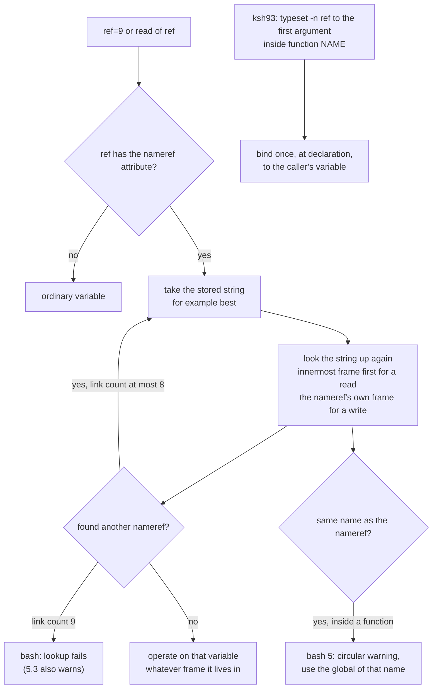

# Namerefs and Dynamic Scope

> [!summary] Claim
> A bash nameref stores a variable name, not a binding, and re-resolves that name under dynamic scope at every use, so any function that shares a local name with its caller, or whose name argument comes from input, silently writes the wrong variable or runs code.

Part of [Bash](README.md) in [Shell and Unix Engineering](../README.md).

## TL;DR

- Mechanism: `declare -n ref=name` (bash 4.3+) sets the `att_nameref` attribute on `ref` and stores the string `name`; every read, assignment, `unset`, and attribute change on `ref` looks `name` up again through the stack of function variable contexts, at most 8 links deep.
- Rule: a function that takes an output variable name must keep all of its own locals under a private prefix and must reject any name that is not a plain identifier before binding it.
- Trap: if the caller passes a name that the callee also declares local (`best`, `i`, `out`), the nameref finds the callee's local and the caller's variable is never written; there is no error and no warning.
- Portability fact: POSIX.1-2024 lists `local`, `typeset`, `declare`, and `nameref` as names whose results are unspecified (XCU 2.9.1.4); only bash 4.3+, ksh93, and mksh have `typeset -n`, released zsh through 5.9.2 does not (as of 2026-11), and ksh93 binds the name once at declaration where bash and mksh re-resolve it.
- When not to use it: across a library boundary you do not control, in `/bin/sh` scripts, or on macOS's bash 3.2; return data on standard output, through bash 5.3's `${| cmd; }` (which needs no caller-chosen name), or move the logic to a language with real references.

## Mental model



A plain variable access stops at the first box, but a nameref access turns into a second name lookup that starts from scratch.
That lookup walks the same dynamic-scope chain any other name would, from the innermost function frame down to the globals, so it lands on whatever variable of that name is visible at that moment, which can be the callee's own local.
If the variable found is itself a nameref, the loop repeats, and bash gives up after eight links.
A nameref whose stored name is its own name is a loop; bash 5.0 and later break it by jumping to the global variable of that name.
ksh93 takes the other branch at the bottom of the diagram: in a `function NAME { }` body, `typeset -n ref=$1` resolves `$1` in the caller's scope once, and later uses go straight to that variable.

## How it works

### Dynamic scope is a stack of hash tables

Bash keeps variables in a linked list of `VAR_CONTEXT` structures (`bash-5.3 variables.h, struct var_context`), each holding a `HASH_TABLE *table`, a `scope` number (0 for globals), and `up` and `down` pointers.
The global variable `shell_variables` points at the innermost context and `global_variables` at the outermost.
Calling a shell function runs `push_context` from `execute_function` (`bash-5.3 execute_cmd.c, execute_function`), which saves the positional parameters, increments `variable_context`, and pushes a new `VC_FUNCENV` context (`bash-5.3 variables.c, push_context` and `push_var_context`); returning pops it and flushes its table (`bash-5.3 variables.c, pop_var_context`).
`local` and `declare` inside a function create the variable in the current function's table (`bash-5.3 variables.c, make_local_variable`), which allocates the table on first use.

Lookup is a linear walk: `var_lookup` loops `for (vc = vcontext; vc; vc = vc->down)` and returns the first table that holds the name (`bash-5.3 variables.c, var_lookup`).
That loop is the whole of dynamic scope.
A function sees its caller's locals because the caller's table is further down the same chain, and a write to a name that no frame holds lands in the global table.
The bash manual states the consequence directly: "visible variables and their values are a result of the sequence of function calls that caused execution to reach the current function" (bash-5.3 `doc/bash.1`, FUNCTIONS).
The callee-sees-caller rule and the restore-on-return rule are covered in [[Functions-and-Scope]]; this note covers what namerefs and `unset` do on top of that chain.

POSIX does not standardize any of it.
XCU 2.9.1.4 lists `declare`, `local`, `nameref`, and `typeset` among the command names whose results are unspecified (POSIX.1-2024 XCU 2.9.1.4).
The rationale records that local variables "were removed because they do not fit the simple model developed for functions" and asks implementations to reserve `local` and `typeset` for a future standard (POSIX.1-2024 XRAT C.2.9.5).

### A nameref is an attribute plus a stored name

`declare -n` sets `att_nameref` (`0x0000800`, `bash-5.3 variables.h`) and stores the target name as the variable's value, which `nameref_cell` reads back.
The manual: "Whenever the nameref variable is referenced, assigned to, unset, or has its attributes modified (other than using or changing the nameref attribute itself), the operation is actually performed on the variable specified by the nameref variable's value" (bash-5.3 `doc/bash.1`, PARAMETERS).
`declare` checks the value when it is assigned: it must be an identifier or an array reference (`bash-5.3 general.c, valid_nameref_value`), which is why `declare -n r=1` fails with "invalid variable name for name reference" in bash 4.4 and later.
An array reference is accepted, and that is where the security problem starts (see below).

Reads go through `find_variable`, which calls `find_variable_internal` for the nameref itself and then `find_variable_nameref` to chase the chain (`bash-5.3 variables.c, find_variable`).
`find_variable_nameref` counts links and returns the sentinel `nameref_maxloop_value` when `level > NAMEREF_MAX`, and `NAMEREF_MAX` is 8 (`bash-5.3 variables.h`; the same value is in `bash-4.3 variables.h`).
Each hop calls `find_variable_internal (newname, flags)`, which starts again at `shell_variables`, the innermost frame.
That one line is the root of the shadowing bug: the target name is resolved from wherever execution is now, not from where the nameref was declared.

Assignments go through `bind_variable`, which walks the frames, finds the nameref, and then resolves it with `find_variable_nameref_context (v, vc, &nvc)` starting at the frame where the nameref was found, with the source comment "This starts at the context where we found the nameref" (`bash-5.3 variables.c, bind_variable`).
Reads and writes therefore start their search in different frames.
The lab's `asym` mode shows the consequence: when a callee declares a local with the target's name, `$ref` in the callee reads the callee's local while `ref=written` in the same callee skips that local and writes the global, the first `target` below the frame that holds the nameref.
mksh resolves both directions from the innermost frame, and ksh93 never lets the callee see the caller's `ref` at all.

### Loops and self-references

`declare` rejects a nameref to its own name at global scope ("nameref variable self references not allowed") and only warns inside a function (`bash-5.3 builtins/declare.def`, the `check_selfref` branch, which says "disallow self references at global scope, warn at function scope").
Inside a function the loop is detected at use: when the next lookup returns the same variable, `find_variable_nameref` prints "circular name reference" and, under the comment "provisional change - circular refs go to global scope for resolution, without namerefs", returns `find_global_variable_noref (v->name)` (`bash-5.3 variables.c, find_variable_nameref`).
That change shipped in bash 5.0 ("A nameref name resolution loop in a function now resolves to a variable by that name in the global scope", bash `CHANGES`, 5.0-alpha item i).
The lab confirms the version split: given a caller with `local out` and a callee doing `typeset -n out=$1` with `$1` equal to `out`, bash 4.4 writes the caller's local and bash 5.1 to 5.3 write the global; bash 4.3 and 5.0, run by hand in the official `bash:4.3` and `bash:5.0` images, fall on the same sides.

### unset under dynamic scope

`unset` uses the same chain.
`makunbound` removes the first matching entry walking down from the current frame (`bash-5.3 variables.c, makunbound`).
When that entry is a local of the current function, bash keeps the entry and marks it `att_invisible`, so the name reads as unset and a later assignment stays local.
When the entry belongs to a calling function, bash deletes it outright, which makes the next variable down the chain, often a global, visible again; the shopt `localvar_unset` (bash 5.0+) makes that case behave like the same-scope case (`bash-5.3 variables.c, makunbound`, the `localvar_unset && old_var->context < variable_context` test).
The manual documents both halves (bash-5.3 `doc/bash.1`, FUNCTIONS and the `localvar_unset` shopt entry).
The "upvar" technique for returning values depends on exactly this cross-frame deletion: bash-completion's `_comp_upvars` is documented as "Assign variables one scope above the caller", its usage comment puts `local varname [varname ...] &&` in front of the call, and its `-v` branch runs `unset -v "$2" && eval "$2"=\"\$3\"` (bash-completion `bash_completion`, `_comp_upvars`).
The required `local varname` in the function that calls `_comp_upvars` is what the `unset` consumes; without it, the `unset` deletes the very variable the value was meant for and `eval` creates a global, which the lab's `upvar` mode measures.

### Locals that inherit

A new local in bash starts unset and inherits only the export attribute: `new_var->attributes = exported_p (old_var) ? att_exported : 0` (`bash-5.3 variables.c, make_local_variable`).
So `export E; f() { local E; E=x; env; }` hands `E=x` to the child, which the lab confirms for bash, dash, and BusyBox ash.
dash goes further and copies the value too: "When a variable is made local, it inherits the initial value and exported and readonly flags from the variable with the same name in the surrounding scope" (dash 0.5.12 `dash.1`), which is why a fresh `local v` in dash reads as the outer value and why `local ro=x` over a readonly `ro` is an assignment to a readonly variable there.
`shopt -s localvar_inherit` (bash 5.0) and `local -I` (bash 5.1) copy the outer value and attributes, except the nameref attribute (`bash-5.3 doc/bash.1`, `declare -I` and `localvar_inherit`; bash `CHANGES` 5.0-alpha item o and 5.1-alpha item bb).
`make_local_variable` also refuses a local copy of a readonly global, with the source comment "disallow local copies of readonly global variables (since I believe that this could be a security hole)" (`bash-5.3 variables.c, make_local_variable`).

### Indirection without namerefs

`${!name}` is older indirect expansion; on a nameref it instead expands to the stored name, "for compatibility" (bash-5.3 `doc/bash.1`, Parameter Expansion), which `parameter_brace_expand_indir` implements by returning `nameref_cell (v)` (`bash-5.3 subst.c, parameter_brace_expand_indir`).
The lab shows bash, ksh93, and mksh all give the target name for `${!ref}`.
zsh's equivalent read form is the `(P)` expansion flag, and zsh's development documentation says "Zsh versions greater than 5.9.0 are required for `typeset -n`" (zsh `Doc/Zsh/params.yo`, Named References), meaning the development line, not the 5.9.x maintenance releases: the released tags end at `zsh-5.9.2` (GitHub tags API, fetched 2026-11-10), the NEWS file lists named references under "Changes since 5.9" for 5.10, and the matrix's zsh 5.9 and the host's 5.9.2 both reject `typeset -n` with "bad option: -n".

### Value substitution: a return channel without a name

bash 5.3 added `${ command; }` and `${| command; }`, "to capture the output of COMMAND without forking a child process and using pipes" (bash `CHANGES`, 5.3-alpha item s).
The `|` form "expands to the value of the `REPLY` shell variable after command executes", and bash "creates `REPLY` as an initially-unset local variable when command executes, and restores `REPLY` to the value it had before" (bash-5.3 `doc/bash.1`, Command Substitution).
mksh has had the same construct as a "valsub", which evaluates "to whatever the, initially empty, expression-local variable `REPLY` is set to" (mksh `mksh.1`, Command Substitution).
A function written as `f() { REPLY=...; }` and called as `x=${| f; }` returns a value with no fork, no subshell, and no caller-supplied variable name, so there is nothing to shadow and nothing to inject; the lab's `valsub` mode shows the value arriving, the function's side effect landing in the same shell, and the outer `REPLY` restored, in bash 5.3 and mksh only.

### ksh93, mksh, and zsh-development semantics

ksh93: "The value of the variable at the time of that command becomes the variable that will be referenced whenever the nameref variable is used," and, as "a special exception to the static scoping provided by shell functions declared with the `function` name syntax", `typeset -n ref=$1` reaches the caller's variable, but only when the positional parameter is assigned directly in the declaring command (ksh93u+m `sh.1`, Name References).
mksh: `-n` creates "a bound variable (name reference)" whose accesses go to the named variable "in the current scope", the manual marks that as different from ksh93, and the value "is lazily evaluated at the time name is accessed" (mksh `mksh.1`, `typeset -n`); mksh's `nameref` is a predefined alias for `\builtin typeset -n`.
zsh development sources add `typeset -n` with a `-u` option "to force a named reference to refer to the outer scope, even if a local has already been declared" (zsh `Doc/Zsh/expn.yo`, Named References), which is the fix bash lacks; this is documentation for an unreleased version and the lab cannot test it.

## Numbers and limits

| Quantity | Value | Source |
| --- | --- | --- |
| bash nameref chain limit | 8 links resolve, the 9th fails | `NAMEREF_MAX 8` in `bash-5.3 variables.h` and `bash-4.3 variables.h`; lab `chain` test |
| bash response at 9 links | expands as unset, silently in 4.3 to 5.2; 5.3 adds "maximum nameref depth (8) exceeded" | lab `chain` test (4.4, 5.1, 5.2, 5.3); bash 4.3 measured by hand in the `bash:4.3` image, 2026-11-10 |
| ksh93 and mksh chain | 9 links resolve in the lab; 200 and 1100 links resolved by hand | lab `chain` test; hand run in the Debian image, 2026-11-10 |
| Cost of reading a global from depth 1000, one local per frame | about 16 ns per frame per read (3.40 s vs 0.28 s for 200000 reads) | measured on the host, bash 5.3.15, Apple M3 Pro, macOS 27.2, 2026-11-10, best of 3 runs |
| Same, frames without locals | about 4 ns per frame per read (1.17 s vs 0.30 s) | same host measurement |
| Reading through a one-link nameref vs directly, depth 0 | 0.29 s vs 0.28 s for 200000 reads, within run-to-run noise | same host measurement |
| `${\| f; }` value substitution | bash 5.3 and mksh R59; no fork | bash `CHANGES` 5.3-alpha item s; lab `valsub` test |
| First bash with `declare -n` and `test -R` | 4.3 | bash `CHANGES`, 4.3-alpha item w |
| `declare -g` | 4.2 | bash `CHANGES`, 4.2-alpha item e; lab `declare-g` test (3.2 rejects `-g`) |
| `localvar_inherit`, `localvar_unset` | 5.0 | bash `CHANGES` 5.0-alpha item o, 5.0-beta2 item c; lab tests |
| `local -I` / `declare -I` | 5.1 | bash `CHANGES` 5.1-alpha item bb; lab `inherit` test |
| Circular nameref in a function goes to the global | 5.0 | bash `CHANGES` 5.0-alpha item i; lab `circular-local` test |

The per-frame cost is the price of `var_lookup` visiting every frame between the reader and the global table, so deep recursion makes every global access slower in proportion to depth.

## Portability

Every cell below is asserted by the lab unless it names another source.
The matrix runs bash 3.2, 4.4, 5.1, 5.2, and 5.3; the bash 4.3 and 5.0 rows of this column come from hand runs of the same probes in the official `bash:4.3` and `bash:5.0` container images and agree with the lab wherever a version branch is not shown.
ksh93 has no `local`, so its `local` rows are n/a; the lab asserts what happens instead (the call fails with status 127 and every name stays global).

| Behavior | POSIX sh | bash 3.2 (macOS) | bash 4.3 to 5.3 | zsh 5.9 | `zsh --emulate sh` 5.9 | dash 0.5.12 | ksh93 (u+ 2012, u+m 1.0.10) | mksh R59 | yash 2.58.1 | posh 0.14.1 | BusyBox ash 1.37.0 |
| --- | --- | --- | --- | --- | --- | --- | --- | --- | --- | --- | --- |
| `typeset -n` | unspecified (XCU 2.9.1.4) | no | yes | no | no | no | yes | yes | no | no | no |
| Target name resolved | n/a | n/a | at each use, dynamic scope | n/a | n/a | n/a | once, at declaration | at each use | n/a | n/a | n/a |
| Callee local with the caller's name captures the write | n/a | n/a | yes | n/a | n/a | n/a | no | yes | n/a | n/a | n/a |
| Subscript in the target (`a[i]`) | n/a | n/a | evaluated at each use | n/a | n/a | n/a | fixed at declaration | evaluated at each use | n/a | n/a | n/a |
| `$(...)` inside a target subscript runs | n/a | n/a | yes | n/a | n/a | n/a | no, "arithmetic syntax error" | yes | n/a | n/a | n/a |
| Links resolved | n/a | n/a | 8 | n/a | n/a | n/a | 9 or more | 9 or more | n/a | n/a | n/a |
| `unset -n` | n/a | n/a | yes | n/a | n/a | n/a | yes | no (usage error ends the script) | n/a | n/a | n/a |
| Nameref as `for` variable | n/a | n/a | yes | n/a | n/a | n/a | yes | no ("empty nameref target") | n/a | n/a | n/a |
| Nameref to `1` | n/a | n/a | refused | n/a | n/a | n/a | refused | binds `$1` | n/a | n/a | n/a |
| `typeset -p ref` shows | n/a | n/a | the reference | n/a | n/a | n/a | the reference | the target | n/a | n/a | n/a |
| `local` built-in | unspecified (XCU 2.9.1.4) | yes | yes | yes | yes | yes | no (status 127) | yes | yes | yes | yes |
| Callee `unset` of a caller's local | n/a | deletes it, outer value shows | deletes it, outer value shows | hides it | hides it | hides it | n/a | deletes it | deletes it | hides it | hides it |
| `unset` of own local, then assign | n/a | stays local | stays local | stays local | stays local | stays local | n/a | writes the global | writes the global | stays local | stays local |
| Child sees a local that shadows an exported name | n/a | the local | the local | nothing | nothing | the local | n/a | the global | the global | the global | the local |
| `local` over a readonly global | n/a | refused, function continues | refused, function continues | allowed | allowed | fatal, exit 2 | n/a | allowed | allowed | allowed | fatal, exit 2 |
| `declare -g` in a callee | n/a | no `-g` | writes the global, skipping the caller's local | writes the caller's local | writes the caller's local | no `declare` | no `declare` | no `declare` | no `declare` | no `declare` | no `declare` |
| A fresh `local v` reads as | n/a | unset | unset (`localvar_inherit` 5.0+ and `local -I` 5.1+ copy the outer value) | set, empty | unset | the outer value | n/a | unset | unset | unset | unset |
| `${\| f; }` returns `REPLY` without a fork | n/a | no | 5.3 only | no | no | no | no | yes | no | no | no |

No utility behavior is involved; the lab uses `env` and `grep` only to observe what a child process receives.

## Worked example

The [lab](../labs/04-namerefs-and-dynamic-scope/) returns `max(3, 9, 4)` into a variable the caller names, three ways.
`outparam_lib.sh` holds the two nameref versions, verbatim:

```bash
# shellcheck shell=bash
# outparam_lib.sh: two ways to return a value into a variable the caller names.
# Sourced by outparam.sh only after it has proved that `typeset -n` works,
# so shells without namerefs never parse this file.
# The `function NAME {` form is deliberate: it is the form in which ksh93 gives
# typeset static scope, and bash and mksh treat it exactly like NAME().

# naive_max OUT N...: store the largest N in the variable named OUT.
# Bug: OUT is resolved when it is used, so a caller variable that shares a
# name with one of these locals (best, n, out) is shadowed and never written.
function naive_max {
  typeset -n out=$1
  typeset best=$2 n
  shift 2
  for n in "$@"; do
    if ((n > best)); then
      best=$n
    fi
  done
  # shellcheck disable=SC2034 # out is a nameref: this assigns the caller's variable
  out=$best
}

# guarded_max OUT N...: the same, but OUT must be a plain identifier outside the
# function's private prefix, so neither shadowing nor subscript injection can happen.
function guarded_max {
  case $1 in
    '' | [0123456789]* | *[!ABCDEFGHIJKLMNOPQRSTUVWXYZabcdefghijklmnopqrstuvwxyz0123456789_]*)
      printf 'guarded_max: not an identifier: %s\n' "$1" >&2
      return 2
      ;;
    _gm_*)
      printf 'guarded_max: reserved name: %s\n' "$1" >&2
      return 2
      ;;
    *) ;;
  esac
  typeset -n _gm_out=$1
  typeset _gm_best=$2 _gm_n
  shift 2
  for _gm_n in "$@"; do
    if ((_gm_n > _gm_best)); then
      _gm_best=$_gm_n
    fi
  done
  # shellcheck disable=SC2034 # _gm_out is a nameref: this assigns the caller's variable
  _gm_out=$_gm_best
}
```

The driver, simplified excerpt of `outparam.sh` (the real file adds usage, the `is_identifier` helper, and the eval-based `portable_max`):

```sh
case $mode in
  naive | guarded)
    if ! (typeset -n lab_ref=lab_target) >/dev/null 2>&1; then
      printf 'namerefs: unsupported\n'
      exit 3
    fi
    . "$lib"
    ;;
  portable) ;;
esac
if is_identifier "$name"; then
  eval "$name=preset"
fi
"${mode}_max" "$name" 3 9 4
printf 'status=%s\n' "$?"
```

What the lab asserts, run from a scratch directory:

```text
$ bash outparam.sh naive result
status=0
result=9
$ bash outparam.sh naive best
status=0
best=preset
$ ksh93 outparam.sh naive best
status=0
best=9
$ bash outparam.sh guarded best
status=0
best=9
$ dash outparam.sh portable best
status=0
best=9
$ bash outparam.sh naive 'a[$(touch pwned)0]'; ls pwned
status=0
pwned
$ bash outparam.sh guarded 'a[$(touch pwned)0]'; ls pwned
guarded_max: not an identifier: a[$(touch pwned)0]
status=2
ls: pwned: No such file or directory
```

`naive best` is the shadowing bug: the nameref `out` resolves `best` from the innermost frame, finds `naive_max`'s own `typeset best`, and the caller's `best` keeps `preset`, with status 0.
ksh93 gets it right with the same source because its `typeset -n out=$1` in a `function` body binds to the caller's `best` at declaration.
The injection run creates `pwned` in bash and mksh because the nameref's value `a[$(touch pwned)0]` is a valid array reference, and assigning through it evaluates the subscript (`bash-5.3 variables.c, bind_variable` calls `assign_array_element (nameref_cell (nv), ...)`).
The guarded version fixes both bugs with two checks before the binding: an identifier test that spells out every allowed character instead of using a bracket range or a character class, so its meaning cannot change with the locale, and a refusal of its own `_gm_` prefix.
The `portable` mode uses the same checks in front of `eval` and passes in every shell in the matrix, which is the fallback for `/bin/sh`, bash 3.2, zsh, dash, posh, yash, and BusyBox.
The ls error text is macOS's; the lab asserts the file's absence, not the message.

## Pitfalls

> [!warning] A callee local with the caller's variable name
> Trigger: `f() { local -n out=$1; local i; ...; out=$result; }` called as `f i` or `f result`.
> Symptom: the caller's variable keeps its old value and `f` returns 0; the write went to `f`'s own local (lab: `naive best` prints `best=preset` in bash and mksh).
> Fix: give every local in a nameref-taking function a private prefix (`_f_out`, `_f_i`) and reject names that start with it, as `guarded_max` does; BashFAQ/006 states the limit plainly for bash, where a nameref "will look for whatever variable of that name is visible by the current function" and "There is no way to override this."

> [!warning] Read and write through the same nameref reach different variables
> Trigger: function A declares `local -n ref=target` and calls B, which declares `local target`.
> Symptom: in B, `$ref` reads B's local while `ref=x` writes A's or the global `target` (lab `asym`), so `ref=$ref.suffix` reads one variable and writes another.
> Fix: never let a function that can see a nameref declare a local with the target's name; with a prefix convention this cannot happen by accident.

> [!warning] Self-named nameref falls through to the global
> Trigger: `f() { local -n out=$1; out=x; }` called as `f out` from a function that has its own `local out`.
> Symptom: bash 5.x prints "circular name reference" warnings and writes the global `out`, not the caller's local; bash 4.4 writes the caller's local (lab `circular-local`; 4.3 the same in a hand run), so the same script changes behavior across an upgrade.
> Fix: the prefix rule again; and treat any "circular name reference" warning in CI logs as a bug, not noise.

> [!warning] Subscript injection through the target name
> Trigger: the name passed to a nameref function comes from input, a config file, or a filename.
> Symptom: a value such as `a[$(cmd)0]` passes `declare -n`'s validity check because it is an array reference, and the first assignment runs `cmd` (lab: the `pwned` file appears in bash and mksh; ksh93 refuses with "arithmetic syntax error").
> Fix: validate the name against a literal identifier character list before `declare -n`; BashFAQ/006 warns that "If an end user can populate the ref variable with arbitrary strings, the result can be unexpected code injection."
> The same subscript-evaluation class is covered in [[Command-Injection]] and [[Arithmetic-Expansion]].

> [!warning] unset in a helper deletes its caller's local
> Trigger: an upvar-style helper does `unset -v "$1"; eval "$1=\$value"` without the documented `local "$1"` in the function that calls it.
> Symptom: in bash, mksh, and yash the `unset` deletes the caller's local and `eval` creates a global, so the value leaks to the top level (lab `upvar`: `top_result=computed`); dash, BusyBox, posh, and zsh only hide the local and the value stays local.
> Fix: follow bash-completion's contract (`local varname && _comp_upvars -v varname value`), or set `shopt -s localvar_unset` in bash 5.0+, whose effect bash-completion's own `_comp_unlocal` has to switch off temporarily to unshadow a global.

> [!warning] unset of your own local exposes the global in mksh and yash
> Trigger: `f() { local x=1; unset x; x=2; }` in a script that is also run by mksh or yash.
> Symptom: after the `unset`, `$x` shows the global's value and `x=2` overwrites the global (lab `unset-own`: `top=again`).
> Fix: do not rely on `unset` to clear a local; assign the empty string, or test with `${x+set}` on a variable you never unset.

> [!warning] The 8-link limit fails silently before bash 5.3
> Trigger: namerefs passed through more than eight layers of helpers, each declaring `local -n ref=$1`.
> Symptom: bash 4.3 to 5.2 expand the reference as unset with no message; 5.3 prints "maximum nameref depth (8) exceeded" (lab `chain`).
> Fix: resolve the name once at the API boundary and pass that name, not the reference, further down; in bash `${!ref}` on a nameref expands to the last name in the chain (`bash-5.3 subst.c, parameter_brace_expand_indir` calls `find_variable_last_nameref`).

> [!warning] declare -g does not mean what it says inside nested functions
> Trigger: a helper uses `declare -g x=v` to set a "global" while a caller has `local x`.
> Symptom: bash writes the global table, but the helper and its caller still read the caller's local (`writer_sees=caller_local`), and the new value appears only after the caller returns; zsh's `-g` instead writes the caller's local (lab `declare-g`).
> Fix: pick names for globals that no function uses as a local, or return values explicitly.

> [!warning] A local over a readonly global is refused but the function continues
> Trigger: `readonly LOG_LEVEL=info` at top level and `f() { local LOG_LEVEL=debug; ...; }`.
> Symptom: bash prints "readonly variable", `local` returns 1, and `f` runs on with the global value; dash and BusyBox ash abort the whole script with status 2, dash because its `local` inherits the readonly flag (dash 0.5.12 `dash.1`); zsh, mksh, posh, and yash quietly create the local (lab `readonly-local`).
> Fix: do not reuse readonly names for locals, and check the status of `local` when the name is not under your control.

> [!warning] ShellCheck reports nameref writes as unused
> Trigger: `local -n ref=$1; ref=5`.
> Symptom: ShellCheck 0.11.0 reports SC2034 ("ref appears unused") on the assignment and SC2154 ("result is referenced but not assigned") at the caller (run here, 2026-11-10), and a reviewer who trusts the linter deletes the line or disables SC2034 file-wide.
> Fix: disable SC2034 on the one assignment line with a reason, as `outparam_lib.sh` does.

## Security and robustness

Treat a variable name received from outside a function as code, because in bash and mksh it is: the nameref target accepts an array reference, and the subscript is evaluated on every use.
Validate with an identifier pattern that lists its characters explicitly, as the lab's `is_identifier` does, and do it before `declare -n`, because `declare -n` itself accepts the dangerous form.
Reject your own private prefix, so a caller cannot alias your internals by naming them.
Bash refuses to make a local copy of a readonly global and its source calls that refusal a guard against "a security hole" (`bash-5.3 variables.c, make_local_variable`), but the refusal is a status of 1, not an exit, so a function that assumed its local took effect carries on with the global value.
A local that shadows an exported variable is exported to children in bash, dash, and BusyBox, invisible in zsh, and replaced by the global's value in mksh, posh, and yash, so do not use `local PATH=...` or `local LC_ALL=...` to control what a child process sees in portable code; use a prefix assignment on the command (`PATH=/safe/bin cmd`) instead.
Deep recursion makes every global lookup cost proportional to depth (about 16 ns per frame per read on the host), so recursion over input size can turn a linear script into a quadratic one.

## The principal's view

Namerefs make bash functions return structured data without `eval`, and that is worth having in a codebase that is already committed to bash 4.3 or newer, such as completion scripts or an internal tool that pins its interpreter.
The decision to make is whether a function's caller is trusted code under the same review.
If it is, adopt one convention, prefixed locals in every function that accepts a variable name plus an identifier check at the boundary, and enforce it in review, because nothing in the language warns when it is broken.
If it is not, as with a shared library sourced into scripts you do not own, do not take variable names at all: print results on standard output and let the caller capture them, or, on bash 5.3 and mksh, set `REPLY` and let the caller write `x=${| f; }`.
The trade-off is explicit: `$(f)` costs a fork per call and loses arrays, `${| f; }` is fork-free but ties the code to bash 5.3 or mksh and returns one string, and nameref return is free at run time and can fill arrays but couples every function to the names of every local in every caller.
ksh93 shows that the design can be safe, since it binds at declaration and refuses `$(...)` in the target, but that is a different language from bash and mksh, which resolve names lazily under dynamic scope.
When a script needs reference semantics, multiple return values, and recursion all at once, it has outgrown the shell; move that part to Python, Go, or another language whose variables are lexically scoped.

## Interview questions

> [!question] L5: What does `declare -n ref=$1` store, and when is the referenced variable found?
>
> > [!success]- Answer
> > It stores the string in `$1` and sets the nameref attribute on `ref`.
> > Bash finds the referenced variable each time `ref` is used, by looking the stored name up through the current chain of function frames.
> > So the variable it reaches depends on which locals are visible at the moment of use, not at the moment of declaration.
> >
> > Follow-up: How does ksh93 differ?

> [!question] L5: How do you remove a nameref without removing the variable it refers to?
>
> > [!success]- Answer
> > Use `unset -n ref` in bash or ksh93.
> > A plain `unset ref` acts on the target and leaves the nameref pointing at a now-unset name.
> > mksh has no `unset -n`; its `unset` reports a usage error, which ends a non-interactive script.
> >
> > Follow-up: What does `${!ref}` print after the plain `unset`?

> [!question] L6: Predict what bash 5.2 prints for `f() { local -n out=$1; local best=0; out=7; }; best=1; f best; echo "$best"`
>
> > [!success]- Answer
> > It prints `1`.
> > `out` resolves the name `best` when `out=7` runs, and the innermost visible `best` is `f`'s local.
> > The assignment goes to that local and disappears when `f` returns.
> > The same code in ksh93, written as `function f { typeset -n out=$1; typeset best=0; out=7; }`, prints `7`.
> >
> > Follow-up: What is the minimal change to `f` that makes bash print `7` for any caller name outside a private prefix?

> [!question] L6: Debug this script, where `get_user` should store the user name in the caller's variable but bash 5.2 prints `[]` and warnings: `get_user() { local -n _res=$1; _res=$USER; }; main() { local _res; get_user _res; echo "[$_res]"; }; main`
>
> > [!success]- Answer
> > The caller passes `_res`, which is also the name of `get_user`'s own nameref.
> > `local -n _res=_res` is a self-reference at function scope, so bash only warns "circular name reference".
> > In bash 5.x the loop resolves to the global `_res`, so the write skips `main`'s local and `main` prints its own empty `_res`.
> > Fix it by renaming the function's internals to a private prefix and rejecting that prefix as an argument.
> >
> > Follow-up: Bash 4.4 prints the user name with the same warnings; which 5.0 change explains the difference?

> [!question] L6: Why does a helper that returns a value with `unset -v "$1"; eval "$1=\$v"` sometimes create a global?
>
> > [!success]- Answer
> > In bash, `unset` from a callee deletes the nearest visible variable of that name even when it belongs to a calling function.
> > If the helper's caller declared `local "$1"` first, the unset removes that local and the assignment reaches the next caller's variable, which is the intended upvar effect.
> > If not, the unset removes the target local itself and `eval` creates a global.
> > dash, BusyBox, posh, and zsh only hide the caller's local, so there the same code stays local.
> >
> > Follow-up: What does `shopt -s localvar_unset` change, and from which bash version?

> [!question] L7+: Is a variable name passed to a nameref function an injection vector, and what are the payload and the defense?
>
> > [!success]- Answer
> > Yes in bash and mksh.
> > `declare -n` accepts any valid array reference, so `a[$(cmd)0]` is accepted, and assigning through the nameref evaluates the subscript and runs `cmd`.
> > ksh93 evaluates the subscript as arithmetic at declaration and refuses the command substitution.
> > The defense is an identifier check with an explicit character list before `declare -n`, plus a refusal of the function's private prefix.
> >
> > Follow-up: Which other bash features evaluate a subscript taken from data?

> [!question] L7+: Why does bash need `NAMEREF_MAX`, and what happens at 9 links in bash 5.2 versus 5.3?
>
> > [!success]- Answer
> > Each link is another lookup, and a chain can loop through several names, so the resolver needs a bound; bash sets it to 8 in `variables.h`.
> > At the ninth link `find_variable_nameref` returns a sentinel and the lookup fails.
> > Bash 5.2 then expands the reference as unset with no message, and 5.3 also prints "maximum nameref depth (8) exceeded".
> > ksh93 and mksh resolved 9 links in the lab and 1100 in a hand run.
> >
> > Follow-up: How would you design an API that never needs more than one link?

> [!question] L7+: A team wants to use namerefs throughout a shared bash library sourced by dozens of scripts; what do you decide?
>
> > [!success]- Answer
> > Namerefs couple each library function to every local name in every caller, and bash gives no warning when the names collide.
> > If the library and its callers are reviewed together and pinned to bash 4.3 or newer, allow namerefs only behind a prefix convention and an identifier check, and test with colliding names.
> > Otherwise return data on standard output, accept the fork per call, and keep the library free of caller-name dependencies.
> > If the library needs references and recursion, it should not be shell.
> >
> > Follow-up: How would you detect a violated prefix convention mechanically?

> [!question] L6: What does a child process see after `export E=a; f() { local E; E=b; env | grep ^E=; }; f` in bash, mksh, and zsh?
>
> > [!success]- Answer
> > Bash prints `E=b`, because a new local inherits the export attribute of the variable it shadows.
> > mksh prints `E=a`, because its local is not exported and the global's value is what the environment carries.
> > zsh prints nothing, because the unexported local hides the global from the environment.
> >
> > Follow-up: How do you set a variable for one child process portably?

## Related

Prerequisites: [[Bash-Parameter-Transformations]], [[Functions-and-Scope]]

Next: [[Double-Bracket-Conditional]]

See also: [[Indexed-Arrays]], [[Associative-Arrays]], [[printf-v-and-printf-q]], [[Shell-Options-shopt]], [[Bash-Version-History]], [[Bash-3-2-on-macOS]], [[The-eval-Builtin]], [[Command-Injection]], [[Arithmetic-Expansion]], [[Variable-Contexts-and-Exported-Functions]], [[ksh93-Features]], [[mksh]], [[Zsh-Expansion-Flags]]

## Further reading

- [GNU bash 5.3 source](https://ftp.gnu.org/gnu/bash/bash-5.3.tar.gz): `variables.c` (`find_variable_nameref`, `bind_variable`, `make_local_variable`, `makunbound`) and `builtins/declare.def` are the definitive specification of what bash does.
- [bash CHANGES, in the same tarball](https://ftp.gnu.org/gnu/bash/bash-5.3.tar.gz): dates every nameref and local-variable behavior change from 4.2 to 5.3.
- [POSIX.1-2024 XCU chapter 2](https://pubs.opengroup.org/onlinepubs/9799919799/utilities/V3_chap02.html): section 2.9.1.4 is where `local`, `typeset`, `declare`, and `nameref` are left unspecified.
- [POSIX.1-2024 XRAT C.2.9.5](https://pubs.opengroup.org/onlinepubs/9799919799/xrat/V4_xcu_chap01.html): why local variables were left out of the standard.
- [ksh93u+m sh.1](https://raw.githubusercontent.com/ksh93/ksh/dev/src/cmd/ksh93/sh.1): Name References, the original design that binds at declaration.
- [mksh(1)](https://raw.githubusercontent.com/MirBSD/mksh/master/mksh.1): `typeset -n`, its explicit statement that it differs from ksh93, and valsubs.
- [dash(1), 0.5.12](https://git.kernel.org/pub/scm/utils/dash/dash.git/plain/src/dash.1?h=v0.5.12): documents that `local` copies the outer value and the exported and readonly flags.
- [zsh Named References (development)](https://raw.githubusercontent.com/zsh-users/zsh/master/Doc/Zsh/expn.yo): `typeset -n -u`, the outer-scope reference that bash lacks.
- [bash-completion](https://raw.githubusercontent.com/scop/bash-completion/main/bash_completion): `_comp_upvars` and `_comp_unlocal`, production code built on unset under dynamic scope.
- [Freddy Vulto, Bash: Passing variables by reference](https://fvue.nl/wiki/Bash:_Passing_variables_by_reference): the original upvar write-up that bash-completion cites.
- [BashFAQ/006](https://mywiki.wooledge.org/BashFAQ/006): community maintainers' comparison of bash, mksh, ksh93, and zsh namerefs and the injection warning.
