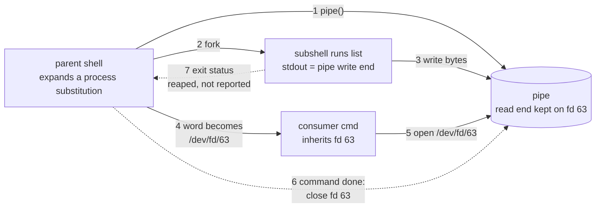

# Process Substitution

> [!summary] Claim
> Process substitution turns a running command into a pathname by forking it onto one end of a pipe and handing the consumer `/dev/fd/N` (or a FIFO), so it works only for consumers that open the name once, read or write it sequentially, and never need the producer's exit status unless the script collects it explicitly.

Part of [Bash](README.md) in [Shell and Unix Engineering](../README.md).

## TL;DR

- Mechanism: `<(list)` and `>(list)` are word expansions: the shell calls `pipe()`, forks `list` with its stdout (or stdin) on one end, keeps the other end open on a descriptor such as 63, and substitutes the word `/dev/fd/63`.
- Rule: the pathname is valid only while the shell keeps that descriptor open, which is the duration of the command it was expanded for; to keep it longer, move it with `exec {fd}< <(list)`.
- Trap: the substituted process is asynchronous and silent: its exit status never reaches `$?`, `set -e`, or `pipefail`, and a `>(list)` consumer is usually still running when the next command starts.
- Portability fact: POSIX.1-2024 has no process substitution; bash, zsh, ksh93 and BusyBox ash (1.34.0 and later) implement it with different descriptors, splitting, and wait rules, yash gives the same syntax a different meaning, and dash, posh, mksh, and bash before 5.1 in POSIX mode (macOS `/bin/sh`) reject it.
- When not to use it: when the consumer seeks, reads the file twice, closes inherited descriptors (sudo, setuid programs), or runs as another user, or when the producer's failure matters and you are not on bash 5.1 or later; use a temporary file, a named FIFO with explicit `wait`, or a real pipeline.

## Mental model



The shell first creates an anonymous pipe and moves its own end to a high descriptor (arrow 1), then forks a subshell whose standard output is the pipe's write end and which runs `list` concurrently with everything that follows (arrows 2 and 3).
The word `<(list)` is replaced by a pathname that names the shell's descriptor, and the consumer inherits that descriptor across `fork` and `execve` (arrow 4).
When the consumer opens the pathname, the kernel hands it the same pipe: Linux reopens the pipe inode through the `/proc/self/fd` magic link, macOS duplicates the descriptor (arrow 5).
As soon as the command that used the word completes, the shell closes its descriptor, so the name dies with the command (arrow 6).
The producer's exit status is collected by the shell's `SIGCHLD` handling and dropped unless the script asks for it through `$!` (arrow 7), which is why the producer's failure is invisible by default.
For `>(list)` every arrow is the same with the direction of data reversed: the subshell reads the pipe on its standard input and the consumer writes to the pathname.

## How it works

### Not POSIX: why other shells say "syntax error"

POSIX.1-2024 defines no process substitution; the term does not occur in XCU chapter 2.
Under the tokenizer rules, `<` is an operator character and `(` cannot extend it, so `<(` is the operator `<` followed by the operator `(` (POSIX.1-2024 XCU 2.3).
The grammar then needs a `filename` word after `<` (POSIX.1-2024 XCU 2.10.2), so a strictly POSIX parser reports a syntax error, which is exactly what dash 0.5.12, posh 0.14.1, and mksh R59 do in the lab's `kind` and `read` tests.
The word expansions POSIX does define (tilde, parameter, command substitution, arithmetic, field splitting, pathname expansion, quote removal) are listed in POSIX.1-2024 XCU 2.6, and redirections in XCU 2.7; process substitution is a vendor expansion layered beside them.

### Origins

Tom Duff's rc paper for Plan 9 describes the same idea as "pipeline branching": `cmp <{old} <{new}` runs each braced command with its output on a pipe and passes the comparison program "an argument that will connect to the pipe when opened (e.g., /dev/fd/6)" (rc paper, section 10).
The same paragraph states the two limits this note keeps returning to: "Pipeline topologies more general than trees can require arbitrarily large pipe buffers, or worse, can cause deadlock", and "Some commands are unprepared to deal with input files that turn out not to be seekable. For example diff needs to read its input twice."
The BusyBox commit that added the feature to ash calls it "a Korn shell feature that's also available in bash and some other shells" (BusyBox commit a1b0d385).

### Bash: from token to file descriptor

The parser treats `<(` and `>(` as the start of a nested construct and reads to the matching `)` the same way it reads a command substitution (bash-5.3 parse.y: `read_token` does not return `<` or `>` as an operator when `(` follows, and `read_token_word` reads the construct with `parse_comsub`, the reader for `$(...)`; the `LEX_GTLT` flag in `parse_matched_pair` covers a substitution nested inside another construct).
Expansion happens in `expand_word_internal` in bash-5.3 subst.c: on an unquoted `<` or `>` followed by `(`, it calls `extract_process_subst` and then `process_substitute (string, c == '>')`; inside double quotes, in a here-document, or with the word flag `W_NOPROCSUB` the characters stay literal, which is why `"<(:)"` prints as text (lab `quoted`).
The resulting pathname is appended to the word through `dollar_add_string` without field splitting or globbing, so `IFS=/` does not break it apart (lab `split`, result 1).
The bash manual places it "simultaneously with parameter and variable expansion, command substitution, and arithmetic expansion" (bash-5.3 doc/bash.1, Process Substitution).

`process_substitute` in bash-5.3 subst.c then does, on a system with `/dev/fd`:

1. `pipe (fildes)`; the parent keeps `fildes[open_for_read_in_child]` (the read end for `<(...)`, the write end for `>(...)`).
2. `move_to_high_fd (parent_pipe_fd, 1, 64)` (bash-5.3 general.c): it probes downward from descriptor 63 with `fcntl (n, F_GETFD)` for a free slot above 3, `dup2`s the pipe there, and closes the original, so the first substitution gets 63, the next 62 (lab `paths`); when 63 to 4 are all taken it returns the pipe's original descriptor.
3. `make_dev_fd_filename` builds `DEV_FD_PREFIX` plus the number and marks the slot in `dev_fd_list`, an array sized by `getdtablesize ()` capped at 256 (`add_fifo_list`).
4. `make_child (NULL, FORK_ASYNC|FORK_PROCSUB)` forks.
   The child turns off `interactive`, restores the original signal dispositions, applies the asynchronous-list signal setup, sets `SUBSHELL_COMSUB|SUBSHELL_PROCSUB|SUBSHELL_ASYNC`, turns off `-v`, `dup2`s its pipe end onto 0 or 1, closes the parent's end, and runs the text with `parse_and_execute`, then any `EXIT` trap, then `exit`.
5. The parent records the child as `last_procsub_child`, adds it to the process-substitution list (`procsub_add`), stores the PID in `dev_fd_list[fd]`, closes the child's end, and returns `/dev/fd/63`.

When the command finishes, `unlink_fifo_list` closes every recorded descriptor; `reap_some_procsubs` closes the descriptor of a producer already reaped.
That is the lifetime rule: `set -- <(echo hi); cat "$1"` fails because the descriptor closed when `set` returned (lab `lifetime`).
The producer is a child of the shell, not a job: before bash 4.4 nothing could wait for it; bash 4.4 sets `$!` to it ("Bash now allows waiting for the most recent process substitution, since it appears as `$!`", bash-5.3 CHANGES, bash-4.4-alpha item u).
bash 5.0 CHANGES says the `wait` builtin "can now wait for the last process substitution created" (bash-5.3 CHANGES, bash-5.0-alpha item a), and the bash 5.3 manual says a bare `wait` waits for "the last-executed process substitution, if its process id is the same as `$!`" (bash-5.3 doc/bash.1, `wait`); the lab measures a bare `wait` reaching it in 5.1 to 5.3 and not in 4.4 (`async-waitall`; 5.0 is not in the matrix).
bash 4.4 remembers only the most recent substitution, so waiting on an earlier one's PID fails with "not a child of this shell" (status 127), while 5.1 to 5.3 wait on both (measured with the worked example).

Systems without `/dev/fd` take the other branch: `make_named_pipe` creates a FIFO named by `sh_mktmpname ("sh-np", ...)` with mode 0600, the child opens it (blocking until the consumer opens the other side), and `unlink_fifo_list` removes FIFOs whose producer is gone; `unlink_all_fifos` first opens each with `O_RDWR|O_NONBLOCK` to release producers still blocked in `open` (bash-5.3 subst.c).
Which branch a build takes is a configure decision: `BASH_CHECK_DEV_FD` accepts `/dev/fd/` only if `/dev/fd/3` works ("check for systems like FreeBSD 5 that only provide /dev/fd/[012]"), else `/proc/self/fd/`, else neither (bash-5.3 aclocal.m4).

POSIX mode: bash 3.2 and 4.4 in POSIX mode reject `<(` as a separate word and keep it literal inside a word (`--file=<(:)` stays text, lab `option`); "Process substitution is now available in posix mode" arrived in bash 5.1 (bash-5.3 CHANGES, bash-5.1-alpha item u).
macOS `/bin/sh` is bash 3.2.57 in POSIX mode, so a `#!/bin/sh` script that uses `<(...)` fails there (lab, every test, family bash in POSIX mode).

### The consumer's side: what `open("/dev/fd/63")` does

On Linux, `/dev/fd` is a symlink into `/proc/self/fd`, whose entries for pipes are magic links reading `pipe:[inode]` (proc_pid_fd(5)).
Opening one does not duplicate the descriptor: the open reaches the pipe inode, whose `pipeanon_fops.open` is `fifo_open`, which attaches a new open file description to the same pipe in the mode requested (Linux fs/pipe.c, `fifo_open`, `pipeanon_fops`).
Two consequences follow: the opener needs permission on the pipe inode, which belongs to the shell's user ("An unprivileged process may lack permissions to open them", proc_pid_fd(5)), and an opener that closed the inherited descriptor first finds no `/proc/self/fd/63` entry and gets `ENOENT` (lab `closed`).
On macOS, opening `/dev/fd/N` duplicates descriptor N when the mode is a subset of the descriptor's: fd(4) as installed on the macOS host says that opening `/dev/fd/0` "and the call: fd = fcntl(0, F_DUPFD, 0); are equivalent", so a closed descriptor gives `EBADF` (lab `closed`).
Either way the consumer gets a pipe: `fstat` reports `S_IFIFO`, `lseek` fails with `ESPIPE`, and there is no size (lab `filetype`: `type=fifo seek=ESPIPE data=hi`).

### zsh

`getproc` in zsh `Src/exec.c` (identical in 5.9 apart from a timing type) creates the pipe with `mpipe`, which moves both ends to descriptor 10 or above with `fcntl (fd, F_DUPFD, 10)` (`movefd`, `Src/utils.c`), and builds `PATH_DEV_FD "/%d"`.
`configure.ac` probes `/proc/self/fd` before `/dev/fd`, so Linux zsh prints `/proc/self/fd/11` and macOS zsh `/dev/fd/11` (lab `paths`).
`getproc` calls `addproc` only for `>(...)` (`if (!out)`), making those processes part of the current job, so zsh waits for them when the shell itself runs the command (a builtin or a `{ ...; }` group) but not when it hands the command to an external program; the zsh manual describes the same split and the `{ ...; } > >(...)` workaround (zshexpn, Process Substitution; lab `async-group` and `async`).
`< <(...)` and `> >(...)` are handled by `getpipe`, which uses a plain pipe and no `/dev/fd` name at all.
`=(list)` (`getoutputfile`) is a different mechanism: it creates a temporary file with `O_CREAT|O_EXCL` and mode 0600, forks `list` with stdout on it, waits for it (`waitforpid`), and registers the file for deletion after the command; it is a seekable regular file that survives a consumer closing its descriptors (lab `tempfile`: `type=regular seek=3 data=hi`, `open=ok`, `after=removed`).
zsh expands the arguments of the last pipeline stage in the parent shell, so in `echo in | cat <(cat)` the inner `cat` reads the parent's stdin, not the pipe from `echo` (lab `stdin`).

### ksh93

`sh_argprocsub` in ksh93u+m 1.0.10 `src/cmd/ksh93/sh/args.c` writes `/dev/fd/` plus the descriptor number from `sh_pipe`, which keeps the lowest free descriptor `pipe` returned and moves only 0 to 2 (`sh_iomovefd` in ksh93u+m 1.0.10 `sh/io.c`), so the first substitution is `/dev/fd/3` (lab `paths`).
The substitution becomes its own argument node, so `--file=<(:)` expands to two words, `--file=` and `/dev/fd/3` (lab `option`).
ksh93u+m connects pipeline stages with sockets, but in a build where sockets serve as pipes and cannot be opened through `/dev/fd` (`#if _pipe_socketpair && !_socketpair_devfd`), args.c maps `sh_pipe` to `sh_rpipe`, a real pipe; the lab's `filetype` test sees `type=fifo` under ksh93u+m 1.0.10 on Linux.
Because the descriptor is low, `exec 3< <(list)` collides with it and fails with `3: cannot open [Bad file descriptor]` in both ksh93u+m 1.0.10 and ksh93u+ 2012, while `exec 5< <(list)` works (lab `persist 3`, `persist 5`); the ksh93u+m dev NEWS for 2026-10-21 records a related fix after 1.0.10 ("a file descriptor that is opened with 'exec' ... redirecting a process substitution (e.g. 'exec 3< <(print hello)') was closed again as soon as the command had finished").
ksh93u+ 2012 (macOS `/bin/ksh`) cannot use `>(...)` as a redirection target at all (`cannot create`, lab `async`), matching the 2020-06-23 NEWS entry "Fixed a bug that caused combining process substitution with redirection to create a bizarre file in the user's current working directory".
ksh93u+m 1.0.10 can `wait` for `$!` of a `>(...)` even on an external command (lab `async-wait-ext`), and since 2026-07-02 the dev branch detects `/dev/fd` at run time and falls back to FIFOs, "on FreeBSD, where /dev/fd is an optional file system" (ksh NEWS).

### BusyBox ash

Process substitution in ash is compiled in with `ASH_BASH_COMPAT` (`BASH_PROCESS_SUBST`), added by commit a1b0d385 (authored 2020-07-23) and first released in BusyBox 1.34.0 on 2021-08-19 (busybox.net news); 1.34.1 fixed an "ash (regression in process substitution)" and 1.35.0 lists "ash: regressions in process substitution" (busybox.net news).
`evalbackcmd` in `shell/ash.c` reuses the command substitution path with `ctl` set to `CTLTOPROC` or `CTLFROMPROC`, forks with a NULL job ("process substitution uses NULL job, like openhere()"), and moves the parent's end with `fcntl (pip[ip], F_DUPFD, 64)`, so names start at `/dev/fd/64` (lab `paths`).
The descriptor is pushed onto the redirection list (`pushfd`) and closed when that list unwinds.
Because there is no job, `$!` is never set and `wait` cannot reach the producer (lab `status`: `bang=unset`, `wait=0`).
`expbackq` writes the name with `strtodest` into the expansion buffer before field splitting, so `IFS=/` splits `/dev/fd/64` into four fields (lab `split`).

### yash

yash 2.58.1 parses the same characters as process redirection: `<(command)` connects `command`'s stdout to the stdin of the command the redirection is on, and the documentation warns that bash and zsh process substitution "uses the same syntax ... but incompatibly differs in behavior" (yash manual, Redirection).
So `cat <(echo a) <(echo b)` prints only `b`, and `echo X <(:) Y` prints `X Y` (lab `read`, `kind`); in POSIXly-correct mode "process redirection cannot be used" (yash manual, POSIXly-correct mode).

## Numbers and limits

| Quantity | Value | Source |
| --- | --- | --- |
| First descriptors bash hands out | 63, then 62, downward to 4, then the pipe's own descriptor | lab `paths`; bash-5.3 general.c `move_to_high_fd (fd, 1, 64)` |
| First descriptors BusyBox ash hands out | 64, then 65 | lab `paths`; `fcntl (..., F_DUPFD, 64)` in ash.c `evalbackcmd` |
| zsh descriptor floor | 10 (measured 11 and 13 for two substitutions) | lab `paths`; zsh `Src/utils.c` `movefd` |
| ksh93 descriptor | lowest free, 3 when 3 to 9 are closed | lab `paths` |
| Substitutions in one command | 70 gave 70 distinct names in every implementing shell | lab `count` |
| bash `dev_fd_list` size | `getdtablesize ()`, capped at 256, grown to fd + 2 on demand | bash-5.3 subst.c `add_fifo_list` |
| bash FIFO list growth (no `/dev/fd`) | 20 entries per step (`FIFO_INCR`) | bash-5.3 subst.c |
| Linux default pipe capacity | 65536 bytes (16 pages of 4096 bytes) since Linux 2.6.11 | pipe(7) |
| macOS pipe capacity | 65536 bytes (filling a non-blocking pipe with 1 KiB writes) | measured on the macOS host, 2026-11 |
| Linux `pipe-max-size` default | 1048576 bytes | Linux fs/pipe.c `pipe_max_size` |
| `PIPE_BUF` | 4096 on Linux; POSIX minimum 512 | pipe(7) |
| Status of a producer killed by `SIGPIPE` | 141 (bash, zsh, BusyBox), 269 (ksh93), 397 (yash) | lab `sigpipe` (1 MiB written to an unread pipe) |
| Cost of one substitution | about 0.5 to 1.0 ms (macOS host, bash 5.3.15); about 0.08 to 0.4 ms (Linux containers, bash 5.2.37); the same order as one `$(...)` | measured by hand on the shell matrix hosts, 2026-11, 1000-iteration loops, three runs each |
| sudo's first closed descriptor | 3 (`closefrom` default) | sudoers(5) |
| bash waits for `$!` of a substitution | 4.4 and later; bash 4.4 only the most recent one, 5.1 and later earlier ones too | bash CHANGES 4.4-alpha u; lab `status`, `added checked` |
| A bare `wait` reaches the last substitution | bash 5.0 per CHANGES; measured in 5.1 to 5.3, not in 4.4 | bash CHANGES 5.0-alpha a; lab `async-waitall` |
| Process substitution in bash POSIX mode | 5.1 and later | bash CHANGES 5.1-alpha u; lab |
| First BusyBox release with it | 1.34.0, 2021-08-19 | busybox.net news |

## Portability

Every cell is asserted by the lab under the shell matrix (macOS host; Alpine 3.22 with bash 3.2 to 5.3, BusyBox 1.37.0, dash, mksh R59 2020, yash 2.58.1, zsh 5.9; Debian 13 with dash, posh, ksh93u+m 1.0.10, mksh R59 2025, BusyBox, zsh), unless a source is named.

| Behavior | POSIX sh | bash 3.2 (macOS `/bin/bash`) | bash 5.1+ | zsh | `zsh --emulate sh` | dash | ksh93u+m 1.0.10 | ksh93u+ 2012 (macOS `/bin/ksh`) | mksh | yash | posh | BusyBox ash 1.37.0 |
| --- | --- | --- | --- | --- | --- | --- | --- | --- | --- | --- | --- | --- |
| `<(list)` | not specified; syntax error (XCU 2.3, 2.10.2) | pathname (syntax error in POSIX mode, macOS `/bin/sh`) | pathname, also in POSIX mode | pathname | pathname | syntax error | pathname | pathname | syntax error | process redirection of stdin | syntax error | pathname |
| Name of the first one | - | `/dev/fd/63` | `/dev/fd/63` | `/proc/self/fd/N` (Linux), `/dev/fd/N` (macOS), N >= 10 | same as zsh | - | `/dev/fd/3` | `/dev/fd/3` | - | no word | - | `/dev/fd/64` |
| `--file=<(:)` | - | `--file=/dev/fd/63` (literal in POSIX mode) | `--file=/dev/fd/63` | one word | one word | - | two words | two words | - | `--file=` | - | one word |
| Name field-split by `IFS=/` | - | no | no | no | no | - | no | no | - | - | - | yes (4 fields) |
| `$!` and `wait $!` after `cmd <(exit 7)` | - | `$!` set, `wait` 127 | `$!` set, `wait` 7 | `$!` 0, `wait` 127 | `$!` 0, `wait` 127 | - | `$!` unset | `$!` unset | - | `$!` 0, `wait` 127 | - | `$!` unset |
| Waits for `>(...)` on `{ ...; }` | - | no | no | yes | yes | - | no | broken | - | - | - | no |
| `wait $!` reaches `>(...)` on `{ ...; }` | - | no | yes (4.4+) | already waited | already waited | - | yes | broken | - | - | - | no |
| Bare `wait` reaches it | - | no | yes | already waited | already waited | - | yes | broken | - | - | - | no |
| `wait $!` reaches `>(...)` on an external command | - | no | no | no | no | - | yes | broken | - | - | - | no |
| `x=$(cmd > >(slow))` waits for `slow` writing to stdout | - | yes | yes | yes | yes | - | no | broken | - | - | - | yes |
| ... and for `slow` after `exec >file` | - | no | no | no | no | - | no | broken | - | - | - | no |
| Second `>(...)` writes into the first | - | yes | yes | no | no | - | yes | broken | - | - | - | no |
| `exec 3< <(list)` | - | works | works | works | works | - | fails (fd 3 collision) | fails | - | - | - | works |
| `. <(echo cmd)` runs `cmd` | - | no (reads 0 bytes) | yes | yes | yes | - | yes | yes | - | error | - | yes |
| `=(list)` temporary file | - | syntax error | syntax error | yes | yes | - | syntax error | syntax error | syntax error | syntax error | syntax error | syntax error |
| Consumer closed its fds, then opened the name | - | `ENOENT` (Linux), `EBADF` (macOS) | `ENOENT` (Linux), `EBADF` (macOS) | `ENOENT` (Linux), `EBADF` (macOS) | `ENOENT` (Linux), `EBADF` (macOS) | - | `ENOENT` (Linux) | `EBADF` (macOS) | - | - | - | `ENOENT` (Linux) |

Utilities and kernels: the consumer is an ordinary program, so the only utility-level difference the lab measures is the kernel's: Linux reopens the pipe (`ENOENT` once the descriptor is gone), macOS duplicates the descriptor (`EBADF`).
The lab's worked example uses `sort` and `comm` with `LC_ALL=C`, which behave the same in GNU coreutils, macOS, and BusyBox for that input (lab `added`).

## Worked example

The [lab](../labs/04-process-substitution/) has two scripts: `procsub.sh`, one probe per behavior above, and `added.sh`, the pattern a production script needs.
`added.sh` prints the lines of a new file that are not in an old one, and shows that the obvious one-liner hides a failing producer.

```bash
#!/usr/bin/env bash
# added.sh MODE OLD NEW: print the lines of NEW that are not in OLD (comm -13 of both sorted).
#   naive:   comm -13 <(sorted OLD) <(sorted NEW); a producer that fails is invisible.
#   checked: open each substitution on its own descriptor, keep its PID from $!, run comm,
#            then wait for each producer and fail if either one failed.
# Needs bash 5.1 or later: bash 4.4 can wait only for the most recent process substitution
# (waiting on the first PID fails with status 127), and before 5.1 POSIX mode has no
# process substitution at all.

if [ -z "${BASH_VERSION-}" ]; then
  echo "added: needs bash 5.1 or later" >&2
  exit 3
fi
case $BASH_VERSION in
  [0-4].* | 5.0.*)
    echo "added: needs bash 5.1 or later" >&2
    exit 3
    ;;
  *) ;;
esac

export LC_ALL=C # one collation for sort and comm

sorted() {
  if [ ! -r "$1" ]; then
    printf 'added: cannot read %s\n' "$1" >&2
    return 66
  fi
  sort -- "$1"
}

naive() {
  # shellcheck disable=SC2312 # hiding the producers' status is the bug this mode shows
  comm -13 <(sorted "$1") <(sorted "$2")
}

checked() {
  local old new old_pid new_pid comm_status old_status new_status
  # shellcheck disable=SC2312 # each producer's status is collected below with wait
  exec {old}< <(sorted "$1")
  old_pid=$!
  # shellcheck disable=SC2312 # collected below with wait
  exec {new}< <(sorted "$2")
  new_pid=$!
  comm -13 "/dev/fd/$old" "/dev/fd/$new"
  comm_status=$?
  exec {old}<&- {new}<&-
  wait "$old_pid"
  old_status=$?
  wait "$new_pid"
  new_status=$?
  if [ "$old_status" -ne 0 ] || [ "$new_status" -ne 0 ]; then
    printf 'added: producer failed (old=%d new=%d)\n' "$old_status" "$new_status" >&2
    return 2
  fi
  return "$comm_status"
}

case ${1-} in
  naive | checked) "$1" "$2" "$3" ;;
  *)
    echo "usage: added.sh naive|checked OLD NEW" >&2
    exit 2
    ;;
esac
```

With `old` holding `b` and `a`, and `new` holding `c`, `a`, `b`, and `d`, bash 5.1 to 5.3 print (stdout and stderr shown separately; the lab compares the merged lines in sorted order because their interleaving varies):

```text
$ ./added.sh naive old new; echo "status=$?"
c
d
status=0
$ ./added.sh naive missing new 2>err; echo "status=$?"; cat err
a
b
c
d
status=0
added: cannot read missing
$ ./added.sh checked missing new 2>err; echo "status=$?"; cat err
a
b
c
d
status=2
added: cannot read missing
added: producer failed (old=66 new=0)
```

The naive form reports success and prints every line of `new` as added, because `comm` saw an empty old file; nothing in `$?`, `set -e`, or `pipefail` covers a process substitution.
The checked form keeps each producer's PID, closes the descriptors after `comm` has read to end of file, and waits for both; under bash 4.4 its first `wait` fails with "not a child of this shell" (status 127), which is why the guard demands 5.1 (measured in the matrix).
Every other shell in the matrix stops at the guard with status 3 and `added: needs bash 5.1 or later`, including bash 3.2 and 4.4 and the shells that reject the syntax (dash, posh, mksh), which never parse the functions below the guard.

The probes give the facts the pitfalls rely on; under bash 5.3 on Linux `procsub.sh` prints, among others:

```text
$ ./procsub.sh paths
/dev/fd/63
/dev/fd/62
$ ./procsub.sh filetype ./fdprobe
type=fifo seek=ESPIPE data=hi
$ ./procsub.sh closed ./fdprobe
open=ENOENT
$ ./procsub.sh status
status=0
bang=pid
wait=7
$ ./procsub.sh chain first
file=out:err:E
```

On macOS `closed` prints `open=EBADF`; `fdprobe` is the lab's C program that reports the file type, tries `lseek`, and, for `closeall`, closes every descriptor from 3 up before opening the pathname, as sudo does.

## Pitfalls

> [!warning] The producer's failure is invisible
> Trigger: `diff <(sort "$a") <(sort "$b")` or `comm -13 <(...) <(...)` where a producer fails (missing file, network error, killed).
> Symptom: the consumer sees end of file early and succeeds with wrong output; `$?` is the consumer's status, `set -e` does not fire, and `pipefail` does not apply (lab `status`, `errexit`, `added naive`).
> Fix: on bash 5.1 and later, open each substitution with `exec {fd}< <(...)`, save `$!`, and `wait` for each PID after the consumer finishes, as `added.sh checked` does; elsewhere, write to temporary files and check each producer's status before running the consumer.

> [!warning] The next command runs before `>(...)` has finished
> Trigger: `generate > >(gzip >out.gz)` followed by a command that reads `out.gz`, or `tee >(sha256sum >sum)` followed by a check of `sum`.
> Symptom: an intermittent truncated or missing file, because nothing waits for an output substitution on an external command (lab `async`), and only zsh waits for one on a compound command (lab `async-group`).
> Fix: in bash 4.4 and later put the substitution on a group, `{ cmd; } > >(consumer)`, and `wait $!` (lab `async-wait`); for a pipeline stage, route it through a descriptor of the group, `{ a | tee /dev/fd/3 | b; } 3> >(consumer); wait $!`.
> Capturing, `x=$(cmd > >(consumer))`, waits only while the consumer still holds the capture pipe as its stdout (lab `capture`, all shells but ksh93); a consumer that moves its stdout to a file (`exec >file`) releases it early, and the capture returns before the file is complete (lab `capture-released`), so prefer the explicit `wait`.
> If the order matters more than the syntax, use a pipeline.

> [!warning] The second output substitution writes into the first
> Trigger: `cmd > >(tee out.log) 2> >(tee err.log)`.
> Symptom: in bash and ksh93 the stderr `tee` inherits stdout after the first redirection, so its copy of stderr lands in `out.log` (lab `chain`: `out:err:E`); zsh and BusyBox send it to the original stdout.
> Fix: say where the second consumer writes: `2> >(tee err.log >&2)`.

> [!warning] The consumer seeks or reads twice
> Trigger: a program that calls `lseek`, `mmap`, or `fstat` for a size, or reads its input twice (the rc paper names `diff`), given `<(...)`.
> Symptom: `ESPIPE`, a size of zero, or an empty second pass (lab `filetype`).
> Fix: a temporary file (`mktemp`, `trap` cleanup), or zsh `=(list)`, which is a real file (lab `tempfile`).

> [!warning] The consumer closes inherited descriptors or runs as another user
> Trigger: `sudo cmd <(list)`, a setuid program, a daemon that calls `closefrom (3)`, or `sudo -u other cat <(list)`.
> Symptom: `No such file or directory` on Linux and `Bad file descriptor` on macOS (lab `closed`), because sudo "will close all open file descriptors other than standard input, standard output, and standard error" (sudoers(5), `closefrom`); a different user cannot open the shell's pipe inode even when the descriptor survives (proc_pid_fd(5)).
> Fix: feed the data on stdin (`list | sudo cmd /dev/stdin` or `sudo cmd < file`), or use a file the target user can read.

> [!warning] Keeping the name past its command
> Trigger: `f=<(list)` or `set -- <(list)`, then using the name in a later command, or storing it in an array for later.
> Symptom: `No such file or directory` or `Bad file descriptor`, because the shell closed the descriptor when the creating command returned (lab `lifetime`).
> Fix: `exec {fd}< <(list)` (bash 4.1 and later) or `exec 5< <(list)`, then read `<&$fd` or pass `/dev/fd/$fd`, and close it with `exec {fd}<&-` (lab `persist 5`).

> [!warning] ksh93 hands out descriptor 3
> Trigger: `exec 3< <(list)` in ksh93u+m 1.0.10 or ksh93u+ 2012.
> Symptom: `3: cannot open [Bad file descriptor]`; the substitution itself was on `/dev/fd/3` (lab `persist 3`).
> Fix: use a descriptor of 5 or more, or a named descriptor in shells that support `{fd}`.

> [!warning] `#!/bin/sh` that is bash in POSIX mode
> Trigger: a script with `#!/bin/sh` (or run as `sh script`) that uses `<(...)` on macOS, where `/bin/sh` is bash 3.2.57, or on any system where `sh` is dash, BusyBox ash, mksh, or posh.
> Symptom: `syntax error near unexpected token` on macOS and Debian; on Alpine BusyBox ash silently accepts it, so the script passes CI and fails on a developer's Mac.
> Fix: `#!/usr/bin/env bash` and a version check, or no process substitution in `sh` scripts.

> [!warning] bash 3.2 sources nothing
> Trigger: `. <(generate-config)` or `source <(kubectl completion bash)` under macOS `/bin/bash` 3.2.
> Symptom: status 0 and nothing defined (lab `source`), because bash 3.2's `_evalfile` reads `st_size` bytes and a pipe's size is 0 (bash-3.2 builtins/evalfile.c); bash 4.0 fixed the `.` builtin, which had failed "to read and execute commands from non-regular files such as devices or named pipes" (bash CHANGES, bash-4.0-alpha item i), and bash 5.3 reads non-regular files with `zmapfd`.
> Fix: `eval "$(generate-config)"` with the usual care about `eval`, or require bash 4.

> [!warning] A producer nobody reads hangs or dies
> Trigger: the consumer never opens the name, or exits early (`head -n 1 <(big)`).
> Symptom: the producer blocks once it has filled the pipe (65536 bytes by default on Linux) and dies of `SIGPIPE` when the shell closes the read end, reporting 141, 269 in ksh93, or 397 in yash (lab `sigpipe`); without `/dev/fd`, a producer can block in `open` of the FIFO, which bash releases by opening it itself (`unlink_all_fifos`).
> Fix: treat 141 as expected when the consumer may stop early, and say so where you check statuses.

> [!warning] The producer outlives the script
> Trigger: a script ends right after `cmd <(slow)` or `cmd >(slow)`.
> Symptom: the script exits 0 while `slow` is still running and holding whatever descriptors it inherited (lab `orphan`); a test harness that waits for its output descriptor to close (bats keeps fd 3) then hangs until `slow` exits.
> Fix: wait for `$!` where the shell supports it, close descriptors the producer does not need (`3>&-`), or use a pipeline, which the shell waits for.

> [!warning] Shell-specific stdin and splitting
> Trigger: `echo data | cmd <(cat)` in zsh, or a non-default `IFS` with BusyBox ash.
> Symptom: zsh's substitution reads the shell's stdin instead of the pipe, because it expands the last pipeline stage in the parent (lab `stdin`); BusyBox splits `/dev/fd/64` on `/` into four words (lab `split`).
> Fix: do not read stdin inside a substitution that is part of a pipeline; keep `IFS` at its default around BusyBox substitutions.

## Security and robustness

- The name is a capability, not a path: anyone who can open `/proc/PID/fd/N` of the shell can attach to the pipe, but proc_pid_fd(5) gates that with a ptrace-mode access check and the pipe inode's own owner and mode, so another user cannot read it; a process of the same user can.
- sudo closes descriptors from 3 by default (sudoers(5) `closefrom`), and `closefrom_override` must be enabled before a user may pass `-C`; do not loosen that policy to make process substitution work, feed the data on stdin instead.
- bash rewrites `/dev/fd/N` paths in `test` and `[[` itself (`sh_stat` in bash-5.3 lib/sh/eaccess.c); CVE-2012-3410 was a "Stack-based buffer overflow in lib/sh/eaccess.c in GNU Bash before 4.2 patch 33 ... via a long filename in /dev/fd" in that rewriting (NVD), which bash 5.3 performs into an `xrealloc`'d buffer sized from the path.
- On systems without `/dev/fd`, bash and ksh93 create FIFOs in the temporary directory: bash with `mkfifo (name, 0600)` under a random name from `sh_mktmpname`, ksh93 with `mkfifo` then `chmod (S_IRUSR|S_IWUSR)` and a retry on `EEXIST` (and on `EACCES`, `ENOENT`, `ENOTDIR`, `EROFS`; ksh93u+m 1.0.10 args.c); ksh93 treats `EEXIST` as a lost race and picks another name, so neither shell reuses a name an attacker created first (the class of bug in [[Temporary-File-Attacks]]), but a world-writable `TMPDIR` still decides who can see and delete the FIFO.
- zsh `=(list)` writes the producer's output to a 0600 file created with `O_EXCL`; secrets passed this way touch disk, and a job disowned with `&!` leaves the file behind (zshexpn).
- A producer inherits every descriptor the shell has open, including other substitutions' pipes; that is what makes `chain` route stderr into stdout, and what lets a forgotten producer keep a lock file, socket, or pipe open after the script ends.
- Treat the producer's status as data: collect it with `wait` (bash 5.1+) or move the producer to a temporary file whose status you check; a silent producer failure is the robustness hole, not the syntax.

## The principal's view

Process substitution is a convenience for interactive work and small bash-only tools, and a liability in anything whose correctness you will be asked to defend.
The decision is about three properties a pipeline gives you and a process substitution takes away: the shell waits for every stage, every stage's status is visible (`PIPESTATUS`, `pipefail`), and the topology is a line that cannot deadlock.
Use it when a consumer genuinely needs several named inputs or outputs (`diff`, `comm`, `paste`, `tee` to several sinks), the consumer reads each sequentially to end of file, and the interpreter is pinned to bash 5.1 or later (or zsh) by an explicit `#!/usr/bin/env bash` and a version check.
Require the checked form (`exec {fd}<`, `$!`, `wait`) in code review whenever a producer can fail, and reject `> >(...)` followed by a read of what the consumer wrote unless the wait is explicit.
Prefer a temporary file when the consumer seeks, reads twice, runs under sudo, or the data must survive a crash for debugging; the cost is one `mktemp` and a `trap`, and you gain a seekable, inspectable, re-readable artifact.
Prefer named FIFOs with explicit `wait` when you need the same streaming behavior in POSIX sh, at the price of managing cleanup yourself.
Move to Python (`subprocess` with explicit pipes) or Go when the graph is not a tree, when you need back-pressure or timeouts per branch, or when more than two producers must be supervised: Duff's warning that non-tree topologies "can require arbitrarily large pipe buffers, or worse, can cause deadlock" is the boundary of what a shell should orchestrate.
The trade-off is honesty for brevity: `diff <(a) <(b)` is one line because it omits the error handling that the checked version spends twenty lines on.

## Interview questions

> [!question] L5: What does `echo <(true)` print in bash, and why does `set -- <(echo hi); cat "$1"` fail?
>
> > [!success]- Answer
> > It prints a pathname such as `/dev/fd/63`: bash forks `true` onto a pipe, moves its own end to descriptor 63, and substitutes that descriptor's name.
> > The descriptor is closed as soon as the command that expanded the word completes, so after `set` returns, `/dev/fd/63` no longer refers to the pipe and `cat` fails.
> > To keep it, redirect it onto a descriptor the script owns with `exec {fd}< <(echo hi)`.
> >
> > Follow-up: Which descriptor does BusyBox ash use, and which does ksh93 use?

> [!question] L5: Why does `n=0; while read -r _; do n=$((n+1)); done < <(printf 'a\nb\n'); echo "$n"` print 2 when the same loop fed by a pipe prints 0?
>
> > [!success]- Answer
> > In a pipeline each stage is a subshell in bash, so the loop's assignments die with it.
> > With `< <(...)` the loop is a compound command in the current shell whose stdin is redirected from the substitution's pathname; only the producer is a subshell.
> > bash 4.2 and later can also run the last pipeline stage in the current shell with `shopt -s lastpipe` when job control is off (bash CHANGES, bash-4.2-alpha item t).
> >
> > Follow-up: What happens to the producer's exit status in the `< <(...)` form?

> [!question] L6: Predict the output in bash: `{ echo E >&2; } > >(sed 's/^/out:/' >f) 2> >(sed 's/^/err:/'); sleep 1; cat f`
>
> > [!success]- Answer
> > It prints `out:err:E`.
> > Redirections are processed left to right, so when bash forks the second substitution, the group's stdout is already the first substitution's pipe, and the second `sed` inherits it as its stdout.
> > The second `sed` therefore writes `err:E` into the first, which prefixes `out:` and writes to `f`.
> > zsh prints `err:E` on the terminal and leaves `f` empty, because its second substitution keeps the original stdout.
> >
> > Follow-up: How do you make `2> >(tee err.log)` keep stderr on stderr?

> [!question] L6: How do you get the exit status of the producer in `diff <(sort a) <(sort b)`?
>
> > [!success]- Answer
> > You cannot from that line: `$?` is `diff`'s status and `pipefail` does not cover substitutions.
> > In bash 5.1 and later, open each substitution with `exec {fd}< <(sort a)`, save `$!` immediately, run `diff /dev/fd/$fd ...`, close the descriptors, and `wait` for each saved PID.
> > bash 4.4 can wait only for the most recent substitution; bash 3.2, zsh, BusyBox, and ksh93 for `<(...)` give no usable PID, so the portable answer is temporary files whose producers you run and check first.
> >
> > Follow-up: Why must you close the descriptors or let `diff` reach end of file before you wait?

> [!question] L6: Debug this script: it runs nightly and the checksum check fails about once a week.
>
> ```bash
> #!/usr/bin/env bash
> set -euo pipefail
> pg_dump "$DB" | tee >(sha256sum >dump.sha) | gzip >dump.gz
> read -r sum _ <dump.sha
> verify "$sum" dump.gz
> ```
>
> > [!success]- Answer
> > `sha256sum` runs in a process substitution that nothing waits for: the pipeline finishes when `gzip` exits, and `read` can run before `sha256sum` has written `dump.sha`, so it reads an empty or partial file.
> > `set -e` and `pipefail` do not see the substitution at all, so a `sha256sum` failure would also go unnoticed.
> > The substitution is expanded inside the forked `tee` stage, so even `$!` in the script never names it.
> > Fix it by moving the substitution onto a group in the script's own shell and waiting for it (bash 4.4 or later): `{ pg_dump "$DB" | tee /dev/fd/3 | gzip >dump.gz; } 3> >(sha256sum >dump.sha); wait $!`, then check that `wait` returned 0.
> > Alternatives are computing the checksum in a second pass, or a named FIFO whose reader you start with `&` and `wait` for.
> >
> > Follow-up: Why would wrapping the pipeline in `x=$(...)` not be a reliable fix here, even in bash?

> [!question] L6: A tool works with `cmd <(gen)` on your laptop but fails under `sudo cmd <(gen)`; why, on Linux and on macOS?
>
> > [!success]- Answer
> > sudo closes every descriptor from 3 up before it executes the command (`closefrom`, default 3), so descriptor 63 no longer exists in `cmd`.
> > On Linux `/dev/fd/63` resolves through `/proc/self/fd/63`, which is now absent, so `open` fails with `ENOENT`; on macOS opening `/dev/fd/63` is a `dup` of a closed descriptor, so it fails with `EBADF`.
> > Even with descriptors kept, a target user other than yours could not open the shell's pipe inode through `/proc`.
> > Feed the data on stdin instead: `gen | sudo cmd /dev/stdin`.
> >
> > Follow-up: Why does zsh `=(gen)` survive this, and what does it cost?

> [!question] L7: A colleague proposes `#!/bin/sh` scripts that use `<(...)` because CI on Alpine passes; what do you say?
>
> > [!success]- Answer
> > Alpine's `sh` is BusyBox ash, which has supported process substitution since 1.34.0, so CI proves nothing about other systems.
> > Debian's `sh` is dash and macOS's is bash 3.2 in POSIX mode, and both reject the syntax; POSIX.1-2024 does not define it, and its tokenizer makes `<(` a redirection followed by a syntax error.
> > Even among implementations the semantics differ: BusyBox field-splits the name and cannot wait for it, ksh93 uses descriptor 3, zsh waits for some `>(...)` and not others, and yash treats it as a redirection.
> > The policy is: process substitution only under an explicit bash 5.1+ or zsh interpreter, with a version check, and checked producers.
> >
> > Follow-up: What would you test in CI to catch this regression class?

> [!question] L7+: When is process substitution the wrong tool even in bash, and what replaces it?
>
> > [!success]- Answer
> > When the consumer needs a seekable or re-readable file, when it runs with closed descriptors or as another user, when the producer's failure must stop the job and you are below bash 5.1, and when the data flow is not a tree.
> > Non-tree topologies can deadlock on full pipe buffers (65536 bytes on Linux by default), which Duff already warned about in the rc paper.
> > Replace it with temporary files for correctness and debuggability, named FIFOs with explicit `wait` for streaming in POSIX sh, and a real language with explicit pipes, timeouts, and supervision when several producers must be coordinated.
> >
> > Follow-up: How would you bound memory and time per branch in the replacement?

> [!question] L6: Why does `exec 3< <(echo hi)` fail in ksh93 but work in bash, and why does `cat <(exit 7); wait $!` print 7 only in bash 4.4 and later?
>
> > [!success]- Answer
> > ksh93 takes the lowest free descriptor for the substitution, which is 3, so the redirection `3<` closes the very descriptor it is about to open through `/dev/fd/3`; bash moves its end to 63 or below, out of the way of small script descriptors.
> > bash 4.4 started recording the substitution's PID in `$!` and allowing `wait` on it; bash 3.2 sets `$!` but reports "not a child of this shell", zsh leaves `$!` at 0, and ksh93 and BusyBox leave it unset, so their `wait $!` is a bare `wait` that returns 0.
> >
> > Follow-up: What does a bare `wait` do with a process substitution in bash 5.1?

## Related

Prerequisites: [[Brace-Expansion]]

Next: [[Coprocesses]]

See also: [[Pipelines-Subshells-Redirection-and-Process-Substitution]], [[dev-fd-and-dev-stdin]], [[Pipes-and-FIFOs]], [[SIGPIPE-and-EPIPE]], [[Redirection-Order-and-Semantics]], [[Subshells-and-the-Execution-Environment]], [[Bash-POSIX-Mode]], [[Bash-3-2-on-macOS]], [[pipefail-and-PIPESTATUS]], [[wait-n-and-wait-p]], [[sudo-and-sudoers]], [[Temporary-File-Attacks]], [[BusyBox-ash]], [[ksh93-Features]]

## Further reading

- [POSIX.1-2024 XCU chapter 2, Shell Command Language](https://pubs.opengroup.org/onlinepubs/9799919799/utilities/V3_chap02.html) - token recognition (2.3), word expansions (2.6), redirection (2.7), and the grammar (2.10) that make `<(` a syntax error in a POSIX shell.
- [GNU bash 5.3 source](https://ftp.gnu.org/gnu/bash/bash-5.3.tar.gz) - `process_substitute` in subst.c, `move_to_high_fd` in general.c, `BASH_CHECK_DEV_FD` in aclocal.m4, and the CHANGES entries that date each behavior.
- [zsh Src/exec.c](https://raw.githubusercontent.com/zsh-users/zsh/master/Src/exec.c) - `getproc`, `getpipe`, and `getoutputfile`, the three mechanisms behind `<(...)`, `< <(...)`, and `=(...)`.
- [zshexpn, Process Substitution](https://raw.githubusercontent.com/zsh-users/zsh/master/Doc/Zsh/expn.yo) - the maintainers' own list of drawbacks, including closed descriptors and the missing wait for `>(...)`.
- [ksh93u+m args.c](https://raw.githubusercontent.com/ksh93/ksh/v1.0.10/src/cmd/ksh93/sh/args.c) - `sh_argprocsub`, the separate-argument design, and the FIFO fallback.
- [ksh93u+m NEWS](https://raw.githubusercontent.com/ksh93/ksh/dev/NEWS) - a decade of process substitution bug fixes, each a pitfall in older ksh.
- [BusyBox ash.c](https://raw.githubusercontent.com/mirror/busybox/master/shell/ash.c) - `evalbackcmd` and `expbackq`, process substitution grafted onto command substitution.
- [BusyBox commit a1b0d385](https://github.com/mirror/busybox/commit/a1b0d3856d9a0419cb74bf4c87525265871b5868.patch) - the original ash implementation and its size cost.
- [yash manual, Redirection](https://magicant.github.io/yash/doc/redir.html) - process redirection, the same syntax with a different meaning.
- [Linux fs/pipe.c](https://raw.githubusercontent.com/torvalds/linux/master/fs/pipe.c) - `fifo_open` and `pipeanon_fops`, why opening `/proc/self/fd/N` of a pipe reopens it.
- [proc_pid_fd(5)](https://man7.org/linux/man-pages/man5/proc_pid_fd.5.html) - the magic links and the permission check on reopening a pipe.
- [pipe(7)](https://man7.org/linux/man-pages/man7/pipe.7.html) - pipe capacity, `PIPE_BUF`, and `SIGPIPE` semantics.
- [sudoers(5)](https://www.sudo.ws/docs/man/sudoers.man/) - `closefrom` and `closefrom_override`, the most common reason a substitution's name stops working.
- [Tom Duff, Rc - The Plan 9 Shell](https://doc.cat-v.org/plan_9/4th_edition/papers/rc) - the original `<{cmd}` and the deadlock and seekability warnings.
- [NVD CVE-2012-3410](https://nvd.nist.gov/vuln/detail/CVE-2012-3410) - a buffer overflow in bash's own `/dev/fd` path handling.
