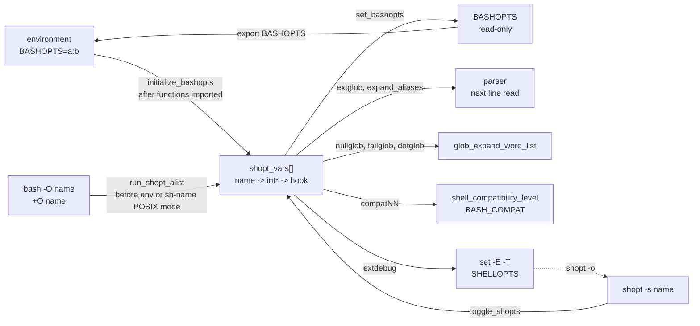

# Shell Options: shopt

> [!summary] Claim
> `shopt` is a bash-only builtin that flips plain C integers in one static table, and because those integers are read at different moments (parse, expansion, startup, environment import) the same `shopt -s` line can take effect immediately, one line late, never in a child, or silently not at all.

Part of [Bash](README.md) in [Shell and Unix Engineering](../README.md).

## TL;DR

- Mechanism: `shopt` looks a name up in the static `shopt_vars[]` array, stores 0 or 1 into the `int` it points to, runs an optional hook, and rebuilds `BASHOPTS` (bash-5.3 builtins/shopt.def, toggle_shopts).
- Rule: set every option a script depends on at the top of the script, on its own line, before any function or loop that needs it is parsed.
- Trap: `extglob` is read by the parser and `failglob` aborts the whole top-level command, so a loop or function can lose most of its body to one unmatched pattern.
- Portability: `shopt` is one of the names POSIX reserves with "the results are unspecified" (POSIX.1-2024 XCU 2.9.1.4); every non-bash shell in the matrix answers it with status 127 and keeps running.
- When not to use it: in a library or sourced helper, where a global flip changes the caller's globbing; scope it in a subshell or restore it with the `shopt -p` idiom instead.

## Mental model



Three writers feed one table: the environment (an imported `BASHOPTS`), the command line (`-O` and `+O`), and the builtin itself.
The environment writer runs after exported functions have already been parsed, and the command-line writer runs after POSIX mode has set its own defaults, which is why both can lose.
From the table, each option is consumed by whichever subsystem reads that `int`: the parser for `extglob` and `expand_aliases`, the glob step of word expansion for `nullglob`, `failglob`, and `dotglob`, the compatibility machinery for the `compatNN` names, and the `set -o` flags for `extdebug`.
`BASHOPTS` is a derived, read-only string, and it reaches a child bash only if the parent exports it; the dashed arrow is `shopt -o`, which is a doorway into the separate `set -o` table rather than part of this one.

## How it works

### Two option tables, one builtin

Bash keeps two unrelated option stores.
The `set -o` table (`o_options[]` in builtins/set.def) holds the POSIX options and their one-letter flags, mirrored into `SHELLOPTS` and `$-`.
The `shopt` table is `shopt_vars[]` in builtins/shopt.def: each entry is `{ name, int *value, set_func }`, and the comment above it warns that every new entry needs a matching default in `reset_shopt_options` (bash-5.3 builtins/shopt.def).
`find_shopt` is a linear `STREQ` scan over that array, so a lookup costs one string compare per option, at most 59 in bash 5.3.15 as measured below.
The option set is fixed at compile time: entries such as `checkjobs`, `cmdhist`, `direxpand`, `progcomp`, and `syslog_history` sit inside `#if defined (JOB_CONTROL)`, `HISTORY`, `READLINE`, or `SYSLOG_HISTORY` blocks, so two builds of the same release can list a different number of options.

`shopt_builtin` parses `-p -s -u -o -q` with `internal_getopt` and dispatches on the flag combination (bash-5.3 builtins/shopt.def, shopt_builtin):

| Call | Function | Effect | Status |
|---|---|---|---|
| `shopt` or `shopt -p` | `list_shopts` | every option, as a table or as `shopt -s/-u NAME` lines | 0 |
| `shopt NAME...` | `list_shopts` | those options | 1 if any is off or invalid |
| `shopt -q NAME...` | `list_shopts` with output suppressed | nothing printed | 0 if every name is on, else 1 (invalid name 1) |
| `shopt -s` or `shopt -u` | `list_some_shopts` | only the options that are on (or off) | 0 |
| `shopt -s NAME...` | `toggle_shopts` | set each; an invalid name is reported and skipped | 1 if any name is invalid |
| `shopt -s -u NAME` | none | "cannot set and unset shell options simultaneously" | 1 |
| `shopt -Z` | `builtin_usage` | usage message | 2 (the builtin returns the internal `EX_USAGE`, 258, and `execute_cmd.c` maps it to `EX_BADUSAGE`, 2) |
| `shopt -o [-p] [NAME...]` | `list_shopt_o_options` | the `set -o` table, printed as `set -o NAME` or `set +o NAME` with `-p` | 1 if any is off |
| `shopt -so NAME...` | `set_shopt_o_options` | calls `set_minus_o_option` for each name | see the bug below |

Every one of these statuses is asserted by the lab's `statuses` and `bridge` probes.

### toggle_shopts: store, hook, rebuild

`toggle_shopts` does three things per name: `*shopt_vars[ind].value = mode`, then the entry's `set_func` hook if it has one, and after the loop `set_bashopts()` if a `BASHOPTS` variable exists (bash-5.3 builtins/shopt.def, toggle_shopts).
The store happens before the hook, so a hook can veto it.
`set_login_shell` and `set_restricted_shell` do exactly that: they overwrite the stored 1 with the real state, which is why `shopt -s login_shell` returns 0 and leaves the option off (lab `statuses`: `readonly_set=0`, `readonly_value=shopt -u login_shell`).
An invalid name in a list does not stop the valid ones: `shopt -s no_such_option dotglob` prints an error, returns 1, and still turns on `dotglob` (lab `statuses`).

The hooks are where options touch other state:

- `shopt_set_extglob` copies `extglob_flag` into the parser's `extended_glob`, and `shopt_set_expaliases` copies `expaliases_flag` into `expand_aliases` (bash-5.3 builtins/shopt.def).
  The split into a user-visible flag and a working variable exists so the parser can force the working copy on temporarily and later reset it from the flag (`reset_parser` restores `extended_glob = extglob_flag`, bash-5.3 parse.y, reset_parser).
- `shopt_set_debug_mode` assigns `error_trace_mode = function_trace_mode = debugging_mode` and calls `set_shellopts()`, so `shopt -s extdebug` turns on `set -E` and `set -T`, and `shopt -u extdebug` turns both off even if the script had set `-E` itself (bash-5.3 builtins/shopt.def, shopt_set_debug_mode; lab `coupling`: `trace_before=E`, then `ET`, then `none` in bash 4.4 to 5.3, while bash 3.2 never changes `$-`).
- `set_shellopts_after_change` exists only so that `interactive_comments`, which is also a `set -o` name, stays in sync with `SHELLOPTS` (lab `coupling`: `shellopts_after=missing` after `shopt -u interactive_comments`).
- `set_compatibility_level` clears all seven `shopt_compat31` through `shopt_compat44` integers, sets the named one, derives `shell_compatibility_level`, and binds `BASH_COMPAT` to it (bash-5.3 builtins/shopt.def, set_compatibility_level).
  The compat options therefore exclude each other: after `shopt -s compat31 compat32` only `compat32` is on, and from bash 5.1 `BASH_COMPAT` reads `32`; unsetting it restores the release's own level (`51`, `52`, `53` in the lab), while bash 4.4 leaves `BASH_COMPAT` unset and bash 3.2 has only `compat31`.
- `set_array_expand` backs two names with one integer: in bash 5.3 `array_expand_once` and `assoc_expand_once` both point at `expand_once_flag`, so `shopt -s assoc_expand_once` makes `shopt -p array_expand_once` print `-s` (bash-5.3 builtins/shopt.def, shopt_vars; lab `shared`).

### BASHOPTS: a derived, read-only mirror

`set_bashopts` walks the table twice, once to size the string and once to join every enabled name with `:`, then binds it with `ASS_FORCE` and re-applies `att_readonly` (bash-5.3 builtins/shopt.def, set_bashopts).
So every successful `shopt -s` or `-u` costs an O(options) rebuild and a `malloc`, and assignment to `BASHOPTS` fails (lab `startup`: `bashopts_assignable=no` from bash 4.4; bash 3.2 has no such variable and lets you assign it, because `BASHOPTS` arrived in bash-4.1-alpha per CHANGES).
The mirror is only as fresh as the last `toggle_shopts` call: `GLOBIGNORE` sets `glob_dot_filenames = 1` directly in `setup_glob_ignore` (bash-5.3 pathexp.c), so `dotglob` is on while `BASHOPTS` still omits it (lab `coupling`: `dotglob_with_globignore=shopt -s dotglob`, `bashopts_lists_dotglob=no`).
Unsetting `GLOBIGNORE` turns `dotglob` off again, even if you had set it yourself.

### Startup order decides who wins

At startup three sources write the table, in this order (bash-5.3 shell.c, main and shell_initialize):

1. `-O NAME` and `+O NAME` are only queued by `add_shopt_to_alist` while the arguments are parsed, because, as the source comment says, POSIX-mode and interactive initialization could otherwise override them.
2. If `--posix` was given or `POSIXLY_CORRECT` is in the environment, `sv_strict_posix` runs `posix_initialize(1)`, which turns on `interactive_comments`, `sourcepath`, `expand_aliases`, `inherit_errexit`, and `shift_verbose` (bash-5.3 general.c, posix_initialize).
3. `run_shopt_alist` applies the queue through `shopt_setopt`; one invalid name makes the shell `exit (EX_BADUSAGE)`, status 2 (lab `startup`: `bad_O=status:2`).
4. `shell_initialize` calls `initialize_shell_variables`, which imports exported functions by parsing them with `parse_and_execute`, calls `sv_strict_posix` again if `POSIXLY_CORRECT` or `POSIX_PEDANTIC` was imported, and only afterwards `initialize_bashopts`, which applies an imported `BASHOPTS` through `parse_bashopts` (bash-5.3 shell.c, shell_initialize; variables.c, initialize_shell_variables).
5. The startup files run, and only then, if the shell was invoked under the name `sh` (`act_like_sh`), does `main` call `sv_strict_posix` and enter POSIX mode (bash-5.3 shell.c, main).

So the three doors into POSIX mode have different precedence over `+O`: `bash --posix +O sourcepath` ends with `sourcepath` off, because the queue runs after step 2, while `POSIXLY_CORRECT=y bash +O sourcepath` and a bash named `sh` turn it back on in steps 4 and 5 (lab `posixorder`, identical in bash 3.2, 4.4, 5.1, 5.2, and 5.3; lab `startup`: `plus_O_posix_owned`).
Step 4 has a sharper consequence: an exported function containing `@(a|b)` fails to import into a child that gets `extglob` only from `BASHOPTS`, because the function text is parsed before `BASHOPTS` is applied; only `bash -O extglob` imports it (lab `parse`: `import_bashopts=status:127`, `import_dash_O=yes`).
`parse_bashopts` silently ignores names it does not know, so `BASHOPTS=no_such_option:dotglob` still enables `dotglob` (lab `startup`: `env_with_unknown_name`).
In privileged mode (`-p`), restricted mode, or when the real and effective ids differ, `initialize_bashopts` is called with `no_bashopts` set and the environment copy is ignored (bash-5.3 shell.c; lab `startup`: `privileged=shopt -u nullglob`).

### What a child gets

Options live in the process image, so a subshell, a command substitution, and a pipeline stage start with a copy and cannot change the parent (lab `scope`).
A new bash process starts from `reset_shopt_options` defaults unless `-O` or an exported `BASHOPTS` says otherwise (lab `startup`: `plain=shopt -u nullglob`, `exported=shopt -s nullglob`).
The surprising case is a script with no `#!` line: `execve` fails with `ENOEXEC`, `shell_execve` decides to run the file itself in a forked copy, and calls `initialize_subshell`, which calls `reset_shell_flags`, `reset_shell_options`, and `reset_shopt_options` (bash-5.3 execute_cmd.c, shell_execve and initialize_subshell), so it also starts from defaults (lab `startup`: `no_shebang_child=shopt -u nullglob`), while a sourced file shares the caller's options (`sourced=shopt -s nullglob`).

### Function scope and `local -`

A `shopt` inside a function changes the global integer and outlives the function (lab `scope`: `after_function=shopt -s nullglob`).
`local -` (bash 4.4 NEWS item s) saves the bitmap returned by `get_current_options` and restores it on return; that bitmap is the `set -o` table followed by the five `posix_vars` integers (bash-5.3 builtins/set.def, get_current_options; general.c, posix_vars).
So `local -` restores `set -f` from bash 4.4, restores `shift_verbose` (one of the five) from bash 5.1 but not in 4.4, and never restores `nullglob` in any release (lab `scope`, matching bash-5.1-beta CHANGES item i on how `local -` restores options).

### When each option is read

| Read by | Options | Consequence |
|---|---|---|
| Parser, per line or compound command | `extglob`, `expand_aliases`, `interactive_comments` | the change applies from the next parsed line; a function defined while `extglob` was off cannot be fixed by turning it on later |
| Glob step of word expansion | `nullglob`, `failglob`, `dotglob`, `nocaseglob`, `globstar`, `globasciiranges`, `globskipdots` | the value at expansion time counts, so a function parsed with `extglob` on and run with it off leaves `@(a|b).txt` literal (lab `parse`: `parsed_on_run_off`) |
| Pattern matching in `case`, `[[`, `${x/p/r}` | `nocasematch`, `extglob`, `patsub_replacement` | see [[Extended-Globbing]] and [[Bash-Parameter-Transformations]] |
| Startup only | `login_shell`, `restricted_shell` (read-only), `extdebug` set before startup files run | changing them later has no or a different effect |
| Interactive editing and history | `cmdhist`, `lithist`, `histappend`, `histverify`, `histreedit`, `hostcomplete`, `progcomp`, `progcomp_alias`, `complete_fullquote`, `direxpand`, `dirspell`, `no_empty_cmd_completion`, `force_fignore`, `checkwinsize`, `checkjobs`, `huponexit`, `promptvars`, `mailwarn` | irrelevant to most scripts |
| Execution and expansion semantics | `lastpipe`, `inherit_errexit`, `execfail`, `sourcepath`, `shift_verbose`, `xpg_echo`, `extquote`, `localvar_inherit`, `localvar_unset`, `varredir_close`, `noexpand_translation`, `gnu_errfmt`, `cdable_vars`, `cdspell`, `autocd`, `checkhash`, `bash_source_fullpath`, `array_expand_once` | each changes what an existing construct means |
| Compatibility level | `compat31` to `compat44` | mutually exclusive; from bash 5.1 only `BASH_COMPAT` reaches higher levels |

The bash manual states the parser rule for `extglob` directly: make sure it "is enabled before parsing constructs containing the patterns, including shell functions and command substitutions" (bash-5.3 doc/bash.1, Pattern Matching).
The lab shows the one-line form `shopt -s extglob; echo @(a|b).txt` is a syntax error, because bash reads the whole line before it runs `shopt` (lab `parse`: `same_line=syntax-error`); the same reasoning is how the manual explains alias definitions (bash-5.3 doc/bash.1, ALIASES), covered in [[Aliases]].
`[[ x == @(a|b) ]]` works without `extglob` from bash 4.1, because the parser forces `extended_glob = 1` while reading the right-hand side of `==` and `!=` (bash-4.1-alpha CHANGES item s; bash-5.3 parse.y, cond_term; execute_cmd.c, execute_cond_node).

### The glob options at the point of use

`glob_expand_word_list` handles a pattern that matched nothing in this order: if `failglob` is on, set the status to 1, print `no match: WORD`, and `exp_jump_to_top_level (DISCARD)`; else if `nullglob` is off, keep the word unchanged; else drop it (bash-5.3 subst.c, glob_expand_word_list).
`DISCARD` unwinds to the top-level read loop, so the unit that is lost is the whole top-level command: a `for` loop, a function call, or a command substitution, not the one simple command (lab `failglob-abort.sh`).
POSIX gives no switch for any of this: an unmatched pattern "shall be left unchanged" and a leading period must be matched explicitly (POSIX.1-2024 XCU 2.14.3); the only POSIX glob option is `set -f` (POSIX.1-2024 XCU 2.6.6).
`nullglob` applies to every unquoted word that contains a pattern character, including words that were never meant as globs: `[a-c]` disappears and `unset list[0]` becomes `unset` with no operand, leaving the array untouched (lab `globs`: `nullglob_bracket_words=0`, `nullglob_unset_left=2`).
`globstar` (bash-4.0-alpha CHANGES item w) makes `**` match zero or more directories; without it, `**` is two ordinary stars and matches exactly one level (lab `globs` and the recursive `**` test).
bash-4.3 stopped following symbolic links to directories under `**` (bash-4.3-release CHANGES item d).
bash 5.2 added two options that are on by default, `globskipdots` (`.` and `..` never match) and `patsub_replacement` (`&` in the replacement of `${x/p/r}` means the matched text), so upgrading to 5.2 changed the meaning of existing code (bash-5.2-alpha CHANGES items aa and x; lab `defaults` lists both as on in 5.2 and 5.3).

### The `shopt -o` doorway, and one of its bugs

`shopt -o` reaches the `set -o` table, `shopt -po noglob` prints `set +o noglob`, and `shopt -so noglob` behaves exactly like `set -f` (lab `bridge`).
The reverse door does not exist: `test -o nullglob` and `[ -o nullglob ]` look only at the `set -o` table and return 1 even when `nullglob` is on (lab `bridge`: `test_o_sees_shopt=1`).
`shopt -so nullglob` (a `shopt` name passed to `-o`) prints "invalid option name" yet returns 0 in bash 4.4 to 5.3: `set_minus_o_option` returns `EX_USAGE` (258, an internal code; bash-5.3 shell.h) for an unknown name, and `set_shopt_o_options` only counts `EXECUTION_FAILURE` (1) as an error (bash-5.3 builtins/set.def, set_minus_o_option; builtins/shopt.def, set_shopt_o_options).
The same name passed to `set -o nullglob` returns 2, because there the 258 reaches `execute_cmd.c`, which maps it to `EX_BADUSAGE` (checked with bash 5.3.20, 2026-11-12).
bash 3.2 returns 1 for the same call (lab `bridge`: `set_o_invalid`).

## Numbers and limits

| Quantity | Value | Source |
|---|---|---|
| Options listed by `shopt` | 34 (3.2.57 macOS), 48 (4.4.23), 53 (5.1.16), 57 (5.2.37), 59 (5.3.15) | lab `defaults`, run 2026-11-12 on macOS and the official `bash:` Docker images; build-dependent because of `#if defined` table entries |
| Options on by default (non-POSIX mode) | 8 (3.2), 9 (4.4), 11 (5.1), 13 (5.2, 5.3) | lab `defaults` |
| Options POSIX mode turns on | 5 shopt-visible (`interactive_comments`, `sourcepath`, `expand_aliases`, `inherit_errexit`, `shift_verbose`) | bash-5.3 general.c, posix_vars and posix_initialize |
| Compatibility options | 7 in bash 5.3 (`compat31`, `compat32`, `compat40` to `compat44`); none above 44 | bash-5.3 builtins/shopt.def; bash-5.1-alpha CHANGES item zzz |
| Name column of `shopt` listing | 15 characters through 5.2, 20 in 5.3 (`OPTFMT` is `"%-20s\t%s\n"`) | lab `formats`; bash-5.3 builtins/shopt.def |
| Status of bad flag, invalid name, bad `-O` | 2, 1, 2 (`EX_USAGE`, 258 internally, mapped to `EX_BADUSAGE`; `EXECUTION_FAILURE`; `EX_BADUSAGE`) | lab `statuses` and `startup`; bash-5.3 shell.h, shell.c run_shopt_alist, execute_cmd.c builtin_status |
| Cost of `shopt -q nullglob` | 1.7 to 2.5 us per call | measured here: 20000 calls per run, six runs in two sessions, bash 5.3.15, Apple M3 Pro, 2026-11 |
| Cost of a `shopt -s` plus `shopt -u` pair | 3.1 to 4.7 us | same runs; each toggle also rebuilds `BASHOPTS` |
| Cost of `saved=$(shopt -p nullglob)` | 0.8 to 1.4 ms per call | same runs, 2000 calls per run; dominated by the command-substitution fork |

The measurement is three `for ((i = 0; i < n; i++))` loops timed with `EPOCHREALTIME`, so each figure includes the loop's own overhead.
The ranges pool two sessions of three runs each, plus one run on bash 5.3.20 (2.30 us, 3.98 us, 1.88 ms); the spread between runs is machine noise, so read the figures as orders of magnitude (as of 2026-11).
The roughly 500-fold gap between the builtin and its capture is the fork, so a save and restore inside a hot loop should use a subshell around the loop, or `shopt -q` and a branch, rather than `$(shopt -p)` per iteration.

## Portability

| Shell | `shopt` | Unmatched pattern by default | Remove an unmatched pattern | Recursive `**` | Option set in a function survives return |
|---|---|---|---|---|---|
| POSIX sh | unspecified name (XCU 2.9.1.4) | left unchanged (XCU 2.14.3) | no mechanism | no | not specified for `shopt` |
| macOS bash 3.2.57 (`/bin/bash`, `/bin/sh`) | yes, 34 options | unchanged | `shopt -s nullglob` | no `globstar` (invalid option, status 1) | yes; no `local -` |
| bash 4.4 to 5.3 | yes | unchanged | `shopt -s nullglob` | `shopt -s globstar` | yes; `local -` covers `set` options only |
| zsh 5.9 native | status 127 | error "no matches found", script ends | `setopt nullglob` | on by default | no with `setopt localoptions`, yes without |
| `zsh --emulate sh` | status 127 | unchanged | `setopt nullglob` | on by default | same as native |
| dash 0.5.12 | status 127 | unchanged | none | no | yes (`set -f` tested) |
| ksh93 (u+ 2012, u+m 1.0.10) | status 127 | unchanged | `~(N)` pattern prefix | `set -o globstar` | yes (`set -f` in a POSIX-style function) |
| mksh R59 | status 127 | unchanged | none | no | yes (`set -f`) |
| yash 2.58 | status 127 | unchanged | `set -o nullglob` | `set -o extendedglob` | yes (`set -f`) |
| posh 0.14.1 | status 127 | unchanged | none | no | yes (`set -f`) |
| BusyBox 1.37.0 ash | status 127 | unchanged | none | no | yes (`set -f`) |

Every non-POSIX cell is asserted by the lab in that shell family (macOS host, Debian 13, and Alpine 3.22 containers, 2026-11-12), and the zsh option semantics match the zsh manual (zsh Options, `NULL_GLOB`, `NOMATCH`, `LOCAL_OPTIONS`).
No external utility is involved, so GNU, BSD, BusyBox, and uutils differences do not apply; the one utility the lab calls, `grep -c -i`, behaves the same in all of them for this input.
A bash script run as `sh script` loses all of this silently: `shopt -s failglob` fails with 127, there is no `set -e` to stop it, and every later line runs with POSIX globbing (lab `failglob-abort.sh` under the non-bash families).

## Worked example

The [lab](../labs/04-shell-options-shopt/) has two scripts: `probe.sh`, a POSIX-syntax driver with twelve modes whose bash-only parts sit in `eval` strings, and `failglob-abort.sh`, which shows how much code one `failglob` error discards.
This is `failglob-abort.sh`, verbatim:

```bash
#!/usr/bin/env bash
# failglob-abort.sh - show how far a failglob error unwinds: the whole top-level command.
# Usage: failglob-abort.sh DIR   (DIR must hold no file named *.none)
# A shell with no shopt builtin fails on line "shopt -s failglob" and then runs everything,
# which is what happens when a bash script is started with sh.

cd "$1" || exit 1
shopt -s failglob

for pass in 1 2; do
  echo "pass $pass"
  echo ./*.none
  echo "pass $pass done"
done
echo "after loop status=$?"

report() {
  echo in-function
  echo ./*.none
  echo after-glob-in-function
}
report
echo "after function status=$?"

captured=$(
  echo ./*.none
  echo inside-substitution
)
echo "after substitution status=$? captured=[$captured]"
```

Under bash, `./failglob-abort.sh "$dir" 2>&1` prints (bash 5.3.15; the lab asserts every line, the diagnostics by suffix):

```text
pass 1
./failglob-abort.sh: line 12: no match: ./*.none
after loop status=1
in-function
./failglob-abort.sh: line 19: no match: ./*.none
after function status=1
./failglob-abort.sh: line 28: no match: ./*.none
after substitution status=1 captured=[]
```

`pass 1 done`, the whole second iteration, `after-glob-in-function`, and `inside-substitution` never run, and the status of each discarded command is 1.
bash 4.4 and 5.1 print the same lines but report lines 17 and 27 (the start of the function and of the substitution) where 5.3 reports 19 and 28 (measured in the `bash:4.4` and `bash:5.1` images).
Native zsh stops the script at the first unmatched glob with "no matches found" and status 1; every other shell in the matrix prints all 14 lines with `./*.none` left literal.

The save-and-restore idiom from `probe.sh` mode `save` (simplified excerpt):

```bash
saved=$(shopt -p nullglob) || true   # "shopt -u nullglob"; the status is 1 because it is off
shopt -s nullglob
# ... work that needs nullglob ...
eval "$saved"                        # back to exactly what the caller had
```

The lab shows why `|| true` is not decoration: under `set -e`, `saved=$(shopt -p nullglob)` exits the shell with status 1 whenever the option is off, because an assignment's status is that of its last command substitution (lab `save`: `naive_status=1`, `naive_reached_end=no`).

## Pitfalls

> [!warning] Same-line `extglob`
> Trigger: `shopt -s extglob; case $f in @(a|b)) ...` on one line, or `shopt -s extglob` inside the function that uses the pattern.
> Symptom: "syntax error near unexpected token `('" before anything on the line runs.
> Fix: put `shopt -s extglob` on its own line near the top of the file, before any function that uses extended patterns is defined (lab `parse`).

> [!warning] `failglob` discards more than one command
> Trigger: `shopt -s failglob` and an unmatched pattern inside a loop, function, or `$(...)`.
> Symptom: the rest of the loop, function, or substitution is skipped, and the script continues with status 1 at the next top-level command (lab `failglob-abort.sh`).
> Fix: treat `failglob` as an assertion for interactive use or for scripts that also run `set -e`; for "no files is fine", use `nullglob` and test the array length.

> [!warning] `nullglob` eats words that were not meant as globs
> Trigger: `shopt -s nullglob` and an unquoted `[...]` or `*` in a non-glob word, such as `unset arr[0]`, `echo [WARN]`, or `ls *.log` with no match.
> Symptom: `unset` gets no operand and the element survives; `[WARN]` disappears; `ls` with no operand lists the current directory, and `grep pat *.c` with no match reads standard input (lab `globs` proves the first two).
> Fix: quote non-glob words (`unset 'arr[0]'`), and collect matches into an array first: `files=(*.log); (( ${#files[@]} )) || exit 0`.

> [!warning] Capturing `shopt -p` under `set -e`
> Trigger: `saved=$(shopt -p nullglob)` in a script with `set -e` while the option is off.
> Symptom: the script exits with status 1 at that line, with no message (lab `save`).
> Fix: `saved=$(shopt -p nullglob) || true`, then `eval "$saved"` to restore.

> [!warning] Exported functions and `BASHOPTS`
> Trigger: `export -f fn` where `fn` contains an extended pattern, plus `export BASHOPTS` to pass `extglob` to the child.
> Symptom: the child reports `fn: command not found` (status 127), because it parsed `fn` before applying `BASHOPTS` (lab `parse`).
> Fix: start the child as `bash -O extglob`, or define the function in a file the child sources after its own `shopt -s extglob`.

> [!warning] Errors that look like success
> Trigger: `shopt -s login_shell`, `shopt -s restricted_shell`, or `shopt -so nullglob` in bash 4.4 and later.
> Symptom: status 0 and no change (read-only options are reset by their hook; `-o` with a `shopt` name prints an error but returns 0) (lab `statuses` and `bridge`).
> Fix: verify with `shopt -q NAME` after setting, and never pass `-o` with a `shopt` name.

> [!warning] Options that move behind your back
> Trigger: assigning `GLOBIGNORE`, toggling `extdebug`, or setting any `compatNN` option.
> Symptom: `dotglob` turns on (and off again when `GLOBIGNORE` is unset) without appearing in `BASHOPTS`; `shopt -u extdebug` clears a `set -E` the script set itself; setting one `compatNN` clears every other (lab `coupling`).
> Fix: set `GLOBIGNORE` and `extdebug` only at the top of a script, and set compatibility through `BASH_COMPAT`, the only mechanism the bash 5.3 manual supports above level 44.

> [!warning] `local -` does not scope `shopt`
> Trigger: `f() { local -; shopt -s nullglob; ...; }`.
> Symptom: `nullglob` stays on after `f` returns in every bash release; only the five POSIX-mode options are restored, and only from bash 5.1 (lab `scope`).
> Fix: run the body in a subshell, `f() ( shopt -s nullglob; ... )`, or save and restore with `shopt -p`.

> [!warning] A bash script started with `sh`
> Trigger: `sh deploy.sh` on Debian (dash) or Alpine (BusyBox ash), for a file that relies on `shopt`.
> Symptom: one "shopt: not found" line on stderr, status 127, and the rest of the script runs with different globbing (lab first test and `failglob-abort.sh`).
> Fix: use a `#!/usr/bin/env bash` line, run the file directly, and fail fast with `[ -n "${BASH_VERSION-}" ] || { echo "needs bash" >&2; exit 2; }`.

> [!warning] Release-dependent defaults and names
> Trigger: the same script on macOS bash 3.2 and on bash 5.2 or later.
> Symptom: `shopt -s globstar` fails with status 1 on 3.2 and `**` silently matches one level; `${x/a/&}` inserts the match on 5.2+ because `patsub_replacement` is on by default (bash-5.2-alpha CHANGES item x; lab `globs` and `defaults`).
> Fix: check `BASH_VERSINFO` once at startup, check the status of every `shopt -s` you rely on, and quote a literal `&` in replacements; see [[Bash-3-2-on-macOS]] and [[Bash-Version-History]].

## Security and robustness

- The environment is an input channel for `shopt`: any bash child that inherits an exported `BASHOPTS` turns those options on before reading a single line of its script, and `parse_bashopts` accepts the list silently, skipping unknown names (lab `startup`).
  A hostile `BASHOPTS=nullglob:dotglob:nocaseglob` changes what every glob in a privileged helper expands to.
- bash defends only the obvious cases: privileged mode, restricted mode, and set-id execution ignore `BASHOPTS` and `SHELLOPTS` (bash-5.3 shell.c, shell_initialize), and for a shell started with effective and real ids that differ the manual adds that `CDPATH` and `GLOBIGNORE` from the environment are ignored as well and exported functions are not imported (bash-5.3 doc/bash.1, INVOCATION).
- sudo removes both variables: `initial_badenv_table` in sudoers lists `"BASHOPTS"` (commented `bash, initial "shopt -s" options`) and `"SHELLOPTS"` (commented `bash, initial "set -o" options`) (sudo plugins/sudoers/env.c, as of 2026-11).
  Other launchers (cron, systemd units, CI runners, `ssh` with `AcceptEnv`) do not necessarily do so; a script that must not inherit options should start with `env -u BASHOPTS -u SHELLOPTS` in its caller, or reset the options it depends on explicitly.
- The function-import path that ignores `BASHOPTS` is the same environment-parsing path that CVE-2014-6271 (Shellshock) abused: bash "through 4.3 processes trailing strings after function definitions in the values of environment variables" (NVD, CVE-2014-6271), which is why exported functions and option-carrying variables deserve the same distrust.
- A defensive header for a bash script that globs untrusted directories: `shopt -u failglob nocaseglob dotglob` plus `shopt -s nullglob` if the script handles empty results, then quote every expansion; do not rely on inherited defaults.
- A library function should never leave a global option changed: run it in a `( ... )` body or restore the saved `shopt -p` text, because the caller's `rm -- "$dir"/*.tmp` means something else under the wrong `nullglob` or `dotglob`.

## The principal's view

`shopt` options are process-global mutable state that changes the meaning of syntax, so the decision is about ownership, not about which flag to pick.
The rule I would enforce in review: the entry script owns the option set, declares it in one block at the top, before any function definitions, and checks each `shopt -s` it relies on; libraries do not change options, or they scope the change in a subshell and document it.
The trade-off is between expressiveness and locality: `nullglob` plus arrays and `globstar` make file handling short and correct in bash 4+, but every such option makes the script's behavior depend on state a reader cannot see at the point of use, and on a release (`globstar` absent on macOS 3.2, new defaults in 5.2).
For portable `sh` the answer is to not need options: `for f in *.log; do [ -e "$f" ] || continue; ...; done` handles the empty case with POSIX semantics in every shell in the matrix.
Once a script needs several options plus recursion over a tree, `find ... -print0 | xargs -0` or a language with a real directory API (Python's `pathlib`, Go's `filepath.WalkDir`) is more robust than tuning glob options, and it removes the environment as an input.

## Interview questions

> [!question] L5: What does `shopt -s nullglob` change, and why is it not the POSIX default?
>
> > [!success]- Answer
> > With `nullglob`, an unquoted word whose pattern matches no file is removed instead of left in place.
> > POSIX requires an unmatched pattern to be left unchanged (XCU 2.14.3), so `ls *.log` with no match passes the literal `*.log` and fails loudly.
> > `nullglob` makes `for f in *.log` run zero times, which is usually what a script wants, but it also turns `ls *.log` into `ls`, which lists everything.
> >
> > Follow-up: How do you get the same zero-iterations behavior in POSIX `sh`?

> [!question] L5: Predict the output of `bash -c 'shopt -s extglob; echo @(a|b)'` and explain it.
>
> > [!success]- Answer
> > It prints a syntax error near the unexpected token `(` and runs nothing, not even the `shopt`; the exit status is 2.
> > bash parses the whole line before executing it, and `extglob` is read by the parser, so when `@(` is tokenized the option is still off.
> > Putting `shopt -s extglob` on a separate line, or passing `-O extglob`, fixes it.
> >
> > Follow-up: Why does `[[ a == @(a|b) ]]` work without `extglob` from bash 4.1?

> [!question] L5: How do you save a `shopt` option, change it, and restore it exactly?
>
> > [!success]- Answer
> > `saved=$(shopt -p nullglob) || true`, change it, then `eval "$saved"`.
> > `shopt -p` prints a reusable `shopt -s` or `shopt -u` command, and it returns 1 when the option is off, so the `|| true` keeps `set -e` from ending the script.
> > A subshell `( shopt -s nullglob; ... )` avoids the restore entirely when the work does not need to set variables in the parent.
> >
> > Follow-up: Why does `local -` not help here?

> [!question] L6: Debug this: a deploy script loses half its cleanup loop on some hosts. `shopt -s failglob; for d in a b; do rm -f "/var/lock/app/$d"/*.lock; echo "cleaned $d"; done; echo done`.
>
> > [!success]- Answer
> > When `/var/lock/app/a` has no lock files, `failglob` raises "no match" and bash jumps to the top level with `DISCARD`, abandoning the whole `for` loop, so `b` is never cleaned and neither `cleaned` line prints.
> > The status is 1 and the script continues at `echo done`, so nothing looks fatal in the log.
> > Fix: drop `failglob` and use `nullglob` with `rm -f --`, or guard the loop body; `-f` already makes `rm` quiet about missing files.
> >
> > Follow-up: What exactly is the unit of code `failglob` discards, and how do you prove it?

> [!question] L6: A child bash gets `BASHOPTS=extglob` exported but an exported function using `@(x|y)` is "command not found" in it. Why?
>
> > [!success]- Answer
> > bash imports exported functions in `initialize_shell_variables` by parsing them, and applies an inherited `BASHOPTS` later in `initialize_bashopts`.
> > So the function text is parsed with `extglob` off, the parse fails, and the function is not defined.
> > `bash -O extglob` works because `-O` options are applied before `shell_initialize` runs.
> >
> > Follow-up: Which startup modes ignore `BASHOPTS` entirely, and why?

> [!question] L6: Why can `shopt -s` return 0 and leave the option off?
>
> > [!success]- Answer
> > `toggle_shopts` stores the new value and then runs the entry's hook, and the hooks for `login_shell` and `restricted_shell` overwrite the stored value with the real state.
> > Separately, in bash 4.4 and later `shopt -so NAME` with an invalid `set -o` name returns 0, because the error code (`EX_USAGE`) is not the one the loop checks.
> > So the only reliable check is `shopt -q NAME` after setting.
> >
> > Follow-up: What other state changes when you toggle `extdebug`?

> [!question] L6: Your script sets `GLOBIGNORE=*.bak` and later `.env` files start appearing in `for f in *`. What happened?
>
> > [!success]- Answer
> > Setting `GLOBIGNORE` to a non-null value turns on `dotglob` (`setup_glob_ignore` sets `glob_dot_filenames = 1`), so `*` now matches names starting with a period other than `.` and `..`.
> > The change bypasses `shopt`, so `BASHOPTS` does not list `dotglob`, while `shopt -p dotglob` does.
> > Unsetting `GLOBIGNORE` turns `dotglob` off again, even if it had been set explicitly.
> >
> > Follow-up: How would you exclude backups without changing dot-file matching?

> [!question] L7+: You own a 40-script bash toolkit used on macOS 3.2 laptops and Linux CI with bash 5.2. What policy do you set for shell options?
>
> > [!success]- Answer
> > Each entry point declares its options in one block at the top, before function definitions, and checks the status of each `shopt -s` so `globstar` failing on 3.2 stops the script instead of silently matching one level.
> > Libraries never change global options, or they scope the change in a subshell; a ShellCheck and review rule enforces it.
> > Callers strip `BASHOPTS` and `SHELLOPTS` from the environment, CI runs the suite under every bash in the matrix, and the 5.2 default changes (`globskipdots`, `patsub_replacement`) are audited explicitly.
> > Recursive file work moves to `find -print0` or a real language when it grows beyond a loop.
> >
> > Follow-up: How do you test that no library leaks an option change?

> [!question] L7+: Is the `shopt` design (a flat table of global integers with hooks) a good one? What would you change?
>
> > [!success]- Answer
> > It is cheap (a linear scan and an `int` store, about 2 us per call measured here) and easy to extend, which is why it grew from a few options to 59.
> > Its costs are hidden coupling (hooks that move `set -o` flags, `GLOBIGNORE` writing the same integer, two names sharing one integer), no scoping primitive for these options, and parse-time options that are indistinguishable from run-time ones in the interface.
> > A redesign would separate parse-time from run-time options, give functions an option scope like zsh's `localoptions`, and make every writer go through one path so `BASHOPTS` cannot go stale.
> >
> > Follow-up: What compatibility constraints would stop bash from making `local -` cover `nullglob` today?

## Related

Prerequisites: [[Extended-Globbing]]

Next: [[Brace-Expansion]]

See also: [[The-set-Builtin-and-Shell-Options]], [[Pathname-Expansion]], [[Bash-POSIX-Mode]], [[Bash-Startup-Files-and-Modes]], [[inherit_errexit-and-errtrace]], [[pipefail-and-PIPESTATUS]], [[ERR-and-DEBUG-Traps]], [[Bash-Parameter-Transformations]], [[Aliases]], [[Functions-and-Scope]], [[Subshells-and-the-Execution-Environment]], [[Environment-Variables-and-Inheritance]], [[Bash-3-2-on-macOS]], [[Bash-Version-History]]

## Further reading

- GNU bash 5.3 source, `builtins/shopt.def`: the option table, `toggle_shopts`, every hook, and `set_bashopts`; the ground truth for this note.
- GNU bash 5.3 source, `shell.c` (`run_shopt_alist`, `shell_initialize`) and `general.c` (`posix_vars`): the startup order that decides which option source wins.
- GNU bash 5.3 source, `subst.c` (`glob_expand_word_list`): the exact `failglob`, `nullglob`, and default branches.
- Bash Reference Manual, The Shopt Builtin (gnu.org): the documented meaning and default of every option.
- POSIX.1-2024 XCU 2.6.6, 2.9.1.4, and 2.14.3: what a portable shell guarantees about pathname expansion, and that `shopt` is a reserved, unspecified name.
- bash `CHANGES` and `NEWS` in the 5.3 tarball: the release in which each option and default appeared.
- zsh manual, Options: `NULL_GLOB`, `NOMATCH`, `GLOB_DOTS`, and `LOCAL_OPTIONS`, the scoped design bash lacks.
- sudo `plugins/sudoers/env.c`, `initial_badenv_table`: a production list of environment variables, `BASHOPTS` among them, considered unsafe to pass to a privileged shell.
- NVD, CVE-2014-6271: the Shellshock record, for why bash's environment-import path is a security boundary.
