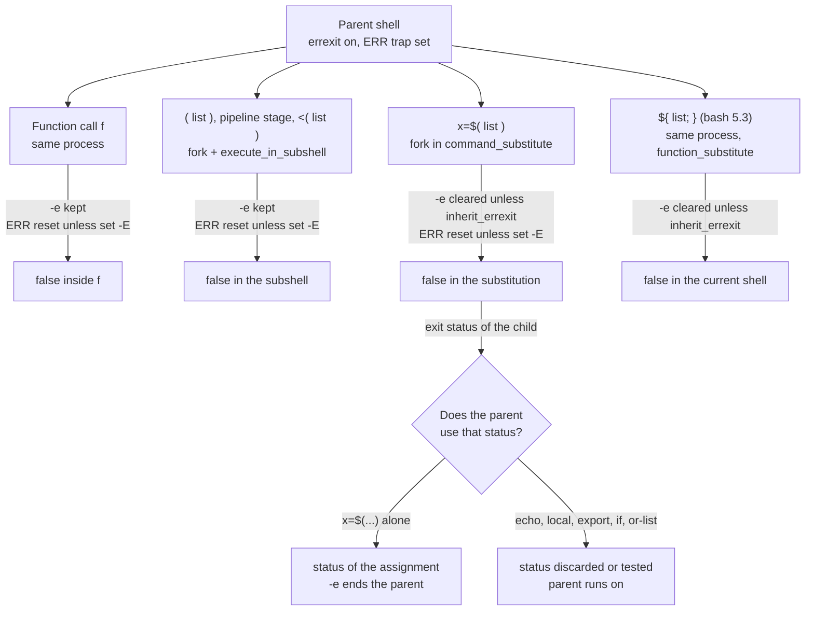

# inherit_errexit and errtrace

> [!summary] Claim
> Bash deliberately strips `set -e` from every command substitution and strips the `ERR` trap from every function, subshell and substitution, and `shopt -s inherit_errexit` and `set -E` are the two switches that undo those resets, yet neither one can make a parent notice a failure whose status the parent itself throws away.

Part of [Bash](README.md) in [Shell and Unix Engineering](../README.md).

## TL;DR

- Mechanism: the child of `$(...)` runs `change_flag ('e', FLAG_OFF)` unless `inherit_errexit` is set, and function entry and subshell creation reset the `ERR` trap unless `error_trace_mode` (`set -E`) is set (bash-5.3 `subst.c`, `command_substitute`; `execute_cmd.c`, `execute_function`; `trap.c`, `reset_or_restore_signal_handlers`).
- Rule: in bash 4.4 or later, write `set -Eeuo pipefail` and then `shopt -s inherit_errexit`, send every byte the `ERR` trap prints to stderr, and still assign each substitution on its own line so its status is not masked.
- Trap: `inherit_errexit` only stops the substitution's child; `echo "$(cmd)"`, `local x=$(cmd)`, `export x=$(cmd)` and any substitution inside an `if` or `||` condition still let the script run on.
- Portability: neither switch exists in POSIX; POSIX.1-2024 XCU 2.15 (`set -e`) requires the option in each subshell, which dash, ksh93, mksh, yash, posh and zsh do, while bash without the shopt and BusyBox ash clear it, and `set -E` means emacs mode in dash and `PUSHD_SILENT` in native zsh.
- When not to use it: when the script must run as `sh` (Alpine's `sh` is BusyBox ash, which clears `-e` in `$(...)`), on bash 3.2 (stock macOS `/bin/bash`), or when error handling needs structured context; then test each command's own status, or move to a language with exceptions.

## Mental model



The parent hands its option bits and its trap table to four kinds of child context, and bash applies a different reset rule to each.
A function runs in the same process and keeps `-e`, but `execute_function` saves and clears the `ERR` trap on entry unless `set -E` is on.
A `( list )` subshell, a pipeline stage and a process substitution are forked children that keep `-e`, as POSIX requires, but `reset_or_restore_signal_handlers` (reached through `reset_signal_handlers`, or through `restore_original_signals` for a process substitution) clears the `ERR` trap in them unless `set -E` is on.
A command substitution is a forked child that loses both `-e` (unless `inherit_errexit`) and the `ERR` trap (unless `set -E`).
Bash 5.3's `${ list; }` runs in the current shell, so with `inherit_errexit` a failure inside it ends the script itself.
Whatever happens inside, the child reports only an exit status, and the bottom of the diagram is the part no option changes: the parent acts on that status only when the substitution's status becomes the status of a command that `-e` is not ignoring.

## How it works

### What POSIX requires

POSIX.1-2024 XCU 2.15 (special built-in `set`, option `-e`) says that when any command fails the shell immediately shall exit, as if by the `exit` special built-in with no arguments, with three exceptions.
Exception 1: the failure of any individual command in a multi-command pipeline, or of any subshell in which command substitution ran during word expansion, shall not cause the shell to exit; only the failure of the pipeline itself shall be considered.
Exception 2: `-e` is ignored for the compound list following `while`, `until`, `if`, or `elif`, for a pipeline beginning with `!`, and for any command of an AND-OR list other than the last.
Exception 3: if the exit status of a compound command other than a subshell command was the result of a failure while `-e` was being ignored, then `-e` shall not apply to that command.
The same paragraph then says this requirement applies to the shell environment and each subshell environment separately.
Its first normative example is `set -e; (false; echo one) | cat; echo two`: the subshell exits before `echo one`, and the parent still runs `echo two` because the pipeline's status is zero.
Its second is `set -e; echo $(false; echo one) two`: the substitution's subshell exits before `echo one`, the parent ignores that status, and then runs the expanded `echo two`.
So POSIX asks for exactly what `inherit_errexit` turns on, and also states the limit this note keeps returning to: the substitution's failure stops the substitution, not the parent.
The APPLICATION USAGE for `set` says not to rely on `-e` inside functions, and gives `start || echo >&2 some_server failed`: the function is a non-final AND-OR command, so a failing `some_server` is followed by the success echo and the function's status is zero.
The rest of the `-e` exception list, and how each shell applies it outside this note's scope, is in [[errexit-Semantics-and-Exceptions]].

XCU 2.13 (Shell Execution Environment) says a subshell environment is "a duplicate of the shell environment, except that ... traps that are not being ignored shall be set to the default action", and lists "Options turned on at invocation or by set" among the things duplicated.
The `trap` page in XCU 2.15 repeats it: "When a subshell is entered, traps that are not being ignored shall be set to the default actions", with one exception for a command substitution that contains only a `trap` command.
POSIX defines `EXIT` and the signal names as trap conditions and nothing called `ERR`, so every rule about the `ERR` trap below is an extension.
The `set -o` list in XCU 2.15 includes `pipefail` (new in POSIX.1-2024) but neither `errtrace` nor anything like `inherit_errexit`.

### `inherit_errexit`: one branch in `command_substitute`

In bash-5.3 `subst.c`, `command_substitute` creates a pipe, calls `make_child` with `FORK_COMSUB`, and in the child calls `reset_signal_handlers ()`, sets `subshell_environment |= SUBSHELL_COMSUB`, turns off `-v` (`change_flag ('v', FLAG_OFF)`), and then:

```c
/* When inherit_errexit option is not enabled, command substitution does
   not inherit the -e flag.  It is enabled when Posix mode is enabled */
if (inherit_errexit == 0)
  {
    builtin_ignoring_errexit = 0;
    change_flag ('e', FLAG_OFF);
  }
set_shellopts ();
```

`change_flag` in `flags.c` clears `errexit_flag`, the flag that `$-` reports, and its `case 'e'` copies it into `exit_immediately_on_error`, the variable every execution path tests; `set_shellopts ()` then rewrites `SHELLOPTS` to match, so `$-` inside the substitution really lacks `e` (the lab's first test prints `off` in native bash and `on` with `inherit_errexit`).
Nothing else differs: the option is a single `int` in `subst.c`, registered in `builtins/shopt.def` as `{ "inherit_errexit", &inherit_errexit, ... }`, and it is consulted only in `command_substitute` and, in 5.3, in `function_substitute`.
Bash 3.2 has the same reset without the switch: its `command_substitute` does `if (posixly_correct == 0) exit_immediately_on_error = 0;` (bash-3.2 `subst.c`, `command_substitute`).
The manual (bash-5.3 `doc/bash.1`, `shopt`) says: "If set, command substitution inherits the value of the errexit option, instead of unsetting it in the subshell environment."
It adds: "This option is enabled when posix mode is enabled."
`CHANGES` introduced it in the bash-4.4-rc1 section, noting "By default, those subshells disable -e."

Process substitution is not a command substitution: `process_substitute` (bash-5.3 `subst.c`) calls `restore_original_signals` and turns off `-v` but never touches `-e`, so `<(list)` keeps `-e` with or without `inherit_errexit` (lab: `cat <(f)` prints `on`, and `cat <(false; echo one)` prints nothing).
A `( list )` subshell goes through `execute_in_subshell` (bash-5.3 `execute_cmd.c`), which also leaves `-e` alone, as POSIX requires.

### The flag is a shopt, and the clear happens once

`inherit_errexit` is a `shopt` option, so it never appears in `$-` and it is not a `set -o` name.
The GNU Bash manual (Bash Variables) defines `BASHOPTS` as the readonly colon-separated list of enabled `shopt` options, and says that if the variable is in the environment when bash starts, each option is enabled before any startup file is read.
`errexit` and `errtrace` are `set -o` options, so they appear in `$-` as `e` and `E` and in the readonly `SHELLOPTS` variable, which that same page imports the same way.
`command_substitute`, and bash 5.3 `function_substitute`, test only `inherit_errexit == 0` (bash-5.3 `subst.c`).
There is no `posixly_correct` test on that path, so `shopt -u inherit_errexit` turns the clear back on even while POSIX mode stays enabled.
That form is source-derived: the lab does not assert `shopt -u` under POSIX mode.
The clear itself is one `change_flag ('e', FLAG_OFF)` before the substituted list runs, so a later `set -e` inside the list turns the flag back on for the rest of the list.
That inner `set -e` does not clear the `CMD_IGNORE_RETURN` mark described below, so `if` and `||` still ignore failures inside the substitution.
On bash before 4.4, which has no `inherit_errexit`, and on BusyBox ash, which clears `eflag` and has no `shopt`, `x=$(set -e; cmd)` is the source-derived way to get the POSIX child behavior.
The lab does not assert that form.
Chet Ramey called the clear a feature, present since before bash 2.0, and said POSIX mode inherits `-e` because that is what he reads the standard to require (bug-bash, 2005-01-11).
It is a documented deviation from the per-subshell sentence, not a bug, and bash 4.4's `inherit_errexit` plus POSIX mode are the documented corrections.

### POSIX mode turns it on and never turns it off

`posix_initialize (on)` in bash-5.3 `general.c` sets `inherit_errexit = 1` when POSIX mode is switched on.
When POSIX mode is switched off it restores the five options in `posix_vars[]` (`interactive_comments`, `source_uses_path`, `expaliases_flag`, `inherit_errexit`, `print_shift_error`) only if `saved_posix_vars` is non-null, and `save_posix_options` is called only from `assign_in_env` (bash-5.3 `variables.c`), when `POSIXLY_CORRECT` is assigned in a temporary environment.
On the ordinary path the `else` branch resets `source_searches_cwd`, `expand_aliases` and `print_shift_error` but not `inherit_errexit`, so `set -o posix; set +o posix` leaves `inherit_errexit` on; the lab prints `1 0 0` for the three `shopt -q` results, and bash-4.4 `general.c` has the same one-way assignment.

### Why `-e` stays ignored inside `if x=$(...)`

`inherit_errexit` copies the flag, not the context.
When `execute_simple_command` (bash-5.3 `execute_cmd.c`) expands the words of a command that carries `CMD_IGNORE_RETURN` (the test of an `if`, a non-final command of an AND-OR list), it increments `comsub_ignore_return` around `expand_words`, with the comment "Pass the ignore return flag down to command substitutions".
The forked child inherits the counter, and `parse_and_execute` (bash-5.3 `builtins/evalstring.c`) marks every command it parses `CMD_IGNORE_RETURN` when `(subshell_environment & SUBSHELL_COMSUB) && comsub_ignore_return`.
So `if x=$(false; echo one); then` prints `then [one]` in bash 4.4 to 5.3 with or without `inherit_errexit` (lab), which follows the POSIX reading that `-e` is ignored for the whole compound list after `if`.
Shells disagree here, and the lab shows it: dash's `evalbackcmd` forks and runs `evaltreenr(n, EV_EXIT)`, dropping the caller's `EV_TESTED` flag, so the child exits at `false` and the `else` branch runs with an empty `x` (measured in the shell matrix on dash 0.5.12 as well); mksh and posh do the same (measured in the shell matrix on mksh R59 and posh 0.14.1, 2026-11) because their `comsub` calls `execute(t, XXCOM | XPIPEO | XFORK, NULL)` without `XERROK`; bash 3.2 in POSIX mode (macOS `/bin/sh`) also prints `else []`, since `comsub_ignore_return` does not exist in 3.2.
yash keeps the suppression because its `suppresserrexit` flag is a static variable that the forked child of `exec_command_substitution` inherits (yash 2.58.1 prints `then [one]`, measured in the shell matrix, 2026-11).

### Bash 5.3 function substitution

Bash 5.3 adds `${ command; }`, which runs `command` in the current shell and substitutes its output (bash-5.3 `NEWS`, item s).
`function_substitute` (bash-5.3 `subst.c`) applies the same rule as `command_substitute`, but in the current process, so it saves `errexit` with `add_unwind_protect (uw_restore_errexit, ...)` before `change_flag ('e', FLAG_OFF)` and restores it afterwards.
It also saves `builtin_ignoring_errexit` with `unwind_protect_int` and zeroes it, and it saves and clears `-v` the same way (bash-5.3 `subst.c`, `function_substitute`, seen 2026-11), because without a fork every one of these changes would otherwise leak into the caller.
With `inherit_errexit` on, nothing is saved or cleared, and a failure inside `${ false; echo one; }` makes the main shell exit with status 1 (lab), not just a child.

The form is not new to shells: the ksh93 manual lists it as the brace-group form of command substitution (`${ list;}`, ksh93 `sh.1`, dev branch), and mksh documents it as a "funsub" that runs "in the current execution environment" (mksh `mksh.1`, Command substitution).
mksh's `funsub` in `eval.c` calls `execute (t, XXCOM | XERROK, NULL)`, so every command of the body runs with `XERROK` and neither `-e` nor the `ERR` trap fires for a failure inside it (measured on mksh R59 2025/04/26: `set -e; x=${ false; echo one; }` sets `x` to `one` and runs on, and an `ERR` trap stays silent), which matches what bash 5.3 does with `inherit_errexit` off; mksh has no switch to change that.
Bash 5.3 is the first bash with the form, so a script that uses it must also guard on the version (the lab evals it so older bash and the other shells still parse the file).

### `errtrace`: the `ERR` trap and its three resets

The `ERR` trap arrived in bash-2.05a; `CHANGES` (2.05a-alpha1, item l) says the ksh-like trap "will be run whenever the shell would have exited if the -e option were enabled" and "is not inherited by shell functions."
Bash 3.0 added `set -o errtrace` (`set -E`) and `functrace` (`set -T`), which "cause DEBUG and ERR traps, respectively, to be inherited by shell functions" (bash-5.3 `NEWS`, bash-3.0 section, item m).
The flag is `error_trace_mode` in `flags.c` (`{ 'E', &error_trace_mode }`), and it is consulted in three places.

1. Function entry: `execute_function` (bash-5.3 `execute_cmd.c`) does `if (error_trap && error_trace_mode == 0)`, saves a copy of the trap string, registers `uw_maybe_set_error_trap` to run when the function returns, and calls `restore_default_signal (ERROR_TRAP)`, so the function body runs with no `ERR` trap.
2. Subshell creation: `reset_or_restore_signal_handlers` (bash-5.3 `trap.c`), reached through `reset_signal_handlers` from `execute_in_subshell`, `command_substitute`, and the forked-builtin path of `execute_simple_command`, ends with `if (error_trace_mode == 0) sigmodes[ERROR_TRAP] &= ~SIG_TRAPPED;`, with the comment "Command substitution and other child processes don't inherit the debug, error, or return traps."
3. Undo: `restore_traps` re-arms the `ERR` trap only `if (trapstr && error_trace_mode == 0)`, which is how bash undoes a reset it applied.

The manual's `-E` entry is precise: "If set, any trap on ERR is inherited by shell functions, command substitutions, and commands executed in a subshell environment." (bash-5.3 `doc/bash.1`, `set`).
The trap fires under the same conditions as `-e`: not for commands after `while` or `until`, in the test of an `if`, in a non-final AND-OR operand, in a non-final pipeline stage (subject to `pipefail`), or under `!` (bash-5.3 `doc/bash.1`, `trap`).

Two consequences of the save-and-restore design show up in the lab.
First, a function whose last command fails triggers the trap twice under `set -E`: once inside for `false`, and once at the call site because the call itself returned 1; without `-E` it fires once, for the call.
Second, the restore is conditional only from bash 4.4: bash-4.4 `execute_function` registers `maybe_set_error_trap`, which ends up in `trap_if_untrapped`, so an `ERR` trap that a function sets survives its return, while bash 3.2 to 4.3 register `set_error_trap` and put the caller's trap back unconditionally (bash-3.2, bash-4.0 and bash-4.3 `execute_cmd.c`, `execute_function`); the bash-4.4-alpha `CHANGES` entry eeee describes the same change for the `DEBUG` trap.

### `extdebug` couples to `errtrace` from bash 4.4

`shopt_set_debug_mode` in bash-4.4 and bash-5.3 `builtins/shopt.def` runs `error_trace_mode = function_trace_mode = debugging_mode`, so `shopt -s extdebug` turns on `-E` and `-T` and `shopt -u extdebug` turns both off, even if `set -E` was run separately before.
Bash 4.0 to 4.3 `shopt.def` lack that line, and bash 3.2 registers `extdebug` with no setter at all; the lab prints `E -` on 4.4 and later and `- E` on 3.2.
The 5.3 manual lists it as `extdebug` behavior 6: "Error tracing is enabled: command substitution, shell functions, and subshells invoked with ( command ) inherit the ERR trap."

### How the other shells scope `ERR`

BusyBox ash added both the `ERR` condition and `set -o errtrace` between 1.34.0 and 1.35.0 (`NTRAP_ERR` appears in the 1_35_0 `shell/ash.c`, not in 1_34_0).
Its `evalfun` copies bash: `if (!Eflag) { savetrap = trap[NTRAP_ERR]; trap[NTRAP_ERR] = NULL; }`, and after the body it puts `savetrap` back only if the function left the slot empty.
But every forked child runs `forkchild`, which calls `clear_traps ()`, and that loop runs to `trap[NTRAP_LAST]` with `NTRAP_LAST` equal to `NTRAP_ERR`, so subshells and substitutions lose the `ERR` trap whatever `-E` says.
BusyBox also clears `eflag` in `evalbackcmd`, with a comment noting that dash removed that line in 2010 ("[EVAL] Don't clear eflag in evalbackcmd") and that BusyBox keeps the bash-like behavior because "it seems to be somewhat more useful"; BusyBox ash has no `shopt`, so there is no way to turn that reset off.
mksh keeps one global trap table: its manual says "The original Korn shell's DEBUG trap and handling of ERR and EXIT in functions are not yet implemented", `execute` calls `trapsig(ksh_SIGERR)` for every failing command not run with `XERROK`, and `exchild` calls `cleartraps ()`, whose loop covers `ksh_NSIG + 1` slots and so the `ERR` slot (`ksh_SIGERR` is `ksh_NSIG` in `sh.h`).
zsh names the condition `ZERR` and accepts `ERR` as `TRAPERR` on systems without a `SIGERR` signal (zsh Functions manual, `TRAPZERR`).
It runs the trap in functions, subshells and substitutions alike, and for `f() { false; }; f` it fires once (lab, measured on zsh 5.9.2).
zsh 5.9 `Src/exec.c` `execlist` keeps `static int donetrap` (line 1299), resets it to 0 at the start of each sublist (lines 1401-1403, comment: a trap is only called once for each sublist that fails), and sets it to 1 after `dotrap(SIGZERR)` (lines 1553-1557).
The body's `false` and the call share that static, so the call site sees `donetrap` already set and skips.
The `TRAPZERR` manual sentence does not mention this collapse, and it was not found in the changelog as a bug as of 2026-11.
A brace group is a different path: `execcursh` sets `this_noerrexit = 1` after the body (line 454), so the group does not fire again after its last command already did, and a function goes through `doshfunc`, not `execcursh`.
A forced `return` then sets `this_noerrexit = 0` (line 5936), which makes the caller sensitive to `ERR_EXIT` again rather than suppressing it.
ksh93 shares traps with POSIX-style `name()` functions but gives `function name` functions their own: "Traps caught by the caller are reset to their default action inside the function", and the same manual says "The errexit option is turned off in the function's scope" for that syntax (ksh93 `sh.1`, dev branch).
The lab defines functions with `name()` and does not assert the `function` keyword form; measured by hand on ksh93u+ 2012-08-01 and ksh93u+m 1.0.10 (2026-11), `set -e; function g { false; echo in-g; }; g; echo after` prints `in-g` and `after`, and a caller's `ERR` trap stays silent inside `g`.
mksh, by contrast, fires the `ERR` trap only once for `f() { false; }; f` (mksh R59 2020/10/31 and 2025/04/26, measured in the shell matrix, 2026-11), although it fires twice for `f() { false; return 1; }; f`; ksh93u+m fires twice for both.
dash, posh and yash have no `ERR` condition at all (`trap: ERR: bad trap` in dash).
yash and zsh offer a different tool instead: yash's `err-return` option and zsh's `ERR_RETURN` make a failing command return from the current function; yash's manual adds that "Unlike err-exit, the suppress condition does not apply inside a function".

## Numbers and limits

| Fact | Value | Source |
|---|---|---|
| `ERR` trap first released | bash 2.05a, tarball dated 2001-11-16 | bash-5.3 `CHANGES` (2.05a-alpha1 item l); GNU mirror listing |
| `set -E` and `errtrace` first released | bash 3.0, tarball dated 2004-08-03 | bash-5.3 `NEWS` (3.0 item m); GNU mirror listing |
| `inherit_errexit` first released | bash 4.4, tarball dated 2016-09-15 | bash-5.3 `CHANGES` (4.4-rc1 item b); GNU mirror listing |
| `extdebug` implies `errtrace` | bash 4.4 and later | `shopt_set_debug_mode` in 4.4 and 5.3 `shopt.def`; absent in 4.0 to 4.3 |
| Function-set `ERR` trap survives return | bash 4.4 and later; 3.2 to 4.3 restore the caller's | `execute_function` in 3.2, 4.0, 4.3, 4.4 `execute_cmd.c`; lab |
| Process substitution allowed in POSIX mode | bash 5.1 and later | bash-5.3 `NEWS` (5.1 item u); lab on bash 3.2 |
| `${ command; }` function substitution | bash 5.3, tarball dated 2025-07-30 | bash-5.3 `NEWS` (5.3 item s); GNU mirror listing |
| Options POSIX mode saves and restores | 5 (`posix_vars[]`) | bash-5.3 `general.c` |
| BusyBox ash `ERR` and `errtrace` | first in 1.35.0 source | `shell/ash.c` at tags 1_34_0 and 1_35_0 |
| `ERR` firings for `f() { false; }; f` with `-e` off | bash with `-E`: 2; bash without: 1; zsh: 1; ksh93: 2; mksh: 1 | lab, measured 2026-11; mksh R59 measured in the shell matrix |
| `inherit_errexit` in `$-` or `SHELLOPTS` | absent; when set it is a name in readonly `BASHOPTS` | GNU Bash manual, Bash Variables and The Shopt Builtin |
| `local` status after a failing `local x=$(...)` | 0, unless `local` is outside a function, the name is invalid, or the name is readonly | GNU Bash manual, Bash Builtins; lab measured `export` and `local`; `readonly x=$(false)` in a function also printed `rc=0` (hand run, bash 5.3.15, 2026-11) |
| Traces printed for one failure inside `value=$(load)` | 2 (child, then parent) | lab `strict-trace.sh comsub`, measured 2026-11 |
| Lab coverage | 21 tests; 21 of 21 pass on bash 5.3.15 in this revision (one run, 2026-11-21); the earlier revision also recorded passes on bash 5.3.15 as `sh`, bash 3.2.57, bash 3.2.57 as `/bin/sh`, dash 0.5.13.5, zsh 5.9.2, `zsh --emulate sh` and ksh93u+ 2012-08-01 | lab run on the macOS host, 2026-11 |

## Portability

| Shell | `-e` in `x=$(...)` by default | knob | `-e` in `if x=$(...)` | `set -E` | `ERR` in a `name()` function | `ERR` in `( )` and `$( )` |
|---|---|---|---|---|---|---|
| POSIX sh | kept (XCU 2.15 `set`) | none needed | ambiguous (see How it works) | not defined | no `ERR` condition | no `ERR` condition |
| bash 3.2 (macOS `/bin/bash`) | cleared | none; `shopt -s inherit_errexit` fails with status 1 | ignored | errtrace | only with `-E` | only with `-E` |
| bash 3.2 as `/bin/sh` (POSIX mode) | kept | POSIX mode | applied (`else []`) | errtrace | only with `-E` | only with `-E` |
| bash 4.4 to 5.3 | cleared | `inherit_errexit`, POSIX mode | ignored, even with the knob | errtrace | only with `-E` | only with `-E` |
| zsh 5.9 native | kept | none | ignored | `PUSHD_SILENT`, silently | always | always |
| `zsh --emulate sh` | kept | none | ignored | error (`bad option: -E`) | always | always |
| dash | kept | none | applied (`else []`) | emacs mode, silently | no `ERR` | no `ERR` |
| ksh93 | kept | none | ignored | error | always | never |
| mksh | kept | none | applied (`execute` without `XERROK`) | error | always (global table) | never (`cleartraps` in `exchild`) |
| yash | kept | none | ignored (`suppresserrexit` inherited) | error | no `ERR` | no `ERR` |
| posh | kept | none | applied (`comsub` without `XERROK`) | error | no `ERR` | no `ERR` |
| BusyBox ash 1.35+ | cleared (`evalbackcmd`) | none | ignored | errtrace | only with `-E` | never (`clear_traps` in `forkchild`) |

The bash, zsh, dash and ksh93 rows were measured by the lab on the macOS host (bash 5.3.15 and 3.2.57, zsh 5.9.2, dash 0.5.13.5, ksh93u+ 2012-08-01, as of 2026-11).
Every cell of the ksh93u+m 1.0.10, mksh, yash, posh and BusyBox rows was also measured by hand in the shell matrix images on 2026-11-21 (Debian: dash 0.5.12, mksh R59 2025/04/26, posh 0.14.1, ksh93u+m 1.0.10, BusyBox ash 1.37.0, bash 5.2.37, zsh 5.9; Alpine: mksh R59 2020/10/31, yash 2.58.1, BusyBox ash 1.37.0), and each matched the table and the 2012 ksh93 build.
The mechanisms named in those cells are read from the cited source files (mksh `exec.c` `execute` and `eval.c` `comsub`, posh `exec.c` and `eval.c`, yash `exec.c` `suppresserrexit`, BusyBox `ash.c` `evalbackcmd`, `evalfun`, `clear_traps`, all re-read 2026-11), and the lab asserts the behavior per shell family.
Bash's clear is a documented feature: Chet Ramey (bug-bash, 2005-01-11) called it a feature present since before bash 2.0, and POSIX mode plus `inherit_errexit` (bash 4.4) are the corrections.
BusyBox's clear is a documented deviation from the POSIX.1-2024 XCU 2.15 per-subshell sentence: the `evalbackcmd` comment, committed 2016-10-25 (busybox-cvs, Denys Vlasenko, commit 960ca385), cites dash's removal of `eflag = 0` on 2010-06-28 ("[EVAL] Don't clear eflag in evalbackcmd") and keeps the bash-like behavior because it "seems to be somewhat more useful".
dash's removal is the POSIX-conforming fix.
The `if x=$(false; echo one)` split (bash, yash, BusyBox, ksh93 and zsh ignore `-e` in the child; dash, mksh and posh apply it) is an unspecified corner where exception 2 meets the per-subshell sentence.
None of those readings is a bug, and no changelog entry for the disagreement itself was found as of 2026-11.
Two details come straight from the code: mksh and posh decide the `if x=$(...)` row in `execute`, whose `if (rv != 0 && !(flags & XERROK) ...)` block (mksh adds `trapsig (ksh_SIGERR)` there, both test `Flag (FERREXIT)`) is skipped only when `XERROK` is set, and their `comsub` passes `XXCOM | XPIPEO | XFORK` without it; yash decides it with the static `suppresserrexit`, which `exec_condition` sets and the forked child of `exec_command_substitution` inherits.
mksh and ksh93 also accept `${ list;}`, which bash gained in 5.3 (see Bash 5.3 function substitution).
The "default" column for dash, zsh, ksh93, mksh, yash and posh and the BusyBox "cleared" cell agree with the shell matrix result recorded in [[Command-Substitution]].
No external utility is involved: every behavior here lives inside the shell, so GNU, BSD, BusyBox and uutils utilities do not change any cell.

## Worked example

The [lab](../labs/04-inherit_errexit-and-errtrace/) has three files: `inherit_errexit.bats` and `errtrace.bats` pin each claim above per shell family, and `strict-trace.bats` drives this script, the canonical bash strict-mode prelude with a stack-tracing `ERR` trap (verbatim copy of `strict-trace.sh`):

```bash
#!/usr/bin/env bash
# strict-trace.sh MODE: a bash strict-mode prelude whose ERR trap prints a stack trace.
# MODE is nested (a failure two functions deep), comsub (the same failure inside an
# assignment's command substitution), or masked (inside a substitution whose status is lost).
# Every line the trap prints goes to stderr, so it never leaks into a substitution's value.

# Only POSIX syntax before this guard: other shells must reach it and stop here.
case ${BASH_VERSION-} in
  "" | [123].* | 4.[0-3].*)
    echo "strict-trace.sh: needs bash 4.4 or later" >&2
    exit 2
    ;;
  *) ;;
esac

set -Eeuo pipefail
shopt -s inherit_errexit

on_err() {
  local status=$? i=1
  printf 'ERR status=%s subshell=%s command=%s\n' \
    "$status" "$BASH_SUBSHELL" "$BASH_COMMAND" >&2
  while [ "$i" -lt "${#FUNCNAME[@]}" ]; do
    printf '  at %s line %s\n' "${FUNCNAME[i]}" "${BASH_LINENO[i - 1]}" >&2
    i=$((i + 1))
  done
  return "$status"
}
trap on_err ERR

read_config() {
  false
  echo "unreachable: read_config continued"
}

load() {
  read_config
}

# shellcheck disable=SC2312 # the masked mode loses the substitution's status on purpose
case ${1-} in
  nested)
    load
    ;;
  comsub)
    value=$(load)
    echo "unreachable: value=$value"
    ;;
  masked)
    echo "masked: [$(load)]"
    ;;
  *)
    echo "usage: strict-trace.sh nested|comsub|masked" >&2
    exit 64
    ;;
esac
echo "end of script"
```

Captured from bash 5.3.15 on the macOS host (2026-11); the lab asserts every line:

```text
$ bash strict-trace.sh nested; echo "rc=$?"
ERR status=1 subshell=0 command=false
  at read_config line 32
  at load line 37
  at main line 43
rc=1
$ bash strict-trace.sh comsub; echo "rc=$?"
ERR status=1 subshell=1 command=false
  at read_config line 32
  at load line 37
  at main line 46
ERR status=1 subshell=0 command=value=$(load)
  at main line 46
rc=1
$ bash strict-trace.sh masked; echo "rc=$?"
ERR status=1 subshell=1 command=false
  at read_config line 32
  at load line 37
  at main line 50
masked: []
end of script
rc=0
```

`nested` shows `set -E` doing its job: without it `on_err` would not run inside `read_config`, and the only trace would be one frame at `main`.
The trap runs once and then `-e` ends the script, so the double firing seen in `errtrace.bats` never happens when `-e` is on.
`comsub` shows `inherit_errexit` doing its job (the child stops at `false`, so `unreachable` never prints) and its cost: the child prints a full trace with `subshell=1`, then the failed assignment prints a second, shallower one in the parent.
`masked` is the residual hole: the child stops and traces, but `echo` succeeds, so the script prints `masked: []` and exits 0.
`BASH_COMMAND` holds the source text of the failing command, `value=$(load)`, not its expansion, and `BASH_LINENO[i - 1]` is the line inside `FUNCNAME[i]` from which `FUNCNAME[i - 1]` was called, which for the first frame is the failing line.
Under bash 3.2, `/bin/sh` on macOS, and every non-bash shell the guard exits 2 before any bash-only line runs, which `strict-trace.bats` asserts.

## Pitfalls

> [!warning] inherit_errexit does not reach the parent
> Trigger: `echo "id=$(lookup)"`, `cmd --arg "$(lookup)"`, `local id=$(lookup)`, `export ID=$(lookup)`, or `readonly ID=$(lookup)` under `set -e` and `inherit_errexit`.
> Symptom: `lookup` stops at its first failure, its partial or empty output is used, and the script continues with status 0 (lab: `a  b` then `reached`; `local x=[] reached`).
> Fix: declare first and assign alone (`local id; id=$(lookup)`), which ShellCheck reports as SC2155 for `local`, `export` and `readonly`; enable SC2312 (`check-extra-masked-returns`) to find substitutions inside other commands' arguments; BashFAQ/105 lists the same `local var=$(...)` case.
> The GNU Bash manual (Bash Builtins, `local`) states the return status is zero unless `local` is used outside a function, an invalid name is supplied, or the name is a readonly variable, so the mask is the documented contract.
> The lab measured `export` and `local`; a hand run on bash 5.3.15 (2026-11) of `set -e; f() { readonly x=$(false); echo "rc=$?"; }; f` printed `rc=0` and the script went on, so `readonly` masks the status the same way.

> [!warning] BusyBox ash clears -e inside command substitution
> Trigger: `set -e` and `x=$(false; echo one)` when `/bin/sh` is BusyBox ash, which is what Alpine ships (BusyBox ash 1.37.0, measured in the shell matrix as of 2026-11).
> Symptom: `evalbackcmd` sets `eflag = 0`, so the child runs past `false` and the assignment's status is the status of `echo`, which is 0 (BusyBox comment, 2016-10-25, example `z=$(false;echo foo)`).
> A following `|| exit` therefore does not run, and the lab asserts value `one` with status 0.
> BusyBox ash 1.37.0 printed `x=[one] rc=0` for `set -e; x=$(false; echo one); echo "x=[$x] rc=$?"` in both matrix images (measured 2026-11-21); dash, zsh and ksh93 were measured on the host and stop the child, leaving the value empty, and mksh, yash and posh do the same in the matrix images.
> Fix: put `set -e` at the start of the substituted list, or require bash 4.4 or later with `inherit_errexit`.
> BusyBox ash does not keep `-e` in `$(...)`.

> [!warning] ksh93 function name turns errexit off
> Trigger: a ksh93 script that defines helpers with the `function name` keyword under `set -e` or an `ERR` trap.
> Symptom: inside that function the manual turns `errexit` off and resets traps the caller caught, so a failing command does not exit and does not run the caller's `ERR` trap.
> A POSIX `name()` function shares options and traps, and errors there abort the script (ksh93 `sh.1`, Functions, dev branch).
> Fix: use `name()` when the shared option and trap rules are wanted, and check statuses explicitly inside `function` bodies.
> The lab defines functions with `name()`, so it does not assert the `function` keyword form; a hand measurement on ksh93u+ 2012-08-01 and ksh93u+m 1.0.10 (2026-11) confirms both effects.

> [!warning] Conditions switch -e off inside the substitution too
> Trigger: `if out=$(build); then` or `out=$(build) || die "build failed"` in bash.
> Symptom: `build` runs to its end with `-e` ignored even under `inherit_errexit`, because `comsub_ignore_return` marks every command in the child `CMD_IGNORE_RETURN`; the condition sees only the status of `build`'s last command (lab: `then [one]`).
> Fix: make the substituted code check its own steps (`a || return`), or run it as a separate script whose status is the status of a single command; do not assume dash's or mksh's stricter result (`else []`) carries over.

> [!warning] The ERR trap runs twice
> Trigger: `set -E` without `set -e`, and a function whose last command fails, or a failure inside `x=$(f)` with both `-E` and `inherit_errexit`.
> Symptom: two log lines or two alerts per failure (lab: `trap` printed twice; `strict-trace.sh comsub` prints two traces).
> Fix: deduplicate in the handler, for example by recording `BASH_SUBSHELL` and the failing `BASH_COMMAND` and staying silent at a shallower frame for the same failure, or keep `-e` on so the first firing ends the script.

> [!warning] Trap output becomes data
> Trigger: an `ERR` trap that writes to stdout, with `set -E`, and a substitution whose child fails, such as `x=$(false)`.
> Symptom: the trap's text is captured into the variable (lab: `x=[TRAPOUT]`), and in zsh it is captured even without any option.
> Fix: write every trap message to stderr (`>&2`) or to a dedicated descriptor, as `on_err` does.

> [!warning] shopt -s inherit_errexit kills the script on bash 3.2
> Trigger: `set -e` followed by `shopt -s inherit_errexit` on stock macOS `/bin/bash` 3.2.57.
> Symptom: `shopt: inherit_errexit: invalid shell option name` and exit status 1 before any work is done (measured on the host).
> Fix: require bash 4.4 explicitly with a version guard, as `strict-trace.sh` does; `shopt -s inherit_errexit 2>/dev/null || true` silently runs with weaker semantics, which is worse for a script that depends on them; see [[Bash-3-2-on-macOS]].

> [!warning] set -E means something else outside bash
> Trigger: a bash script run as `sh script`, `dash script`, or `zsh script`.
> Symptom: dash accepts `set -E` and turns on emacs line editing, native zsh accepts it as `PUSHD_SILENT`, and in both the `ERR` trap scoping you relied on is gone without an error (lab, measured on dash 0.5.13.5 and zsh 5.9.2).
> Fix: a `#!/usr/bin/env bash` line, and a guard on `BASH_VERSION` that exits before the first bash-only line.

> [!warning] Turning off extdebug turns off errtrace
> Trigger: `set -E`, later `shopt -s extdebug` for a debugging block, then `shopt -u extdebug`.
> Symptom: in bash 4.4 and later the `ERR` trap stops reaching functions after the block (lab: `E -`).
> Fix: re-run `set -E` after `shopt -u extdebug`, or never toggle `extdebug` in production scripts.

> [!warning] An ERR trap set in a function leaks out, or does not
> Trigger: a library function that installs its own `ERR` trap.
> Symptom: in bash 4.4 and later the function's trap replaces the caller's for the rest of the script; in bash 3.2 to 4.3 the caller's trap comes back on return (lab: `inner` versus `outer`).
> Fix: save the caller's trap with `saved=$(trap -p ERR)` and restore it with `eval "$saved"` (or `trap - ERR` when `saved` is empty) before returning, which behaves the same on every version.

> [!warning] set +o posix leaves inherit_errexit on
> Trigger: a block wrapped in `set -o posix` and `set +o posix`.
> Symptom: `inherit_errexit` stays on for the rest of the script (lab: `1 0 0`), so later substitutions stop at their first failure where they used to run on.
> Fix: record `shopt -p inherit_errexit` before the block and `eval` it afterwards; see [[Bash-POSIX-Mode]].

## Security and robustness

`errexit`, `inherit_errexit` and `errtrace` are error-detection aids, not a security boundary: every exception listed above is a path on which a failed command does not stop the script, and an attacker who can make a command fail in such a context gets the script's behavior on partial input.
An `ERR` trap is an `eval` string (POSIX.1-2024 XCU 2.15 `trap`: "in a manner equivalent to: eval action"), so `trap "log $msg" ERR` expands `msg` when the trap is set and executes whatever it contains when it fires; write the action in single quotes or as a function name, as `trap on_err ERR` does.
`BASH_COMMAND` is the command's source text, so a trace leaks literal tokens that appear on the failing line (for example a `curl -H 'Authorization: ...'` written inline), but not the values of variables, which stay unexpanded (lab: `command=value=$(load)`); keep secrets in variables or files, never inline, if traces go to shared logs.
Bash imports `SHELLOPTS` from the environment at startup (GNU Bash manual, Bash Variables: if this variable is in the environment when bash starts, each shell option in the list is enabled before reading any startup files), so `export SHELLOPTS` in one script turns `errtrace`, `errexit` and the rest on in every bash script it runs (measured on the host: a child printed `child-E-on` only after `export SHELLOPTS`); never export it, and treat an inherited one as hostile in setuid-like wrappers.
`BASHOPTS` is the same kind of variable for `shopt` options, including `inherit_errexit`, and the same manual says an exported `BASHOPTS` enables each listed option in child shells.
A hand run on bash 5.3.15 (2026-11) confirmed it: `env BASHOPTS=inherit_errexit bash -c 'shopt inherit_errexit'` prints `on`, and so does a child of a shell that ran `shopt -s inherit_errexit; export BASHOPTS`; the lab does not assert this, so never export it either.
The trap runs in the failing context with `$?` set to the failing status, so the handler must save `$?` on its first line (`local status=$?`) before any command overwrites it; a failing command inside the handler does not re-enter it (measured: `trap 'echo in-trap; false' ERR; false` prints `in-trap` once in bash 5.3), and BusyBox enforces the same with `in_trap_ERR`.

## The principal's view

The decision is a contract for every bash script in a repository: declare the minimum bash version, then make one prelude mandatory.
For bash 4.4 and later the prelude is `set -Eeuo pipefail` plus `shopt -s inherit_errexit` plus a stderr-only `ERR` trap that prints a trace and deduplicates by frame, with ShellCheck's SC2155 and SC2312 enforced in CI so that masked substitutions are rejected at review time rather than discovered in production.
The trade-off is honest only if the team knows what the prelude cannot do: conditions and masked statuses still bypass it, the trap can fire twice, `extdebug` and `set +o posix` silently change it, and none of it exists in dash or in the bash 3.2 that macOS ships as `/bin/bash`, and BusyBox ash (Alpine's `sh`) clears `-e` inside `$(...)` with no shopt to restore it.
For code that must run under `sh`, POSIX.1-2024 already requires `-e` in each subshell and defines no `ERR` trap, but `x=$(cmd) || exit` only sees the substitution's own status.
On bash without `inherit_errexit`, and on BusyBox ash, a substituted list whose last command succeeds is status 0 even when an earlier command failed, so the `|| exit` never runs.
The portable check is one command whose own status is the failure, or an explicit status test after every step.
`x=$(set -e; ...)` restores the child flag on those two shells because the clear is a single assignment before the list (source-derived; the lab does not assert it), and it still loses inside `if` and `||` on bash 4.4 and later.
When a script needs per-step error context, retries, cleanup ordering, or structured logs, the shell has reached the end of its error model: a `set -e` script has one global, context-sensitive exit rule, while Python, Go or Rust make the error a value or an exception that cannot be lost by putting a call inside an argument list.
A useful rule of thumb is that once the `ERR` handler grows logic beyond printing and exiting, the script is being asked to be a program, and it should become one.

## Interview questions

> [!question] L5: What does `shopt -s inherit_errexit` change, and in which bash version did it appear?
>
> > [!success]- Answer
> > It stops bash from clearing `-e` in the child that runs a command substitution, so a failure inside `$(...)` ends that child.
> > It appeared in bash 4.4 (2016) and is turned on automatically by POSIX mode.
> > Without it, `x=$(false; echo one)` sets `x` to `one` under `set -e`.
> > Dash, ksh93, mksh, yash, posh and zsh keep `-e` in that child.
> > BusyBox ash clears it and has no shopt to put it back.
> >
> > Follow-up: Which shells behave as if it were always on?

> [!question] L5: What does `set -E` do in bash, and what does it do in dash?
>
> > [!success]- Answer
> > In bash it is `errtrace`: the `ERR` trap is inherited by functions, command substitutions and subshells, which otherwise reset it.
> > In dash `-E` is the emacs editing option, so `set -E` succeeds silently and changes nothing about errors.
> > Native zsh accepts it as `PUSHD_SILENT`, and ksh93, mksh, posh and `zsh --emulate sh` reject it.
> >
> > Follow-up: How do you make a script refuse to run under the wrong shell?

> [!question] L6: Predict the output of `bash -c 'shopt -s inherit_errexit; set -e; echo "a $(false; echo one) b"; echo reached; x=$(false; echo one); echo "x=$x"'`.
>
> > [!success]- Answer
> > It prints `a  b` (two spaces) and then `reached`, and exits with status 1 without printing `x=`.
> > The first substitution stops at `false`, but its status is discarded because the command is `echo`, which succeeds.
> > The second substitution's status becomes the status of the assignment-only command, and `-e` ends the shell.
> >
> > Follow-up: What would bash 3.2 print, and why?

> [!question] L6: Debug this script: it runs under `set -Eeuo pipefail` and `inherit_errexit`, yet deploys an empty version string when `git describe` fails.
>
> ```bash
> deploy() {
>   local version=$(git describe --tags)
>   push_release "$version"
> }
> ```
>
> > [!success]- Answer
> > The substitution does stop at the failing `git describe`, but `local` returns 0, so the function continues with an empty `version`.
> > The GNU Bash manual (Bash Builtins) says that zero status is the contract unless `local` is outside a function, the name is invalid, or the name is readonly.
> > Split it into `local version` and `version=$(git describe --tags)` on its own line, so the assignment's status is the substitution's status.
> > ShellCheck reports the original as SC2155, which names the same pattern for `export` and `readonly`.
> > The lab measured `export` and `local`, and a hand run on bash 5.3.15 showed `readonly x=$(false)` also returns 0.
> >
> > Follow-up: Would `readonly version=$(...)` have the same bug?

> [!question] L6: Why does a function whose last command fails trigger the `ERR` trap twice under `set -E`?
>
> > [!success]- Answer
> > With `-E` the trap stays armed inside the function, so it fires for the failing command in the body.
> > The function then returns that status, and the call is itself a simple command with a non-zero status in a context where `-e` would exit, so the trap fires again in the caller.
> > Without `-E`, `execute_function` clears the trap on entry, so only the call site fires.
> > Zsh fires once for that function, with or without `set -E`, because `execlist`'s `static int donetrap` is shared by the function body and the call (zsh 5.9 `Src/exec.c`).
> >
> > Follow-up: Why does the double firing disappear when `set -e` is also on?

> [!question] L7+: Under `inherit_errexit`, why does `if out=$(step1; step2); then` still run `step2` after `step1` fails in bash, while dash skips it?
>
> > [!success]- Answer
> > Bash marks the `if` test `CMD_IGNORE_RETURN`, increments `comsub_ignore_return` while expanding its words, and `parse_and_execute` in the forked child marks every command `CMD_IGNORE_RETURN` because of that counter.
> > `inherit_errexit` copies the `errexit` flag, not the "ignored here" context, so the child ignores `-e`.
> > dash conveys the ignored context with the `EV_TESTED` evaluation flag, which `evalbackcmd` does not pass to the child, so the child exits at `step1`.
> > POSIX.1-2024 XCU 2.15 exception 2 ignores `-e` for the compound list after `if`, and the next sentence applies `-e` to each subshell separately, so the two readings collide on exactly this case.
> > Exception 3 then says a compound command other than a subshell does not itself exit when its status came from a failure while `-e` was ignored.
> > Neither reading is a bug, and no changelog entry for the disagreement was found as of 2026-11.
> >
> > Follow-up: Which behavior do mksh and yash pick, and what in their source decides it?

> [!question] L7+: A team's library function sets its own `ERR` trap; after an upgrade from bash 4.3 to 5.2 the caller's error handler stops firing; why?
>
> > [!success]- Answer
> > Bash 4.3 and older restore the caller's `ERR` trap unconditionally when a function returns (`set_error_trap` registered in `execute_function`).
> > Bash 4.4 and later register `maybe_set_error_trap`, which restores only if the function left `ERR` untrapped, so the library's trap now replaces the caller's.
> > The fix is for the library to save `trap -p ERR` and restore it itself, which is correct on every version.
> >
> > Follow-up: Which other trap got the same change, and where is it documented?

> [!question] L7+: You must choose an error-handling policy for 300 bash scripts that run on macOS laptops and Linux CI. What do you require, and what do you forbid?
>
> > [!success]- Answer
> > Require a `#!/usr/bin/env bash` line and a bash 4.4 or later guard, because macOS `/bin/bash` is 3.2 and has no `inherit_errexit`.
> > Require the prelude `set -Eeuo pipefail` plus `shopt -s inherit_errexit` plus a stderr-only, deduplicating `ERR` trap.
> > Enforce SC2155 and SC2312 in CI, forbid `export SHELLOPTS` and `export BASHOPTS` and toggling `extdebug`, and state that conditions, masked substitutions, and BusyBox ash's cleared `-e` are not covered.
> > Any script that needs retries, rollback or structured errors moves to a general-purpose language.
> >
> > Follow-up: How would you measure whether the policy reduced silent failures?

> [!question] L6: Does `( false; echo one )` print `one` under `set -e` in bash, and does `cat <(false; echo one)`?
>
> > [!success]- Answer
> > Neither prints `one`: POSIX requires `-e` in every subshell, and bash's `execute_in_subshell` and `process_substitute` both leave `-e` set.
> > Only command substitution (and bash 5.3's `${ ...; }`) clears it, which is the whole reason `inherit_errexit` exists.
> > Bash before 5.1 rejects `<(...)` in POSIX mode with a syntax error.
> >
> > Follow-up: Does the `ERR` trap fire inside either of them without `set -E`?

## Related

Prerequisites: [[pipefail-and-PIPESTATUS]]

Next: [[ERR-and-DEBUG-Traps]]

See also: [[errexit-Semantics-and-Exceptions]], [[Command-Substitution]], [[Subshells-and-the-Execution-Environment]], [[Traps-and-EXIT]], [[The-set-Builtin-and-Shell-Options]], [[Shell-Options-shopt]], [[Bash-POSIX-Mode]], [[Bash-3-2-on-macOS]], [[Process-Substitution]], [[Bash-Introspection-Variables]], [[Bash-Version-History]]

## Further reading

- POSIX.1-2024 XCU chapter 2 (https://pubs.opengroup.org/onlinepubs/9799919799/utilities/V3_chap02.html): `set -e` in 2.15 with three exceptions, both normative examples, and the per-subshell sentence, plus the APPLICATION USAGE warning about functions, 2.13 on what a subshell inherits, and `trap` on traps reset in subshells.
- GNU Bash manual, The Shopt Builtin, Bash Variables, and Bash Builtins (https://www.gnu.org/software/bash/manual/html_node/The-Shopt-Builtin.html): `inherit_errexit` enabled by POSIX mode, `BASHOPTS` and `SHELLOPTS` imported at startup, and the `local` return-status contract.
- Chet Ramey, bug-bash, 2005-01-11 (https://lists.gnu.org/archive/html/bug-bash/2005-01/msg00148.html): the command-substitution clear of `-e` is a feature since before bash 2.0, and POSIX mode inherits it.
- zsh 5.9 `Src/exec.c` (https://raw.githubusercontent.com/zsh-users/zsh/zsh-5.9/Src/exec.c): `static int donetrap` in `execlist`, the once-per-sublist comment, and `execcursh` setting `this_noerrexit`.
- BusyBox ash comment commit, 2016-10-25 (https://lists.busybox.net/pipermail/busybox-cvs/2016-October/036193.html): why `evalbackcmd` still sets `eflag = 0` after dash removed that line on 2010-06-28.
- bash 5.3 source (https://ftpmirror.gnu.org/bash/bash-5.3.tar.gz): `subst.c` `command_substitute` and `function_substitute`, `execute_cmd.c` `execute_function`, `trap.c` `reset_or_restore_signal_handlers`, and `doc/bash.1` for the documented contract.
- bash 3.2 and 4.4 source (https://ftpmirror.gnu.org/bash/bash-3.2.tar.gz, https://ftpmirror.gnu.org/bash/bash-4.4.tar.gz): the before and after of `inherit_errexit`, `extdebug` and the function trap restore.
- BusyBox `shell/ash.c` (https://raw.githubusercontent.com/mirror/busybox/master/shell/ash.c): `evalbackcmd` clearing `eflag` with its comment on dash, `evalfun` and `forkchild` for the narrower `errtrace`.
- dash `src/eval.c` and `src/options.c` (https://git.kernel.org/pub/scm/utils/dash/dash.git/plain/src/eval.c): `evalbackcmd` without `EV_TESTED`, and `-E` as emacs.
- mksh manual and source (https://raw.githubusercontent.com/MirBSD/mksh/master/mksh.1): the `ERR` trap's global scope and the `XERROK` evaluation flag.
- zsh options (https://zsh.sourceforge.io/Doc/Release/Options.html): `ERR_EXIT`, `ERR_RETURN`, `LOCAL_TRAPS`, and `PUSHD_SILENT (-E)`.
- yash `set` (https://magicant.github.io/yash/doc/_set.html): `err-exit` and `err-return`, a function-scoped alternative to the whole `inherit_errexit` problem.
- BashFAQ/105 (https://mywiki.wooledge.org/BashFAQ/105): the long list of cases where `set -e` surprises, including substitutions and `local`.
- ShellCheck SC2155 (https://raw.githubusercontent.com/wiki/koalaman/shellcheck/SC2155.md) and SC2312 (https://raw.githubusercontent.com/wiki/koalaman/shellcheck/SC2312.md): the static checks that catch masked substitution statuses.
