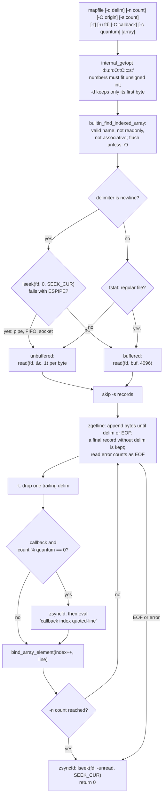

# mapfile and readarray

> [!summary] Claim
> `mapfile` (and its synonym `readarray`) is a bash 4.0+ builtin that reads delimiter-terminated records from one file descriptor straight into an indexed array, one `read(2)` per byte on a pipe and 4096-byte reads plus an `lseek` back on a regular file, and it returns 0 at end of input whatever happened upstream, so the array is only as trustworthy as the producer status you check separately.

Part of [Bash](README.md) in [Shell and Unix Engineering](../README.md).

## TL;DR

- Mechanism: `mapfile -t arr < file` calls `zgetline` in a loop, stores each record with `bind_array_element` at index `origin`, `origin + 1`, and so on, and strips one trailing delimiter per record with `-t` (bash-5.3 builtins/mapfile.def, `mapfile`; lib/sh/zgetline.c).
- Rule: always pass `-t`, feed it with a redirection or `< <(cmd)` (never `cmd | mapfile` without `lastpipe`), use `-d ''` with `find -print0` for file names, and check the producer's status with `wait "$!"` (bash 4.4+) because `mapfile` itself returns 0 (lab).
- Trap: a pipe costs one system call per byte, so 1,000,000 lines (32 MB) took 11.4 s through `< <(cat file)` against 0.185 s from `< file` (measured by hand, bash 5.3.20); and a failed or truncated producer still leaves a plausible, partial array with status 0 (lab).
- Portability: POSIX lists `mapfile` and `readarray` among the names whose results are unspecified (POSIX.1-2024 XCU 2.9.1.4); only bash 4.0 and later have them, so macOS `/bin/bash` 3.2 reports `mapfile: command not found` (127), and zsh's `zsh/mapfile` module is an unrelated associative array of file contents (lab; zsh manual 22.16).
- When not to use it: in `/bin/sh` scripts (use the `while IFS= read -r line || [ -n "$line" ]` loop into `set --`), for input that does not fit in memory, for binary data containing NUL bytes in newline mode, and for anything you would then process line by line anyway (use `awk` or a real language).

## Mental model



The builtin first parses options and resolves the target array, which is the only place it can fail: every later problem, including a read error, ends the loop as if the input had ended, and the builtin returns 0.
The read strategy is chosen once per call from the type of the descriptor: with newline records anything whose `lseek` fails with `ESPIPE` (a pipe, FIFO or socket), and with any other delimiter anything that is not a regular file, is read one byte per system call so that `mapfile` never consumes bytes past the last record it stores, and a regular file is read in 4096-byte blocks and then repositioned with `lseek` so the next reader of the same open file description starts exactly after the last record.
Each record then passes through the optional `-t` chop and the optional callback, which runs before the element is assigned, and lands at the next index; `-n` stops the loop after `count` stored records.

## How it works

### What POSIX says

POSIX.1-2024 has no array variables and no `mapfile`.
It lists `mapfile` and `readarray` in the table of command names whose results are unspecified when the shell finds them during command search, next to `declare`, `local`, `typeset` and `shopt` (POSIX.1-2024 XCU 2.9.1.4), which reserves the names for extensions without defining them.
What the standard does give you is `read`, which reads one logical line into variables and, new in POSIX.1-2024, accepts `-d delim`, where a null `delim` makes the NUL byte the delimiter "to process null-terminated lists of pathnames (as produced by the find -print0 primary)" (POSIX.1-2024 XCU `read`, APPLICATION USAGE); `find -print0` is also new in the same edition (POSIX.1-2024 XCU `find`).
The same `read` page specifies the case that `mapfile` handles differently: "If end-of-file is detected before a terminating logical line delimiter is encountered, the variables specified by the var operands shall be set as described above and the exit status shall be 1" (POSIX.1-2024 XCU `read`, DESCRIPTION), which is why a plain `while read` loop drops an unterminated last line.
The rule that explains `mapfile`'s `lseek` is general: "When a standard utility reads a seekable input file and terminates without an error before it reaches end-of-file, the utility shall ensure that the file offset in the open file description is properly positioned just past the last byte processed by the utility", while for non-seekable files the offset is unspecified (POSIX.1-2024 XCU 1.4 Utility Description Defaults, INPUT FILES).
`mapfile` is not a standard utility, but it honors that rule, and on non-seekable input it goes further than the standard requires by never reading ahead at all.

### The interface

The synopsis is `mapfile [-d delim] [-n count] [-O origin] [-s count] [-t] [-u fd] [-C callback] [-c quantum] [array]`, and `readarray` is the same builtin under a second name: both `$BUILTIN` entries in bash-5.3 builtins/mapfile.def name `$FUNCTION mapfile_builtin`.
With no `array` operand the records go to `MAPFILE` (`DEFAULT_ARRAY_NAME`; the file also defines `DEFAULT_VARIABLE_NAME "MAPLINE"`, commented "not used right now").
The options, as the Bash Reference Manual 4.2 (Bash Builtin Commands) states them and as the source implements them:

- `-d delim`: use "the first character of delim to terminate each input line", and if delim "is the empty string, mapfile will terminate a line when it reads a NUL character"; the code is `delim = *list_optarg`, so `-d ':;'` splits on `:` only, and the empty string yields its terminating NUL byte (lab).
- `-n count`: copy at most `count` records; 0 means all.
- `-O origin`: start at index `origin` and do not clear the array first (the option clears `MAPF_CLEARARRAY`); elements outside the new range survive (lab: `x=(o1 o2 o3 o4)` then two records at `-O 1` gives `o1 a b o4`).
- `-s count`: discard the first `count` records; they are not counted by `-n` (lab: `-s 1 -n 1` on `a b c` stores `b`).
- `-t`: remove one trailing delimiter from each record.
- `-u fd`: read from `fd` instead of 0; the number must fit an `int` and `sh_validfd` must accept it, otherwise `fd: invalid file descriptor: Bad file descriptor` and status 1 (lab).
- `-C callback` and `-c quantum`: evaluate `callback` every `quantum` records, default 5000 (`DEFAULT_QUANTUM`); `-c 0` is "invalid callback quantum" (measured by hand).

The documented exit status is "zero unless an invalid option or option argument is supplied, array is invalid or unassignable, or if array is not an indexed array" (Bash Reference Manual 4.2); nothing about the input can make it nonzero.

### From the operand to the array

`mapfile_builtin` rejects an empty name with status 2 (`EX_USAGE`, "empty array variable name") and any name that fails `valid_identifier` with status 1, so `mapfile 'a[$(cmd)]'` is "not a valid identifier" and the command never runs, and the same holds for a nameref whose value is a subscripted name (measured by hand on bash 5.3.20; bash-5.3 CHANGES, bash-4.4-beta2, the two items labelled j, on namerefs in `mapfile`).
`mapfile` then calls `builtin_find_indexed_array (array_name, flags & MAPF_CLEARARRAY)` (bash-5.3 builtins/common.c), which calls `find_or_make_array_variable (name, 1)` to create the variable or convert a scalar (a scalar's value becomes element 0, so `s=hello; mapfile -t -O 1 s` keeps `hello` at index 0, measured by hand), fails with "not an indexed array" for an associative array, reports a readonly variable through the same lookup, clears the invisible attribute, and calls `array_flush` unless `-O` was given (lab, for an associative array, a readonly name, a closed `-u` descriptor, an empty name and `1x`: statuses `1 1 1 2 1`).
All of this happens before the first byte is read, so a bad target never consumes input.
The target is an ordinary variable assignment in scope terms: inside a function, `mapfile -t g` creates or overwrites the global `g`, and `local g` before it keeps the array local (measured by hand on bash 5.3.15).
`IFS` plays no part, because records are cut only at the delimiter, so `IFS=: mapfile -t z` still keeps `a:b c` as one element (measured by hand on bash 5.3.15); field splitting is a job for `read -a`, not `mapfile` ([[Field-Splitting-and-IFS]]).
Each record is stored with `bind_array_element (entry, array_index, line, 0)` (bash-5.3 arrayfunc.c), which reaches `array_insert`; because the index only grows, every insertion takes the "Fast path for the common case of allocating arrays sequentially" that hooks the element onto the end of the list in O(1) (bash-5.3 array.c, `array_insert`).
`array_index` is an `unsigned int`, and `-O`, `-n`, `-s` and `-c` are each checked with `intval != (unsigned)intval`, so the largest accepted value is 4294967295 and the index wraps: `-O 4294967295` on three lines stores indices 4294967295, 0 and 1, and `-O 4294967296` is "invalid array origin" with status 1 (lab).
The callback sees the wrapped index through a `%d` format, so the first record at `-O 4294967295` is reported as index `-1` (measured by hand).

### The read strategy

Before the loop, `mapfile` decides whether to buffer (bash-5.3 builtins/mapfile.def, `mapfile`):

```c
  if (delim == '\n')
    unbuffered_read = (lseek (fd, 0L, SEEK_CUR) < 0) && (errno == ESPIPE);
  else
    unbuffered_read = (fstat (fd, &sb) != 0) || (S_ISREG (sb.st_mode) == 0);
```

Unbuffered means `zread (fd, &c, 1)`, one `read(2)` per byte, retried on `EINTR` after checking for signals and traps (bash-5.3 lib/sh/zread.c, `zread`).
Buffered means `zreadc`, which refills a static 4096-byte buffer (`ZBUFSIZ`) and hands out one byte at a time; when the loop ends, and before each callback, `zsyncfd` computes the bytes still unread in that buffer and calls `lseek (fd, -off, SEEK_CUR)` so the kernel's offset matches what `mapfile` consumed (bash-5.3 lib/sh/zread.c, `zreadc` and `zsyncfd`).
The effect is that `mapfile` never steals input from the next reader of the same open file description ([[File-Descriptors-and-Open-File-Descriptions]]): `{ mapfile -t -n 1 x; cat; } < file` leaves `b` and `c` for `cat` on a regular file through the `lseek`, and `printf 'a\nb\nc\n' | { mapfile -t -n 1 x; cat; }` does the same on a pipe because nothing was read ahead (lab, both cases).
The price is on pipes: 32,000,000 bytes through a pipe means 32,000,000 system calls, and the measured cost was 11.36 s against 0.185 s for the same file redirected (see Numbers and limits).
The `read` builtin makes the same choice for the same reason (bash-5.3 builtins/read.def sets `unbuffered_read` for pipes, and for terminals when `-n` or `-d` is given, and calls `zsyncfd` when buffered), so this is a property of bash's line readers, not of `mapfile` alone ([[The-read-Builtin]]).
bash 5.1 used `unbuffered_read = 1` for every non-newline delimiter, regular files included; bash 5.2 added the `fstat` test, which is the CHANGES entry "`mapfile` now uses fully-buffered reads in more cases, which should improve bulk read performance" (bash-5.1 and bash-5.3 builtins/mapfile.def compared; bash-5.3 CHANGES, bash-5.2-alpha item v).
On Cygwin every read is unbuffered (`#ifndef __CYGWIN__` around the test).

### Assembling a record

`zgetline` is "Derived from GNU libc's getline" but takes a descriptor, a delimiter and the buffering flag (bash-5.3 lib/sh/zgetline.c).
It grows its buffer from `GET_LINE_INITIAL_ALLOCATION` (64 bytes; 16 in bash 4.0) by doubling, stores each byte including the delimiter, and stops at the delimiter or when the read returns 0 or -1.
It returns `nr - 1`, the number of bytes stored minus one, so a final record without a delimiter (`nr > 0`) is returned as a record and only an empty read at the start of a record (`nr == 0`, return -1) ends the loop: `mapfile` keeps `b` from `a\nb`, where a plain `while IFS= read -r l` loop runs its body once and leaves `b` in `l` (lab, in every shell for the `read` half).
A read error also returns -1 and ends the loop silently: `mapfile -t x < directory` stores nothing and returns 0, while `read` on the same descriptor prints "read error: Is a directory" (lab).
The stored line is a C string, so in newline mode a NUL byte inside a record truncates that element at the NUL and discards the rest of the record: `ab\0cd\nef\n` becomes `ab` and `ef`, whereas bash's `read` (since 4.3, "now skips NUL bytes in the input", bash-5.3 CHANGES, bash-4.3-alpha item p) returns `abcd` (lab).
With `-d ''` the NUL is the delimiter, so records may contain newlines: `a b\0c\nd\0e` gives `a b`, `c` newline `d`, and `e` (lab).

`-t` is `do_chop`: if the last byte of the record equals the delimiter, overwrite it with NUL; exactly one delimiter goes, so `a\n\nbc\n` keeps the empty middle line, with element lengths 2, 1, 3 without `-t` and 1, 0, 2 with it (lab).
With `-d ''` the chop changes nothing visible, because the stored NUL already terminates the C string.
bash 5.2 fixed "a bug that caused `mapfile -t` not to remove the delimiter when the delimiter is > 128 in the current encoding" (bash-5.3 CHANGES, bash-5.2-alpha item gg); the 5.1 code compared the plain `char` `line[length-1]` with an `unsigned char delim`, and the fix is the cast `(unsigned char)line[length-1]`, so the bug could only appear where plain `char` is signed (bash-5.1 and bash-5.3 builtins/mapfile.def compared; the signedness condition follows from the C integer promotions, ISO C 6.3.1.1, which turn a signed `char` above 127 into a negative `int` that can never equal the promoted `unsigned char`; not reproduced on a bash 5.1 binary).

### The callback

When `callback` is set and `line_count % callback_quantum == 0`, `mapfile` first calls `zsyncfd` (if buffered) and then `run_callback`, and only after that calls `bind_array_element`, so the callback runs after the record is read but before it is stored, as the manual says (bash-5.3 builtins/mapfile.def).
`run_callback` builds the string `"%s %d %s"` from the callback text, the index, and the record passed through `sh_single_quote`, and runs it with `evalstring (execstr, NULL, SEVAL_NOHIST)`.
With `-c 2` over five records the callback runs for `b` at index 1 and for `d` at index 3, each time seeing one element fewer than the index implies, and with no `-c` over 5001 records it runs once, for `line5000` at index 4999 (lab).
The record is quoted, so `$(: >"$HIT")` or `'; : >"$HIT"; '` arrive as literal arguments, but the callback text itself is code: `-C eval` turns every record into a command, and the lab shows it creating the marker file.
The source warns about the other direction: "bad things can happen if the callback modifies ENTRY, e.g., unsetting it or changing it to a non-indexed-array type" (bash-5.3 builtins/mapfile.def, comment above `bind_array_element`), and bash 4.3 fixed "seg faults during `mapfile` callbacks if the callback unsets the array variable" (bash-5.3 CHANGES, bash-4.3-alpha item oooo).
Between 5.1 and 5.3 the order changed from callback-then-`zsyncfd` to `zsyncfd`-then-callback, so a callback that reads the same descriptor now sees the offset `mapfile` has actually consumed (bash-5.1 and bash-5.3 builtins/mapfile.def compared; no CHANGES entry found for it).

### Version history

| bash | Change | Source |
| --- | --- | --- |
| 4.0 | `mapfile` added; `readarray` became a synonym in 4.0-release; fixes for interrupting it, for callbacks on the first line, and for EOF typed interactively | bash-5.3 NEWS, bash-4.0 item u; CHANGES, bash-4.0-alpha item u, bash-4.0-release items 1d, 1e, 1f and 3a |
| 4.1 | callback commands no longer stored in the history list; crash on an associative array name fixed; callbacks at the wrong time fixed | NEWS, bash-4.1 item v; CHANGES, bash-4.1-beta items 1a and 3a, bash-4.1-alpha item c |
| 4.2 | callback gets a third argument, the line | NEWS, bash-4.2 item l |
| 4.3 | no longer reads one extra line (with `-n`); no segfault when the callback unsets the array | CHANGES, bash-4.3-alpha items mmm and oooo |
| 4.4 | `-d delim`, and `-t` strips that delimiter; no invalid variable names; array created even when the name is in the temporary environment; nameref fixes | NEWS, bash-4.4 item d; CHANGES, bash-4.4-alpha item hhh, bash-4.4-rc1 item b, bash-4.4-beta2 two items labelled j |
| 5.2 | buffered reads for non-newline delimiters on regular files; `-t` fix for delimiters above 128 | CHANGES, bash-5.2-alpha items v and gg |
| 5.3 | no `mapfile` entry in NEWS or CHANGES | bash-5.3 NEWS and CHANGES searched |

The bash 4.0 loop shows the extra-line bug directly: it called `zgetline` and only then tested `line_count > line_count_goal`, so with `-n 1` it consumed the second line and threw it away (bash-4.0 builtins/mapfile.def); the bash 4.4 loop tests the count after storing (bash-4.4 builtins/mapfile.def).

### Feeding it, and where the array ends up

`mapfile` is a builtin, so it assigns in the shell that runs it, and the plumbing decides which shell that is.
`mapfile -t x < file` and `mapfile -t x < <(cmd)` run it in the current shell ([[Process-Substitution]]); `cmd | mapfile -t x` runs it in a pipeline subshell and the array vanishes (the lab prints 0), unless `shopt -s lastpipe` is set in a shell without job control, which makes the last stage run in the current shell (the lab prints 2; [[Shell-Options-shopt]], [[Subshells-and-the-Execution-Environment]]).
`lastpipe` has one more benefit: under `set -o pipefail` the pipeline's status reports the producer, so `set -o pipefail; shopt -s lastpipe; producer | mapfile -t x` both keeps the array and returns the producer's failure (measured by hand: status 4 with both elements kept; [[pipefail-and-PIPESTATUS]]).
With process substitution the producer's status is not part of any command's status, but bash 4.4 and later let `wait "$!"` return it ("Bash now allows waiting for the most recent process substitution, since it appears as `$!`", bash-5.3 NEWS, bash-4.4 item u; lab: `0 3 1` for mapfile status, producer status, element count).
A here-string always ends in a newline, so `mapfile -t x <<< "$v"` with an empty `v` stores one empty element, where `< <(printf '%s' "$v")` stores none (measured by hand; [[Here-Documents]]).
`-u` reads any descriptor, including a coprocess's output ([[Coprocesses]]); because bash closes the coprocess's descriptors and unsets the `NAME` array when it reaps the coprocess (`coproc_reap` calls `coproc_dispose`, which calls `coproc_unsetvars` and `coproc_close`, in bash-5.3 execute_cmd.c), the lab duplicates the read end first with `exec {rd}<&"${UP[0]}"`, closes the write end so the coprocess sees EOF, and then reads with `mapfile -t -u "$rd" x`.

### Other shells

Only bash has the builtin.
The lab asserts that `command -v mapfile` and `command -v readarray` fail in dash, BusyBox ash, mksh, posh, yash, ksh93, native zsh and `zsh --emulate sh`, and in bash 3.2, and that bash still has `mapfile` as a builtin in POSIX mode.
zsh's similarly named feature is a different thing: `zmodload zsh/mapfile` provides "one special associative array parameter of the same name" whose keys are file names and whose values are file contents, assignment to an element writes the file and unsetting an element deletes it, and "No errors are printed or flagged for non-existent, unreadable, or unwritable files" (zsh manual 22.16 The zsh/mapfile Module).
The zsh idiom for lines into an array is the `f` parameter-expansion flag, "Split the result of the expansion at newlines" (zsh manual 14.3.1 Parameter Expansion Flags), as in `array=("${(f@)mapfile[filename]}")`, which the manual notes yields an extra empty element when the file ends with a newline.
BusyBox ash has no `mapfile` (no occurrence in shell/ash.c), and its `read` takes the same byte-at-a-time approach, `read(fd, &buffer[bufpos], 1)` in `shell_builtin_read` (BusyBox shell/shell_common.c).
In a POSIX shell the only list is the positional parameters, and `set --; while IFS= read -r l || [ -n "$l" ]; do set -- "$@" "$l"; done < file` is the faithful replacement for `mapfile -t`, keeping empty lines, surrounding blanks, and an unterminated last line (lab, every shell family); it is quadratic, because each `set --` copies the whole list.

## Numbers and limits

| Quantity | Value | Source |
| --- | --- | --- |
| Buffer for regular files | 4096 bytes (`ZBUFSIZ`) | bash-5.3 lib/sh/zread.c |
| Reads per byte on a pipe, FIFO or socket | 1 `read(2)` | bash-5.3 builtins/mapfile.def, lib/sh/zread.c `zread (fd, &c, 1)` |
| Initial record buffer | 64 bytes, doubling (16 in bash 4.0) | bash-5.3 and bash-4.0 lib/sh/zgetline.c |
| Maximum record length | none in practice; doubling stops only if the `size_t` size would overflow (the record is then truncated) or when `xrealloc` fails, which is a fatal "cannot allocate" error that ends the shell | bash-5.3 lib/sh/zgetline.c, xmalloc.c `allocerr` |
| Default callback quantum | 5000 records | bash-5.3 builtins/mapfile.def `DEFAULT_QUANTUM`; lab |
| Largest `-O`, `-n`, `-s`, `-c` | 4294967295 (`unsigned int`) | bash-5.3 builtins/mapfile.def; lab rejects `-O 4294967296` |
| Index after 4294967295 | wraps to 0 | lab |
| 1,000,000 lines, 32,000,000 bytes, `mapfile -t x < file` | 0.185 s | measured by hand 2026-11-12, bash 5.3.20, Apple M3 Pro, macOS 27.3, one run |
| Same, `mapfile -t x < <(cat file)` | 11.363 s | same run |
| Same, `mapfile -t -d '' x < file` (one record) | 0.141 s | same run |
| Same, `while IFS= read -r l; do x+=("$l"); done < file` | 5.412 s | same run |
| Same loop fed by `< <(cat file)` | 16.397 s | same run |
| Same, `set -f; IFS=newline; x=($(<file))` | 0.396 s (drops empty lines) | same run |
| 100,000 lines, file versus pipe | 0.017 s versus 1.160 s | same machine, separate run |
| Peak RSS, bash doing nothing / 100,000 lines / 1,000,000 lines | 5.47 MB / 11.96 MB / 69.80 MB | `/usr/bin/time -l`, same machine; about 64 bytes per 31-character element |

The pipe numbers scale linearly with bytes (1.16 s per 3.2 MB and 9.6 to 11.4 s per 32 MB in two runs), which is what one system call per byte predicts; I did not trace the system calls themselves, because macOS `dtruss` needs elevated privileges.
The `-d ''` row exercises the buffered path that bash 5.2 added for non-newline delimiters; on bash 5.1 the same command would take the unbuffered path (source comparison, not measured).

## Portability

| Shell | `mapfile` / `readarray` | `-d ''` NUL records | `read -r -d ''` | Plain `while read` and an unterminated last line | Lines into a list without a loop |
| --- | --- | --- | --- | --- | --- |
| POSIX sh | unspecified name (XCU 2.9.1.4) | n/a | required (XCU `read`) | body skipped, line left in the variable (XCU `read`) | none; the `set --` loop |
| bash 3.2 (macOS `/bin/bash`, `/bin/sh`) | absent, status 127 (lab) | n/a | yes (shell matrix) | body skipped (lab) | `set --` loop (lab) |
| bash 4.0 to 4.3 | yes | "invalid option" (source; lab arm not run) | yes | body skipped | `mapfile -t` |
| bash 4.4 to 5.3 | yes, also in POSIX mode (lab) | yes (lab) | yes (shell matrix) | body skipped (lab) | `mapfile -t` (lab) |
| zsh 5.9 native | absent; `zsh/mapfile` is an associative array (lab; zsh manual 22.16) | n/a | yes (shell matrix) | body skipped (lab) | `"${(f@)...}"` (zsh manual 14.3.1, 22.16) |
| zsh `--emulate sh` | absent (lab) | n/a | yes (shell matrix) | body skipped (lab) | `set --` loop (lab) |
| dash 0.5.12 | absent (lab) | n/a | rejected, status 2 (shell matrix) | body skipped (lab) | `set --` loop (lab) |
| ksh93u+ 2012 / 93u+m 1.0.10 | absent (lab) | n/a | ignores NUL / yes (shell matrix) | body skipped (lab) | `set --` loop (lab) |
| mksh R59 | absent (lab) | n/a | yes (shell matrix) | body skipped (lab) | `set --` loop (lab) |
| yash 2.58.1 | absent (lab) | n/a | rejected, status 2 (shell matrix) | body skipped (lab) | `set --` loop (lab) |
| posh 0.14.1 | absent (lab) | n/a | rejected (shell matrix) | body skipped (lab) | `set --` loop (lab) |
| BusyBox ash 1.37.0 | absent (lab; no occurrence in ash.c) | n/a | yes (shell matrix) | body skipped (lab) | `set --` loop (lab) |

"Lab" cells are assertions in this note's lab, which is written to run across the shell matrix (macOS host, Alpine 3.22, Debian 13); it has been run once, under bash 5.3.20 only.
The `read -r -d ''` column comes from the [[The-read-Builtin]] lab, measured in the shell matrix.
The bash 4.0 to 4.3 row follows the source of those releases and NEWS; the lab has arms for them, but the matrix's bash images start at 3.2 and then 4.4, so those arms may never run.
On the producer side, `find -print0` is standardized in POSIX.1-2024 (XCU `find`), is present in the macOS `find(1)` page, and is a BusyBox build option, `FEATURE_FIND_PRINT0`, "default y" (BusyBox findutils/find.c); uutils was not checked.

## Worked example

The [lab](../labs/04-mapfile-and-readarray/) has one script and 21 bats tests.
`read-records.sh` is the production pattern: NUL-delimited records into an array, with the producer's status recovered, because `mapfile` cannot report it.
This is the script, verbatim:

```bash
#!/usr/bin/env bash
# read-records.sh CMD [ARG...]: run CMD, load its NUL-terminated records into an indexed array,
# print the record count and each record between angle brackets, and exit with CMD's status.
# mapfile returns 0 at end of input whatever the producer did, so the producer's status comes
# from `wait "$!"`, which can wait for a process substitution in bash 4.4 and later.
# Example: read-records.sh printf 'a b\0c\nd\0'
#   -> 2 records
#   -> <a b>
#   -> <c
#   -> d>
case ${BASH_VERSION-} in
  4.[4-9]* | [5-9].*) ;;
  *)
    printf 'read-records.sh: needs bash 4.4 or later\n' >&2
    exit 2
    ;;
esac

# read_records NAME CMD [ARG...]: fill the indexed array NAME with CMD's NUL-terminated records,
# without the NULs; a final record with no NUL is kept. Returns CMD's exit status.
# NAME must not be "name", which is local here.
read_records() {
  local name=$1
  shift
  # shellcheck disable=SC2312 # the status is not masked: wait "$!" returns it on the next line
  mapfile -t -d '' "$name" < <("$@")
  wait "$!"
}

records=()
status=0
read_records records "$@" || status=$?
printf '%d records\n' "${#records[@]}"
for r in "${records[@]}"; do
  printf '<%s>\n' "$r"
done
exit "$status"
```

Captured output on bash 5.3.20 (the lab asserts the same text and statuses):

```text
$ ./read-records.sh printf 'a b\0c\nd\0e'
3 records
<a b>
<c
d>
<e>
[status 0]
$ ./read-records.sh sh -c 'printf "x\0y"; exit 3'
2 records
<x>
<y>
[status 3]
$ /bin/bash read-records.sh printf 'a'
read-records.sh: needs bash 4.4 or later
[status 2]
```

The second run is the case the script exists for: the producer wrote one complete record and one partial one and then failed, `mapfile` stored both and returned 0, and only `wait "$!"` turned that into status 3.
The version guard is a `case` on `BASH_VERSION` rather than arithmetic on `BASH_VERSINFO`, so that dash, zsh, yash, ksh93 and BusyBox ash can parse it and exit with the message instead of a syntax error (the lab asserts status 2 and the message for those families).

## Pitfalls

> [!warning] A failed producer looks like a short input
> Trigger: `mapfile -t hosts < <(curl -fsS "$url" | jq -r '.hosts[]')` under `set -euo pipefail`.
> Symptom: when `curl` fails, `hosts` is empty or partial and the script continues with status 0; neither `errexit` nor `pipefail` sees a process substitution (lab: mapfile status 0, producer status 3).
> Fix: `wait "$!" || exit` right after the `mapfile` (bash 4.4+), or `set -o pipefail; shopt -s lastpipe; producer | mapfile -t hosts` in a non-interactive shell, or write the producer's output to a file, check its status, then `mapfile -t hosts < file`.

> [!warning] Forgetting -t
> Trigger: `mapfile files < list` followed by `[ -e "${files[0]}" ]` or `[[ ${files[0]} == "$want" ]]`.
> Symptom: every element ends in a newline, so the tests fail for names that look right when printed (lab: lengths 2, 1, 3 instead of 1, 0, 2).
> Fix: always `mapfile -t`; the only reason to omit it is to check whether the last record was terminated (its element is the only one without the trailing newline).

> [!warning] Piping into mapfile
> Trigger: `grep ERROR log | mapfile -t hits; echo "${#hits[@]}"`.
> Symptom: 0, because the `mapfile` ran in a subshell that exited with the pipeline (lab).
> Fix: `mapfile -t hits < <(grep ERROR log)`, or `shopt -s lastpipe` in a script; `lastpipe` does nothing while job control is on, so it does not help at an interactive prompt.

> [!warning] Reading through a pipe when a file would do
> Trigger: `mapfile -t x < <(cat big.log)`, `cat big.log | ...` with `lastpipe`, or `-u` on a pipe for large inputs.
> Symptom: one `read(2)` per byte; 32 MB took 11.4 s instead of 0.185 s (measured by hand).
> Fix: redirect the file itself (`< big.log`), so the buffered path and its `lseek` apply; if the data must come from a command and is large, write it to a temporary file first, or do the work in `awk`.

> [!warning] Partial last record
> Trigger: `mapfile -t -d '' files < <(find . -print0)` when `find` is killed or fails halfway through writing a name.
> Symptom: the partial name is stored as an ordinary element, because `zgetline` returns an unterminated final record; POSIX warns of the same failure for `find -print0 | xargs -r0`, "if find -print0 is terminated after it has written a partial pathname, the partial pathname may be processed as if it was a complete pathname" (POSIX.1-2024 XCU `find`, EXAMPLES).
> Fix: check the producer's status with `wait "$!"` and discard the array on failure; for newline records, omit `-t` and check that the last element ends in a newline.

> [!warning] Empty input through a here-string
> Trigger: `mapfile -t lines <<< "$(cmd)"` where `cmd` printed nothing.
> Symptom: `${#lines[@]}` is 1 and the loop runs once with an empty string, because a here-string appends a newline (measured by hand).
> Fix: `mapfile -t lines < <(cmd)`, which stores zero elements for empty output.

> [!warning] NUL bytes in newline mode
> Trigger: `mapfile -t x < binary-or-UTF-16-file`.
> Symptom: each element silently ends at its first NUL and the rest of that line is lost (lab: `ab\0cd` becomes `ab`), while `read` silently drops the NUL instead (lab: `abcd`), so the two disagree on the same data.
> Fix: never treat binary data as lines in the shell; use `-d ''` only for data whose records are NUL-terminated, and `od`, `xxd` or a real language for binary.

> [!warning] -O does not clear
> Trigger: reusing an array with `mapfile -t -O 0 x < new` to "append from 0", or appending with `-O "${#x[@]}"` to a sparse array.
> Symptom: elements beyond the new range survive from the previous contents (lab: `o1 a b o4`); on a sparse array `${#x[@]}` is not the next free index, so the append overwrites ([[Indexed-Arrays]]).
> Fix: omit `-O` to replace the array; to append, compute the next index as one past the highest set index, or read into a temporary array and `x+=("${tmp[@]}")`.

> [!warning] mapfile on macOS
> Trigger: `#!/bin/bash` or `#!/bin/sh` on macOS, where both are bash 3.2.57.
> Symptom: `mapfile: command not found`, status 127 (lab; captured above for the script's guard).
> Fix: `#!/usr/bin/env bash` plus a version check at startup, or the `set --` loop for `/bin/sh` ([[Bash-3-2-on-macOS]]).

I found no CVE and no published postmortem whose root cause is `mapfile`, so none is cited; the crash fixes in the version history (an associative array name in 4.0, a callback unsetting the array before 4.3) are the closest documented defects.

## Security and robustness

`-C` is an `eval`: the callback text is concatenated with the index and the quoted record and passed to `evalstring`, so a callback built from data (`-C "$handler"`) is [[Command-Injection]], and a callback that re-evaluates its arguments (`-C eval`, or a function that runs `eval "$2"`) turns every input record into code (lab: `-C eval` creates the marker file).
The record itself is safe as an argument because `sh_single_quote` quotes it; the lab feeds `$(: >"$HIT")` and a single-quote breakout and no file appears ([[The-eval-Builtin]]).
The array-name operand is validated as a plain identifier, so `mapfile "$name"` with `name='a[$(cmd)]'` is rejected before any input is read, unlike `read "a[$i]"`, whose subscript is evaluated ([[Indexed-Arrays]]); even so, take the name from code, not from data, because a valid name such as `PATH` or `IFS` is accepted and overwritten (here `PATH` becomes an array whose element 0 is the first line).
There is no length limit on a record and no limit on the count unless you pass `-n`, so an untrusted producer can make the shell allocate until `xrealloc` fails, which ends the shell; bound the input upstream (`head -c`, `head -n`) or with `-n` when the producer is not trusted.
Everything `mapfile` stores is data that later expansions may reinterpret: quote every use (`"${x[@]}"`, `"${x[i]}"`), and when a record becomes an argument to a command, end the options first (`rm -- "${files[@]}"`), because a file named `-rf` is a valid record.
For file names, the only fully safe record separator is NUL, because a name can contain every other byte, including newline; pair `find ... -print0` with `mapfile -d ''`, check the producer's status, and remember that `-d ''` needs bash 4.4.

## The principal's view

The decision is not whether `mapfile` is better than a `while read` loop; it is, by 29x on a regular file in the hand measurement, and it gets the unterminated last line right.
The decision is whether this data should be in a shell array at all.
`mapfile` is the right tool when the list is small enough to hold in memory, the next step is to pass the elements as arguments or iterate over them a few times, and the script is already committed to bash 4.4 or later.
It is the wrong tool when the producer can fail (unless the script checks `wait "$!"`), when the data is a stream that should be processed as it arrives, when it is large (one element costs about twice its text in memory, and a pipe costs one system call per byte), or when the records have structure, which belongs in `awk`, `jq`, or Python.
For an organization the policy question is the bash floor: `mapfile` needs 4.0, `-d ''` and `wait "$!"` need 4.4, and macOS ships 3.2, so either the fleet installs a modern bash and every script checks `BASH_VERSINFO`, or scripts that must run on stock macOS use the POSIX loop ([[Bash-Version-History]]).
In review, the three questions that catch most `mapfile` bugs are: is there a `-t`, where is the producer's status checked, and does the input arrive through a pipe that makes it slow or a subshell that makes it vanish.

## Interview questions

> [!question] L5: What does `-t` do in `mapfile -t`, and what goes wrong without it?
>
> > [!success]- Answer
> > `-t` removes one trailing delimiter, a newline by default, from each record before it is stored.
> > Without it every element ends in a newline, so comparisons, `[ -e "$f" ]` tests, and arguments built from the elements fail even though printed output looks correct.
> > Only one delimiter is removed, so an empty line still becomes an empty element.
> > The one use of omitting it is to see whether the last record was terminated, since only that element can lack the newline.
> >
> > Follow-up: What does `-t` do when the delimiter is NUL (`-d ''`), and why?

> [!question] L5: Predict the output.
>
> ```bash
> mapfile -t a <<< ""
> printf 'x\ny' | mapfile -t b
> mapfile -t -O 4294967295 c < <(printf '1\n2\n')
> echo "${#a[@]} ${#b[@]} ${!c[@]}"
> ```
>
> > [!success]- Answer
> > It prints `1 0 0 4294967295`.
> > The here-string appends a newline, so `a` holds one empty element.
> > `b` was filled in a pipeline subshell, so the parent never assigned it and its count is 0.
> > The index in `mapfile` is an `unsigned int`, so after 4294967295 it wraps to 0, and `${!c[@]}` lists indices in ascending order.
> >
> > Follow-up: Which of the three would change with `shopt -s lastpipe`, and which with `< <(printf '')` instead of the here-string?

> [!question] L5: How does `mapfile` differ from `while IFS= read -r line; do arr+=("$line"); done < file`?
>
> > [!success]- Answer
> > `mapfile` keeps a final line that has no newline, while the loop's last `read` returns 1 and the body never sees that line.
> > `mapfile` is one builtin call instead of one `read` and one assignment per line, which measured 0.185 s against 5.4 s for a million lines from a file.
> > In newline mode `mapfile` truncates a record at a NUL byte, while bash's `read` drops the NUL and keeps the rest.
> > The loop works in every POSIX shell if the array is replaced by `set --`, while `mapfile` needs bash 4.0.
> >
> > Follow-up: How do you fix the loop so it keeps the unterminated last line?

> [!question] L6: Debug this script: it deployed to zero hosts and printed success during an API outage.
>
> ```bash
> #!/usr/bin/env bash
> set -euo pipefail
> mapfile -t hosts < <(curl -fsS "$INVENTORY_URL" | jq -r '.hosts[]')
> for h in "${hosts[@]}"; do deploy "$h"; done
> echo "deployed to ${#hosts[@]} hosts"
> ```
>
> > [!success]- Answer
> > `mapfile` returns 0 at end of input no matter what the producer did, and the producer runs in a process substitution, whose status is not part of any command that `errexit` or `pipefail` checks.
> > `curl -f` failed, `jq` saw empty input, `hosts` was empty, and the loop and the success message ran.
> > Fix it with `wait "$!" || { echo "inventory failed" >&2; exit 1; }` immediately after the `mapfile` (bash 4.4 or later), and also reject an empty list explicitly, because an empty but successful inventory is usually an error too.
> > An alternative is `shopt -s lastpipe` with the pipeline written as `curl ... | jq ... | mapfile -t hosts`, where `pipefail` then reports the failure.
> >
> > Follow-up: If `curl` dies after printing half the list, what does each fix do?

> [!question] L6: Why is `mapfile -t x < <(cat file)` about 60 times slower than `mapfile -t x < file`?
>
> > [!success]- Answer
> > For each call, `mapfile` checks whether the descriptor can seek; a pipe fails `lseek` with `ESPIPE`, so it reads one byte per `read(2)` call to avoid consuming bytes past the last record it stores.
> > On a regular file it reads 4096-byte blocks and, when it stops, seeks back over the unread part of the buffer with `zsyncfd`.
> > 32 MB through a pipe is therefore 32 million system calls, measured at 11.4 s against 0.185 s.
> > The fix is to redirect the file directly, or to spool command output to a temporary file when it is large.
> >
> > Follow-up: Why can't bash simply buffer pipe input and keep the extra bytes for later?

> [!question] L6: After `{ mapfile -t -n 1 x; cat; } < file`, what does `cat` print, and what guarantees it?
>
> > [!success]- Answer
> > `cat` prints every line after the first.
> > `mapfile` read a 4096-byte block, stored one line, and then `zsyncfd` called `lseek (fd, -unread, SEEK_CUR)`, so the shared file offset points just past the first line.
> > This is the behavior POSIX requires of standard utilities on seekable input in XCU 1.4, and on a pipe the same result comes from reading one byte at a time.
> > bash 4.0 to 4.2 would print only the third line, because their loop read one line past the count before checking it (bash-4.0 source and the bash-4.3 CHANGES entry; not run here).
> >
> > Follow-up: What would `cat` print if `mapfile` used stdio buffering without the `lseek`?

> [!question] L7+: A reviewer approves `mapfile -t -C "$HOOK" -c 1 rows < "$input"`, where `HOOK` comes from a configuration file: what is the risk, and what policy do you set?
>
> > [!success]- Answer
> > The callback text is evaluated with `evalstring`, so whoever controls the configuration controls a command that runs once per row with the script's privileges.
> > The row is passed single-quoted and cannot inject by itself, but a hook that re-evaluates its arguments, such as `eval`, makes every row code.
> > The policy is that `-C` takes only a function name defined in the script, validated against an allowlist, and that the function treats `$2` as data.
> > Most uses of `-C` are progress reporting, which is better done after `mapfile` returns or by reading in chunks with `-n`.
> >
> > Follow-up: What breaks if the callback modifies the array that `mapfile` is filling?

> [!question] L7+: Your scripts must run on stock macOS, Debian, and Alpine, so what is your policy for reading lists of file names?
>
> > [!success]- Answer
> > Stock macOS has bash 3.2 as `/bin/bash` and `/bin/sh`, with no `mapfile`, and Alpine's `/bin/sh` is BusyBox ash, so a portable script cannot depend on `mapfile`.
> > For a POSIX script, the producer side is `find ... -exec cmd {} +`, which never parses names at all, and when names must be iterated in the shell, `read -r -d ''` is now POSIX but dash 0.5.12, posh 0.14.1 and yash 2.58.1 reject `-d` (measured in the shell matrix), yash 2.59 and later accept it but treat `-d ''` as no delimiter, and ksh93u+ 2012 ignores the NUL ([[The-read-Builtin]], as of 2026-11), so the `-exec` form is the only one that works everywhere.
> > For scripts that declare bash, require 4.4 or later, check `BASH_VERSINFO` at startup, and use `mapfile -t -d '' files < <(find ... -print0)` followed by `wait "$!"`.
> > CI must run the scripts under bash 3.2, the oldest supported Linux bash, and BusyBox, because the failures are a missing builtin, an invalid option, or a missing `wait` feature, none of which shows on a developer's current bash.
> >
> > Follow-up: Why is `find -print0 | xargs -0` less safe than `find -exec` when `find` can be interrupted?

> [!question] L7+: When would you refuse to put a dataset in a bash array via `mapfile`, even in a bash-only codebase?
>
> > [!success]- Answer
> > When it may not fit in memory: each element costs roughly twice its text in the hand measurement, and there is no limit on record length or count unless `-n` is set.
> > When it should be streamed, because `mapfile` must read to the end before the script can act on the first record.
> > When it is binary or has structure, since NUL bytes truncate records and fields need `awk`, `jq`, or a real parser.
> > When the producer is untrusted or can fail mid-stream, unless every call checks the producer's status, because a partial array looks valid.
> >
> > Follow-up: How would you process a 10 GB log of NUL-separated records in a bash-centric toolchain?

## Related

Prerequisites: [[Coprocesses]]

Next: [[printf-v-and-printf-q]]

See also: [[Indexed-Arrays]], [[The-read-Builtin]], [[Process-Substitution]], [[pipefail-and-PIPESTATUS]], [[Shell-Options-shopt]], [[Subshells-and-the-Execution-Environment]], [[Pipelines-and-And-Or-Lists]], [[File-Descriptors-and-Open-File-Descriptions]], [[Pipes-and-FIFOs]], [[Here-Documents]], [[Command-Injection]], [[The-eval-Builtin]], [[Namerefs-and-Dynamic-Scope]], [[wait-n-and-wait-p]], [[Exit-Status-and-Wait-Status]], [[Field-Splitting-and-IFS]], [[Bash-Version-History]], [[Bash-3-2-on-macOS]]

## Further reading

- GNU bash 5.3 source, builtins/mapfile.def, lib/sh/zgetline.c, lib/sh/zread.c, builtins/common.c and array.c: https://mirrors.kernel.org/gnu/bash/bash-5.3.tar.gz - the whole implementation, from option parsing to the `lseek` back.
- Bash Reference Manual 4.2 Bash Builtin Commands, `mapfile`, in doc/bashref.texi of the same tarball - the specification, including when the callback runs.
- bash NEWS and CHANGES in the same tarball - the release that introduced or fixed each behavior in the version history.
- GNU bash 5.1, 4.4 and 4.0 sources: https://mirrors.kernel.org/gnu/bash/ - compare `mapfile.def` across releases to see the buffering, callback-order and `-n` changes.
- POSIX.1-2024 XCU 2.9.1.4 Command Search and Execution: https://pubs.opengroup.org/onlinepubs/9799919799/utilities/V3_chap02.html - `mapfile` and `readarray` as unspecified names.
- POSIX.1-2024 XCU `read`: https://pubs.opengroup.org/onlinepubs/9799919799/utilities/read.html - the portable reader, its new `-d` option, and its end-of-file rule.
- POSIX.1-2024 XCU 1.4 Utility Description Defaults: https://pubs.opengroup.org/onlinepubs/9799919799/utilities/V3_chap01.html - the file-offset rule behind `zsyncfd`.
- POSIX.1-2024 XCU `find`: https://pubs.opengroup.org/onlinepubs/9799919799/utilities/find.html - `-print0` and the partial-pathname warning.
- zsh manual 22.16 The zsh/mapfile Module: https://zsh.sourceforge.io/Doc/Release/Zsh-Modules.html - the unrelated zsh feature with the same name.
- zsh manual 14.3.1 Parameter Expansion Flags: https://zsh.sourceforge.io/Doc/Release/Expansion.html - the `f` flag, zsh's way to split into lines.
- BusyBox shell/shell_common.c: https://raw.githubusercontent.com/mirror/busybox/master/shell/shell_common.c - a second shell that reads one byte per system call for the same reason.
