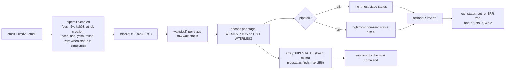

# pipefail and PIPESTATUS

> [!summary] Claim
> A pipeline's status is one number chosen from N child wait statuses, and `pipefail` and the `PIPESTATUS` array are two different answers to "which one": `pipefail` changes the number that `$?`, `set -e`, and `&&` see, while `PIPESTATUS` keeps all N for exactly one command and is then overwritten.

Part of [Bash](README.md) in [Shell and Unix Engineering](../README.md).

## TL;DR

- Mechanism: the shell reaps every stage with `waitpid(2)`; by default `$?` is the rightmost stage's status, under `set -o pipefail` it is the rightmost non-zero status (0 if all succeeded), and bash and mksh (`PIPESTATUS`) and native zsh (`pipestatus`) also publish every stage's status in an array (POSIX.1-2024 XCU 2.9.2; lab tests 2, 3, and 8).
- Rule: copy the array in one simple command, `ps=("${PIPESTATUS[@]}")`, immediately after the pipeline, because in bash the next command of any kind, including an assignment, `:`, `[`, `eval`, or a function call, replaces it, and in mksh every such command does unless it ran a pipeline of its own (lab tests 9, 10, and 12).
- Trap: under `set -e -o pipefail`, a writer killed by `SIGPIPE` because its reader exited early fails the pipeline with 141, so `producer | head -n 1` can abort a script that did nothing wrong (lab test 13).
- Portability: `pipefail` is in POSIX.1-2024 and in bash 3.0+, zsh, ksh93, mksh, yash, BusyBox ash, the BSD shells, and dash 0.5.13 (or Debian's patched 0.5.12), but not in posh or older dash builds; the per-stage array is not standardized and exists only in bash, mksh, and native zsh (lab tests 1 and 8).
- When not to use it: `pipefail` reports a failure after the downstream stage has already consumed the bad data, so it cannot protect `curl ... | sh` or `gen | apply`; when the consumer has side effects, write to a file, check the producer, then run the consumer.

## Mental model



The shell creates one pipe per boundary, forks one child per stage, and later collects one raw wait status per child from the kernel.
Each raw status is decoded the same way a simple command's would be: a normal exit gives `WEXITSTATUS`, death by signal N gives 128 + N in bash, zsh, dash, mksh, and BusyBox ash (256 + N in ksh93, 384 + N in yash).
From that vector the shell derives a single pipeline status: the rightmost element, or with `pipefail` the rightmost non-zero element; a leading `!` then inverts it, and only that one number reaches `$?`, `set -e`, and `&&` or `||`.
In parallel, bash, mksh, and native zsh copy the whole decoded vector into an array, which lives only until the next command finishes and replaces it.

## How it works

### The specification

POSIX.1-2024 (Issue 8) defines the pipeline exit status as a four-row table indexed by "pipefail enabled" and "begins with `!`" (POSIX.1-2024 XCU 2.9.2):

| `pipefail` | Begins with `!` | Exit status |
|---|---|---|
| no | no | The status of the last (rightmost) command. |
| no | yes | 0 if the last command returned non-zero, otherwise 1. |
| yes | no | 0 if every command returned 0, otherwise the status of the last (rightmost) command that returned non-zero. |
| yes | yes | 0 if any command returned non-zero, otherwise 1. |

Lab test 3 checks all four rows plus `! true | true` under `pipefail` (1) and prints `off=0 off_bang=1 on=3 on_bang=0 on_bang_ok=1` in every shell that has the option.
The option itself is defined in the `set` special built-in as "Derive the exit status of a pipeline from the exit statuses of all of the commands in the pipeline, not just the last (rightmost) command" (POSIX.1-2024 XCU 2.15, set).
The change history of `set` records "Austin Group Defect 789 is applied, adding -o pipefail", and the rationale for pipelines carries the same note (POSIX.1-2024 XRAT C.2.9.2).

Three details of the text matter in practice.
First, "rightmost" is spatial, not temporal.
In bug 789, the commenter stephane objected that "last" was ambiguous and gave `(sleep 3; exit 3) | (sleep 1; exit 2) | true`, which must give 2, not 3, and the published table says "last (rightmost) command specified".
Lab test 2 runs the same shape, with the left stage failing a second after the middle one, and every shell with `pipefail` prints `status=2`.
The ksh93u+m manual still says "the last component command that exited with a non-zero exit status", and RELEASE93 described the 93g feature as "the last command to fail", yet the measured value is the rightmost one there too.
Second, the setting is sampled: "The shell shall use the pipefail setting at the time it begins execution of the pipeline, not the setting at the time it sets the exit status of the pipeline", with the example `command1 | set -o pipefail` (POSIX.1-2024 XCU 2.9.2).
That sentence was added after kre, who had added `pipefail` to NetBSD sh, pointed out in bug 789 note 4102 that nobody had defined when the option is read for an asynchronous pipeline, and Chet Ramey noted that implementations disagreed; the next section shows they still do.
Third, the shell is still only required to "wait for the last command specified in the pipeline to complete, and may also wait for all commands to complete" (POSIX.1-2024 XCU 2.9.2); a shell that implements `pipefail` must wait for all stages when the option is on, because it cannot know the rightmost non-zero status before every stage has exited.

The rationale explains why the default was never changed: a bitwise OR of all statuses was suggested, "However, the choice of the last-specified command semantics are historical practice and would cause applications to break if changed", illustrated by `sleep 5 | (exit 4)` giving 4 and `(exit 4) | sleep 5` giving 0 (POSIX.1-2024 XRAT C.2.9.2).
`set -e` sees only the derived number: "The failure of any individual command in a multi-command pipeline ... shall not cause the shell to exit. Only the failure of the pipeline itself shall be considered", and `-e` is ignored for "a pipeline beginning with the `!` reserved word" (POSIX.1-2024 XCU 2.15, set).
So `pipefail` is the only standard way to make `set -e` react to an upstream stage, and `! a | b` is never an errexit trigger whatever the option says.
A signal death must map to a status "greater than 128" that identifies the signal "in an implementation-defined manner", and values above 255 are explicitly allowed (POSIX.1-2024 XCU 2.8.2), which is why ksh93 and yash report 269 and 397 for `SIGPIPE`.

POSIX standardizes no per-stage array.
Notes from the 2014-01-09 Austin Group phone call, posted to bug 789 as note 2107, said that knowing a pipeline failed "is not as useful without an array variable of which process(es) in the pipeline failed" and floated a space-separated `POSIX_PIPE_STATUS`.
A later note (2253, 2014-05-28) proposed standardizing only the option because "busybox ash lacks arrays, and ksh does not have an equivalent array of exit statuses", and that is what was done.
For background pipelines, the `wait` page says the result "shall be the exit status of the process requested by the last pid operand", and its example says that both `wait <pid of sleep 31>` and `wait %%` return the status of the last process of `sleep 257 | sleep 31 &` (POSIX.1-2024 XCU wait); the text never mentions `pipefail`, which is part of why shells split on it (lab test 7).

### The kernel's part

The kernel knows nothing about pipelines.
Each stage is an ordinary child; when it exits, the kernel keeps a wait status (exit code in bits 8-15, or the terminating signal in bits 0-6) until the parent reaps it with `waitpid(2)`.
A pipeline status therefore costs N reaps, and a shell that reports `pipefail` or an array must keep N statuses in its job table until the last stage is reaped.
The only interaction with the pipe itself is `SIGPIPE`: a writer whose reader has gone gets `SIGPIPE` on its next `write(2)`, dies with signal 13 under the default disposition, and its slot reads 141; this is the subject of [[SIGPIPE-and-EPIPE]], and here it matters only because `pipefail` turns that death into a pipeline failure (lab test 13).

### bash

bash stores each pipeline as a `JOB` whose `pipe` field is a circular list of `PROCESS` records, one per stage, each holding the raw `WAIT status`.
When the job is created, `stop_pipeline` records the option in the job: `if (pipefail_opt) newjob->flags |= J_PIPEFAIL;` (bash-5.3 jobs.c, stop_pipeline), with `#define J_PIPEFAIL 0x40 /* pipefail set when job was started */` (bash-5.3 jobs.h).
The status is derived in `raw_job_exit_status`: if the job has `J_PIPEFAIL`, it walks the whole ring and keeps the last raw status that is not `EXECUTION_SUCCESS`, which is the rightmost non-zero one; otherwise it returns the last process's status (bash-5.3 jobs.c, raw_job_exit_status).
`process_exit_status` then decodes it: `128 + WTERMSIG (status)` for a signal, `WEXITSTATUS` for a normal exit, and 0 for a stopped process (bash-5.3 jobs.c, process_exit_status).
`J_PIPEFAIL` is present in the bash 5.0 tarball and absent from 4.4, whose `raw_job_exit_status` tested the global `pipefail_opt` at the moment the status was computed; lab test 7 shows the consequence, `start_only=3 wait_only=0` on bash 5.3 and `start_only=0 wait_only=3` on bash 3.2.57.

`PIPESTATUS` is a plain array variable that the shell overwrites.
For a foreground job that has finished, `wait_for` calls `setjstatus`, which decodes every stage into a static `int` buffer it grows with `xrealloc` and passes it to `set_pipestatus_array` (bash-5.3 jobs.c, setjstatus).
`set_pipestatus_array` looks the variable up by name, creates it with `make_new_array_variable ("PIPESTATUS")` if it does not exist, and, if it exists but `array_p (v) == 0`, returns without doing anything, under the comment "Do nothing if not an array variable" (bash-5.3 variables.c, set_pipestatus_array).
It has no read-only check; it edits the array cell in place, replacing elements, appending, or flushing and rebuilding when the new pipeline is shorter.
Everything that is not a pipeline job goes through `set_pipestatus_from_exit (s)`, which installs a one-element array: builtins and shell functions (`execute_simple_command`), assignment-only and redirection-only commands (`execute_null_command` path), `[[` and `((` (`execute_command_internal`), syntax errors (`report_syntax_error` in y.tab.c), expansion errors (`exp_jump_to_top_level` in subst.c), and every caller of `set_exit_status` (bash-5.3 execute_cmd.c, subst.c, shell.c).
Traps and the bash 5.3 `${ ...; }` function substitution save and restore the array with `save_pipestatus_array` and `restore_pipestatus_array` (bash-5.3 trap.c, run_pending_traps and _run_trap_internal; subst.c, function_substitute), so a trap's own commands do not clobber the value the interrupted code was about to read.

The manual states the resulting rule: bash sets `PIPESTATUS` "after executing multi-element pipelines, timed and negated pipelines, simple commands, subshells created with the ( operator, the `[[` and `((` compound commands, and after error conditions that result in the shell aborting command execution" (bash-5.3 doc/bash.1, PIPESTATUS).
Compound commands such as `if`, `while`, and `{ }` do not set it themselves; afterwards it holds whatever the last command executed inside them left there.

The bash CHANGES file dates each piece: `PIPESTATUS` is a new variable in bash-2.0; "PIPESTATUS to not be set when builtins or shell functions were executed in the foreground was fixed" in bash-2.02; `set -o pipefail` is item gg of bash-3.0; bash-3.1 fixed a bug that made the shell ignore the rightmost command's status when `pipefail` was enabled; bash-3.2 "Changed the `[[` and `((` compound commands to set PIPESTATUS"; bash-4.0 made failed word expansions set it; bash-4.2 "Fixed a bug that caused execution of a trap to overwrite PIPESTATUS"; bash-5.0 fixed `lastpipe` with `pipefail` returning a wrong status; and bash-5.1 "Fixed several places where the shell set `$?` without setting PIPESTATUS".

With `shopt -s lastpipe` and job control off, the last stage runs in the current shell, and `execute_pipeline` appends that stage's result to the job with `append_process` so `PIPESTATUS` and `pipefail` still cover all stages (bash-5.3 execute_cmd.c, execute_pipeline).
Measured by hand on bash 5.3.15, `shopt -s lastpipe; (exit 3) | (exit 4) | { read -r _; v=set; (exit 5); }` leaves `PIPESTATUS` as `3 4 5` and `v` set.
`local -` (bash 4.4+, per CHANGES) saves the full set of `set -o` options, not only the single-letter ones: bash 4.4's `get_current_options` already records binary options such as `pipefail` with `GET_BINARY_O_OPTION_VALUE` (bash-4.4 builtins/set.def, get_current_options), and bash 5.1 added `set_shellopts ()` on restore so `SHELLOPTS` follows (bash-5.1 variables.c).
Lab test 16 shows a function-scoped `pipefail` not leaking on bash 5.3 (`local_dash=0`) and leaking on 3.2 (`local_dash=1`).
Because `SHELLOPTS` is read from the environment at startup, `env SHELLOPTS=pipefail bash -c 'false | true; echo $?'` prints 1 (lab test 16), unless bash starts with differing real and effective IDs and no `-p`, in which case `SHELLOPTS`, `BASHOPTS`, `CDPATH`, and `GLOBIGNORE` from the environment are ignored (bash-5.3 doc/bash.1, INVOCATION).
`PIPESTATUS` is not on that list.

### zsh

zsh calls the option `PIPE_FAIL` and the array `pipestatus`.
`storepipestats` walks the job's processes, encodes each as `0200 | WTERMSIG` for a signal (128 + N), `0200 | WEXITSTATUS` for a stopped process, or `WEXITSTATUS`, and remembers the last non-zero one as `pipefail`; it then copies them into the global `pipestats[MAX_PIPESTATS]` (zsh-5.9 Src/jobs.c, storepipestats), with `#define MAX_PIPESTATS 256` (zsh-5.9 Src/zsh.h).
The loop stops at 256, so in a longer pipeline the array keeps the first 256 stages and loses the rightmost ones: lab test 14 runs 300 stages whose last exits 7 and prints `n=256 last=0 rc=7` in zsh against `n=300 last=7 rc=7` in bash.
`$?` is unaffected because it comes from the last process, not from the array.
The option is read with `isset(PIPEFAIL)` inside `storepipestats`, at the time the status is stored, not when the pipeline began.
When the last stage ran in the current shell (`STAT_CURSH`, native zsh's default), the code is `if (!lastval && isset(PIPEFAIL)) lastval = pipefail;`, evaluated after that stage has run, so `false | set -o pipefail` returns 1 in native zsh and leaves the option on (lab test 4: `status=1 after=on`), contrary to the XCU 2.9.2 example.
`pipestatgetfn` and `pipestatsetfn` back the parameter (zsh-5.9 Src/params.c), and the parameter list marks it `<S> <Z>`, where `<Z>` "indicates that the parameter does not exist when the shell initializes in sh or ksh emulation mode" (zsh-5.9 Doc/Zsh/params.yo), so `zsh --emulate sh` has neither `pipestatus` nor `PIPESTATUS` (lab test 8 prints `unsupported` there).
zsh replaces `pipestatus` after a pipeline, a builtin, or `eval`, but not after an assignment or a function call: `false | (exit 2); a=$pipestatus[1]; b=$pipestatus[2]` gives `1` and `2` (lab test 10), and after `f() { false | (exit 4); }; f` the array is `1 4`, the function's last pipeline (lab test 12).
The option and its test went into the zsh tree on 2013-10-06 ("users/18023 ... add PIPEFAIL option and test"), and a 2013-10-24 entry fixed "PIPEFAIL behavior when the last command in a pipeline is executed within the current shell" (zsh-5.9 ChangeLog).

### mksh

mksh documents `pipefail` as "Make the exit status of a pipeline the rightmost non-zero errorlevel, or zero if all commands exited with zero" and `PIPESTATUS` as "An array containing the errorlevel (exit status) codes, one by one, of the last pipeline run in the foreground" (mksh.1).
`execute()` marks `PIPESTATUS` for replacement at the start of every command (`vp_pipest->flag |= INT_L`) and, at its end, replaces it with a one-element array holding that command's status unless a pipeline cleared the mark (mksh exec.c, execute).
A pipeline passes `XPIPEST` to `exchild`, and `j_waitj` rebuilds the array with one element per process, flagged `INTEGER | RDONLY | ARRAY` without `INT_L`, while folding in `Flag(FPIPEFAIL)` at that moment (mksh jobs.c, j_waitj).
The mark is shared by nested `execute()` calls, so a pipeline run inside a function body or an `eval` string also clears it for the enclosing command: after `f() { false | (exit 4); }; f` the array is `1 4`, and after `eval 'false | (exit 5)'` it is `1 5`, measured on mksh R59 2020/10/31 (Alpine) and R59 2025/04/26 (Debian) (lab test 12).
So mksh's array is read-only to scripts (`PIPESTATUS=x` fails with "read-only: PIPESTATUS"), is replaced by every simple command that runs no pipeline of its own (an assignment, `:`, `[`), unlike bash survives a function call or `eval` that ended in a pipeline, and reads the option when it waits.

### dash, BusyBox ash, yash, and the BSD shells

dash added the option in commit `6347b9fc52d742f36a0276cdea06cd9ad1f02c77` ("jobs: Implement pipefail option", authored by Chris Novakovic on 2022-04-22), which changes only the option tables, the manual, and `getstatus`: start from the last process's status and, `if (pipefail)`, walk left `while (status == 0 && --ps >= job->ps)` (dash jobs.c, getstatus).
Its manual text says the option counts if it "was enabled when the shell began execution of the pipeline", but `getstatus` reads the global flag when the status is computed, so a background pipeline collected by `wait` uses the setting at `wait` time (lab test 7: `start_only=0 wait_only=3` on dash 0.5.13).
BusyBox ash has the same loop in its `getstatus`, compiled in under `BASH_PIPEFAIL`, which is `ENABLE_ASH_BASH_COMPAT` (default y), and builds a signal status as `retval |= 128` (busybox shell/ash.c, getstatus).
yash's `calc_status_of_job` returns the last process's status unless `shopt_pipefail`, in which case it scans from the right for the first non-zero one; signals map to `WTERMSIG + TERMSIGOFFSET` (yash job.c, calc_status_of_job), and its manual describes the option only as "zero if and only if all the subcommands of the pipeline exit with an exit status of zero" (yash `set` manual).
NetBSD sh documents the POSIX semantics explicitly: "the status of the last (lexically last, i.e.: rightmost) command in the pipeline to exit with non-zero exit status" if the option "was set when a pipeline was started" (NetBSD sh.1); kre, its maintainer, wrote in bug 789 that NetBSD 8's implementation reads the option when the status is collected.
FreeBSD sh documents `pipefail` and warns that "Since an exit due to SIGPIPE counts as a non-zero exit status, this option may cause non-zero exit status for successful pipelines" (FreeBSD sh.1).

### ksh93

ksh introduced the option: "The pipefail option has been added. With pipefail enabled, a pipeline will not complete until all commands are complete" (ksh RELEASE93, 12/28/93g); bug 789's submitter dates that to 1998.
The manual still says that "If the monitor or pipefail option is on, or the pipeline is preceded by the reserved word time, then the shell waits for all component commands in the pipeline to terminate; otherwise, the shell only waits for the last component command" (ksh93u+m sh.1, Pipelines).
Lab test 6 makes this visible: an upstream stage that creates a file after one second has not run yet when `cmd | true` returns in ksh93 (`not-waited`), and has run under `pipefail` (`waited`); bash, zsh, and dash always wait.
ksh93u+m's NEWS records two `pipefail` bugs inherited from ksh93u+ 2012, the version still shipped as macOS `/bin/ksh`: on 2020-09-30, "if both the 'errexit' and 'pipefail' options are active, ksh now correctly exits if any pipeline element returns nonzero", and on 2024-07-26, "the status of a signalled non-rightmost process in a pipeline was just the signal number, instead of that number + 256. Bug introduced in ksh 93u+ 2011-04-15".
Lab test 5 shows the first on macOS `/bin/ksh` (`survived`; by hand, an ERR trap does not run either), and by hand `set -o pipefail; yes | head -n 1 >/dev/null; echo $?` prints 13 there, the second.
ksh93 has no per-stage array.

## Numbers and limits

| Quantity | Value | Source |
|---|---|---|
| bash `PIPESTATUS` length | one element per stage, no fixed cap (buffer grown with `xrealloc`) | bash-5.3 jobs.c `setjstatus`; 300 stages kept in lab test 14 |
| zsh `pipestatus` length | at most 256; the leftmost 256 stages are kept | `MAX_PIPESTATS 256` in zsh-5.9 Src/zsh.h; `n=256 last=0` in lab test 14 |
| Signal death status | 128 + N in bash, zsh, dash, mksh, BusyBox ash; 256 + N in ksh93; 384 + N in yash | bash `process_exit_status`, zsh `storepipestats`, ash `getstatus`; ksh93 and yash measured in the shell matrix |
| `SIGPIPE` writer status | 141 (128 + 13) | lab test 13, `head -c 1048576 /dev/zero \| head -c 1` |
| ksh93u+ 2012 upstream `SIGPIPE` under `pipefail` | 13, a bug fixed in ksh93u+m on 2024-07-26 | ksh93u+m NEWS; measured by hand on macOS `/bin/ksh` (as of 2026-11) |
| Writer payload that forces `SIGPIPE` | 1 MiB, larger than the 64 KiB pipe on Linux and macOS | lab test 13; pipe sizes measured in the shell matrix |
| Timing margin in the lab | 1 s upstream delay in tests 2, 6, and 7 | lab design rule: at least one second |
| `J_PIPEFAIL` flag value | `0x40` in `JOB.flags`, present since bash 5.0 | bash-5.3 jobs.h; absent from bash-4.4 jobs.h |
| bash release adding `PIPESTATUS` | 2.0 | bash-5.3 NEWS |
| bash release adding `pipefail` | 3.0 | bash-5.3 NEWS item gg and CHANGES |
| bash release adding `local -` | 4.4 | bash-5.3 CHANGES (bash-4.4-alpha item s) |
| ksh release adding `pipefail` | 93g (1998 per bug 789's submitter) | ksh RELEASE93 |
| zsh `PIPE_FAIL` committed | 2013-10-06 | zsh-5.9 ChangeLog (users/18023) |
| mksh and BusyBox ash with `pipefail` | mksh R46 (2013/05/02) and BusyBox 1.16.0 (2010-01-26) | the mksh R45 tarball has no `pipefail`, R46 has `FPIPEFAIL` in sh_flags.h and a `pipefail` entry in mksh.1; BusyBox 1.15.3 shell/ash.c has no `pipefail`, 1.16.0 adds it under `ENABLE_ASH_BASH_COMPAT` (release tarballs); both predate bug 789 (2013-11-08) |
| dash with `pipefail` | 0.5.13 upstream; Debian 0.5.12-7 and later | dash commit `6347b9f`; Debian dash changelog, 0.5.12-7 (2024-05-17): "Upstream patch: Implement pipefail option (Closes: #1071238)"; 0.5.12-12 measured; see also [[Pipelines-and-And-Or-Lists]] |
| POSIX standard with `pipefail` | POSIX.1-2024 (Issue 8), via Austin Group Defect 789 (filed 2013-11-08) | XCU 2.15 set change history; bug 789 |
| Cloudflare incident | 2021-12-16, 20:10 to 20:40 UTC, requests delayed up to 5 s | Cloudflare postmortem, published 2022-04-05 |

## Portability

| Shell | `set -o pipefail` | Status array | `false \| set -o pipefail` status, option after | `set -e -o pipefail; false \| true` | Waits for upstream stages without `pipefail` | Background job, option set only at start / only at `wait` | Upstream `SIGPIPE` under `pipefail` |
|---|---|---|---|---|---|---|---|
| POSIX.1-2024 sh | required (XCU 2.15 set) | none | 0; option afterwards depends on where the last stage ran (XCU 2.9.2, 2.13) | exits (XCU 2.15 set) | may wait for the last stage only (XCU 2.9.2) | sampled at start (XCU 2.9.2); `wait` reports "the process requested" (XCU wait) | above 128, implementation-defined (XCU 2.8.2) |
| macOS bash 3.2.57 | yes | `PIPESTATUS` | 0, off | exits | waits | 0 / 3 | 141 |
| bash 5.3 | yes | `PIPESTATUS` | 0, off | exits | waits | 3 / 0 (since 5.0) | 141 |
| zsh 5.9 native | yes (`PIPE_FAIL`) | `pipestatus`, max 256 | 1, on | exits | waits | 0 / 0 | 141 |
| zsh `--emulate sh` | yes | none | 0, off | exits | waits | 0 / 0 | 141 (shell matrix) |
| dash 0.5.13, Debian 0.5.12-7+ | yes | none | 0, off | exits | waits | 0 / 3 | 141 (shell matrix) |
| dash 0.5.12 (Alpine, macOS `/bin/dash`, Ubuntu 24.04) | no; `set -o pipefail` aborts the shell (shell matrix for Alpine and macOS; Ubuntu 24.04 ships 0.5.12-6ubuntu5, older than Debian's 0.5.12-7 patch and with no `pipefail` entry in its changelog, so by package history and not by a run) | none | n/a | n/a | waits | n/a | n/a |
| ksh93u+ 2012 (macOS `/bin/ksh`) | yes | none | 0, on | survives (bug) | does not wait | 0 / 0 | 13 (bug) |
| ksh93u+m 1.0.10 | yes | none | 0, on | exits | does not wait | 3 / 0 | 1 or 269, a race; 269 under `set -o posix` (shell matrix) |
| mksh R59 | yes | `PIPESTATUS` (read-only) | 0, off | exits | waits | 0 / 3 | 141 |
| yash 2.58.1 | yes | none | 0, off | exits | waits | 0 / 3 | 397 (shell matrix) |
| BusyBox ash 1.37.0 | yes (`ASH_BASH_COMPAT`) | none | 0, off | exits | waits | 0 / 3 | 141 (shell matrix) |
| posh 0.14.1 | no | none | n/a | n/a | waits | n/a | n/a |

Lab tests prove the cells: option support from test 1, arrays from tests 8 to 14, the `set -o pipefail` stage from test 4, errexit from test 5, waiting from test 6, background jobs from test 7, and `SIGPIPE` slots from test 13 for the array shells; the remaining `SIGPIPE` cells were measured in the shell matrix for [[Pipelines-and-And-Or-Lists]] and [[SIGPIPE-and-EPIPE]].
The bash 3.2, bash 5.3, native zsh, `zsh --emulate sh`, dash 0.5.13, and ksh93u+ 2012 rows were run on macOS for this note; the mksh R59, yash 2.58.1, BusyBox ash 1.37.0, posh 0.14.1, ksh93u+m 1.0.10, and dash 0.5.12 rows were run in the shell matrix's Debian 13 and Alpine 3.22 images (as of 2026-11), where Debian's dash 0.5.12-12 also accepts `pipefail`.
"Background job" means `set -o pipefail; (exit 3) | /bin/sleep 1 & p=$!; set +o pipefail; wait "$p"` (start) and the mirror image (wait); the job is still running when `wait` starts.
zsh and ksh93u+ 2012 return the last process's own status for `wait PID`, the literal reading of XCU wait, so the option never matters there; bash 5 honours the setting at job creation (`J_PIPEFAIL`), and so does ksh93u+m, matching the remark in bug 789 that ksh93 alone samples the option when the pipeline starts; the others read the option at `wait` time.
Bash 3.2 is time-sensitive here: when the job has already been reaped before `wait` runs (a 1 s sleep first), `wait "$p"` on bash 3.2.57 printed 0, the last stage's status, whether `pipefail` was on only at start, only at `wait`, or both (hand run, as of 2026-11), so the lab keeps the job alive.
The utility in the `SIGPIPE` column does not change with the shell: `head -c` exists in GNU coreutils, BSD and macOS, and BusyBox, and the writer dies of the signal in all of them because the harness starts it with `SIGPIPE` at its default disposition.

## Worked example

The lab is [lab](../labs/04-pipefail-and-pipestatus/): `pipefail-probe.sh` (seven modes, POSIX syntax only), `pipestatus-probe.sh` (nine modes, array syntax hidden in `eval` strings so dash, posh, and BusyBox ash can parse it), and 16 bats tests that assert each shell family's value.

Simplified excerpt of `pipefail-probe.sh`, mode `rightmost` (comments and ShellCheck directives trimmed):

```sh
set -o pipefail
(
  /bin/sleep 1
  exit 3
) | (exit 2) | true
echo "status=$?"
```

Simplified excerpt of `pipestatus-probe.sh`, mode `piecewise`, where `v` is `PIPESTATUS` or `pipestatus` and `base` is 0 or 1:

```sh
a='' b=''
false | (exit 2)
eval "a=\${${v}[$base]-unset}; b=\${${v}[$((base + 1))]-unset}"
echo "first=$a second=$b"
```

The `a='' b=''` line sits before the pipeline on purpose: the first draft of this lab put it after the pipeline, and that assignment reset `PIPESTATUS` to `0` before it was read, which is the pitfall the mode demonstrates.

Output captured from every mode on macOS, bash 5.3.15 (the `errexit` mode prints nothing and exits 1; `waitall` was given a scratch directory):

```text
support    pipefail=yes
rightmost  status=2
table      off=0 off_bang=1 on=3 on_bang=0 on_bang_ok=1
sampled    status=0 after=off
async      start_only=3 wait_only=0
waitall    waited
basic      pipestatus=1 0 3
reset      pipestatus=0
piecewise  first=1 second=unset
bang       status=1 pipestatus=1 0
collapse   function=[4] eval=[5]
sigpipe    pipestatus=141 0
many       stages=300 n=300 last=7 rc=7
trap       trap=1 0
bashonly   imported=[0 rc=1] first=[x] later=[1 2] shellopts=1 local_dash=0
```

The lines that differ in the other shells run on the same host:

```text
/bin/bash 3.2.57   async      start_only=0 wait_only=3
/bin/bash 3.2.57   bashonly   imported=[0 rc=1] first=[x] later=[1 2] shellopts=1 local_dash=1
zsh 5.9            sampled    status=1 after=on
zsh 5.9            async      start_only=0 wait_only=0
zsh 5.9            piecewise  first=1 second=2
zsh 5.9            collapse   function=[1 4] eval=[5]
zsh 5.9            many       stages=300 n=256 last=0 rc=7
/bin/ksh 93u+ 2012 sampled    status=0 after=on
/bin/ksh 93u+ 2012 errexit    survived
/bin/ksh 93u+ 2012 async      start_only=0 wait_only=0
/bin/ksh 93u+ 2012 waitall    not-waited
dash 0.5.13        async      start_only=0 wait_only=3
```

TAP report under bash 5.3.15, captured from the lab; the same 16 tests also passed under `/bin/bash` 3.2.57, zsh 5.9, `zsh --emulate sh`, dash 0.5.13, and `/bin/ksh` 93u+ 2012:

```text
1..16
ok 1 pipefail support is detected without aborting the shell
ok 2 pipefail takes the rightmost failing stage, not the last one to exit
ok 3 the four rows of the XCU 2.9.2 exit status table
ok 4 set -o pipefail in the last stage: sampled at start, persists where the stage ran
ok 5 set -e exits on a failing upstream stage under pipefail, except in ksh93u+ 2012
ok 6 ksh93 waits for every stage only under pipefail; the others always wait
ok 7 a background pipeline's pipefail is sampled at start, at wait, or not at all
ok 8 the status array holds one entry per stage, left to right
ok 9 the next simple command replaces the array, even a builtin
ok 10 an assignment resets PIPESTATUS in bash and mksh but not pipestatus in zsh
ok 11 ! inverts the status but the array keeps the raw statuses
ok 12 eval and a function call leave a one-element array in bash; mksh and zsh keep inner pipelines
ok 13 a writer killed by SIGPIPE shows 141 in its own slot
ok 14 zsh keeps only the first 256 stage statuses; bash and mksh keep all 300
ok 15 an ERR trap fired by pipefail still sees the pipeline's array
ok 16 bash imports PIPESTATUS and SHELLOPTS from the environment, and local - scopes pipefail
```

The idiom the lab justifies, for bash, is to snapshot the array first and decide per stage:

```bash
producer | filter | head -n 1 >"$out"
ps=("${PIPESTATUS[@]}")
# producer may die of SIGPIPE because head stopped reading; anything else is a failure.
if { [ "${ps[0]}" -ne 0 ] && [ "${ps[0]}" -ne 141 ]; } || [ "${ps[1]}" -ne 0 ] || [ "${ps[2]}" -ne 0 ]; then
  printf 'pipeline failed: %s\n' "${ps[*]}" >&2
  exit 1
fi
```

## Pitfalls

> [!warning] Reading the array after something else ran
> Trigger: `cmd1 | cmd2; rc=$?; [ "${PIPESTATUS[0]}" -ne 0 ]`, or `a=${PIPESTATUS[0]}; b=${PIPESTATUS[1]}`.
> Symptom: the second read sees a one-element array holding the status of `rc=$?` or `a=...` (0), so the upstream failure is never seen; lab test 10 prints `first=1 second=unset` in bash, and test 9 shows that even `:` resets it.
> Fix: capture everything in one simple command right after the pipeline, `ps=("${PIPESTATUS[@]}")` or `st=$? ps=("${PIPESTATUS[@]}")`, then work on the copy.

> [!warning] Wrapping the pipeline in a function, `eval`, or `.`
> Trigger: a helper such as `run() { "$@" | tee -a "$log"; }` followed by a `PIPESTATUS` check at the call site, or `eval "$cmd"` where `$cmd` is a pipeline.
> Symptom: in bash the caller sees one element, the function's or the builtin's own status (`function=[4] eval=[5]` in lab test 12); native zsh keeps the function's last pipeline (`1 4`) but not the `eval` one, and mksh keeps both (`function=[1 4] eval=[1 5]`), so code tuned on one shell misreads on another.
> Fix: inspect `PIPESTATUS` inside the function and return a decided status, or enable `pipefail` inside the function with `local -` (bash 4.4+) so the return value already carries the failure.

> [!warning] Missing pipefail in front of a side effect
> Trigger: `(dos-make-addr-conf | tee config.toml) && dosctl set template_vars config.toml`, Cloudflare's Bash cron job, without `pipefail`.
> Symptom: the subshell's status is `tee`'s 0 even when the generator fails, so `&&` runs `dosctl`, which stored an empty value (valid, empty TOML) in a Quicksilver key; `dosd` refused to run without the data, and between 20:10 and 20:40 UTC on 2021-12-16 Cloudflare delayed web requests by up to five seconds (Cloudflare postmortem, 2022-04-05).
> Fix: the published fix is `set -e -u -o pipefail` above the same line, which works because the consumer runs after the pipeline under `&&`; when the consumer is itself a stage, `pipefail` only reports the failure after the damage, so stage through a file instead.

> [!warning] SIGPIPE turns early-exit readers into failures
> Trigger: `set -e -o pipefail` with `producer | head -n 1`, `| grep -q`, `| sed 1q`, or any reader that stops before EOF.
> Symptom: the producer's next write after the reader exits raises `SIGPIPE`, its slot reads 141 (lab test 13), and `pipefail` makes the whole pipeline fail, intermittently when the producer's output is close to the pipe size, because a producer that finishes before the reader exits never sees the signal.
> Fix: in bash, accept 141 only from the stages that may legitimately be cut off by inspecting `PIPESTATUS` (see the worked example); portably, read to EOF (`sed -n 1p` instead of `head -n 1`, as kre suggested in bug 789) or avoid the pipe (`grep -q pat file`).

> [!warning] Inherited `SHELLOPTS` and `PIPESTATUS`
> Trigger: a parent runs `export SHELLOPTS`, or the environment contains `PIPESTATUS`.
> Symptom: every child bash starts with the parent's `set -o` options, including `pipefail`, so a script that relies on the default changes behavior (lab test 16, `shellopts=1`); an imported `PIPESTATUS` becomes a scalar, `set_pipestatus_array` then never updates it, and `env PIPESTATUS=0 bash -c 'false | false; echo "${PIPESTATUS[*]}"'` prints `0` (lab test 16, `imported=[0 rc=1]`).
> Fix: do not export `SHELLOPTS`; in scripts that read `PIPESTATUS`, run `unset PIPESTATUS` first (by hand on bash 5.3 and 3.2, the next command then recreates it as an array), or start from `env -i`.

> [!warning] Background pipelines and the moment pipefail is read
> Trigger: `set -o pipefail; a | b & p=$!; set +o pipefail; ...; wait "$p"`.
> Symptom: bash 5 and ksh93u+m report `a`'s failure, bash 3.2 and 4.x, dash, BusyBox ash, mksh, and yash use the setting at `wait` time, and zsh and ksh93u+ 2012 return only `b`'s status (lab test 7).
> Fix: make the asynchronous list compute its own status, `{ set -o pipefail; a | b; } & p=$!`, so `wait` receives a single process's exit status in every shell.

> [!warning] ksh93u+ 2012 ignores pipefail under set -e
> Trigger: `set -e -o pipefail` in a script run by macOS `/bin/ksh`.
> Symptom: `false | true` does not exit the shell and the ERR trap does not run (lab test 5 prints `survived`); a signalled upstream stage reports 13 instead of 269.
> Fix: use ksh93u+m 1.0 or later (fixed 2020-09-30 and 2024-07-26 per its NEWS), or test `$?` explicitly after each pipeline.

> [!warning] ksh93 returns before upstream stages finish
> Trigger: `producer >side.log | consumer` followed by a read of `side.log` in ksh93 without `pipefail` or `monitor`.
> Symptom: the shell continues as soon as the last stage exits, so the file may be incomplete (lab test 6: `not-waited`).
> Fix: turn on `pipefail`, which makes ksh93 wait for every stage, or `wait` for the job explicitly.

> [!warning] `set -o pipefail` aborts shells without it
> Trigger: `set -euo pipefail` at the top of a `#!/bin/sh` script that runs under dash 0.5.12 (Alpine, macOS `/bin/dash`, Ubuntu 24.04) or posh.
> Symptom: `set` is a special built-in, so the unknown option aborts the shell before the first real command.
> Fix: probe in a subshell, `if (set -o pipefail) 2>/dev/null; then set -o pipefail; fi` (lab test 1), and decide what the script does without it.

> [!warning] `!` and `pipefail` both hide the per-stage truth
> Trigger: `! grep -q x file | cat`, or reading `$?` alone under `pipefail`.
> Symptom: `!` collapses the status to 0 or 1 and exempts the pipeline from `set -e`; under `pipefail`, `$?` says which status, not which stage, so 1 from `grep` and 1 from `sort` look the same.
> Fix: when the stage matters, read the array (`PIPESTATUS` keeps the raw values even after `!`, lab test 11) or restructure into separate commands.

## Security and robustness

`pipefail` is a detector, not a guard.
In `curl -fsSL "$url" | sh`, the shell executes each complete command as soon as it arrives, so a download that dies halfway has already run the first half of the script before `curl`'s non-zero status exists; `pipefail` turns that into a failed pipeline, which is useful only for alerting.
The same holds for `generate | apply`, `pg_dump | gzip >backup.gz` (the archive exists even when the dump failed), and the Cloudflare job, whose fix worked only because `dosctl` ran after the pipeline under `&&`.
A robust pattern for consumers with side effects is: write the producer's output to a temporary file, check the producer's status, validate the content (non-empty, parses), and then hand the file to the consumer.

Environment-controlled state is part of the attack surface of a status check.
A script that gates a deployment on `(( PIPESTATUS[0] == 0 ))` passes unconditionally when the environment holds `PIPESTATUS=0` (lab test 16), because bash imports environment variables as shell variables and never converts the scalar back to an array; bash's privileged-mode filter strips `SHELLOPTS`, `BASHOPTS`, `CDPATH`, and `GLOBIGNORE`, not `PIPESTATUS` (bash-5.3 doc/bash.1, INVOCATION).
Exported `SHELLOPTS` silently changes `pipefail`, `errexit`, and `nounset` in every bash descendant, which can make a third-party script fail, or stop failing, far from the change.
Wrappers that run untrusted or user-provided scripts should start them with an explicit environment (`env -i PATH=... bash script`).

`pipefail` also makes a pipeline wait for all of its stages in shells, such as ksh93, that otherwise return after the last stage (lab test 6).
That is the right default for correctness, but a stage that blocks forever (a reader on a FIFO with no writer, a network client with no timeout) now blocks the whole script instead of being orphaned; bound such stages with `timeout`.

## The principal's view

The decision is whether a shell pipeline is the right unit of failure.
For linear, idempotent data flows, `set -o pipefail` plus `set -e` is the correct baseline in every bash, zsh, ksh93, mksh, yash, BusyBox ash, and current dash script, and its known false positive, `SIGPIPE` from early-exit readers, should be handled per stage rather than by turning the option off.
`PIPESTATUS` is the precise tool when stages fail in expected ways (141 from a cut-off producer, 1 from a `grep` that found nothing), but it is non-portable, ephemeral, and easy to clobber, so code that depends on it belongs in a bash-only script with a `#!/usr/bin/env bash` line and a review rule that the array is copied on the line after the pipeline.
When a pipeline feeds a consumer with side effects (a database load, a configuration push, a package install), the trade-off flips: streaming saves disk and latency but makes the failure visible only after the consumer has acted, so stage through a file, or move the step into a language whose process API returns every child's status and lets you abort the consumer.
For portable `#!/bin/sh` code, feature-detect `pipefail`, avoid the arrays, and when a stage's status matters, run it as its own command or use the `{ cmd; echo $? >&3; }` file-descriptor idiom.
The staff-level failure to avoid is believing `pipefail` makes a script transactional; it only changes which number you get, and a review should ask what already happened downstream by the time that number arrives.

## Interview questions

> [!question] L5: What does `false | true; echo $?` print, and what changes under `set -o pipefail`?
>
> > [!success]- Answer
> > It prints 0, because without the option the pipeline status is the status of the rightmost command (POSIX.1-2024 XCU 2.9.2).
> > Under `pipefail` it prints 1, the status of the rightmost command that returned non-zero.
> > Under `set -e` the default form continues and the `pipefail` form exits.
> >
> > Follow-up: What does `set -o pipefail; ! false | true; echo $?` print?
> > 0: the pipefail status is 1 and `!` inverts it, and `set -e` would ignore this pipeline anyway because it begins with `!`.

> [!question] L5: Predict the output of this bash snippet: `false | (exit 2); echo "$?"; echo "${PIPESTATUS[@]}"`
>
> > [!success]- Answer
> > The first line prints 2, the rightmost status.
> > The second line prints 0, not `1 2`, because `echo "$?"` is a simple command and replaced `PIPESTATUS` with its own status.
> > The fix is to copy both in one command: `st=$? ps=("${PIPESTATUS[@]}")`.
> >
> > Follow-up: What would native zsh print for `false | (exit 2); a=$pipestatus[1]; echo $pipestatus`?
> > `1 2`, because zsh does not replace `pipestatus` after an assignment, although it does after a builtin such as `echo` (lab tests 9 and 10).

> [!question] L5: Why does `cmd | head -n 1` fail a `set -euo pipefail` script with status 141 only sometimes?
>
> > [!success]- Answer
> > When `head` exits after one line, the next `write(2)` by `cmd` raises `SIGPIPE` and `cmd` dies with 128 + 13 = 141, which `pipefail` reports.
> > If `cmd` finished writing before `head` exited, typically because its whole output fit in the 64 KiB pipe buffer, it never writes to a reader-less pipe and exits 0.
> > So the result depends on output size and scheduling.
> >
> > Follow-up: How do you accept that case without losing real failures?
> > Check `PIPESTATUS[0]` against 0 or 141 and the other stages against 0, or use a reader that drains to EOF such as `sed -n 1p`.

> [!question] L6: Debug this script: the deploy runs even when `build-manifest` fails.
> ```bash
> #!/bin/bash
> set -u
> publish() { build-manifest | tee manifest.json; }
> publish
> if [ "${PIPESTATUS[0]}" -ne 0 ]; then exit 1; fi
> deploy manifest.json
> ```
>
> > [!success]- Answer
> > The author expects `${PIPESTATUS[0]}` to be `build-manifest`'s status, but the last command before the check is the function call `publish`, not the pipeline inside it.
> > After a function call bash replaces `PIPESTATUS` with one element, the function's return status, which is the pipeline status, which without `pipefail` is `tee`'s 0 (lab test 12 shows the one-element array).
> > So the check always passes and `deploy` publishes whatever partial or empty `manifest.json` `tee` wrote.
> > The fix is to decide inside the function, for example `build-manifest | tee manifest.json; local ps=("${PIPESTATUS[@]}"); [ "${ps[0]}" -eq 0 ] && [ "${ps[1]}" -eq 0 ]`, then `publish || exit 1`, or to enable `pipefail` so the function's status already carries the failure.
> > Better still, write to a temporary file, check `build-manifest`, and rename into place only on success, so `deploy` never sees a partial manifest.
> >
> > Follow-up: Would the same check work in native zsh with `$pipestatus[1]`?
> > Yes by accident: zsh keeps the function's last pipeline in `pipestatus` after the call (`1 4` in lab test 12), and so does mksh in `PIPESTATUS`, so the same idea is correct in zsh and mksh and wrong in bash.


> [!question] L6: Under POSIX.1-2024, what does `set +o pipefail; false | set -o pipefail; echo $?` print, and what do real shells do?
>
> > [!success]- Answer
> > POSIX requires 0: "The shell shall use the pipefail setting at the time it begins execution of the pipeline", and this exact example is in XCU 2.9.2.
> > bash, dash, mksh, yash, BusyBox ash, and `zsh --emulate sh` print 0 and leave the option off, because the last stage ran in a subshell.
> > ksh93 prints 0 but leaves the option on, because its last stage runs in the current shell.
> > Native zsh prints 1 and leaves it on, because `storepipestats` reads `isset(PIPEFAIL)` after the current-shell stage has run (lab test 4).
> >
> > Follow-up: Why did the Austin Group pin the sampling time at all?
> > Because kre showed in bug 789 that for background pipelines the option could be read at creation, at `wait`, or as each child exits, and implementations disagreed.

> [!question] L6: How do bash and dash implement `pipefail` differently, and when is the difference observable?
>
> > [!success]- Answer
> > bash 5 copies the option into the job as `J_PIPEFAIL` when `stop_pipeline` creates it, and `raw_job_exit_status` reads that flag.
> > dash's `getstatus` reads the global `pipefail` flag when it computes the status.
> > For a foreground pipeline the two are the same; for a background pipeline whose option is changed before `wait`, bash 5 uses the creation-time value and dash uses the wait-time value (lab test 7).
> >
> > Follow-up: What does bash 3.2 do?
> > It behaves like dash when the job is still running at `wait`, because `J_PIPEFAIL` arrived in bash 5.0.

> [!question] L7: Design status handling for `pg_dump db | gzip | aws s3 cp - s3://bucket/key` in a bash job that must never upload a truncated backup as good.
>
> > [!success]- Answer
> > `pipefail` alone is insufficient, because `aws s3 cp` may complete an upload of the truncated stream before the pipeline's status exists.
> > Capture `ps=("${PIPESTATUS[@]}")` and require `0 0 0`; on any failure, delete or quarantine the object, and write a separate completion marker only after success, so readers trust the marker rather than the object's existence.
> > Prefer uploading to a temporary key and renaming (copying) to the final key after the check, so the final name is atomic with respect to success.
> > Give the stages timeouts, because `pipefail` waits for every stage and one hung stage holds the job.
> >
> > Follow-up: Which status values should be tolerated here?
> > None: no stage in this pipeline stops reading early, so a 141 means a downstream stage died and is a real failure.

> [!question] L7: Why did POSIX standardize `pipefail` but not `PIPESTATUS`, and what would a portable design need?
>
> > [!success]- Answer
> > POSIX sh has no arrays, and the bug 789 discussion noted that BusyBox ash lacked arrays and ksh had no equivalent variable, so only the existing common practice, the option, was standardized.
> > A portable mechanism would need a defined lifetime (bash replaces it after every command, mksh after every command that ran no pipeline of its own, zsh only after some), a representation without arrays (the proposed space-separated `POSIX_PIPE_STATUS`), and a rule for stages run in the current shell.
> > The divergences the lab shows (zsh's 256-entry cap, its different reset rule, `<Z>` hiding it in sh emulation) are exactly what a standard would have to settle.
> >
> > Follow-up: How do you get per-stage statuses in POSIX sh today?
> > Run each stage as `{ cmd; echo "$?" >&3; }` with descriptor 3 opened on a file or a separate pipe, then read the recorded statuses after the pipeline.

> [!question] L7: A colleague proposes `set -o pipefail` in a shared library sourced by many bash scripts; what do you check before approving?
>
> > [!success]- Answer
> > Options are global and dynamically scoped, so every caller's pipelines change meaning, including `producer | head` idioms that will start failing with 141.
> > If only the library's own functions need it, use `local -` inside each function (bash 4.4+) so the setting is restored on return (lab test 16).
> > Check that nothing exports `SHELLOPTS`, or the option leaks into every child bash.
> > Check the supported shells: macOS `/bin/sh` is bash 3.2 (has the option, lacks `local -`), and dash 0.5.12 aborts on `set -o pipefail`.
> >
> > Follow-up: Why did one bug 789 commenter (stephane) argue against an option for this?
> > Because "option handling is not really compatible with the function features": setting it around a pipeline changes any function that pipeline calls, so he proposed a `status` builtin that inspects the last pipeline instead.

## Related

Prerequisites: [[printf-v-and-printf-q]]

Next: [[inherit_errexit-and-errtrace]]

See also: [[Pipelines-and-And-Or-Lists]], [[SIGPIPE-and-EPIPE]], [[errexit-Semantics-and-Exceptions]], [[Exit-Status-and-Wait-Status]], [[ERR-and-DEBUG-Traps]], [[Indexed-Arrays]], [[Shell-Options-shopt]], [[The-set-Builtin-and-Shell-Options]], [[wait-n-and-wait-p]], [[Bash-3-2-on-macOS]], [[Bash-Version-History]], [[Environment-Variables-and-Inheritance]], [[Subshells-and-the-Execution-Environment]]

## Further reading

- [POSIX.1-2024 XCU 2.9.2 Pipelines and 2.15 set](https://pubs.opengroup.org/onlinepubs/9799919799/utilities/V3_chap02.html): the four-row exit-status table, the sampling rule for `pipefail`, and the `set -e` exemptions.
- [POSIX.1-2024 wait](https://pubs.opengroup.org/onlinepubs/9799919799/utilities/wait.html): why `wait PID` on a background pipeline reports one process, which explains the zsh and ksh93 results.
- [POSIX.1-2024 XCU rationale, C.2.9.2](https://pubs.opengroup.org/onlinepubs/9799919799/xrat/V4_xcu_chap01.html): why the default remains "last command" and the rejected bitwise-OR proposal.
- [Austin Group Defect 789](https://www.austingroupbugs.net/view.php?id=789): the 2013 to 2019 debate on rightmost versus last-to-exit, sampling time, `SIGPIPE`, and a standard status array.
- [GNU bash 5.3 source](https://ftpmirror.gnu.org/bash/bash-5.3.tar.gz): `jobs.c` (`raw_job_exit_status`, `setjstatus`), `variables.c` (`set_pipestatus_array`), and the CHANGES history of every fix.
- [zsh 5.9 `Src/jobs.c`](https://raw.githubusercontent.com/zsh-users/zsh/zsh-5.9/Src/jobs.c): `storepipestats`, the 256-entry array, and the current-shell `PIPE_FAIL` rule.
- [mksh manual](https://raw.githubusercontent.com/MirBSD/mksh/master/mksh.1): the `pipefail` and `PIPESTATUS` definitions in the pdksh lineage.
- [ksh93u+m NEWS](https://raw.githubusercontent.com/ksh93/ksh/dev/NEWS): the errexit and signal-status `pipefail` fixes that macOS `/bin/ksh` lacks.
- [dash commit 6347b9f](https://git.kernel.org/pub/scm/utils/dash/dash.git/patch/?id=6347b9fc52d742f36a0276cdea06cd9ad1f02c77): a complete `pipefail` that adds eight lines to `getstatus`.
- [Cloudflare, "PIPEFAIL: How a missing shell option slowed Cloudflare down"](https://blog.cloudflare.com/pipefail-how-a-missing-shell-option-slowed-cloudflare-down/): the buggy and fixed one-line scripts and the 30-minute incident they caused.
