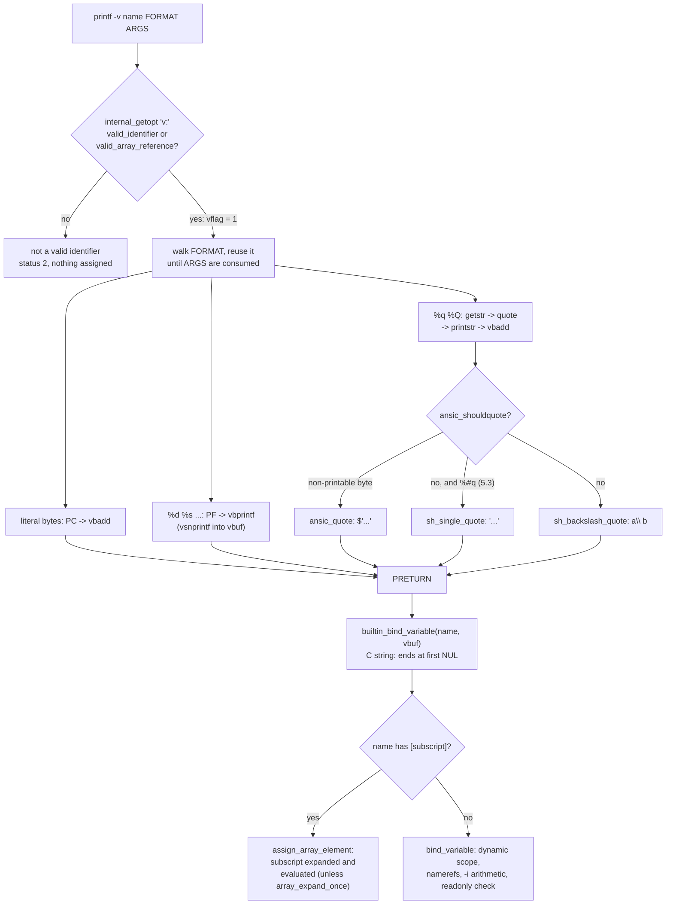

# printf -v and printf %q

> [!summary] Claim
> `printf -v name` and `printf %q` are shell-specific extensions that turn `printf` from an output utility into an in-process string builder and a code generator, so they are fast and fork-free where they exist, but their absence is often silent, their output dialect differs in every shell, and the `-v` name itself is evaluated as code when it carries an array subscript.

Part of [Bash](README.md) in [Shell and Unix Engineering](../README.md).

## TL;DR

- Mechanism: bash's `printf -v name` appends every byte the format produces to a private heap buffer (`vbadd`, `vbprintf`) and binds it to `name` once at the end with `builtin_bind_variable`, with no `fork`, no pipe, and no `write`; `%q` passes each argument through `ansic_quote`, `sh_single_quote`, or `sh_backslash_quote`.
- Rule: use `printf -v var` instead of `var=$(printf ...)` inside bash loops, and use `%q` output only as input to `eval` in the same shell family that produced it.
- Trap: `printf -v "arr[$i]" ...` evaluates the subscript as arithmetic, so a hostile `$i` such as `$(cmd)0` runs `cmd` in bash 4.1 through 5.3 and in zsh (lab), unless bash 5.3's `shopt -s array_expand_once` is on.
- Portability fact: POSIX.1-2024 gives `printf` no options and no `%q`; BusyBox ash and GNU `printf` read `printf -v x y` as the format `-v`, print `-v`, and exit 0, while dash, macOS `printf`, and ksh93u+ 2012 reject it (lab, local measurements, and the BusyBox source).
- When not to use it: never in a `#!/bin/sh` script, never to quote text for a different shell (ssh to an unknown login shell, `/bin/sh -c`, a generated POSIX script), and never on bytes that may contain NUL.

## Mental model



The parse step decides everything about the name before any output exists: bash accepts a plain identifier or anything `valid_array_reference` accepts, which is a syntactic check that leaves the subscript text unexamined.
The format walk is the same code that writes to standard output, except that every place that would call `putchar` or `printf` calls `vbadd` or `vbprintf` instead, so field widths, precision, format reuse, and conversion errors behave identically in both modes.
`%q` and `%Q` choose one of three quoting styles per argument, then hand the quoted text to `printstr`, which applies width and precision to the quoted bytes, not to the argument.
Only at `PRETURN` does the buffer become a variable, through the same binding path an assignment statement uses, which is why the result honours `local` scope, namerefs, `declare -i`, and `readonly`, and why an array subscript in the name is expanded at that moment.

## How it works

### What POSIX specifies, and what it leaves out

POSIX.1-2024 gives the synopsis `printf format [argument...]` and the OPTIONS section reads "None", so `-v` is outside the standard `(POSIX.1-2024 XCU printf, SYNOPSIS and OPTIONS)`.
The standard conversions are the C ones from XBD 5 plus `b`; `%q` is not among them, and "If a character sequence in the format operand begins with a '%' character, but does not form a valid conversion specification, the behavior is unspecified" `(POSIX.1-2024 XCU printf, EXTENDED DESCRIPTION)`.
The FUTURE DIRECTIONS section says "A future version of this standard may add a %q conversion to convert a string argument to a quoted output format that can be reused as shell input", and the Issue 8 change history lists Austin Group Defect 1771 as changing that section `(POSIX.1-2024 XCU printf, FUTURE DIRECTIONS and CHANGE HISTORY)`.
Issue 8 also adds numbered conversions `%n$` (Austin Group Defect 1592); bash 5.3.15 rejects `printf '%2$s %1$s\n' a b` with `` `$': invalid format character ``, while zsh 5.9.2, ksh93u+ 2012, GNU coreutils 9.12, and macOS `printf` print `b a` (measured by hand on the macOS host, 2026-11).
The reason `-v` exists at all is in XCU 2.6.3: command substitution runs the command "in a subshell environment" and drops every trailing newline from the output, and "If the output contains any null bytes, the behavior is unspecified" `(POSIX.1-2024 XCU 2.6.3)`.
So `x=$(printf ...)` costs a subshell, a pipe, and a `waitpid`, loses trailing newlines, and is unspecified for NUL, while `printf -v x ...` stays inside the shell process.

### bash: parsing the option

`printf_builtin` calls `internal_getopt (list, "v:")`; for `-v` it sets `vname = list_optarg`, accepts the name if `valid_identifier (vname) || valid_array_reference (vname, arrayflags)`, and otherwise calls `sh_invalidid` and returns `EX_USAGE`, which is status 2 `(bash-5.3 builtins/printf.def, printf_builtin)`.
The first valid `-v` allocates a 16-byte `vbuf` (`vbuf = xmalloc (vbsize = 16)`) that survives between calls, so a script that calls `printf -v` in a loop reuses one buffer.
bash 3.2 accepts only `legal_identifier (vname = list_optarg)`, which is why macOS `/bin/bash` rejects `printf -v 'a[1]' v` with `` `a[1]': not a valid identifier `` and status 2 `(bash-3.2 builtins/printf.def, printf_builtin)`; array elements arrived in 4.1 (bash-5.3 `CHANGES`, bash-4.1-alpha section 3, item e: "`printf -v' can now assign values to array indices").
After the options, `list == 0` prints the usage line and returns 2, so `printf -v x` with no format is a usage error (measured by hand, bash 5.3.15).

### bash: the buffer

Two macros carry the whole mode switch `(bash-5.3 builtins/printf.def)`.
`PC (c)` handles one literal byte: `if (vflag) vbadd (b, 1); else putchar (c);`.
`PF (f, func)` handles one C conversion: `nw = vflag ? vbprintf (f, fieldwidth, precision, func) : printf (f, fieldwidth, precision, func);`, and a negative `nw` reports `strerror (errno)` and returns failure.
`vbadd` grows the buffer to the next multiple of 64 bytes, `vbsize = ((nlen + 63) >> 6) << 6`, copies the bytes with `FASTCOPY`, and keeps `vbuf[vblen] = '\0'` after every append `(bash-5.3 builtins/printf.def, vbadd)`.
`vbprintf` calls `vsnprintf (vbuf + vblen, vbsize - vblen, format, args)`, and if the result did not fit it reallocates to the same 64-byte rounding and formats a second time `(bash-5.3 builtins/printf.def, vbprintf)`.
Neither path makes a system call except `realloc`, which the allocator may serve without one; there is no `write (1, ...)`, which is why the lab's `printf -v x hi >&-` returns 0 and assigns `hi` while `printf hi >&-` returns 1.

### bash: binding the result

Every return goes through `PRETURN`, which for `-v` does `v = builtin_bind_variable (vname, vbuf, bindflags); stupidly_hack_special_variables (vname);` and fails if `v == 0 || ASSIGN_DISALLOWED (v, 0)`, then frees `vbuf` if it grew past 4096 bytes or truncates it to an empty string otherwise `(bash-5.3 builtins/printf.def, PRETURN)`.
Four consequences follow from that one call.
First, `vbuf` is passed as a `char *`, so the variable ends at the first NUL byte: `printf -v x 'a\0b'` gives `${#x}` of 1 although the same format writes three bytes to standard output (lab).
Second, because conversion errors also return through `PRETURN`, the bytes accumulated so far are still assigned: `printf -v x '%d' abc` prints `abc: invalid number`, sets `x` to `0`, and returns 1, which is POSIX's rule that printf "shall continue processing any remaining operands and shall write the value accumulated at the time the error was detected" applied to a variable (measured by hand, bash 5.3.15; `(POSIX.1-2024 XCU printf, EXTENDED DESCRIPTION)`).
Third, the binding uses ordinary assignment semantics, so the value goes to the variable the function can see (a `local x` in a function shadows the caller's `x`), through a nameref to its target, through `declare -i` arithmetic (`printf -v n %s 2+3` sets `n` to 5), and through the special-variable hooks: `printf -v LC_ALL C` changes the locale immediately, the fix listed as bash-3.1-beta1 item f (all measured by hand on bash 5.3.15).
Fourth, the readonly check is new: bash 4.4 and earlier call `bind_variable` or `bind_printf_variable` and ignore the result, so `printf -v r 2` on a readonly `r` prints `r: readonly variable` and returns 0; 5.0 added `if (v == 0 || readonly_p (v) || noassign_p (v))` (bash-5.0 and bash-4.4 `builtins/printf.def`, `PRETURN`; bash-5.3 `CHANGES`, bash-5.0-alpha item ooo; lab).

Two special cases precede the format walk.
If the format is the empty string, bash 4.4 and later bind the empty string directly (bash-4.4-alpha section 3 item m: `printf -v var ""` "will now set `var` to the empty string, as if `var=""` had been executed"; the 5.3 source comment above the check reads "Allow printf -v var "" to act like var="""), while 3.2 returns at the check `if (list->word->word == 0 || list->word->word[0] == '\0')` without touching the variable, so `x=old; printf -v x ''` leaves `old` there (lab).
And the format is reused while arguments remain, all into the same buffer, so `printf -v x '%s,' a b c` yields `a,b,c,` and `printf -v arr %s p q` assigns the single string `pq` to `arr[0]` (measured by hand, bash 5.3.15).

### bash: array subscripts in the name

`builtin_bind_variable` routes a name that passes `valid_array_reference` to `assign_array_element (name, value, bindflags, ...)` with `ASS_ALLOWALLSUB`, and adds `ASS_NOEXPAND` only when `array_expand_once` is set `(bash-5.3 builtins/common.c, builtin_bind_variable)`.
Without `ASS_NOEXPAND`, the subscript of an indexed array is expanded and evaluated as an arithmetic expression, and expansion includes command substitution.
The lab passes `b[$(echo ran >pw)1]` as the name: bash 4.1 through 5.3 create the file and set `b[1]`, bash 3.2 rejects the name, and zsh, which also evaluates the subscript, creates the file too.
`read` takes the same path (measured by hand: `read "c[$i]"` with the same `i` runs the command in bash 5.3.15), so this is a property of name arguments to builtins, not of `printf`.
bash 5.3 adds `array_expand_once` ("new shopt option, replaces assoc_expand_once", bash-5.3 `CHANGES`, bash-5.3-alpha item t); with it set, the subscript text reaches arithmetic evaluation unexpanded and fails with `arithmetic syntax error: operand expected`, which ends a non-interactive shell, so the lab runs the call in a subshell and sees status 1 and no file.
The 5.2-alpha items ss ("Builtins like printf/read/wait now behave more consistently when assigning arbitrary keys to associative arrays") and m (subscripts parsed once under the option) are the history of this path; a key containing `]` is still rejected as `not a valid identifier` in 5.3.15 (measured by hand with `h[a b]]`).

### bash: `%q` and `%Q`

The `case 'q': case 'Q':` branch takes the next argument with `getstr`, which returns `""` when arguments are exhausted, and then picks a quoting function `(bash-5.3 builtins/printf.def, printf_builtin)`:

```c
if (p && *p == 0) /* XXX - getstr never returns null */
  xp = savestring ("''");
else if (ansic_shouldquote (p))
  xp = ansic_quote (p, 0, (int *)0);
else if (altform)
  xp = sh_single_quote (p);
else
  xp = sh_backslash_quote (p, 0, 3);
```

The first line is why `printf '%q '` with no arguments prints `'' ` in bash, a phantom empty word, where zsh, ksh93, and GNU `printf` expand the missing `%q` to nothing and print only the literal space (lab for `[%q]`, which gives `[]` in zsh and ksh93; measured by hand for GNU coreutils 9.12).
`ansic_shouldquote` returns true if any byte fails `ISPRINT`, or, for a non-ASCII byte, if `ansic_wshouldquote` finds a character that `iswprint` rejects in the current locale `(bash-5.3 lib/sh/strtrans.c, ansic_shouldquote)`; `ansic_wshouldquote` first appears in bash 4.3's `strtrans.c` (absent in 4.2), which is why bash 3.2 passes a lone `0xff` byte through raw under `LC_ALL=C.UTF-8` while 4.3 and later write `$'\377'` (lab).
`ansic_quote` allocates `4 * l + 4` bytes, writes `$'`, maps ESC to `\E`, `\a \v \b \f \n \r \t` to their letters, puts a backslash before `\` and `'`, writes three octal digits for any other non-printable byte, and closes with `'` `(bash-5.3 lib/sh/strtrans.c, ansic_quote)`.
`sh_backslash_quote (string, table, flags)` allocates `2 * slen + 1` bytes and puts a backslash before every byte marked 1 in the static table `bstab`: tab, newline, space, `!`, `"`, `$`, `&`, `'`, `(`, `)`, `*`, `,`, `;`, `<`, `>`, `?`, `[`, `\`, `]`, `^`, a backquote, `{`, `|`, and `}` `(bash-5.3 lib/sh/shquote.c, bstab and sh_backslash_quote)`.
It also quotes `#` only as the first byte (a comment), `~` only at the start of the word or after `:` or `=` when `flags & 1`, and any locale blank when `flags & 2`; printf passes `flags` 3.
The tilde rule was added in 4.3 (bash-4.3-alpha item ddddd: `%q` did not "quote a tilde even if it appeared in a location where it would be subject to tilde expansion"), and the blank rule in 5.0 (bash-5.0-alpha item bb), so `printf %q '~x'` is `~x` in bash 3.2 and `\~x` from 4.3 (lab).
The comma is quoted because of brace expansion, which is why `a,b` becomes `a\,b` in bash but stays `a,b` in zsh and ksh93 (measured by hand).

Width and precision are applied afterwards by `printstr` to the quoted text, so `printf '%.2q' 'a b'` is the two bytes `a\`, a dangling backslash that `eval` reads as a line continuation (lab).
bash 5.2 added `%Q`, which "acts like %q but applies any specified precision to the original unquoted argument, then quotes and outputs the result" (bash-5.3 `CHANGES`, bash-5.2-alpha section 3 item r): the code truncates `p[precision] = '\0'` before quoting and then sets the output precision to the quoted length with `ckd_add (&precision, slen, 0)` (which stores `slen + 0` in `precision` and reports `ERANGE` on overflow), so `printf '%.3Q' 'a b c'` is `a\ b` (lab).
bash 5.2 applies `%Q` precision only when it is written as digits (`if (convch == 'Q' && precstart)`); 5.3 also accepts `%.*Q` (`have_precision || precstart`) `(bash-5.2 and bash-5.3 builtins/printf.def)`.
bash 5.3 made the alternate form `%#q` select `sh_single_quote`, so `printf '%#q' 'a b'` is `'a b'` in 5.3 and `a\ b` before it (bash-5.3 `CHANGES`, bash-5.3-alpha section 3 item l; lab).

The `$'...'` fallback dates from 2.05b ("The `printf' %q format specifier now uses $'...' quoting to print the argument if it contains non-printing characters", bash-2.05b-alpha1 item u), and the empty-string case from 3.2 (bash-3.2-release item b: `%q` used to "ignore empty string arguments").
POSIX.1-2024 standardizes `$'...'` in XCU 2.2.4, but its escape for ESC is `\e`; bash writes `\E`, which XCU 2.2.4 does not list, so a `%q` string that contains ESC is bash dialect even for a POSIX.1-2024 reader `(POSIX.1-2024 XCU 2.2.4)`.

### zsh

zsh documents `printf [ -v name ] format [ arg ... ]`, `%q` "to quote the argument in such a way that allows it to be reused as shell input", numbered conversions `%n$` and `*n$`, and two semantics bash does not share: numeric arguments are "evaluated as an arithmetic expression", and with `-v`, "If name is an array and the format string is reused when consuming arguments then one array element will be used for each use of the format string" (zsh manual, Shell Builtin Commands, `printf`).
`-v` arrived in 5.3 ("The print and printf builtins have a new option -v to assign the output to a variable. This is for bash compatibility but with the additional feature that, for an array ...", zsh `NEWS`, Changes from 5.2 to 5.3.1).
`%q` calls `quotestring (metafy (curarg, curlen, META_USEHEAP), QT_BACKSLASH_SHOWNULL)` `(zsh-5.9 Src/builtin.c, bin_print)`, which backslash-quotes and writes each control byte as its own `$'...'` segment, so a newline inside `c` and `d` becomes `c$'\n'd` (lab) and an empty argument becomes `''`.
zsh variables are not C strings, and the lab shows `printf -v x 'a\0b'` keeping all three bytes in native zsh and in `zsh --emulate sh`.
Errors behave differently from bash: a readonly or invalid name aborts the running shell or subshell, and in zsh 5.9.2 the aborted subshell reports status 0, so `(readonly r=1; printf -v r 2); echo $?` prints 0 (lab), and the arithmetic evaluation of numeric arguments means `printf %d 'w[$(cmd)1]'` runs `cmd` when `w` is an array (lab).

### ksh93

ksh93u+m added `-v` on 2021-11-18 ("The printf built-in command now supports a -v option as on bash and zsh", ksh93u+m `NEWS`), so ksh93u+ 2012, the macOS `/bin/ksh`, rejects it with `printf: -v: unknown option` and status 2 (measured by hand), while the ksh93u+m 1.0.10 man page documents `printf [ -v vname ] format [ arg ... ]`.
In 1.0.10, `-v` opens the variable with `nv_open (opt_info.arg, sh.var_tree, NV_VARNAME)` before formatting and assigns it at the end with `nv_putval (vname, sfstruse (outfile), 0)`, a C string `(ksh93u+m 1.0.10 bltins/print.c, b_print)`.
`%q` calls `sh_fmtqf`, which hands the alternate form `%#q` to `sh_fmtcsv` ("quoted in manner suitable as a field in a .csv format file", sh.1) and otherwise calls `sh_fmtq`, which leaves a safe word bare, wraps a word with shell-special characters in `'...'`, and switches to `$'...'` as soon as it meets a `'` or a non-printable character `(ksh93u+m 1.0.10 sh/string.c, sh_fmtqf and sh_fmtq)`.
So ksh93 prints `it's` as `$'it\'s'` and `a b` as `'a b'`, the opposite trade-off to bash (lab, both ksh93 releases).
In ksh93, `%Q` "will convert the given number of seconds to readable time" (sh.1), so `printf '%.3Q'` means something unrelated to bash's `%Q`, and ksh93u+ 2012 answers bash's `%.2Q` with `warning: invalid argument of type Q` (measured by hand).

### Everything else: dash, BusyBox, yash, mksh, posh, and the utilities

dash's `printfcmd` begins with `nextopt(nullstr)`, which accepts no options, so `printf -v x y` fails with `printf: Illegal option -v` and status 2, and `%q` fails with `%q: invalid directive` and status 2 (dash v0.5.12 `src/bltin/printf.c`, `printfcmd`; lab on dash 0.5.13.5).
BusyBox `printf` skips only a leading `--` (`argv = skip_dash_dash(argv)`), takes `-v` as the format, prints it, and stops reusing the format because it consumed no argument, so `printf -v x y` prints `-v` and exits 0; `%q` is not in `format_chars[] = "diouxXfeEgGcs"`, so it fails with `invalid format` and status 1 `(BusyBox coreutils/printf.c, printf_main and print_formatted)`.
GNU coreutils treats `-v` the same way and adds a warning, `printf: warning: ignoring excess arguments, starting with 'x'`, still with status 0 (measured by hand, GNU coreutils 9.12); it has had `%q` since 8.25 ("printf now supports the '%q' format to print arguments in a form that is reusable by most shells", coreutils `NEWS`, release 8.25, 2016-01-20), implemented as `quotearg_style (shell_escape_quoting_style, *argv)` with no width or precision, so `%10q` is `invalid conversion specification` `(coreutils v9.5 src/printf.c, print_formatted)`.
uutils `printf` accepts `%q` and rejects it with any flag, width, or precision, using `QuotingStyle::SHELL_ESCAPE` (uutils `uucore` `format/spec.rs`, main branch as of 2026-11).
Measured by hand with uutils 0.0.30 (Debian 13 package `rust-coreutils`, 2026-11): `%-5q` and `%.2q` fail with `invalid conversion specification` and status 1, `%q` of `it's` prints `"it's"`, and `printf -v x y` prints `-v` plus the same excess-arguments warning as GNU, status 0.
FreeBSD's `printf` calls `getopt(argc, argv, "")` and has no `q` conversion; macOS `/usr/bin/printf` answers `-v` with `illegal option -- v` and `%q` with `illegal format character q`, both status 1 (measured by hand, macOS 27.3).
yash documents `printf format [value...]` with conversions `d i u o x X f F e E g G c s b %` and position specifiers, and no options (yash manual, printf built-in).
The mksh manual lists `printf` as "(optional, defer always) If compiled in, format and print the arguments, supporting the bare POSIX-mandated minimum. If an external utility of the same name is found, it is deferred to", so in practice mksh runs the system's `printf` utility and inherits its `-v` and `%q` behaviour (mksh R59 manual).

### Cost

`printf -v` is a loop over the format in the shell process; `$(printf ...)` adds `fork`, `pipe`, `read` until EOF, and `waitpid`.
On the macOS host (Apple M3 Pro, bash 5.3.15, one run each, 2026-11-12), 100000 calls of `printf -v y '%s-%d' "$x" "$i"` took 0.263 s (2.6 us per call) and 100000 calls of `printf -v y %q "$x"` took 0.215 s, while 2000 calls of `y=$(printf '%s-%d' "$x" "$i")` took 3.446 s (1.7 ms per call), about 650 times slower; zsh 5.9.2 showed 1.75 us against 0.69 ms (measured by hand, not in the lab).
ksh93u+ 2012 ran 20000 `y=$(printf ...)` in 0.255 s (12.7 us per call), because ksh93 runs a command substitution as a "virtual subshell" that shares "the process of its parent environment" until something forces a `fork` (ksh93u+m 1.0.10 sh.1, Subshells), and is why ksh93 scripts never needed `-v`; on `/bin/ksh` 2012, `x=$(/bin/sh -c 'echo $PPID'; :)` reports the main shell's PID, while bash reports a forked child's (measured by hand, 2026-11).

## Numbers and limits

| Quantity | Value | Source |
|---|---|---|
| `printf -v` in bash | 3.1 and later | bash-5.3 `CHANGES`, bash-3.1-alpha1 section 3 item q |
| `printf -v` into an array element | bash 4.1 and later | bash-5.3 `CHANGES`, bash-4.1-alpha section 3 item e; lab (3.2 rejects, status 2) |
| `%q` uses `$'...'` for non-printing bytes | bash 2.05b and later | bash-5.3 `CHANGES`, bash-2.05b-alpha1 item u |
| `%q` quotes a leading `~`; multibyte printability check | bash 4.3 and later | bash-4.3-alpha item ddddd; `ansic_wshouldquote` in 4.3 `strtrans.c`, not 4.2; lab |
| `printf -v x ''` assigns the empty string | bash 4.4 and later | bash-4.4-alpha section 3 item m; lab (3.2 keeps the old value) |
| Failed `-v` assignment returns 1 | bash 5.0 and later | `PRETURN` in bash-5.0 versus 4.4; lab (3.2 returns 0) |
| `%Q` | bash 5.2 and later | bash-5.2-alpha section 3 item r; lab |
| `%#q` single quotes, `%.*Q` | bash 5.3 | bash-5.3-alpha section 3 item l; 5.3 `printf.def`; lab |
| `shopt array_expand_once` | bash 5.3 | bash-5.3-alpha item t; lab |
| `printf -v` in zsh | 5.3 and later | zsh `NEWS`, 5.2 to 5.3.1 |
| `printf -v` in ksh93u+m | 2021-11-18 and later | ksh93u+m `NEWS` |
| `%q` in GNU coreutils | 8.25 (2016-01-20) | coreutils `NEWS` |
| bash `vbuf` first allocation | 16 bytes | `printf_builtin`, bash 5.3 |
| bash `vbuf` growth | next multiple of 64 bytes | `vbadd` and `vbprintf`, bash 5.3 |
| bash `vbuf` kept between calls | up to 4096 bytes, freed above | `PRETURN`, bash 5.3 |
| bash backslash `%q` of `n` bytes | at most `2n` bytes; 1000 spaces -> 2000 | `sh_backslash_quote` allocates `2n + 1`; lab |
| bash `$'...'` `%q` of `n` control bytes | `4n + 3` bytes; 1000 x `0x01` -> 4003 | `ansic_quote` allocates `4n + 4`; lab |
| bash `printf -v` cost | 2.6 us per call | by hand, M3 Pro, bash 5.3.15, 2026-11 |
| bash `$(printf ...)` cost | 1.7 ms per call | by hand, same host |
| zsh `printf -v` and `$(printf ...)` | 1.75 us and 0.69 ms per call | by hand, zsh 5.9.2, same host |
| ksh93u+ 2012 `$(printf ...)` | 12.7 us per call | by hand, `/bin/ksh`, same host |

## Portability

| Shell or utility | `printf -v name` | `%q` | `%q` of `it's` | `-v` value with NUL | What `printf -v x y` does where `-v` is missing |
|---|---|---|---|---|---|
| POSIX sh | not specified (OPTIONS: None) | not specified; FUTURE DIRECTIONS only | n/a | n/a | unspecified |
| bash 3.2 (macOS `/bin/bash`, `/bin/sh`) | scalars only | yes; no `~` quoting, raw invalid bytes | `it\'s` | ends at NUL | n/a |
| bash 4.1 to 5.3 | yes, including `a[i]` | yes; `%Q` from 5.2, `%#q` from 5.3 | `it\'s` | ends at NUL | n/a |
| zsh 5.9 native | yes, one element per reuse for arrays | yes, `$'\n'` segments | `it\'s` | keeps NUL | n/a |
| `zsh --emulate sh` | same as native | same as native | `it\'s` | keeps NUL | n/a |
| dash 0.5.12, 0.5.13 | no | no, `invalid directive`, status 2 | n/a | n/a | `Illegal option -v`, status 2 |
| ksh93u+m 1.0.10 | yes | yes | `$'it\'s'` | ends at NUL | n/a |
| ksh93u+ 2012 (macOS `/bin/ksh`) | no | yes | `$'it\'s'` | n/a | `-v: unknown option`, status 2 |
| mksh R59 | no; runs the external `printf` | external utility's | external utility's | n/a | external utility's |
| yash 2.58.1 | no | no, `` `q' is not a valid conversion specifier ``, status 1 | n/a | n/a | `` `-v' is not a valid option ``, status 2, `x` unchanged |
| posh 0.14.1 | no; runs the external `printf` | external utility's | external utility's | n/a | external utility's |
| BusyBox ash 1.37 | no | no, `invalid format`, status 1 | n/a | n/a | prints `-v`, status 0 |
| GNU coreutils `printf` | no | yes, no width or precision | `"it's"` | n/a | prints `-v` and a warning, status 0 |
| uutils `printf` 0.0.30 | no | yes, no flags, width, or precision | `"it's"` | n/a | prints `-v` and a warning, status 0 |
| macOS and FreeBSD `printf` | no | no, `illegal format character q`, status 1 | n/a | n/a | `illegal option -- v`, status 1 |
| BusyBox `printf` applet | no | no, status 1 | n/a | n/a | prints `-v`, status 0 |

Cells come from the lab or from measurements by hand on the macOS host (bash 5.3.15 and 3.2.57, zsh 5.9.2, dash 0.5.13.5, ksh93u+ 2012, GNU coreutils 9.12, macOS 27.3 `printf`) or in the Debian 13 image (uutils 0.0.30) unless they cite a manual or source file; the ksh93u+m 1.0.10, yash 2.58.1, posh, mksh, and BusyBox ash rows were measured by hand in the shell matrix's Debian 13 and Alpine 3.22 images (2026-11), and the lab encodes the same results as assertions.
The `%q` column for mksh and posh depends on which `printf` is first in `PATH`: GNU on Debian prints `'a b'` and `"it's"`, and BusyBox on Alpine rejects `%q`; the lab branches on the utility implementation, not on the shell.

## Worked example

The [lab](../labs/04-printf-v-and-printf-q/) ships `shquote.sh`, which turns its arguments into one line that the same shell can `eval` back into the same arguments, using `printf -v` with `%q` where the shell has both and a fork-free POSIX fallback elsewhere.
This is the whole file:

```sh
#!/bin/sh
# shquote.sh: print one line that the running shell parses back into exactly the given arguments.
# It uses printf -v with %q when the shell really has both (bash 3.1+, zsh 5.3+, ksh93u+m),
# detected by effect, and otherwise a fork-free POSIX single-quote fallback.
# Usage: shquote.sh [ARG...]
# Example: shquote.sh 'a b' "it's"  ->  a\ b it\'s          (bash, zsh)
#          shquote.sh 'a b' "it's"  ->  'a b' 'it'\''s'     (POSIX fallback)
# The %q dialect belongs to the running shell: feed the line back only to that same shell.

# sq_append WORD: append WORD, single-quoted so that any POSIX shell reads it back, and a space, to out.
sq_append() {
  sq_rest=$1
  sq_done=
  while :; do
    case $sq_rest in
      *\'*)
        sq_done=$sq_done${sq_rest%%\'*}\'\\\'\'
        sq_rest=${sq_rest#*\'}
        ;;
      *) break ;;
    esac
  done
  out="$out'$sq_done$sq_rest' "
}

# Detect printf -v by its effect, not its exit status: BusyBox ash and GNU printf take -v as the
# format, print it, and exit 0. The probe runs in a subshell because zsh aborts on a -v error.
out=
# shellcheck disable=SC3045 # the probe exists to find out whether printf -v works here
if (
  probe=
  printf -v probe %q ok >/dev/null 2>&1 && [ "$probe" = ok ]
) 2>/dev/null; then
  # bash turns a %q with no argument into '', so an empty argument list must not reach printf.
  if [ "$#" -gt 0 ]; then
    # shellcheck disable=SC3045 # printf -v runs only after the probe above proved the shell has it
    printf -v out '%q ' "$@"
  fi
else
  for arg in "$@"; do
    sq_append "$arg"
  done
fi
printf '%s\n' "${out% }"
```

The test runs it with six hostile arguments and then has the same shell parse the line (simplified excerpt of `printf-v-q.bats`):

```bash
nl=$(printf 'c\nd')
run_lab "$LAB_DIR/shquote.sh" 'a b' "it's" '' '$(echo pwned)' '*' "$nl"
line=$output
run_lab_c 'eval "set -- $1"; echo "$#"; printf "<%s>" "$@"' sh "$line"
[ "$output" = "$(printf '6\n<a b><it'"'"'s><><$(echo pwned)><*><c\nd>')" ]
```

Under bash 3.2 and 5.3 the script prints:

```text
a\ b it\'s '' \$\(echo\ pwned\) \* $'c\nd'
```

Under zsh, native or `--emulate sh`, the newline becomes its own `$'...'` segment:

```text
a\ b it\'s '' \$\(echo\ pwned\) \* c$'\n'd
```

Under dash, ksh93u+ 2012, BusyBox ash, mksh, posh, and yash the probe fails and the fallback prints (the last word holds a real newline):

```text
'a b' 'it'\''s' '' '$(echo pwned)' '*' 'c
d'
```

Under ksh93u+m 1.0.10 the probe succeeds and `sh_fmtq` prints `'a b' $'it\'s' '' '$(echo pwned)' '*' $'c\nd'`, which is what the lab asserts (measured by hand in the shell matrix's Debian image, 2026-11).
In every shell the `eval` rebuilds exactly six arguments, the command text is never executed, and the outputs above are what the lab asserts; the bash, zsh, dash, and ksh93u+ 2012 lines were captured on the macOS host in the run that passed all 18 tests under bash 5.3.15, bash 3.2.57, zsh 5.9.2, `zsh --emulate sh`, dash 0.5.13.5, and ksh93u+ 2012.

## Pitfalls

> [!warning] A missing `-v` is silent in BusyBox ash and under GNU `printf`
> Trigger: a `#!/bin/sh` script, or a shell such as mksh or posh that runs the external utility, calls `printf -v line '%s' "$x"`.
> Symptom: BusyBox ash and GNU coreutils read `-v` as the format, print `-v` to standard output, and exit 0, so `line` stays empty, a stray `-v` lands in the output stream, and `set -e` does not fire (lab, first test; BusyBox `printf_main`).
> Fix: detect the feature by its effect, as `shquote.sh` does (`(p=; printf -v p %s ok && [ "$p" = ok ])`), or require bash explicitly with `#!/usr/bin/env bash`; never test `$?`.

> [!warning] Hostile array subscripts in the `-v` name run code
> Trigger: `printf -v "counts[$key]" %d "$n"` where `key` comes from input, a file name, or a log line, and `counts` is an indexed array.
> Symptom: a key such as `$(touch /tmp/x)0` is expanded and evaluated as an arithmetic subscript, so the command runs with the script's privileges in bash 4.1 through 5.3 and in zsh (lab test "bash 4.1+ and zsh run a command substitution hidden in a printf -v array subscript"); `read "a[$k]"` has the same hole.
> Fix: validate keys before use (`case $key in *[!0-9]*) reject ;; esac` for indexed arrays), use an associative array with `shopt -s array_expand_once` on bash 5.3 (lab), or keep untrusted text out of variable names entirely; see [[Indexed-Arrays]] and [[Associative-Arrays]].

> [!warning] `%q` output is a dialect, not a standard
> Trigger: `ssh host "rm -- $(printf %q "$f")"` or a generated `/bin/sh` script built with bash's `%q`.
> Symptom: bash writes `$'...'` for any non-printable byte and `\E` for ESC; dash 0.5.12 reads `$'...'` as a literal `$` followed by a quoted word, and `\E` is not in POSIX.1-2024 XCU 2.2.4, so the remote shell can see a different file name and still exit 0; zsh splits the same string into `c$'\n'd`, ksh93 into `$'c\nd'`, and GNU into `'c'$'\n''d'` (lab and measured by hand).
> Fix: send data on standard input or as separate `ssh` arguments to a fixed remote command, run `bash -c` remotely if you must quote, or quote with the POSIX `'...'` form that `shquote.sh` falls back to, which every shell in the matrix reads.

> [!warning] A precision on `%q` produces broken quoting
> Trigger: `printf '%.20q' "$path"` to cap a log field, or `%-20.20q` in a table.
> Symptom: `printstr` truncates the quoted bytes, so the field can end in a lone backslash or inside `$'...'`; `printf '%.2q' 'a b'` is `a\` (lab), which `eval` treats as a line continuation.
> Fix: on bash 5.2 or later use `%Q`, which truncates the argument and then quotes it (`%.3Q` of `a b c` is `a\ b`, lab); elsewhere truncate first with `${x:0:20}` and quote second.

> [!warning] `printf '%q ' "$@"` invents an argument when `$@` is empty
> Trigger: building a command line with `printf -v cmd '%q ' "$@"` in a function that may be called with no arguments.
> Symptom: bash's `getstr` returns `""` for the missing argument and `%q` turns it into `''`, so `eval "set -- $cmd"` gives one empty argument instead of none; zsh and ksh93 expand the missing `%q` to nothing, so no word appears (lab test "printf %q with no argument quotes an empty string in bash only").
> Fix: guard with `[ "$#" -gt 0 ]`, as `shquote.sh` does.

> [!warning] NUL bytes vanish from `printf -v` in bash and ksh93
> Trigger: building binary records or `find -print0` style data with `printf -v rec '%s\0' "$@"`.
> Symptom: `builtin_bind_variable` receives a C string, so the variable ends at the first NUL; the same format to standard output writes every byte, and native zsh keeps them (lab).
> Fix: write NUL-delimited data straight to a file descriptor (`printf '%s\0' "$@" >"$out"`), never through a bash variable; see [[mapfile-and-readarray]] for reading it back with `-d ''`.

> [!warning] macOS bash 3.2 differs in four ways
> Trigger: a script tested on Linux bash 5 runs on macOS `/bin/bash`.
> Symptom: `printf -v 'a[1]'` fails with status 2, `printf -v x ''` leaves `x` unchanged, a readonly target returns 0, `%Q` and `%#q` do not exist, and `%q` leaves `~` unquoted and passes an invalid byte raw (lab, every bash-branched test).
> Fix: start with `#!/usr/bin/env bash` and test on the oldest bash you ship to; see [[Bash-3-2-on-macOS]] and [[Bash-Version-History]].

> [!warning] zsh aborts on a bad `-v` target and reports success
> Trigger: `printf -v "$name" ...` in zsh with a readonly name, a name such as `1x`, or an out-of-range subscript such as `b[0]` in native zsh.
> Symptom: zsh 5.9.2 aborts the current shell or subshell without running the next command, and the subshell's status is 0, so `(printf -v r 2) || handle` never handles it (lab test with a readonly name; measured by hand for `1x` and `b[0]`).
> Fix: validate the name before the call, or check the variable's value after the subshell instead of its status.

> [!warning] zsh and ksh93 evaluate numeric arguments as arithmetic
> Trigger: `printf '%d\n' "$untrusted"` in zsh or ksh93, often inside `printf -v`.
> Symptom: the argument is an arithmetic expression, so `w[$(cmd)1]` runs `cmd` when `w` is an array in zsh (native and `--emulate sh`) and in ksh93u+ 2012, while bash rejects it as `invalid number` and prints 0 (lab).
> Fix: check that the value matches `[0-9]*` before formatting, or use `%s` for anything that is not already a validated integer.

> [!warning] Old bash `printf -v` bugs
> Trigger: running on a pinned old bash.
> Symptom: bash before 4.3 could "dump core when used with the %b format code" (bash-4.3-alpha item tt) and left variables set by `printf -v` "marked as invisible" (bash-4.3-rc2 item a); before 5.0 some assignment errors returned success (bash-5.0-alpha item ooo).
> Fix: treat bash 4.3 as the floor for `printf -v` with `%b`, and 5.0 as the floor where its status matters.

## Security and robustness

`printf -v` has two attack surfaces, the name and the format.
The name is the larger one: a builtin that takes a variable name with a subscript expands that subscript (the lab shows it for `printf -v`, and `read` does the same, measured by hand), so a name built from data is code, and the only complete defences are validation and bash 5.3's `array_expand_once`.
The format is the classic one: `printf -v line "$msg"` lets `%n`, `%s` without arguments, or a stray `%` in `msg` change the output, and bash's `%n` writes a count into a named variable, which bash-2.05a item a restricted to "a valid shell identifier"; always pass data as an argument, `printf -v line '%s' "$msg"`; see [[printf-versus-echo]].
`%q` is a correct quoter only for its own shell: the lab round-trips a value with `'`, newline, `0x01`, `0x7f`, `$(id)`, a backquote, `*`, `?`, `[a]`, `~`, `#`, `!`, and braces through `eval` in bash 5.3.15 and zsh 5.9.2 (measured by hand), but nothing guarantees that another shell reads the same bytes back.
Because any non-printable byte forces bash into the `$'...'` form, `printf 'got %q\n' "$input"` is a cheap terminal-escape neutralizer for logs: ESC becomes the two visible characters `\E`; see [[Terminal-Escape-Injection]].
Locale is an input: bash decides printability with `iswprint` in the current `LC_CTYPE`, so `e9` in UTF-8 stays raw under `LC_ALL=C.UTF-8` and becomes `$'\303\251'` under `LC_ALL=C` (measured by hand, bash 3.2.57 and 5.3.15), and two runs with different environments can quote the same value differently; pin `LC_ALL` when the output is compared or stored.
`printf -v` never writes to a descriptor, so it cannot fail with `EPIPE`, `EBADF`, or `ENOSPC`, which makes it the safe way to build a message before deciding where to send it; a script that builds output with `$(printf ...)` inherits every failure mode of a subshell instead.

## The principal's view

The decision is whether a fleet's shell standard permits `printf -v` and `%q`, and the answer follows from interpreter control, not from taste.
In bash-only code with a known floor (bash 5.0 or later in containers and CI images you build), `printf -v` should be the default way to build strings: it is about 650 times cheaper than `$(printf ...)` per call on the measured host, it keeps trailing newlines, it reports assignment errors, and it removes a subshell whose side effects would be lost.
`%q` belongs in exactly two places, `eval` in the same bash and log lines meant for humans; any text that crosses a process boundary to a different interpreter should be data on standard input or argv, not quoted code.
The trade-off is that both features fail quietly where they are absent, so allowing them without a hard `bash` dependency is worse than banning them: the review rule should be "`printf -v` and `%q` only under `#!/usr/bin/env bash` with a `BASH_VERSINFO` floor", plus a lint rule that flags `printf -v` with a `[` in a non-literal name.
Portable code should use the POSIX `'...'` quoting function in `shquote.sh`, which costs a few parameter expansions per quote, and plain command substitution, accepting the fork.
When a script spends its time building strings in loops, quoting argument vectors for remote execution, or handling binary data, the right move is a language with real strings and an `exec` that takes an argument array (Python's `subprocess.run([...])` and `shlex.quote`, Go's `exec.Command`), because no amount of quoting makes a command string as safe as never building one.

## Interview questions

> [!question] L5: Why is `printf -v x '%s\n' a` not the same as `x=$(printf '%s\n' a)`?
>
> > [!success]- Answer
> > Command substitution runs in a subshell and strips every trailing newline, as POSIX.1-2024 XCU 2.6.3 requires, so the second form stores `a`.
> > `printf -v` formats into an in-process buffer and binds it unchanged, so it stores `a` plus a newline.
> > It also avoids a fork, a pipe, and a wait, about 2.6 us against 1.7 ms per call on the measured host.
> >
> > Follow-up: What happens to a NUL byte in each form?

> [!question] L5: Predict the output of `printf '[%q]' "a b" "it's" ""` in bash 5.3 and in ksh93.
>
> > [!success]- Answer
> > bash prints `[a\ b][it\'s]['']`, because `sh_backslash_quote` escapes the space and the quote and the empty string becomes `''`.
> > ksh93 prints `['a b'][$'it\'s']['']`, because `sh_fmtq` single-quotes words with special characters and switches to `$'...'` when it meets a `'`.
> > Both are valid input to their own shell, and neither is guaranteed valid input to dash.
> >
> > Follow-up: What does bash print for `printf '[%q]'` with no arguments, and why does it matter?

> [!question] L5: How do you detect whether the running shell has `printf -v`?
>
> > [!success]- Answer
> > Check the effect, not the status: `(p=; printf -v p %s ok >/dev/null 2>&1 && [ "$p" = ok ])`.
> > BusyBox ash and GNU `printf` treat `-v` as the format, print it, and exit 0, so `$?` alone lies.
> > The subshell keeps zsh's abort-on-error and any stray output contained.
> >
> > Follow-up: Why is a version check on `BASH_VERSION` weaker than this probe?

> [!question] L6: Debug this: `printf -v "seen[$id]" 1` in a log-processing script created a file called `owned` in the working directory.
>
> > [!success]- Answer
> > `seen` is an indexed array, so `builtin_bind_variable` sends the name to `assign_array_element`, which expands the subscript and evaluates it as arithmetic.
> > An `id` of `$(touch owned)0` therefore runs `touch`, then indexes element 0.
> > Fix it by validating `id` as digits, by using `declare -A seen` with `shopt -s array_expand_once` on bash 5.3, or by not deriving names from data.
> >
> > Follow-up: Which other builtins take the same path?

> [!question] L6: Why does `printf '%.10q' "$name"` sometimes produce text that `eval` rejects, and what does bash offer instead?
>
> > [!success]- Answer
> > The precision is applied by `printstr` to the quoted output, so it can cut a `\` escape or a `$'...'` string in half.
> > bash 5.2 added `%Q`, which truncates the argument to the precision first and then quotes it, raising the output precision to the quoted length.
> > bash 5.3 also honours `%.*Q`.
> >
> > Follow-up: What does `%Q` mean in ksh93?

> [!question] L6: A teammate replaces `x=$(printf ...)` with `printf -v x ...` everywhere for speed; what can break on macOS and in containers?
>
> > [!success]- Answer
> > On macOS `/bin/bash` 3.2, `printf -v 'a[i]'` is rejected, `printf -v x ''` leaves `x` unchanged, and a readonly target returns 0.
> > Under `#!/bin/sh` on Alpine (BusyBox ash) the call prints `-v` and exits 0, and on Debian (dash) it fails with status 2.
> > Values with NUL bytes are truncated in bash where the old form was merely unspecified.
> >
> > Follow-up: How would you enforce the bash floor in CI?

> [!question] L6: How do bash and zsh differ when `printf -v arr '%s' x y z` reuses the format?
>
> > [!success]- Answer
> > bash appends every reuse to one buffer and assigns `xyz` to `arr[0]`.
> > zsh assigns one element per reuse when `arr` is an array, so `arr` becomes `x y z`, as its manual documents.
> > Code written for one shell silently changes meaning in the other.
> >
> > Follow-up: Which one keeps a NUL byte?

> [!question] L7+: You own a deployment tool that runs `ssh host "$cmd"` with `cmd` built by `printf -v cmd '%q ' "$@"`; the fleet adds Alpine hosts. What breaks and what do you change?
>
> > [!success]- Answer
> > ssh hands the string to the remote login shell, so bash's dialect now meets BusyBox ash or dash.
> > Arguments with a newline, tab, or ESC become `$'...'`, which dash 0.5.12 reads literally and which uses `\E`, outside POSIX.1-2024 XCU 2.2.4; the remote command can run with different arguments and exit 0.
> > Change the protocol, not the quoting: run a fixed remote program and send arguments on standard input, NUL-delimited, or force `bash -c` remotely and pin the version, or fall back to plain `'...'` quoting, which every shell reads.
> >
> > Follow-up: How would you test this in CI without real hosts?

> [!question] L7+: Set a policy for `printf -v` and `%q` across 300 repositories that mix bash, POSIX sh, and zsh.
>
> > [!success]- Answer
> > Allow both only under `#!/usr/bin/env bash` with a `BASH_VERSINFO` floor of 5.0, because the 3.2 and 4.x behaviours differ silently.
> > Ban `%q` text that crosses to another interpreter, and ban non-literal `-v` names containing `[` unless the subscript is validated or `array_expand_once` is set.
> > Provide a POSIX quoting helper for `sh` code and enforce the rules with a grep-based lint plus a CI matrix that includes BusyBox ash and dash.
> >
> > Follow-up: What would make you move a script out of shell entirely?

> [!question] L7+: Explain the bash implementation of `printf -v` and the design choice that makes it binary-unsafe.
>
> > [!success]- Answer
> > The `PC` and `PF` macros switch between `putchar` or `printf` and `vbadd` or `vbprintf`, which append to a heap buffer rounded to 64 bytes; `PRETURN` binds it with `builtin_bind_variable`.
> > bash variables are NUL-terminated C strings, so the binding stops at the first NUL even though `vblen` knows the true length.
> > Reusing the stdout code path keeps width, precision, reuse, and error semantics identical in both modes, at the price of that truncation.
> >
> > Follow-up: How does zsh avoid the problem?

## Related

Prerequisites: [[mapfile-and-readarray]]

Next: [[pipefail-and-PIPESTATUS]]

See also: [[printf-versus-echo]], [[Command-Substitution]], [[Dollar-Single-Quotes]], [[Bash-Parameter-Transformations]], [[The-eval-Builtin]], [[Indexed-Arrays]], [[Associative-Arrays]], [[Namerefs-and-Dynamic-Scope]], [[Bash-3-2-on-macOS]], [[Bash-Version-History]], [[Command-Injection]], [[Terminal-Escape-Injection]], [[Quoting-Backslash-Single-and-Double]]

## Further reading

- [POSIX.1-2024 printf](https://pubs.opengroup.org/onlinepubs/9799919799/utilities/printf.html): the baseline, with no options, no `%q`, numbered conversions, and the FUTURE DIRECTIONS note on `%q`.
- [POSIX.1-2024 XCU chapter 2](https://pubs.opengroup.org/onlinepubs/9799919799/utilities/V3_chap02.html): 2.2.4 for `$'...'` and 2.6.3 for what command substitution does to newlines and NUL bytes.
- [bash 5.3 source](https://mirrors.kernel.org/gnu/bash/bash-5.3.tar.gz): `builtins/printf.def`, `builtins/common.c` (`builtin_bind_variable`), `lib/sh/shquote.c`, `lib/sh/strtrans.c`, and `CHANGES` for every version boundary in this note.
- [bash 3.2 source](https://mirrors.kernel.org/gnu/bash/bash-3.2.tar.gz): the macOS `/bin/bash` implementation, for reading what the old `-v` and `%q` paths do.
- [zsh printf builtin](https://zsh.sourceforge.io/Doc/Release/Shell-Builtin-Commands.html): array semantics of `-v`, arithmetic arguments, and `%n$`.
- [ksh93u+m print.c](https://raw.githubusercontent.com/ksh93/ksh/v1.0.10/src/cmd/ksh93/bltins/print.c) and [string.c](https://raw.githubusercontent.com/ksh93/ksh/v1.0.10/src/cmd/ksh93/sh/string.c): the third `%q` dialect and the `-v` added in 2021.
- [BusyBox printf.c](https://raw.githubusercontent.com/mirror/busybox/master/coreutils/printf.c): why `printf -v` prints `-v` and succeeds in Alpine's `/bin/sh`.
- [GNU coreutils printf.c](https://raw.githubusercontent.com/coreutils/coreutils/v9.5/src/printf.c): the `shell_escape` quoting style behind the utility's `%q`.
