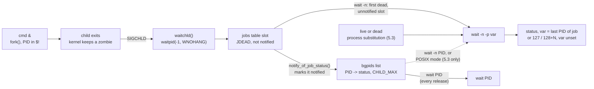

# wait -n and wait -p

> [!summary] Claim
> `wait -n` makes bash wait for whichever child ends next and `wait -p` names that child, which is the only way to run a bounded worker pool in the shell without polling, but what it reports depends on the bash release (4.3, 5.1, 5.2 patch 30, 5.3), on whether the code runs from a file or from `bash -c`, and on whether the child died by a signal.

Part of [Bash](README.md) in [Shell and Unix Engineering](../README.md).

## TL;DR

- Mechanism: `wait -n` scans bash's jobs table for a dead job that has not been reported yet, in slot order, and otherwise blocks in `waitpid(-1, ...)` until some job ends; `-p NAME` unsets `NAME`, then stores the PID of the last process of the job whose status is returned.
- Rule: always use `wait -n -p pid` together and test `${pid-}`: a status of 127 with `pid` set means the job exited 127, 127 with `pid` unset means "no child left", and a status above 128 with `pid` unset means a trapped signal interrupted the wait.
- Trap: before bash 5.2 patch 30, a job that ended while the script was running something else could vanish from `wait -n` (always under `bash -c`, and in script files when it was killed by a signal), yet `wait PID` still finds it; Ubuntu 24.04 ships 5.2.21 and Debian 12 ships 5.2.15 (as of 2026-11).
- Portability: POSIX `wait` has no options at all (POSIX.1-2024 XCU `wait`, OPTIONS: "None"); bash 4.3+ has `-n`, bash 5.1+ has `-p` and honours `wait -n PID...`, BusyBox ash 1.37 accepts `-n` but returns a meaningless status (0 or 129, measured in the shell matrix), NetBSD sh has both, and zsh, ksh93, mksh, posh, yash, dash and macOS `/bin/bash` 3.2 reject or misread `-n` (zsh treats it as a job name and returns 127 at once).
- When not to use it: when the bash release is not pinned to 5.2.30 or later, when the pool must run under `sh`, or when tasks need retries, timeouts or output capture; use `xargs -P`, GNU parallel, `make -j`, or a language with a real process API.

## Mental model



A background command is a forked child whose PID the shell records as a job (arrow 1); when it exits, the kernel keeps it as a zombie until a `waitpid` call collects its status.
Bash collects it from its `SIGCHLD` handler with a non-blocking `waitpid(-1, &status, WNOHANG)` and marks the job's slot dead (arrows 2 and 3).
A dead job can then go two ways.
If `wait -n` runs while the slot is still dead and unreported, it returns that status (arrow 5).
If the shell first decides the job has been "notified" (arrow 4), it deletes the slot and keeps only a PID and status pair in the `bgpids` list, which `wait PID` reads in every release but `wait -n` reads only in 5.3, and only for PID operands or in POSIX mode (the dotted arrow).
Every behavioral difference this note documents is a difference in when arrow 4 fires, or in which of these places `wait -n` looks.

## How it works

### What POSIX specifies, and what it leaves to extensions

POSIX.1-2024 defines `wait [pid...]` with the OPTIONS section reading "None" (XCU `wait`).
With operands it waits until all of them have terminated and returns the status of the last; an unknown PID counts as a process that "exited with exit status 127"; with no operands it waits for all known PIDs and returns 0.
"Once a process ID that is known in the current shell execution environment ... has been successfully waited for, it shall be removed from the list of process IDs that are known", and the shell "is also required to remember only {CHILD_MAX} number of processes in this way" (XCU `wait`, APPLICATION USAGE).
XCU 2.9.3.1 lists when a background PID stops being known, and adds that "the implementation need not retain more than the {CHILD_MAX} most recent entries".
XCU 2.12 gives the signal rule `wait -n` inherits: "When the shell is waiting, by means of the wait utility, for asynchronous commands to complete, the reception of a signal for which a trap has been set shall cause the wait utility to return immediately with an exit status >128, immediately after which the trap associated with that signal shall be taken."
The rationale explains why `wait` must target a specific process: the wording "means that wait is required to wait for an explicit process when it is given an argument so that the status information of other processes is not consumed", and it recommends `waitpid()` for that.
FUTURE DIRECTIONS says "A future version of this standard may add an option which takes a variable name as an option-argument, allowing wait to return information about the wait status of a process in an unambiguous way", which is close to what `-p` does, but nothing like "wait for any one" is standardized.

### The bash builtin, step by step

The code is `wait_builtin` in bash-5.3 `builtins/wait.def`.

1. Options are parsed with `internal_getopt (list, "fnp:")`, and the `n`, `f` and `p` cases are compiled only `#if defined (JOB_CONTROL)`; a bash built without job control support has the second `$SHORT_DOC wait [pid ...]` and rejects all three.
   Runtime job control (`set -m`) is not needed: the lab runs every test with no terminal.
2. For `-p NAME`, the name must pass `valid_identifier` or `valid_array_reference`, else `sh_invalidid` prints "not a valid identifier" and the builtin returns 1; then `builtin_unbind_variable (vname)` unsets it, and a readonly variable makes that fail with "cannot unset: readonly variable" and status 1 (ad hoc, bash 5.1.0, 5.2.0 and 5.3.15).
3. `setjmp_sigs (wait_intr_buf)` sets the landing point for a trapped signal, and a trap that is already pending returns `128 + signal` before anything is waited for; a pending `SIGCHLD` trap is skipped outside POSIX mode ("we don't break out of the wait even when the signal is trapped; we run the trap after the wait completes").
4. With `-n` and operands, bash 5.3 first calls `check_nonjobs`, which looks each numeric operand up in `bgpids` (`retrieve_proc_status`) and in the list of finished process substitutions, and returns a hit at once; this is the 5.3 fix for jobs that left the table early.
5. `set_waitlist` marks every operand's job `J_WAITING` (or a process substitution `PROC_WAITING`) and returns how many it found; none found means status 127.
6. `wait_for_any_job (wflags, &pstat)` does the waiting; a negative result becomes 127, and `-p` is bound with `builtin_bind_var_to_int (vname, pstat.pid, bindflags)` only when the result is not negative, so "no children" leaves the variable unset.

Without `-n`, the per-operand loop runs `wait_for_single_pid` or `wait_for_job`, and since 5.2 `-p` is set at the end to the last operand that named a real child (`if (vname && pstat.pid != NO_PID)`), as an ad hoc run shows (`wait -p v $!` sets `v` on 5.2.0 and 5.3.15 and leaves it unset on 5.1.0).
Bare `wait -p v` deliberately leaves `v` unset since 5.2: the assignment sits under `#if 0` with the comment "Compatibility with NetBSD sh: don't set VNAME since it doesn't correspond to the return status"; 5.1.0 did set it (ad hoc).

### `wait_for_any_job`: three scans, then block

`wait_for_any_job` in bash-5.3 `jobs.c` is the whole of `wait -n`.

1. It walks `jobs[0]` to `jobs[js.j_jobslots - 1]` and returns the first job that is `DEADJOB`, not `IS_NOTIFIED`, and not foreground, skipping jobs without `J_WAITING` when operands were given.
   The status is `job_exit_status (i)`, the PID is `find_last_pid (i, 0)`, and the slot is deleted with `delete_job (i, posixly_correct ? DEL_NOBGPID : 0)`, so outside POSIX mode the status is also copied to `bgpids` and a later `wait PID` can read it again.
2. It walks the process substitution list for one with `p->running == PS_DONE` (5.3).
3. In POSIX mode only, it takes any entry from `bgpids` with `bgp_findone` and deletes it.
4. Otherwise it loops: if no job is running and no process substitution is a candidate it returns -1 (status 127); else it calls `wait_for (ANY_PID, 0)`, which reaches `waitchld` and a blocking `WAITPID (-1, &status, waitpid_flags)`, where the flags add `WUNTRACED|WCONTINUED` only under job control, then rescans.

Two consequences follow directly from the code, and the lab checks both.
"Next" means next in the job table, not next in time: when several jobs are already dead, the lowest slot wins, so a job that exited a second earlier is reported second (lab: `first=11 second=22` on bash 4.3 through 5.3).
And `wait -n` returns one job, not one process: `find_last_pid` names the last process of a pipeline, so for `a | b &` the variable equals `$!` (ad hoc, bash 5.3.15), and the status is the job's, decided by `pipefail` as for a foreground pipeline.
The scan also calls `coproc_reap`, so a coprocess is one more job that `wait -n` can return (see [[Coprocesses]]).

### Where a status lives, and why "already finished" depended on the release

A finished child's status sits in one of two places.
The jobs table holds it until the shell decides the user has been told about the job; `notify_of_job_status` sets `J_NOTIFIED`, and cleanup then deletes the slot and moves the PID and status into `bgpids`, a ring of at least `js.c_childmax` entries hashed through `pidstat_table[4096]` (bash-5.3 `jobs.c`, `PIDSTAT_TABLE_SZ`).
`wait PID` searches both places, so it never loses a recent status.
`wait -n` before 5.3 searched only the jobs table, so any job marked notified before the call was invisible, and the call reported 127 or waited for some other job.

Whether a non-interactive shell marks a dead background job notified was decided by this test in bash-5.2 `jobs.c`, `notify_of_job_status`:

```c
if (startup_state == 0 && WIFSIGNALED (s) == 0 &&
      ((DEADJOB (job) && IS_FOREGROUND (job) == 0) || STOPPED (job)))
  continue;
```

`startup_state == 0` is a script read from a file or standard input; `bash -c` sets 2.
So in a script file a job that exited normally was kept for `wait -n`, but a job killed by a signal fell through and was marked notified; under `bash -c` every dead job was marked notified the next time the shell ran that function, which it does after foreground commands and even during a loop of builtins (ad hoc, 5.2.29: `(exit 3) &`, a 300000-iteration `while` loop, then `wait -n` gave 127).
Steven Pelley reported the signal case on bug-bash on 2024-01-22 ("wait -n misses signaled subprocess": "wait -n fails to return for processes that terminate due to a signal prior to calling wait -n. Instead, it returns 127"), reproduced on 4.4.12, 5.2.15 and 5.2.21.
Patch bash52-030 ("`wait -n' can fail to return some jobs if they exit due to signals the shell does not report to the user") added two `continue` cases, one for unreported signals in non-interactive shells and one commented "hang onto the status if the shell is running -c command", and bash 5.3 shipped the same code plus `check_nonjobs` (5.3 NEWS: "`wait -n' can now return terminated process substitutions, jobs about which the user has already been notified").
The lab pins the boundary: under `sh -c`, 5.2.29 prints `status=127` and 5.2.37 prints `status=3`; in a script file, a job killed by `SIGTERM` gives `wait-n=127 wait-pid=143` on 4.3 through 5.2.29 and `wait-n=143 wait-pid=143` from 5.2.30.
The 5.3 fix is not total: a job that `jobs` has already listed is still invisible to a bare `wait -n` outside POSIX mode, though `wait -n PID` and POSIX mode find it (ad hoc, 5.3.15: 127, 3 and 3).

### `-p`: what it stores and when it stays unset

`-p` stores a PID, never a job number: `wait -n -p v %1` sets `v` to the PID (ad hoc, 5.3.15), where NetBSD sh sets "the identifier from the arg list (if given) of that job" (NetBSD `sh(1)`, August 15, 2026), so the same script gets `%1` back there.
Without operands NetBSD stores "the lead process identifier of the job", the first process of a pipeline, where bash stores the last (same page).
The variable is unset first, so it is unset after a 127 for "no children", after an interrupted wait ("any varname will remain unset", bash 5.3 `bash.1`), and after a usage error; a readonly name fails before anything is waited for.
It may be a local: `f() { local pid; ...; wait -n -p pid; }` writes the function's local and leaves the global unset (ad hoc, 5.1.16 to 5.3.15).
It may be an array element, and the subscript is evaluated like any arithmetic subscript, so `wait -n -p 'a[$(cmd)0]'` runs `cmd` (lab: `code-ran`; with `shopt -s assoc_expand_once`, 5.3.15 refuses it with "arithmetic syntax error", ad hoc).

### Signals and traps

`trap_handler` in bash-5.3 `trap.c` records `wait_signal_received = sig` when the running builtin is `wait`, and if `waiting_for_child && wait_intr_flag` it `sh_longjmp`s to `wait_intr_buf`, which lands in `wait_builtin` with `status = 128 + wait_signal_received`; the trap action runs before the next command, as XCU 2.12 requires.
The lab prints `trapped` and then `status=USR1 who=unset` on 5.1.16, 5.2.29, 5.2.37 and 5.3.15.
Patch bash51-010 fixed the cleanup: "If `wait -n' is interrupted by a trapped signal other than SIGINT, it does not completely clean up state, and that can prevent subsequent calls to `wait -n' from working correctly" (5.2 has `unset_waitlist ()` on the longjmp path).

### `-f` and job control

`-f` (bash 5.0) sets `JWAIT_FORCE`: "when job control is enabled, forces wait to wait for each id to terminate before returning its status, instead of returning when it changes status" (bash 5.3 `bash.1`).
It matters only with `set -m`, where `waitpid` gets `WUNTRACED` and a stopped job is a status change; POSIX itself forbids `wait` returning for a stopped process, and its rationale recommends that any such extension "uses a different method of returning information about the wait status" (XCU `wait`, RATIONALE).

### Release history

| bash | Change | Source |
|---|---|---|
| 3.2 to 4.2 | no `-n`: `wait -n` is "invalid option", status 2 | lab, macOS `/bin/bash` 3.2.57 |
| 4.3 | `-n`: "wait for the next child to change status" | bash 4.3 NEWS `cc` |
| 4.3 | `CHILD_MAX` variable: "the number of exited child statues the shell remembers" | bash 4.3 NEWS `z` |
| 5.0 | `-f`; `wait` can wait for the last process substitution | bash 5.0 NEWS `a`, `j` |
| 5.1 | `-p VARNAME`; `wait -n` "accepts a list of job specifications" | bash 5.1 NEWS `q`, `ll` |
| 5.1 patch 2 | `-p` no longer gets a value when there are no jobs | bash51-002 |
| 5.1 patch 10 | `wait -n` resets its state after a trapped signal | bash51-010 |
| 5.2 | `-p` with plain `wait PID` set to the PID; bare `wait -p` leaves it unset | 5.2 CHANGES, `wait.def` diff |
| 5.2 patch 30 | jobs that end by an unreported signal, or under `-c`, stay visible | bash52-030 |
| 5.3 | `-n` sees process substitutions and notified jobs; in POSIX mode it deletes what it returns | bash 5.3 NEWS `mm`, `nn` |

Before 5.1, operands after `-n` are parsed and thrown away: the 5.0 code is `if (nflag) { status = wait_for_any_job (wflags); ... }`, so `wait -n "$pid"` waits for any job (lab: `status=9` instead of `4` on 4.3, 4.4 and 5.0).

### Other shells

BusyBox ash compiles `-n` when `ENABLE_ASH_BASH_COMPAT` is set (`#define BASH_WAIT_N ENABLE_ASH_BASH_COMPAT` in `shell/ash.c`) and has no `-p`.
Its `waitcmd` handles `-n` only without operands; with operands it falls into the ordinary loop, so `wait -n PID` is `wait PID`.
Without operands it skips jobs already in state `JOBDONE` and is meant to return the status of the next job whose state changes during the call ("wait -n waits for one _job_, not one _process_"), with 127 only for an empty job list.
In practice the status is lost: `waitone` computes the job's status under `DOWAIT_JOBSTATUS`, but `dowait`, which `waitcmd` calls, returns its own `rpid` flag (0 or 1), and `waitcmd` decodes that flag as a wait status (BusyBox master `shell/ash.c`).
Measured in the shell matrix with BusyBox 1.37.0 on both Alpine and Debian: `(exit 5) & wait -n` gives 129 (flag 1 read as "killed by signal 1"), `sleep 2 & (sleep 1; exit 7) & wait -n` returns 0 only after both jobs end, and `wait -n` with no jobs left gives 0, not 127.
So BusyBox `wait -n` is unusable for a pool, and the lab's feature probe (`(exit 5) & wait -n` must give 5) classifies it as unsupported.
NetBSD sh documents `wait [-n] [-p var] [job ...]` with bash-like semantics, plus the operand-text difference above.
FreeBSD sh, dash, ksh93u+m 1.0.10, mksh, posh and yash document only `wait [job...]`; ksh93's option string `sh_optwait` declares no options ("unknown option", status 2), mksh's `c_wait` and posh's `posh_builtin_wait` return 1 when `getopt` sees one, and yash's `wait_builtin` returns `Exit_ERROR` (2: "`-n' is not a valid option"); all four statuses measured in the shell matrix (ksh93u+m 1.0.10, mksh R59 2020/10/31 and 2025/04/26, posh 0.14.1, yash 2.58.1).
zsh 5.9 has no options for `wait`, so `-n` is an operand: `zsh:wait:1: job not found: -n` and status 127, returned without waiting (lab: `status=127 slow_alive=yes`), which turns a `wait -n` pool loop into a busy loop that starts every task at once.

## Numbers and limits

| Quantity | Value | Source |
|---|---|---|
| `fork` + `( : ) & wait -n` per job | 0.82 ms (three runs, 814 to 830 us) | ad hoc, bash 5.3.15, Apple M3 Pro, macOS 27.3, 2026-11-12 |
| Same, with 500 `/bin/sleep 60` jobs running | 0.85 ms (841 to 854 us) | ad hoc, same machine; the slot scan is linear but cheap |
| `/usr/bin/true & wait -n` per job | 1.7 ms | ad hoc, same machine |
| Status for "no unwaited-for children" | 127, `-p` variable unset | bash 5.3 `bash.1`; lab |
| Status for a trapped signal | 128 + N (bash), `-p` unset | `wait.def`; lab |
| Usage error | 2 (bash `EX_USAGE`, dash, ksh93, yash), 1 (mksh, posh), 127 (zsh) | lab; mksh `funcs.c`, posh `builtins.c`, yash `job.c`; measured in the shell matrix |
| Floor for remembered statuses | `sysconf(_SC_CHILD_MAX)`; 6000 here (`getconf CHILD_MAX`) | bash-5.3 `jobs.c` `set_maxchild`, `lib/sh/oslib.c` `getmaxchild`; ad hoc |
| Cap for remembered statuses | `MAX_CHILD_MAX` 32768 in code; the manual still says 8192 | bash-5.3 `jobs.c`, `doc/bash.1` |
| Fallback when `sysconf` fails | `DEFAULT_CHILD_MAX` 4096 (32768 when it reports no limit) | bash-5.3 `jobs.c` `set_maxchild` |
| `bgpids` hash buckets | 4096 (`PIDSTAT_TABLE_SZ`), ring starts at 512 (`BGPIDS_TABLE_SZ`) | bash-5.3 `jobs.c` |
| bash shipped (as of 2026-11) | Ubuntu 24.04 5.2.21, Ubuntu 22.04 5.1, Debian 12 5.2.15, Debian 13 5.2.37, Alpine 3.22 5.2.37, macOS 3.2.57 | packages.ubuntu.com, packages.debian.org, pkgs.alpinelinux.org; lab |

Setting `CHILD_MAX` below the floor is silently raised to it, and above 32768 lowered to 32768 (`set_maxchild`); the variable still reads back what you assigned (ad hoc: `CHILD_MAX=1; echo $CHILD_MAX` prints 1 on 4.3, 5.2.37 and 5.3.15), so the value you can see is not the value in force.
The 5.2.21-2ubuntu4 changelog lists no backport of patch 30, so Ubuntu 24.04 behaves like upstream 5.2.21 here, unless a later security update changed it.

## Portability

| Shell | `wait -n` | `wait -p` | `wait -n PID` | Evidence |
|---|---|---|---|---|
| POSIX sh | not specified (OPTIONS: None) | not specified | not specified | XCU `wait` |
| bash 3.2 (macOS `/bin/bash`, `/bin/sh`) | invalid option, status 2 | invalid option | n/a | lab |
| bash 4.3 to 5.0 | yes | invalid option, status 2 | operand ignored, any job returned | lab (4.3.0, 4.4.0, 5.0.0) |
| bash 5.1 to 5.2.29 | yes; loses some already-ended jobs | yes | yes | lab (5.1.16, 5.2.29) |
| bash 5.2.30 to 5.2.37 | yes | yes | yes | lab (5.2.37) |
| bash 5.3 | yes, also process substitutions | yes | yes | lab (5.3.15) |
| zsh 5.9 native and `--emulate sh` | `-n` taken as a job: 127 at once | same, 127 | same | lab |
| dash 0.5.13 | "Illegal option -n", status 2 | same | same | lab |
| ksh93u+ 2012 | "unknown option", status 2 | same | same | lab |
| ksh93u+m 1.0.10 | "unknown option", status 2 | same | same | `data/builtins.c` `sh_optwait`; measured in the shell matrix |
| mksh R59 | status 1 | status 1 | status 1 | `funcs.c` `c_wait`; measured in the shell matrix |
| posh 0.14 | status 1 | status 1 | status 1 | `src/builtins.c`; measured in the shell matrix |
| yash 2.58 | status 2 | status 2 | status 2 | `job.c` `wait_builtin`; measured in the shell matrix |
| BusyBox ash 1.37 | accepted, but returns 0 or 129 instead of the job's status | illegal option, status 2 | treated as `wait PID` | `shell/ash.c` `waitcmd`, `dowait`; measured in the shell matrix |
| NetBSD sh | yes | yes, stores the operand text | yes | NetBSD `sh(1)` |
| FreeBSD sh | no | no | no | FreeBSD `sh(1)` |

For bounded parallelism outside the shell, GNU `xargs -P max-procs` ("Run up to max-procs processes at a time; the default is 1") and FreeBSD and macOS `xargs -P maxprocs` exist, but POSIX `xargs` has no such option and only "encourages" implementations to add one (XCU `xargs`, RATIONALE).

## Worked example

The [lab](../labs/04-wait-n-and-wait-p/) has a pool (`pool.sh`), a scenario probe (`probe.sh`), and 15 bats tests that assert each shell family's answer.
`pool.sh` is the pattern this note recommends: one `wait -n -p` per finished task, a PID-to-name map, and a fallback to `wait PID` when `wait -n` reports no child while tasks are still outstanding.

```bash
#!/usr/bin/env bash
# pool.sh MAXJOBS NAME:SECONDS:STATUS...: run each task (sleep SECONDS, then exit STATUS) with at
# most MAXJOBS running at once, and report every task the moment it ends.
# wait -n -p tells the pool which task ended; when it reports no child while tasks are still
# outstanding (bash 5.1 to 5.2.29 can lose a job that ended before wait -n was called), the pool
# recovers each status with wait PID, which reads the shell's saved status list.
# POOL_WORK_SECONDS=N makes the pool run N seconds of foreground work (an external sleep) after
# each launch, the way a real pool runs commands between waits; tasks then end outside wait -n.
# Exit status: 0 if every task exited 0, 1 if any failed, 2 for a usage error or a shell
# without a usable wait -n -p (bash 5.1 or later).
# Example: pool.sh 2 a:2:0 b:0:3  ->  done b status=3, done a status=0, summary: 2 tasks, 1 failed

if ! (
  (exit 5) &
  p=$!
  wait -n -p v 2>/dev/null
  [ "$?" -eq 5 ] && [ "${v-}" = "$p" ]
); then
  echo "pool.sh: this shell has no usable wait -n -p (bash 5.1 or later)" >&2
  exit 2
fi

set -u

usage() {
  echo "usage: pool.sh MAXJOBS NAME:SECONDS:STATUS..." >&2
  exit 2
}

[ "$#" -ge 2 ] || usage
max=$1
shift
case $max in
  '' | *[!0-9]* | 0) usage ;;
  *) ;;
esac

declare -A task_of # pid -> task name, for the tasks still outstanding
running=0
failed=0
total=$#

# finish PID STATUS: report one ended task and forget it.
finish() {
  echo "done ${task_of[$1]} status=$2"
  [ "$2" -eq 0 ] || failed=$((failed + 1))
  unset 'task_of[$1]'
  running=$((running - 1))
}

# reap_one: block until one outstanding task has ended, then report it.
reap_one() {
  local pid status
  wait -n -p pid
  status=$?
  if [ -n "${pid-}" ]; then
    finish "$pid" "$status"
    return
  fi
  if [ "$status" -gt 128 ]; then
    return # a trapped signal interrupted wait -n; nothing was reaped
  fi
  # wait -n saw no child, yet tasks are outstanding: their statuses were already collected.
  for pid in "${!task_of[@]}"; do
    wait "$pid"
    finish "$pid" "$?"
    return
  done
  echo "pool.sh: wait -n found no child and no task is outstanding" >&2
  exit 2
}

for spec in "$@"; do
  IFS=: read -r name seconds code <<<"$spec"
  while [ "$running" -ge "$max" ]; do
    reap_one
  done
  (
    /bin/sleep "$seconds"
    exit "$code"
  ) &
  task_of[$!]=$name
  running=$((running + 1))
  if [ "${POOL_WORK_SECONDS:-0}" -gt 0 ]; then
    /bin/sleep "$POOL_WORK_SECONDS"
  fi
done

while [ "$running" -gt 0 ]; do
  reap_one
done

echo "summary: $total tasks, $failed failed"
[ "$failed" -eq 0 ]
```

Run with two slots, task `a` takes 2 s, `b` fails at once, `c` takes 1 s and `d` is instant; output captured from bash 5.3.15 and 5.1.16 on macOS, exit status 1:

```console
$ ./pool.sh 2 a:2:0 b:0:3 c:1:0 d:0:0
done b status=3
done c status=0
done d status=0
done a status=0
summary: 4 tasks, 1 failed
```

`b` ends first and frees its slot for `c`; `c` ends at 1 s and frees it for `d`; `a` ends last at 2 s, so the whole run takes 2 s instead of the 3 s that two batches of plain `wait` (2 s, then 1 s) would take.
With one slot the order is the input order (`done a`, then `done b`), which is what proves the bound: the lab asserts both.
The fallback is exercised by running the same file as `bash -c` with `POOL_WORK_SECONDS=1 ... 2 a:0:3 b:2:0`: on 5.1.16 and 5.2.29 `wait -n` never sees `a` and reports `b` first, and `wait PID` then recovers `a`'s 3, while 5.2.37 and 5.3.15 report `a` first.

`probe.sh` reproduces each claim of this note in one mode; the core of the version story is mode `signaled`, shown here as a simplified excerpt (the probe adds `need_n` and runs it inside a `case`):

```sh
/bin/sleep 5 &
p=$!
/bin/sleep 1
kill -TERM "$p"
/bin/sleep 1
wait -n
first=$?
wait "$p"
echo "wait-n=$first wait-pid=$?"
```

It prints `wait-n=127 wait-pid=143` on bash 4.3 through 5.2.29 and `wait-n=143 wait-pid=143` on 5.2.37 and 5.3.15.

## Pitfalls

> [!warning] A job that ended early is missing
> Trigger: bash 4.3 to 5.2.29, a background job that ends while the shell runs some other command, under `bash -c` (any exit) or in a script file (death by a signal such as `SIGTERM`).
> Symptom: `wait -n` returns 127 with `-p` unset, or the status of a later job, while `wait "$pid"` still returns the real status; a pool that counts down on every `wait -n` finishes "successfully" with a failed task unreported.
> Fix: require 5.2.30+ (check `BASH_VERSINFO`), keep a PID map and reconcile with `wait PID` when `wait -n` reports no child, as `pool.sh` does; this is the bug Steven Pelley reported on bug-bash (2024-01-22) and patch bash52-030 fixed.

> [!warning] 127 means two things
> Trigger: a task whose command is not found exits 127, the same status `wait -n` returns when nothing is left.
> Symptom: a loop `while wait -n; ...` or `until [ $? -eq 127 ]` stops early and abandons running tasks.
> Fix: use `-p` and branch on `${pid-}`; the lab shows `first=127 who=job second=127 who=unset`.

> [!warning] "Next" is not "first to finish"
> Trigger: two or more jobs have already ended when `wait -n` runs.
> Symptom: they come back in job-table order; logs and "fail fast on the first error" logic name the wrong task as first.
> Fix: treat `wait -n` as "some ended job" and timestamp in the task itself if order matters.

> [!warning] `wait -n PID` silently ignores PID before 5.1
> Trigger: bash 4.3 to 5.0.
> Symptom: `wait -n "$pid"` returns whichever job ends first; no error is printed.
> Fix: gate on `BASH_VERSINFO` or use plain `wait "$pid"`.

> [!warning] zsh returns 127 without waiting
> Trigger: a bash script run with `zsh` (or a `#!/bin/sh` that is zsh), using `wait -n`.
> Symptom: `wait -n` prints "job not found: -n" and returns 127 at once; a pool loop never blocks and starts every task at the same time.
> Fix: probe the feature, as `pool.sh` does, and refuse to run.

> [!warning] `set -e` and `set -u` around `wait -n -p`
> Trigger: `set -e` with `wait -n -p pid; status=$?`, or `set -u` with `"$pid"` after a 127.
> Symptom: the script exits on the first failed task, or aborts with "pid: unbound variable" when no children remain.
> Fix: `if wait -n -p pid; then status=0; else status=$?; fi` and `${pid-}`; see [[errexit-Semantics-and-Exceptions]].

> [!warning] Foreign children answer your `wait -n`
> Trigger: bash 5.3, a pool that also uses `<(...)`, or a coprocess anywhere in the script.
> Symptom: bare `wait -n` returns a process substitution's or coprocess's status (lab: `status=7 who=procsub`), and the PID is not in your map.
> Fix: pass the PIDs you own, `wait -n -p pid "${!task_of[@]}"` (5.1+), or ignore unknown PIDs and loop.

> [!warning] POSIX mode forgets what `wait -n` returned
> Trigger: bash 5.3 with `set -o posix`, `bash --posix`, or `/bin/sh` that is bash 5.3.
> Symptom: a later `wait "$pid"` for a job `wait -n` already returned gives 127 (lab: `wait-n=6 wait-pid=127`); 5.2 and default mode give the status again.
> Fix: record the status when `wait -n` returns it; never wait twice.

> [!warning] bash 5.1.0 and 5.1.1 fill `-p` with garbage
> Trigger: `wait -n -p v` with no children on 5.1 before patch 2.
> Symptom: `v` is set to an uninitialized value (ad hoc, unpatched 5.1.0: `v=73949948`), so `${v-}` checks pass.
> Fix: patch level 2 or later (bash51-002, from a bug-bash report of 2020-12).

The failures above are correctness bugs; their cost shows up as task failures that a batch job never reports.

## Security and robustness

The `-p` operand is a variable name that bash evaluates: an array element's subscript goes through arithmetic expansion, so `wait -n -p "$name"` with `name='a[$(cmd)0]'` runs `cmd` (lab: `code-ran`), the same class of injection as `printf -v`, `read` and `declare` with untrusted names ([[printf-v-and-printf-q]], [[Command-Injection]]).
Never take the name from input; if you must, validate it against `^[A-Za-z_][A-Za-z0-9_]*$` first, or set `shopt -s assoc_expand_once` (bash 5.3 rejects the expansion then, ad hoc).
A pool that runs on a shell without `wait -n` either fails or, in zsh, starts everything at once, which is an accidental fork bomb at scale; feature-probe and exit, never fall through.
`wait -n` has no timeout: a hung task blocks the pool forever, so wrap tasks in `timeout` or kill them from a watchdog job, and remember that a trapped signal is the only thing that ends a blocked `wait -n` early ([[Timeouts-in-Scripts]], [[Graceful-Shutdown]]).
On exit or interrupt, kill the outstanding PIDs from an `EXIT` trap, or they keep running as orphans ([[Traps-and-EXIT]], [[Signal-Propagation-to-Children]]).
Statuses are kept for at least `sysconf(_SC_CHILD_MAX)` and at most 32768 children; PID reuse inside that window is possible, which is why bash CHANGES records, as far back as the 2.05b development cycle, a fix so the `SIGCHLD` code "won't find jobs already marked as terminated if the OS reuses pids quickly enough", and why a long-lived pool should wait for every PID it starts.

## The principal's view

The decision is not whether `wait -n` works but which bash you are actually running, and under what entry point.
On bash 5.2.30 or later, or 5.3, `wait -n -p` with a PID map is a sound, dependency-free bounded pool for tens to hundreds of short tasks, and costs about a millisecond per task in fork and wait overhead (ad hoc).
On anything older, which in 2026-11 still includes Ubuntu 24.04 and Debian 12, the pool must reconcile with `wait PID` or it will drop failures under `bash -c` and for killed tasks, and on 4.3 to 5.0 it cannot even name the finished task.
The trade-off is reach against correctness: the shell pool needs no install, but every guarantee (fairness, order, retries, timeouts, output separation, exit-code aggregation) is code you must write and test across releases.
Choose `xargs -P` when tasks are independent commands over a list and per-task status does not matter beyond "something failed" (GNU `xargs` exits 123 "if any invocation of the command exited with status other than 0 or 255"); GNU parallel when you need retries, job logs, ordered output or remote hosts ([[xargs-P]], [[GNU-parallel]]); `make -j` when tasks have dependencies; and Python `concurrent.futures`, Go, or a CI matrix when the pool is part of a service or must survive restarts.
Pin the floor explicitly: `if ((BASH_VERSINFO[0] * 100 + BASH_VERSINFO[1] < 503)); then ...` documents the assumption in code, and a CI job on the oldest supported image keeps it honest.

## Interview questions

> [!question] L5: What does `wait -n` return when the shell has no children, and how do you tell that apart from a job that exited 127?
>
> > [!success]- Answer
> > It returns 127.
> > A job whose command was not found also exits 127.
> > With `wait -n -p pid`, the variable is set in the second case and unset in the first, so test `${pid-}`.
> >
> > Follow-up: What do the status and the variable look like when a trapped signal interrupts the wait?

> [!question] L5: Predict the output of this script file run by bash 5.3: `(sleep 1; exit 11) & (exit 22) & sleep 2; wait -n; echo $?; wait -n; echo $?`
>
> > [!success]- Answer
> > `11`, then `22`.
> > Both jobs are dead when `wait -n` runs, and it returns the first dead, unreported job in job-table order, not the first to exit.
> > The lab asserts this on bash 4.3 through 5.3.
> >
> > Follow-up: Would BusyBox ash print the same?

> [!question] L5: What does `-p` store for `cmd1 | cmd2 &`, and for `wait -n -p v %1`?
>
> > [!success]- Answer
> > The PID of the last process in the pipeline, which equals `$!`.
> > With `%1` it still stores a PID, from `find_last_pid`, not the text `%1`.
> > NetBSD sh differs: it stores the operand as given.
> >
> > Follow-up: Which exit status does the pipeline job report?

> [!question] L6: Debug this: a CI step runs `bash -c '...'` with a pool that does `wait -n || failed=1` once per task, and on Ubuntu 24.04 a failing task is never reported, though it fails locally on macOS with Homebrew bash 5.3.
>
> > [!success]- Answer
> > Ubuntu 24.04 ships bash 5.2.21, before patch bash52-030.
> > Under `-c`, a job that ends while the shell runs anything else is marked notified and moved out of the jobs table, so `wait -n` never sees it and returns another job's 0 or 127.
> > The script counts one `wait -n` per task, so it finishes with the failure lost.
> > Fix it with a PID map and a `wait PID` fallback, run the pool from a file, or require 5.2.30+.
> >
> > Follow-up: Why would the same script file, not `-c`, have caught a task that exited 3 but not one killed by `SIGTERM`?

> [!question] L6: Why does `wait -n "$pid"` on bash 5.0 return the status of a different job?
>
> > [!success]- Answer
> > Operands after `-n` were only accepted from 5.1; the 5.0 code calls `wait_for_any_job` and ignores the list.
> > Whichever job ends first wins, and nothing is printed.
> >
> > Follow-up: How would you write a function that waits for one of a set of PIDs portably to 4.3?

> [!question] L6: If a script that set `trap 'echo got' USR1` is blocked in `wait -n -p pid` when another process sends `SIGUSR1`, what happens, and in which order?
>
> > [!success]- Answer
> > The trap handler longjmps out of the blocking `waitpid`, `wait` returns 128 plus the signal number, and `pid` stays unset.
> > The trap action runs before the next command, so `got` is printed before anything that inspects `$?`.
> > `kill -l "$?"` turns the status back into `USR1` whatever the platform's number.
> >
> > Follow-up: Why is a `SIGCHLD` trap treated differently outside POSIX mode?

> [!question] L6: What happens if a bash `wait -n` pool is run by zsh?
>
> > [!success]- Answer
> > zsh's `wait` has no options, so `-n` is a job name that does not exist.
> > It prints "job not found: -n" and returns 127 at once, without waiting.
> > A loop that waits for a free slot never blocks, so all tasks start together.
> >
> > Follow-up: Write the one-line feature probe that refuses to run there.

> [!question] L7: Explain why bash's answer to "did this job already finish?" depended on `startup_state` before 5.2 patch 30.
>
> > [!success]- Answer
> > Statuses live either in the jobs table or, once a job is marked notified, in `bgpids`.
> > `notify_of_job_status` kept a dead job unnotified only when `startup_state == 0` (a script file or stdin) and the job had not died by a signal.
> > Under `bash -c` (`startup_state == 2`), and for signaled jobs, it marked the job notified, cleanup deleted the slot, and `wait -n`, which searched only the table, could no longer see it.
> > Patch 30 added the missing `continue` cases, and 5.3 also lets `wait -n PID` search `bgpids`.
> >
> > Follow-up: Which case does 5.3 still not cover without POSIX mode?

> [!question] L7: Design a bounded worker pool in shell that is correct on bash 4.3 through 5.3 and fails safely elsewhere.
>
> > [!success]- Answer
> > Probe for `wait -n` (and `-p` where available) in a subshell and refuse to run if it fails.
> > On 5.1+, keep a PID-to-task map, call `wait -n -p pid`, and when `pid` is unset with status below 129 and tasks remain, reconcile each outstanding PID with `wait PID`.
> > On 4.3 to 5.0, `-p` and operands are missing, so after each `wait -n` find the tasks that have ended (once bash has reaped a child, `kill -0` on its PID fails) and collect each with `wait PID`.
> > Kill outstanding PIDs from an `EXIT` trap and bound each task with `timeout`.
> > If the pool needs retries or ordered output, use GNU parallel instead.
> >
> > Follow-up: What do you lose by using `xargs -P` instead?

> [!question] L7: Is `wait -n -p "$1"` in a library function safe?
>
> > [!success]- Answer
> > No.
> > The name may be an array element, and its subscript is arithmetic-expanded, so `a[$(cmd)0]` runs `cmd`.
> > Validate the name as an identifier, use a fixed local name and return the PID on stdout, or set `assoc_expand_once`.
> >
> > Follow-up: Which other bash builtins take a variable name with the same risk?

## Related

Prerequisites: [[ERR-and-DEBUG-Traps]]

Next: [[xtrace-PS4-and-BASH_XTRACEFD]]

See also: [[Background-Jobs-and-wait]], [[Bounded-Job-Pools]], [[xargs-P]], [[GNU-parallel]], [[Exit-Status-and-Wait-Status]], [[Processes-fork-exec-and-wait]], [[Zombies-and-Orphans]], [[Process-Substitution]], [[Coprocesses]], [[Traps-and-EXIT]], [[Signal-Propagation-to-Children]], [[Graceful-Shutdown]], [[Timeouts-in-Scripts]], [[errexit-Semantics-and-Exceptions]], [[Bash-POSIX-Mode]], [[Bash-Version-History]], [[Bash-3-2-on-macOS]], [[Associative-Arrays]], [[Command-Injection]]

## Further reading

- [POSIX.1-2024 XCU wait](https://pubs.opengroup.org/onlinepubs/9799919799/utilities/wait.html): the baseline, the {CHILD_MAX} rule, and the rationale for waiting on explicit PIDs.
- [POSIX.1-2024 XCU chapter 2](https://pubs.opengroup.org/onlinepubs/9799919799/utilities/V3_chap02.html): 2.9.3.1 for when a background PID stops being known, 2.12 for the trap rule.
- [bash 5.3 source](https://ftpmirror.gnu.org/bash/bash-5.3.tar.gz): `builtins/wait.def` and `jobs.c` (`wait_for_any_job`, `notify_of_job_status`, `set_maxchild`) are the specification in practice.
- [bash52-030](https://ftpmirror.gnu.org/bash/bash-5.2-patches/bash52-030): the patch that made already-ended jobs visible, with the code that explains the old behavior.
- [Pelley, "wait -n misses signaled subprocess"](https://lists.gnu.org/archive/html/bug-bash/2024-01/msg00104.html): the report and reproduction behind it.
- [BusyBox `shell/ash.c`](https://raw.githubusercontent.com/mirror/busybox/master/shell/ash.c): the only other common `wait -n`, whose status path through `waitcmd` and `dowait` loses the job's status.
- [NetBSD `sh(1)`](https://raw.githubusercontent.com/NetBSD/src/trunk/bin/sh/sh.1): the second implementation of `-n` and `-p`, and the operand-text difference.
- [waitpid(2)](https://man7.org/linux/man-pages/man2/wait.2.html): the system call under every `wait`, including `-1` for any child and `WNOHANG`.
