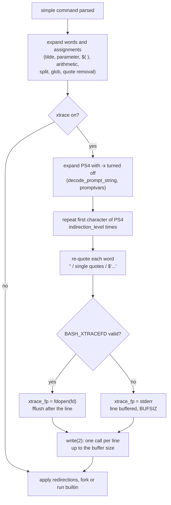

# xtrace, PS4, and BASH_XTRACEFD

> [!summary] Claim
> `set -x` is a printer inside the executor that writes each command after expansion and before execution, prefixed by an expanded `PS4`, to a descriptor the shell chooses at a specific moment; nearly every surprise (leaked secrets, interleaved logs, lost lines, a trace that ignores your redirection) follows from which descriptor that is, when it is bound, and how many `write(2)` calls one line costs.

Part of [Bash](README.md) in [Shell and Unix Engineering](../README.md).

## TL;DR

- Mechanism: bash's `execute_simple_command` calls `xtrace_print_word_list` on the expanded words before any redirection or fork, printing `PS4` (expanded with tracing switched off, first character repeated once per `parse_and_execute` level) and the words re-quoted, to a stdio stream that is `stderr` or the `fdopen` of `BASH_XTRACEFD` (bash-5.3 print_cmd.c).
- Rule: in production send the trace to its own descriptor (`exec 3>>log; BASH_XTRACEFD=3`), set `PS4='+ ${BASH_SOURCE##*/}:${LINENO}:${FUNCNAME[0]:-main}: '`, and turn tracing off around secrets with `{ set +x; } 3>/dev/null 2>/dev/null`.
- Trap: the trace prints expanded values, so `curl -H "Authorization: Bearer $TOKEN"` writes the token, and the classic `{ set +x; } 2>/dev/null` silences nothing once the trace goes to descriptor 3 (lab).
- Portability: POSIX.1-2024 XCU 2.15 `set` requires only "a trace for each command after it expands the command and before it executes it" on standard error and XCU 2.5.3 requires `PS4` to be parameter-expanded; the format, quoting, nesting marks, `set +x` tracing, function scope, and descriptor binding all differ by shell, and only bash 4.1+ and BusyBox ash honor `BASH_XTRACEFD` (lab).
- When not to use it: it is a debugging aid, not an audit log or a profiler; it costs about 1.2 microseconds per traced command with a plain `PS4` and about 3 milliseconds with a command substitution in `PS4` (measured here, two runs), it cannot be made machine-parseable across shells, and it leaks every expanded argument.

## Mental model



The trace is produced after expansion is complete, so it shows the words the command really receives, never the source text.
Before writing, bash expands `PS4` like a prompt with `-x` temporarily off, so a command substitution inside `PS4` is never itself traced, and it repeats the first character of the result once per nesting level of `parse_and_execute` (each `eval`, `$( )`, `source`, trap action, and the top-level script).
Each word is then re-quoted so the line could be pasted back as input.
The line goes to one stdio stream: `stderr`, which bash makes line buffered at startup, or a stream `fdopen`ed on the descriptor named by `BASH_XTRACEFD`, which bash flushes after every line, so in both cases a short line reaches the kernel as one `write(2)`.
Only then are the command's own redirections applied, which is why `cmd 2>/dev/null` still shows `cmd` in the trace.

## How it works

### What POSIX requires

POSIX.1-2024 XCU 2.15 `set` defines `-x`: "The shell shall write to standard error a trace for each command after it expands the command and before it executes it."
The same entry continues: "It is unspecified whether the command that turns tracing off is traced."
The `set` rationale explains the second sentence: "Historically, sh did trace the command set +x, but ksh did not."
XCU 2.5.3 Shell Variables defines `PS4`, marked as part of the User Portability Utilities option: "When an execution trace (`set -x`) is being performed, before each line in the execution trace, the value of this variable shall be subjected to parameter expansion".
It goes on: "Whether the value is also subjected to command substitution ... or arithmetic expansion ... or both is unspecified."
And it ends: "After expansion, the value shall be written to standard error", with the default `+ `.
`xtrace` is the `-o` name for `-x` (XCU 2.15 `set`), and `sh -x` takes the same option at invocation (XCU `sh`).
Nothing else is specified: not the quoting of words, not whether assignments, redirections, or compound-command heads appear, not what happens inside functions or subshells, and not which descriptor "standard error" means once the script redirects it.
Every row of the portability table below is in that unspecified space.

### bash: where the trace is printed

bash-5.3 execute_cmd.c `execute_simple_command` runs `if (echo_command_at_execute && (cmdflags & CMD_COMMAND_BUILTIN) == 0) xtrace_print_word_list (words, 1);` after `expand_words` and before looking the command up, applying redirections, or forking.
That placement gives three properties: the trace shows the post-expansion words, a command that fails to be found or whose redirection fails is still traced, and the command's own `2>/dev/null` does not hide its trace line, because that redirection has not been performed yet.
The `CMD_COMMAND_BUILTIN` test is the bash-5.1-alpha fix "If `set -x' is enabled, bash doesn't print a command twice if it's run by the `command' builtin" (bash-5.3 CHANGES).
Assignments are traced separately: variables.c `bind_variable_internal` ends with `if (echo_command_at_execute) xtrace_print_assignment (name, value, 0, 1);` and the comment "The Korn shell prints the `+ ' in front of assignment statements, so we do too."
That is why an assignment-only command such as `x=$(cmd)` produces a line for the inner `cmd` first and then `+ x=value`.
The bash manual lists the other traced constructs: "simple commands, for commands, case commands, select commands, and arithmetic for commands and their arguments or associated word lists" (bash-5.3 doc/bashref.texi, `set -x`); print_cmd.c also has `xtrace_print_cond_term` for `[[ ]]` and `xtrace_print_arith_cmd` for `(( ))`.
`for`, `select`, and `case` heads have been printed since bash 3.0 (bash-5.3 NEWS, bash-3.0 item t), and compound heads are printed unexpanded or reconstructed: `case a in`, `[[ -n x ]]`, and `((  1 + 1  ))` with doubled spaces (measured here with bash 5.3.15).
Brace groups, subshells, and pipelines have no line of their own; only the commands inside them are traced.
Declaration builtins print their assignment before the builtin: `declare -A m=([k]=v)` traces as `+ m=(['k']='v')` and then `+ declare -A m` (measured here, bash 5.3).

### bash: how a word is quoted

bash-5.3 print_cmd.c `xtrace_print_word_list` prints an empty word as `''`, a word for which `ansic_shouldquote` is true (it contains a non-printing character) with `ansic_quote` as `$'...'`, a word that `sh_contains_shell_metas` flags with `sh_single_quote`, and anything else bare.
Bash 2.0 introduced the quoting, "so it can be reused as input" (bash-5.3 NEWS, bash-2.0 item c).
The order of the two tests changed in 5.3: bash 3.2 through 5.2 test for shell metacharacters first, so a tab (a metacharacter) is printed inside single quotes as a raw byte, while 5.3 tests for non-printing characters first and prints `$'a\tb'` (seen in the 3.2, 4.1, 4.3, 4.4, 5.0, 5.1, 5.2, and 5.3 print_cmd.c `xtrace_print_word_list`, which tests `sh_contains_shell_metas` before `ansic_shouldquote` in every release but 5.3; lab).
A raw control byte in a trace is a terminal-escape hazard when the trace is viewed, so 5.3's order is the safer one; see [[Terminal-Escape-Injection]].
`xtrace_print_assignment` quotes scalars the same way but prints a compound array assignment exactly as written (`arr=(x "y z")`), because the value has not been expanded at that point (lab).
For `for` and `select` heads the `xtflags & 2` path suppresses quoting entirely, since those words are printed before expansion.

### bash: PS4 expansion and the nesting mark

print_cmd.c `indirection_level_string` reads `PS4`, returns an empty prefix if it is unset or empty, and otherwise calls `decode_prompt_string (ps4, 1)` between `change_flag ('x', FLAG_OFF)` and `change_flag ('x', FLAG_ON)`: `PS4` is expanded "like PS1" (bash-5.3 doc/bashref.texi, `PS4`), backslash escapes such as `\u` and `\D{%s}` included, and the commands in a `$( )` inside `PS4` run untraced.
The parameter expansion half of that is conditional: parse.y `decode_prompt_string` expands only `if (promptvars || posixly_correct)`, so after `shopt -u promptvars` bash prints `+$v> ` literally, unless the shell is also in POSIX mode (measured here).
The expanded string's first character is then copied `indirection_level` times, followed by the rest of the string; with `HANDLE_MULTIBYTE` the "first character" is a whole multibyte character (`MBRLEN`), so `PS4=$'\xc3\xa9 '` (one two-byte UTF-8 character and a space) repeats both bytes together, giving the character twice at level 2 (measured here in bash 3.2 and 5.3, whose print_cmd.c both carry `ps4_firstc_len`).
The buffer is resized to `ps4_firstc_len * indirection_level + strlen (ps4)` on every line, so neither depth nor length is truncated.
`indirection_level` is a global counter that eval.c `reader_loop` and builtins/evalstring.c `parse_and_execute` increment on entry, so a script or `bash -c` string runs at level 1 (`+ `), each `eval`, `source`, `$( )`, and trap action adds one, and a `( )` subshell, a function call, or a pipeline does not (lab: `>x`, `>>x`, `>>>x` for nested `eval`; `++ ` for a trace inside `$( )`).
The bash manual calls this "multiple levels of indirection" (bash-5.3 doc/bashref.texi, `PS4`).
No other shell in the matrix repeats the character (lab), so `++` in a log is a reliable sign the trace came from bash.

### bash: BASH_XTRACEFD, from assignment to write(2)

`BASH_XTRACEFD` appeared in bash 4.1: "New variable `$BASH_XTRACEFD`; when set to an integer bash will write xtrace output to that file descriptor" (bash-5.3 NEWS, bash-4.1 item o).
The variable is in the special-variable table of bash-5.3 variables.c, so every assignment calls `sv_xtracefd`, which parses the value with `strtol`, requires the whole string to be a number and `sh_validfd (fd)` to succeed, and then calls `fdopen (fd, "w")` and print_cmd.c `xtrace_set (fd, fp)`.
A value that is not an open descriptor is refused with `BASH_XTRACEFD: 9: invalid value for trace file descriptor`, and tracing keeps its previous destination (lab).
An empty value or `unset BASH_XTRACEFD` calls `xtrace_reset`, which does `fflush` and `fclose` on the stream and therefore closes the descriptor, then points the trace back at `stderr` (lab: the descriptor is closed afterwards).
The manual says the descriptor "is closed when BASH_XTRACEFD is unset or assigned a new value" (bash-5.3 doc/bashref.texi), but `sv_xtracefd` only calls `xtrace_set` for a new valid number, which overwrites `xtrace_fp` without closing the old stream: the old descriptor stays open and its `FILE` is leaked (lab: after `BASH_XTRACEFD=3; BASH_XTRACEFD=4`, descriptor 3 is still open in bash 5.3).
BusyBox ash's comment says the same thing about bash, "bash closes fd == `$BASH_XTRACEFD` when it is changed. we do not emulate this" (ash.c `evalcommand`), so both the manual and BusyBox describe a behavior that bash-5.3's code does not have for reassignment.
The manual's own warning is real: "setting BASH_XTRACEFD to 2 (the standard error file descriptor) and then unsetting it will result in the standard error being closed" (bash-5.3 doc/bashref.texi); measured here, a later `echo x >&2` then fails with status 1.
redir.c protects the other direction: a redirection that closes the trace descriptor (`exec 5>&-`, `r_close_this`) or moves it (`exec 6>&5-`, `r_move_output`) calls `xtrace_fdchk`, which resets the trace to `stderr` before the descriptor goes away, so no line is written into a closed or reused descriptor (lab).
A redirection that only re-points the descriptor, such as `{ ...; } 3>/dev/null`, is a `dup2(2)` over descriptor 3 that the `FILE` cannot see, so for the duration of that command the trace goes wherever descriptor 3 now points; that is how the lab's `{ set +x; } 3>/dev/null` hides the `set +x` line.
variables.c `initialize_shell_variables` also calls `sv_xtracefd` when `BASH_XTRACEFD` arrives in the environment (a bug fixed in bash-4.2-alpha, item ee, "bash to not change the xtrace file descriptor if BASH_XTRACEFD was found in the shell environment at startup", bash-5.3 CHANGES), so `export BASH_XTRACEFD=3` makes child bash processes that inherit descriptor 3 trace there too (measured here: `bash -xc` in a child wrote to the parent's log).
Since bash 4.3 the `{var}` redirection may name it directly: "can use variables with special meanings to the shell (e.g., BASH_XTRACEFD)" (bash-5.3 NEWS, bash-4.3 item y); `exec {BASH_XTRACEFD}>>log` allocates a descriptor at 10 or above, assigns it, and triggers `sv_xtracefd` through `stupidly_hack_special_variables` in redir.c `redir_varassign` (measured here: descriptor 10, trace in the log).
bash does not set close-on-exec on the trace descriptor, so every command the script runs inherits it, which keeps a log pipe open for as long as any long-lived child survives; see [[Close-on-Exec-and-Descriptor-Inheritance]].

### bash: how many writes one line costs

`shell_initialize` in bash-5.3 shell.c calls `sh_setlinebuf (stderr)`, and lib/sh/setlinebuf.c sets `_IOLBF` with a buffer of `LBUF_BUFSIZE`, which is 2016 bytes when bash uses its own malloc and `BUFSIZ` otherwise.
`xtrace_print_word_list` issues one `fprintf` per word and then `fflush`, so a trace line reaches the kernel as one `write(2)` until it outgrows the buffer, and then as one write per buffer-full.
The `fdopen` stream behind `BASH_XTRACEFD` is fully buffered but flushed after every line, with the same effect.
The lab measures this with a datagram socket as the trace descriptor, because a datagram socket keeps write boundaries that a pipe or a file would merge: `+ : one two three` is one 18-byte write in bash on `stderr` and on `BASH_XTRACEFD`, and six writes in dash (`+ `, `:`, ` one`, ` two`, ` three`, newline).
Measured here with a 3006-byte line on macOS, bash on `stderr` wrote 1024, 1024, and 958 bytes, consistent with `BUFSIZ` of 1024, and on `BASH_XTRACEFD` wrote 2048 and 958; on Debian (glibc, `BUFSIZ` 8192) bash wrote the same line in one 3006-byte call (measured here, 2026-11).
This matters when several background jobs trace to one pipe or one `O_APPEND` file: only a single `write(2)` of at most `PIPE_BUF` bytes is atomic on a pipe (see [[PIPE_BUF-and-Write-Atomicity]]), so short bash trace lines interleave whole, long ones can be cut at buffer boundaries, and dash, BusyBox, or yash on musl lines interleave word by word.

### Other shells

dash prints the trace in eval.c `evalcommand` with `outstr(expandstr(ps4val()), out)` on `preverrout`, after setting `preverrout.fd = 2` and redirecting with `REDIR_SAVEFD2`, then `eprintlist` writes each assignment and argument raw, with no quoting: `+ : marker c d` for the argument `c d`, and an empty argument as nothing (lab and measured here with dash 0.5.13.5).
The `inps4` flag ("Prevent PS4 nesting") stops a command substitution in `PS4` from tracing itself; dash's `PS4` is fully expanded (lab: `[7] : marker`).
BusyBox ash is the same code lineage with three additions in ash.c `evalcommand`: `preverrout_fd` becomes the value of `BASH_XTRACEFD` when it is a number (compiled in with `ENABLE_ASH_BASH_COMPAT`), arguments go through `maybe_single_quote` (and are always quoted when they match a reserved word), and every piece is a separate `fdprintf` with a final `safe_write(preverrout_fd, "\n", 1)`, so a line is one write per word.
The `BASH_XTRACEFD` check is only `is_number` on the variable's current value at each command, with no `fdopen`, no validity test, and no diagnostic, and the code comment says "bash closes fd == $BASH_XTRACEFD when it is changed. we do not emulate this", so BusyBox never closes the descriptor and an unset or non-numeric value silently returns the trace to descriptor 2 (ash.c `evalcommand`; measured here in BusyBox 1.37.0 on Alpine: after `BASH_XTRACEFD=3; BASH_XTRACEFD=4`, after `unset BASH_XTRACEFD`, and after `BASH_XTRACEFD=` the descriptors stay open).
BusyBox, like dash, keeps the trace on the original standard error when a command's own redirection moves descriptor 2: `redirect_fd` sets `preverrout_fd = new_fd` when the moved descriptor is the trace descriptor (ash.c).
zsh prints `PS4` with `printprompt4` in Src/utils.c, which runs `promptexpand` with `XTRACE` off, then `quotedzputs` for each word, on the stdio stream `xtrerr`; native zsh's default `PS4` is `+%N:%i> ` ("the name of the current shell structure and the line number within it"), and "in sh or ksh emulation, the default is `+ `" (zsh Doc/Zsh/params.yo).
Because zsh expands `PS4` as a prompt, `$v` in it is literal unless `PROMPT_SUBST` is set, which sh and ksh emulation turn on (zsh Doc/Zsh/options.yo; lab: `[$v]` native, `[7]` under `--emulate sh`).
zsh Src/exec.c `execcmd_exec` duplicates `stderr` into a fresh `xtrerr` stream "for xtrace output before redirecting" a simple command, so like bash a command's own `2>` does not hide its trace.
zsh prints an assignment prefix before it evaluates the value, so `x=$(echo in)` traces as one broken line, `+zsh:1> x=+zsh:1> echo in`, followed by `+zsh:1> x=in` (measured here, zsh 5.9).
zsh restores `XTRACE` when a function returns: with `LOCAL_OPTIONS` unset "only this option, and the LOCAL_LOOPS, XTRACE and PRINT_EXIT_VALUE options are restored" (zsh Doc/Zsh/options.yo), so `set -x` inside a function stops at its return (lab).
ksh93's `PS4` "is expanded for parameter evaluation, command substitution, and arithmetic expansion", defaults to `+ `, and is also `+ ` when unset (ksh93 sh.1).
ksh93u+m `sh_exec` in xec.c skips the trace for the `set` builtin altogether, not only for `set +x`: the command branch carries the comment "set +x doesn't echo" and traces with `else if((np!=SYSSET) && sh_isoption(SH_XTRACE)) sh_trace(com-command,tflags);`, so `set +x` is not traced (lab), matching the POSIX rationale's "ksh did not", and neither is `set -x` or `set -- a b`.
Its `sh_trace` prints `PS4` with tracing switched off, quotes each word with `sh_fmtq`, and writes to `sfstderr` before `sh_redirect` runs, so a command's own `2>` does not hide its line (ksh93u+m xec.c; lab).
ksh93 resets `xtrace` inside `function name` functions "unless the functrace shell option is set or the function was tagged using typeset -f -t" (ksh93 sh.1), but `name()` functions share it; `--functrace` arrived in ksh93u+m on 2022-06-04 (ksh93u+m NEWS).
ksh93u+m also fixed its quoting algorithm "used in xtrace, printf %q, and more" for UTF-8 (NEWS 2020-07-05 and 2020-07-09) and "a crash or freeze ... while processing a here-document while xtrace (set -x) is on and the `$PS4` prompt contains parameter expansions or command substitutions" (NEWS 2021-12-27).
The macOS ksh93u+ 2012 also prints one extra trace line after the command's line that lists all of its redirections, `+ 1> /dev/null 2> /dev/null` for `: a >/dev/null 2>/dev/null`, and ksh93u+m 1.0.10 prints the same line (measured here, 2026-11).
mksh binds the trace descriptor when tracing is switched on: misc.c `change_xtrace` does `shl_xtrace->fd = savefd(2)` on `set -x`, a private duplicate of the current descriptor 2, so a later `exec 2>file` or `{ set +x; } 2>/dev/null` does not move or hide the trace (read from misc.c; measured here in mksh R59 2020/10/31 and R59 2025/04/26, where the lab's probes print `snapshot` and `shown`).
mksh's `PS4` gets "Parameter, command and arithmetic substitutions" and the manual suggests `[$EPOCHREALTIME] ` for timestamps (mksh.1); exec.c restores the caller's `xtrace` after every function call (`change_xtrace(old_flags[(int)FXTRACE], Nee)`), and the `inherit-xtrace` option, on by default ("Do not reset `-o xtrace` upon entering functions (default)", mksh.1), decides whether a function starts with it.
yash's `print_xtrace` in exec.c expands `PS4` (and `YASH_PS4` outside POSIX mode, with `PS4S` for styling), quotes each word with `quote_as_word`, and writes to `stderr` with one `fprintf` or `fputc` per piece; yash.c asks for line buffering with `setvbuf(stderr, NULL, _IOLBF, BUFSIZ)`, but musl's `setvbuf` "No allocation of buffers is performed" and its `stderr` has `buf_size = 0`, so on Alpine yash 2.58.1 wrote `+ ':' one two three` in 9 calls (measured here; musl src/stdio/setvbuf.c and stderr.c); the `trace-all` option can suppress tracing inside hook variables such as `PROMPT_COMMAND` (yash doc/_set.txt).
yash's `quote_as_word` is also the most aggressive quoter here: it prints `:` as `':'` and `+x` as `'+x'`, so `set +x` traces as `+ set '+x'` (measured here, yash 2.58.1).
yash is the one shell here that applies a command's own redirections before it prints the trace: `exec_simple_command_with_words` calls `open_redirections` and only then `print_xtrace (argv)`, and `print_xtrace` writes to `stderr` (descriptor 2 as the command sees it), so in yash `cmd 2>/dev/null` hides the line for `cmd`, while bash, zsh, dash, BusyBox, posh, mksh, and ksh93 still show it (exec.c; measured here in yash 2.58.1 and the other shells).
The reason differs by shell: bash, posh, and ksh93 print before they open redirections, and zsh, dash, BusyBox (`preverrout_fd` follows a moved descriptor 2), and mksh (the `savefd (2)` copy) print to a descriptor 2 they saved before the redirection.
POSIX does not say which of the two orders is right, since it requires only a trace "after it expands the command and before it executes it".
posh prints `PS4_SUBSTITUTE(str_val(global("PS4")))`, where exec.c defines `PS4_SUBSTITUTE(s)` as `substitute((s), 0)` only `#ifdef KSH` and as `(s)` otherwise, prints words raw with `%s%c`, and prints a separate line for each redirection from `iosetup` (`snptreef` with `%R`) before it applies it; the posh build files fetched here (Makefile.am, config.h.in) do not define `KSH`, so posh prints `PS4` unexpanded, which does not conform to XCU 2.5.3 (measured here: posh 0.14.1 prints `[$v] : marker` for `PS4='[$v] '`).

## Numbers and limits

| Quantity | Value | Source |
| --- | --- | --- |
| Cost of one traced command, `PS4='+ '`, trace to `/dev/null` through `BASH_XTRACEFD` | about 1.2 microseconds (1.15 in run one: 0.33 s vs 0.10 s for 200001 trace lines; 1.3 in run two: 0.56 s vs 0.17 s for 300000 trace lines) | measured here, bash 5.3.15 then 5.3.20, Apple M3 Pro, two runs, 2026-11 |
| Same, `PS4` with `${BASH_SOURCE}`, `${LINENO}`, `${FUNCNAME[0]:-main}` | about 2.4 microseconds per line (2.3 in run one: 0.56 s; 2.5 in run two: 0.92 s against the 0.17 s baseline) | measured here, two runs, 2026-11 |
| Same, `PS4='+ $EPOCHREALTIME '` | about 1.4 microseconds per line (1.4 in run one: 0.38 s; 1.3 in run two: 0.56 s) | measured here, two runs, 2026-11 |
| Same, `PS4='+ $(date +%s) '` | about 3 milliseconds per line (2.8 ms in run one: 5.66 s for 2001 lines; 3.7 ms in run two: 11.1 s for 3000 lines): one fork and exec per traced command | measured here, two runs, 2026-11; the fork cost varies with machine load |
| `write(2)` calls for `+ : one two three` | 1 in bash (both destinations), zsh, ksh93u+ 2012, ksh93u+m 1.0.10, mksh, posh; 6 in dash and BusyBox ash; 9 in yash 2.58.1 on musl (it traces `':'`, 20 bytes) | lab, macOS host; measured here in the Debian and Alpine images, 2026-11 |
| `write(2)` sizes for a 3006-byte trace line | macOS: bash on `stderr` 1024, 1024, 958; bash on `BASH_XTRACEFD` 2048, 958; zsh 2048, 958; Debian: bash 3006; dash 0.5.12 2, 1, 3002, 1 | measured here, 2026-11; dash on macOS cannot be measured this way, because a 3002-byte datagram exceeds macOS's 2048-byte `net.local.dgram.maxdgram` |
| bash `stderr` line buffer | `LBUF_BUFSIZE`: 2016 bytes with bash malloc, else `BUFSIZ` (1024 on macOS, consistent with the measurement above) | bash-5.3 lib/sh/setlinebuf.c |
| `PS4` prefix length or depth limit | none; the buffer is resized to `ps4_firstc_len * indirection_level + strlen (ps4)` | bash-5.3 print_cmd.c `indirection_level_string` |
| `BASH_XTRACEFD` values accepted | a decimal string naming an open descriptor (`sh_validfd`); anything else is refused with a diagnostic | bash-5.3 variables.c `sv_xtracefd`; lab |
| bash xtrace history | quoting 2.0; `for`, `select`, `case` heads 3.0; `BASH_XTRACEFD` 4.1; environment import fixed 4.2-alpha; `{BASH_XTRACEFD}` redirection 4.3; root ignores inherited `PS4` 4.4; no double print under `command` 5.1-alpha; `$'...'` before single quotes 5.3 | bash-5.3 NEWS and CHANGES; 5.3 ordering from 5.2 and 5.3 print_cmd.c |

## Portability

| Shell | Default `PS4` | `PS4` expanded | Quoting of `c d` | Nesting mark | `set +x` traced | Trace descriptor | `set -x` in a function | `BASH_XTRACEFD` | Evidence |
| --- | --- | --- | --- | --- | --- | --- | --- | --- | --- |
| POSIX sh | `+ ` | parameter expansion required; command substitution and arithmetic unspecified | unspecified | unspecified | unspecified | "standard error" | unspecified | not specified | XCU 2.5.3, 2.15 `set` |
| bash 3.2 (macOS `/bin/bash`, `/bin/sh`) | `+ ` | yes, if `promptvars` or POSIX mode | `'c d'`; tab as raw byte in quotes | first char repeated per level | yes | current fd 2 | stays on | ignored | lab |
| bash 5.3 | `+ ` | same | `'c d'`; tab as `$'a\tb'` | first char repeated per level | yes | current fd 2 or `BASH_XTRACEFD` | stays on | yes (4.1+) | lab |
| zsh 5.9 native | `+%N:%i> ` | prompt escapes; `$v` only with `PROMPT_SUBST` | `'c d'` | none | yes | stderr as of the command, saved before its own redirections | restored on return | ignored | lab |
| `zsh --emulate sh` | `+ ` | yes (`PROMPT_SUBST` on) | `'c d'` | none | yes | same as native | restored on return | ignored | lab |
| dash 0.5.12 and 0.5.13 | `+ ` | yes | raw `c d` | none | yes | current fd 2 | stays on | ignored | lab (0.5.13.5 here); eval.c |
| ksh93u+ 2012 (macOS `/bin/ksh`) | `+ ` | yes | `'c d'` | none | no | current fd 2 | `name()` stays on; `function` resets | ignored | lab |
| ksh93u+m 1.0.10 | `+ ` | yes | `'c d'` (source) | none (source) | no (source) | current fd 2 (source) | as 2012, plus `--functrace` | ignored | sh.1, NEWS, xec.c; measured |
| mksh R59 | `+ ` | yes | `'c d'` (source) | none (source) | yes (source) | duplicate of fd 2 taken at `set -x` | restored on return | ignored | mksh.1, exec.c, misc.c; measured |
| yash 2.58 | `+ ` | yes, plus `YASH_PS4` | `'c d'` (source), and also `':'` and `'+x'` | none (source) | yes (source), as `+ set '+x'` | current fd 2 | stays on (source) | ignored | params.txt, exec.c; measured |
| posh 0.14 | `+ ` | no (source: `PS4_SUBSTITUTE` is the identity) | raw `c d` (source) | none | yes (source) | current fd 2 | stays on (source) | ignored | exec.c; measured |
| BusyBox 1.37 ash | `+ ` | yes | `'c d'` (source), and reserved words such as `'in'` | none | yes (source) | current fd 2 or `BASH_XTRACEFD` | stays on | yes, if built with `ASH_BASH_COMPAT` | ash.c; measured |

"(source)" cells come from reading that shell's code (ksh93u+m xec.c `sh_trace`, mksh exec.c and misc.c, yash exec.c `print_xtrace`, posh exec.c, BusyBox ash.c `evalcommand`), and every one of them was then confirmed by running the lab's `probe.sh` modes in the Debian 13 image (ksh93u+m 1.0.10, mksh R59 2025/04/26, posh 0.14.1, BusyBox 1.37.0) and the Alpine 3.22 image (yash 2.58.1, mksh R59 2020/10/31, BusyBox 1.37.0) on 2026-11-26.
Every other cell was measured here or read from a cited manual.
yash's extra quoting (`+ ':' marker 'c d'`, `+ set '+x'`) and BusyBox's quoting of the reserved word `in` defeat a fixed-string search for `: marker`, `set +x`, or `: in`, so the lab's probes strip single quotes from the trace before matching.

A command's own redirection and its trace line:

- bash, posh, and ksh93 print the line before they open the command's redirections; zsh, dash, BusyBox, and mksh print to a saved copy of descriptor 2; in all of them `cmd 2>/dev/null` still shows `cmd` in the trace (lab: `ownredir`).
- yash opens the redirections first, so `cmd 2>/dev/null` hides the line (exec.c `exec_simple_command_with_words`; lab).
- POSIX does not decide: it requires only a trace after expansion and before execution (XCU 2.15 `set`).
- posh and mksh (`iosetup` in both) also print a separate trace line per redirection, posh after the command's line (`+ 2> /dev/null `) and mksh before it (`+ 2>/dev/null `), and ksh93u+ 2012 and ksh93u+m 1.0.10 print one line after the command's line listing them all (`+ 1> /dev/null 2> /dev/null`) (measured here, 2026-11); the `evalcommand` trace code in dash and BusyBox and `print_xtrace` in yash print only assignments and words, and bash 5.3 and zsh 5.9 print no redirection line (measured here).

No external utility is involved in tracing, so GNU, BSD, BusyBox, and uutils utilities do not differ here; only the shell writes the trace.

## Worked example

The [lab](../labs/04-xtrace-ps4-and-bash_xtracefd/) has 21 tests: `probe.sh` runs under every shell and prints a computed fact per mode, `bash-probe.sh` holds the `BASH_XTRACEFD` and formatting probes that need bash, `writes.c` counts the `write(2)` calls behind one trace line, and `trace-demo.sh` is the production pattern below.

`trace-demo.sh`, verbatim:

```sh
#!/bin/sh
# trace-demo.sh: a production xtrace setup - the trace goes to its own log through
# BASH_XTRACEFD, every line names file, line and function, and a secret stays out of it.
# Prints "trace-demo.sh: needs bash" and exits 2 under any other shell.
# Usage: trace-demo.sh LOG   (LOG is appended to; stdout and stderr stay clean)
if [ -z "${BASH_VERSION-}" ]; then
  echo "trace-demo.sh: needs bash" >&2
  exit 2
fi
exec 3>>"$1"
BASH_XTRACEFD=3
PS4='+ ${BASH_SOURCE##*/}:${LINENO}:${FUNCNAME[0]:-main}: '
set -x

load_token() {
  { set +x; } 3>/dev/null 2>/dev/null
  # shellcheck disable=SC2034 # stands in for a credential a real script would pass to curl
  token=example-secret-not-real
  set -x
}

fetch() {
  load_token
  printf 'fetching %s\n' "$1"
}

fetch https://example.invalid/data
echo "warning: cache cold" >&2
```

Under bash 5.3 the terminal shows only the program's own output, as the lab asserts:

```text
fetching https://example.invalid/data
warning: cache cold
```

and the log receives the trace, with no line containing the token:

```text
+ trace-demo.sh:27:main: fetch https://example.invalid/data
+ trace-demo.sh:23:fetch: load_token
+ trace-demo.sh:24:fetch: printf 'fetching %s\n' https://example.invalid/data
+ trace-demo.sh:28:main: echo 'warning: cache cold'
```

Under macOS bash 3.2, `BASH_XTRACEFD` is an ordinary variable, so the same four trace lines are interleaved with the output on stderr and the log stays empty (lab).
Under every other shell the script prints `trace-demo.sh: needs bash` and exits 2.
Four details make it correct.
`PS4` is in single quotes, so `${LINENO}` and `${FUNCNAME[0]}` are expanded at each trace line, not once at assignment (see [[Bash-Introspection-Variables]] for what each variable holds).
`{ set +x; } 3>/dev/null 2>/dev/null` silences the `set +x` line on both possible destinations, so it works with and without `BASH_XTRACEFD`; the lab's `silence` probe shows that `2>/dev/null` alone leaks `+ set +x` into the log.
The `set -x` that turns tracing back on is not traced, because tracing is off when it runs; the token assignment between the two is therefore absent.
The trace goes to descriptor 3, opened with `>>`, so several runs append to one log and the script's stdout and stderr remain usable by its caller.

The cross-shell probes print a computed word rather than raw trace text, for example the binding probe:

```sh
  follows)
    PS4='+ '
    (
      set -x
      exec 2>"$f"
      : after
    ) 2>/dev/null
    if has ': after'; then echo follows; else echo snapshot; fi
    ;;
```

That excerpt is verbatim from `probe.sh`; it prints `follows` in bash, zsh, dash, ksh93, yash, posh, and BusyBox ash, and `snapshot` in mksh, whose trace stays on the descriptor it duplicated at `set -x` (measured here, 2026-11).

## Pitfalls

> [!warning] Secrets in the trace
> Trigger: `set -x` active while a command receives a credential, as in `curl -H "Authorization: Bearer $TOKEN" ...`, or a CI job that runs scripts with `bash -x`.
> Symptom: the trace prints the expanded argument, so the token lands in the log; an assignment such as `TOKEN=$(vault read ...)` is traced too, as `+ TOKEN=value`.
> Fix: turn tracing off around every line that touches a secret (`{ set +x; } 2>/dev/null 3>/dev/null` ... `set -x`), pass secrets through files or stdin rather than arguments, and treat trace logs as sensitive data; CI masking of known secret values is a second line of defense, not the first.

> [!warning] The silence idiom stops working with `BASH_XTRACEFD`
> Trigger: `{ set +x; } 2>/dev/null` in a script that sends its trace to descriptor 3.
> Symptom: `+ set +x` appears in the trace log, because the redirection silenced descriptor 2 while the trace went to descriptor 3 (lab).
> Fix: redirect both, `{ set +x; } 2>/dev/null 3>/dev/null`, naming whatever descriptor `BASH_XTRACEFD` holds.
> Other shells: ksh93 never traces `set`, so the idiom is a no-op there; mksh writes to a duplicate of descriptor 2 taken at `set -x`, so `2>/dev/null` on the group does not hide the line (misc.c `change_xtrace`; lab); yash would hide it, and so would a plain `cmd 2>/dev/null` on any command, because yash opens redirections before it prints the trace (exec.c; lab).

> [!warning] Closing standard error by unsetting `BASH_XTRACEFD`
> Trigger: `BASH_XTRACEFD=2` (to "reset" it) and a later `unset BASH_XTRACEFD` or `BASH_XTRACEFD=`.
> Symptom: `xtrace_reset` closes the stream and with it descriptor 2; every later diagnostic is lost and `echo x >&2` fails with status 1 (measured here).
> Fix: never assign 2; to return the trace to stderr, `unset BASH_XTRACEFD` only when it names a descriptor you opened for tracing.

> [!warning] Reassignment leaks the old descriptor
> Trigger: switching logs with `BASH_XTRACEFD=4` while it was 3, trusting the manual's "closed when ... assigned a new value".
> Symptom: descriptor 3 stays open in bash 5.3 (lab), and the leaked `FILE` is never flushed or freed; a pipe reader on it never sees end of file.
> Fix: `unset BASH_XTRACEFD` (which closes the old stream) before assigning the new descriptor, or close the old one explicitly.

> [!warning] A `$( )` in `PS4` forks for every traced command
> Trigger: `PS4='+ $(date +%T) '` for timestamps.
> Symptom: about 3 ms per traced command here (2.8 to 3.7 ms), a slowdown of about 2500x over a plain `PS4` on a tight loop.
> Fix: use `$EPOCHREALTIME` (bash 5.0+, mksh) or `\t`-style prompt escapes in bash, both of which run in-process (about 1.4 microseconds per line here).

> [!warning] Interleaved traces from background jobs
> Trigger: several `&` jobs or `xargs -P` workers tracing to one pipe or file.
> Symptom: lines cut mid-word in dash and BusyBox (one `write(2)` per word) and in yash on musl (one per word and separator), or at the stdio buffer boundary in bash for lines over 1024 bytes on macOS (lab and measured here).
> Fix: give each worker its own log (`exec 3>>"log.$BASHPID"; BASH_XTRACEFD=3`), and put `$BASHPID` in `PS4` when the logs must be merged later.

> [!warning] `set -x` scope differs by shell
> Trigger: a debug helper `debug_on() { set -x; }` called from a script.
> Symptom: in bash, dash, and ksh93 `name()` functions tracing stays on after the call; in zsh and mksh it stops at the return; in ksh93 `function` functions tracing set by the caller does not reach the body (ksh93 sh.1).
> Fix: enable tracing at the top level, or in bash wrap a region with `set -x` ... `{ set +x; } 2>/dev/null` in the same scope.

> [!warning] Reading the trace as source
> Trigger: copying a trace line back into a shell to reproduce a failure.
> Symptom: dash and posh print words unquoted, so `c d` becomes two words; zsh prints `x=+zsh:1> echo in` for an assignment with a command substitution; bash 3.2 to 5.2 put raw control characters on the line.
> Fix: rely on bash 5.3's quoting only within bash, and reproduce from the script, not from the trace.

> [!warning] Root shells and inherited `PS4` (CVE-2016-7543)
> Trigger: a privileged program that runs bash older than 4.4 with an environment the caller controls, such as `SHELLOPTS=xtrace` and `PS4='$(cmd)'`.
> Symptom: NVD: "Bash before 4.4 allows local users to execute arbitrary commands with root privileges via crafted SHELLOPTS and PS4 environment variables."
> Fix: bash 4.4 "Shells running as root no longer inherit PS4 from the environment" (bash-5.3 NEWS, bash-4.4 item nn), implemented in variables.c `initialize_shell_variables` as `bind_variable ("PS4", "+ ", 0)` when `current_user.euid == 0`; privileged wrappers should still start bash with `env -i` and an explicit environment.

## Security and robustness

- `PS4` is code: in bash, dash, ksh93, mksh, yash, and BusyBox it is expanded with command substitution before every trace line, so any process that can set `PS4` and enable `xtrace` in a shell's environment can run commands in it; bash protects only root shells (variables.c `initialize_shell_variables`), and a non-root setuid or sudo-style wrapper is still exposed unless it clears the environment.
- `xtrace` itself can be imported: bash enables every option named in an inherited `SHELLOPTS` "before reading any startup files" (bash-5.3 doc/bashref.texi, `SHELLOPTS`), and `set -x; export SHELLOPTS` turns on tracing in every child bash (measured here); `BASH_ENV` can do the same with a sourced `set -x`, see [[Bash-Startup-Files-and-Modes]].
- An exported `BASH_XTRACEFD` makes child bash processes write their traces into whatever that descriptor is in the child, which may be a socket, a pipe the child uses for data, or nothing at all (then the child prints the invalid-value diagnostic); unexport it with `export -n BASH_XTRACEFD`.
- Trace logs contain every expanded argument, including credentials, personal data, and file names chosen by attackers; store them like other sensitive logs, rotate them, and never enable `-x` in a script that handles secrets without the off-and-on bracket shown above.
- A traced word can contain terminal escape sequences; bash 5.3 prints non-printing bytes as `$'...'`, but bash before 5.3, dash, and posh print them raw, so viewing a trace with `cat` can drive the terminal (see [[Terminal-Escape-Injection]]); view untrusted traces with `cat -v` or `less`.
- The trace descriptor is inherited by every child because bash never sets close-on-exec on it; a daemon started from a traced script keeps the log open, and a pipe reader on the trace never sees end of file until that daemon exits.

## The principal's view

The decision is how much observability to buy with `xtrace` and where its output goes.
For a CI or deployment script, `set -x` with a `BASH_XTRACEFD` log and a `PS4` that names file, line, and function is the cheapest debugging aid there is: one line per command, no code changes at each call site, about a microsecond per command, and a separate stream that keeps stdout and stderr contracts intact.
The trade-off is that the trace is unstructured, shell-specific text that includes every expanded value: it is a debugging transcript, not an audit trail, a metric source, or a security log, and making it safe requires discipline around every secret.
Standardize the setup in one sourced library (descriptor, `PS4`, an `xtrace_off` and `xtrace_on` helper that silences both descriptors) instead of letting each script improvise, and default it off in production paths that touch credentials, enabling it per run with an environment flag the script checks.
When the requirement becomes per-command timing, structured events, or reliable redaction, the hook has outgrown the shell: a `DEBUG` trap ([[ERR-and-DEBUG-Traps]]) costs more and is just as leaky, so move the logic into a language with a logging library that can redact fields and emit structured records.

## Interview questions

> [!question] L5: What exactly does `set -x` print, and when?
>
> > [!success]- Answer
> > The shell writes each command after expansion and before execution, prefixed by the expanded `PS4`, which is what XCU 2.15 `set` requires.
> > In bash the call happens in `execute_simple_command` before redirections are applied, so the line shows the final words, and a command's own `2>/dev/null` does not hide it (yash is the exception: it opens redirections first).
> > Assignments get their own lines from `bind_variable`, and `for`, `case`, `select`, `[[ ]]`, and `(( ))` heads are printed too.
> >
> > Follow-up: Why does `x=$(date)` produce two trace lines in bash, and in which order?

> [!question] L5: Predict the output on stderr of `bash -c 'PS4=">x "; set -x; eval ": e1; eval \": e2\""; set +x'`.
>
> > [!success]- Answer
> > `>x eval ': e1; eval ": e2"'`, then `>>x : e1`, then `>>x eval ': e2'`, then `>>>x : e2`, then `>x set +x`.
> > Each `eval` runs `parse_and_execute`, which increments `indirection_level`, and bash repeats only the first character of `PS4` once per level.
> > The words are re-quoted for reuse as input, and bash traces the `set +x` that turns tracing off.
> >
> > Follow-up: What would dash print for the same script?

> [!question] L5: How do you send the trace to a file without touching the script's stderr?
>
> > [!success]- Answer
> > In bash 4.1 or later, open a descriptor and name it: `exec 3>>trace.log; BASH_XTRACEFD=3`, or `exec {BASH_XTRACEFD}>>trace.log` in bash 4.3 or later.
> > bash `fdopen`s that descriptor and flushes after each trace line, and it resets to stderr if the descriptor is closed with `exec 3>&-`.
> > In other shells the only option is redirecting descriptor 2 for the region being traced.
> >
> > Follow-up: What happens if you later run `unset BASH_XTRACEFD` and the value was 2?

> [!question] L6: Debug this script: the author expects no `set +x` line and no token in `trace.log`, yet both appear.
>
> ```bash
> exec 3>>trace.log
> BASH_XTRACEFD=3
> set -x
> TOKEN=$(cat /run/secrets/token)
> { set +x; } 2>/dev/null
> curl -fsS -H "Authorization: Bearer $TOKEN" "$url"
> set -x
> ```
>
> > [!success]- Answer
> > The token is traced by the assignment line `+ TOKEN=...`, because tracing is still on when the assignment runs; the `set +x` must come before it.
> > The `set +x` line is traced to descriptor 3, and `2>/dev/null` silenced descriptor 2, so it lands in the log.
> > Fix: `{ set +x; } 2>/dev/null 3>/dev/null` before reading the secret, and turn tracing back on only after the last command that uses it.
> >
> > Follow-up: How would you make the `curl` call itself not expose the token in the process table either?

> [!question] L6: Why can trace lines from parallel jobs be cut in the middle, and how does that differ between bash and dash?
>
> > [!success]- Answer
> > The kernel only keeps one `write(2)` together, and on a pipe only up to `PIPE_BUF` bytes.
> > bash buffers a trace line in stdio and writes it in one call until it exceeds the buffer, 1024 bytes on macOS for stderr; dash writes each word separately, six calls for `+ : one two three`.
> > So bash lines interleave whole unless they are long, and dash lines can interleave word by word.
> >
> > Follow-up: How would you prove the number of writes without `strace`?

> [!question] L6: Where does the widespread `{ set +x; } 2>/dev/null` idiom for stopping tracing silently fail across different shells?
>
> > [!success]- Answer
> > POSIX leaves it unspecified whether `set +x` is traced at all, and ksh93 never traces the `set` builtin (xec.c skips `SYSSET`), so there it is unnecessary.
> > In bash with `BASH_XTRACEFD` the line goes to another descriptor and leaks.
> > In mksh the trace goes to a duplicate of descriptor 2 taken when `set -x` ran, so redirecting descriptor 2 later changes nothing.
> >
> > Follow-up: How would you detect at run time which descriptor a shell is tracing to?

> [!question] L6: What does `PS4='+ ${BASH_SOURCE##*/}:${LINENO}:${FUNCNAME[0]:-main}: '` cost, and what are the alternatives for timestamps?
>
> > [!success]- Answer
> > `PS4` is expanded on every trace line, so the cost scales with traced commands: about 2.4 microseconds per line here, against about 1.2 for `+ `.
> > A command substitution in `PS4` forks and execs on every line, about 3 ms here, so `$(date)` makes traced loops thousands of times slower.
> > `$EPOCHREALTIME` (bash 5.0 or later, mksh) and bash prompt escapes such as `\D{%T}` stay in-process.
> >
> > Follow-up: Why are the commands inside a `PS4` command substitution not themselves traced?

> [!question] L7+: How did CVE-2016-7543 work, and what did bash 4.4 change?
>
> > [!success]- Answer
> > Before 4.4, a bash started with root privileges imported both `SHELLOPTS` and `PS4` from its environment.
> > `SHELLOPTS=xtrace` turned on tracing at startup, and a `PS4` containing a command substitution ran that command with root privileges at the first trace line.
> > bash 4.4 rebinds `PS4` to `+ ` when the effective uid is 0, in `initialize_shell_variables`, so root shells ignore an inherited `PS4`.
> > A non-root privileged wrapper is not covered, so wrappers should still clear the environment.
> >
> > Follow-up: Which other inherited variables can change a bash script's behavior before its first line runs?

> [!question] L7+: What architectural objections and controls do you raise if a platform team mandates running every production script under `bash -x` with traces shipped to a central pipeline?
>
> > [!success]- Answer
> > The trace contains every expanded argument, so it will collect credentials and personal data, and redaction after the fact is unreliable.
> > It is unstructured, version-dependent text (quoting changed in 5.3, nesting marks differ, other shells differ more), so parsing it for metrics or audit is fragile.
> > Offer an opt-in per-run switch that writes to a separate descriptor with a standard `PS4`, scrubbed retention, and an off-and-on helper around secrets, and use structured logging from the scripts' own code for anything that must be relied on.
> >
> > Follow-up: Which parts of the setup would you enforce with a linter, and which only by review?

## Related

Prerequisites: [[wait-n-and-wait-p]]

Next: [[Bash-Introspection-Variables]]

See also: [[The-set-Builtin-and-Shell-Options]], [[ERR-and-DEBUG-Traps]], [[Bash-Startup-Files-and-Modes]], [[Shell-Options-shopt]], [[Bash-POSIX-Mode]], [[Bash-Version-History]], [[Bash-3-2-on-macOS]], [[Descriptor-Duplication-and-Closing]], [[Close-on-Exec-and-Descriptor-Inheritance]], [[PIPE_BUF-and-Write-Atomicity]], [[Terminal-Escape-Injection]], [[Command-Injection]], [[Environment-Variables-and-Inheritance]], [[Command-Substitution]], [[The-eval-Builtin]]

## Further reading

- [POSIX.1-2024 XCU chapter 2](https://pubs.opengroup.org/onlinepubs/9799919799/utilities/V3_chap02.html): the two sentences that are all the standard says about `-x`, the `PS4` definition in 2.5.3, and the rationale on tracing `set +x`.
- [GNU bash 5.3 source](https://ftpmirror.gnu.org/bash/bash-5.3.tar.gz): print_cmd.c `xtrace_print_word_list` and `indirection_level_string`, variables.c `sv_xtracefd`, and redir.c `xtrace_fdchk` are the whole mechanism; NEWS and CHANGES date each change.
- [dash eval.c](https://git.kernel.org/pub/scm/utils/dash/dash.git/plain/src/eval.c): the minimal implementation, ten lines in `evalcommand`, useful for seeing what the standard actually demands.
- [BusyBox ash.c](https://raw.githubusercontent.com/mirror/busybox/master/shell/ash.c): the only other `BASH_XTRACEFD` implementation, with a comment on where it deliberately differs from bash.
- [mksh misc.c](https://raw.githubusercontent.com/MirBSD/mksh/master/misc.c): `change_xtrace` shows the design alternative of binding the trace descriptor once, at `set -x`.
- [zsh Doc/Zsh/options.yo](https://raw.githubusercontent.com/zsh-users/zsh/master/Doc/Zsh/options.yo): `XTRACE`, `PROMPT_SUBST`, and the `LOCAL_OPTIONS` rule that restores `XTRACE` at function return.
- [ksh93u+m sh.1](https://raw.githubusercontent.com/ksh93/ksh/dev/src/cmd/ksh93/sh.1) and [NEWS](https://raw.githubusercontent.com/ksh93/ksh/dev/NEWS): the KornShell semantics (`set +x` untraced, `function` scoping, `functrace`) and the xtrace bugs fixed since 2012.
- [NVD CVE-2016-7543](https://nvd.nist.gov/vuln/detail/CVE-2016-7543): the canonical example of `PS4` as an injection vector.
