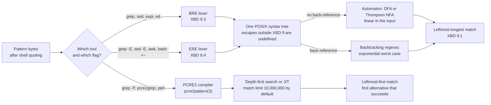

# BRE ERE and PCRE

> [!summary] Claim
> BRE and ERE are two spellings of one POSIX language with leftmost-longest semantics, PCRE is a different language run by a backtracking search with leftmost-first semantics, and every construct outside POSIX.1-2024 XBD 9 (such as `\d`, an ERE `\1`, or `.*?`) means something different in GNU, BSD, musl, and glibc, as the lab measures.

Part of [Regular Expressions and Text Processing](README.md) in [Shell and Unix Engineering](../README.md).

## TL;DR

- Mechanism: a BRE (XBD 9.3) and an ERE (XBD 9.4) compile to the same POSIX matcher, which returns the leftmost-longest match; PCRE2 compiles to a depth-first backtracking program (or JIT code) that returns the first match its search order finds.
- Rule: in a BRE, `+ ? | ( ) { }` are literal and `\( \) \{ \}` are operators; in an ERE it is the reverse; in PCRE a backslash before any non-alphanumeric character is always literal, inside or outside a class.
- Trap: an escape the standard does not define is undefined, not an error; the lab shows `grep '\d'` matching the letter `d` (GNU, with a warning upstream but silently in Debian's build), a digit (BSD and musl), or a silent `d` (glibc).
- Portability: POSIX.1-2024 guarantees BREs, EREs, back-references in BREs only, `RE_DUP_MAX` of at least 255, patterns of at least 256 bytes, and `sed -E`; `grep -P` exists only in GNU grep builds with PCRE2.
- When not to use it: never feed PCRE or any back-reference an attacker-controlled pattern or subject in a latency path; use an ERE on a DFA engine (GNU grep, RE2, Rust `regex`), a fixed-string search (`grep -F`), or a real parser for structured data.

## Mental model



The shell removes quotes and hands the tool a byte string; the tool, not the string, decides which grammar reads it, so the same `a+` is a literal two-character string to `grep` and one-or-more `a` to `grep -E` and `awk`.
The BRE and ERE lexers differ only in which characters need a backslash to become operators, and both feed the same POSIX semantics, which GNU grep's manual states directly: "basic and extended regular expressions are merely different notations for the same pattern-matching functionality" (grep-3.12 `doc/grep.texi`, Regular Expressions).
A POSIX engine can answer most patterns with an automaton that reads each input byte once, and falls back to a backtracking matcher only for back-references, which are not regular.
The PCRE2 path never builds an automaton for the normal `pcre2_match()` API: it searches the pattern tree depth-first and stops at the first leaf that succeeds, so alternation order and greediness, not length, decide the result (pcre2matching(3), The Standard Matching Algorithm).

## How it works

### Three languages, one alphabet

The POSIX rationale states the lineage: "The BRE corresponds to the ed or historical grep type, and the ERE corresponds to the historical egrep type (now grep -E)" (POSIX.1-2024 XRAT A.9).
POSIX folded `egrep` and `fgrep` into `grep -E` and `grep -F` (POSIX.1-2024 XCU grep, RATIONALE), and GNU grep 3.8 (2022-09-02) made `egrep` and `fgrep` warn that they are obsolescent (grep-3.12 `NEWS`).
PCRE is not a POSIX dialect at all: it tracks Perl's syntax and semantics, and PCRE2's own compatibility page lists where even Perl and PCRE2 disagree, for example a braced quantifier with nothing to repeat is an error in PCRE2 but literal text in Perl (pcre2compat(3), item 4).
Since GNU grep 3.8, `grep -P` is built on PCRE2 instead of the older PCRE library (grep-3.12 `NEWS`).

### The BRE grammar (POSIX.1-2024 XBD 9.3)

A BRE has four special characters outside brackets: `.`, `[`, `\`, and `*`, plus the anchors `^` and `$` in anchoring positions (POSIX.1-2024 XBD 9.3.3).
Each is special only in context, which is the source of most BRE surprises:
- `*` is literal as the first character of the whole BRE (after an optional `^`) and as the first character of a subexpression, so `grep '*a'` searches for the two characters `*a` (XBD 9.3.3; the lab asserts it in every grep).
- `^` is an anchor only as the first character of the BRE; inside `\(...\)` an implementation may also treat it as an anchor, so a portable BRE escapes a leading `^` in a subexpression (XBD 9.3.8).
- `$` is an anchor only as the last character, with the same optional extension at the end of a subexpression (XBD 9.3.8).
The rationale explains why the rules are so contextual: making mid-pattern anchors undefined "would cause a number of historical BREs, such as `2^10`, `$HOME`, and `$1.35`, that relied on the characters being treated literally, to become invalid" (POSIX.1-2024 XRAT A.9.3.8).
Grouping and counting need backslashes: `\(...\)` makes a subexpression and `\{m\}`, `\{m,\}`, `\{m,n\}` make an interval expression, with `0 <= m <= n <= RE_DUP_MAX` (XBD 9.3.6).
A back-reference `\1` through `\9` matches the same string the n-th subexpression matched; if that subexpression matched several times, the reference uses the last match, so `^\(ab*\)*\1$` matches `ababbabb` but not `ababbab` (XBD 9.3.6).
The limit of nine comes from the single-digit syntax, not from a limit on groups: the rationale gives a valid BRE with ten subexpressions (POSIX.1-2024 XRAT A.9.3.6).
POSIX.1-2024 made `\?`, `\+`, and `\|` implementation-defined: each either matches the literal character or acts like the ERE operator, and a note warns that a future revision may require the operator meaning (XBD 9.3.2; Austin Group Defect 1546 per XRAT A.9.3.2).
Any other escaped ordinary character, such as `\d` or `\w`, has undefined meaning (XBD 9.3.2), and the standard's definition of undefined explicitly allows "an error, enabling an extended syntax for that RE, or using the construct in error as literal characters" (XBD 9.1, "invalid").

### The ERE grammar (POSIX.1-2024 XBD 9.4)

An ERE makes `+`, `?`, `|`, `(`, `)`, and `{` special and treats their backslashed forms as literals (XBD 9.4.3).
`^` and `$` are anchors everywhere outside brackets, so the ERE `a^b` "is valid, but can never match" while the BRE `a^b` matches the three literal characters (XBD 9.4.9 and 9.3.8; the lab asserts both in every grep).
A repetition operator first in an ERE, or right after `(`, `|`, `^`, or `$`, is undefined (XBD 9.4.3), which is why implementations split three ways on `grep -E '*a'` (see Portability).
EREs have no back-references in POSIX: the grammar's `BACKREF` token is "Applicable only to basic regular expressions" (XBD 9.5.1), and the rationale records that adding them "was rejected by the standard developers as likely to decrease consensus" (XRAT A.9.4).
Precedence, from high to low, is bracket symbols, escapes, brackets, grouping, repetition, concatenation, anchoring, then alternation, so `abba|cde` means `(abba)|(cde)` (XBD 9.4.8).
POSIX.1-2024 added two minimal-match features to EREs: a `?` after any repetition switches it from leftmost-longest to leftmost-shortest, so `.*?c` stops at the first `c`, and the new `regcomp()` flag `REG_MINIMAL` makes shortest the default and lets `?` select longest (XBD 9.4.6; Austin Group Defects 793 and 1329 per XRAT A.9.4.6).
The lab shows that glibc and musl had not implemented either as of 2026-11: neither `posix/regcomp.c` (glibc master) nor `src/regex/regcomp.c` (musl master) contains `REG_MINIMAL`, and both read `.*?` as `(.*)?`, which is still greedy.

### Bracket expressions (POSIX.1-2024 XBD 9.3.5, shared by both)

Inside `[...]`, a BRE's `.`, `*`, `[`, and `\` and an ERE's `.`, `(`, `*`, `+`, `?`, `{`, `|`, `$`, `[`, and `\` lose their special meaning (XBD 9.3.5).
So in grep `[\n]` matches a backslash or the letter `n`, never a newline; the lab asserts `out=n,\` in every grep.
sed is not uniform here, because XCU sed separately says `\n` matches a newline in the pattern space: on the host, macOS sed followed the bracket rule (`s/[\n]/X/g` turned `n\` into `XX`), while GNU sed 4.10 left `n\` alone and instead replaced the newline that `N` had appended (measured).
The source explains both: GNU sed's `normalize_text` in `sed/compile.c` turns `\n` into a newline everywhere in a regex except inside a bracket expression when `posixicity` is not `POSIXLY_EXTENDED`, and `sed.c` selects `POSIXLY_CORRECT` only when that environment variable is set, so by default `[\n]` contains a newline and under `POSIXLY_CORRECT=1` it follows the bracket rule (measured: `XX`).
Apple's `compile_ccl` in `sed/compile.c` (text_cmds) skips the FreeBSD backslash handling under `#ifdef __APPLE__` with a comment citing XBD 9.3.3, so the bracket is copied verbatim and `[\n]` is a backslash or `n`.
`]` is literal only first in the list, `-` is literal only first or last, and the twelve classes `[:alnum:]` through `[:xdigit:]` must exist in every locale (XBD 9.3.5).
Range expressions such as `[a-z]` are defined only in the POSIX locale; elsewhere they are unspecified, which is the subject of [[Locale-and-LC_ALL]].
awk is the exception: its EREs decode C escapes such as `\n` and `\t` "both inside and outside bracket expressions" (POSIX.1-2024 XCU awk, Regular Expressions), so in awk `[\n]` is a newline; the lab asserts this for the one true awk and gawk on the host, and BusyBox awk does the same by rewriting each escape in a `/.../` literal with `bb_process_escape_sequence()` before `xregcomp()` compiles it (busybox `editors/awk.c`, `next_token`, the `TC_REGEXP` branch).

### Which match wins: leftmost-longest versus leftmost-first

POSIX defines the match as the one that "begins earliest in the string" and, among those, "the longest such sequence", and then requires each subexpression from left to right to be as long as possible without shortening the whole (XBD 9.1, "matched").
Its own example: the ERE `(wee|week)(knights|night)` matches all ten characters of `weeknights`, so the first group must be `wee` even though `week` is the longer alternative; the lab's C probe prints `match 0-10 1=0-3 2=3-10` from the macOS libc, and the same offsets from glibc 2.41 and musl in the shell matrix.
PCRE2 "tries each alternative in turn, from left to right, and the first one that succeeds is used" (pcre2pattern(3), VERTICAL BAR), so `a|ab` against `ab` matches `ab` in every POSIX tool and only `a` under `grep -P`.
The rationale defends the POSIX rule as the one "historically used by deterministic recognizers", easier to define than the first-match rule of backtrackers (XRAT A.9.2).
The full subexpression algebra, including why `\(a*\)*` against `bc` yields an empty `\1`, belongs to [[POSIX-Leftmost-Longest-Matching]].

### From pattern to library call: `regcomp(3)` and `regexec(3)`

There is no system call for regular expressions: every POSIX tool either links the C library's `regcomp()` and `regexec()` or carries its own engine, and the engine runs entirely in user space over a buffer the tool has already filled with `read(2)`.
`regcomp()` takes `REG_EXTENDED` to select an ERE (otherwise a BRE), plus `REG_ICASE`, `REG_NOSUB`, `REG_NEWLINE`, and, new in POSIX.1-2024, `REG_MINIMAL` (POSIX.1-2024 XBD regex.h; XSH regcomp, CHANGE HISTORY Issue 8).
`regexec()` fills `pmatch[i].rm_so` and `rm_eo` with byte offsets for the whole match and each subexpression, and sets both to -1 for a subexpression that did not participate (XSH regcomp).
Without `REG_NEWLINE`, a newline is an ordinary character that `.` and `[^a]` can match; with it, `^` and `$` also match around embedded newlines (XSH regcomp).
grep cannot match a newline at all: patterns are separated by newlines and matched against lines with the newline removed (POSIX.1-2024 XCU grep, DESCRIPTION).
No interface accepts a NUL byte in a pattern or subject (XBD 9.2).

The three C libraries the matrix uses read the same string differently:
- glibc: `regcomp()` selects `RE_SYNTAX_POSIX_EXTENDED` or `RE_SYNTAX_POSIX_BASIC` (glibc `posix/regcomp.c`, `regcomp`); the basic syntax includes `RE_BK_PLUS_QM`, so `\+` and `\?` are operators, and `peek_token` makes `\|` alternation unless `RE_LIMITED_OPS` or `RE_NO_BK_VBAR` is set (glibc `posix/regcomp.c`, `peek_token`; `posix/regex.h`).
  Because `RE_SYNTAX_POSIX_EXTENDED` lacks `RE_NO_BK_REFS`, `\1` is a back-reference in an ERE too; `{,m}` is read as `{0,m}`; and a count above `RE_DUP_MAX` (0x7fff) fails with `REG_ESIZE` (glibc `posix/regcomp.c`, `parse_dup_op`).
  `peek_token` knows `\w`, `\W`, `\s`, `\S`, `\b`, `\B`, `\<`, `\>`, and the buffer anchors but not `\d`, so `\d` is the letter `d`.
- musl: `parse_atom` accepts `\+`, `\?`, and `\|` in a BRE as a documented extension, recognizes `\1` through `\9` only when not in ERE mode, and otherwise treats an unknown escaped character "as a literal", so the ERE `(a)\1` matches `a1` (musl `src/regex/regcomp.c`, `parse_atom`).
  Its `tre_macros` table expands `\d`, `\D`, `\w`, `\W`, `\s`, `\S`, `\t`, `\n`, `\r`, `\f`, `\a`, and `\e`, so `\d` is a digit (musl `src/regex/regcomp.c`, `tre_macros`); counts above `RE_DUP_MAX` (255) make `parse_dup` fail and `tre_parse` return `REG_BADBR`.
- macOS: the default `regcomp()` is plain POSIX, and the lab measures `\+` and `\|` as literals, ERE `\1` as a literal `1`, `.*?` as `REG_BADRPT`, and `a\{256\}` as `REG_BADMAX`; the `REG_ENHANCED` flag switches on `\+`, `\?`, `\|` in BREs, back-references in EREs, `\d`, `\w`, `\b`, `\<`, `\Q...\E`, and minimal repetitions (re_format(7), ENHANCED FEATURES; `REG_MINIMAL` and `REG_ENHANCED` in the SDK's `_regex.h`).
  macOS grep (BSD grep 2.6.0-FreeBSD) accepts every one of those enhanced constructs and macOS sed (`text_cmds-201`) accepts none, as the lab measures; the reason is that Apple's grep adds `REG_ENHANCED` under `#ifdef __APPLE__` for both `-G` and `-E` (apple-oss-distributions `text_cmds`, `grep/grep.c`, `main`).

### GNU grep: a cascade of engines

GNU grep maps each mode to a syntax: `grep` to `RE_SYNTAX_GREP`, `grep -E` to `RE_SYNTAX_EGREP`, and `grep -P` to `Pcompile` (grep-3.12 `src/grep.c`, the `matchers` table).
`RE_SYNTAX_GREP` is `RE_SYNTAX_POSIX_BASIC` plus `RE_NEWLINE_ALT` and minus `RE_CONTEXT_INVALID_DUP` and `RE_DOT_NOT_NULL`, and `RE_SYNTAX_EGREP` is `RE_SYNTAX_POSIX_EXTENDED` plus `RE_INVALID_INTERVAL_ORD` and `RE_NEWLINE_ALT` and minus `RE_CONTEXT_INVALID_OPS` and `RE_DOT_NOT_NULL` (grep-3.12 `lib/regex.h`); dropping `RE_CONTEXT_INVALID_OPS` is why a leading ERE `*` is not an error in GNU grep.
`EGexecute` then searches in stages: a keyword set (Boyer-Moore for one fixed string, Aho-Corasick for several, per the manual's Performance chapter) finds a candidate line, a superset DFA and then the exact DFA confirm it, and `re_search()` from the regex library runs only when the DFA reports a back-reference or exact match positions are needed (grep-3.12 `src/dfasearch.c`, `EGexecute`).
That cascade is why a back-reference costs so much: the manual warns that `^(.*)\1{14}(.*)\2{13}$` makes the matcher backtrack "using an algorithm that is exponential in the worst case" (grep-3.12 `doc/grep.texi`, Performance).
Since 3.8, the DFA lexer warns about a backslash before an ordinary character ("stray \ before d") and about a repetition operator at the start of an expression ("* at start of expression"), and then treats the escaped character as ordinary and drops the leading ERE repetition (grep-3.12 `lib/dfa.c`, `lex`; `NEWS` for 3.8; in the shell matrix, `grep -oE '*a'` on `x*a` printed `a`); the release notes say these warnings "are likely to be errors in future releases".
Distributions can differ from upstream here: Debian's grep (3.11-4 in Debian 13) carries `debian/patches/1019724-handle-backslash-warning.patch`, which silences the "stray \" warning unless `DEB_GREP_ENABLE_STRAY_BACKSLASH_WARN` is set to a non-empty value, so in the shell matrix `grep '\d'` matched `d` with no warning on Debian while "* at start of expression" was still printed.

### GNU sed and `--posix`

GNU sed compiles with `RE_SYNTAX_POSIX_EXTENDED` under `-E` or `-r` and `RE_SYNTAX_POSIX_BASIC` otherwise; `--posix` adds `RE_NO_GNU_OPS` and, for a BRE, `RE_LIMITED_OPS`, which turns `\+`, `\?`, `\|`, `\w`, and the other GNU escapes back into literals (sed-4.9 `sed/regexp.c`, `compile_regex_1`).
On the host, GNU sed 4.10 with `--posix` printed `aa [a+]` for `s/a\+/[&]/` on `aa a+`, with a warning that `\+` "is not portable"; the 4.9 source contains no such warning, so the lab asserts the result and not the warning.
POSIX.1-2024 added `sed -E` (Austin Group Defect 528 per XCU sed, CHANGE HISTORY Issue 8), and in sed `\n` matches a newline in the pattern space (XCU sed, Regular Expressions in sed).
BusyBox sed has no `--posix` and answers `--version` with "This is not GNU sed version 4.0" to satisfy autoconf (busybox `editors/sed.c`, `sed_main`), so a version probe that only looks for "GNU sed" misidentifies it; the lab's `sed_flavor` tests that string first.

### PCRE2 through `grep -P`

`Pcompile` compiles with `PCRE2_DOLLAR_ENDONLY`, adds `PCRE2_UTF` in a UTF-8 locale, adds `PCRE2_UCP` when `PCRE2_EXTRA_ASCII_BSD` exists, and then calls `pcre2_jit_compile(..., PCRE2_JIT_COMPLETE)` (grep-3.12 `src/pcresearch.c`, `Pcompile`).
It accepts exactly one pattern: a newline in the pattern dies with "the -P option only supports a single pattern" (same function).
`jit_exec` doubles the JIT stack on `PCRE2_ERROR_JIT_STACKLIMIT` and doubles the depth limit on `PCRE2_ERROR_DEPTHLIMIT`, but a `PCRE2_ERROR_MATCHLIMIT` dies with "exceeded PCRE's backtracking limit" and exit status 2 (grep-3.12 `src/pcresearch.c`, `jit_exec` and `Pexecute`; `EXIT_TROUBLE = 2` in `src/system.h`).
Since grep 3.10, `\d` under `-P` matches only the ten ASCII digits, while `[[:digit:]]` matches every Unicode decimal digit (grep-3.12 `NEWS` for 3.10; `doc/grep.texi`, grep Programs).
PCRE adds what POSIX lacks: lazy and possessive quantifiers, atomic groups, lookahead and lookbehind, `\K`, named groups, inline options such as `(?i)`, `\Q...\E`, Unicode properties `\p{...}`, recursion, and backtracking verbs (pcre2pattern(3)).
PCRE2 also has a second engine, `pcre2_dfa_match()`, which scans breadth-first, finds every match at a start position, and returns them longest first, but is "not Perl-compatible" and gives up captures and back-references (pcre2matching(3)).

### Who speaks which dialect

| Tool | Dialect | Source |
| --- | --- | --- |
| `grep`, `grep -G` | BRE | POSIX.1-2024 XCU grep |
| `grep -E` | ERE | POSIX.1-2024 XCU grep |
| `grep -P` | PCRE2, GNU only | grep-3.12 `src/grep.c`; absent from busybox `findutils/grep.c` |
| `sed`, `sed -E` | BRE, ERE | POSIX.1-2024 XCU sed |
| `awk` | ERE plus C escapes, also inside brackets | POSIX.1-2024 XCU awk |
| `expr STRING : RE` | BRE anchored at the first character | POSIX.1-2024 XCU expr |
| `ed`, historical `grep` | BRE | POSIX.1-2024 XRAT A.9 |
| bash `[[ s =~ re ]]` | ERE through the libc `regcomp()` | bash-5.3 `lib/sh/shmatch.c`, `sh_regmatch` |
| `case` patterns, globs | not regular expressions | [[Pathname-Expansion]] |

## Numbers and limits

| Quantity | Value | Source |
| --- | --- | --- |
| Longest RE every implementation must accept | 256 bytes | POSIX.1-2024 XBD 9.2 |
| `_POSIX_RE_DUP_MAX`, the floor for `RE_DUP_MAX` | 255 | POSIX.1-2024 XBD limits.h |
| `RE_DUP_MAX` in glibc | 32767 (0x7fff) | glibc `posix/bits/posix2_lim.h`, `posix/regex.h` (master, fetched 2026-11) |
| `RE_DUP_MAX` in musl | 255 | musl `include/limits.h` (master, fetched 2026-11) |
| `RE_DUP_MAX` on macOS 27.3 | 255 | lab: `regprobe dupmax` and `getconf RE_DUP_MAX`; re_format(7) |
| Error for a count of `RE_DUP_MAX + 1` | glibc `REG_ESIZE`, musl `REG_BADBR`, macOS `REG_BADMAX` | glibc `parse_dup_op`, musl `tre_parse`; macOS measured by the lab |
| Back-references per BRE | 9 (`\1` to `\9`) | POSIX.1-2024 XBD 9.3.6, XRAT A.9.3.6 |
| Character classes required in every locale | 12 | POSIX.1-2024 XBD 9.3.5 |
| GNU grep interval count limit | 32767 | grep-3.12 `doc/grep.texi`, Problematic Expressions |
| PCRE2 default match limit | 10,000,000 | pcre2api(3); `pcre2test -C` of PCRE2 10.49 on the host |
| PCRE2 default depth limit | 10,000,000 (same as the match limit) | pcre2api(3); `pcre2test -C` on the host |
| PCRE2 default heap limit | 20,000,000 KiB | `pcre2test -C` of PCRE2 10.49 on the host (as of 2026-11) |
| PCRE2 parenthesis nesting limit | 250 | pcre2limits(3); `pcre2test -C` on the host |
| PCRE2 capture groups | 65535 | pcre2limits(3) |
| PCRE2 quantifier values | below 65536 | pcre2limits(3) |
| PCRE2 variable-length lookbehind | 255 characters by default | pcre2limits(3) |
| grep -P JIT stack growth step | 8192 bytes (`STACK_GROWTH_RATE`) | grep-3.12 `src/pcresearch.c`, `jit_exec` |
| Perl's backtracking versus a Thompson NFA on `a?`x29 then `a`x29 | over 60 s versus 20 microseconds | Russ Cox, "Regular Expression Matching Can Be Simple And Fast" (2007 measurement) |
| Cloudflare outage from one PCRE rule | 27 minutes | Cloudflare postmortem, 2019-07-02 |

## Portability

The utility table below is what the lab asserts; the host column was measured on macOS 27.3 with `grep (BSD grep, GNU compatible) 2.6.0-FreeBSD`, `sed` from `text_cmds-201`, the one true awk 20200816, and gawk 5.4.1, and the GNU, BusyBox, glibc, musl, and `grep -P` cells were measured in the shell matrix on Debian 13 (GNU grep 3.11, GNU sed 4.9, glibc 2.41, PCRE2 10.46) and Alpine 3.22 (BusyBox 1.37.0 on musl) on 2026-11-14, where they match the lab's arms except as noted.

| Construct | POSIX.1-2024 | GNU grep 3.x | macOS grep | BusyBox grep on musl | glibc `regcomp` | musl `regcomp` | macOS `regcomp` | `grep -P` |
| --- | --- | --- | --- | --- | --- | --- | --- | --- |
| BRE `a+` | literal `a+` | literal | literal (lab) | literal | literal | literal | literal | n/a |
| BRE `\+`, `\?` | implementation-defined (9.3.2) | operators | operators (lab) | operators | operators (lab arm) | operators (lab arm) | literal (lab) | n/a |
| BRE backslash-bar | implementation-defined (9.3.2) | alternation | alternation (lab) | alternation | alternation (lab arm) | alternation (lab arm) | literal (lab) | n/a |
| ERE `(ab)\1` | undefined (9.4.2) | back-reference | back-reference (lab) | literal `1` (lab arm) | back-reference (lab arm) | literal `1` (lab arm) | literal `1` (lab) | back-reference |
| `\d` outside brackets | undefined (9.3.2, 9.4.2) | letter `d`; warning upstream, silent in Debian's build (lab arm) | digit (lab) | digit (lab arm) | letter `d` (lab arm) | digit (lab arm) | letter `d` (lab) | ASCII digit (lab arm) |
| `[\n]` | backslash or `n` (9.3.5) | backslash or `n` | backslash or `n` (lab) | backslash or `n` | not probed | not probed | not probed | newline (lab arm) |
| ERE leading `*` | undefined (9.4.3) | ignored, warning (lab arm) | error, status 2 (lab) | error, status 2 (lab arm) | `REG_BADRPT` (measured) | `REG_BADRPT` (measured) | `REG_BADRPT` (lab) | not probed |
| ERE `.*?c` on `abc abc` | shortest: `abc` (9.4.6) | greedy `abc abc` (lab arm) | shortest (lab) | greedy (lab arm) | greedy `0-7` (lab arm) | greedy `0-7` (lab arm) | `REG_BADRPT` (lab) | shortest (lab arm) |
| Alternation of `a` and `ab`, on `ab` | `ab`, leftmost-longest | `ab` | `ab` | `ab` | `ab` | `ab` | `ab` (lab) | `a` (lab arm) |
| `RE_DUP_MAX` | at least 255 | 32767 | 255 (lab) | 255 | 32767 (lab arm) | 255 (lab arm) | 255 (lab) | quantifiers below 65536 |

The sed column follows the same split: GNU sed 4.x and BusyBox sed make BRE `\+` an operator and read `.*?` greedily, while macOS sed keeps `\+` literal, rejects `.*?` with status 1, and treats the ERE `\1` as a literal `1` (lab, `sed_flavor` arms; macOS measured).
`sed --posix` exists only in GNU sed; BSD and BusyBox sed reject it with status 1 (lab).
`expr` anchors its BRE at the first character, so `expr xab : ab` prints `0` and exits 1 in every implementation the lab runs (POSIX.1-2024 XCU expr).

The shell decides only one thing about regular expressions: whether it has `[[ string =~ ere ]]` and which engine runs it.
POSIX.1-2024 lets `[[` and `]]` be reserved words with unspecified results (XCU 2.4), so `[[` is never portable `sh`.
The lab's `flavors.sh` printed byte-identical output under bash 3.2 as `/bin/sh`, dash, zsh, and ksh93u+ 2012 on the host (compared by checksum), because the shell only spawns `grep`, `sed`, and `expr`.

| Shell | `[[ =~ ]]` | Engine behind it | ERE `^(a)\1$` from a variable |
| --- | --- | --- | --- |
| POSIX `sh` | unspecified (XCU 2.4) | none | n/a |
| macOS bash 3.2 | yes | libc `regcomp(REG_EXTENDED)` | matches `a1`, not `aa` (lab, Apple libc) |
| bash 5.x | yes | libc `regcomp(REG_EXTENDED)` (bash-5.3 `sh_regmatch`) | follows the libc: `aa` on glibc (5.2.37, Debian), `a1` on musl (Alpine) and macOS (5.3.20) (lab; measured) |
| zsh, native and `--emulate sh` | yes | POSIX ERE through `zsh/regex`, or PCRE through `zsh/pcre` when `RE_MATCH_PCRE` is set (zshmisc(1)) | `a1` on macOS (lab); `aa` on Debian and `a1` on Alpine, so it follows the libc (measured) |
| dash | no | none, but an external `[[` runs if one is on `PATH` | `no [[ =~ ]]` on Debian and macOS (lab); on Alpine `/usr/bin/[[` is the BusyBox applet, so dash prints `a1=yes` through musl (measured) |
| ksh93 | yes | its own engine (inferred: it matches `aa` where the macOS and musl libcs match `a1`) | `aa`, not `a1` (lab, ksh93u+ 2012; ksh93u+m 1.0.10 measured on Debian) |
| mksh | no `=~` (mksh(1)) | none | `no [[ =~ ]]` (lab; R59 on Debian and Alpine measured): `[[ a =~ b ]]` is a syntax error that exits a non-interactive mksh even inside `eval`, so the probe runs it in a subshell |
| yash | yes, an ERE (yash test built-in manual) | libc (inferred from behavior) | `a1` on Alpine, following musl (measured; yash is not in the Debian image) |
| posh | no | none | `no [[ =~ ]]` (lab; Debian measured) |
| BusyBox ash | yes when built with `BASH_TEST2` | `regcomp(REG_EXTENDED)` (busybox `coreutils/test.c`) | `a1` on Alpine, following musl (measured) |

Quoting inside `[[ =~ ]]`, `BASH_REMATCH`, and bash's version-specific rules are in [[Bash-Regex-and-BASH_REMATCH]].

## Worked example

The [lab](../labs/07-bre-ere-and-pcre/) feeds the same patterns to every grep, sed, expr, awk, and libc it finds, and branches its assertions on the implementation, because the shell under test never changes which utility runs.
`flavors.sh` is the probe behind most tests (verbatim):

```sh
#!/bin/sh
# flavors.sh: feed the same patterns to grep as a BRE, an ERE, and a PCRE (-P),
# and to sed and expr, and print what each one selected.
# Usage: flavors.sh DIR   (DIR is an existing scratch directory for stdout and stderr captures)
# Each result line is: LABEL: out=<selected lines joined by commas, or none> st=<exit status> warn=<yes|no>
# warn=yes means the command wrote something on stderr (a warning, an error, or a usage message).
set -u
dir=${1:?usage: flavors.sh DIR}
LC_ALL=C
export LC_ALL

# join_lines: read lines on stdin and print them joined by commas, or "none".
join_lines() {
  joined=
  while IFS= read -r line; do
    joined=${joined:+$joined,}$line
  done
  printf '%s\n' "${joined:-none}"
}

# probe LABEL INPUT CMD [ARG...]: run CMD with INPUT (lines) on stdin and report the result.
probe() {
  label=$1
  input=$2
  shift 2
  printf '%s\n' "$input" | "$@" >"$dir/out" 2>"$dir/err"
  st=$?
  out=$(join_lines <"$dir/out")
  if [ -s "$dir/err" ]; then warn=yes; else warn=no; fi
  printf '%s: out=%s st=%s warn=%s\n' "$label" "$out" "$st" "$warn"
}

ops='a
aa
a+
(ab)
ab
a{2}
a|b
b'

echo '== 1. the same characters as BRE and ERE (grep -x over 8 lines)'
for re in 'a+' '(ab)' 'a{2}' 'a|b'; do
  probe "BRE $re" "$ops" grep -x -e "$re"
  probe "ERE $re" "$ops" grep -E -x -e "$re"
done
probe 'BRE a\+' "$ops" grep -x -e 'a\+'
probe 'BRE a\|b' "$ops" grep -x -e 'a\|b'

echo '== 2. anchors and a leading star'
probe 'BRE a^b' 'a^b' grep -e 'a^b'
probe 'ERE a^b' 'a^b' grep -E -e 'a^b'
probe 'BRE *a' '*a' grep -e '*a'
probe 'ERE *a' '*a' grep -E -e '*a'

echo '== 3. back-references'
probe 'BRE \(ab\)\1' 'abab
ab1' grep -x -e '\(ab\)\1'
probe 'ERE (ab)\1' 'abab
ab1' grep -E -x -e '(ab)\1'

echo '== 4. backslash escapes and brackets'
probe 'BRE \d' '5
d' grep -x -e '\d'
probe 'BRE [\n]' 'n
\
x' grep -x -e '[\n]'
probe 'PCRE [\n]' 'n
\
x' grep -P -x -e '[\n]'
probe 'PCRE \d' '5
d' grep -P -x -e '\d'

echo '== 5. which alternative wins'
probe 'sed -E s/a|ab/' 'ab' sed -E 's/a|ab/[&]/'
probe 'PCRE -o a|ab' 'ab' grep -P -o -e 'a|ab'

echo '== 6. the POSIX.1-2024 minimal repetition .*?'
probe 'sed -E s/.*?c/' 'abc abc' sed -E 's/.*?c/[&]/'
probe 'ERE -o .*?c' 'abc abc' grep -E -o -e '.*?c'
probe 'PCRE -o .*?c' 'abc abc' grep -P -o -e '.*?c'

echo '== 7. expr matches an anchored BRE'
probe 'expr a+b : a+' '' expr 'a+b' : 'a+'
probe 'expr xab : ab' '' expr 'xab' : 'ab'

echo '== 8. GNU sed --posix drops the BRE extensions'
probe 'sed s/a\+/' 'aa a+' sed 's/a\+/[&]/'
probe 'sed --posix s/a\+/' 'aa a+' sed --posix 's/a\+/[&]/'
```

Captured output on the macOS host (BSD grep, macOS sed, macOS libc), which the lab's `bsd` and `apple` arms assert line by line:

```text
== 1. the same characters as BRE and ERE (grep -x over 8 lines)
BRE a+: out=a+ st=0 warn=no
ERE a+: out=a,aa st=0 warn=no
BRE (ab): out=(ab) st=0 warn=no
ERE (ab): out=ab st=0 warn=no
BRE a{2}: out=a{2} st=0 warn=no
ERE a{2}: out=aa st=0 warn=no
BRE a|b: out=a|b st=0 warn=no
ERE a|b: out=a,b st=0 warn=no
BRE a\+: out=a,aa st=0 warn=no
BRE a\|b: out=a,b st=0 warn=no
== 2. anchors and a leading star
BRE a^b: out=a^b st=0 warn=no
ERE a^b: out=none st=1 warn=no
BRE *a: out=*a st=0 warn=no
ERE *a: out=none st=2 warn=yes
== 3. back-references
BRE \(ab\)\1: out=abab st=0 warn=no
ERE (ab)\1: out=abab st=0 warn=no
== 4. backslash escapes and brackets
BRE \d: out=5 st=0 warn=no
BRE [\n]: out=n,\ st=0 warn=no
PCRE [\n]: out=none st=2 warn=yes
PCRE \d: out=none st=2 warn=yes
== 5. which alternative wins
sed -E s/a|ab/: out=[ab] st=0 warn=no
PCRE -o a|ab: out=none st=2 warn=yes
== 6. the POSIX.1-2024 minimal repetition .*?
sed -E s/.*?c/: out=none st=1 warn=yes
ERE -o .*?c: out=abc, abc st=0 warn=no
PCRE -o .*?c: out=none st=2 warn=yes
== 7. expr matches an anchored BRE
expr a+b : a+: out=2 st=0 warn=no
expr xab : ab: out=0 st=1 warn=no
== 8. GNU sed --posix drops the BRE extensions
sed s/a\+/: out=aa [a+] st=0 warn=no
sed --posix s/a\+/: out=none st=1 warn=yes
```

Read it top to bottom as a proof.
Section 1 is the whole BRE versus ERE difference in eight lines: the same four strings select their literal selves as BREs and their expansions as EREs.
Section 2 shows the context rules: a BRE keeps `^` and a leading `*` literal, while the ERE anchor makes `a^b` unmatchable and the leading ERE `*` an error on this grep.
Section 4 is the trap: macOS grep reads `\d` as a digit, while macOS sed on the same machine, GNU grep, and glibc read it as the letter `d` (the other arms).
Section 6 is the newest one: POSIX.1-2024 says `.*?c` stops at the first `c`, macOS grep agrees (`abc` and ` abc` as two matches), and macOS sed rejects the pattern outright.

For the lines that differ elsewhere, the lab asserts these values in its `gnu` and `busybox` arms, and the shell matrix measured exactly these lines on Debian 13 (GNU grep 3.11, GNU sed 4.9) and Alpine 3.22 (BusyBox 1.37.0 on musl):

| Label | GNU grep and GNU sed | BusyBox grep and sed on musl |
| --- | --- | --- |
| `ERE *a` | `out=*a st=0 warn=yes` | `out=none st=2 warn=yes` |
| `ERE (ab)\1` | `out=abab st=0 warn=no` | `out=ab1 st=0 warn=no` |
| `BRE \d` | `out=d st=0 warn=no` on Debian (`warn=yes` upstream or with `DEB_GREP_ENABLE_STRAY_BACKSLASH_WARN=1`) | `out=5 st=0 warn=no` |
| `PCRE [\n]` | `out=none st=1 warn=no` | `out=none st=2 warn=yes` |
| `PCRE -o`, alternation of `a` and `ab` | `out=a st=0 warn=no` | `out=none st=2 warn=yes` |
| `sed -E s/.*?c/` | `out=[abc abc] st=0 warn=no` | `out=[abc abc] st=0 warn=no` |
| `ERE -o .*?c` | `out=abc abc st=0 warn=no` | `out=abc abc st=0 warn=no` |
| `PCRE -o .*?c` | `out=abc, abc st=0 warn=no` | `out=none st=2 warn=yes` |
| `sed s/a\+/` | `out=[aa] a+ st=0 warn=no` | `out=[aa] a+ st=0 warn=no` |

The C probe `regprobe.c` takes the utilities out of the picture and asks the libc directly; on the host it printed:

```text
$ regprobe bre 'a\+' aa
nomatch
$ regprobe ere '(a)\1' a1
match 0-2 1=0-1
$ regprobe ere '.*?c' 'abc abc'
error REG_BADRPT
$ regprobe ere '(wee|week)(knights|night)' weeknights
match 0-10 1=0-3 2=3-10
$ regprobe dupmax
255
$ regprobe bre 'a\{256\}' a
error REG_BADMAX
```

Run it with `bats labs/07-bre-ere-and-pcre/bre-ere-and-pcre.bats`; the host run passed all 14 tests (2026-11-14), and `LAB_SHELL` selects the shell for the `[[ =~ ]]` test.

## Pitfalls

> [!warning] Undefined escapes that look like PCRE
> Trigger: writing `\d`, `\s`, `\w`, `\b`, or `\t` in a grep or sed pattern because they work in Perl, Python, or JavaScript.
> Symptom: `grep '\d'` matches the letter `d` in GNU grep (with a "stray \ before d" warning upstream since 3.8, but silently in Debian's build, which disables that warning), a digit in macOS grep and musl, and a silent `d` through glibc `regcomp()` (lab); a script that worked on a Mac quietly selects different lines on Debian.
> Fix: use the POSIX classes `[[:digit:]]`, `[[:space:]]`, `[[:alnum:]_]`, or switch to `grep -P` deliberately and document the GNU dependency.

> [!warning] `+`, `?`, `|`, and `{` without `-E`
> Trigger: `grep 'error|warning'` or `sed 's/[0-9]+/N/'`.
> Symptom: no match, because a BRE reads every one of those characters literally (XBD 9.3.2); the code exits 1 and looks like "no errors found".
> Fix: say `grep -E` and `sed -E` (both POSIX.1-2024), and never rely on `\+` or the backslash-bar: they are implementation-defined, and macOS sed and the macOS libc keep them literal (lab).

> [!warning] Back-references in an ERE
> Trigger: `grep -E '(.)\1'` to find doubled characters, or bash `[[ $s =~ $re ]]` with `\1` in `re`.
> Symptom: GNU grep and glibc treat `\1` as a back-reference, but musl (BusyBox grep and bash on Alpine) and plain macOS `regcomp()` (macOS sed, bash, zsh) treat it as the digit `1`, so the same line selects `ab1` instead of `abab` (lab).
> Fix: back-references are POSIX only in BREs: write `grep '\(.\)\1'`, or move the check into awk or a real language.

> [!warning] Assuming POSIX.1-2024 lazy repetition works
> Trigger: `sed -E 's/<.*?>//g'` to strip tags one at a time.
> Symptom: GNU sed, BusyBox sed, and glibc read `.*?` as a greedy `(.*)?` and delete from the first `<` to the last `>`; macOS sed rejects the pattern with "repetition-operator operand invalid" and status 1 (lab).
> Fix: use a negated class, `s/<[^>]*>//g`, which is shortest by construction in every POSIX engine.

> [!warning] `grep -P` exit status 2 read as "no match"
> Trigger: `if grep -qP "$re" file; then ...` on input that drives PCRE2 past its match limit.
> Symptom: GNU grep dies with "exceeded PCRE's backtracking limit" and exit status 2 (grep-3.12 `src/pcresearch.c`), and an `if` treats it like status 1, silently skipping the branch.
> Fix: test the status explicitly (`case $? in 0) ;; 1) ;; *) fail ;; esac`), and prefer `grep -E` unless a PCRE-only feature is required.

> [!warning] Catastrophic backtracking in a deployed PCRE rule
> Trigger: Cloudflare deployed a WAF rule on 2019-07-02 whose PCRE pattern ended in `.*(?:.*=.*)`; the Lua WAF used PCRE, "which uses backtracking for matching and has no mechanism to protect against a runaway expression", and a CPU guard had been removed weeks earlier during a refactor.
> Symptom: HTTP and HTTPS CPUs pinned near 100 percent across the network and a 27-minute global outage of 502 errors (Cloudflare postmortem).
> Fix: bound or remove backtracking: Cloudflare reinstated the CPU protection, inspected all 3,868 managed rules, and committed to "switching to either the re2 or Rust regex engine which both have run-time guarantees"; the general treatment is in [[ReDoS]].

> [!warning] Back-reference bugs in the C library
> Trigger: crafted back-reference patterns such as `(\227|)(\\1\\1|t1|\\\2537)+` (CVE-2018-20796) or `(|)(\\1\\1)*` (CVE-2019-9192) passed to `grep` on glibc (NVD).
> Symptom: uncontrolled recursion in `check_dst_limits_calc_pos_1` in glibc's `posix/regexec.c` through glibc 2.29 (CVE-2018-20796, and CVE-2019-9192, which the maintainers dispute because it needs a crafted pattern); the GNU grep manual adds that glibc's bug database still held back-reference bugs 52, 10844, 11053, 24269, and 25322 "as of 2021".
> Fix: treat a pattern with back-references as code, never as data from an untrusted source, and keep it out of hot paths.

> [!warning] Ranges outside the POSIX locale
> Trigger: `grep '[a-z]'` under a UTF-8 locale.
> Symptom: the range may match characters that are not lowercase ASCII letters or reject ones that are, because ranges have unspecified behavior outside the POSIX locale (XBD 9.3.5; grep-3.12 `doc/grep.texi`, Problematic Expressions).
> Fix: use `[[:lower:]]` for "a lowercase letter" or spell out `[abcdefghijklmnopqrstuvwxyz]`, or run under `LC_ALL=C`; see [[Locale-and-LC_ALL]].

## Security and robustness

Treat a regular expression as a program: its cost is chosen by whoever writes the pattern, and with backtracking also by whoever writes the subject.
POSIX gives no complexity bound, only a 256-byte floor on pattern size, and its rationale suggests a fast deterministic recognizer with a fallback "for those expressions requiring it" (XRAT A.9.2).
In practice that split is exact: without back-references, GNU grep answers from a DFA in time linear in the input, and with one it falls into a backtracking matcher whose worst case its own manual calls exponential (grep-3.12 `doc/grep.texi`, Performance).
PCRE2 always backtracks under `pcre2_match()`, and its only defenses are the match limit (10,000,000 steps by default), the depth limit, and the heap limit (pcre2api(3)); hitting one is an error, not a no-match, and GNU grep reports it with status 2.
Memory is a second axis: GNU grep warns that large `{n,m}` counts "may cause grep to use lots of memory", and musl's source notes that `(a{255}){255}` circumvents `RE_DUP_MAX` and "uses a lot of memory" (grep-3.12 `doc/grep.texi`, Known Bugs; musl `src/regex/regcomp.c`, comment in `tre_parse`).
The JIT has its own attack surface: CVE-2022-1586 and CVE-2022-1587 were out-of-bounds reads in PCRE2's `pcre2_jit_compile.c` (NVD).
Rules that follow:
- Never interpolate untrusted text into a pattern; if a user supplies a literal, use `grep -F` (or `-F -x`), which has no metacharacters at all.
- If users must supply patterns, accept only an ERE subset with no back-references and run it on a linear-time engine (RE2, Rust `regex`, Go `regexp`), and impose a byte limit on both pattern and subject.
- Always distinguish exit 1 (no match) from exit 2 (error) for grep, and check `regcomp()`'s return value in C: an invalid pattern is reported there, not by `regexec()`.
- Pin `LC_ALL=C` for byte-oriented matching of pathnames and logs, as POSIX itself recommends for grep on pathnames (XCU grep, APPLICATION USAGE).

## The principal's view

The decision is which language a team standardizes on for patterns that live in scripts, configs, and alerting rules, and the answer is ERE with POSIX bracket classes, written for `grep -E`, `sed -E`, and `awk`.
That choice buys three things: it runs unchanged on GNU, BSD, BusyBox, and macOS; it stays inside the regular languages, so a DFA engine gives linear time; and its leftmost-longest rule is the same everywhere.
The cost is expressiveness: no lookaround, no lazy quantifiers (until glibc and musl implement POSIX.1-2024's `?` modifier), no Unicode properties, and no portable back-references, so some patterns get longer.
Reach for PCRE when a feature truly needs it (lookbehind, `\K`, Unicode properties) and the inputs are trusted, and record that dependency as you would any GNU-only flag, because `grep -P` does not exist in BusyBox or macOS grep (lab).
Leave regular expressions entirely for structured data (JSON, CSV with quoting, HTML, programming languages), for anything that needs matched delimiters, and for user-supplied patterns on a request path; use a parser, `jq`, a CSV library, or a linear-time engine with resource limits.
For teams that want one engine across languages and services, RE2 syntax is the safer lingua franca than PCRE, since it rejects back-references by design and keeps matching linear; [[Regex-Engines-Automata-Backtracking-and-ReDoS]] has the engine internals.
Finally, test the actual binaries a script will meet: the lab found macOS grep and macOS sed disagreeing on the same machine, which no amount of reading one man page reveals.

## Interview questions

> [!question] L5: Predict the output of `printf 'a+\naa\n' | grep -c 'a+'` and of `printf 'a+\naa\n' | grep -c -E 'a+'`.
>
> > [!success]- Answer
> > The first prints `1`: in a BRE `+` is an ordinary character, so only the line `a+` contains the string `a+`.
> > The second prints `2`: in an ERE `a+` is one or more `a`, and both lines contain an `a`.
> > The lab's section 1 shows the same split with `-x`, where the ERE selects `a` and `aa` but not `a+`.
> >
> > Follow-up: What does `grep -c 'a\+'` print, and is that portable?

> [!question] L5: Why does `grep 'a^b'` match the line `a^b` while `grep -E 'a^b'` matches nothing?
>
> > [!success]- Answer
> > A BRE treats `^` as an anchor only as the first character of the pattern, so mid-pattern it is literal (XBD 9.3.8).
> > An ERE treats `^` as an anchor everywhere outside brackets, and POSIX says the ERE `a^b` "is valid, but can never match" (XBD 9.4.9).
> > The rationale keeps the BRE rule so historical patterns such as `2^10` and `$1.35` keep working.
> >
> > Follow-up: How would you match a literal `^` portably in both dialects?

> [!question] L6: Debug this script: it reports "no failures" on a Debian box although the log has lines like `FAIL 12` and `ERROR 7`.
> ```sh
> if grep -q 'FAIL|ERROR \d+' app.log; then
>   echo failures
> else
>   echo 'no failures'
> fi
> ```
>
> > [!success]- Answer
> > The pattern is a BRE, so `|` and `+` are literal characters; with GNU grep the whole pattern matches only the literal text `FAIL|ERROR d+`.
> > `\d` is undefined in POSIX: GNU grep matches the letter `d` (upstream it warns "stray \ before d", but Debian's grep disables that warning, so on Debian the mistake is silent), so adding `-E` alone fixes the alternation but still fails on `ERROR 7` on Debian, while macOS grep, which reads `\d` as a digit, would then pass.
> > A fix is `grep -qE '(FAIL|ERROR) [[:digit:]]+' app.log`, and the script should also distinguish exit status 2 (an error such as an unreadable file) from 1, which `if` folds together.
> >
> > Follow-up: After adding only `-E`, the developer's Mac reports failures and Debian does not; how do you make CI catch that class of bug?

> [!question] L6: What does `echo ab | sed -E 's/a|ab/[&]/'` print, and what does `echo ab | grep -oP 'a|ab'` print? Explain the difference.
>
> > [!success]- Answer
> > sed prints `[ab]`: POSIX requires the longest match among those starting leftmost (XBD 9.1).
> > grep -P prints `a`: PCRE2 tries alternatives left to right and keeps the first that succeeds (pcre2pattern(3), VERTICAL BAR).
> > The difference is semantic, not syntactic: the same characters describe the same language of strings, but the two engines choose different members of the match set.
> >
> > Follow-up: Rewrite the PCRE pattern so it returns `ab` without changing its meaning.

> [!question] L6: A colleague uses `grep -E '(\w)\1'` to find doubled characters in CI on Alpine, and it finds `a1` lines instead: why?
>
> > [!success]- Answer
> > Back-references are not part of POSIX EREs (XBD 9.5.1 limits `BACKREF` to BREs), so each engine decides.
> > Alpine's BusyBox grep calls musl's `regcomp()`, whose `parse_atom` recognizes `\1` only in BREs and otherwise treats an unknown escape as a literal, so `\1` is the digit `1`.
> > musl's macro table does expand `\w`, so the pattern means "a word character followed by 1".
> > The portable form is the BRE `grep '\([[:alnum:]_]\)\1'`.
> >
> > Follow-up: Which libc treats the ERE `\1` as a back-reference, and how would you prove it without grep?

> [!question] L6: Your team wants non-greedy matching in sed scripts and points out that POSIX.1-2024 added `.*?`. What do you tell them?
>
> > [!success]- Answer
> > POSIX.1-2024 did add the `?` repetition modifier and `REG_MINIMAL` to EREs (XBD 9.4.6; Austin Group Defects 793 and 1329).
> > As of 2026-11 neither glibc nor musl implements it: both read `.*?` as a greedy `(.*)?`, so GNU sed and BusyBox sed print `[abc abc]` for `s/.*?c/[&]/` on `abc abc`, and macOS sed rejects it (lab).
> > The portable tool for "shortest up to a delimiter" remains a negated bracket such as `[^c]*c`.
> >
> > Follow-up: How would you detect support at runtime in a configure step?

> [!question] L7+: Why can GNU grep answer most patterns in linear time, and what single feature forces it off that path?
>
> > [!success]- Answer
> > Without back-references a BRE or ERE describes a regular language, so `EGexecute` filters with a keyword set and answers with a DFA that reads each byte once (grep-3.12 `src/dfasearch.c`).
> > A back-reference makes the language non-regular, so the DFA can only report "maybe", and grep runs `re_search()`, a backtracking matcher with an exponential worst case (grep-3.12 `doc/grep.texi`, Performance).
> > PCRE under `-P` is always on the backtracking side, bounded only by PCRE2's match, depth, and heap limits.
> >
> > Follow-up: How would you design a log-search service that accepts user patterns and still guarantees a latency bound?

> [!question] L7+: Design the pattern policy for a fleet's alerting rules, which are evaluated on every log line by several tools in several languages.
>
> > [!success]- Answer
> > Standardize on an ERE subset: POSIX bracket classes, no back-references, no undefined escapes, no lazy quantifiers, and anchors only at ends.
> > That subset means the same thing in grep, sed, awk, glibc, musl, BSD, RE2, and Rust `regex`, and it is regular, so every evaluator can use a linear-time engine.
> > Enforce it in CI with a linter that compiles each rule with a strict engine (for example RE2) and with `regcomp()` on each target libc, plus a fixed corpus of positive and negative lines per rule.
> > Allow PCRE only by exception, with an owner, trusted inputs, and an explicit match limit, because the Cloudflare outage shows what one unbounded rule does to a fleet.
> >
> > Follow-up: What would you measure to prove a rule is safe before rollout?

> [!question] L7+: POSIX made `\+`, `\?`, and the backslash-bar implementation-defined instead of requiring the GNU meaning: argue whether a portable script may use them.
>
> > [!success]- Answer
> > Implementation-defined means each implementation must document its choice, which is stronger than undefined but still not portable (XBD 9.3.2).
> > The lab finds GNU grep, macOS grep, glibc, and musl all choosing the operator meaning, but macOS sed and the plain macOS `regcomp()` choosing literals, so one shipping platform still disagrees.
> > The standard's note that a future version "may require" the operator meaning signals direction, not current fact.
> > A portable script should use `-E` with `+`, `?`, and the plain bar, or spell `\{1,\}` and `\{0,1\}` in a BRE, and reserve the backslash forms for code pinned to one implementation.
> >
> > Follow-up: How does GNU sed's `--posix` change the answer?

## Related

Prerequisites: [[Quoting-Backslash-Single-and-Double]], [[Pathname-Expansion]], [[Reading-the-POSIX-Standard]]

Next: [[POSIX-Leftmost-Longest-Matching]]

See also: [[Regex-Engines-Automata-Backtracking-and-ReDoS]], [[Regex-Engines-NFA-DFA-and-Backtracking]], [[ReDoS]], [[grep-in-Depth]], [[ripgrep-Internals]], [[sed-Pattern-and-Hold-Space]], [[awk-Language]], [[Perl-One-Liners]], [[Locale-and-LC_ALL]], [[Unicode-and-UTF-8-in-Text-Tools]], [[Bash-Regex-and-BASH_REMATCH]], [[POSIX-2024-Changes]]

## Further reading

- [POSIX.1-2024 XBD 9, Regular Expressions](https://pubs.opengroup.org/onlinepubs/9799919799/basedefs/V1_chap09.html): the normative BRE and ERE grammar, contexts, and the new minimal-repetition rule.
- [POSIX.1-2024 XRAT A.9](https://pubs.opengroup.org/onlinepubs/9799919799/xrat/V4_xbd_chap01.html): why the rules are contextual, why EREs got no back-references, and which Austin Group defects changed what.
- [POSIX.1-2024 regcomp](https://pubs.opengroup.org/onlinepubs/9799919799/functions/regcomp.html): the C interface every POSIX tool sits on, including `REG_MINIMAL` and submatch offsets.
- [GNU grep 3.12 manual source](https://ftpmirror.gnu.org/grep/grep-3.12.tar.xz) (`doc/grep.texi`): Basic vs Extended, Problematic Regular Expressions, and Performance are the best practical portability lists in print.
- [musl `src/regex/regcomp.c`](https://git.musl-libc.org/cgit/musl/plain/src/regex/regcomp.c): a compact TRE-derived parser whose comments mark every extension.
- [pcre2pattern(3)](https://www.pcre.org/current/doc/html/pcre2pattern.html) and [pcre2matching(3)](https://www.pcre.org/current/doc/html/pcre2matching.html): the PCRE2 language and its two matching algorithms.
- [Russ Cox, Regular Expression Matching Can Be Simple And Fast](https://swtch.com/~rsc/regexp/regexp1.html): the measurement that makes the automaton versus backtracking trade-off concrete.
- [Cloudflare, Details of the Cloudflare outage on July 2, 2019](https://blog.cloudflare.com/details-of-the-cloudflare-outage-on-july-2-2019/): the canonical production postmortem of a backtracking regex.
