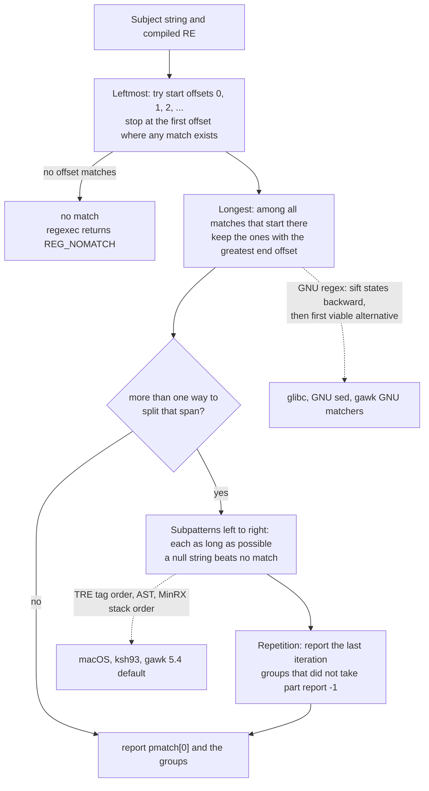

# POSIX Leftmost Longest Matching

> [!summary] Claim
> POSIX fixes which match a regular expression reports with two rules, earliest start and then greatest length, and these rules are implemented consistently for the whole match but not for subexpressions, where glibc, macOS, AT&T AST, gawk's MinRX, and Go each split a tied match their own way.

Part of [Regular Expressions and Text Processing](README.md) in [Shell and Unix Engineering](../README.md).

## TL;DR

- Mechanism: the engine finds the earliest position at which any match starts, then among all matches starting there takes the longest, then splits that match among subexpressions from left to right, each as long as possible, with a null string counting as longer than no match `(POSIX.1-2024 XBD 9.1)`.
- Rule: leftmost beats longest and longest beats order, so `a*` matches the empty string at offset 0 of `baaac`, and `a|ab|abc` matches `abc` in `xabcd` no matter how the alternatives are ordered.
- Trap: the subexpression split is where implementations part ways: `(.|..)(..|.)` on `abc` gives `\1` = `ab` on macOS and `a` with GNU regex (the code glibc shares with GNU sed and gawk's old matcher), and the standard itself is ambiguous for three or more variable-length pieces.
- Portability fact: POSIX.1-2024 added the minimal modifier (`*?`, `+?`, `??`, `{m,n}?`) and `REG_MINIMAL` `(POSIX.1-2024 XBD 9.4.6)`, but as of 2026-11 glibc and musl parse `.*?` as a greedy `(.*)?` (glibc `posix/regcomp.c`, musl `src/regex/regcomp.c`), macOS `regcomp` rejects it without `REG_ENHANCED` (lab), and neither glibc nor musl defines `REG_MINIMAL` (their `regex.h` headers).
- When not to use it: never let correctness depend on how a tie is split among capture groups; write patterns whose groups cannot compete (negated bracket expressions, anchors, disjoint alternatives), or parse with a real parser.

## Mental model



The top three boxes are the part everyone agrees on: a scan over start offsets that stops at the first offset with any match, and a choice of the greatest end offset among the matches from that start.
Only when two or more parses cover exactly the same span does the dashed part matter, and this is where the standard says "each subpattern, from left to right, shall match the longest possible string" without defining "subpattern".
The repetition box applies the separate reporting rules of `regexec`: a repeated group reports its last iteration, and a group nested in it reports only what happened inside that last iteration.
The dashed arrows are implementation choices measured in the lab: GNU regex resolves ties by taking the first alternative that can still reach the end of the longest match, while TRE (macOS), AT&T AST (ksh93), and MinRX (gawk 5.4) implement a left-to-right maximization, and even those three disagree on some inputs.

## How it works

### The rule as written

XBD 9.1 defines "leftmost" as "The characters closest to the beginning of the string" and then states the search: "The search for a matching sequence starts at the beginning of a string and stops when the first sequence matching the expression is found, where "first" is defined to mean "begins earliest in the string"" `(POSIX.1-2024 XBD 9.1)`.
It continues: "If the pattern permits a variable number of matching characters and thus there is more than one such sequence starting at that point, the longest such sequence is matched" `(POSIX.1-2024 XBD 9.1)`.
Its two examples are `bb*` matching the second to fourth characters of `abbbc`, and `(wee|week)(knights|night)` matching all ten characters of `weeknights` `(POSIX.1-2024 XBD 9.1)`.
The second example is the important one: the first alternative `wee` is shorter than `week`, but `wee` + `knights` covers ten characters while `week` + `night` covers nine, so the whole-match rule forces `\1` = `wee` (lab: `(0,10)(0,3)(3,10)`).
The rationale gives a formal version: "The search is performed as if all possible suffixes of the string were tested for a prefix matching the pattern; the longest suffix containing a matching prefix is chosen, and the longest possible matching prefix of the chosen suffix is identified as the matching sequence." `(POSIX.1-2024 XRAT A.9.2)`.
It also explains the choice: the rule "historically used by deterministic recognizers" is "easier to define and describe, and arguably more useful, than the first-match rule historically used by non-deterministic recognizers" `(POSIX.1-2024 XRAT A.9.2)`.

### Leftmost first, longest second

The order of the two rules is the source of the most common surprise.
A pattern that can match the empty string matches at offset 0 of every subject, so `sed 's/a*/X/'` on `baaac` prints `Xbaaac`, not `bXc`: the empty match at offset 0 is leftmost, and the longer `aaa` at offset 1 is never considered (lab).
`regexec` reports the same thing: `a*` against `baaac` gives `(0,0)` (lab).
`expr` makes the effect visible as a number, because its `:` operator anchors every pattern at the first character `(POSIX.1-2024 XCU expr)`: `expr aaab : 'a*'` prints `3`, and `expr baaa : 'a*'` prints `0` with exit status 1 (lab).

### Longest, not first: alternation order is irrelevant

Under POSIX, `a|ab|abc` and `abc|ab|a` are the same matcher: at offset 1 of `xabcd` all three alternatives match, and the longest, `abc`, wins (lab: `sed -E 's/a|ab|abc/X/'` prints `xXd`, `regexec` gives `(1,4)`, and every awk on the host reports `RSTART` 2 and `RLENGTH` 3).
Perl, Python, PCRE, JavaScript, and Go's default `regexp.Compile` use leftmost-first instead: Go's documentation says the match "begins as early as possible in the input (leftmost), and among those it chooses the one that a backtracking search would have found first" (Go `src/regexp/regexp.go`, `Compile`).
Measured by hand on the host (as of 2026-11): Perl 5 matches `a` for `a|ab|abc` on `xabcd`, and Go's `Compile` reports `[1 2]` where `CompilePOSIX` reports `[1 4]`.

### The subexpression rule

The same paragraph of XBD 9.1 continues: "Consistent with the whole match being the longest of the leftmost matches, each subpattern, from left to right, shall match the longest possible string" `(POSIX.1-2024 XBD 9.1)`.
It adds: "For this purpose, a null string shall be considered to be longer than no match at all" `(POSIX.1-2024 XBD 9.1)`.
Its examples are `\(.*\).*` against `abcdef`, where `\1` is all six characters, and `\(a*\)*` against `bc`, where `\1` is the null string rather than unset (lab: `(0,0)(0,0)`).
A third example, added with the 2024 minimal modifier, applies the same rule to a shortest-match group: in the ERE `(.*?).*` against `abcdef`, "the subpattern "(.*?)" matches the empty string, since that is the longest possible match for the ERE ".*?"" `(POSIX.1-2024 XBD 9.1)`.
The rationale adds the proviso that makes this hard: subexpression lengths are maximized only among parses that keep the whole match leftmost-longest, so "\(ac*\)c*d[ac]*\1" against `acdacaaa` matches all eight characters with `\1` = `a`, although `\(ac*\)` alone would prefer `ac` `(POSIX.1-2024 XRAT A.9.1)`.
It concludes: "Conceptually, the implementation must examine every possible match and among those that yield the leftmost longest total matches, pick the one that does the longest match for the leftmost subexpression, and so on." and notes that two identical subexpressions can match different lengths, as `(a.*b)(a.*b)` does on `accbaccccb` with four and six characters `(POSIX.1-2024 XRAT A.9.1)` (lab: `(0,10)(0,4)(4,10)`).

### What regexec must report

The `regcomp` page turns the selection into offsets `(POSIX.1-2024 XSH regcomp)`:

- `pmatch[i].rm_so` is the byte offset of the start of subexpression `i`, and `rm_eo` is one past its end; subexpression `i` "begins at the ith matched open parenthesis".
- A group that "participated in the match several times" reports "the last such match".
- A group that did not participate reports -1, which happens when `*`, `?`, or `{}` follows it and it matched zero times, or when `|` selected another branch.
- A group nested in another is judged "within the substring reported in pmatch[j] rather than the whole string", and a group inside a -1 group is also -1.
- A zero-length match reports both offsets as "the byte offset of the character or null terminator immediately following the zero-length string".

The third and fourth rules decide `((a)|b)*` on `ab`: the last iteration of group 1 matched `b`, so group 2, which lives inside group 1, did not take part in that iteration and must report `(-1,-1)` (lab on macOS).
XBD 9.3.6 adds a constraint on repetition in BREs: a subexpression repeated by `*` or an interval "shall not match a null expression unless this is the only match for the repetition or it is necessary to satisfy the exact or minimum number of occurrences for the interval expression" `(POSIX.1-2024 XBD 9.3.6)`, which is why `\(a*\)*` on `aaa` reports `\1` = `aaa` and not a trailing empty iteration (measured by hand with a regcomp probe on macOS: `(0,3)(0,3)`, and the same for the ERE `(a*)*`); XBD 9.4.6 states the ERE rule for an ERE matching a single character.

### Where the standard is ambiguous

The standard never defines "subpattern": XBD 3 Definitions has no entry for it, and in XBD 9, XRAT A.9, and the `regcomp` page the word appears only in this paragraph of XBD 9.1, in the rule and in its `(.*?)` example (checked against the POSIX.1-2024 HTML, as of 2026-11).
MinRX's design notes put the problem precisely: for `ABC` with three variable-length parts, "Either we can try to maximize AB at the expense of shortening C, or else we can try to maximize A at the expense of shortening BC", and "It turns out the POSIX standard is ambiguous about this situation" (MinRX `ALGORITHM.txt`).
`(a|ab)(c|bcd)(d*)` on `abcd` is the textbook case: both `a`+`bcd`+`` and `ab`+`c`+`d` cover four characters.
Right-associative reading (maximize `A` first) gives `(0,4)(0,2)(2,3)(3,4)`; left-associative reading (maximize `AB` first, and `a`+`bcd` is a longer `AB` than `ab`+`c`) gives `(0,4)(0,1)(1,4)(4,4)`.
Kuklewicz's 2009 survey treats the first as the POSIX answer and lists glibc's `(0,4)(0,1)(1,4)(4,4)` as a bug (Haskell wiki, Regex Posix).
MinRX deliberately implements the left-associative reading, "since it is cheaper at both runtime and compile time, and is also consistent with the behaviour of the repeated self-concatenation in duplication operators" (MinRX `ALGORITHM.txt`).
Repetition is ambiguous in the same way: Russ Cox argues that for `(a|bcdef|g|ab|c|d|e|efg|fg)*` on `abcdefg` POSIX requires the split `ab c d efg`, so the group reports `efg` (Cox, Regular Expression Matching: the Virtual Machine Approach); measured by hand on the host (as of 2026-11), ksh93u+ 2012 (AT&T AST) reports `efg`, while macOS `regexec`, gawk 5.4 with MinRX, gawk with the GNU matchers, GNU sed 4.10, and macOS sed all report `g`.

Only a two-piece tie is free of this ambiguity, and that is where the lab draws a clean line: `(.|..)(..|.)` on `abc` must give `\1` = `ab`, and GNU regex gives `a` (the lab asserts it for glibc; measured by hand with GNU sed 4.10 and gawk 5.4.1's GNU matchers).

### How the implementations choose

GNU regex (glibc `posix/`, also copied into gnulib, GNU sed, and gawk) first finds the whole match with a DFA-style scan, `check_matching`, which keeps scanning after the first accepting state only when `fl_longest_match` is set, and `re_search_internal` sets it as `fl_longest_match = (nmatch != 0 || dfa->nbackref)` (glibc `posix/regexec.c`, `re_search_internal` and `check_matching`).
With `nmatch` 0 or `REG_NOSUB` and no back-references, glibc therefore stops at the first accepting state, which is safe because only success or failure is reported.
To recover groups it prunes the recorded state log to the states that can reach the chosen end (`sift_states_backward`, `prune_impossible_nodes`), then walks forward in `set_regs`, and at each epsilon fork `proceed_next_node` takes the first destination still in the pruned log: "Pick a valid destination, or return -1 if none is found." (glibc `posix/regexec.c`, `proceed_next_node`).
The first viable destination is the first alternative in pattern order, so GNU regex returns the parse a backtracking matcher would find first among those that reach the longest end, which explains every GNU result in the lab: `a` for `(.|..)`, and the stale `(0,1)` for the inner group of `((a)|b)*`, because `update_regs` resets a register only when its own open parenthesis is passed, so a new iteration of the parent leaves the inner group's earlier offsets in place (lab; glibc `posix/regexec.c`, `update_regs`).
That is the same choice Go documents for `CompilePOSIX`: "Among the possible leftmost-longest matches, this package chooses the one that a backtracking search would have found first, while POSIX specifies that the match be chosen to maximize the length of the first subexpression, then the second, and so on from left to right" (Go `src/regexp/regexp.go`, `CompilePOSIX`).
The same comment calls the POSIX rule "computationally prohibitive and not even well-defined" (Go `src/regexp/regexp.go`, `CompilePOSIX`).

TRE (musl's `src/regex`, and the macOS libc matcher, whose `_regex.h` marks flags "Used internally by TRE" and defines TRE's `REG_UNGREEDY` as `REG_MINIMAL`) runs a tagged NFA: every thread carries a vector of tags (offsets at group boundaries), and when two threads meet in one state `tre_tag_order` keeps the one whose tags win when compared in order, smaller first for a tag marked `TRE_TAG_MINIMIZE` and larger first otherwise (musl `src/regex/regexec.c`, `tre_tag_order`).
musl dispatches to `tre_tnfa_run_parallel` for patterns without back-references and to the backtracking `tre_tnfa_run_backtrack` when `tnfa->have_backrefs` is set (musl `src/regex/regexec.c`, `regexec`).
Henry Spencer's engine, still the FreeBSD libc matcher, finds the span first and then calls `dissect`, which for each sub-RE takes the longest span after which `walk` says "could the rest match the rest?", trying a shorter one otherwise, and inside an alternation keeps the "first matching branch" for that span (FreeBSD `lib/libc/regex/engine.c`, `dissect`).
MinRX, the default engine of gawk 5.4.0, is "a non-backtracking matcher" whose threads carry a bounded stack compared "from outermost (oldest) stack levels to inner (youngest) stack levels", so the best partial match of each structured block is decided before it can escape the block (MinRX `README.md` and `ALGORITHM.txt`; gawk 5.4.1 `NEWS`, "Changes from 5.3.x to 5.4.0").

### What the 2024 minimal modifier changed

POSIX.1-2024 lets every ERE duplication symbol take a `?` suffix that changes the repetition "from the leftmost longest possible match to the leftmost shortest possible match, including the null match", with the example that `.*c` matches up to the last `c` of `abc abc` and `.*?c` up to the first `(POSIX.1-2024 XBD 9.4.6)`.
`REG_MINIMAL` makes shortest the default for an ERE and inverts the meaning of the `?` modifier `(POSIX.1-2024 XSH regcomp)`; the rationale records Austin Group Defects 793 and 1329 as the source `(POSIX.1-2024 XRAT A.9.4.6)`.
The modifier only applies to EREs: BREs still say "The behavior of multiple adjacent duplication symbols ('*' and intervals) produces undefined results" `(POSIX.1-2024 XBD 9.3.6)`.
The new syntax was undefined before (adjacent duplication symbols), and that is exactly why old libraries accept it with a different meaning: glibc's `parse_expression` loops over consecutive duplication tokens and rejects them only "In BRE" (glibc `posix/regcomp.c`, `parse_expression`), and musl's parser accepts `a+?` as a stacked repetition and always builds the iteration node with `minimal` 0, with the comment "multiple consecutive *+?{,} is unspecified, but (a+)+ has to be supported so accepting a++ makes sense" (musl `src/regex/regcomp.c`, `tre_parse`).
Neither glibc's nor musl's `regex.h` defines `REG_MINIMAL`; macOS's `_regex.h` defines `REG_MINIMAL` as `0100` and `REG_ENHANCED` as `0400` (macOS SDK `_regex.h`, read on the host).

### Shell patterns are a different rule

Shell pattern matching is anchored and has no leftmost search: `${x#pattern}` removes the smallest matching prefix and `${x##pattern}` the largest, with `%` and `%%` the suffix forms `(POSIX.1-2024 XCU 2.6.2)`.
Inside one pattern, each `*` matches "the greatest possible number of characters that still allows the remainder of the pattern to match the string" `(POSIX.1-2024 XCU 2.14.2)`, which is the shell's analogue of the subpattern rule.
So `x=aXbXc` gives `bXc`, `c`, `aXb`, and `a` for `#*X`, `##*X`, `%X*`, and `%%X*` (the lab asserts this for every shell in the matrix; run here under bash 3.2).
`[[ s =~ re ]]` is not shell pattern matching: bash and zsh hand the pattern to the C library, so the shell under test never decides the split; on the host, bash 3.2.57, bash 5.3.15, and zsh 5.9.2 all report `ab` and `c` for `(.|..)(..|.)` because they all call macOS `regexec`, and ksh93u+ 2012 reports the same from its own AST engine (measured by hand; see [[Bash-Regex-and-BASH_REMATCH]]).

### The utilities

`sed`'s `g` flag substitutes "all non-overlapping instances of the RE" `(POSIX.1-2024 XCU sed)` and says nothing about empty matches.
GNU sed adds one rule, documented in its source: skip "an empty string immediately following another match", which "avoids that baaaac, when passed through s,a*,x,g, gives 'xbxxcx' instead of xbxcx" (GNU sed `sed/execute.c`, `do_subst`); BusyBox sed implements the same rule ("Second match is NOT replaced!") (BusyBox `editors/sed.c`, `do_subst_command`).
The lab confirms `XbXcX` for `s/a*/X/g` on `baaac` with macOS sed, and the same three replacements from `gsub(/a*/, "X")` in the one true awk and gawk (lab).
`awk`'s `match()` sets `RSTART` and `RLENGTH` "to the length of the matched string, -1 if no match is found" `(POSIX.1-2024 XCU awk)`, and the match is the XBD 9.1 one.
`awk` field splitting with an ERE `FS` is different again: "Each occurrence of a sequence of one or more characters matching the extended regular expression shall delimit fields" `(POSIX.1-2024 XCU awk)`, so an empty match never splits a field.
`grep -o` is not in POSIX; macOS grep 2.6.0-FreeBSD prints `abc` for `a|ab|abc` on `xabcd` (measured by hand).

## Numbers and limits

| Quantity | Value | Source |
|---|---|---|
| `_POSIX_RE_DUP_MAX`, the least `RE_DUP_MAX` a system may have | 255 | `(POSIX.1-2024 XBD limits.h)` |
| `RE_DUP_MAX` in glibc | `0x7fff` (32767) | glibc `posix/regex.h` (as of 2026-11) |
| `RE_DUP_MAX` in musl and macOS | 255 | musl `include/limits.h`; macOS SDK `sys/syslimits.h` (as of 2026-11) |
| RE size every implementation must handle | 256 bytes | `(POSIX.1-2024 XRAT A.9.2)` |
| Back-references in a BRE | `\1` to `\9`, one digit | `(POSIX.1-2024 XBD 9.3.6)` |
| Parses of `(a\|ab)(c\|bcd)(d*)` covering `abcd` | 2, and the standard does not pick one | XBD 9.1 wording; MinRX `ALGORITHM.txt` |
| Splits of `abcdefg` by `(a\|bcdef\|g\|ab\|c\|d\|e\|efg\|fg)*` | 3 | Cox, regexp2 |
| MinRX cost | `O(M * P)` space, roughly `O(M * N)` time (M pattern length, N text length, P parenthesis depth) | MinRX `README.md` |
| glibc whole-match scan length when `nmatch` is 0 and there are no back-references | stops at the first accepting state | glibc `regexec.c`, `re_search_internal` |
| Kuklewicz 2009 glibc failures still reproduced by GNU regex | `((a)\|(b)){2,}` and `(a\|ab)(c\|bcd)(d*)`, same offsets as 2009 | measured by hand, gawk 5.4.1 `GAWK_GNU_MATCHERS=1`, 2026-11 |
| Lab suite on the host | 18 of 18 pass, macOS `/bin/sh` (bash 3.2.57), awk 20200816 and gawk 5.4.1 | lab, 2026-11-14 |

## Portability

The regex rows are decided by the C library or the utility's own engine, never by the shell; the shell rows cover what the shell itself matches.

| Implementation | Whole match leftmost-longest | Tie split, `(.\|..)(..\|.)` on `abc` | Inner group of `((a)\|b)*` on `ab` | `.*?c` on `abc abc` |
|---|---|---|---|---|
| POSIX.1-2024 | required `(POSIX.1-2024 XBD 9.1)` | `\1` = `ab` | -1 `(POSIX.1-2024 XSH regcomp)` | minimal, 3 characters `(POSIX.1-2024 XBD 9.4.6)` |
| macOS libc (`regexec`, macOS sed, bash, zsh on macOS) | yes (lab) | `ab` (lab) | -1 (lab) | `REG_BADRPT`; minimal only with `REG_ENHANCED` (lab); macOS sed errors (measured by hand) |
| glibc (`regexec` on Debian) | yes (lab asserts; GNU regex measured by hand) | `a` (lab asserts; GNU regex measured by hand) | stale `(0,1)` (lab asserts; glibc `update_regs`) | greedy `(0,7)` (lab asserts; glibc `parse_expression`) |
| musl (`regexec` on Alpine) | not measured | not measured | not measured | greedy `(0,7)` (lab asserts; musl `tre_parse` builds every iteration with `minimal` 0) |
| GNU sed 4.10 | yes (measured by hand) | `a` (measured by hand) | `a` (measured by hand) | greedy (measured by hand) |
| gawk 5.4.1, default MinRX | yes (lab) | `ab` (measured by hand) | unset, no `m[2]` element (measured by hand) | minimal, `RLENGTH` 3 (measured by hand) |
| gawk 5.4.1, `GAWK_GNU_MATCHERS=1` | yes (measured by hand) | `a` (measured by hand) | `a` (measured by hand) | greedy, `RLENGTH` 7 (measured by hand) |
| one true awk 20200816 (macOS) | yes (lab) | no captures in POSIX awk | no captures | greedy, `RLENGTH` 7 (measured by hand) |
| macOS grep 2.6.0-FreeBSD | yes (measured by hand) | not applicable | not applicable | minimal, prints `abc` and ` abc` (measured by hand) |
| ksh93u+ 2012 `[[ =~ ]]` (AST) | yes (measured by hand) | `ab` (measured by hand) | empty (measured by hand) | minimal (measured by hand) |
| Go `regexp.CompilePOSIX` | yes (measured by hand) | `a`, documented (Go `regexp.go`) and measured by hand with Go 1.27.4 | not measured | not POSIX ERE syntax |
| Perl 5 | no, leftmost-first (measured by hand) | `a` (measured by hand) | not measured | minimal (measured by hand) |

Shell rows (the lab's `${x#...}` test runs under every shell in the matrix):

| Shell | `${x#*X}` `${x##*X}` `${x%X*}` `${x%%X*}` on `aXbXc` | `[[ =~ ]]` engine |
|---|---|---|
| POSIX sh | `bXc`, `c`, `aXb`, `a` `(POSIX.1-2024 XCU 2.6.2)` | not specified |
| macOS bash 3.2, bash 5.3 | same (lab, bash 3.2; bash 5.3 by hand) | C library `regexec` (measured by hand) |
| zsh 5.9 native and `--emulate sh` | same (lab asserts) | C library unless `RE_MATCH_PCRE` (measured by hand, zsh 5.9.2); see [[Bash-Regex-and-BASH_REMATCH]] |
| dash, posh | same (lab asserts) | no `[[`; see [[Bash-Regex-and-BASH_REMATCH]] |
| ksh93 | same (lab asserts) | AST regex, measured by hand on ksh93u+ 2012 |
| mksh, yash, BusyBox ash | same (lab asserts) | see [[Bash-Regex-and-BASH_REMATCH]] |

## Worked example

The [lab](../labs/07-posix-leftmost-longest-matching/) has two programs and one test file.
`regoff.c` compiles a pattern with `regcomp`, runs `regexec` once, and prints `(rm_so,rm_eo)` for the whole match and every group, so each C library's choice is visible as numbers; `-L` names the library it was built against, and `-M` and `-X` add `REG_MINIMAL` and `REG_ENHANCED` or report that the header lacks them.
`leftmost.sh` asks any awk where `match()` lands:

```sh
#!/bin/sh
# leftmost.sh STRING ERE [AWK [ARG...]]: print where awk's match() says ERE matches STRING,
# as "RSTART RLENGTH TEXT", or "0 -1" when it does not match.
# The awk command defaults to awk; pass it as separate words (for example: busybox awk).
# The ERE travels through -v, so awk processes backslash escapes in it: keep it free of them.
set -eu

if [ "$#" -lt 2 ]; then
  echo "usage: leftmost.sh STRING ERE [AWK [ARG...]]" >&2
  exit 64
fi
string=$1
ere=$2
shift 2
if [ "$#" -eq 0 ]; then
  set -- awk
fi

"$@" -v s="$string" -v re="$ere" 'BEGIN {
  if (match(s, re)) print RSTART, RLENGTH, substr(s, RSTART, RLENGTH)
  else print RSTART, RLENGTH
}'
```

The core of the probe, as a simplified excerpt of `regoff.c` (option parsing and error names omitted):

```c
rc = regcomp(&re, argv[i], cflags);
if (rc != 0) {
  printf("regcomp: %s\n", code_name(rc));
  return 2;
}
rc = regexec(&re, argv[i + 1], NSLOTS, m, 0);
/* ... */
for (k = 0; k <= re.re_nsub && k < NSLOTS; k++) {
  printf("(%ld,%ld)", (long)m[k].rm_so, (long)m[k].rm_eo);
}
```

One test from `leftmost.bats`, verbatim, shows how a per-library divergence is asserted:

```sh
@test "a two-way tie: POSIX gives the first subexpression the longer string" {
  regoff -E '(.|..)(..|.)' abc
  [ "$status" -eq 0 ]
  case $(lab_libc) in
    darwin) [ "$output" = "(0,3)(0,2)(2,3)" ] ;;
    glibc) [ "$output" = "(0,3)(0,1)(1,3)" ] ;; # first viable alternative, not the longest
    musl) skip "musl result not measured" ;;
    *) false ;;
  esac
}
```

Output of the probe on the host (macOS, captured 2026-11-14), each line the value the lab asserts for `darwin`:

```text
$ regoff -L
darwin
$ regoff -E '(.|..)(..|.)' abc
(0,3)(0,2)(2,3)
$ regoff -E '((a)|b)*' ab
(0,2)(1,2)(-1,-1)
$ regoff -E '.*?c' 'abc abc'
regcomp: REG_BADRPT
$ regoff -E -X '.*?c' 'abc abc'
(0,3)
$ regoff -E -M '(.*)c' abcabc
(0,6)(0,5)
$ regoff -E -M -X '(.*)c' abcabc
(0,3)(0,2)
```

The lab asserts the glibc values `(0,3)(0,1)(1,3)`, `(0,2)(1,2)(0,1)`, and `(0,7)` for the same first three patterns; the GNU regex code that glibc shares with gawk and GNU sed produced exactly those splits on the host.
The whole suite, run once under macOS `/bin/sh` on 2026-11-14:

```text
1..18
ok 1 regoff reports a C library family it was written for
ok 2 leftmost beats longest: an empty match at offset 0 wins over aaa at offset 1
ok 3 expr anchors at the first character, so a leading mismatch gives a zero-length match
ok 4 at the leftmost position the longest alternative wins, whatever its order
ok 5 awk match() sets RSTART and RLENGTH to the leftmost-longest match in every awk
ok 6 leftmost.sh reports a failed match as RSTART 0 and RLENGTH -1
ok 7 the standard's example: (wee|week)(knights|night) takes all ten characters
ok 8 the rationale's examples: the whole match decides first, then each subexpression
ok 9 a null string beats no match: \(a*\)* against bc reports an empty \1
ok 10 a two-way tie: POSIX gives the first subexpression the longer string
ok 11 a group inside the last iteration that did not take part reports -1
ok 12 a three-way split that the standard leaves ambiguous splits differently by library
ok 13 the POSIX.1-2024 minimal modifier .*? is rejected or silently greedy in the C libraries
ok 14 macOS honors .*? only with REG_ENHANCED; other libraries have no such flag
ok 15 REG_MINIMAL: undefined in glibc and musl, defined but inert without REG_ENHANCED on macOS
ok 16 s///g skips an empty match that directly follows a non-empty one
ok 17 awk gsub() with a pattern that can match empty makes three replacements in baaac
ok 18 shell patterns are anchored: # and ## pick the shortest or longest prefix, not a leftmost match
```

## Pitfalls

> [!warning] The empty match at offset 0
> Trigger: a pattern that can match nothing, such as `s/[0-9]*/N/` to replace the first number in `abc123`.
> Symptom: the output is `Nabc123`, because the empty match at offset 0 is leftmost and wins before the longer `123` is considered (the same mechanism as the lab's `Xbaaac`).
> Fix: require at least one character (`[0-9][0-9]*` in a BRE, `[0-9]+` in an ERE), or anchor the pattern to what must precede it.

> [!warning] Alternation order ported between engines
> Trigger: an ERE written for `grep -E` or `sed -E` moved into Perl, Python, PCRE, JavaScript, or Go's `regexp.Compile`, for example `(GET|GETS)` or `(\.tar|\.tar\.gz)`.
> Symptom: POSIX tools take the longest alternative and the leftmost-first engines take the first that works, so the captured text differs and code reading the capture breaks only after the port.
> Fix: order alternatives longest first and anchor what follows them, so both semantics pick the same branch; in Go use `CompilePOSIX` or call `Longest` when POSIX whole-match semantics are required.

> [!warning] Captures that depend on the C library
> Trigger: a `sed -E` or `[[ =~ ]]` script whose groups can compete for the same characters, such as `sed -E 's/^(-|--)(.*)/\2/'` to strip the dashes from an option name.
> Symptom: the script is correct on macOS and wrong on Linux (or the reverse): on `--verbose`, macOS sed prints `verbose` and GNU sed 4.10 prints `-verbose` (measured by hand), because both splits cover the whole string; the lab shows the same split for `(.|..)(..|.)`.
> Fix: make the groups unable to overlap: `([^,]*),(.*)`, explicit anchors, or alternatives that match disjoint strings; then every engine has exactly one parse to report.

> [!warning] `.*?` that silently stays greedy
> Trigger: a non-greedy `.*?` copied from Perl into `sed -E`, `grep -E`, or awk, now that POSIX.1-2024 has blessed the syntax.
> Symptom: GNU sed, glibc, musl, and the one true awk accept it and match greedily (`(.*?)c` on `abc abc` captures `abc ab` in GNU sed 4.10); macOS sed, bash, and zsh reject it; gawk 5.4, macOS grep, and ksh93 make it minimal (measured by hand, 2026-11).
> Fix: write the minimal match as a negated bracket expression (`[^c]*c`), which means the same thing in every engine.

> [!warning] Stale inner captures in a repeated group
> Trigger: reading an inner group of a repeated group, such as `\2` of `((a)|b)*` or of `((a)|(b)){2,}`.
> Symptom: glibc reports the inner group from an earlier iteration (`(0,1)` for `ab`), where the standard requires -1; Kuklewicz reported the `{2,}` case against glibc in 2009, and gawk's GNU matchers still give `(0,1)` for it in 2026-11 (measured by hand).
> Fix: capture from the repeated group itself, or match one iteration at a time in a loop.

> [!warning] The standard's own `REG_NOTBOL` loop
> Trigger: the `regcomp` page's example loop, `error = regexec (&re, buffer + pm.rm_eo, 1, &pm, REG_NOTBOL);`, reused for all matches of a user pattern `(POSIX.1-2024 XSH regcomp, EXAMPLES)`.
> Symptom: a pattern that matches the empty string returns `rm_eo` 0 forever, so the loop never advances; and because `rm_eo` is relative to the pointer passed in, not to `buffer`, the second search starts correctly but the third and later ones restart from the wrong place in `buffer`.
> Fix: keep a running base offset, add `rm_eo` to it, and when `rm_so == rm_eo` advance by one character before the next call (the rule GNU sed and BusyBox sed implement).

> [!warning] Locale changes between compile and match
> Trigger: `regcomp` in one locale and `regexec` after `setlocale` changes `LC_CTYPE` or `LC_COLLATE`, for example in a long-lived process that serves several users.
> Symptom: "If, when regexec() is called, the locale is different from when the regular expression was compiled, the result is undefined." `(POSIX.1-2024 XSH regcomp)`; lengths are also measured in characters consumed, so a multi-character collating element counts "as the number of characters it matches" `(POSIX.1-2024 XBD 9.1)`.
> Fix: compile and match under one fixed locale, and see [[Locale-and-LC_ALL]] for how utilities pick it.

## Security and robustness

POSIX semantics change the cost model of a backtracking matcher: a leftmost-first engine may stop at the first success, but a leftmost-longest engine must keep exploring every alternative at the chosen start to prove nothing longer exists, so a backtracking implementation of POSIX does at least as much work as a leftmost-first one on the same input (the reason POSIX's rationale prefers deterministic recognizers and asks non-deterministic ones to "observe the rules on which match is chosen; the longest match, not the first match" `(POSIX.1-2024 XRAT A.9.2)`).
Back-references force every engine studied here off its automaton path: glibc sets `fl_longest_match` and uses its fail stack when `dfa->nbackref` is non-zero, and musl switches to `tre_tnfa_run_backtrack`, so user-supplied BREs with `\1` are the input to bound (see [[ReDoS]]).
That path has produced CVEs: CVE-2018-20796 and CVE-2019-9192 are uncontrolled recursion in glibc's `check_dst_limits_calc_pos_1` in `posix/regexec.c` (glibc through 2.29), demonstrated in `grep` by `(\227|)(\\1\\1|t1|\\\2537)+` and `(|)(\\1\\1)*` respectively, and the second is disputed by the maintainer "because the behavior occurs only with a crafted pattern" (NVD).
POSIX submatch tracking costs memory per thread: TRE keeps a tag vector per NFA state, and CVE-2016-8859 was integer overflow in exactly those allocations, "via a large number of (1) states or (2) tags", in TRE and musl (NVD); current musl `tre_tnfa_run_parallel` checks `num_tags` against `SIZE_MAX` before allocating (musl `src/regex/regexec.c`).
For validation, never rely on the tie-breaking split of an unanchored pattern: extracting a host from `user@host` with `(.*)@(.*)` happens to agree everywhere (`a@b@evil` yields `a@b` and `evil` in macOS sed and GNU sed, measured by hand) only because greedy-first and longest-first choose the same split for `.*` before a literal; replace either `.*` with an alternation and the split depends on the library, so a security decision should use `[^@]*` and reject inputs with more than one `@`.
Treat any pattern from a user as code: cap its length, reject back-references unless required, set a time or step budget, and run it in an engine with linear-time guarantees when the input is hostile.

## The principal's view

The decision is not "POSIX or Perl semantics"; it is whether any consumer of a match depends on more than the whole-match span.
Whole-match leftmost-longest is the one property every POSIX engine measured here agrees on, it is cheap to implement with a DFA, and it makes alternation order irrelevant, which is why `grep`, `awk`, and `sed` addresses are safe to share across platforms.
Capture-group contents are a different contract: the standard defines them with a word it never defines, the best-known reference implementations (AST, TRE, MinRX) disagree on repetitions, and the most deployed library (glibc) returns leftmost-first splits that Kuklewicz reported in 2009 and that still reproduce in 2026-11.
The trade-off is expressiveness against portability: overlapping groups make patterns shorter, but every overlap is a place where the answer depends on the libc, the sed, or the awk version (gawk 5.4 changed its default engine and with it the answer for `(.|..)(..|.)`).
A staff-plus engineer therefore sets a rule for shell and CI code: groups must be unambiguous (negated bracket expressions and anchors), `.*?` is banned in POSIX tools until every target platform implements it, and a lab like this one runs on each target libc in CI.
When the extraction logic grows past one or two groups, move it to a language with a single specified engine (Go's `regexp`, Rust's `regex`, Python's `re`) or to a real parser, and keep POSIX regex for line selection.

## Interview questions

> [!question] L5: What does `echo baaac | sed 's/a*/X/'` print, and why?
>
> > [!success]- Answer
> > It prints `Xbaaac`.
> > POSIX selects the leftmost match first and the longest only among matches that start there.
> > `a*` matches the empty string at offset 0, so that empty match wins before `aaa` at offset 1 is considered.
> >
> > Follow-up: What does `s/a*/X/g` print, and which rule decides that the empty match right after `aaa` is not replaced?

> [!question] L5: Predict the output: `printf 'xabcd\n' | sed -E 's/a|ab|abc/<&>/'` and the same pattern in `perl -pe`.
>
> > [!success]- Answer
> > `sed -E` prints `x<abc>d`, because at offset 1 all three alternatives match and POSIX takes the longest.
> > Perl prints `x<a>bcd`, because Perl tries alternatives in order and stops at the first that succeeds.
> > The order of alternatives is irrelevant in POSIX and decisive in leftmost-first engines.
> >
> > Follow-up: How would you rewrite the pattern so both tools print the same thing?

> [!question] L6: `(wee|week)(knights|night)` on `weeknights`: what are `\1` and `\2`, and why does the longer alternative lose?
>
> > [!success]- Answer
> > `\1` is `wee` and `\2` is `knights`.
> > The whole match is chosen first: `wee`+`knights` covers ten characters and `week`+`night` covers nine.
> > The subexpression rule only chooses among parses that already produce the leftmost-longest whole match, so `week` is never a candidate.
> >
> > Follow-up: Which XRAT example shows the same proviso with a back-reference?

> [!question] L6: What does `regexec` report for `((a)|b)*` on `ab`, and why does glibc disagree?
>
> > [!success]- Answer
> > POSIX requires `(0,2)(1,2)(-1,-1)`: group 1 reports its last iteration `b`, and group 2 is judged only inside that iteration, where it did not take part.
> > glibc reports `(0,1)` for group 2, a value left over from the first iteration.
> > GNU regex walks the chosen path forward in `set_regs`, and `update_regs` resets a register only at its own open parenthesis, so the inner register keeps its first-iteration value.
> >
> > Follow-up: How would you get the last `a` that matched, portably?

> [!question] L6: Debug this script: `opt=$(printf '%s\n' "$1" | sed -E 's/^(-|--)(.*)/\2/')` then `case $opt in verbose) ...` works for `--verbose` on a Mac and falls through on a Linux CI runner.
>
> > [!success]- Answer
> > Both `-` + `-verbose` and `--` + `verbose` cover the whole string, so the whole-match rule cannot choose and the C library breaks the tie.
> > macOS sed gives the first group the longer `--` and prints `verbose`; GNU sed 4.10 takes the first alternative that still reaches the end and prints `-verbose` (measured by hand).
> > Remove the tie: `sed -E 's/^-{1,2}//'` prints `verbose` on both, because a single repetition has one longest parse, or avoid regex entirely with `opt=${1#-}; opt=${opt#-}`.
> > Then run the script's tests on every target libc.
> >
> > Follow-up: Why does `-v` (one dash) behave the same on both platforms?

> [!question] L7+: POSIX.1-2024 added `*?` and `REG_MINIMAL`; what should a platform team do about them in 2026?
>
> > [!success]- Answer
> > Treat them as unavailable in shell and CI code.
> > As of 2026-11 glibc and musl accept `.*?` with greedy meaning, macOS `regcomp` rejects it unless `REG_ENHANCED` is set, and neither glibc nor musl defines `REG_MINIMAL`.
> > gawk 5.4 (MinRX), macOS grep, and ksh93 already implement minimal matching, so the same script gives three different behaviors.
> > Write minimal matches as negated bracket expressions and add a lint rule for `*?`, `+?`, and `??` in POSIX contexts.
> >
> > Follow-up: Why could the standard add this syntax without breaking any conforming application?

> [!question] L7+: Why does Go's `CompilePOSIX` refuse to implement the POSIX subexpression rule, and what does it do instead?
>
> > [!success]- Answer
> > Go calls the rule "computationally prohibitive and not even well-defined".
> > Tracking every possible split of a repetition can need per-thread state that grows with the input in a forward NFA, as Cox's `(a|bcdef|g|ab|c|d|e|efg|fg)*` example shows.
> > `CompilePOSIX` keeps leftmost-longest for the whole match and, among those, reports the split a backtracking search would find first, the same as GNU regex.
> > Backward matching or Kuklewicz's thread-priority technique (regex-tdfa) can bound the state, at extra cost.
> >
> > Follow-up: Which part of the standard's wording makes "not even well-defined" a fair description?

> [!question] L7+: Why is asking glibc "does it match?" cheaper than asking "where does it match?", and what does `REG_NOSUB` add?
>
> > [!success]- Answer
> > `re_search_internal` sets `fl_longest_match` only when `nmatch` is non-zero or the pattern has back-references, so a pure success-or-failure call stops at the first accepting state.
> > With offsets requested, `check_matching` keeps scanning until no longer match is possible, then `sift_states_backward` prunes the state log and `set_regs` walks it forward to place the groups: three passes instead of one.
> > `nmatch` 0 already gives the cheap path at match time; the rationale keeps `REG_NOSUB` because it "allows an implementation to use a different (perhaps more efficient) algorithm if it knows in regcomp() that no subexpressions need be reported" `(POSIX.1-2024 XSH regcomp, RATIONALE)`.
> >
> > Follow-up: Which pattern features would force even a yes-or-no query off the DFA path in glibc or musl?

> [!question] L6: Contrast `${x##*X}` with `sed 's/.*X//'` on `aXbXc`; do they always agree?
>
> > [!success]- Answer
> > Both print `c` here.
> > The shell form is anchored at the start and removes the largest prefix matching the pattern, and each `*` takes the most characters that still let the rest match `(POSIX.1-2024 XCU 2.14.2)`.
> > The sed form searches for the leftmost match and takes the longest there; it also starts at offset 0 here, so the spans agree.
> > They differ when the pattern cannot match at offset 0 or when it uses features only one language has (bracket ranges agree, but `|`, `+`, and back-references exist only in the regex).
> >
> > Follow-up: What do `${x#*X}` and `sed 's/[^X]*X//'` print, and why do they agree?

## Related

Prerequisites: [[BRE-ERE-and-PCRE]]

Next: [[Regex-Engines-NFA-DFA-and-Backtracking]]

See also: [[ReDoS]], [[grep-in-Depth]], [[sed-Pattern-and-Hold-Space]], [[awk-Language]], [[awk-Implementations]], [[Perl-One-Liners]], [[Locale-and-LC_ALL]], [[Bash-Regex-and-BASH_REMATCH]], [[Parameter-Expansion]], [[POSIX-2024-Changes]]

## Further reading

- [POSIX.1-2024 XBD 9 Regular Expressions](https://pubs.opengroup.org/onlinepubs/9799919799/basedefs/V1_chap09.html): the leftmost-longest and subpattern rules (9.1) and the new minimal modifier (9.4.6), in the standard's own words.
- [POSIX.1-2024 XRAT A.9](https://pubs.opengroup.org/onlinepubs/9799919799/xrat/V4_xbd_chap01.html): the formal statement, the back-reference proviso, and why deterministic recognizers set the rule.
- [POSIX.1-2024 regcomp](https://pubs.opengroup.org/onlinepubs/9799919799/functions/regcomp.html): the five `pmatch` reporting rules and `REG_MINIMAL`.
- [glibc posix/regexec.c](https://raw.githubusercontent.com/bminor/glibc/master/posix/regexec.c): `check_matching`, `sift_states_backward`, `set_regs`, and `proceed_next_node`, where GNU's tie-breaking lives.
- [musl src/regex/regexec.c](https://git.musl-libc.org/cgit/musl/plain/src/regex/regexec.c): TRE's tagged NFA and `tre_tag_order`.
- [FreeBSD lib/libc/regex/engine.c](https://raw.githubusercontent.com/freebsd/freebsd-src/main/lib/libc/regex/engine.c): Henry Spencer's `dissect`, the span-first approach.
- [MinRX ALGORITHM.txt](https://raw.githubusercontent.com/mikehaertel/minrx/HEAD/ALGORITHM.txt): a matcher designed for POSIX semantics, including the associativity ambiguity and minimal repetitions.
- [Russ Cox, Regular Expression Matching: the Virtual Machine Approach](https://swtch.com/~rsc/regexp/regexp2.html): why POSIX submatching is hard for an NFA and how to bound it.
- [Haskell wiki, Regex Posix](https://wiki.haskell.org/Regex_Posix): Kuklewicz's 2009 cross-library test results, built on Glenn Fowler's testregex.
- [Go regexp package source](https://raw.githubusercontent.com/golang/go/master/src/regexp/regexp.go): a production library that documents exactly where it departs from POSIX.
- [PCRE2 pcre2matching](https://www.pcre.org/current/doc/html/pcre2matching.html): the leftmost-first standard algorithm and the alternative DFA matcher that finds the longest match.
