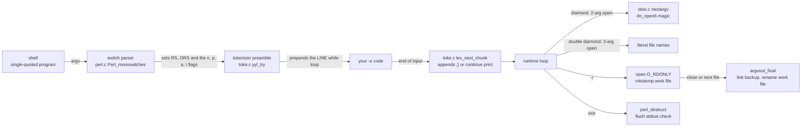

# Perl One Liners

> [!summary] Claim
> A Perl one-liner is a program that `perl` builds by pasting literal source text around your `-e` code, reading input through the two-argument `open` behind `<>`, so its power and its sharpest traps (pipe-opening file names, truncating in-place edits, silently exiting 0) all come from that text splice and that `open`.

Part of [Regular Expressions and Text Processing](README.md) in [Shell and Unix Engineering](../README.md).

## TL;DR

- Mechanism: `-n` and `-p` make the tokenizer prepend the text `LINE: while (<>) {` (plus `chomp;` for `-l` and `our @F=split(...);` for `-a`) and append `;}` or `;}continue{print or die qq(-p destination: $!\n);}` at end of input (`toke.c`, `yyl_try` and `Perl_lex_next_chunk`).
- Rule: pass data through `%ENV` or `@ARGV`, never by splicing a shell variable into the program text, and read untrusted file names with `<<>>` (perl 5.22 and later), not `<>`.
- Trap: under `-i`, `last` or `exit 0` partway through a file commits the truncated output, while `die` or a nonzero `exit` keeps the original; and a file `-i` cannot edit is skipped with a warning and exit status 0.
- Portability fact: Perl is not in POSIX; Debian marks `perl-base` essential, Alpine's base image has no perl, and Apple has announced since macOS 10.15 that future releases will not include scripting runtimes, though macOS 27.3 still ships `/usr/bin/perl` 5.34.1 (measured).
- When not to use it: when the job is one regex filter (`grep`), one column cut (`cut`, `awk`), or anything that must outlive its author, where a checked-in script with `use strict`, tests, and argument parsing beats a clever line.

## Mental model



The shell hands perl an argument vector, and the switch parser turns `-0`, `-l`, `-n`, `-p`, `-a`, `-F` and `-i` into interpreter state before a single token of your code is read.
When the tokenizer reaches the end of the (empty) main file it emits a preamble of literal Perl source built from that state, so your `-e` text lands inside an open `while` block, and at true end of input it pastes the closing brace (and, for `-p`, a `continue` block that prints).
At run time the loop reads `<>`, which shifts `@ARGV` and opens each element: plain `<>` uses the two-argument `open` that honours `|`, `<`, `>` and leading whitespace, `<<>>` uses the three-argument form, and `-i` opens the file read-only and redirects the default output handle to a fresh work file in the same directory.
That work file replaces the original only when its handle is closed cleanly, and the final flush of standard output in `perl_destruct` is where buffered write errors finally surface.

## How it works

### The switches are text generators

`perlrun` documents `-n` as assuming the loop `LINE: while (<>) { ... }` and `-p` as the same loop with `continue { print or die "-p destination: $!\n"; }`.
The implementation is literal: in `toke.c` function `yyl_try`, the end-of-buffer case (`case 0`) builds the preamble with `sv_catpvs(PL_linestr, "LINE: while (<>) {")`, then `"chomp;"` when `PL_minus_l` is set, then `"our @F=split(' ');"` for `-a`, or `"our @F=split(%s);"` with the `-F` text when it starts with `/`, `'` or `"` and that character occurs again later in the text (the code tests `strchr(PL_splitstr + 1, *PL_splitstr)`), else `split(q\0...\0)` with every backslash doubled.
In `toke.c` function `Perl_lex_next_chunk`, at the end of real input, `PL_minus_p` appends `;}continue{print or die qq(-p destination: $!\n);}` and `PL_minus_n` appends `;}`.
Because these are text splices, a program may close the loop itself: `$s += $_ }{ print $s` ends the `while` body at `}` and the appended `;}` closes a bare block that runs once after the loop (the "Eskimo greeting"; the lab prints `sum=6` for input `1 2 3`).
`B::Deparse` shows the result; on the macOS host (perl 5.34.1), `perl -MO=Deparse -F: -lane 'print $F[0]'` printed:

```perl
BEGIN { $/ = "\n"; $\ = "\n"; }
LINE: while (defined($_ = readline ARGV)) {
    chomp $_;
    our @F = split(/:/, $_, 0);
    print $F[0];
}
```

Consequences that follow from the splice, each proven in the lab:

- `BEGIN` and `END` blocks run outside the loop, as in awk (`perlrun`, `-n`); the lab prints `begin`, `x`, `end`.
- `next` under `-p` still runs the `continue` block, so the line is printed; `last` skips it, so the current line is not printed and the loop ends (the lab prints `a`, `B` for `next if /a/; $_ = uc`, and only `kept:a` for `last if /b/`).
- The loop label `LINE` is real, so `next LINE` works from a nested loop.

Since perl 5.20, `-F` implies `-a` and `-n`, and `-a` implies `-n` (`perl5200delta`, "-F now implies -a and -a implies -n"); before that, `-F` without `-a` was a no-op.
The lab's `perl -F: -le 'print $F[1]'` (no `-n`, no `-a`) prints `b`.
`-E` is `-e` plus `use feature ':5.N'; use builtin ':5.N';` for the running version (`toke.c`, `yyl_try`, the `PL_minus_E` branch), so `say` works; `-E` arrived in 5.10 (`perl5100delta`).

### Record separators: `-0`, `-l`, `-00`, `-0777`, `-g`

`-0` takes up to four characters of octal (`perl.c`, `Perl_moreswitches`, `numlen = 4`): a value above 0377 sets `$/` to `undef` (slurp), the special value `00` sets `$/` to the empty string (paragraph mode), and `-0xHHH` takes hexadecimal for any code point (`perlrun`, `-0`).
`-l` without digits copies the current `$/` into `$\` at the moment the switch is parsed, except that a paragraph-mode `$/` gives `$\ = "\n\n"` (`Perl_moreswitches`, `case 'l'`, `RsPARA`).
So switch order is semantics: `-ln0e` sets `$\` to newline and then `$/` to NUL, while `-0 -l` copies the NUL into `$\`.
The lab prints `ln0: ors=10 rs=0`, `0l: ors=0 rs=0` and `00l: ors=10.10 rs-empty=1`.
`chomp` with `-l` removes only the current `$/`, so a CRLF file keeps its `\r`: the lab measures `length` 4 for `abc\r\n` under `-lne`.
`-g` is a synonym for `-0777` from perl 5.36 (`perl5360delta`); perl 5.34.1 rejects it with `Unrecognized switch: -g` (measured), and the lab branches on `$]`.
Slurp mode is what makes multi-line edits trivial: `perl -0777 -pe 's/\\\n//g'` joins backslash-continued lines, which needs hold-space gymnastics in sed (see [[sed-Pattern-and-Hold-Space]]).

### Autosplit is `split`, not awk's field splitting

`-a` runs `split(' ')`, which is awk-compatible: leading whitespace is dropped and runs of any whitespace separate fields (`perlfunc`, `split`), so the trailing newline never reaches `$F[-1]` (lab: `default-no-l=2` for `a bc`).
A `-F` pattern is a regular expression, which has three consequences awk users do not expect:

- `split` with no LIMIT strips trailing empty fields (`perlfunc`, `split`: "trailing empty fields are stripped"), so `a:b::` gives 2 fields under `-F:` but 4 in awk and with `split /:/, $_, -1` (lab: `perl-F=2`, `split-1=4`, `awk=4`).
- `-F'|'` becomes `split(q\0|\0)`, the pattern `|`, an alternation of two empty patterns that matches between every character, so `a|b` gives 3 fields and `$F[1]` is `|` (lab); `-F.` matches every character and leaves only trailing empty fields, which are stripped, so `@F` is empty (lab: `F-dot=0`).
- Without `-l` the last field keeps the newline (lab: `F-no-l=3` for `a:bc`, `F-with-l=2`).

`perlrun` forbids literal whitespace in a `-F` pattern; on perl 5.34.1 `-F' '` deparses to `split(//, $_, 0)` and splits `a b` into `[a],[ ],[b]` (measured on the host), so write `-F'\s+'` or omit `-F`.
`-F'\t'` works because the backslash survives into `q\0\\t\0` and the regex `\t` matches a tab (measured: `a<TAB>b c<TAB>d` gives 3 fields with `$F[1]` equal to `b c`).

### `<>` is a two-argument `open`

`perlop` ("I/O Operators") specifies `<>` as `unshift(@ARGV, '-') unless @ARGV; while ($ARGV = shift) { open(ARGV, $ARGV); ... }` and warns that the two-argument `open` "interprets special characters".
In `doio.c` function `Perl_nextargv`, plain `<>` calls `do_open6(gv, PL_oldname, oldlen, NULL, NULL, 0)`, the magic two-argument path, while `<<>>` passes `nomagicopen` and calls `do_open6(gv, "<", 1, ...)`.
So an argument `printf INJECTED |` runs a shell command and reads its output, `>victim` opens `victim` for writing and truncates it to 0 bytes, and leading whitespace is stripped from a name; the lab proves the first two, and that `<<>>` leaves `victim` at 8 bytes.
`perl5220delta` introduced `<<>>` ("New double-diamond operator").
`-i` takes a third path: `do_open_raw(gv, PL_oldname, oldlen, O_RDONLY, 0, &statbuf)`, so in-place mode never opens pipes (lab: `inplace=[]`).
`$.` is not reset between files because `ARGV` is never explicitly closed; `close ARGV if eof` resets it, `eof` without parentheses tests the current file, and `eof()` tests the end of the whole `@ARGV` stream (`perlfunc`, `eof`); the lab prints `cumulative f2:3`, `reset f2:1`, and `last-file-only c`.

### `-i` since 5.28: a work file and a rename

`perlrun` still describes `-i` as renaming the input file and opening the output by the original name, but `perl5280delta` ("In-place editing with perl -i is now safer") changed it so "the input file isn't replaced until the output file has been completely written and successfully closed", by "creating a work file in the same directory, which is renamed over the input file" (perl GH #15216, "Safety for -i option", opened 2016-03-06).
The code path in `doio.c`:

1. `Perl_nextargv` opens the input `O_RDONLY`, records its mode, uid and gid from the `stat`, and refuses a non-regular file ("Can't do inplace edit: %s is not a regular file").
2. `S_openindirtemp` builds the template `DIR/XXXXXXXX` from the last `/` of the name, sets `umask(0177)`, and calls `mkstemp`; failure gives the warning "Can't do inplace edit on %s: Cannot make temp name: %s" and the file is skipped.
3. Back in `Perl_nextargv`, `fchmod` copies the original mode to the work file and `fchown` copies the owner, with failures silently ignored (the source comment says `XXX silently ignore failures`).
4. `S_argvout_final`, run when the handle closes, makes the backup with `linkat` (so the backup is the original inode) and falls back to `renameat`, then `renameat`s the work file over the original name; with `ARGV_USE_ATFUNCTIONS` these are relative to a directory handle opened at start, so a `chdir` mid-edit cannot misdirect them.
5. `S_argvout_free` commits the edit at global destruction only if `PL_statusvalue == 0`; otherwise it closes and unlinks the work file, abandoning the edit.

POSIX `rename()` guarantees that "a directory entry named new shall remain visible to other threads throughout the renaming operation and refer either to the file referred to by new or old before the operation began" (POSIX.1-2024 XSH `rename`), so a concurrent reader sees the old or the new content, never a partial file.
The same mechanism has sharp edges, all measured in the lab:

| Situation | Result | Why |
| --- | --- | --- |
| `die` on line 2 | original kept (3 lines), nonzero status, no work file left | `PL_statusvalue != 0` at destruction, edit abandoned |
| `exit 3` on line 2 | original kept, status 3 | same |
| `exit` (0) on line 2 | file committed with 1 line, status 0 | clean exit commits whatever was written |
| `last` on line 2 | file committed with 1 line, status 0 | loop ends, normal exit commits |
| target is a symlink | link replaced by a regular file holding the edit; target unchanged | `rename` over the link name |
| hard-linked file | edited name gets a new inode; the other link keeps old data | new inode from `mkstemp` |
| mode 0444 file in a writable directory | edited, mode stays 0444, status 0 | needs only read on the file and write on the directory (`perlfaq5`) |
| `-i.orig` | `bk.orig` has the original inode, the edited file a new one | `linkat` backup |
| read-only directory | "Cannot make temp name: Permission denied", file unchanged, status 0 | warn-and-skip, not fatal |

`-i` with no file arguments filters standard input to standard output with the warning "-i used with no filenames on the command line, reading from STDIN" (the message text is in `perl.c`, not `perlrun`; observed on the host).
`$^I` holds the extension at run time and `undef` disables in-place editing (`perlvar`).

### Exit status and write errors

A missing input file under `-n` or `-p` prints "Can't open nosuch: No such file or directory" and moves on (`perlrun`, `-n`), so the lab measures exit status 0.
Output goes through a PerlIO buffer of `BUFSIZ > 8192 ? BUFSIZ : 8192` bytes (`perlio.h`, `PERLIOBUF_DEFAULT_BUFSIZ`), so a write error appears only when a buffer is flushed:

- With standard output open read-only (`1</dev/null`, so `write(2)` fails with `EBADF`), a 2-byte `-p` run fails only at exit, where `perl_destruct` in `perl.c` prints "Unable to flush stdout: %s" and forces a failure status (lab: status 1).
- A 1 MB `-p` run fills the buffer, the `print` in the appended `continue` block fails, and `die "-p destination: $!"` exits with `$!` as the status (lab: status 9, `EBADF` on Linux and macOS).
- The same 1 MB under `-n` with a bare `print` ignores every failed `print` and is rescued only by the exit-time flush check (lab: status 1).

`die` exits with `$!` if nonzero, else `$? >> 8`, else 255 (`perlfunc`, `die`), so its status is whatever errno happened to be: the lab's `die` under `-i` exited 25 on the host (`ENOTTY`, left over from a terminal check) and the refused regex exited 255; test for nonzero, never for a specific value.

### Bytes, characters, and the locale

Perl strings read from a handle without a decoding layer are bytes: `length` of UTF-8 `\303\251` is 2, and `uc` leaves it unchanged (lab).
Perl does not consult `LC_ALL` for this; the lab measures 2 even under `LC_ALL=C.UTF-8`.
`-C` sets the layers by letters that sum to a number: `I` 1, `O` 2, `E` 4, `S` 7, `i` 8, `o` 16, `D` 24, `A` 32, `L` 64 (`perlrun`, `-C`); `-CS` decodes the standard streams (lab: `CS=1`, `uc-CS=changed`), and `L` makes the rest conditional on `LC_ALL`, `LC_CTYPE` or `LANG` indicating UTF-8 (lab: `CSL-utf8-locale=1`, `CSL-C-locale=2`).
`perlrun` warns that `-C` does not validate input as UTF-8, and that since 5.10.1 a `-C` on a `#!` line must also be given on the command line.
Contrast grep, sed and awk, whose behavior follows `LC_ALL` (see [[Locale-and-LC_ALL]] and [[Unicode-and-UTF-8-in-Text-Tools]]).

### Numbers

Perl prints a floating-point value with 15 significant digits on an IEEE double build (`sv.c` formats an NV with `SNPRINTF_G(..., NV_DIG)`, and `NV_DIG` is `DBL_DIG`, 15 on the host), so `1234567.891` prints in full where awk's `OFMT` default `"%.6g"` (POSIX.1-2024 XCU `awk`) prints `1.23457e+06` (both measured in the lab).
`0.1 + 0.2` prints `0.3` yet compares unequal to `0.3` (lab), the standard binary floating-point effect (`perlfaq4`, "Why am I getting long decimals").
Integers that fit a 64-bit IV stay exact (`9007199254740993` prints as written), but `2**53 + 1` is computed as a double and prints `9.00719925474099e+15` (lab).
A non-numeric string such as `-` in a byte column adds 0 silently; only `-w` reports `Argument "-" isn't numeric in addition (+)` (lab).

## Numbers and limits

| Quantity | Value | Source |
| --- | --- | --- |
| Latest stable perl | 5.44.0, released 2026-07-15; maintenance 5.42.3 and 5.40.5 on 2026-08-02 | `perlhist` (as of 2026-11) |
| perl on Debian 13 | `perl-base` 5.40.1-6+deb13u1, marked essential | packages.debian.org (as of 2026-11) |
| perl on Alpine 3.22 | not in the base image; `perl` package 5.40.4-r0 | pkgs.alpinelinux.org (as of 2026-11) |
| perl on macOS 27.3 | `/usr/bin/perl` 5.34.1 | measured on the host, 2026-11-14 |
| `-0` octal digits read | up to 4 characters; any value above 0377 slurps | `perl.c` `Perl_moreswitches` |
| `-l` octal digits read | 3, or 4 when the first is `0` | `perl.c` `Perl_moreswitches` |
| PerlIO buffer | `max(BUFSIZ, 8192)` bytes | `perlio.h` `PERLIOBUF_DEFAULT_BUFSIZ` |
| `-i` work file | `DIR/XXXXXXXX` via `mkstemp` under `umask(0177)` | `doio.c` `S_openindirtemp` |
| `-C` flag values | `I`=1 `O`=2 `E`=4 `S`=7 `i`=8 `o`=16 `D`=24 `A`=32 `L`=64 | `perlrun` |
| `die` exit status | `$!`, else `$? >> 8`, else 255 | `perlfunc` `die`; lab saw 25 and 255 |
| Printed float digits | 15 significant (`1234567.891`, `9.00719925474099e+15`) vs awk `%.6g` | lab, perl 5.34.1 |
| Field extraction, 1,000,000 lines (28,000,000 bytes), one run each | `perl -lane 'print $F[2]'` 0.535 s; macOS `awk '{print $3}'` 0.793 s; gawk 0.292 s; `cut -d' ' -f3` 0.390 s | measured once on the macOS 27.3 host, 2026-11-14; a second run on the same host under load (27,000,000 bytes) gave 2.51 s, 6.68 s, 1.92 s and 2.16 s, the same ordering at several times the cost, so trust the ordering, not the absolute times |
| Process start cost | 200 sequential runs of `/usr/bin/true`, `perl -e 1`, `awk 'BEGIN{}'`, `sed -n 1p` each took 6 to 10 ms per run, and the noise between two passes exceeded the differences; a rerun under load gave about 30 ms for `/usr/bin/true` and 23 ms for `perl -e 1`, again noise-dominated | measured on the macOS host, 2026-11-14 |

The startup measurement says that on this host process creation, not interpreter startup, dominates a per-file `find -exec perl` loop; batch file names with `-exec ... +` or `xargs -0` (see [[Program-Startup-argv-envp-and-ARG_MAX]]).

## Portability

| Environment | Behavior | Evidence |
| --- | --- | --- |
| POSIX sh | A single-quoted program reaches perl byte for byte; a `'` inside needs `'\''` | POSIX.1-2024 XCU 2.2.2; lab `quoting` |
| macOS bash 3.2 as `/bin/sh` | All 22 lab tests pass | lab run on the host, 2026-11-14; a second run of every mode on the host printed exactly the asserted values |
| dash, posh and other shells | The shell only quotes and launches perl, and the lab has been run only under macOS `/bin/sh`, so no claim is made about other shells' results; a tab for `-F` should be written `-F'\t'` for perl to interpret, never as `$'\t'` | POSIX.1-2024 XCU 2.2.2; `$'...'` is unsupported in dash 0.5.12 and posh 0.14.1 (measured in the shell matrix) |
| Debian 13 | `perl-base` 5.40.1 essential, so `perl` exists on every install; its file list has `strict.pm`, `warnings.pm` and `re.pm` but not `B/Deparse.pm`, so `-MO=Deparse` needs the full `perl` package | packages.debian.org, package page and file list |
| Alpine 3.22 and BusyBox systems | no perl until `apk add perl`; the lab fails there by design rather than skipping | Alpine package index; matrix Dockerfile installs no perl |
| macOS 27.3 | `/usr/bin/perl` 5.34.1: has `<<>>` (5.22), the safe `-i` (5.28), `-F` implying `-an` (5.20); lacks `-g` (5.36) | measured; perldeltas |
| macOS 10.15 and later | Apple: runtimes "such as Python, Ruby, and Perl are included in macOS for compatibility with legacy software. Future versions of macOS won't include scripting language runtimes by default" | Catalina release notes |
| perl 5.10 | `-E` and `say` | `perl5100delta` |
| perl 5.14 | `s///r` and `y///r` non-destructive forms | `perl5140delta` |
| perl 5.26 | `.` removed from `@INC` by default | `perl5260delta` |
| perl 5.39.8 (5.40 release) | `-M MODULE` may be a separate argument | `perlrun`, `-M` |

GNU, BSD and BusyBox utilities do not enter the picture except as the tools Perl replaces; the in-place contrast with `sed -i` belongs to [[sed-In-Place-Editing-Portability]].

## Worked example

The [lab](../labs/07-perl-one-liners/) script `perl-one-liners.sh` runs one probe per mode and `test.bats` asserts every printed line.
Its `report` mode is the classic log rollup: requests and bytes per HTTP status from common-log-format lines, using `-l` (chomp and newline), `-a` (fields), a hash per aggregate, and `}{` to run the report once after the loop.
Excerpt, the `report` arm of `perl-one-liners.sh`:

```sh
    printf '%s\n' \
      '10.0.0.1 - - [13/Nov/2026:10:00:00 +0000] "GET / HTTP/1.1" 200 512' \
      '10.0.0.2 - - [13/Nov/2026:10:00:01 +0000] "GET /a HTTP/1.1" 404 128' \
      '10.0.0.1 - - [13/Nov/2026:10:00:02 +0000] "GET /b HTTP/1.1" 200 2048' \
      '10.0.0.3 - - [13/Nov/2026:10:00:03 +0000] "GET /c HTTP/1.1" 304 -' \
      | perl -lane '$hits{$F[8]}++; $bytes{$F[8]} += $F[9] }{ print "$_ $hits{$_} $bytes{$_}" for sort keys %hits'
```

Output captured on the host (perl 5.34.1 under `/bin/sh`) and asserted by the lab:

```text
200 2 2560
304 1 0
404 1 128
```

Field 8 is the status and field 9 the byte count because `split(' ')` counts the bracketed timestamp as two fields and the quoted request as three.
The `-` byte count of the 304 line adds 0 without a warning; add `-w` to see `Argument "-" isn't numeric`.
`sort keys` makes the output order deterministic, because `keys` returns "items in a per-hash randomized order" (`perlsec`, "Hash Traversal Randomization").

Other lab modes, each one assertion block in `test.bats`: `wrap` (the splice), `chomp`, `autosplit`, `ors-order`, `slurp`, `eof`, `inject`, `inplace-fail`, `inplace-links`, `inplace-dir`, `fatal-inplace`, `exit-status`, `unicode`, `numbers`, `coerce`, `regex-eval`, `shell-inject`, `quoting`.

## Pitfalls

> [!warning] Truncation by `last` or `exit` under `-i`
> Trigger: `perl -pi -e 'last if /END/'` or `exit if $. > 10` to stop early.
> Symptom: the file is rewritten with only the lines printed so far, exit status 0 (lab: 3 lines become 1).
> Fix: never leave the loop early under `-i`; to stop editing, keep printing: `$done ||= /END/; s/x/y/ unless $done`.

> [!warning] Silent success on skipped files
> Trigger: `-i` on a file in a read-only directory, a missing file, or a non-regular file.
> Symptom: a warning on stderr and exit status 0, so `set -e` and CI see success (lab: `status=0 content=old`).
> Fix: promote warnings to errors with `perl -Mwarnings=FATAL,inplace -pi -e ...`, or check `-w` and writability before the run, or verify the result; never trust the status of a bare `perl -pi`.
> The skip warnings are in the `inplace` category (`doio.c`, `packWARN(WARN_INPLACE)`), so `-Mwarnings=FATAL,inplace` makes them fatal: the lab measures a nonzero exit for a missing file under `-n` and for a read-only directory under `-i`, with the file left unchanged.

> [!warning] Pipe-opening and truncating file names under `<>`
> Trigger: `perl -ne ... *` in a directory where someone can create a file named `rm -rf ~ |` or `>important`, or `find | xargs perl -ne`.
> Symptom: the command runs, or `important` is truncated to 0 bytes (lab: `victim-bytes=0`).
> Fix: use `<<>>` with an explicit loop (`perl -e 'while (<<>>) { ... }'`), since `-n` and `-p` always generate `<>`; or prefix relative names with `./` and pass `--` so names cannot start with `-` (perlop "I/O Operators" documents the `rm -rfv *|` case).

> [!warning] Symlinks and hard links lost by `-i`
> Trigger: editing a config file that is a symlink into a dotfiles repository, or a hard-linked file.
> Symptom: the link becomes a regular file and the real target is never edited (lab: `link=regular target-content=old`).
> Fix: edit the resolved path (`perl -pi -e ... "$(readlink -f link)"` on systems whose `readlink` has `-f`), or write through the link: `perl -0777 -ne '...; open my $o, ">", $ARGV or die; print $o $_'`, accepting the loss of atomicity.

> [!warning] `-F` is a regex and `split` drops trailing empty fields
> Trigger: `-F'|'`, `-F.`, `-F' '`, or a CSV whose last columns are empty.
> Symptom: one field per character, no fields at all, or a short `@F` that shifts `$F[-1]` (lab: `F-pipe=3`, `F-dot=0`, `perl-F=2`).
> Fix: `-F'\|'` or `-F'[|]'`; `-F'\t'`; for trailing fields `@F = split /:/, $_, -1` with `-ln`.

> [!warning] Switch order changes the output separator
> Trigger: `perl -0 -lne` intending NUL-separated input and newline output.
> Symptom: output records end in NUL, not newline (lab: `0l: ors=0`).
> Fix: put `-l` first: `perl -ln0e`.

> [!warning] Byte semantics in a UTF-8 world
> Trigger: `length`, `substr`, `uc`, or `/./` on UTF-8 text without `-C`.
> Symptom: `length` counts bytes, case mapping does nothing (lab: `default=2`, `uc-default=unchanged`), and a `substr` can cut a character in half.
> Fix: `-CSDA` (or `-CSDAL` to follow the locale) plus `use utf8` in the program if the source contains literals beyond ASCII.

> [!warning] Testing `die`'s exit code for a value
> Trigger: a wrapper script that checks `[ $? -eq 255 ]`.
> Symptom: the code is `$!` from some earlier failed call (25 and 255 in the lab), so the check flips with unrelated system state.
> Fix: test for nonzero, or `exit 2` explicitly after printing to `STDERR`.

> [!warning] `$.` and `eof` across files
> Trigger: `perl -ne 'print "$ARGV:$.\n" if eof' *.log` to count lines per file.
> Symptom: counts accumulate (lab: `f2:3` for a 1-line file), and `eof()` with parentheses fires only on the last file.
> Fix: `close ARGV if eof;` at the end of the loop body.

## Security and robustness

- Code injection through the shell: `perl -le "print $v"` with `v='1; print "INJECTED"'` executes the second statement (lab); the same value passed as `V=$v perl -le 'print $ENV{V}'`, as `@ARGV`, or as `-s -v="$v"` stays data (lab). This is the shell-to-interpreter instance of [[Command-Injection]].
- Regex injection: a pattern from `$ENV{PAT}` is still a regex, so validate it or quote it as `/\Q$ENV{PAT}\E/`; perl refuses a `(?{ })` code block that arrives by interpolation unless `use re 'eval'` is in scope (lab: "Eval-group not allowed at runtime", the block never ran; the full message is in `perldiag`), but a hostile pattern can still backtrack exponentially (see [[ReDoS]] and [[Regex-Engines-NFA-DFA-and-Backtracking]]).
- `s///ee` evaluates the replacement as code and must never see untrusted data (`perlop`, `s///`, the `e` modifier).
- File names: `<>` is a two-argument `open` (`perlop`), so any directory an attacker can write to can turn a glob into command execution or truncation; `<<>>` (5.22) and `-i` (raw `O_RDONLY` open in `Perl_nextargv`) are not affected (lab).
- Environment: `PERL5OPT` adds `-[CDIMTUWdmtw]` switches to every perl command line and `PERL5LIB` prepends module directories; both are ignored under taint mode (`-T`) (`perlrun`, `PERL5OPT`), so a one-liner run with an attacker-influenced environment, such as a CI job building untrusted pull requests, runs attacker code via `-M`.
- `@INC` and the current directory: before 5.26, `.` was the last `@INC` entry, so `perl -MSomeModule` in an untrusted directory such as `/tmp` could load `./SomeModule.pm`; CVE-2016-1238 records this for core scripts, and `perl5260delta` removed `.` by default.
- `-i` permissions: the work file is created `0600` (`umask(0177)` in `S_openindirtemp`) and only then `fchmod`ed to the original mode, so there is no window where a private file is world-readable; ownership copying by `fchown` fails silently for a non-root user editing someone else's file in a shared directory, leaving the file owned by the editor (`doio.c`, `Perl_nextargv`).
- Robustness: check every failure path explicitly, because perl's defaults favor continuing: missing files warn and continue, `-i` skips, `-n` `print` errors only surface at the exit flush; a production pipeline adds `-Mwarnings=FATAL,all` or a final verification step.

## The principal's view

The decision is not "Perl or awk" but where a text transform should live.
A one-liner is the right tool for an interactive or exploratory transform, for one-off migrations under version control, and for the specific jobs where sed and awk are weak: multi-line edits under `-0777`, regex features beyond ERE (lookaround, `\K`, non-greedy quantifiers, named captures; see [[BRE-ERE-and-PCRE]]), atomic in-place rewrites with backups, and hash-based joins.
The trade-off is that a one-liner inherits permissive defaults (exit 0 on skipped files, bytes not characters, silent numeric coercion, two-argument `open`) that are acceptable at a terminal and wrong in automation.
The rule I would set for a team: one-liners at the prompt and in runbooks, but anything in CI, cron, or a deploy path becomes a file with `use strict; use warnings FATAL => 'all';`, an explicit `while (<<>>)` loop, explicit `close` checks, tests, and a pinned interpreter.
Availability is now a real cost: macOS ships an old perl under a deprecation notice and minimal container images ship none, so a tool that must run everywhere should not assume `perl` exists; ship the interpreter in the image, or choose [[Python-as-a-Shell-Companion]] when the team already maintains Python, or plain POSIX awk when the transform is columnar and must run on BusyBox.
For throughput, measure rather than assume: in the single run above, gawk beat Perl at field extraction and Perl beat macOS's one-true-awk, so the choice should follow the regex features and correctness defaults you need.

## Interview questions

> [!question] L5: What does `perl -pe 's/foo/bar/'` actually compile, and why can you write `}{` inside `-n` code?
>
> > [!success]- Answer
> > The tokenizer pastes `LINE: while (<>) {` before your code and `;}continue{print or die qq(-p destination: $!\n);}` after it (`toke.c`, `yyl_try` and `Perl_lex_next_chunk`).
> > With `-n` the tail is just `;}`.
> > Because it is text, `}` in your code closes the `while` early and `{` opens a bare block that the pasted `;}` closes, so that block runs once after the loop.
> >
> > Follow-up: Why does `next` still print the line under `-p` but `last` does not?

> [!question] L5: Predict the output of `printf 'a:b::\n' | perl -F: -lane 'print scalar @F'` and of the same input through `awk -F: '{print NF}'`.
>
> > [!success]- Answer
> > Perl prints 2 and awk prints 4.
> > `-F:` generates `split(/:/, $_, 0)`, and `split` with no limit strips trailing empty fields.
> > awk keeps empty fields; in Perl, pass a negative limit: `split /:/, $_, -1`.
> >
> > Follow-up: What does `-F'|'` do to `a|b`, and why?

> [!question] L5: Why does `find . -print0 | perl -ln0e 'print'` print newline-terminated names, while `perl -0 -lne` would print NUL-terminated ones?
>
> > [!success]- Answer
> > `-l` without digits copies the current `$/` into `$\` when the switch is parsed.
> > In `-ln0e`, `$/` is still newline when `-l` runs, and `-0` then sets `$/` to NUL.
> > In `-0 -l`, `$/` is already NUL when `-l` copies it.
> >
> > Follow-up: What does `-00 -l` set `$\` to?

> [!question] L6: A teammate runs `perl -pi -e 'last if /^__END__/' config.txt` to stop after the marker. What happens to the file, and what is the exit status?
>
> > [!success]- Answer
> > The file is committed with only the lines before the marker, and the exit status is 0.
> > Since 5.28, `-i` writes a work file and renames it over the original when the handle closes; at destruction `S_argvout_free` commits if the status is 0.
> > `last` ends the loop normally, so the truncated work file wins.
> > A `die` or nonzero `exit` would have abandoned the edit and kept the original.
> >
> > Follow-up: How would you stop substituting after the marker without losing the rest of the file?

> [!question] L6: Debug this script: `for f in *.conf; do perl -pi -e 's/old/new/' "$f"; done; echo done` reports success, but half the files are unchanged. List the causes you would check.
>
> > [!success]- Answer
> > `-i` exits 0 when it skips a file, so the loop cannot see failures.
> > Check for a read-only directory ("Cannot make temp name"), non-regular files ("not a regular file"), and symlinks, where the link was replaced by an edited regular file and the target is untouched.
> > Check for hard links, where only one name sees the edit.
> > Fix by making the warnings fatal (`-Mwarnings=FATAL,inplace`), editing resolved paths, and verifying with a `grep -L new` afterwards.
> >
> > Follow-up: Why does `-i` succeed on a mode 0444 file?

> [!question] L6: Why is `perl -ne 'print if /x/' *` dangerous in a shared upload directory, and what are two fixes?
>
> > [!success]- Answer
> > `<>` uses the two-argument `open`, so a file named `cmd |` runs `cmd`, and one named `>victim` truncates `victim`.
> > Fix one: `perl -e 'while (<<>>) { print if /x/ }' -- ./*`, since `<<>>` opens each name literally (perl 5.22 and later).
> > Fix two: avoid the glob and stream names NUL-separated into a script that opens each name with three-argument `open`.
> > `-i` is not affected, because it opens with `O_RDONLY` directly.
> >
> > Follow-up: Why does `./` matter even with `<<>>` when names start with `-`?

> [!question] L6: A one-liner sums a byte column and reports a total that is too low, with no error. What Perl defaults make that possible?
>
> > [!success]- Answer
> > Non-numeric strings like `-` or `1.2.3` coerce to a numeric prefix or 0 without a warning unless `-w` is on.
> > Short rows give `undef`, which also adds 0.
> > If the column is the last one under `-F`, missing `-l` leaves a newline, which is harmless for numbers but breaks string comparisons.
> > Run with `-w` (or `-Mwarnings=FATAL,numeric`) and count rejected rows explicitly.
> >
> > Follow-up: Why do `perl -le 'print 1234567.891'` and `awk 'BEGIN{print 1234567.891}'` print different text?

> [!question] L7+: Your platform team wants to ban Perl one-liners in CI. Make the case for and against, and define the policy you would ship.
>
> > [!success]- Answer
> > For a ban: the defaults are wrong for automation (exit 0 on skipped files, two-argument `open`, bytes not characters, silent coercion), and minimal images and macOS's deprecation notice make availability a real risk.
> > Against: Perl remains the most capable regex and atomic in-place editing tool on a stock Debian system, and banning it pushes people to worse sed hacks.
> > The policy: allow one-liners interactively and in runbooks; in CI require a checked-in script with `use strict`, fatal warnings, `<<>>`, explicit close checks, and a test, running on a perl pinned in the build image; keep POSIX awk for columnar work that must run on BusyBox.
> >
> > Follow-up: How would you detect existing one-liners that rely on `-i` succeeding?

> [!question] L7+: Explain why `perl -pi` is crash-safe since 5.28 but still not a transactional multi-file edit, and how you would build one.
>
> > [!success]- Answer
> > Each file is written to a `mkstemp` work file in its own directory and renamed over the original only after a successful close, and POSIX `rename` keeps the name pointing at the old or the new file throughout.
> > But files are committed one at a time, so a failure on file 7 leaves files 1 to 6 edited, and a crash does not fsync the work file or the directory, so durability after power loss is not promised.
> > For an all-or-nothing edit, write every new version first, `fsync` them, then rename them all, and keep the old versions for rollback; or edit a copy of the tree and swap a symlink atomically.
> >
> > Follow-up: What does the `PL_statusvalue == 0` check in `S_argvout_free` mean for a program that calls `exit 0` from a signal handler?

> [!question] L7+: A security review flags `perl -ne "print if /$PATTERN/"` in a deployment script. Rank the risks and give the minimal safe rewrite.
>
> > [!success]- Answer
> > Worst is code execution: the shell substitutes `$PATTERN` into the program text, so `/; system "..."; /` runs code.
> > Next, even passed safely as `$ENV{PATTERN}`, the value is a regex, so a crafted pattern can backtrack catastrophically, although perl refuses interpolated `(?{ })` blocks without `use re 'eval'`.
> > Third, `<>` treats file arguments as two-argument `open` specs.
> > Rewrite: `PATTERN=$p perl -e 'while (<<>>) { print if /\Q$ENV{PATTERN}\E/ }' -- ./*` for a literal search, or validate the regex and bound its run time if it must be a regex.
> >
> > Follow-up: Which environment variables could still change what that rewrite executes?

## Related

Prerequisites: [[awk-Implementations]]

Next: [[Python-as-a-Shell-Companion]]

See also: [[awk-Language]], [[awk-Associative-Arrays-and-Idioms]], [[sed-In-Place-Editing-Portability]], [[sed-Pattern-and-Hold-Space]], [[BRE-ERE-and-PCRE]], [[Regex-Engines-NFA-DFA-and-Backtracking]], [[ReDoS]], [[grep-in-Depth]], [[Locale-and-LC_ALL]], [[Unicode-and-UTF-8-in-Text-Tools]], [[Quoting-Backslash-Single-and-Double]], [[Command-Injection]], [[Program-Startup-argv-envp-and-ARG_MAX]], [[Environment-Variables-and-Inheritance]]

## Further reading

- `perlrun` (https://perldoc.perl.org/perlrun): the authoritative list of switches, including the `-n`, `-p`, `-i`, `-0`, `-l`, `-a`, `-F`, `-C` and `PERL5OPT` semantics used here.
- `perlop`, "I/O Operators" (https://perldoc.perl.org/perlop): defines `<>` and `<<>>` and documents the two-argument `open` hazard.
- `perlfunc`, `split`, `eof`, `die` (https://perldoc.perl.org/perlfunc): trailing-field stripping, per-file versus stream end of file, and the exit-code formula.
- `perl5280delta` (https://perldoc.perl.org/perl5280delta): the safe in-place editing change, with its incompatibilities.
- Perl GH #15216 (https://github.com/Perl/perl5/issues/15216): the "Safety for -i option" report that motivated it.
- `doio.c` in perl5 (https://github.com/Perl/perl5/blob/blead/doio.c): `Perl_nextargv`, `S_openindirtemp`, `S_argvout_final` and `S_argvout_free` are the real in-place edit specification.
- `toke.c` in perl5 (https://github.com/Perl/perl5/blob/blead/toke.c): `yyl_try` and `Perl_lex_next_chunk`, where the `-n` and `-p` loops are pasted in as text.
- POSIX.1-2024 `rename()` (https://pubs.opengroup.org/onlinepubs/9799919799/functions/rename.html): the atomic-replacement guarantee `-i` relies on.
- CVE-2016-1238 (https://nvd.nist.gov/vuln/detail/CVE-2016-1238) and `perl5260delta` (https://perldoc.perl.org/perl5260delta): why `.` left `@INC`.
- `perlfaq5` (https://perldoc.perl.org/perlfaq5), "Why does Perl let me delete read-only files?": the directory-permission model behind `-i` on 0444 files.
