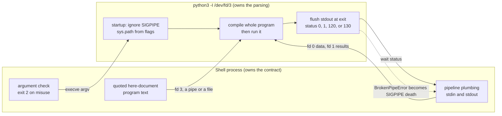

# Python as a Shell Companion

> [!summary] Claim
> Python is the right escape hatch when a shell pipeline needs real parsing, but only if the shell keeps ownership of arguments, standard input, signals, and exit status, because those are the four things a careless `python3 -c` hand-off silently corrupts.

Part of [Regular Expressions and Text Processing](README.md) in [Shell and Unix Engineering](../README.md).

## TL;DR

- Mechanism: the shell `fork`s and `execve`s `python3`; program text, data, and control signals each cross that boundary through a different channel (argv, a file descriptor, standard input, the environment, a signal disposition, an 8-bit exit status), and Python adds its own policy on top (it ignores `SIGPIPE`, block-buffers a piped stdout, and sets `sys.path[0]` from the script or the current directory).
- Rule: send the program through a quoted here-document on a spare descriptor (`python3 -I /dev/fd/3 ARG... 3<<'EOF'`), send every value through argv or standard input, never through string interpolation, and give the script an explicit exit-status contract.
- Trap: `python3 - <<EOF` spends standard input on the program, `python3 -c "...$var..."` turns data into code, and `python3 gen.py | head` ends in `BrokenPipeError` and status 1 or 120 instead of a quiet `SIGPIPE` death.
- Portability: the here-document, `fd 3`, and status rules are POSIX (POSIX.1-2024 XCU 2.7.4, 2.8.2), but a here-document on standard input is concatenated with piped input only in native zsh (`MULTIOS`), and Python 3.15 changed the default text encoding to UTF-8 (as of 2026-11).
- When not to use it: a one-line field extraction or sum is `awk` (about 3 to 5 ms to start against 16 to 28 ms for `python3` on the machine measured below), and structured JSON belongs in `jq` unless you need logic `jq` cannot express.

## Mental model



The shell validates arguments before any interpreter starts, so misuse costs a 5 to 9 ms shell start instead of a 16 to 28 ms interpreter start (Numbers and limits) and exits 2 with a usage line.
It then execs Python with the program already attached to descriptor 3 by the here-document redirection, which leaves descriptor 0 free for the data and descriptor 1 for the results.
Python's startup installs its own signal policy and builds `sys.path` from the flags it was given, compiles the entire program, and only then runs it.
The result travels back as bytes on descriptor 1 and as a wait status, and the dotted arrow is the one path that needs deliberate code: a reader that closes early must turn Python's `BrokenPipeError` back into the death by `SIGPIPE` that every other filter in the pipeline would have suffered.

## How it works

### Five ways to hand Python its program

| Channel | Command shape | What the shell and kernel do | Cost |
| --- | --- | --- | --- |
| Script file | `python3 tool.py ARG...` | Python opens the path itself | `sys.path[0]` is the script directory unless `-P` or `-I` |
| Argument | `python3 -c 'CODE' ARG...` | CODE is one argv string | one string is capped at `MAX_ARG_STRLEN` on Linux, no NUL byte, shell quoting applies to the whole program |
| Standard input | `python3 - ARG... <<'EOF'` | the interpreter reads the program from fd 0 | `sys.argv[0]` is `-`, and fd 0 is no longer available for data |
| Spare descriptor | `python3 -I /dev/fd/3 ARG... 3<<'EOF'` | the shell opens fd 3 on the here-document, Python opens `/dev/fd/3` as a script path | `sys.argv[0]` is `/dev/fd/3`, and tracebacks show no source lines when fd 3 is a pipe (measured: Homebrew bash 5.3.20 and dash on macOS) but do when it is a regular file (macOS `/bin/bash` 3.2.57) |
| Module | `python3 -m json.tool` | the import system finds the code | needs the module installed and importable |

The interpreter documents the first four selectors in its command-line synopsis, `python [-bBdEhiIOPqRsSuvVWx?] [-c command | -m module-name | script | - ] [args]`, and says that "an interface option terminates the list of options consumed by the interpreter, all consecutive arguments will end up in `sys.argv`" (CPython `Doc/using/cmdline.rst`, fetched 2026-11-21).
For a script path, `pymain_run_file_obj()` in `Modules/main.c` calls `Py_fopen(filename, "rb")`, rejects a directory by `fstat`, and runs the file with `_PyRun_AnyFile(fp, filename, 1, &cf)`, so nothing requires the path to be a regular file; a pipe or a `/dev/fd/N` name works.
The same page states that "in non-interactive mode, the entire input is parsed before it is executed", which is why a syntax error anywhere in a here-document program prevents every line of it from running.

### The here-document is the shell's side of the contract

POSIX.1-2024 XCU 2.7.4 defines `<<word` and `<<-word`: the here-document is "a single word that begins after the next NEWLINE token and continues until there is a line containing only the delimiter".
If any part of the delimiter word is quoted, "the delimiter shall be formed by performing quote removal on word, and the here-document lines shall not be expanded".
Otherwise every line is expanded for parameter expansion, command substitution, and arithmetic expansion, and a backslash behaves as in double quotes, so `$`, a backtick, and a backslash in Python source are all live.
`<<-` strips only leading `<tab>` characters, which means it also flattens a Python block indented with tabs and leaves a space-indented one alone.
The standard also says "it is unspecified whether the file descriptor is opened as a regular file or some other type of file", so a program that reads `/dev/fd/3` must not seek.

Implementations choose differently.
dash's `openhere()` in `src/redir.c` writes a document no longer than `PIPESIZE` (defined as `PIPE_BUF`, with a 4096 fallback) into a pipe without forking, and for a larger one uses `memfd_create` when it is available and otherwise forks a writer process (dash `src/redir.c`, `openhere`, `sh_pipe`).
On the macOS host used for this note, `stat -f %HT /dev/fd/3` on a two-line document printed `Fifo File` under bash 5.3.15, Homebrew bash 5.3.20, and dash, and `Regular File` under macOS `/bin/bash` 3.2.57, zsh, and ksh93u+ (measured 2026-11-21).
The lab asserts that a program opens `/dev/fd/3` and reads the whole document under every shell in the matrix; with the real interpreter, `python3 -I /dev/fd/3` read the whole program and left standard input for the data in both cases, a pipe (Homebrew bash 5.3.20, dash) and a regular file (`/bin/bash` 3.2.57), measured on CPython 3.15.2 on macOS.

### Data travels as bytes, and Python decodes them

Arguments, the environment, and filenames arrive from the kernel as bytes, and Python's `os` layer decodes them with the `surrogateescape` error handler: `os.environ` is built with encode and decode functions that use `'surrogateescape'` (CPython `Lib/os.py`, `_create_environ_mapping`), and `os.fsencode` is documented to use the filesystem encoding with the same handler, so an invalid byte sequence in a filename can round-trip instead of raising.
Text read from standard input is decoded with the stream encoding, and that is where versions differ.
Before Python 3.15 the default depended on the locale, with a special case for the legacy C locale: PEP 538 coerces it to a UTF-8 locale and PEP 540 states that "the POSIX locale enables the locale coercion (PEP 538) and the UTF-8 mode".
Python 3.15 made UTF-8 the default "independent of the system's environment" for I/O without an explicit `encoding` argument, and `PYTHONUTF8=0` or `-X utf8=0` restores the old behavior (CPython `Doc/whatsnew/3.15.rst`, PEP 686, as of 2026-11).
On the measured host, `LC_ALL=C python3 -c 'import sys; print(sys.stdout.encoding, sys.flags.utf8_mode)'` printed `utf-8 1`.
A tool that must run on 3.14 and earlier should pass `encoding="utf-8"` explicitly, as the lab's `csvcol.sh` does, and see [[Locale-and-LC_ALL]] and [[Unicode-and-UTF-8-in-Text-Tools]] for what the locale does to `sort`, `grep`, and `tr`.

### Results travel back through buffers and a status

`sys.stdout` is "line-buffered" only when interactive; "otherwise, it is block-buffered like regular text files", while `stderr` has been line-buffered in both cases since 3.9 (CPython `Doc/library/sys.rst`).
`-u` or `PYTHONUNBUFFERED` removes the buffering (CPython `Doc/using/cmdline.rst`).
Measured here (Python 3.15.2, macOS), `python3 -c 'import sys,io; print(sys.stdout.line_buffering, io.DEFAULT_BUFFER_SIZE)' | cat` printed `False 131072`.
Two consequences follow, and both were reproduced here.
With `2>&1` the three lines `out1`, `err1`, `out2` came out as `err1`, `out1`, `out2`, because the buffered stdout drained at exit while stderr was flushed per line.
A process that dies on a default-action signal never runs its flush: `python3 -c 'import os,signal; print("hi"); os.kill(os.getpid(), signal.SIGTERM)' | cat` printed nothing, and the same command with `-u` printed `hi`.

The exit status is whatever the C library's `exit()` receives, reduced modulo 256 by the kernel and `wait` (POSIX.1-2024 XCU 2.8.2: "this value is equal to the result of performing a modulo 256 operation on the value passed to `_Exit()`, `_exit()`, or `exit()`").
Observed with Python 3.15.2: `sys.exit(256)` gave 0, `sys.exit(300)` gave 44, `sys.exit(-1)` gave 255, `sys.exit(None)` gave 0, `sys.exit("message")` printed the message and gave 1, and an uncaught exception gave 1.
Two Python-specific statuses matter to shell callers.
`Py_Exit()` in `Python/pylifecycle.c` sets `sts = 120` when `_Py_Finalize()` fails, which is how a flush error at shutdown (a closed pipe) becomes 120.
`exit_sigint()` in `Modules/main.c` restores `SIG_DFL` for `SIGINT` and kills the process with it when a `KeyboardInterrupt` was unhandled, so the parent sees a death by signal 2 (status 130 in a typical shell), with a `SIGINT + 128` return as the fallback.
Observed here, a self-delivered `SIGINT` gave 130.

### SIGPIPE: Python's policy against the shell's

`signal_install_handlers()` in `Modules/signalmodule.c` calls `PyOS_setsig(SIGPIPE, SIG_IGN)`, and likewise for `SIGXFZ` and `SIGXFSZ`; `_PySignal_Init()` runs it from interpreter startup when `install_signal_handlers` is set (`Python/pylifecycle.c`).
A Python writer to a closed pipe therefore does not die: `write(2)` fails with `EPIPE` and the runtime raises `BrokenPipeError`.
The CPython signal documentation says to catch it at the entry point, redirect the remaining output to `/dev/null` (because Python flushes standard streams on exit), and "do not set `SIGPIPE`'s disposition to `SIG_DFL` in order to avoid `BrokenPipeError`", because that makes the program die whenever any socket connection is interrupted mid-write (CPython `Doc/library/signal.rst`, "Note on SIGPIPE").
Measured on 3.15.2 with `set -o pipefail` in bash:

| Python writer | `seq`-sized output piped to `head -1` | Statuses |
| --- | --- | --- |
| one `print` of a 100000-line string | traceback, `BrokenPipeError` | `1 0` |
| `print` in a loop of 100000 iterations | traceback, then "Exception ignored while flushing sys.stdout", exit via `Py_Exit` | `120 0` |
| `csvcol.sh` (this note's lab script) | silent | `141 0` |

The third row is the technique the lab script uses: catch `BrokenPipeError`, point stdout at `/dev/null`, set `SIGPIPE` to `SIG_DFL` only at that moment, and `os.kill(os.getpid(), signal.SIGPIPE)`, so the caller observes the same death as for `yes | head`.
It confines the `SIG_DFL` risk the documentation warns about to the final instant of a process that has already decided to exit.
Signal exit statuses are not uniform across shells: 128 plus N in most, 256 plus N in ksh93, and 384 plus N in yash (measured in the shell matrix), so `141` is the bash, dash, zsh, and BusyBox value, and [[pipefail-and-PIPESTATUS]] covers what each shell reports.

The ignored disposition is inherited.
POSIX.1-2024 XCU 2.12 says commands "shall inherit the same signal actions as those inherited by the shell from its parent unless a signal action is modified by the trap special built-in", and `execve(2)` preserves ignored signals, so a child of `os.system()` or of `os.exec*()` starts with `SIGPIPE` ignored.
`subprocess` is the exception by default: `restore_signals=True` "restore[s] all signals that Python has set to `SIG_IGN` to `SIG_DFL` in the child process before the exec", currently `SIGPIPE`, `SIGXFZ`, and `SIGXFSZ` (CPython `Doc/library/subprocess.rst`).
The mechanism is `_Py_RestoreSignals()` called in the forked child before `exec` when `restore_signals` is set (`Modules/_posixsubprocess.c`, `child_exec`), and `setsigdef` for the `posix_spawn` path (`Lib/subprocess.py`, `_posix_spawn`).
Measured here with a C probe that reports its own `SIGPIPE` disposition: `os.system` gave `ignored`, `os.execv` gave `ignored`, `subprocess.run(..., restore_signals=False)` gave `ignored`, and `subprocess.run([...])` and `subprocess.run("...", shell=True)` gave `default`.
Inside a shell the same inheritance applies in reverse: a shell started with `SIGPIPE` ignored cannot be talked out of it by `trap - PIPE` in most shells (the lab asserts that native zsh and zsh in sh mode are the exceptions), which matters when a Python wrapper `exec`s a shell script.
See [[SIGPIPE-and-EPIPE]] and [[Signals-Dispositions-Masks-and-Delivery]].

### Isolation: what `-I` actually removes

`-I` "implies `-E`, `-P` and `-s`": it ignores all `PYTHON*` environment variables, does not prepend the "potentially unsafe path" (`sys._path0`, the script directory or, for `-c`, the current directory) to `sys.path`, and does not add the user site directory (CPython `Doc/using/cmdline.rst`; `config_parse_cmdline` in `Python/initconfig.c` handles `-P` by setting `safe_path` and `-s` by clearing `user_site_directory`).
Without it, `python3 -c` documents that "the current directory will be added to the start of `sys.path`", and a script adds its own directory.
Reproduced here: in a directory holding a file named `csv.py`, `python3 s.py` and `python3 -c 'import csv'` both imported the local `csv.py`, while `python3 -I` in the same directory imported the standard library module.
Note that `PyConfig_InitIsolatedConfig()` in `Python/initconfig.c` is the embedding API's isolated configuration and also sets `install_signal_handlers = 0`; the `-I` command-line flag is a different path and leaves the signal policy as described above.

For virtual environments, `venv` documents that "you don't specifically need to activate a virtual environment, as you can just specify the full path to that environment's Python interpreter when invoking Python" (CPython `Doc/library/venv.rst`).
Activation prepends the environment's `bin` to `PATH` and sets `VIRTUAL_ENV` (CPython `Doc/library/venv.rst`), so a script should name `"$VENV/bin/python"` instead of sourcing `activate`.
A system interpreter marked with an `EXTERNALLY-MANAGED` file refuses `pip install` outside a venv (PEP 668), so a bootstrap script that runs `pip install` against the system Python can fail on distributions that adopt it.

### Shebangs and the argument limits of exec

A script whose first line is `#!/usr/bin/env python3` asks the kernel to run `env`, which searches `PATH`.
On Linux, `load_script()` in `fs/binfmt_script.c` splits the line into an interpreter and at most one optional argument: after the interpreter name it takes the rest of the line, with leading spaces and tabs skipped, as a single string (`i_name`, `i_sep`, `i_arg`), and the buffer it parses is `BINPRM_BUF_SIZE`, 256 bytes (`include/uapi/linux/binfmts.h`).
So `#!/usr/bin/env python3 -I` makes `env` look for a program literally named `python3 -I`, and the portable spelling is `#!/usr/bin/env -S python3 -I`, since GNU coreutils `env` implements `-S`/`--split-string` (`src/env.c`) and so does uutils `env` (`src/uu/env/src/env.rs`), but BusyBox `env` does not: on Alpine with BusyBox 1.37.0 both `#!/usr/bin/env -S sh -e` and `#!/usr/bin/env sh -e` fail (measured 2026-11-21).
On the macOS host used here both spellings ran and printed `1` for `sys.flags.isolated`, which is a platform difference, not a portability guarantee.
See [[env-and-Shebang-Tricks]].

The kernel also bounds what a `-c` program can be.
`MAX_ARG_STRLEN` is `PAGE_SIZE * 32` (131072 bytes with 4 KiB pages) per argument string (`include/uapi/linux/binfmts.h`), and total argv plus environment is bounded by `bprm_stack_limits()` in `fs/exec.c`, which takes `max(min(_STK_LIM / 4 * 3, rlim_stack.rlim_cur / 4), ARG_MAX)` with `ARG_MAX` 131072 (`include/uapi/linux/limits.h`).
A program of 131072 bytes or more passed with `-c` fails with `E2BIG`, because the limit counts the terminating NUL: in the Debian matrix image a 131071-byte argument ran and a 131072-byte one failed with "Argument list too long"; a here-document on a descriptor has no such limit.

### Python writing shell, and shell reading Python

When Python must emit shell text (for example `export` lines for `eval`), `shlex.quote()` is the quoting function.
Its source returns `''` for an empty string, returns the string unchanged if it is ASCII and uses only `%+,-./0123456789:=@`, letters, and `_`, and otherwise wraps it in single quotes, replacing each `'` by `'"'"'` (CPython `Lib/shlex.py`, `quote`).
The documentation warns that `shlex` "is only designed for Unix shells" and that its output "is not guaranteed to be correct on non-POSIX compliant shells or shells from other operating systems", and recommends list arguments with `shell=False` instead (CPython `Doc/library/shlex.rst`).
The lab confirms the single-quote form round-trips through `eval` to exactly one word in every shell under test.

When the shell reads Python's output, the record separator is the design choice.
`$(...)` strips every trailing newline and a NUL byte makes behavior unspecified (POSIX.1-2024 XCU 2.6.3), so Python should write NUL-terminated records for `xargs -0` or `read -r -d ''` when values may contain newlines, and a sentinel such as a final `.` when a trailing newline matters, which the lab asserts.

### Python's side of the standard library

Python is worth its startup cost where the shell tools stop being correct.
`csv` handles RFC 4180 quoting, including embedded commas and newlines, which `cut -d,` and `awk -F,` cannot; `csv` readers should be given files opened with `newline=''` (CPython `Doc/library/csv.rst`).
`python3 -m json.tool` validates and pretty-prints JSON, and on 3.15.2 accepts `--sort-keys`, `--compact`, `--indent`, `--tab`, `--no-indent`, `--no-ensure-ascii`, and `--json-lines`.
`re` differs from POSIX in a way that changes results, not just speed.
Its documentation says alternatives separated by `|` "are tried from left to right" and that the first complete match is accepted, even when a later branch would give "a longer overall match" (CPython `Doc/library/re.rst`), whereas POSIX requires the longest of the leftmost matches, with the example that the ERE `(wee|week)(knights|night)` matches all ten characters of `weeknights` (POSIX.1-2024 XBD 9.1).
On `abcd`, `grep -oE 'ab|abcd'` printed `abcd`, `re.findall('ab|abcd', 'abcd')` returned `['ab']`, and `awk` and `gawk` on the measured host, and mawk 1.3.4, original-awk, and BusyBox awk in the Debian and Alpine matrix images, gave a match of start 1 and length 4.
See [[POSIX-Leftmost-Longest-Matching]], [[BRE-ERE-and-PCRE]], and [[Regex-Engines-NFA-DFA-and-Backtracking]].

Python integers are arbitrary precision while `awk` numbers are doubles: `python3 -c 'print(2**53+1)'` printed `9007199254740993`, and both macOS `awk` and `gawk` printed `9007199254740992` for `2^53+1` with `%d`.

Python also drives other programs, and the mapping to shell semantics is not one to one.
`subprocess.run("...", shell=True)` runs `/bin/sh -c` on POSIX (CPython `Doc/library/subprocess.rst`), `returncode` is "a negative value `-N`" when the child died of signal N where a shell reports 128 plus N (observed `-15` for a child that killed itself with `SIGTERM`), and a pipeline built from `Popen` objects needs the parent to close its copy of the first stage's `stdout` ("Allow p1 to receive a SIGPIPE if p2 exits") or the first stage never learns the reader is gone.
There is no `pipefail` equivalent unless the program checks each `returncode`.

## Numbers and limits

| Quantity | Value | Source |
| --- | --- | --- |
| Process start, `/bin/sh -c :` | about 5 to 9 ms | measured here: Apple M3 Pro, Darwin 27.3.0, 200 runs each; round means 6.8 ms and 5.1 ms, then a rerun on 2026-11-21 with the host heavily loaded (load average about 30): best run 4.5 ms, medians 8.1 and 8.9 ms |
| Process start, macOS `awk 'BEGIN{exit}'` (one true awk 20200816) | about 3 to 5 ms | measured here, same method (means 3.2 ms and 2.9 ms; loaded rerun: best 2.4 and 2.7 ms, medians 5.1 and 5.8 ms) |
| Process start, `python3 -c pass` (3.15.2, Homebrew) | about 16 to 28 ms | measured here (means 28.1 ms and 20.5 ms; loaded rerun: best 16.0 and 17.1 ms, medians 21.3 and 25.7 ms); `-I` was no slower (best 16.1 and 16.4 ms, medians 18.3 and 18.6 ms) |
| `io.DEFAULT_BUFFER_SIZE` | 131072 | measured here on Python 3.15.2 |
| Largest single argument string, Linux | `PAGE_SIZE * 32`, 131072 with 4 KiB pages | `include/uapi/linux/binfmts.h` (`MAX_ARG_STRLEN`), checked 2026-11-21 |
| Total argv plus environment, Linux | `max(min(_STK_LIM / 4 * 3, stack rlimit / 4), ARG_MAX)`, `ARG_MAX` 131072 | `fs/exec.c` (`bprm_stack_limits`), `include/uapi/linux/limits.h` |
| `getconf ARG_MAX`, macOS | 1048576 | measured here, Darwin 27.3.0 |
| Shebang line parsed by the kernel, Linux | first 256 bytes (`BINPRM_BUF_SIZE`), interpreter plus one argument | `fs/binfmt_script.c`, `include/uapi/linux/binfmts.h` |
| dash here-document held in a pipe without a fork | up to `PIPESIZE`, which is `PIPE_BUF` (4096 fallback) | dash `src/redir.c`, `openhere` |
| Exit status range | 0 to 255; `sys.exit(300)` is 44, `sys.exit(256)` is 0 | POSIX.1-2024 XCU 2.8.2; observed on Python 3.15.2 |
| Python shutdown flush failure | exit status 120 | CPython `Python/pylifecycle.c`, `Py_Exit` |
| Unhandled `KeyboardInterrupt` | death by `SIGINT` (130 in most shells) | CPython `Modules/main.c`, `exit_sigint`; observed 130 |
| UTF-8 default text encoding | Python 3.15 and later | CPython `Doc/whatsnew/3.15.rst`, PEP 686, as of 2026-11 |

The break-even is arithmetic: one `python3` start costs roughly four to nine `awk` starts on this machine, so a loop that starts the interpreter once per file is the failure mode, and a single interpreter that reads all the files is the fix.
These timings are one machine and one interpreter build, taken with a bash `EPOCHREALTIME` loop and not a statistical harness, and the rerun shows how far load moves them; treat them as order of magnitude, not as a benchmark.
The note makes no claim about relative throughput on large inputs, because repeated column-sum runs under load swapped the order of `awk`, `gawk`, and Python between runs.

## Portability

Shell behavior that this note relies on (every cell is asserted by the lab per family, or is a measured matrix fact attributed below the table):

| Behavior | POSIX sh | bash 3.2 | bash 5.x | zsh | zsh `--emulate sh` | dash | ksh93 | mksh | yash | posh | BusyBox ash |
| --- | --- | --- | --- | --- | --- | --- | --- | --- | --- | --- | --- |
| Here-document on fd 0 with piped data also on fd 0 | the redirection replaces the pipe, so the program only | program only | program only | data then program (`MULTIOS`) | program only | program only | program only | program only | program only | program only | program only |
| Here-document on fd 3 leaves fd 0 for the data | yes | yes | yes | yes | yes | yes | yes | yes | yes | yes | yes |
| `<<-` strips only leading tabs | yes | yes | yes | yes | yes | yes | yes | yes | yes | yes | yes |
| A shell started with `SIGPIPE` ignored can reset it with `trap - PIPE` | no: "signals that were ignored on entry to a non-interactive shell cannot be trapped or reset" (POSIX.1-2024 XCU 2.15, `trap`) | no | no | yes | yes | no | no | no | no | no | no |
| Exit status of a process killed by `SIGPIPE` | greater than 128, implementation-defined (XCU 2.8.2) | 141 | 141 | 141 | 141 | 141 | 269 | 141 | 397 | 141 | 141 |
| `"$@"` with no arguments under `set -u` | exempt: `@` and `*` are excluded from the unset-parameter error (POSIX.1-2024 XCU 2.15, `set -u`) | works | works | works | works | works | works | works | works | aborts | works |

The `SIGPIPE` row and the here-document rows are the lab's per-family assertions (`companion.bats`), and the fd 0 and `trap - PIPE` rows were also rerun by hand in the Debian and Alpine matrix images for every shell in the table (as of 2026-11).
The lab proves that `<<-` strips leading tabs; that it leaves leading spaces alone rests on POSIX.1-2024 XCU 2.7.4, which names only `<tab>` characters.
The status row is from the shell matrix: 128 plus N in most shells, 256 plus N in ksh93, 384 plus N in yash, so 141, 269, and 397 for `SIGPIPE`; yash reports 141 only when it forks an intermediate yash for the stage.
The `set -u` row is a matrix finding about posh 0.14.1, which aborts on an empty `"$@"` ("@: parameter not set") although POSIX exempts `@`, and the portable spelling is `${1+"$@"}`.
The lab script avoids the problem by checking `$#` before it ever expands `"$@"`.
Two further matrix facts shape lab design rather than this note's behavior: ksh93u+m 1.0.10 connects pipeline stages with sockets instead of pipes, so a writer can see `ECONNRESET` instead of `EPIPE`, and without a controlling terminal `set -m` fails in several shells.

Utilities and interpreters the note depends on:

| Tool | Behavior | Basis |
| --- | --- | --- |
| `awk` (gawk, one true awk, mawk, BusyBox awk) | `match("abcd", /ab\|abcd/)` gives `RSTART` 1 and `RLENGTH` 4, because POSIX requires leftmost-longest | POSIX.1-2024 XBD 9.1; lab asserts it for every installed awk; observed on macOS `awk` 20200816 and gawk, and in the matrix images on mawk 1.3.4 20250131, original-awk, and BusyBox awk 1.37.0 (Debian and Alpine, 2026-11-21) |
| CPython `re` | first matching alternative wins, so `ab\|abcd` on `abcd` gives `ab` | CPython `Doc/library/re.rst`; observed on 3.15.2 |
| `env -S` | split a string into arguments in a shebang | GNU coreutils `src/env.c` and uutils `src/uu/env/src/env.rs` implement `-S`; ran on macOS and in the Debian image (coreutils 9.7); BusyBox `env` 1.37.0 does not implement it (Alpine image: "unrecognized option: S"; no split code in BusyBox `coreutils/env.c`) |
| `python3` | absent from the matrix images | matrix fact, so the lab replaces the interpreter with `pyshim` |
| `shlex.quote` | single-quote form, `'` becomes `'"'"'` | CPython `Lib/shlex.py`; lab confirms `eval` round trip in every shell |

## Worked example

[lab](../labs/07-python-as-a-shell-companion/)

The matrix images have no `python3`, so the lab splits the claim in two.
`csvcol.sh` is the real wrapper, and `pyshim.c` supplies the interpreter's side: a `fakepy` mode that prints exactly what the shell handed it (its arguments, the program bytes on the file it was told to open, and standard input), plus probes that reproduce what CPython does at the process boundary (set `SIGPIPE` to ignored then `exec`, report a disposition, write into a closed pipe, call `exit(N)`).
The script, verbatim from `csvcol.sh`:

```sh
#!/bin/sh
# csvcol: print one named column of CSV input, honoring RFC 4180 quoting
# (commas and newlines inside quoted fields), which awk -F, and cut -d, cannot.
# Usage: csvcol.sh COLUMN [FILE...]   (no FILE, or "-", reads standard input)
# Environment: PYTHON names the interpreter (default python3).
#
# The shell owns argument checking and process plumbing; Python owns parsing.
# The program travels on fd 3 from a quoted here-document, so the shell expands
# nothing in it and standard input stays free for data; values travel in argv.
set -eu
if [ "$#" -lt 1 ]; then
  echo "usage: csvcol.sh COLUMN [FILE...]" >&2
  exit 2
fi
exec "${PYTHON:-python3}" -I /dev/fd/3 "$@" 3<<'EOF'
import csv, os, signal, sys

def main(column, paths):
    for path in paths or ["-"]:
        if path == "-":
            stream = open(sys.stdin.fileno(), newline="", encoding="utf-8", closefd=False)
        else:
            stream = open(path, newline="", encoding="utf-8")
        with stream:
            reader = csv.DictReader(stream, restval="")
            if column not in (reader.fieldnames or []):
                sys.exit(f"csvcol: {path}: no column {column!r}")
            for row in reader:
                sys.stdout.write(row[column] + "\n")
    sys.stdout.flush()

try:
    main(sys.argv[1], sys.argv[2:])
except BrokenPipeError:
    # Die of SIGPIPE like any other filter, so the caller sees 128 + 13.
    os.dup2(os.open(os.devnull, os.O_WRONLY), sys.stdout.fileno())
    signal.signal(signal.SIGPIPE, signal.SIG_DFL)
    os.kill(os.getpid(), signal.SIGPIPE)
except (OSError, csv.Error, UnicodeDecodeError) as e:
    sys.exit(f"csvcol: {e}")
EOF
```

Each design decision maps to a mechanism above.
`set -eu` plus the `$#` check keeps misuse in the shell with status 2 and never starts an interpreter.
The quoted `'EOF'` delimiter means the shell expands nothing in the Python text (POSIX.1-2024 XCU 2.7.4).
`exec` replaces the shell so the wrapper adds no process and the caller's `wait` sees Python's status directly.
`-I` stops a `csv.py` in the current directory, and any `PYTHON*` variable, from changing what runs.
The explicit `encoding="utf-8"` removes dependence on the Python version's default and on `LC_ALL`.
The column name and file names are argv, so a name such as `x"; system("touch pwned"); print "` stays data; the lab proves the contrast with `awk`, where interpolating the same string into program text runs the `system()` call in every installed awk and passing it in `ARGV` does not.

Lab tests that assert the shell-side claims (the matrix selects the shell with `LAB_SHELL`):

```sh
@test "a program on fd 3 leaves standard input free for the data" {
  run_lab_c 'printf "data\n" | cat /dev/fd/3 - 3<<\EOF
program
EOF'
  [ "$status" -eq 0 ]
  [ "$output" = "$(printf 'program\ndata')" ]
}

@test "an ignored SIGPIPE survives exec, as it does for children of os.system and os.exec" {
  run_lab_c '"$1" sigstate; "$1" ignpipe "$1" sigstate' sh "$SHIM"
  [ "$status" -eq 0 ]
  [ "$output" = "$(printf 'SIGPIPE=default\nSIGPIPE=ignored')" ]
}
```

The two tests above are simplified excerpts: the lab file also declares ShellCheck directives and a `setup` that compiles `pyshim.c` with `"${CC:-cc}"`.
Output captured on the macOS host from one run of `LAB_SHELL=bash bats --tap companion.bats` (bash 5.3.15, the `bash` first on `PATH`; no Python involved), 2026-11-21:

```text
1..17
ok 1 a quoted here-document delimiter hands dollar, backtick and backslash through unchanged
ok 2 <<- strips every leading tab, so an indented Python block loses its structure
ok 3 a here-document on standard input displaces piped data, except under zsh MULTIOS
ok 4 a program on fd 3 leaves standard input free for the data
ok 5 a value spliced into program text runs as code, in every awk here
ok 6 the same value passed in argv stays data, in every awk here
ok 7 an ignored SIGPIPE survives exec, as it does for children of os.system and os.exec
ok 8 with SIGPIPE ignored a writer to a closed pipe gets EPIPE instead of dying
ok 9 a shell started with SIGPIPE ignored cannot reset it with trap, except zsh
ok 10 the exit status keeps only the low eight bits of the value given to exit
ok 11 command substitution strips every trailing newline and a sentinel keeps them
ok 12 text that shlex.quote produced evals back to exactly one word, in every shell
ok 13 POSIX leftmost-longest: every awk takes the longer alternative that Python re would skip
ok 14 csvcol.sh hands python3 the program byte for byte on fd 3 and each value as one argument
ok 15 csvcol.sh leaves standard input to the CSV data
ok 16 csvcol.sh with no column exits 2 with a usage line and never starts python3
ok 17 pyshim rejects an unknown mode with status 2
```

Tests 12 and 13 are the `shlex.quote` round trip and the leftmost-longest awk check; test 13 loops over every awk installed on the host, which here is macOS `awk` and `gawk`, and was also run by hand for mawk, original-awk, and BusyBox awk in the Debian and Alpine matrix images (all gave `1 4`).

The same script against a real interpreter (CPython 3.15.2 on macOS, run by hand; the matrix cannot run this because it has no `python3`):

```text
$ printf 'name,note\nann,"hello, world"\nbob,"two\nlines"\n' > 'a b.csv'
$ sh csvcol.sh note 'a b.csv'
hello, world
two
lines
$ sh csvcol.sh nope 'a b.csv'; echo "status=$?"
csvcol: a b.csv: no column 'nope'
status=1
$ seq 1 100000 | awk 'BEGIN{print "h"}{print}' > big.csv
$ bash -c 'set -o pipefail; sh csvcol.sh h big.csv | head -1; echo "statuses: ${PIPESTATUS[*]}"'
1
statuses: 141 0
```

The quoted multi-line field printed as two physical lines, which is correct for the value and exactly why a downstream `while read` loop needs NUL separators when values can contain newlines.

## Pitfalls

> [!warning] The program on standard input steals the data
> Trigger: `printf 'h\n1\n' | python3 - <<'EOF' ... EOF`.
> Symptom: the here-document replaces the pipe on descriptor 0, so the script sees no data (and in native zsh with `MULTIOS` it sees the data first and the program second, which is worse); `sys.argv[0]` is `-`.
> Fix: put the program on a spare descriptor, `python3 -I /dev/fd/3 3<<'EOF'`, or in a file.
> The lab asserts `program` alone in every shell except native zsh, where the output is `data` then `program`.

> [!warning] Interpolating a value into program text
> Trigger: `python3 -c "print('$name')"`, or `awk "BEGIN { print \"$v\" }"`.
> Symptom: a value containing a quote runs as code; the lab shows the `awk` form executing `system("touch pwned")` in every installed awk, which is the same class as the injection the `subprocess` documentation describes for `shell=True` (CPython `Doc/library/subprocess.rst`, "Security Considerations").
> Fix: pass values as argv (`sys.argv`, awk `ARGV`) or on standard input; see [[Command-Injection]] and [[Argument-Injection-and-Double-Dash]].

> [!warning] Unquoted here-document delimiter
> Trigger: `3<<EOF` with Python source containing `$`, a backtick, or a backslash (a regex like `\d+`, a format string, an f-string with `$`).
> Symptom: the shell expands `$name`, runs a backticked command, and halves backslashes, so the program that arrives is not the program written (POSIX.1-2024 XCU 2.7.4).
> Fix: quote any part of the delimiter, `<<'EOF'`.
> The lab's first test shows `print("$v `date` \\ \$")` arriving byte for byte with `<<\EOF` and `print("EXPANDED \ $")` arriving with the unquoted form.

> [!warning] `<<-` and tab-indented Python
> Trigger: `<<-EOF` with an indented block, and an editor that indents with tabs.
> Symptom: every leading tab is removed, so `if True:` and its body collapse to the same column and Python raises `IndentationError`; with spaces the text is unchanged.
> Fix: use plain `<<'EOF'` with the body flush left or space-indented, or avoid `<<-` for Python.
> The lab shows `if True:` and `print(1)` losing their nesting under `<<-`.

> [!warning] BrokenPipeError and status 120 in a pipeline
> Trigger: `python3 gen.py | head -1` for output larger than the pipe buffer.
> Symptom: a traceback on stderr, and status 1 for one big write or 120 for a failed flush at shutdown (observed above); under `set -o pipefail` the pipeline fails for a reader that did exactly what was asked.
> Fix: catch `BrokenPipeError` at the entry point, redirect stdout to `/dev/null`, and either exit quietly or, as the lab script does, restore `SIGPIPE` to `SIG_DFL` and `kill` yourself so the status is that of a signal death; do not set `SIG_DFL` globally at startup (CPython `Doc/library/signal.rst`).

> [!warning] Ignored SIGPIPE leaking into children
> Trigger: a Python program that starts a shell pipeline with `os.system()` or `os.exec*()`, or `subprocess` with `restore_signals=False`.
> Symptom: the children, and their descendants, write to a closed pipe and get `EPIPE` ("Broken pipe" errors, or retry loops) instead of dying silently, because the disposition survives `execve`; a shell that inherited the ignored disposition cannot reset it with `trap - PIPE`.
> Fix: use `subprocess` with the default `restore_signals=True`, or reset the disposition explicitly before `exec`.
> The lab asserts the inheritance with a C probe that reports its own `SIGPIPE` state.

> [!warning] A local file shadows the standard library
> Trigger: `python3 script.py` or `python3 -c` run in a directory that contains `csv.py`, `json.py`, `random.py`, or any stdlib name.
> Symptom: the local file is imported instead (reproduced above with `csv.py`); in a shared or attacker-writable directory this is code execution, not just a confusing error.
> Fix: pass `-I` (or `-P` to drop only the path entry), or run from a directory you control (CPython `Doc/using/cmdline.rst`).

> [!warning] Buffered stdout lost to a signal, and out-of-order stderr
> Trigger: a Python filter killed by `SIGTERM` (for example by `timeout`), or one that interleaves `print` with messages on stderr under `2>&1`.
> Symptom: the buffered output never appears (reproduced: nothing printed without `-u`, `hi` with it), and stderr lines appear before earlier stdout lines (reproduced).
> Fix: `flush=True` at the points that matter, `-u` or `PYTHONUNBUFFERED=1` for logs, and handle `SIGTERM` if partial output must be durable.

> [!warning] The interpreter start in a loop
> Trigger: `for f in *.csv; do python3 -c '...' "$f"; done`, or `find ... -exec python3 -c ... {} \;`.
> Symptom: roughly 16 to 28 ms of fixed cost per file on the measured machine, against about 3 to 5 ms for `awk`, so a thousand files cost 16 to 28 seconds before any work happens.
> Fix: one interpreter that takes all the paths as arguments, as `csvcol.sh` does with `FILE...`, or `xargs` with many arguments per call ([[xargs-and-Argument-Batching]]).

> [!warning] Exit status is modulo 256 and `-1` is 255
> Trigger: `sys.exit(count)` where `count` may reach 256, or `sys.exit(-1)`.
> Symptom: 256 reads as success (observed), 300 as 44, and -1 as 255 (all observed); the lab asserts the same arithmetic for `exit(256)`, `exit(257)`, and `exit(-1)` in C.
> Fix: keep statuses in 0 to 125 with a documented meaning, and print counts to stdout ([[Exit-Code-Contracts]], [[Exit-Status-and-Wait-Status]]).

> [!warning] Command substitution eats trailing newlines and breaks on NUL
> Trigger: `out=$(python3 tool.py)` where the meaningful output ends with newlines or contains a NUL byte.
> Symptom: trailing newlines are silently removed, and a NUL byte makes the result unspecified (POSIX.1-2024 XCU 2.6.3).
> Fix: write the output to a file or a pipe, use a sentinel (`out=$(python3 tool.py; echo .); out=${out%.}`), or use NUL-terminated records ([[Command-Substitution]]).

> [!warning] Shebang with flags on Linux
> Trigger: `#!/usr/bin/env python3 -I` on Linux.
> Symptom: `env` receives `python3 -I` as one argument and cannot find a program of that name, so the script fails with "No such file or directory" even though `python3` exists; macOS happens to run it (observed here).
> Fix: `#!/usr/bin/env -S python3 -I` where `env` is GNU coreutils or uutils, or keep the flags out of the shebang and call the interpreter from a shell wrapper as `csvcol.sh` does, which also works on BusyBox systems whose `env` has no `-S` (Linux `fs/binfmt_script.c`).

> [!warning] A regex ported between grep, awk, and Python changes meaning
> Trigger: copying an alternation such as `ab|abcd` from `grep -E` or `awk` into `re`, or the reverse.
> Symptom: the longest match (POSIX) becomes the first matching branch (Python); `re.findall('ab|abcd', 'abcd')` returned `['ab']` where `grep -oE` printed `abcd`.
> Fix: order alternatives longest first in Python, or anchor the alternation, and see [[ReDoS]] because the backtracking engine that gives this ordering also gives pathological inputs.

## Security and robustness

Treat the interpreter as a privileged component whenever its input is not yours.
Run it with `-I` so the current directory, the script directory, `PYTHONPATH`, `PYTHONSTARTUP`, and the user site cannot inject code; the flag is a single character and is the cheapest hardening available (CPython `Doc/using/cmdline.rst`).
Never build program text from data, and never build shell text from data without `shlex.quote`, whose own documentation warns that it covers Unix shells only.
Prefer `subprocess` with a list and `shell=False`, which the subprocess documentation says lets "all characters, including shell metacharacters" pass safely to the child.
Do not honor an environment variable that selects the interpreter (`csvcol.sh` reads `PYTHON` so tests can substitute one) in a context where the caller is less trusted than the script; a variable like that is a path to arbitrary code.
A setuid or setgid interpreted script is a separate problem; see [[setuid-and-Interpreted-Scripts]].
Resolve virtual environments by full path rather than by `PATH`, because activation is a `PATH` prefix plus a `VIRTUAL_ENV` variable (CPython `Doc/library/venv.rst`).
Bound untrusted input: the regex engine in `re` backtracks, so a hostile pattern or subject can be quadratic or exponential ([[ReDoS]]), and the here-document program is read whole, so a huge program costs memory.
Make failure loud and typed: a stable exit-status contract, messages on stderr, and no partial output on error unless the caller asked for streaming.
Temporary files created by either side belong in `mktemp -d` directories, never in a path an argument chose.

## The principal's view

The decision is where the boundary goes, not whether Python is better than `awk`.
Keep a step in the shell when it is process plumbing: starting programs, wiring pipes, redirecting files, and deciding what an exit status means; the shell is the only layer that gets those right without extra code.
Move a step to Python when the shell tools would be wrong rather than slow: quoted CSV, JSON and YAML, Unicode-aware text, arbitrary precision arithmetic, dates and time zones, or anything where a regular expression's longest-match semantics are not what the data needs.
The cost of a move is fixed per process, about 16 to 28 ms here, plus a dependency on an interpreter version (the 3.15 encoding change shows that defaults drift) and on whatever is importable.
The cost of staying is correctness risk, such as `awk -F,` on quoted fields, and a long tail of quoting bugs.

Three policies make the boundary safe to own at scale.
First, one contract per wrapper: arguments validated in the shell, program text on a spare descriptor or in a file, data on stdin, results on stdout, diagnostics on stderr, statuses documented ([[Exit-Code-Contracts]]).
Second, pin the interpreter and isolate it: an explicit path or virtual environment, `-I`, and `encoding=` on every `open`.
Third, test the shell half without the interpreter, which is what the lab's `fakepy` does: if the wrapper hands the right bytes, arguments, and descriptors to a stand-in, the remaining risk is Python code that ordinary Python tests cover.
Reach for a different tool when the job is a single field or a sum (`awk`, see [[awk-Language]]), a JSON query (`jq`, see [[jq-Language]]), a tabular join over large files ([[Miller]], [[DuckDB-from-the-Shell]]), or when the logic has outgrown a few dozen lines and deserves to be a Python program with a shell wrapper only at the edge ([[When-to-Stop-Using-Text-Tools]]).

## Interview questions

> [!question] L5: Why does `printf 'a,b\n1,2\n' | python3 - <<'EOF'` not process the CSV, and what is the fix?
>
> > [!success]- Answer
> > The here-document is attached to descriptor 0 by a redirection, and a redirection replaces the pipe on that descriptor.
> > Python also reads its program from descriptor 0 when given `-`, so both the program and the data want the same descriptor.
> > Put the program on another descriptor, `python3 -I /dev/fd/3 3<<'EOF'`, or in a file, and leave descriptor 0 for the pipe.
> >
> > Follow-up: In which shell would the output differ, and why? (Native zsh with `MULTIOS` concatenates the two inputs.)

> [!question] L5: Predict the output: what does `python3 -c 'import sys; sys.exit(256)'; echo $?` print, and what about `sys.exit(300)`?
>
> > [!success]- Answer
> > The first prints 0 and the second prints 44.
> > The kernel keeps only the low eight bits of the exit value, and POSIX states the status is the value "modulo 256" (XCU 2.8.2).
> > Observed on Python 3.15.2.
> >
> > Follow-up: What does `sys.exit("failed")` return, and where does the text go? (Status 1, text on stderr.)

> [!question] L5: Why quote the here-document delimiter when the body is Python source?
>
> > [!success]- Answer
> > An unquoted delimiter makes the shell expand parameters, command substitutions, and arithmetic in the body and treat backslash as in double quotes (XCU 2.7.4).
> > Python source is full of `$`, backslashes in regexes, and backticks in strings.
> > Quoting any part of the delimiter turns off all expansion, so the text arrives byte for byte.
> >
> > Follow-up: What does `<<-` do, and why is it a poor fit for Python? (It strips leading tabs, which are significant indentation.)

> [!question] L6: Debug this script: it prints the line count of a file but fails for some names and is exploitable.
> ```sh
> #!/bin/sh
> f=$1
> python3 -c "
> import sys
> print(sum(1 for _ in open('$f')))
> "
> ```
>
> > [!success]- Answer
> > The value of `f` is spliced into Python source inside single quotes, so a name containing a quote breaks the program or injects code, and the same class of bug exists with `awk` program text.
> > Pass it as an argument and read `sys.argv[1]`: `python3 -I -c 'import sys; print(sum(1 for _ in open(sys.argv[1])))' "$f"`.
> > Use `-I` so a local module cannot shadow the standard library, and quote `"$f"` so the shell does not split it.
> >
> > Follow-up: Why is `-I` safe to add here but would be wrong for a script that must import a sibling module? (It removes the script directory from `sys.path`, so sibling imports need an explicit `sys.path` entry or a package.)

> [!question] L6: Why does `python3 gen.py | head -1` print a traceback and fail the pipeline, and what are two fixes?
>
> > [!success]- Answer
> > CPython sets `SIGPIPE` to ignored at startup (`signal_install_handlers`), so a write to a pipe whose reader exited fails with `EPIPE` and becomes `BrokenPipeError`, and a failure to flush at shutdown becomes status 120.
> > Fix one is the documented one: catch the exception at the entry point, `dup2` `/dev/null` over stdout, and exit.
> > Fix two is to die like a filter: after catching it, set `SIGPIPE` to `SIG_DFL` and `kill` yourself, so the caller sees 141 as with `yes | head`.
> > Setting `SIG_DFL` at startup is discouraged because it makes sockets kill the process.
> >
> > Follow-up: Why does `pipefail` make this visible? (It reports the writer's nonzero status instead of the last stage's zero.)

> [!question] L6: Why might `producer` print "Broken pipe" under `os.system("producer | consumer")` when it died silently from a shell?
>
> > [!success]- Answer
> > `os.system()` does not restore signals, and an ignored disposition survives `execve`, so `producer` inherits `SIGPIPE` ignored from the interpreter.
> > The write fails with `EPIPE` instead of killing it.
> > `subprocess` with the default `restore_signals=True` resets `SIGPIPE`, `SIGXFZ`, and `SIGXFSZ` before the exec.
> > Use `subprocess`, or reset the disposition.
> >
> > Follow-up: Can the inner shell undo it with `trap - PIPE`? (Not in most shells: a signal ignored on entry cannot be trapped; native zsh is the exception the lab found.)

> [!question] L7: What changes when `grep -oE 'ab|abcd'` is migrated to `re.findall`, and how do you catch it before production?
>
> > [!success]- Answer
> > POSIX requires the longest of the leftmost matches (XBD 9.1), so `grep` returns `abcd`; Python tries alternatives left to right and accepts the first that matches, so `re.findall` returns `['ab']`.
> > The fix is to order the alternatives longest first, or to restructure the pattern.
> > Catch it with differential tests that run the same corpus through both engines and diff the match spans, with attention to alternations, nested optional groups, and `$` and newline handling.
> >
> > Follow-up: What else differs for performance and safety? (A backtracking engine can be exponential on adversarial input; see ReDoS.)

> [!question] L7: How do you ship a Python helper inside a shell-based toolchain so it is reproducible on Linux and macOS?
>
> > [!success]- Answer
> > Put the interpreter choice in one place: a wrapper that runs the venv's `bin/python` by full path (no `activate`), with `-I` and explicit `encoding=`.
> > Do not put flags in a shebang, because Linux passes everything after the interpreter as one argument; use `env -S` (not available in BusyBox `env`) or a shell wrapper.
> > Do not depend on the system Python, which may be externally managed (PEP 668) and whose defaults change between releases, such as the UTF-8 default in 3.15.
> > Test the wrapper's contract (arguments, stdin, stdout, status, signals) against a stand-in interpreter, and test the Python code separately.
> >
> > Follow-up: How would you detect a version drift problem? (Run the suite under the oldest and newest supported interpreter, and enable `PYTHONWARNDEFAULTENCODING` to find implicit encodings.)

> [!question] L7: When is it wrong to use Python in a pipeline, and what is the principled threshold?
>
> > [!success]- Answer
> > The fixed cost is about 16 to 28 ms per start on the measured machine against about 3 to 5 ms for `awk`, so per-record or per-file invocation is the wrong shape; one process must read everything.
> > Once one process does the reading, startup is paid once, so speed is rarely the reason to avoid Python.
> > The real threshold is correctness and ownership: if `awk` or `sed` would be wrong (quoted CSV, JSON, Unicode, big integers), use Python; if a step is plumbing, or a tool that already implements the format exists (`jq`, a database CLI), use that; and if the Python grows past a screenful, make it a program with tests and let the shell shrink to a wrapper.
> >
> > Follow-up: What would you measure first before deciding? (Invocation count, per-invocation work, and whether the data format has quoting that the shell tools mishandle.)

## Related

Prerequisites: [[Perl-One-Liners]]

Next: [[tr-cut-and-paste]]

See also: [[Here-Documents]], [[Command-Substitution]], [[Quoting-Backslash-Single-and-Double]], [[SIGPIPE-and-EPIPE]], [[Signals-Dispositions-Masks-and-Delivery]], [[Exit-Status-and-Wait-Status]], [[Exit-Code-Contracts]], [[pipefail-and-PIPESTATUS]], [[Environment-Variables-and-Inheritance]], [[env-and-Shebang-Tricks]], [[Processes-fork-exec-and-wait]], [[CSV-Quoting-and-Edge-Cases]], [[Command-Injection]], [[Argument-Injection-and-Double-Dash]], [[Locale-and-LC_ALL]], [[Unicode-and-UTF-8-in-Text-Tools]], [[awk-Language]], [[awk-Implementations]], [[POSIX-Leftmost-Longest-Matching]], [[BRE-ERE-and-PCRE]], [[Regex-Engines-NFA-DFA-and-Backtracking]], [[ReDoS]], [[xargs-and-Argument-Batching]], [[When-to-Stop-Using-Text-Tools]]

## Further reading

- POSIX.1-2024 Shell Command Language, 2.7.4 Here-Document, 2.6.3 Command Substitution, 2.8.2 Exit Status for Commands, and 2.12 Signals and Error Handling: https://pubs.opengroup.org/onlinepubs/9799919799/utilities/V3_chap02.html - the contract every claim about here-documents, statuses, and signal inheritance rests on.
- POSIX.1-2024 Base Definitions, 9.1 Regular Expression Definitions: https://pubs.opengroup.org/onlinepubs/9799919799/basedefs/V1_chap09.html - the leftmost-longest rule that separates `grep` and `awk` from Python's `re`.
- CPython `Doc/using/cmdline.rst`: https://docs.python.org/3/using/cmdline.html - the interface options, `-I`, `-E`, `-P`, `-s`, `-u`, and the environment variables.
- CPython `Doc/library/signal.rst`, "Note on SIGPIPE": https://docs.python.org/3/library/signal.html#note-on-sigpipe - the supported way to handle `BrokenPipeError` and the warning against `SIG_DFL`.
- CPython `Modules/signalmodule.c` (`signal_install_handlers`, `_Py_RestoreSignals`) and `Modules/_posixsubprocess.c` (`child_exec`): https://github.com/python/cpython - where the ignored `SIGPIPE` and its restoration are implemented.
- CPython `Doc/library/subprocess.rst`, `restore_signals` and "Security Considerations": https://docs.python.org/3/library/subprocess.html - what the child inherits and why `shell=True` is dangerous.
- CPython `Lib/shlex.py` and `Doc/library/shlex.rst`: https://docs.python.org/3/library/shlex.html - the quoting algorithm and the statement that it is for Unix shells only.
- PEP 686, UTF-8 Mode by default: https://peps.python.org/pep-0686/ - the 3.15 encoding change that makes locale-independent behavior the default.
- PEP 538, coercing the legacy C locale, and PEP 540, the UTF-8 mode: https://peps.python.org/pep-0538/ and https://peps.python.org/pep-0540/ - what older interpreters did under `LC_ALL=C`.
- PEP 668, externally managed environments: https://peps.python.org/pep-0668/ - why `pip install` fails on the system interpreter of some distributions.
- Linux `fs/binfmt_script.c` and `include/uapi/linux/binfmts.h`: https://github.com/torvalds/linux - how the kernel splits a shebang line and how large it can be.
- Linux `fs/exec.c` (`bprm_stack_limits`) and `include/uapi/linux/limits.h`: https://github.com/torvalds/linux - the limits that bound `-c` programs and the argument vector.
- dash `src/redir.c`, `openhere`: https://git.kernel.org/pub/scm/utils/dash/dash.git/tree/src/redir.c - how one shell backs a here-document with a pipe, a memory file, or a forked writer.
- GNU coreutils `src/env.c`: https://github.com/coreutils/coreutils/blob/master/src/env.c - the `-S` split-string option that makes flags in a shebang portable.
