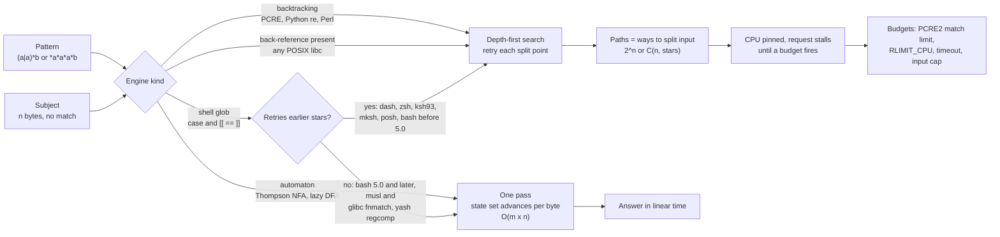

# ReDoS

> [!summary] Claim
> Regular expression denial of service happens when a matcher that explores one path at a time (a backtracking regex engine, a back-reference matcher, or a shell glob matcher that retries every earlier `*`) meets a pattern with many ways to split the same input, so a few kilobytes of hostile text cost exponential or high-degree polynomial CPU time, while an automaton matcher answers the same question in time linear in the input.

Part of [Regular Expressions and Text Processing](README.md) in [Shell and Unix Engineering](../README.md).

## TL;DR

- **Mechanism**: a backtracking matcher tries alternatives depth-first and re-examines the same input bytes once per way of splitting them, so `(a|a)*b` against `aaa...ac` costs `2^(n+4) - 10` steps in the lab's backtracker and `12n + 9` in a Thompson simulation of the same NFA.
- **Rule**: never run attacker-supplied text through a backtracking engine with an ambiguous pattern, never accept an attacker-supplied pattern into any engine without a size and CPU budget, and in shell code never write a `case` or `[[ == ]]` pattern with several `*` against unbounded input.
- **Trap**: the shell itself is a backtracking matcher: dash, zsh, ksh93, mksh, posh, and bash before 5.0 retry every earlier `*`, so a 4-star `case` pattern against 2000 bytes exhausts a 2-second CPU budget there (measured in the lab), while bash 5.x and BusyBox ash finish at once.
- **Portability fact**: POSIX puts no bound on matching cost; the same `grep -E` pattern is linear in GNU grep (DFA) and exponential in macOS grep the moment it contains a back-reference (measured: `^(a*)*\1$` doubles per byte), and POSIX defines back-references only for BREs (POSIX.1-2024 XBD 9.3.6).
- **When not to use it**: when the pattern or the input crosses a trust boundary, use `grep -F`, an automaton engine (GNU grep without back-references, ripgrep's default engine, RE2), or a real parser instead of a cleverer regex.

## Mental model



A pattern and a subject meet in an engine, and the engine kind decides the cost, not the pattern text alone.
An automaton engine keeps the set of NFA states alive at each byte, so it never visits the same (state, position) pair twice and finishes in one pass.
A backtracking engine, a back-reference matcher, and a naive glob matcher all follow one path at a time and back up on failure, so the work equals the number of ways the subject can be split among the ambiguous parts of the pattern.
That number is exponential for nested or overlapping quantifiers and `C(n, k)` for `k` independent stars, and nothing stops the search except success or an external budget: a PCRE2 match limit, `RLIMIT_CPU`, a wall-clock timeout, or a cap on input length.

## How it works

### Two ways to run the same automaton

Thompson's construction turns a regex of length `m` into an NFA with `O(m)` states whose only non-consuming edges are `Split` (try both) and `Jump` (see [[Regex-Engines-NFA-DFA-and-Backtracking]] for the construction).
The lab's `redos-steps.c` builds exactly that NFA once and runs it two ways, counting every state visit.

The backtracking run (`bt`) walks one thread: at a `Split` it recurses into the first branch and, only if the whole rest of the match fails, tries the second branch at the same input position.
For `(a|a)*b` against `a^n c`, every `a` can be consumed by either alternative, the final `c` makes every attempt fail, and the search enumerates all `2^n` assignments before it gives up.
The lab measures exactly `2^(n+4) - 10` steps, so each extra byte doubles the work.

The Thompson run (`nfa`) advances the whole set of live states in lock step and marks each state with the current generation number, so a state enters the next list at most once per byte (`addstate` in the lab, after Cox 2007).
The same input costs exactly `12n + 9` steps: one more byte adds a constant 12.
Cox's 2007 measurement of the textbook case `a?^n a^n` against `a^n` is the canonical demonstration: Perl needed "over sixty seconds to match a 29-character string" while a Thompson NFA "requires twenty microseconds" (Cox, *Regular Expression Matching Can Be Simple And Fast*, January 2007).

### What makes a pattern ambiguous

Exponential blowup needs two things at once: a quantified sub-pattern that can match the same text in more than one way, and a failure after it that forces the engine to try all of them.
The shapes are few:

- Nested quantifiers whose bodies overlap: `(a+)+`, `(a*)*`, `(\w+\s?)+`, `((a+){1,5}){1,5}`.
- Alternation with overlapping branches under a quantifier: `(a|a)*`, `(a|aa)*`, `(\d|\w)+`.
- Adjacent quantified items that can each absorb the same bytes, followed by something that fails: `.*.*=.*`, `\s+` scanned from every start position as in `[\s\u200c]+$`.
  These give polynomial, not exponential, cost: `k` overlapping `.*` give roughly `n^k`, and an unanchored search multiplies by another `n` start positions.

Without the trailing failure the same patterns are cheap: the lab shows `(a+)+b` against `a^16 b` matching in 56 backtracking steps, while `a^16 c` costs 524,281 steps and `a^17 c` 1,048,569.
That asymmetry is why ReDoS survives testing: every realistic, matching input is fast, and only the crafted near-miss is slow.

### Back-references: where POSIX engines backtrack too

A back-reference such as `\1` makes the language non-regular, so no finite automaton can recognize it, and every POSIX libc falls back to search for it.
POSIX defines back-references only for BREs: "The back-reference expression '\n' shall match the same (possibly empty) string of characters as was matched by a subexpression" (POSIX.1-2024 XBD 9.3.6), and in an ERE a backslash before an ordinary character is undefined (XBD 9.4.2); GNU, BSD, and macOS EREs accept `\1` as an extension.

- glibc `regexec` runs a lazily built DFA for the forward scan (`re_search_internal`, with `re_dfastate_t` states) and enables its fail stack in `set_regs` only when `fl_backtrack` is true, which the caller passes as `dfa->has_plural_match && dfa->nbackref > 0` (glibc `posix/regexec.c`, `set_regs` and `re_search_internal`).
- musl uses TRE: `regexec` calls `tre_tnfa_run_parallel` unless `tnfa->have_backrefs`, and then `tre_tnfa_run_backtrack` (musl `src/regex/regexec.c`).
  The macOS SDK's `_regex.h` carries TRE-specific flags ("Used internally by TRE"), and macOS `grep -E '^(a*)*\1$'` measured here grows about 4x per two extra bytes (0.38 s for 22 `a` and a final `b`, 1.50 s for 24, 6.11 s for 26, killed at 10 s for 28).
- FreeBSD's Spencer-derived libc matcher calls a recursive `backref()` for patterns with back-references (FreeBSD `lib/libc/regex/engine.c`).
- GNU grep runs `dfaexec` first and calls `re_search` only for lines where the DFA reports a possible back-reference (`backref` out-parameter in `EGexecute`, grep-3.12 `src/dfasearch.c`), and its manual warns that back-references "trigger a backtracking algorithm that can be quite inefficient", giving `^(.*)\1{14}(.*)\2{13}$` as "exponential in the worst case" (GNU grep 3.12 manual, Performance).
  GNU sed 4.10 with that pattern measured 0.056 s on an 81-byte line and 1.256 s on a 161-byte line here.

The glibc recursion that resolves back-reference limits has itself been a CVE twice: `check_dst_limits_calc_pos_1` "has Uncontrolled Recursion, as demonstrated by '(\227|)(\\1\\1|t1|\\\2537)+' in grep" (CVE-2018-20796) and by `'(|)(\\1\\1)*'` (CVE-2019-9192, disputed by the maintainer "because the behavior occurs only with a crafted pattern").

### Compile-time blowup

Counted repetition is expanded into copies of the sub-automaton, so `{n,m}` multiplies the program size before matching starts.
POSIX lets an implementation stop at `RE_DUP_MAX`, whose minimum is `_POSIX_RE_DUP_MAX` (255) (POSIX.1-2024 XBD `<limits.h>`); `getconf RE_DUP_MAX` prints 255 on macOS (measured).
Stacking repetitions defeats a per-interval limit: glibc through 2.12.2 crashed on `{10,}{10,}{10,}{10,}{10,}` because adjacent bounded repetitions "bypass the intended RE_DUP_MAX limitation" (CVE-2010-4051) and exhausted the stack on `{10,}{10,}{10,}{10,}` (CVE-2010-4052), both demonstrated through ProFTPD.
POSIX now calls multiple adjacent duplication symbols undefined (XBD 9.4.6), and the GNU grep manual notes that `grep -E ".*{10,}{10,}{10,}{10,}{10,}"` "is likely to overflow a stack".

### The shell's own matcher

Shell pattern matching (POSIX.1-2024 XCU 2.14.2) is used by `case` (XCU 2.9.4.3), by the `${var#pattern}` family (XCU 2.6.2), by `[[ == ]]`, and by pathname expansion, and POSIX says nothing about its cost.
A `*` must try every split point, and the simplest code does that by recursion:

- dash `pmatch()` (dash `src/expand.c`): at `*` it loops over every later position, skipping with `strpbrk` to the next byte that could start the rest, and calls `pmatch(p, q)` recursively on each; Debian builds dash with `--disable-fnmatch` (dash `0.5.12-12` `debian/rules`) and Alpine's `APKBUILD` passes no fnmatch option, so both use `pmatch()`.
- mksh `do_gmatch()` (mksh `misc.c`) and posh `do_gmatch()` (posh `misc.c`): `do { if (do_gmatch(s, se, p, pe ...)) return 1; } while (s++ < se);` with no shortcut.
- ksh93 hands the pattern to libast's regex engine through `regcache` and `regnexec` (ksh93u+m `src/lib/libast/string/strmatch.c`, `strngrpmatch`); the lab measures both the macOS ksh93u+ 2012 build and Debian's ksh93u+m 1.0.10 exhausting their budget.

With `k` stars and no match, such a matcher tries every way to place `k - 1` split points, roughly `C(n, k)` attempts, which the lab's `glob-naive` counts: 737 steps at `n = 10`, 8,897 at 20, 123,492 at 40, 1,837,782 at 80 for the 4-star `*a*a*a*b` (each doubling of `n` heads toward 16x, that is `n^4`).

The fix is a theorem, not a heuristic: once a later `*` has matched, backing up to an earlier `*` can only lose options, so a matcher needs to remember only the most recent star (Cox, *Glob Matching Can Be Simple And Fast Too*, 2017).
The lab's `glob-linear` does that and costs `2n + 2` steps on the same input.
Implementations that do it:

- bash 5.0 and later: the `*` case in `GMATCH` returns early with `ends->pattern` and `ends->string` set, a shortcut whose comment says it "avoids backtracking back to a previous" star and was "Picked up from glibc" (bash-5.3 `lib/glob/sm_loop.c`); the code is absent from bash-4.4 and present in bash-5.0.
- glibc `fnmatch` (`posix/fnmatch_loop.c`, the same `ends` structure) and musl `fnmatch`, where "Encountering * completes/commits a component" and a failed component only advances the string (musl `src/regex/fnmatch.c`).
- BusyBox ash defines `#define pmatch(a, b) !fnmatch((a), (b), 0)` and calls it from `patmatch()` for `case` (BusyBox `shell/ash.c`), so it inherits the libc's linear matcher.
- yash compiles a non-literal pattern into a POSIX BRE and calls `regcomp` (yash `xfnmatch.c`, `try_compile_regex`), so it inherits the libc's automaton.

Extended globs (`extglob` in bash, `KSH_GLOB` in zsh, ksh and mksh `@(...)`, `+(...)`) are not covered by the shortcut: bash's `EXTMATCH` loops over every `srest` split of the string and recurses (bash-5.3 `lib/glob/sm_loop.c`), so `+(a|aa)` style patterns keep the backtracking cost even in bash 5.

### Who backtracks, tool by tool

- GNU grep `-G` and `-E`: DFA first (`dfaexec`), GNU regex (`re_search`) only for lines with a possible back-reference or when match positions are needed (`-o`, `--color`).
- GNU sed 4.10 and gawk 5: gnulib `dfa.c` first, GNU regex after it: sed's `match_regex` calls `dfaexec` and then `re_search` (sed-4.10 `sed/regexp.c`), and gawk's `research` calls `dfaexec` with a `try_backref` out-parameter before the regex search (gawk-5.3.2 `re.c`); both finish `^(a+)+$` against 1000 `a` and a `c` in about a millisecond (GNU sed 4.9 and gawk 5.2.1 measured in the Debian image).
- ripgrep (default engine): Rust's `regex` crate, finite automata only, no back-references; `rg -P` switches to PCRE2.
- onetrue awk (macOS `awk`): a lazily built DFA (`cgoto` in `b.c`).
- mawk: a machine that pushes alternatives on an explicit run stack (`rt_push` in `rexp2.c`, `REtest`), so it backtracks: mawk 1.3.4 20250131 in the Debian image took 0.03 s for `^(a+)+$` against 20 `a` and a `c`, 6.76 s against 28, and over 10 s for `^(a|a)*b$` against 28 (measured, 2026-11).
- BusyBox grep, sed, awk: the C library's `regcomp` and `regexec` (`xregcomp` and `regexec` in BusyBox `findutils/grep.c`), so musl TRE on Alpine.
- bash `[[ =~ ]]`: `sh_regmatch` calls `regcomp(&regex, pattern, rflags)` with `rflags = REG_EXTENDED`, plus `REG_ICASE` under `nocasematch` (bash-5.3 `lib/sh/shmatch.c`), so the platform libc decides; zsh `=~` uses the `zsh/regex` module (libc) unless `RE_MATCH_PCRE` is set.
- `grep -P`, `pcre2grep`, `rg -P`, Perl, Python `re`, zsh with `RE_MATCH_PCRE`: backtracking engines.

### Budgets: how a runaway search is stopped

PCRE2 caps the work one `pcre2_match()` call may do and fails with `PCRE2_ERROR_MATCHLIMIT` (`-47`, the code `pcre2grep` and zsh print here) when the match limit is reached; the default "is 10 million, which handles all but the most extreme cases", the depth limit defaults to the match limit, and a pattern can lower but not raise either with `(*LIMIT_MATCH=ddd)` (PCRE2 10.49 `pcre2api`).
The lab's `bt` mode reproduces this: `(a|a)*b` against 30 bytes stops at exactly 1,000,000 steps with `result=limit`, where the full search would take about `2^34` steps.
GNU grep maps each PCRE2 error to a fatal diagnostic, for example "exceeded PCRE's backtracking limit" for `PCRE2_ERROR_MATCHLIMIT`, and doubles the JIT stack on `PCRE2_ERROR_JIT_STACKLIMIT` before giving up (grep-3.12 `src/pcresearch.c`, `jit_exec` and `Pexecute`).

The kernel budget is `RLIMIT_CPU`: Linux `check_process_timers` sends `SIGKILL` "At the hard limit" and `SIGXCPU` "At the soft limit", raising the soft limit by one second each time (Linux `kernel/time/posix-cpu-timers.c`).
The lab sets only the soft limit (`ulimit -S -t 2`), so a runaway shell dies of `SIGXCPU` (status 152 on Linux and macOS, signal 24) instead of `SIGKILL` (137).
posh 0.14.1 has no `ulimit` builtin at all (`ulimit: not found`, status 127, measured), so the lab sets posh's limit in a parent bash and `exec`s posh under it; resource limits survive `execve`.
A CPU budget, unlike a wall-clock `timeout`, does not fire when a loaded machine simply delays the process, which is why the lab can use a 2-second budget: the 4-star workload is far beyond it for a backtracking shell (the 3-star case already takes 0.78 s in dash at 1000 bytes, and one more star multiplies the work by roughly `n / 4`), and far below it for a linear one.

## Numbers and limits

| Quantity | Value | Source |
| --- | --- | --- |
| Backtracking steps, `(a\|a)*b` vs `a^n c` | `2^(n+4) - 10` (16,777,206 at `n = 20`) | lab `redos-table.sh` |
| Thompson steps, same input | `12n + 9` (249 at `n = 20`) | lab |
| Naive glob steps, `*a*a*a*b` vs `a^n` | 737, 8,897, 123,492, 1,837,782 at `n` = 10, 20, 40, 80 | lab |
| Linear glob steps, same input | `2n + 2` | lab |
| 4-star `case` vs 2000 bytes, 2 CPU s budget | `SIGXCPU` in bash 3.2.57, dash, zsh 5.9.2, `zsh --emulate sh`, ksh93u+ 2012; `nomatch` in 0.04 s in bash 5.3.15; in the Linux images `SIGXCPU` in mksh, posh, ksh93u+m 1.0.10 and `nomatch` in BusyBox ash and yash 2.58.1 | measured on macOS host and in the Debian and Alpine images, 2026-11 |
| 3-star `case` at `n` = 250, 500, 1000 | dash 0.03, 0.05, 0.78 s; ksh93u+ 0.05, 0.23, 4.93 s; bash 3.2 0.02, 0.04, 0.29 s | measured on macOS host, 2026-11 |
| Python 3.15.2 `re`, `^(a+)+$` vs `a^n b` | 0.17 s at 22, 0.69 s at 24, over 10 s at 28 | measured, 2026-11 |
| Perl 5.34.1 | `^(a+)+$` 0.03 s at 28 (optimized); `^((a+){1,5}){1,5}$` over 15 s at 20 | measured, 2026-11 |
| PCRE2 defaults | match limit 10,000,000; depth limit 10,000,000; heap limit 20,000,000 KiB; parentheses nest limit 250 | `pcre2test -C`, PCRE2 10.49 (as of 2026-11) |
| `RE_DUP_MAX` | POSIX minimum `_POSIX_RE_DUP_MAX` = 255; macOS 255 | POSIX.1-2024 `<limits.h>`; measured |
| Minimum RE length an implementation must accept | 256 bytes | POSIX.1-2024 XBD 9.2 |
| Cloudflare 2019 outage | deployed 13:42 UTC, down 27 minutes; `.*.*=.*` costs 23 steps on `x=x`, 555 on `x=` plus 20 `x`, 4,067 on 20 `x` without `=` | Cloudflare postmortem, 2019-07-12 |
| Stack Overflow 2016 outage | about 20,000 consecutive whitespace characters, 34 minutes, "199,990,000 checks" | Stack Overflow postmortem, 2016-07-20 |
| Glob blowup in the wild | `ls (a*)^8 b` in a directory holding `a^100`: 7.19 minutes | Cox 2017 |
| Ecosystem incidence | "thousands of super-linear regexes affecting over 10,000 modules" in the JavaScript and Python ecosystems | Davis et al., ESEC/FSE 2018 |

## Portability

| Shell or tool | `case` and `[[ == ]]` matcher | 4-star `case`, 2000 bytes, 2 CPU s | Regex engine for `=~` or the tool |
| --- | --- | --- | --- |
| POSIX sh | XCU 2.14.2 defines what matches, not the cost | unspecified | no `=~`; `grep`, `sed`, `awk` are utilities |
| bash 3.2 (macOS `/bin/sh`) and 4.x | recursive `GMATCH`, retries earlier stars | `SIGXCPU` (lab, 3.2 measured; 4.4 by source) | libc `regcomp` with `REG_EXTENDED` |
| bash 5.0 to 5.3 | `GMATCH` with the `ends` shortcut | `nomatch` (lab, 5.3 measured) | libc `regcomp` with `REG_EXTENDED` |
| zsh native and `--emulate sh` | `pattern.c` backtracking | `SIGXCPU` (lab, measured) | `zsh/regex` (libc), or PCRE2 with `RE_MATCH_PCRE` |
| dash | `pmatch()` recursion (Debian and Alpine builds) | `SIGXCPU` (lab, measured) | none |
| ksh93 | libast regex via `strngrpmatch` | `SIGXCPU` (lab, ksh93u+ 2012 and ksh93u+m 1.0.10 measured) | libast regex |
| mksh, posh | `do_gmatch()` recursion | `SIGXCPU` (lab, measured; posh has no `ulimit`, so a parent bash sets the limit) | none |
| yash | `regcomp` on a translated BRE | `nomatch` (lab, 2.58.1 on Alpine measured) | none |
| BusyBox ash | libc `fnmatch()` | `nomatch` (lab, measured on musl and glibc) | none |
| GNU grep, sed, gawk | | | DFA, GNU regex only for back-references |
| macOS and FreeBSD grep, sed | | | libc regex (TRE on macOS, Spencer on FreeBSD); back-references backtrack (macOS measured) |
| BusyBox grep, sed, awk | | | libc regex (TRE on musl) |
| onetrue awk, mawk | | | lazy DFA (`b.c`); backtracking run stack (`rexp2.c`), exponential on `^(a+)+$` (mawk 1.3.4 measured) |
| ripgrep 15.2.0 | | | finite automata by default; `-P` uses PCRE2 and exits 2 on "match limit exceeded" (measured) |
| `pcre2grep` 10.49 | | | PCRE2 with JIT; reports error -47 but keeps going and exits 0 if another line matched (measured) |
| uutils sed | | | Rust `regex` crate (finite automata) unless the pattern contains `\1` to `\9`, which switches to `fancy-regex` (a backtracking engine); read in `src/sed/fast_regex.rs` (as of 2026-11) |

## Worked example

The [lab](../labs/07-redos/) has three parts: `redos-steps.c` counts the work of the two regex strategies and the two glob strategies, `redos-table.sh` prints the growth, and `glob-case.sh` runs a real multi-star `case` pattern under a CPU budget in the shell under test.

`glob-case.sh` (the lab file, verbatim):

```sh
#!/bin/sh
# glob-case.sh MODE N K CPU_SECONDS [SUFFIX]
# Builds a subject of N 'a' bytes followed by SUFFIX (default empty), then asks whether it matches the
# shell pattern made of K copies of '*a' followed by '*b' (K + 1 stars in all).
#   MODE multi : one 'case' with the whole multi-star pattern (the shell's own matcher)
#   MODE commit: the same question answered one star at a time with ${var#*a},
#                committing to the leftmost 'a' each time, then one '*b' test
# The shell runs under a soft CPU-time limit of CPU_SECONDS (core dumps off), so a
# matcher that backtracks across stars is killed by SIGXCPU instead of hanging.
# Prints "match" or "nomatch" when it finishes.

mode=$1 n=$2 k=$3 cpu=$4 suffix=${5-}

# posh 0.14.1 has no ulimit builtin: there the caller must set the CPU limit
# before starting the shell (the lab's test does it from bash).
if command -v ulimit >/dev/null 2>&1; then
  ulimit -c 0
  ulimit -S -t "$cpu" || exit 4
fi

s= i=0
while [ "$i" -lt "$n" ]; do
  s=${s}a
  i=$((i + 1))
done
s=$s$suffix

case $mode in
  multi)
    p= i=0
    while [ "$i" -lt "$k" ]; do
      p="$p*a"
      i=$((i + 1))
    done
    p="$p*b"
    # eval makes every shell treat $p as a pattern (native zsh would not glob an
    # unquoted expansion in a case pattern).
    eval "case \$s in $p) echo match ;; *) echo nomatch ;; esac"
    ;;
  commit)
    rest=$s i=0
    while [ "$i" -lt "$k" ]; do
      case $rest in
        *a*) rest=${rest#*a} ;;
        *)
          echo nomatch
          exit 0
          ;;
      esac
      i=$((i + 1))
    done
    case $rest in
      *b) echo match ;;
      *) echo nomatch ;;
    esac
    ;;
  *)
    echo "usage: glob-case.sh multi|commit N K CPU_SECONDS [SUFFIX]" >&2
    exit 2
    ;;
esac
```

The `commit` mode is Cox's algorithm written by hand: `${rest#*a}` removes the shortest prefix ending in `a`, which is the leftmost choice for that star, and the answer is the same because a later star can only use a suffix, and the leftmost choice leaves the longest one.
It is not linear in every shell: dash's `scanleft` calls `pmatch` once per prefix length (dash `src/expand.c`), so one strip costs up to the square of the distance to the next `a` (measured in dash 0.5.13.5 on the macOS host: 0.11, 0.39, 1.51 s for 10,000, 20,000, 40,000 bytes), but that is `k x n^2` for the whole check instead of `n^(k+1)`, and here every `a` is adjacent.
For a strictly linear check in a script, hand the line to `awk` and use `index()`, or to `grep -E`.

Captured on the macOS host (`/bin/bash` is 3.2.57, `bash` is 5.3.15):

```text
$ /bin/bash glob-case.sh multi 2000 3 2; echo "status=$?"
status=152
$ bash glob-case.sh multi 2000 3 2; echo "status=$?"
nomatch
status=0
$ dash glob-case.sh commit 2000 3 2; echo "status=$?"
nomatch
status=0
```

`redos-table.sh` against the compiled counter prints (captured; the lab asserts every line):

```text
n              bt    nfa
8            4086    105
12          65526    153
16        1048566    201
20       16777206    249
n      glob-naive linear
10            737     22
20           8897     42
40         123492     82
80        1837782    162
```

Every four extra bytes multiply the backtracking column by 16 and add 48 to the NFA column; each doubling of `n` multiplies the naive glob column by 12, 14, then 15 (approaching the `n^4` limit of 16) and the linear column by 2.

## Pitfalls

> [!warning] Nested or overlapping quantifiers in a backtracking engine
> Trigger: `(a+)+`, `(\w+\s?)+`, `(a|aa)*`, or bounded nests like `((a+){1,5}){1,5}` in PCRE2, Python `re`, Perl, `grep -P`, `rg -P`.
> Symptom: fast on every test input, then one near-miss input pins a core; Python 3.15 `re` needs over 10 s for `^(a+)+$` against 28 `a` and a `b` (measured).
> Fix: remove the ambiguity (`a+` instead of `(a+)+`), use possessive or atomic forms (`(?>a+)`, `a++`; in Python since 3.11, "Contributed by Jeffrey C. Jacobs and Serhiy Storchaka in bpo-433030"), or switch to an automaton engine.
> Python's `urllib.request.AbstractBasicAuthHandler` shipped such a pattern and became CVE-2020-8492 (ReDoS from a malicious HTTP server against the client).

> [!warning] Chains of `.*` and suffix scans
> Trigger: `.*(?:.*=.*)` or `[\s\u200c]+$` searched without an anchor in a backtracking engine.
> Symptom: polynomial blowup that looks fine in review; Cloudflare's WAF rule pinned CPUs "to nearly 100% usage across the servers in our network" for 27 minutes on 2019-07-02, and Stack Overflow went down for 34 minutes in 2016 on a post with about 20,000 consecutive whitespace characters (Stack Overflow postmortem, 2016-07-20).
> Fix: anchor and make the pieces disjoint (`[^=]*=`), trim with string functions (Stack Overflow replaced the regex "with a substring function"), and keep a CPU guard (Cloudflare's root causes include that "A protection that would have helped prevent excessive CPU use by a regular expression was removed by mistake").

> [!warning] Back-references turn a POSIX tool into a backtracker
> Trigger: `\1` in `grep`, `sed`, `[[ =~ ]]`, or `expr` patterns, especially on macOS and musl, where TRE switches to `tre_tnfa_run_backtrack`.
> Symptom: `grep -E '^(a*)*\1$'` on macOS takes 6 s on a 27-byte line of 26 `a` and a `b` (measured); glibc's back-reference path has crashed on crafted patterns (CVE-2018-20796, CVE-2019-9192).
> Fix: do the equality check outside the regex (`awk` with `substr` and `==`), or match each candidate with a back-reference-free regex and compare captures.

> [!warning] Multi-star shell patterns on untrusted strings
> Trigger: `case $line in *ERROR*user=*id=*)` or `[[ $x == *a*b*c* ]]` in dash, zsh, ksh93, mksh, posh, or bash before 5.0, applied to long input.
> Symptom: the script stalls inside one `case`, cost grows like `n^k`; the lab kills such a shell with `SIGXCPU` after 2 CPU seconds on 2000 bytes.
> Fix: hand the line to `grep -E` or to `awk` with `index()`, or commit one star at a time with `${var#*literal}` as in the lab's `commit` mode (quadratic at worst in dash, never `n^k`).

> [!warning] Attacker-controlled glob patterns
> Trigger: FTP `LIST` and `STAT` arguments, `find -name "$user_input"`, or any `glob(3)` call fed from the network.
> Symptom: CVE-2010-2632 (Solaris FTP, "crafted glob expressions that do not match any pathnames"), CVE-2015-5917 (tnftpd on OS X, "multiple instances of the {..,..,..}/* substring"); Cox measured 7.19 minutes for `ls (a*)^8 b` against one 100-byte name and found BSD libc glob exponential.
> Fix: cap the number of stars and the pattern length before calling `glob`, as Pure-FTPd 1.0.46 did by rejecting patterns with more than three stars (Cox 2017), or use a linear matcher.

> [!warning] Counted repetition multiplies before matching starts
> Trigger: `x{1000}{1000}` or `(a{1,100}){1,100}` from an untrusted source.
> Symptom: compile-time memory or stack exhaustion (glibc CVE-2010-4051 and CVE-2010-4052, demonstrated with `{10,}` chains).
> Fix: reject adjacent duplication symbols (POSIX makes them undefined), bound pattern length, and compile under a memory limit.

> [!warning] A plain `ulimit -t` on Linux sends SIGKILL
> Trigger: `ulimit -t 2` in bash or dash sets both the soft and the hard limit.
> Symptom: Linux checks the hard limit first and sends `SIGKILL` (status 137) with no chance to report, not `SIGXCPU` (`check_process_timers`).
> Fix: `ulimit -S -t N` when the process or its parent should see `SIGXCPU` first.

> [!warning] A budget that fails open
> Trigger: relying on PCRE2's match limit to stop ReDoS in a filter.
> Symptom: `pcre2grep` prints error -47 for the hostile line and keeps going, so a count of matching lines silently omits it (measured exit 0); `rg -P` instead abandons the whole file with exit status 2, and GNU grep `-P` dies with "exceeded PCRE's backtracking limit".
> Fix: decide whether a budget hit means reject or allow, and test that path; a security filter must fail closed.

## Security and robustness

ReDoS is CWE-1333, "Inefficient Regular Expression Complexity": "The product uses a regular expression with a worst-case computational complexity that is inefficient and possibly exponential."
Two threat models need different defenses.

When the attacker controls the subject and you control the pattern, the fix lives in the pattern and the engine:

- Prefer an engine with a linear-time guarantee (GNU grep or sed without back-references, ripgrep's default engine, RE2) for anything that sees network input.
- In a backtracking engine, make alternatives and adjacent quantifiers disjoint, and use possessive quantifiers or atomic groups where the engine has them.
- Cap input length before matching (`head -c`, `cut -c`, `awk 'length($0) <= 4096'`): a polynomial blowup on a bounded input is a bounded cost.
- Test with the near-miss input, not with valid input: the slow case is the long almost-match.

When the attacker controls the pattern (search boxes, `grep -e "$q"`, FTP globs), no rewrite helps, so constrain the request:

- Treat literal searches as literals: `grep -F -e "$q"` and `rg -F`, never `grep "$q"`.
- Reject back-references, lookaround, and adjacent duplication symbols, and cap pattern length and star count before compiling.
- Run the match in a process with `RLIMIT_CPU` and `RLIMIT_AS`, or under `timeout`, and decide in advance whether a budget hit means deny.
- Lower PCRE2's limits per call (`pcre2_set_match_limit`, `--match-limit` in `pcre2grep`, `(*LIMIT_MATCH=N)` in the pattern) to a value sized for the expected input, not the 10,000,000 default, which allows that many steps for every line.

Budgets are per call: a limit of 10,000,000 steps on each of a million lines is still 10^13 steps, so a line-oriented filter also needs a whole-job CPU limit.

## The principal's view

The decision is which engine class is allowed to touch untrusted text, and it should be made once, as policy, not pattern by pattern in review.
Automaton engines give up back-references and arbitrary lookaround and in exchange make cost a function of input length alone, which is the property a service needs to state a latency bound at all.
Backtracking engines buy expressiveness with a cost that depends on the pattern, the input, and engine-internal optimizations that differ by version (Perl 5.34 handles `(a+)+` and still hangs on nested `{1,5}`), so their worst case is unknowable from the source without analysis.
The trade-off is real: moving a rule set from PCRE to RE2 or Rust `regex` means rewriting every rule that uses back-references or lookaround, which is why Cloudflare's remediation list marks re-introducing the CPU guard "(Done)" while the engine switch carries an ETA of July 31.
In shell code the same choice is hidden in `case`: a script that pattern-matches log lines with several `*` is fine in bash 5 and BusyBox and a denial-of-service in dash and zsh, so either pin the interpreter or move the match into `grep -E` or `awk`.
Use a parser, not a regex, when the format is nested or quoted (JSON, CSV with quotes, HTTP headers with folded lines), and use a compiled language with a linear engine when a filter is on a request path with a latency budget.

## Interview questions

> [!question] L5: Why is `(a+)+b` dangerous in Python but harmless in GNU `grep -E`?
>
> > [!success]- Answer
> > Python's `re` backtracks: on `aaa...ac` it tries every way to split the run of `a` among iterations of the outer `+`, which is exponential in the length.
> > GNU grep compiles the same ERE to a DFA and scans each byte once, falling back to GNU regex only for back-references.
> > The pattern is the same language in both; only the execution strategy differs.
> >
> > Follow-up: Which single change to the pattern removes the problem in Python without changing what it matches?

> [!question] L5: Why does ReDoS survive a passing test suite and then pin a CPU in production on one request?
>
> > [!success]- Answer
> > Matching inputs end the search on the first successful path, so they are fast even for an ambiguous pattern.
> > Only a long near-miss forces the engine to exhaust every split before failing.
> > Test suites contain valid inputs and short invalid ones, so the expensive case never appears.
> >
> > Follow-up: How would you generate the near-miss input for a given pattern?

> [!question] L6: Predict the output: given that `redos-steps bt '(a|a)*b' a 20 c` prints `steps=16777206 result=nomatch`, what do `bt` and `nfa` print for `n = 24`?
>
> > [!success]- Answer
> > The backtracking count is `2^(n+4) - 10`, so a full search would take `2^28 - 10 = 268435446` steps.
> > That exceeds the program's default `LIMIT` of 100000000, so `bt` stops and prints `steps=100000000 result=limit` with exit status 3, the same way PCRE2 reports a match-limit error instead of an answer.
> > The Thompson count is `12n + 9`, so `nfa` prints `steps=297 result=nomatch`.
> > Four more bytes multiply the backtracking work by 16 and add 48 to the NFA work, so a fixed budget is crossed after only a few more bytes.
> >
> > Follow-up: What is the smallest `LIMIT` that lets `bt` print the full count for `n = 24`?

> [!question] L6: Debug this script, which filters a log and hangs on one 50 KB line under `/bin/sh` on Debian but not when the developer runs it with bash 5.
>
> ```sh
> while IFS= read -r line; do
>   case $line in
>     *ERROR*user=*session=*expired*) printf '%s\n' "$line" ;;
>   esac
> done < app.log
> ```
>
> > [!success]- Answer
> > Debian's `/bin/sh` is dash, whose `pmatch()` retries every earlier `*`, so a long line containing `ERROR` and `user=` but no `expired` costs on the order of `n^4` attempts.
> > bash 5 keeps only the last star's restart point and answers in linear time, so the script works there.
> > The best fix replaces the loop with `grep -E 'ERROR.*user=.*session=.*expired' app.log`, which runs a DFA once over the file.
> > Inside the shell, committing one star at a time (`rest=${line#*ERROR}`, then `${rest#*user=}`, and so on) removes the `n^4` term.
> >
> > Follow-up: What is the worst-case cost of `${line#*ERROR}` in dash, given that its `scanleft` calls `pmatch` once per prefix length?

> [!question] L6: Why does POSIX make back-references BRE-only, and why do they force backtracking even in libc engines?
>
> > [!success]- Answer
> > A back-reference matches whatever an earlier group matched, which can express languages like `ww` that no finite automaton recognizes.
> > XBD 9.3.6 defines `\n` for BREs, and XBD 9.4.2 leaves a backslash before an ordinary ERE character undefined, so ERE `\1` is an extension.
> > glibc enables its fail stack only when the pattern has back-references, and musl's TRE switches from `tre_tnfa_run_parallel` to `tre_tnfa_run_backtrack` for them.
> >
> > Follow-up: How would you check that a line is two copies of the same string in `awk` without a back-reference?

> [!question] L6: Is a filter that uses PCRE2 with the default match limit ReDoS-safe?
>
> > [!success]- Answer
> > No: the limit is per `pcre2_match` call and defaults to 10,000,000, so each hostile line can still burn that much work, and a million lines multiply it.
> > What happens at the limit is a policy choice the caller must make: `pcre2grep` reports error -47 and continues, `rg -P` abandons the file, and GNU grep exits.
> > Lower the limit for the expected input size, add a whole-job CPU budget, and decide whether a limit hit is a reject.
> >
> > Follow-up: How does `(*LIMIT_MATCH=N)` interact with a limit the caller set?

> [!question] L7+: How do you remove ReDoS risk from a WAF with 4,000 PCRE rules without a flag day?
>
> > [!success]- Answer
> > Put a per-request CPU guard in front first, so a bad rule degrades one request instead of the fleet.
> > Classify rules by whether they need back-references or lookaround; compile every rule that does not with an automaton engine (RE2 or Rust `regex`) and run both engines in shadow, comparing verdicts.
> > Rewrite or isolate the remainder, add a CI gate that runs each rule against generated near-miss inputs with a step budget, and stage rule deployment so one rule cannot reach every server at once.
> > Cloudflare's 2019 postmortem lists the same ingredients: the removed CPU protection, profiling rules, and moving to "the re2 or Rust regex engine which both have run-time guarantees".
> >
> > Follow-up: Which rules can an automaton engine not express, and what do you do with them?

> [!question] L7+: Explain why remembering only the last `*` is enough for a correct glob matcher.
>
> > [!success]- Answer
> > Suppose stars `s1` before `s2`, and the matcher has found a placement where the text between them matches and `s2` is at some position.
> > Moving `s1` to a later split only shortens what is left for the rest of the pattern, and any match the rest could make from a later point it can also make by letting `s2` absorb the difference.
> > So after a later star commits, revisiting an earlier star cannot find a match the later star's own retries would miss, and the cost drops from `C(n, k)` to `O(n x m)`.
> > bash 5's `ends` shortcut, glibc and musl `fnmatch`, and the lab's `glob-linear` all rely on this.
> >
> > Follow-up: Why does the argument break for extended globs such as `+(a|aa)`?

> [!question] L5: What is the difference between a CPU limit and a timeout as a ReDoS guard?
>
> > [!success]- Answer
> > `RLIMIT_CPU` counts CPU time the process actually used, so a slow or overloaded machine does not trip it early, and the kernel delivers `SIGXCPU` at the soft limit and `SIGKILL` at the hard one.
> > A wall-clock timeout also catches a process blocked on I/O, but it can fire on a healthy process that was merely descheduled.
> > Use the CPU limit to bound runaway matching and a timeout to bound total latency.
> >
> > Follow-up: Why does `ulimit -t 2` on Linux end a shell with status 137 rather than 152?

## Related

Prerequisites: [[Regex-Engines-NFA-DFA-and-Backtracking]]

Next: [[grep-in-Depth]]

See also: [[Regex-Engines-Automata-Backtracking-and-ReDoS]], [[Drill-Command-Line-Catastrophic-Backtracking-and-Stream-Bottleneck]], [[BRE-ERE-and-PCRE]], [[ripgrep-Internals]], [[POSIX-Leftmost-Longest-Matching]]

## Further reading

- Russ Cox, *Regular Expression Matching Can Be Simple And Fast* (2007), https://swtch.com/~rsc/regexp/regexp1.html - the Thompson NFA versus backtracking measurement everyone cites.
- Russ Cox, *Glob Matching Can Be Simple And Fast Too* (2017), https://research.swtch.com/glob - the shell and libc glob survey and the one-star restart algorithm.
- POSIX.1-2024 XBD Chapter 9, https://pubs.opengroup.org/onlinepubs/9799919799/basedefs/V1_chap09.html - what BREs and EREs must match, including back-references (9.3.6) and undefined adjacent duplication (9.4.6).
- POSIX.1-2024 XCU 2.14, https://pubs.opengroup.org/onlinepubs/9799919799/utilities/V3_chap02.html - shell pattern matching notation, used by `case` and `${var#pattern}`.
- Cloudflare, *Details of the Cloudflare outage on July 2, 2019*, https://blog.cloudflare.com/details-of-the-cloudflare-outage-on-july-2-2019/ - a production ReDoS with step counts and the remediation plan.
- PCRE2 `pcre2api`, https://www.pcre.org/current/doc/html/pcre2api.html - match, depth, and heap limits and how a pattern can lower them.
- GNU grep 3.12 manual, Performance and Known Bugs (in `doc/grep.texi` of https://ftpmirror.gnu.org/grep/grep-3.12.tar.xz) - why back-references are exponential in grep.
- Davis, Coghlan, Servant, Lee, *The Impact of Regular Expression Denial of Service (ReDoS) in Practice*, ESEC/FSE 2018, https://par.nsf.gov/servlets/purl/10105720 - how common super-linear regexes are and how developers fix them.
- `perlre` and `perlretut` (perl 5.34.1, `perldoc perlre`) - Perl's own warning that "these internal optimizations are not always applicable".
- CWE-1333, https://cwe.mitre.org/data/definitions/1333.html - the weakness class and its observed CVEs.
