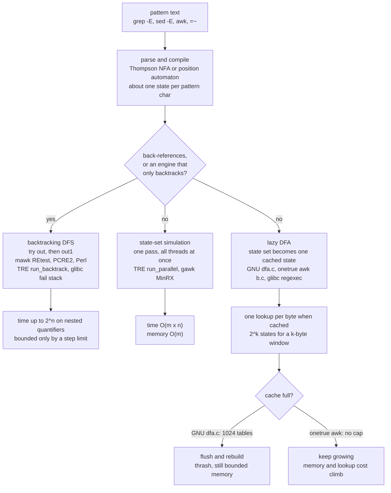

# Regex Engines NFA DFA and Backtracking

> [!summary] Claim
> Every Unix text tool compiles a pattern into the same kind of automaton but runs it one of three ways (backtracking through it, simulating its state set, or caching that set as a lazy DFA), and which one your `grep`, `sed`, or `awk` uses decides whether a pattern costs microseconds, minutes, or gigabytes.

Part of [Regular Expressions and Text Processing](README.md) in [Shell and Unix Engineering](../README.md).

## TL;DR

- Mechanism: a pattern becomes a Thompson NFA of about one state per pattern character; a backtracker explores its paths depth first, a Thompson or parallel simulator advances the whole state set per byte, and a lazy DFA caches each state set it meets as one deterministic state.
- Rule: a backtracker is exponential on nested or overlapping quantifiers, a simulator is linear but pays per active state, and a DFA is one table lookup per byte until the pattern needs more states than its cache holds.
- Trap: a back-reference silently moves even a POSIX tool onto a backtracking path (TRE's `tre_tnfa_run_backtrack`, GNU grep's fallback to regex), and Debian's default `awk`, mawk, backtracks on every pattern.
- Portability fact: the engine is a property of the utility and its C library, not of the shell: the same `grep -E` is GNU `dfa.c` on Debian, BusyBox over musl's TRE on Alpine, and FreeBSD grep over Apple's TRE on macOS.
- When not to use it: do not feed untrusted patterns, or patterns with back-references, nested quantifiers, or long counted windows, to any of these tools on untrusted input; use a linear-time engine with a memory budget (RE2, Rust `regex`, ripgrep) or a real parser.

## Mental model



The pattern is compiled once into an automaton whose size is linear in the pattern.
The diamond is the decision every implementation makes, statically, from the pattern and its own design: TRE and glibc look for back-references at compile time, GNU `dfa.c` reports a back-reference as a "semi-success" at run time, and mawk, PCRE2 and Perl take the left branch for every pattern.
The left branch explores one path at a time and pays for every alternative path it rejects, which is exponential when quantifiers nest.
The middle branch pays for every active state on every byte, so its time is the pattern size times the input size, never worse.
The right branch pays once per distinct state set it meets and then one lookup per byte, which is the fastest path until the pattern forces more distinct sets than the cache allows: GNU `dfa.c` then flushes and rebuilds (bounded memory, lost speed), and onetrue awk keeps allocating (bounded speed loss per state, unbounded memory).

## How it works

### One automaton, three ways to run it

POSIX defines what a regular expression matches, not how: the whole match is "the longest of the leftmost matches", and each subpattern, left to right, "shall match the longest possible string" `(POSIX.1-2024 XBD 9.1)`.
Ken Thompson's 1968 construction turns the pattern into an NFA with "at most" as many states as the pattern has characters, joined by single-character arrows and empty `Split` arrows, and Thompson's own implementation compiled it to IBM 7094 machine code for the QED editor (Russ Cox, regexp1).
The lab's `engines.c` builds exactly this NFA for a small syntax: `(a+)+b` is 5 states (a `CHAR a`, two `SPLIT`s, a `CHAR b`, and `MATCH`), and `x|xy` is also 5.

The three run strategies differ only in how they handle a `Split`:

- Backtracking takes the first arrow, remembers the second, and returns to it when the first path fails.
  It finds the first match in priority order (Perl's leftmost-first rule), needs no more memory than its recursion stack, and can implement back-references, because each path carries its own record of what each group matched.
  Its cost is the number of paths it tries: for `(a+)+b` against `n` bytes of `a`, the lab counts exactly `5 * 2^n - 4` steps.
- Simulation follows both arrows at once, keeping the set of NFA states reachable after each byte, with a generation mark so a state enters the set at most once per byte.
  It reads each input byte once and touches each NFA state at most once per byte, so its cost is at most `m x n` for `m` states and `n` bytes: the lab counts `4n + 1` steps for the same pattern.
  Because it ends with every surviving thread, it finds the longest match naturally, which is the POSIX rule.
- A lazy DFA notices that the state set is a function of the previous set and the byte, so it gives each distinct set a number and caches the transition table entry the first time it computes it.
  After warm-up each byte costs one table lookup, but a pattern that must remember a window of `k` bytes, such as `(a|b)*a(a|b)` followed by `k-2` more `(a|b)`, needs `2^k` distinct sets: the lab's DFA builds exactly 16, 256, 1024 and 4096 states for `k` = 4, 8, 10 and 12 over 100,000 random `a`/`b` bytes.

A memoized backtracker sits between the first two: the lab's `memo` mode keeps a bitmap of `(state, position)` pairs already tried, and since a pair that succeeded would have ended the search, a revisited pair can be pruned, which turns the exponential count back into `4n + 1`.
That is the idea behind RE2's BitState and Rust's bounded backtracker (see [[Regex-Engines-Automata-Backtracking-and-ReDoS]]), and it fails as soon as back-references make the outcome of a pair depend on what the groups captured.

### Why back-references force backtracking

A back-reference such as `\1` matches "the same (possibly empty) string" its group matched `(POSIX.1-2024 XBD 9.3.6)`, so a state is no longer just a position in the pattern: it is a position plus the captured text, and no finite automaton can hold arbitrary captured text.
Cox notes that the matching problem with back-references is NP-complete and that "no one knows how to implement regular expressions with backreferences efficiently" (regexp1).
POSIX gives back-references only to BREs: the `BACKREF` token is "Applicable only to basic regular expressions" `(POSIX.1-2024 XBD 9.5.1)`, and the ERE grammar has none `(POSIX.1-2024 XBD 9.5.3)`, although GNU, musl and Apple libcs accept `\1` in an ERE as an extension.
The GNU grep manual says it plainly: back-references "cannot in general be implemented via a finite state automaton, and instead trigger a backtracking algorithm that can be quite inefficient", using an algorithm "exponential in the worst case" (grep-3.12 doc/grep.texi, node Performance).

### GNU grep: four engines in a pipeline

GNU grep never runs one engine on everything; `EGexecute` in grep-3.12 src/dfasearch.c runs a cascade per buffer:

1. `kwsexec`: a fixed-string search (Boyer-Moore for one string, Aho-Corasick for several, per the manual) for the literals the pattern must contain; with no hit, the buffer is skipped.
2. The superset DFA from `dfassbuild` (grep-3.12 lib/dfa.c), in which every back-reference and multibyte set is replaced by "any byte, repeated", so it can reject lines quickly even when the real pattern is outside the DFA's reach.
3. `dfaexec` on the real DFA, which sets `*backref` when it meets a token it cannot handle; a `BACKREF` token is "generated by \<digit> or by any other construct that is not completely handled", and the scanner then returns "a kind of semi-success" (lib/dfa.c, `enum dfa_state` comment).
4. Only when `backref` is set, or when grep needs exact match boundaries (`print_line_middle` in src/grep.c passes a start pointer for `-o` and `--color`), `re_search` from the C library's regex runs on the single candidate line.

The DFA itself is a position automaton: `dfaanalyze` computes `nullable`, `firstpos`, `lastpos` and `follow` sets per node (the comment block before it in lib/dfa.c), and each DFA state is a set of positions.
States are built lazily in `build_state` and the per-state transition tables are capped: `enum { MAX_TRCOUNT = 1024 };` with the comment that it is "an arbitrary upper limit on the number of transition tables that can exist at once, other than for initial states", after which every non-initial table is freed (lib/dfa.c, `build_state`), and `dfaexec_main` also frees every non-initial state once `MAX_TRCOUNT <= d->sindex`.
The same `dfa.c` from gnulib is in sed-4.9 (`sed/regexp.c` calls `dfasuperset`, `dfaexec`, then `re_search`) and in gawk 5.4.1 (`research` in re.c), so all three thrash the same way.

### glibc regex: a lazy DFA that logs, sifts, and backtracks only for back-references

glibc's `regexec` and gnulib's copy (grep-3.12 lib/regexec.c, the same code) are not backtrackers for ordinary patterns.
`re_search_internal` runs forward through lazily built DFA states (`transit_state` uses `state->trtable`, filled by `build_trtable` on first use), trying start positions left to right (glibc posix/regexec.c).
When the caller wants submatches (`nmatch > 1`) or the pattern has multibyte or back-reference nodes, it keeps a `state_log` of one state pointer per input byte (`re_malloc (re_dfastate_t *, mctx.input.bufs_len + 1)`), then `sift_states_backward` prunes it from the match end, and `set_regs` walks it forward to fill the registers.
`set_regs` creates a fail stack (`push_fail_stack`, `pop_fail_stack`) only when called with `fl_backtrack`, which `re_search_internal` passes as `dfa->has_plural_match && dfa->nbackref > 0`: the backtracking is confined to back-reference patterns.
That confinement is why GNU grep 3.12 on the host finished `^(a|aa)*\1c$` on 42 bytes in under 0.01 s while TRE needed 22 s (Numbers below); the sibling note measured glibc at 17.7 s on a 96-byte subject for a five-group back-reference pattern (Debian image, bash 5.2.37, 2026-11-12; [[Bash-Regex-and-BASH_REMATCH]]), so glibc is still exponential-prone, just on different patterns.

### TRE: musl, macOS, and every tool that calls their regexec

TRE, by Ville Laurikari, is the regex in musl (src/regex/regexec.c) and in Apple's Libc (regex/TRE/lib/regexec.c); the macOS SDK's `_regex.h` carries his copyright and defines `REG_BACKTRACKING_MATCHER`.
Its matcher choice is one `if`: "if (tnfa->have_backrefs)" it calls `tre_tnfa_run_backtrack`, otherwise `tre_tnfa_run_parallel` (musl `regexec`; Apple's `tre_match` adds `|| eflags & REG_BACKTRACKING_MATCHER`).
The parallel matcher is a tagged-NFA simulation whose comment promises that the worst case "is always linearly dependent on the length of the text being searched" and that it "cannot handle TNFAs with back referencing nodes" (tre-match-parallel.c).
Everything that reaches libc `regcomp` inherits this split: BSD grep and sed on macOS, BusyBox `grep` (`xregcomp`, `regexec` in findutils/grep.c), BusyBox `sed` (editors/sed.c), BusyBox `awk` (editors/awk.c), bash `[[ =~ ]]` (`regcomp (&regex, pattern, rflags)` with `REG_EXTENDED` in bash-5.3 lib/sh/shmatch.c, `sh_regmatch`), zsh's `zsh/regex` module (`zcond_regex_match` in Src/Modules/regex.c), and BusyBox's `[[` test applet (`regcomp(&re_buffer, opnd2, REG_EXTENDED)` in coreutils/test.c).

### awk: three engines behind one name

- onetrue awk ("version 20250804" in FreeBSD contrib, "version 20200816" on macOS) builds a DFA lazily from positions: `mkdfa` "put[s] ALL STAR in front of reg. exp." so one pass finds unanchored matches, and `cgoto` computes a new state's position set, then scans every existing state ("tmpset == previous state?") before adding it (b.c).
  There is no state cap: `resize_state` grows the tables by 10 states at a time (the `NSTATES 32` macro is still defined in awk.h but unused in b.c), so Cox's 2007 description of awk's "fixed limit of 32 cached states" no longer holds.
  Each new state in 20250804 callocs `NCHARS` = 1259 `gtte` entries of two `unsigned int`s, about 10 KB; 20200816 callocs 259 `unsigned int`s, about 1 KB.
- gawk 5.4 "now uses Mike Haertel's MinRX regular expression matcher as the default regexp engine" (gawk-5.4.1 NEWS); setting `GAWK_GNU_MATCHERS` in the environment selects the old `dfa.c` plus regex pair (main.c).
  MinRX "is a non-backtracking matcher" that "considers all possible matches in parallel" in "O(M * P) space and roughly O(M * N) time", with `P` the parenthesis nesting depth (minrx README).
- mawk 1.3.4 runs its own regex machine, `REtest` and `REmatch` in rexp2.c, which pushes alternatives on a run stack (`rt_push`) and pops them on failure; its own comment says "In real life cases, the back tracking usually fails."
  That is a backtracker on every pattern, with or without back-references, and it is the default `awk` on Debian.

### Backtracking engines that know they are

PCRE2 (`grep -P`, `pcre2grep`) and Perl backtrack by design and bound the damage with counters: `pcre2_match` increments "an internal counter ... each time round its main matching loop" and fails with `PCRE2_ERROR_MATCHLIMIT` at the match limit, default "10 million"; the depth limit "is ignored, when matching is done using JIT compiled code" (pcre2api).
GNU grep turns those errors into exit status 2 with "exceeded PCRE's backtracking limit" or "exceeded PCRE's nested backtracking limit", after first doubling the JIT stack and the depth limit itself (`jit_exec` in grep-3.12 src/pcresearch.c).
Both engines also run cheap pre-checks (required literal bytes, anchoring), which is why `(a|aa)*c` on a line without a `c` cost them nothing in the measurements below while it hung mawk.

### What the system calls show

None of these engines makes a system call per match step: the loops are pure user-space CPU and `malloc`.
A catastrophic backtracker is therefore one process at 100% of one core with no syscalls at all (nothing to see in `strace` or `dtruss` but the final `write`), a thrashing DFA shows the same profile plus `malloc` and `free` churn, and an uncapped DFA shows `brk` or `mmap` growth until the memory limit; `getrusage` (`/usr/bin/time -l` on macOS, `/usr/bin/time -v` on Linux) is the cheap way to tell them apart.

## Numbers and limits

| Quantity | Value | Source |
| --- | --- | --- |
| Regex length every implementation must accept | 256 bytes | `(POSIX.1-2024 XBD 9.2)` |
| `_POSIX_RE_DUP_MAX`, smallest allowed `RE_DUP_MAX` | 255 | `(POSIX.1-2024 XBD limits.h)` |
| `RE_DUP_MAX` | glibc 32767 (`0x7fff`); musl 255; macOS 255 | glibc posix/regex.h; musl include/limits.h; macOS `getconf RE_DUP_MAX` and "maximum repetition exceeds 255" from `grep -E 'a{256}'`, measured 2026-11-14 |
| NFA size | at most one state per pattern character (Thompson); `(a+)+b` is 5 states in the lab | Cox regexp1; lab |
| Lab: steps for `(a+)+b` on `a` x n | backtracking `5 * 2^n - 4` (5242876 at n=20); memo and Thompson `4n + 1` (81) | lab, asserted for n = 1 to 18 and in `race.sh` |
| Lab: DFA states for a k-byte window, 100,000 random bytes | `2^k`: 16, 256, 1024, 4096 for k = 4, 8, 10, 12 | lab `cache.sh` |
| Lab: same DFA (k=10) with a smaller cache | cap 1023: 14551 states built, 14 flushes; cap 256: 87332 states, 341 flushes | lab `cache.sh` |
| GNU `dfa.c` transition-table cap | `MAX_TRCOUNT = 1024`, also the state count that triggers a full flush | grep-3.12 lib/dfa.c (same in sed-4.9, gawk-5.4.1) |
| GNU grep 3.12, `grep -E 'a[ab]{k-1}$'` on one 1,000,001-byte line of random `a` and `b` ending in `b` (`perl -e 'srand(7); print join("",map{("a","b")[int rand 2]}1..1000000),"b\n"'`), stock | k=10: 0.02 s; k=11: 0.82 s; k=12: 1.80 s; k=14: 6.96 s; k=20: killed at 60 s; 7 to 10 MB RSS at k=14 and below | measured on the host (Apple arm64, grep built from the 3.12 tarball), single runs, 2026-11-14; the sed, gawk, onetrue awk and k=20 rows below use this input |
| Same, `MAX_TRCOUNT` patched to 65536 | k=11: 0.02 s (8.9 MB); k=12: 0.03 s (13 MB); k=14: 0.30 s (40 MB) | same, rebuilt with the one-line change |
| GNU sed 4.10 (Homebrew) and gawk 5.4.1 with `GAWK_GNU_MATCHERS`, same pattern | k=12: 2.33 s and 2.28 s; k=16: 37.6 s and 37.3 s | measured on the host, 2026-11-14 |
| onetrue awk 20200816 (macOS), same pattern | k=16: 8.5 s, 95 MB; k=20: killed at 60 s, 351 MB | measured on the host, 2026-11-14 |
| BSD grep, gawk 5.4.1 MinRX, mawk, ripgrep 15.2.0, pcre2grep 10.49, same pattern, k=20 | 0.01 to 0.30 s, 2.3 to 120 MB (ripgrep 0.30 s, 120 MB; the others at most 0.10 s and 8 MB); none of them matches at k=20 on this input | measured on the host, 2026-11-14 |
| mawk 1.3.4-20260302, `^(a+)+$` on `a` x n then `!` | n=20: 0.03 s; n=24: 0.39 s; n=25: 0.78 s | measured on the host (built from the snapshot), 2026-11-14 |
| mawk, `(a\|aa)*c` on `a` x n then `!` | n=25: 0.01 s; n=50: killed at 60 s | same |
| TRE back-reference matcher, macOS `grep -E '^(a\|aa)*\1c$'` on `a` x n then `!c` | n=24: 0.01 s; n=28: 0.07 s; n=32: 0.48 s; n=36: 3.24 s; n=40: 22.2 s; without `\1` at n=40: under 0.01 s | measured on the host, 2026-11-14 |
| GNU grep 3.12 (gnulib regex), same back-reference pattern | under 0.01 s at n=40 | same |
| PCRE2 10.49 defaults | match limit 10000000; depth limit 10000000; heap limit 20000000 KiB; parentheses nest limit 250 | `pcre2test -C` on the host, 2026-11-14 |
| `pcre2grep '^(a\|a)*$'` on 30 bytes of `a` then `!` | `pcre2_match() gave error -47` (match limit), exit status 1, with and without `--no-jit` | measured on the host with pcre2grep 10.49, 2026-11-14; a line of only `a` matches with status 0; exit 2 only after "more than 20 such errors" (pcre2grep(1), MATCHING ERRORS, DIAGNOSTICS) |
| RE2 memory budget | `kDefaultMaxMem = 8<<20` (8 MiB) | re2/re2.h |
| Perl vs Thompson NFA, `a?^n a^n` | Perl "over sixty seconds" at 29 characters; Thompson "under 200 microseconds" at 100 (2007 hardware) | Cox regexp1 |
| Cloudflare 2019-07-02 | 27 minutes down; `.*(?:.*=.*)` in PCRE; 5,353 steps for `x=` plus 20 `x` with `.*.*=.*;` | Cloudflare postmortem |

## Portability

The engine belongs to the utility and its C library; the shell decides only whether it has a regex operator of its own and which library that calls.

| Implementation | Engine | Nested quantifiers, no back-reference | Back-reference | State cache |
| --- | --- | --- | --- | --- |
| POSIX | unspecified; only results are specified `(POSIX.1-2024 XBD 9.1)` | n/a | BRE only `(POSIX.1-2024 XBD 9.3.6, 9.5.1)` | n/a |
| GNU grep 3.12 | kwset, superset DFA, `dfa.c` lazy DFA, then regex | linear (host build of 3.12, measured above; the lab's `tools.sh` run on Debian was not done for this note) | regex fallback, slow paths in glibc | 1024 tables |
| GNU sed 4.9 (source), 4.10 (measured) | `dfa.c` superset and DFA, then `re_search` | linear (host, 4.10) | regex | 1024 tables |
| gawk 5.4 | MinRX (default since 5.4.0, gawk NEWS), or `dfa.c` plus regex with `GAWK_GNU_MATCHERS`; older gawk, such as Debian's 5.2.1 measured in the shell matrix, has only `dfa.c` plus regex | linear (lab, host gawk 5.4.1) | n/a in awk EREs | MinRX: none; `dfa.c`: 1024 |
| onetrue awk 20200816 (macOS), 2025 (Debian `original-awk`) | position DFA, built lazily | linear (lab, host) | n/a | none: grows without limit |
| mawk 1.3.4 (Debian default `awk`) | backtracking machine (rexp2.c) | exponential: `(a\|aa)*c` on 5001 bytes times out (lab, built 20260302) | n/a | none |
| BusyBox grep, sed, awk | libc `regcomp` and `regexec` | as the libc: on Alpine, musl's TRE parallel matcher, from its `regexec` dispatch (the lab's `tools.sh` and awk loop were not run on Alpine for this note) | as the libc | as the libc |
| glibc `regexec` | lazy DFA plus `state_log`, sifting; fail stack only with back-references | no fail stack (posix/regexec.c); not timed here | backtracking in `set_regs`; 17.7 s at 96 bytes in [[Bash-Regex-and-BASH_REMATCH\|the bash regex note]] | no cap seen in regexec.c |
| musl, macOS libc (TRE) | `tre_tnfa_run_parallel` | linear (lab on the host: BSD grep, BSD sed) | `tre_tnfa_run_backtrack`: exponential (measured above) | n/a |
| uutils | separate projects (as of 2026-11): `uutils/grep` 0.2.0 links Oniguruma (`onig`), a backtracker; `uutils/sed` 0.3.0 uses Rust `regex` (feature `perf-dfa-full`) and switches to `fancy-regex` only when the pattern contains `\1` to `\9` (their Cargo.toml and src/sed/fast_regex.rs) | grep: backtracking, not measured here; sed: Rust `regex`, linear by design, not measured here | grep: Oniguruma; sed: `fancy-regex`, a backtracker | grep: none, it is a backtracker; sed: lazy DFA cache of 2 MiB by default (`hybrid_cache_capacity(2 * (1 << 20))` in rust-lang/regex src/builders.rs; `uutils/sed` does not override it) |
| PCRE2 (`grep -P`, `pcre2grep`) | backtracking, optional JIT | exponential, stopped by the match limit | yes | n/a |
| ripgrep | Rust `regex` (lazy DFA, PikeVM, bounded backtracker); see [[ripgrep-Internals]] | linear (measured above) | rejected | memory budget |

| Shell | Regex operator | Engine behind it |
| --- | --- | --- |
| POSIX sh, dash, posh | none; `[[` "may be recognized as" a reserved word, "in which case the results are unspecified" `(POSIX.1-2024 XCU 2.4)` | external utilities only (`grep`, `expr`, `awk`) |
| macOS bash 3.2, current bash | `[[ s =~ ere ]]` | libc `regcomp` with `REG_EXTENDED` (bash-5.3 lib/sh/shmatch.c, `sh_regmatch`): TRE on macOS and musl, glibc on glibc systems |
| zsh native and `--emulate sh` | `[[ s =~ re ]]` | libc `regcomp`/`regexec` in `zcond_regex_match` (Src/Modules/regex.c) |
| ksh93 | `[[ s =~ re ]]` | libast's own engine ([[Bash-Regex-and-BASH_REMATCH]]) |
| mksh | none: `=~` is a parse error ([[Bash-Regex-and-BASH_REMATCH]]) | external utilities |
| yash | `=~` in `[[` and `test` | `match_regex` (called from builtins/test.c, defined in xfnmatch.c): libc `regcomp` with `REG_EXTENDED \| REG_NOSUB`, then `regexec` |
| BusyBox ash | `[[ s =~ re ]]` through the `test` applet | libc `regcomp(..., REG_EXTENDED)` (coreutils/test.c) |

## Worked example

The [lab](../labs/07-regex-engines-nfa-dfa-and-backtracking/) compiles `engines.c` (four matchers over one Thompson NFA, each counting its steps) and `bounded.c` (a timeout that kills the command's process group and exits 124), then drives them and the system's real tools from three scripts.

`race.sh`, verbatim:

```sh
#!/bin/sh
# race.sh ENGINES: steps taken by three matchers for (a+)+b against n bytes of "a" (no "b"),
# then one backtracking run stopped by a step limit, as PCRE2's match limit stops pcre2_match.
# ENGINES is the compiled engines.c.
set -u
engines=${1:?usage: race.sh ENGINES}

# a_line N: print N bytes of "a" and a newline.
a_line() {
  awk -v n="$1" 'BEGIN { s = ""; for (i = 0; i < n; i++) s = s "a"; print s }'
}

# steps MODE N: print the step count one engine reports for the n-byte subject.
steps() {
  out=$(a_line "$2" | "$engines" "$1" '(a+)+b') || :
  out=${out##*steps=}
  printf '%s\n' "${out%% *}"
}

printf '%3s %10s %5s %8s\n' n backtrack memo thompson
for n in 4 8 12 16 20; do
  bt=$(steps backtrack "$n")
  memo=$(steps memo "$n")
  nfa=$(steps thompson "$n")
  printf '%3s %10s %5s %8s\n' "$n" "$bt" "$memo" "$nfa"
done

limit=1000000
out=$(a_line 30 | "$engines" backtrack '(a+)+b' "$limit")
status=$?
printf 'n=30 limit=%s: status %s, %s\n' "$limit" "$status" "${out#*match=}"
```

Output, captured on the host and asserted by the lab:

```text
  n  backtrack  memo thompson
  4         76    17       17
  8       1276    33       33
 12      20476    49       49
 16     327676    65       65
 20    5242876    81       81
n=30 limit=1000000: status 3, limit steps=1000001
```

Every four bytes multiply the backtracker's work by 16 while the automata add 16 steps; at n=30 the step limit stops it after 1000001 steps with status 3, which is how PCRE2's match limit turns an unbounded search into an error.

`cache.sh ENGINES 10 256 1023 1024` runs the lazy DFA over the same 100,000 pseudo-random bytes three times:

```text
k=10 pattern (a|b)*a(a|b)(a|b)(a|b)(a|b)(a|b)(a|b)(a|b)(a|b)(a|b)
cap=256: nfa=33 states=87332 flushes=341
cap=1023: nfa=33 states=14551 flushes=14
cap=1024: nfa=33 states=1024 flushes=0
```

A cache exactly as large as the `2^10` sets builds each once; one slot fewer builds 14 times as many, and a 256-slot cache builds a state for 87% of the input bytes, which is the GNU grep 1024-table cliff in miniature.

`tools.sh BOUNDED 5000` runs the system's `grep -E` and `sed -E` on two nested-quantifier patterns against a 5001-byte line, each under a 5-second bound; on the macOS host (TRE) it prints:

```text
grep -E (a|aa)*c: status 1, 0 lines
sed -E (a|aa)*c: status 0, 0 lines
grep -E ^(a+)+$: status 1, 0 lines
sed -E ^(a+)+$: status 0, 0 lines
```

The last test loops over every installed awk (`lab_awks`) with the same 5-second bound: gawk, onetrue awk and BusyBox awk finish with status 0, and mawk is killed with status 124.

## Pitfalls

> [!warning] A back-reference changes the engine, not just the pattern
> Trigger: adding `\1` to a pattern that used to be fast, for example `^(a|aa)*\1c$` on macOS or Alpine.
> Symptom: the same tool that ran `^(a|aa)*c$` at n=40 in under 0.01 s needs 3.2 s on a 38-byte line and 22 s on 42 bytes (macOS TRE, measured above), because TRE dispatches every pattern with `have_backrefs` to `tre_tnfa_run_backtrack`.
> Fix: never apply a back-reference pattern to untrusted or long input; split the check into a linear match that captures the group, then compare the captured text in the shell or in awk.

> [!warning] Debian's `awk` is a backtracker
> Trigger: a script developed with gawk or on macOS runs on Debian or Ubuntu, where `awk` is mawk.
> Symptom: a pattern with overlapping alternatives such as `(a|aa)*c` or `^(a+)+$` pegs a core: 0.78 s on 26 bytes and over 60 s on 51 bytes in mawk 1.3.4-20260302, versus milliseconds in every other awk (measured above; the lab asserts the timeout).
> Fix: write unambiguous patterns (`a*c`, `^a+$`), call `gawk` explicitly where it matters, and test with mawk in CI; [[awk-Implementations]] covers the other differences.

> [!warning] A DFA can thrash or bloat on a counted window
> Trigger: a pattern that must remember the last k bytes, such as `a[ab]{k-1}$`, a long `.{n}x`, or many alternatives with shared suffixes, over a large input.
> Symptom: GNU grep 3.12 goes from 0.02 s at k=10 to 1.80 s at k=12 and 6.96 s at k=14 on a 1 MB line, because the needed `2^k` states exceed `MAX_TRCOUNT = 1024`; GNU sed 4.10 and gawk with `GAWK_GNU_MATCHERS` needed 37 s at k=16; onetrue awk was still running at 60 s and 351 MB at k=20 because it never evicts (measured above).
> Fix: anchor or shorten the window, test the fixed part first (`grep -F`, then a second filter), or use ripgrep, which ran the k=20 case in 0.30 s and 120 MB.

> [!warning] pcre2grep reports a resource-limit failure as "no match"
> Trigger: `pcre2grep '^(a|a)*$' file` on a line of 30 `a` followed by `!`.
> Symptom: "pcre2_match() gave error -47" on stderr, and exit status 1, the same as no match; only "more than 20 such errors" produce status 2 (pcre2grep(1)).
> Fix: treat any stderr output from pcre2grep as failure, or use GNU `grep -P`, which exits 2 with "exceeded PCRE's backtracking limit" (grep-3.12 src/pcresearch.c).

> [!warning] Porting between leftmost-first and leftmost-longest engines changes results
> Trigger: moving `s/x|xy/[&]/` from Perl or PCRE to `sed -E`, or back.
> Symptom: POSIX `sed -E` prints `[xy]z` on `xyz` (lab), while a backtracker takes the first alternative that matches and prints `[x]yz`; the lab's backtracker reports `end=1` where its automata report `end=2`.
> Fix: order alternatives longest first and make them mutually exclusive; [[POSIX-Leftmost-Longest-Matching]] has the full subexpression rules.

> [!warning] Cascaded intervals exhaust the compiler, not the matcher
> Trigger: adjacent repetitions such as `{10,}{10,}{10,}{10,}`, which POSIX leaves undefined `(POSIX.1-2024 XBD 9.4.6)`.
> Symptom: CVE-2010-4052 (glibc through 2.11.3 and 2.12.x through 2.12.2: "Stack consumption ... via a regular expression containing adjacent repetition operators") and CVE-2010-4051 (the same sequence "bypass[es] the intended RE_DUP_MAX limitation"), both demonstrated through ProFTPD; the grep manual still warns that `.*{10,}{10,}{10,}{10,}{10,}` "is likely to overflow a stack".
> Fix: reject adjacent duplication symbols in any pattern you accept from outside, and cap pattern length.

## Security and robustness

- Separate the two threats: an untrusted subject can only hurt a backtracking engine or a DFA with a pathological pattern, while an untrusted pattern can hurt every engine, through exponential backtracking, `2^k` DFA states, or compile-time recursion (CVE-2010-4052).
- Engine bugs are part of the attack surface: CVE-2016-8859 ("Multiple integer overflows in the TRE library and musl libc ... via a large number of (1) states or (2) tags"), CVE-2015-8985 (glibc `pop_fail_stack` assertion failure), CVE-2018-20796, and CVE-2019-9192 (uncontrolled recursion in glibc through 2.29 in `check_dst_limits_calc_pos_1`, the latter demonstrated with `(|)(\\1\\1)*` "in grep" and tagged disputed on NVD, the former not, as of 2026-11) are all reachable from `grep`, `sed` or `awk` given a hostile pattern.
- The Cloudflare outage of 2019-07-02 is the canonical incident: one WAF rule containing `.*(?:.*=.*)` ran in PCRE, which "uses backtracking for matching", drove CPUs "to nearly 100%", and took the service down for 27 minutes; the remediation was to switch to "either the re2 or Rust regex engine", which "both have run-time guarantees".
- Bound every match that sees outside data: wall-clock with `timeout` (GNU coreutils, BusyBox) or the lab's `bounded.c`, memory with `ulimit -v` for DFA growth, and steps with `--match-limit` for PCRE2; check the status for the timeout value (124) separately from no match (1).
- Pass a literal as a literal: `grep -F -e "$needle"` uses no regex engine at all and cannot be made pathological, and `-e` keeps a leading `-` from being read as an option.
- Keep `LC_ALL` fixed in pipelines: GNU grep's manual says it "operates more efficiently in single-byte locales", and multibyte classes push `dfa.c` onto its multibyte path; see [[Locale-and-LC_ALL]].

## The principal's view

The decision is which engine class a pipeline is allowed to depend on, made once, written down, and enforced, rather than left to whichever `awk` the base image ships.
For trusted patterns over untrusted data, require an automaton engine and forbid back-references, lookaround, and nested or overlapping quantifiers in review; that keeps GNU grep, BSD grep, TRE-based tools, gawk and onetrue awk linear, and it is the only rule that also keeps mawk safe.
For patterns that come from users, configuration, or other teams, no Unix tool is acceptable: use RE2 or Rust `regex` (ripgrep from the shell), which reject back-references by design and run within a memory budget, and still cap pattern length and the counted repetitions a pattern may contain.
The trade-off is explicit: automaton engines give up back-references and lookaround, and lazy DFAs trade a memory cap for a speed cliff (GNU `dfa.c`) or a speed guarantee for unbounded memory (onetrue awk); backtrackers give the richest syntax with no bound except a step counter that turns slowness into an error your scripts must handle.
When the input has structure (JSON, CSV with quoting, nested syntax), stop using regular expressions and use a parser (`jq`, a CSV library, a real grammar); when the search is for many fixed strings, use `grep -F`, whose Aho-Corasick path never meets these trade-offs at all.

## Interview questions

> [!question] L5: Why is `grep -E '(a|aa)*c'` fast on a long line of `a` in GNU grep but slow in mawk?
>
> > [!success]- Answer
> > GNU grep runs a lazy DFA (`dfa.c`), so it reads each byte once with one table lookup once the few states it needs are cached.
> > mawk's `REtest` is a backtracking machine: on each start position it tries every way to split the `a`s into `a` and `aa`, a Fibonacci number of ways, before failing on the missing `c`.
> > Measured: mawk takes 0.04 s at 25 bytes and more than 30 s at 50, while GNU grep, TRE and onetrue awk stay in milliseconds at 5000.
> >
> > Follow-up: Why are PCRE2 and Perl also fast on this exact input?

> [!question] L5: Predict the output of `printf 'xyz\n' | sed -E 's/x|xy/[&]/'` and of the same substitution in Perl.
>
> > [!success]- Answer
> > `sed -E` prints `[xy]z`, because POSIX requires the longest of the leftmost matches `(POSIX.1-2024 XBD 9.1)`.
> > `perl -pe 's/x|xy/[$&]/'` prints `[x]yz`, because a backtracker returns the first alternative that succeeds in priority order.
> > The lab shows the same split inside one program: its backtracker reports `end=1`, its Thompson simulation and DFA `end=2`.
> >
> > Follow-up: How would you write the alternation so both engines agree?

> [!question] L6: What does a lazy DFA cache, and why does GNU grep get slower, not bigger, on `a[ab]{11}$`?
>
> > [!success]- Answer
> > Each DFA state is a set of NFA positions; the cache maps (state, byte) to the next state and is filled on first use.
> > `a[ab]{11}$` needs a state for every pattern of the last 12 bytes, 4096 of them, while `dfa.c` keeps at most `MAX_TRCOUNT = 1024` transition tables and frees them all when it hits the cap.
> > The DFA then rebuilds states almost every byte, so memory stays at about 7 MB while time goes from 0.02 s at k=10 to 1.80 s at k=12 on a 1 MB line; patching the cap to 65536 brought k=12 back to 0.03 s at 13 MB.
> >
> > Follow-up: What does onetrue awk do instead at the same point, and what does that cost?

> [!question] L6: Your Alpine container's `grep -E` hangs on a pattern that is instant on Debian: what do you suspect first?
>
> > [!success]- Answer
> > Alpine's `grep` is BusyBox calling musl's TRE, while Debian's is GNU grep on glibc, so the engines differ even though the command is identical.
> > The first suspect is a back-reference: TRE sends any pattern with `have_backrefs` to `tre_tnfa_run_backtrack`, while GNU grep's DFA and superset DFA filter candidate lines and glibc backtracks only inside `set_regs`.
> > Confirm by removing the `\1` and timing again, and by reproducing under `bounded` or `timeout` with growing input to see the growth rate.
> >
> > Follow-up: How would you make the check engine-independent?

> [!question] L6: Debug this script: `if pcre2grep -q "$pattern" "$log"; then alert; fi` never alerts on a log that should match, and nobody saw an error.
>
> > [!success]- Answer
> > pcre2grep prints a matching error such as "error -47" (`PCRE2_ERROR_MATCHLIMIT`) to stderr and keeps going, and it exits 2 only after "more than 20 such errors" (pcre2grep(1)).
> > With one pathological line the status is 1, so `if` treats a resource-limit failure as "no match" and `-q` does not hide the message, but nobody reads stderr in the job.
> > Fix: capture stderr and fail on any output, set `--match-limit` deliberately, or use GNU `grep -P`, which exits 2 with "exceeded PCRE's backtracking limit"; better, remove the nested quantifier.
> >
> > Follow-up: What exit-status convention would you want from such a tool, and why?

> [!question] L6: Why can a memoized backtracker be linear without back-references but not with them?
>
> > [!success]- Answer
> > Without back-references the future of a search depends only on (NFA state, input position), so once a pair has failed it will always fail and can be pruned; there are at most `m x (n + 1)` pairs.
> > The lab's `memo` mode shows it: `4n + 1` steps for `(a+)+b`, the same as the Thompson simulation.
> > With a back-reference the future also depends on what each group captured, which is unbounded text, so the pair no longer determines the outcome and the memo is unsound; the general problem is NP-complete (Cox regexp1).
> >
> > Follow-up: Which production engines use this bitmap idea, and what limits do they put on it?

> [!question] L7+: You own a log-search service where users type regular expressions: which engine do you pick, and which limits do you set?
>
> > [!success]- Answer
> > An automaton engine with a memory budget, RE2 or Rust `regex`, because the patterns are untrusted and only these give linear time in the input with bounded memory, and they reject back-references and lookaround outright.
> > Limits: pattern length, counted-repetition size (each copy multiplies the program), the DFA cache budget (RE2 defaults to 8 MiB per object), and a per-query wall-clock and byte budget at the service layer.
> > Cost: users lose back-references and lookaround, and some patterns fall back from DFA to the slower NFA simulation, which must be visible in metrics rather than silent.
> >
> > Follow-up: How would you detect and report queries that fell off the DFA fast path?

> [!question] L7+: Make the case for or against standardizing a fleet's shell scripts on one awk.
>
> > [!success]- Answer
> > For: the name `awk` hides three engine classes, mawk's backtracker on Debian, onetrue awk's uncapped DFA on macOS and BSD, and gawk's MinRX (or GNU `dfa.c` with `GAWK_GNU_MATCHERS`), and the same pattern is milliseconds in one and minutes or gigabytes in another.
> > Against: forcing gawk everywhere adds a dependency to minimal images and hides portability bugs that POSIX awk would expose.
> > The workable policy is a lint for pathological constructs plus a CI matrix that runs scripts under mawk and onetrue awk, and an explicit `gawk` only where a script needs its features.
> >
> > Follow-up: Which constructs would your lint reject, and how would you justify each one to the script owners?

> [!question] L7+: GNU grep has four engines; why not just one?
>
> > [!success]- Answer
> > Each stage removes work for the next: `kwsexec` (Boyer-Moore or Aho-Corasick) skips text that lacks a required literal, the superset DFA rejects lines even for patterns the real DFA cannot handle, the real DFA answers most matches outright, and `re_search` runs only on one candidate line when back-references or exact boundaries are needed.
> > The cost is complexity and engine-dependent semantics at the edges, which `EGexecute` in src/dfasearch.c manages explicitly.
> > The design is why the same back-reference pattern took under 0.01 s in GNU grep and 22 s in a single-engine TRE tool.
> >
> > Follow-up: Which grep options force the `re_search` stage on every matching line, and what does that cost?

## Related

Prerequisites: [[POSIX-Leftmost-Longest-Matching]]

Next: [[ReDoS]]

See also: [[Regex-Engines-Automata-Backtracking-and-ReDoS]], [[BRE-ERE-and-PCRE]], [[grep-in-Depth]], [[ripgrep-Internals]], [[awk-Implementations]], [[Bash-Regex-and-BASH_REMATCH]], [[Locale-and-LC_ALL]]

## Further reading

- POSIX.1-2024 XBD Chapter 9, Regular Expressions (https://pubs.opengroup.org/onlinepubs/9799919799/basedefs/V1_chap09.html): the matching rules every POSIX engine must reproduce, and what is left undefined.
- Russ Cox, "Regular Expression Matching Can Be Simple And Fast" (https://swtch.com/~rsc/regexp/regexp1.html): Thompson's construction, the history of which Unix tools used which engine, and the classic timing comparison.
- GNU grep 3.12 `lib/dfa.c`, `src/dfasearch.c` and the manual's Performance node (https://ftpmirror.gnu.org/grep/grep-3.12.tar.xz): the production lazy DFA, its cap, and the engine cascade.
- glibc `posix/regexec.c` (https://sourceware.org/git/?p=glibc.git;a=blob_plain;f=posix/regexec.c;hb=HEAD): a lazy DFA with state logging, backward sifting, and backtracking confined to back-references.
- TRE in musl `src/regex/regexec.c` (https://git.musl-libc.org/cgit/musl/plain/src/regex/regexec.c): the one-line dispatch between the parallel and the backtracking matcher.
- onetrue awk `b.c` (https://raw.githubusercontent.com/freebsd/freebsd-src/main/contrib/one-true-awk/b.c): a compact position-automaton DFA with no eviction.
- mawk `rexp2.c` (https://raw.githubusercontent.com/ThomasDickey/mawk-snapshots/master/rexp2.c): the backtracking machine behind Debian's default awk.
- gawk 5.4.1 `README_d/README.matchers` and MinRX (https://github.com/mikehaertel/minrx): why gawk switched its default engine and what the new one guarantees.
- PCRE2 API, resource limits (https://www.pcre.org/current/doc/html/pcre2api.html): what the match, depth and heap limits count, and how JIT changes them.
- RE2 (https://github.com/google/re2): the design statement for linear-time matching of untrusted patterns.
- Cloudflare, "Details of the Cloudflare outage on July 2, 2019" (https://blog.cloudflare.com/details-of-the-cloudflare-outage-on-july-2-2019/): a backtracking regex taking down a global network, with step counts.
