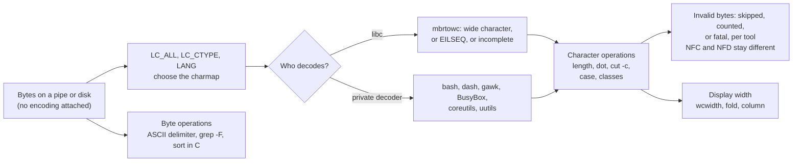

# Unicode and UTF 8 in Text Tools

> [!summary] Claim
> UTF-8 is safe for byte-oriented text tools because no ASCII byte ever occurs inside a multibyte sequence, but every operation that counts, slices, pads, classifies, maps case or measures width needs a decoder that depends on `LC_CTYPE`, the implementation and its version, and every decoder disagrees about invalid input, so decide per operation whether you want bytes or characters and say so with `LC_ALL`.

Part of [Regular Expressions and Text Processing](README.md) in [Shell and Unix Engineering](../README.md).

## TL;DR

- Mechanism: UTF-8 maps each Unicode scalar value to 1 to 4 bytes (RFC 3629 section 3); a tool is "multibyte aware" only if it runs a decoder (`mbrtowc(3)` or a private one) chosen by `LC_CTYPE`, otherwise it sees bytes.
- Rule: use `LC_ALL=C` for byte-exact plumbing (`grep -F`, `cut -d` with an ASCII delimiter, `sort`, `comm`) and `LC_ALL=C.UTF-8` (or the user's UTF-8 locale) only where you need characters, and validate untrusted input as UTF-8 before trusting any character operation.
- Trap: the same command prints different answers by locale, tool and version: `cut -c4` on "caf" plus e-acute is a whole character in BSD `cut` and in GNU coreutils 9.11 and later, and half a character in older GNU `cut`; `printf '%-6s'` pads bytes in bash and dash but characters in zsh; a Byte Order Mark rides along in the first field; NFC and NFD forms of one word never match.
- Portability: POSIX defines `${#x}`, `wc -m`, awk `length` and `cut -c` in characters and `printf` widths in bytes, but does not require UTF-8, does not define what a tool does with invalid bytes, and leaves `tr` with multibyte characters unclear; GNU `tr` still handles only single-byte locales (as of 2026-11).
- When not to use it: normalization, grapheme clusters, display width, full case mapping, collation and confusable detection are outside what `sed`, `awk`, `cut` and `tr` do; use a language runtime or ICU (see [[Perl-One-Liners]] and [[Python-as-a-Shell-Companion]]).

## Mental model



Bytes arrive with no label.
The only label is the process environment: `LC_ALL`, then `LC_CTYPE`, then `LANG` select a charmap, and "C" or "POSIX" means one byte per character.
Operations that only look for ASCII bytes (the left branch) never need a decoder, which is why `cut -d,` and `grep -F` stay correct in every locale.
Operations that count, slice or classify characters (the right branch) need a decoder, and the decoder is either the C library's `mbrtowc` or code inside the tool, so two tools can disagree on the same bytes, and on invalid bytes they usually do.
Width is a third question: neither bytes nor code points tell you how many terminal columns a string occupies.

## How it works

### Characters, code points and bytes

POSIX defines a character as "a sequence of one or more bytes representing a member of a character set" (POSIX.1-2024 XBD 3.58).
It does not require UTF-8: the POSIX locale has 256 single-byte characters, and any other locale may define its own encoding (POSIX.1-2024 XBD 6.2).
`locale charmap` names the active charmap; on the macOS host used for this note it printed `UTF-8` for `C.UTF-8` and `en_US.UTF-8` and `US-ASCII` for `C` (measured here, as of 2026-11).

Unicode assigns each character a code point in the code space `U+0000..U+10FFFF` (Unicode 18.0 chapter 3, D9 and D10).
A scalar value is a code point that is not a surrogate (`U+D800..U+DFFF`), and UTF-8 encodes exactly the scalar values (Unicode 18.0 section 3.9, D76).
Unicode 18.0 contains 172,808 characters (unicode.org version page, as of 2026-11).

### The UTF-8 encoding form

RFC 3629 section 3 gives the table; Unicode 18.0 Table 3-7 is the authoritative form with the extra range limits on the second byte.

| Scalar values | Bytes | First byte | Constraint on the following bytes |
| --- | --- | --- | --- |
| `U+0000..U+007F` | 1 | `00..7F` | none |
| `U+0080..U+07FF` | 2 | `C2..DF` | `80..BF` |
| `U+0800..U+FFFF` | 3 | `E0..EF` | after `E0` the second byte is `A0..BF`; after `ED` it is `80..9F`; otherwise `80..BF` |
| `U+10000..U+10FFFF` | 4 | `F0..F4` | after `F0` the second byte is `90..BF`; after `F4` it is `80..8F`; otherwise `80..BF` |

Each extra constraint closes one hole.
`C0` and `C1` never start a sequence because they could only encode `U+0000..U+007F`, which have a one-byte form (an overlong form).
The `E0 A0` floor and `F0 90` floor do the same for three and four bytes.
`ED A0..BF` would encode the UTF-16 surrogates, and `F4 90` and above would exceed `U+10FFFF`.
The definition of UTF-8 "prohibits encoding character numbers between U+D800 and U+DFFF", and the "rows of the table are mutually exclusive, i.e., there is only one valid way to encode a given character" (RFC 3629 section 3).

Four properties make UTF-8 usable from the shell.

1. ASCII transparency: bytes `00..7F` mean what they mean in ASCII, and no byte below `80` occurs in a multibyte sequence, so "no ASCII byte can appear as part of another character and there are no problems with, for example, '\0' or '/'" (utf-8(7), Linux man-pages 6.19).
   POSIX demands the same of every locale for four bytes: those encoding period, slash, newline and carriage return "shall not occur as part of any other character in any locale", and a null byte likewise (POSIX.1-2024 XBD 6.2).
2. Self-synchronization: lead bytes (`C2..F4`) and continuation bytes (`80..BF`) are disjoint ranges, so from any byte position you can find the next character boundary by skipping continuation bytes; the encoding is "stateless and robust against missing bytes" (utf-8(7)).
3. Order preservation: comparing the byte strings as unsigned bytes gives the same order as comparing the code points (utf-8(7)), which is why `LC_ALL=C sort` is a code point sort for UTF-8 text.
4. Prefix freedom: no valid sequence is a prefix of another, so byte-wise substring search for a valid UTF-8 pattern cannot match in the middle of a character.

### Decoders and what they do with bad bytes

A conforming decoder must not accept ill-formed input: "Implementations of the decoding algorithm above MUST protect against decoding invalid sequences" (RFC 3629 section 3), and a process "shall treat ill-formed code unit sequences as an error condition and shall not interpret such sequences as characters" (Unicode 18.0 conformance clause C10).
When a converter continues after an error, Unicode recommends replacing each maximal subpart of an ill-formed subsequence with one U+FFFD (D93b); for `C2 41 42` the correct output is `U+FFFD U+0041 U+0042`.
"Silently ignoring ill-formed sequences is strongly discouraged because joining text from before and after the ill-formed sequence can cause the resulting text to take a new meaning" (Unicode 18.0 section 3.2, discussion of C10).

The C interface is `mbrtowc(3)`.
It returns the byte count of a complete character, 0 for the null character, `(size_t)-2` when the input is a valid prefix of a character, and `(size_t)-1` with `errno` set to `EILSEQ` for an invalid sequence, after which the conversion state is undefined (POSIX.1-2024 `mbrtowc`; Linux man-pages 6.19 `mbrtowc(3)`).
The caller picks the recovery policy.
The lab probe `utf8probe decode` resets the state and skips one byte, so each byte of a bad run becomes one `bad` token.

C libraries differ on what counts as invalid, and the difference is observable:

| Input bytes | Meaning | Apple libc (macOS 27, measured) | glibc 2.41 (source; measured) | musl (source; measured) |
| --- | --- | --- | --- | --- |
| `C0 AF` | overlong `/` | `bad bad` | rejected: the lead byte is below `C2`, so it falls to the ill-formed branch (`bad bad`) | rejected: lead byte outside `C2..F4` (`bad bad`) |
| `ED A0 80` | surrogate U+D800 | `bad bad bad` | rejected: `ch >= 0xd800 && ch <= 0xdfff` (`bad bad bad`) | rejected: the table limits the byte after `ED` to `80..9F` (`bad bad bad`) |
| `F4 90 80 80` | U+110000 | `bad bad bad bad` | accepted as U+110000 (`U+110000/4`) | rejected (`bad bad bad bad`) |
| `F8 88 80 80 80` | 5-byte form | `bad bad bad bad bad` | accepted as U+200000 (`U+200000/5`) | rejected (`bad bad bad bad bad`) |

glibc's UTF-8 decoder (`utf8_internal_loop` in `iconv/gconv_simple.c`) has branches for lead bytes `F8..FD` that expect five and six bytes, rejects overlong forms with `(ch >> (5 * cnt - 4)) == 0`, and rejects surrogates, but it has no check that the value is at most U+10FFFF.
That is consistent with the glibc UTF-8 charmap declaring `<mb_cur_max> 6` (`localedata/charmaps/UTF-8`), where the macOS probe reports `mb_cur_max=4`.
musl's `mbrtowc` (`src/multibyte/mbrtowc.c`) accepts only lead bytes in `C2..F4` (`SA 0xc2`, `SB 0xf4` in `internal.h`) and narrows the second byte with the table in `internal.c` (`80..9F` after `ED`, `A0..BF` after `E0`, `90..BF` after `F0`, `80..8F` after `F4`), so it follows RFC 3629 exactly.
The glibc and musl rows are read from source, asserted by the lab per C library, and were measured with `utf8probe decode C.UTF-8` in the shell matrix's Debian image (glibc 2.41, which also decoded the six-byte `FC 84 80 80 80 80` as U+4000000) and in its Alpine image for musl (as of 2026-11).
The consequence is practical: "the C library decoded it" does not mean "it is valid UTF-8".
A trust boundary needs a validator that implements Table 3-7 itself, which is what `utf8-validate.sh` in the lab does.

Some tools do not use the C library to decode.

- BusyBox has its own Unicode layer.
  With `FEATURE_CHECK_UNICODE_IN_ENV` it decides that Unicode is on if `LC_ALL`, else `LC_CTYPE`, else `LANG` contains the text `.utf` or `.UTF`; with locale support it calls `setlocale(LC_CTYPE, ...)` and tests whether U+0394 has length 1 (`libbb/unicode.c`, `reinit_unicode`).
  BusyBox `ash` re-reads those variables inside the shell at every `${#x}` expansion, so assigning `LC_ALL` mid-script takes effect (`shell/ash.c`, the `VSLENGTH` branch calling `reinit_unicode_for_ash` and `unicode_strlen`).
- bash's `${#x}` is `MB_STRLEN`: `strlen` when `MB_CUR_MAX` is 1, else `mbstrlen` (`include/shmbutil.h`), called from `parameter_brace_expand_length` in `subst.c`.
- dash has counted characters since 0.5.13, whose "Release 0.5.13." commit is dated 2025-09-21 in the project log: the 0.5.13 history contains `shell: Call setlocale`, `expand: Count multi-byte characters for VSLENGTH`, `expand: Support multi-byte characters during field splitting`, `builtin: Process multi-byte characters in read(1)` and `parser: Add dollar single quote`.
  In `src/expand.c`, `memtodest` increments its count once per character by calling `mbtodest` for each non-ASCII lead byte.
  dash 0.5.12 has none of these and counts bytes: Debian's dash 0.5.12 reported `${#x}` of "caf" plus e-acute as 5 under `LC_ALL=C.UTF-8` in the shell matrix image (as of 2026-11; see the portability section for how the lab tells them apart).
- gawk converts input to wide characters according to the locale and offers `-b` (`--characters-as-bytes`) as "Hands off my data!" (gawk manual, Options).
- GNU coreutils `wc` runs an `mbrtoc32` loop, with a fast path (`u8_count`) when the charset is UTF-8, and treats a decoding error as "a byte but not a character (that is, chars is not incremented)" (`src/wc.c`, function `wc`).
  `cut` since 9.11 decodes with its own `mcel` layer and has a dedicated `cut_characters_mode` (`src/cut.c`).
- uutils `wc` decodes UTF-8 itself and has an `InvalidByteSequence` case (`src/uu/wc/src/wc.rs`); its `cut` has separate `Bytes` and `Characters` modes (`src/uu/cut/src/cut.rs`).

### Operation by operation

| Operation | Needs a decoder | What to expect |
| --- | --- | --- |
| Find an ASCII delimiter or a fixed string (`cut -d,`, `grep -F`, awk `-F,`) | no | Correct in every locale, by properties 1 and 4 |
| Length (`${#x}`, `wc -m`, awk `length`) | yes | Characters in a UTF-8 locale, bytes in `C`; invalid bytes handled per tool |
| Slice (`cut -c`, awk `substr`, `${x:o:l}`) | yes | Same split as length; `cut -c` changed in coreutils 9.11 |
| Regex `.` and bracket classes | yes | The regex library decides; invalid bytes usually do not match `.` |
| Case mapping (`tr`, `toupper`, `\U`) | yes, plus locale tables | Simple one-to-one mapping only; `U+00DF` has no one-character uppercase |
| Padding (`printf '%-6s'`) | no, in POSIX | POSIX counts bytes; zsh counts characters |
| Display width | yes, plus `wcwidth` | 0 for combining marks, 2 for wide East Asian characters and emoji |
| Comparison and sorting | `LC_COLLATE` | See [[Locale-Collation-and-Unicode-in-CLI-Tools]] |
| Normalization, graphemes, confusables | none of these tools | Needs a Unicode library |

The POSIX text for each is short.
`${#parameter}` is "the length in characters" (POSIX.1-2024 XCU 2.6.2), and parameters "can contain arbitrary byte sequences, except for the null byte" and are processed as characters only by operations defined in terms of characters (XCU 2.5).
`wc -m` writes the number of characters; awk `length` returns "the length, in characters, of arg" (XCU `awk`).
`cut` has `-b`, `-c` and `-n`: with `-b`, `-n` rounds a range to character boundaries, so that "`cut -b 1-500 -n file > file1`" and "`cut -b 501- -n file > file2`" "ends up with all the characters in file appearing exactly once" (XCU `cut`, rationale).
`printf` precision counts bytes and `%c` writes the first byte; the standard warns that it "makes no special provision for dealing with multi-byte characters" (XCU `printf`, rationale).
`tr` octal escapes denote single bytes, and the standard concedes that earlier text about adjacent octal escapes forming multibyte characters was ambiguous (XCU `tr`, rationale).
`grep`, `sed` and `awk` recommend `LC_ALL=C` when processing pathnames because "pathnames can contain byte sequences that do not form valid characters in some locales, in which case the utility's behavior would be undefined" (XCU `grep`).

### Tools in detail

**Shell parameter expansion.**
On the macOS host, bash 3.2.57, bash 5.3.20, zsh 5.9.2, dash 0.5.13.5 and ksh93u+ 2012-08-01 all report `${#x}` of "caf" plus e-acute as 4 under `LC_ALL=C.UTF-8` and 5 under `LC_ALL=C` (measured here; the lab asserts it per family).
The same five shells removed one whole character with `${x%?}` (leaving the three bytes of "caf") and three characters with `${x#???}` (leaving the two bytes of e-acute).
A shell that counts bytes would leave the lead byte `C3` behind.
For an invalid byte, `x=$(printf 'a\377b')`, all five shells report 3: each invalid byte counts as one character.

**GNU grep.**
"It is unspecified whether `.` matches an encoding error" (grep manual, Regular Expressions).
GNU grep reads the file as binary when it finds a NUL, or when it would have to output a line with an encoding error: "unless the `-a` option is used, the presence of null characters in input or of encoding errors in output causes GNU grep to treat the file as binary and suppress details about matches" (grep manual, Character Encoding).
Since grep 3.5 (2020-09-27) the notice goes to standard error as `grep: FOO: binary file matches`, so `grep PATTERN FILE | wc -l` no longer counts it (grep NEWS 3.5).
Since grep 2.23 (2016-02-04) grep suppresses a line containing an encoding error and reports binary, instead of printing it (grep NEWS 2.23).

**sed.**
GNU sed matches valid multibyte characters in a multibyte locale, and "regular expressions do not match invalid multibyte sequences" (sed manual, Locale Considerations).
`s/./X/g` turns a Greek capital sigma into one `X` in a UTF-8 locale and into two in `C`.
The `z` command exists because `s/.*//` cannot clear a pattern space that holds an invalid byte, and POSIX requires that `.` not match such bytes (sed manual, `z`).
On the macOS host, `sed 's/./x/g'` on the bytes `61 FF 62` stops with `illegal byte sequence` and prints nothing, while GNU sed 4.10 prints `x`, the untouched `FF`, and `x` (measured here).
Both turned the two bytes of e-acute into one character under `y/e-acute/E/`.

**awk.**
POSIX says `length` counts characters, so gawk does under a UTF-8 locale and does not under `-b` or `LC_ALL=C`.
The macOS awk (the one true awk 20200816) printed 5 for the same string in `C.UTF-8` (measured here), the lab expects the same from mawk, and mawk's manual page documents no multibyte handling at all.
In the shell matrix's Debian image, mawk 1.3.4 20250131 and BusyBox awk 1.37.0 printed 5, while Debian's `original-awk` 20250116 (a newer one true awk) printed 4, so the one true awk's answer depends on its version (as of 2026-11).
gawk `toupper` maps `U+00E9` to `U+00C9` in a UTF-8 locale (measured, gawk 5.4.2) and `printf "%c"` of a string prints the first character, not the first byte, "In locales with multibyte characters" (gawk manual, printf).
awk string comparison is where a locale can bite twice.
POSIX.1-2024 requires `==` and `!=` to test whether strings are identical, "not to check if they collate equally", and keeps collation for `<` and `>` (XCU `awk`, Austin Group Defect 1070).
The macOS awk 20200816 still collates for `==`: it reported `$1 == "id"` true for a field that begins with the invisible BOM under `en_US.UTF-8` and false under `C.UTF-8` (measured here; see the BOM pitfall).

**GNU coreutils (cut, wc, tr, fold, expand).**
The multibyte story is recent and version dependent (coreutils NEWS):

| Release | Date | Change |
| --- | --- | --- |
| 9.8 | 2025-09-22 | `fold` supports multibyte characters, honoring column width, and gains `--characters` |
| 9.11 | 2026-04-20 | `cut` supports multibyte input and delimiters; `-c` is honored and "no longer an alias for -b"; `-n` is honored and "no longer ignored"; `expand` and `unexpand` support multibyte characters |
| 9.12 | 2026-09-14 | Fixes in the 9.11 multibyte `cut`, `expand` and `unexpand` code |
| unreleased | n/a | `wc -m` counts ASCII up to 14x faster and UTF-8 up to 7x; `cut -c` is up to 10x faster in UTF-8 locales |

`tr` is still single-byte: "GNU tr fully supports only safe single-byte locales" and a command mapping `U+00F6` to `U+0141` "is equivalent to `tr '\303\266' '\305\201'`" so it transliterates every `\303` byte (coreutils manual, `tr`, as of 2026-11).
`LC_ALL=C tr` is what the manual recommends.
On the macOS host, BSD `tr '[:lower:]' '[:upper:]'` mapped e-acute to E-acute (`C3 A9` to `C3 89`) while GNU `tr` 9.12 left the two bytes alone (measured here).
`wc -L` reports display width and "Display widths of wide characters are considered" (coreutils manual, `wc`).

**BusyBox applets.**
BusyBox `cut` has no multibyte decoding: its usage text lists `-n` as "Ignored" (`coreutils/cut.c`).
BusyBox `wc -m` counts every byte that is not a UTF-8 continuation byte when Unicode support is on (`coreutils/wc.c`, `(c & 0xc0) != 0x80`), so a stray continuation byte does not count as a character there, while the C-library-based tools usually count it.
BusyBox `printf` hands `%s` to the C library's `printf`, so widths count bytes (`coreutils/printf.c`).

**iconv.**
POSIX `iconv` converts between charmaps and can serve as a validator with `iconv -f UTF-8 -t UTF-8 FILE >/dev/null`, whose exit status says whether the conversion succeeded.
On the macOS host it rejected `C0 AF`, `ED A0 80` and a truncated sequence, accepted `F4 90 80 80` (U+110000), and `iconv -c` silently dropped an invalid byte (measured here).
glibc 2.41's `iconv` in the Debian image rejected `F4 90 80 80` with "illegal input sequence at position 0", although glibc's `mbrtowc` accepts it, so even one C library's two decoding paths disagree (measured in the shell matrix image, as of 2026-11).
Test your own `iconv` against the cases in the lab before relying on it as a gate.

### What none of these tools do

Normalization.
Unicode Normalization Forms NFC and NFD represent canonically equivalent text, for example `U+00E9` versus `U+0065 U+0301`, with different bytes (UAX #15).
No tool in this note normalizes, so `grep` for the NFC form of "cafe" finds 0 hits in NFD text, and `sort -u` keeps both forms.
The lab tour prints this.
RFC 3629 section 10 names the consequence: "the existence of multiple character sequences for 'the same thing' may have security consequences whenever string matching, indexing, searching, sorting, regular expression matching and selection are involved."

Grapheme clusters.
What a reader calls one character can be several code points (a base plus combining marks, or an emoji sequence).
`cut -c`, `${x:o:l}` and `length` count code points, not the "user-perceived characters" of UAX #29.

Display width.
UAX #11 gives each code point one of six East Asian Width values (Ambiguous, Fullwidth, Halfwidth, Narrow, Wide, Neutral) and notes that for "any given operation, these six default property values resolve into only two property values, narrow and wide, depending on context."
So `wcwidth(3)` is a policy: on the macOS host it returned 1 for `U+0041` and `U+00E9`, 0 for the combining `U+0301`, and 2 for `U+4E2D` and `U+1F600` (lab, `utf8probe width`).
musl's `wcwidth` implements the same shape with a non-spacing table and a wide table (`src/ctype/wcwidth.c`).

Case folding and collation.
Simple case mapping is per character and per locale: `U+00DF` stays as it is under `toupper`, because its full uppercase is the two letters "SS".
glibc's `tr_TR` locale maps `i` to `U+0130` in its `toupper` table and `I` to `U+0131` in its `tolower` table (`localedata/locales/tr_TR`), so uppercasing an ASCII keyword in a Turkish glibc locale changes its bytes.

### The byte order mark

U+FEFF at the start of a stream may be used as a signature; in UTF-8 it is the three bytes `EF BB BF`, which is "useless" as an order mark but not forbidden (RFC 3629 section 6).
Standard tools treat those bytes as ordinary text, so the first field of a BOM-prefixed CSV is the bytes `EF BB BF 69 64`, not `id`.
Kernels look at the first two bytes of a script: `load_script` in `fs/binfmt_script.c` returns `-ENOEXEC` unless they are `#!`, so a BOM-prefixed script never reaches its interpreter through `execve`.
The shell then runs the file itself; on the macOS host bash 3.2, bash 5.3, dash, ksh93u+ and zsh each reported the first line as a missing command and carried on to the second line (measured here).

## Numbers and limits

Source tags: "RFC" is RFC 3629, "Unicode" is the Unicode 18.0 core specification chapter 3, "lab" is `utf8.bats` or the tour in the lab, "measured here" is a one-off command on the author's host (macOS 27, Apple silicon, as of 2026-11) that the lab does not run, and "derived" is arithmetic on a cited fact.

| Quantity | Value | Source |
| --- | --- | --- |
| Code space | `U+0000..U+10FFFF`, 1,114,112 code points in 17 planes | Unicode D9; derived |
| Surrogates | 2,048 (`U+D800..U+DFFF`) | RFC section 3; derived |
| Scalar values | 1,112,064 | derived |
| Noncharacters | 66 (`U+FDD0..U+FDEF` and `U+nFFFE`, `U+nFFFF` for 17 planes) | Unicode D14; derived |
| Assigned characters, Unicode 18.0 | 172,808 (13,007 new) | unicode.org version page, 2026-11 |
| Bytes per scalar value | 1, 2, 3 or 4 | RFC section 3 |
| Code points by length | 128, 1,920, 63,488 (61,440 excluding surrogates), 1,048,576 | derived |
| Byte values never present in UTF-8 | 13 (`C0`, `C1`, `F5..FF`) | RFC section 4; derived |
| Lead byte values | 51 (`C2..F4`) | RFC section 4; derived |
| `MB_CUR_MAX` in a UTF-8 locale | 6 in glibc's charmap, 4 on macOS 27 | glibc `UTF-8` charmap; lab (`utf8probe mbmax`) |
| `getconf MB_LEN_MAX` | 6 on the macOS host | measured here |
| "caf" plus e-acute, NFC | 5 bytes, 4 characters | lab (tour) |
| Same text, NFD | 6 bytes, 5 characters | lab (tour) |
| `wcwidth` of `U+0041`, `U+00E9`, `U+0301`, `U+4E2D`, `U+1F600` | 1, 1, 0, 2, 2 | lab (`utf8probe width`) |
| Bidirectional control characters to scan for | 9 (`U+202A..U+202E`, `U+2066..U+2069`), 3 bytes each | UAX #9; lab (`bidi-scan.sh`) |
| BOM | 3 bytes `EF BB BF` | RFC section 6 |
| coreutils `cut -c` multibyte | from 9.11 (2026-04-20) | coreutils NEWS |
| coreutils `fold` multibyte | from 9.8 (2025-09-22) | coreutils NEWS |
| dash multibyte `${#x}` | from 0.5.13 (2025-09-21) | dash git log |
| GNU grep binary notice on stderr | from 3.5 (2020-09-27) | grep NEWS |
| GNU `wc -m` on 27,488,890 bytes (400,000 lines of ASCII, e-acute and CJK), file operand | C: 0.00 s (size from `lseek`); UTF-8: 0.09 to 0.10 s | re-measured 2026-11, 3 runs, coreutils 9.12; S: `wc.c` |
| GNU `cut -c1-40`, same file | C: 0.03 to 0.05 s; UTF-8: 0.22 to 0.27 s | re-measured 2026-11, 3 runs |
| GNU `cut -b1-40`, same file | C: 0.04 to 0.07 s; UTF-8: 0.04 to 0.05 s | re-measured 2026-11, 3 runs |
| gawk `length` sum, same file | C: 0.09 to 0.19 s; UTF-8: 0.14 to 0.38 s | re-measured 2026-11, 6 runs, gawk 5.4.2 |
| `length` sum of that file | 27,088,890 in `C`, 25,088,890 in UTF-8 | re-measured 2026-11 |

The timings come from `perl -MTime::HiRes` around single runs with output to `/dev/null`, on the macOS host with the Homebrew GNU tools, `LC_ALL=C` against `LC_ALL=en_US.UTF-8`, so they carry process start and noise of a few hundredths of a second; read them as "the decoder costs a few times the byte loop on character operations and nothing on byte operations", not as benchmarks.
The file was regenerated for the re-measurement with the same shape (a line number, 51 ASCII bytes, one e-acute and two CJK characters per line) and reproduces the stated size and both `length` sums exactly.
In the `C` locale `wc -m` is the same as `wc -c`, which `wc.c` answers from the file size with `lseek` when the operand is a regular file, so that row measures no counting loop at all; fed through a pipe the same run took 0.06 to 0.46 s (the high end is one noisy outlier among 3).
The two `length` sums differ by 2,000,000, which is 5 bytes of extra length per line (e-acute is 2 bytes for 1 character, each of the 2 CJK characters is 3 bytes for 1) times 400,000 lines.

## Portability

Legend: **M** means measured on the macOS host while writing and asserted by the lab; **L** means asserted by the lab but not run on this host, so the shell matrix decides; **S** means a cited source states it; **X** means measured by hand during fact-checking in the shell matrix's Debian or Alpine image (or, where marked, on the macOS host), not asserted by the lab (as of 2026-11).
All shell rows use the string "caf" plus `U+00E9` (4 characters, 5 bytes).

| Shell | `${#x}` under `LC_ALL=C.UTF-8` | `${#x}` under `LC_ALL=C` | `printf '%-6s'` pads | BOM-prefixed script |
| --- | --- | --- | --- | --- |
| POSIX sh (spec) | characters (S: XCU 2.6.2) | 5, one byte per character (S: XBD 6.2) | bytes (S: XCU `printf`) | n/a |
| macOS bash 3.2.57 (also `/bin/sh`) | 4 (M) | 5 (M) | bytes (M) | first line reported, rest runs (M) |
| bash 5.3.20 | 4 (M; S: `MB_STRLEN`) | 5 (M) | bytes (M) | same (M) |
| zsh 5.9.2 native | 4 (M) | 5 (M) | characters (M) | same (M) |
| `zsh --emulate sh` | 4 (M) | 5 (L; X on the macOS host) | characters (M) | same (L) |
| dash 0.5.13.5 | 4 (M; S: git log) | 5 (M) | bytes (M) | same (M) |
| dash 0.5.12 | 5 (L: dash without the dollar-single-quote form; X: Debian 0.5.12) | 5 (L; X) | bytes (L; X) | same (L; X) |
| ksh93u+ 2012-08-01 (macOS `/bin/ksh`) | 4 (M) | 5 (M) | bytes (M) | same (M) |
| ksh93u+m 1.0.10 | 4 (L; X: Debian) | 5 (L; X) | bytes (X; the lab accepts either) | first line reported, rest runs (X; the lab accepts one or more lines) |
| mksh | 4 or 5 by default (L): 4 in Debian's R59 2025/04/26, 5 in Alpine's R59 2020/10/31 (X); 4 after `set -U`, 5 after `set +U` (L; X in both) | 5 (L; X) | bytes (X in both; the lab accepts either) | Debian's R59 2025 reports the first line, Alpine's R59 2020 prints no diagnostic and runs the rest (X) |
| yash 2.58.1 | 4 (X: Alpine; the lab accepts 4 or 5) | 5 (L; X) | bytes (X; the lab accepts either) | first line reported, rest runs (X) |
| posh 0.14.1 | 5 (X: Debian; the lab accepts 4 or 5) | 5 (L; X) | bytes (X; the lab accepts either) | no diagnostic, rest runs (X) |
| BusyBox ash 1.37.0 | 4 (S: `ash.c`; matrix; X in both) | 5 (matrix; X) | bytes (S: `printf.c`; X) | first line reported, rest runs (X in both) |

On mksh, the matrix recorded that Alpine's mksh R59 (2020/10/31) counts bytes until `set -U` (shell matrix, 2026-10), while Debian's R59 2025/04/26 counted characters by default under `LC_ALL=C.UTF-8` (measured in the Debian image, 2026-11); the lab accepts either count by default and asserts only that the two options flip it.
On BusyBox ash, the matrix recorded that it counts characters in both images unless `LC_ALL=C` (shell matrix, 2026-10).

| Utility | `.` or length in `C.UTF-8` | Invalid byte | `cut -c4` on "caf" plus `U+00E9` | `tr` case classes on `U+00E9` |
| --- | --- | --- | --- | --- |
| GNU sed 4.10 | character (M) | not matched, byte survives (M; S: manual) | n/a | n/a |
| BSD and macOS sed | character (M) | error, no output (M) | n/a | n/a |
| GNU grep | character (S: manual) | binary file notice (S: manual) | n/a | n/a |
| BSD and macOS grep 2.6.0-FreeBSD | character (M) | not matched (M) | n/a | n/a |
| GNU coreutils 9.12 | `wc -m` 4 (M) | `wc -m` skips it (S: `wc.c`) | whole character (M) | unchanged bytes (M) |
| GNU coreutils before 9.11 | `wc -m` 4 | `wc -m` skips it (X: 9.7 on Debian reported 3 for `a`, `FF`, `b`, newline) | first byte only (S: NEWS 9.11; X: 9.7 printed `C3`) | unchanged bytes (S: manual; X: 9.7) |
| BSD and macOS userland | `wc -m` 4 (M) | `wc -m` warns on stderr and counts the byte, so 4 (M); `cut -c` errors (M) | whole character (M) | mapped to `C3 89` (M) |
| BusyBox 1.37.0 | `wc -m` 4 (L; X in both images: 5 with the newline) | continuation byte not counted (S: `wc.c`; X), so `a`, `FF`, `b`, newline counts 4 (X: Alpine) | first byte (S: `cut.c`; X) | bytes (L; X: e-acute unchanged) |
| uutils (main branch) | not run | `InvalidByteSequence` case (S: `wc.rs`) | whole character (S: `cut.rs`, `Characters` mode) | not run |
| gawk 5.4.2 | `length` 4 (M) | warns "Invalid multibyte data detected" (M) | n/a | `toupper` maps (M) |
| mawk 1.3.4 20250131 | `length` 5 (L; manual silent; X: Debian) | n/a | n/a | bytes (L) |
| macOS awk 20200816 | `length` 5 (M) | n/a | n/a | `toupper` maps (M) |

All utilities print byte-based answers under `LC_ALL=C`: the lab asserts 5 for `wc -m`, `awk length` and `grep -o .` there for every implementation, because POSIX makes each byte a character in the POSIX locale.

## Worked example

The [lab](../labs/07-unicode-and-utf-8-in-text-tools/) has five parts: `utf8probe.c`, a C probe that asks the C library what it decodes; `utf8-validate.sh`, a strict RFC 3629 validator in awk; `bidi-scan.sh`, a Trojan Source guard; `shell-probe.sh`, which reports how the shell under test counts and pads; and `utf8-tour.sh`, which prints the byte, character, normalization, BOM, sort and bidi facts.
`utf8.bats` asserts all of it per implementation.

The tour (excerpt, verbatim lines from `utf8-tour.sh`):

```sh
show 'bytes cafe (NFC)' "$(bytes "$nfc")"
show 'bytes cafe (NFD)' "$(bytes "$nfd")"
show 'chars cafe (NFC)' "$(chars "$nfc")"
show 'chars cafe (NFD)' "$(chars "$nfd")"
nfd_hits=$(printf '%s\n' "$nfd" | grep -c -F "$nfc")
show 'grep NFC in NFD text' "$nfd_hits"
```

The validator program, as it appears in `utf8-validate.sh` (excerpt, verbatim):

```sh
# od -An -v -tu1 prints every byte as an unsigned decimal, 16 per line, with no address column (POSIX od).
od -An -v -tu1 "$@" | awk '
  function fail(why) {
    printf "invalid at byte offset %d: %s\n", off, why
    bad = 1
    exit 1
  }
  {
    for (i = 1; i <= NF; i++) {
      b = $i + 0
      if (need > 0) {
        # A continuation byte: the first one may be narrowed by the lead byte, the rest use 80..BF.
        if (b < lo || b > hi) fail("byte " b " is not a valid continuation here")
        need--
        lo = 128
        hi = 191
      } else if (b < 128) {
        # ASCII
      } else if (b >= 194 && b <= 223) { need = 1; lo = 128; hi = 191 }
      else if (b == 224) { need = 2; lo = 160; hi = 191 }
      else if (b >= 225 && b <= 236) { need = 2; lo = 128; hi = 191 }
      else if (b == 237) { need = 2; lo = 128; hi = 159 }
      else if (b >= 238 && b <= 239) { need = 2; lo = 128; hi = 191 }
      else if (b == 240) { need = 3; lo = 144; hi = 191 }
      else if (b >= 241 && b <= 243) { need = 3; lo = 128; hi = 191 }
      else if (b == 244) { need = 3; lo = 128; hi = 143 }
      else fail("byte " b " cannot start a sequence")
      off++
    }
  }
  END {
    if (!bad && need > 0) {
      printf "invalid at byte offset %d: truncated sequence at end of input\n", off
      bad = 1
    }
    if (bad) exit 1
    printf "ok %d bytes\n", off
  }
'
```

Captured output on the author's macOS host (`./utf8-tour.sh PROBE`):

```text
bytes U+00E9               2
bytes U+20AC               3
bytes U+1F600              4
bytes cafe (NFC)           5
bytes cafe (NFD)           6
chars cafe (NFC)           4
chars cafe (NFD)           5
grep NFC in NFD text       0
sort -u NFC and NFD        2
BOM in first field         ef bb bf 69 64 0a
C sort = code points       7a 0a c3 a9 0a e2 82 ac 0a f0 9f 98 80 0a
lines with U+202E          1
```

Captured `utf8probe decode C.UTF-8 HEX` output on the same host:

```text
c3a9 -> U+00E9/2
e282ac -> U+20AC/3
f09f9880 -> U+1F600/4
c0af -> bad bad
eda080 -> bad bad bad
e282 -> short
f4908080 -> bad bad bad bad
f888808080 -> bad bad bad bad bad
```

Captured `shell-probe.sh` output under `LC_ALL=C.UTF-8`, one line per key:

```text
== /bin/bash
locale=C.UTF-8
len=4
dq=yes
pad=bytes
prec=bytes
== /opt/homebrew/bin/bash
locale=C.UTF-8
len=4
dq=yes
pad=bytes
prec=bytes
== zsh
locale=C.UTF-8
len=4
dq=yes
pad=chars
prec=chars
== dash
locale=C.UTF-8
len=4
dq=yes
pad=bytes
prec=bytes
== /bin/ksh
locale=C.UTF-8
len=4
dq=yes
pad=bytes
prec=bytes
```

Run the suite with `LAB_SHELL=dash bats utf8.bats` and the other shells in turn.
The expected effect of the matrix: the shell rows move (dash 0.5.12 versus 0.5.13, zsh padding, mksh `set -U`), the utility rows move with the userland (GNU before and after 9.11, BSD, BusyBox, uutils), and the tour and probe lines stay constant.

## Pitfalls

> [!warning] Counting the wrong unit
> Trigger: `${#x}`, `wc -c`, `wc -m`, awk `length` and `cut -c` are mixed in one script, or run under a different locale from the one you tested.
> Symptom: a "5 character" limit rejects a 4-character name, a column offset lands inside a character, or a byte count is reported as a character count.
> Fix: decide the unit, set it explicitly (`LC_ALL=C` for bytes, `LC_ALL=C.UTF-8` for characters), and test with a string that has 1-, 2-, 3- and 4-byte characters, such as the lab's `UTF-8` set.

> [!warning] Version-dependent `cut -c`, `fold`, `expand` and `tr`
> Trigger: a script relies on GNU `cut -c` selecting characters, or on GNU `tr` mapping a non-ASCII letter.
> Symptom: the same script cuts a character in half on a host with coreutils before 9.11 (2026-04-20), where `-c` is an alias for `-b`, and cuts correctly on a newer one; `tr` leaves e-acute alone on GNU and maps it on macOS.
> Fix: run `cut --version` in CI images and fail on versions you did not test, do character slicing in gawk or Perl when the userland is unknown, and treat `tr` as a byte tool (`LC_ALL=C tr`) as the GNU manual advises.

> [!warning] Invalid bytes silently change results
> Trigger: a log, filename list or legacy export contains Latin-1 or truncated UTF-8 bytes.
> Symptom: GNU grep prints `grep: FILE: binary file matches` (standard error since 3.5, 2020-09-27) and hides the lines; GNU sed's `.` skips the byte so `s/./x/g` leaves it; macOS sed aborts with `illegal byte sequence`; gawk warns "Invalid multibyte data detected"; for the line `a`, `FF`, `b` GNU `wc -m` leaves the byte out and reports 3 (with the newline), macOS `wc -m` warns and reports 4, and a shell's `${#x}` of the three bytes reports 3, so the tools disagree on what a character is.
> Fix: validate first with a strict validator, then either reject, or process under `LC_ALL=C`, or use `grep -a`; never use `iconv -c` to "clean" security-relevant input, because dropping bytes can join the text on both sides into something new (Unicode 18.0 section 3.2).

> [!warning] BOM in the first field and in scripts
> Trigger: a spreadsheet export or a Windows editor writes `EF BB BF` before the first line.
> Symptom: `awk -F, '$1 == "id"'` never matches in `C.UTF-8` (measured with gawk 5.4.2 and the macOS awk), `cut -d, -f1` returns `EF BB BF 69 64`, and a BOM-prefixed script is run by the shell with a diagnostic about a command named after `#!/bin/sh`.
> The behavior can even invert: under `en_US.UTF-8` the macOS awk reported `$1 == "id"` true for the BOM-prefixed field, because that awk's `==` still compares by collation, which ignores the invisible character (POSIX.1-2024 requires an identity test, per Austin Group Defect 1070), while `length($1)` still said 5 (measured here, not in the lab).
> Fix: strip a leading BOM at the boundary after checking for it (`tail -c +4` when the first three bytes are `EF BB BF`), never write one from scripts, and compare under `LC_ALL=C` when exact bytes are the intent.

> [!warning] `printf` padding is bytes, not columns
> Trigger: `printf '%-10s|' "$name"` builds a table of names that include accented or CJK text.
> Symptom: rows with e-acute are one column short in bash, dash and ksh93 (POSIX counts bytes), rows are aligned by characters in zsh, and CJK rows are still wrong in every shell because those characters take two columns.
> Fix: pad with a width-aware tool (`column -t` on the macOS host honored width 2 for `U+4E2D`; GNU `expand` from 9.11 and `fold` from 9.8 consider width; `wc -L` reports display width), or compute `wcwidth` in a helper, and remember that combining marks take zero columns.

> [!warning] NFC versus NFD
> Trigger: names or text from macOS, from copy and paste, or from a normalizing service meet names typed on Linux.
> Symptom: `grep -c 'caf<U+00E9>'` returns 0 on text that looks identical, `sort -u` and `uniq` keep both, `comm` reports a difference.
> Fix: normalize both sides to one form at the boundary with a Unicode library, and compare bytes only after that; see [[Locale-Collation-and-Unicode-in-CLI-Tools]] for filesystem behavior and [[Hostile-Filenames]] for the shell consequences.

> [!warning] Locale-dependent case mapping of protocol text
> Trigger: `tr '[:lower:]' '[:upper:]'`, `toupper` or a sed `\U` is applied to a header, flag name or identifier under a user's locale.
> Symptom: in a Turkish glibc locale `i` uppercases to `U+0130` (`tr_TR` maps `U+0069` to `U+0130`), so `id` becomes `<U+0130>D`; the macOS `tr_TR.UTF-8` locale returned plain `I` in the author's run, so the bug appears on one platform only.
> Separately, `U+00DF` never becomes "SS" under `toupper` (measured with `tr`, gawk and GNU sed).
> Fix: case-fold protocol text under `LC_ALL=C` with explicit ASCII ranges, and use a Unicode case folding library for human text.

> [!warning] "The library accepted it" is not "it is valid UTF-8"
> Trigger: a validation step uses `mbrtowc`, `mbstowcs` or a tool built on them.
> Symptom: on glibc, `F4 90 80 80` and the five- and six-byte forms decode, while musl and the macOS libc reject them, and the macOS `iconv` accepted `F4 90 80 80` as well (measured here); an RFC 3629 consumer downstream then rejects what you passed.
> The historic form of this bug is an overlong slash: RFC 3629 section 10 records that "the illegal octet sequence `2F C0 AE 2E 2F`" was used "in a widespread virus attacking Web servers in 2001", and CVE-2000-0884 describes IIS 4.0 and 5.0 reading documents outside the web root via "malformed URLs that contain UNICODE encoded characters" (NVD).
> Fix: validate with an implementation of Table 3-7 at the trust boundary (the lab's `utf8-validate.sh` shows the state machine in 40 lines of awk), then pass the bytes on unchanged.

## Security and robustness

- Treat bytes as the interface.
  Decode once, at the edge, with a strict validator; reject on error rather than substituting, unless you are only displaying text.
  If you must substitute, follow Unicode's maximal-subpart rule (D93b) so that one bad sequence does not swallow the good bytes after it.
- Reject or neutralize bidirectional controls in source and configuration.
  The nine explicit embedding, override and isolate controls `U+202A..U+202E` and `U+2066..U+2069` change display order without changing the bytes a compiler reads (the lab scan does not cover the directional marks `U+200E` and `U+200F`, which only influence neighbors); CVE-2021-42574 records that the Unicode bidirectional algorithm "permits the visual reordering of characters via control sequences, which can be used to craft source code that renders different logic than the logical ordering of tokens ingested by compilers and interpreters" (NVD, published 2021-11-01).
  The lab's `bidi-scan.sh` greps the exact 3-byte sequences under `LC_ALL=C`, so it needs no decoder, prints only line numbers (echoing the line would send the control to your terminal), and keeps working on files with invalid bytes.
- Expect homoglyphs.
  CVE-2021-42694 covers identifiers that use "homoglyphs that render visually identical to a target identifier"; UTS #39 section 4 defines whole-script and mixed-script confusable detection, which needs a library and data tables, not a regex.
- Bound sizes in the unit the sink cares about.
  A database column or filename limit is bytes; a prompt limit is characters or columns; a UI truncation should be at grapheme boundaries (UAX #29).
  RFC 3629 section 10 also warns of "a risk of buffer overflow" when buffer sizing "doesn't take into account the possibility of 5- and 6-byte sequences", and glibc's UTF-8 decoder does accept those forms.
- Do not print untrusted text raw to a terminal; escape sequences and control characters arrive through the same bytes (see [[Terminal-Escape-Injection]] and [[Terminal-Escape-Sequences-and-Unicode]]).
- Set the locale deliberately.
  A script that inherits `LC_ALL` from a user, a CI runner or a container behaves differently each time (a Debian container had no `LANG` or `LC_*` in the shell matrix, so UTF-8 work needs an explicit `LC_ALL=C.UTF-8`; see [[Locale-and-LC_ALL]]).
  `C.UTF-8` exists upstream in glibc since 2.35 and carries code point order; it "is not built into glibc, and must be installed" (glibc NEWS 2.35).
- Filenames are bytes: an attacker can create names that are invalid UTF-8, contain newlines, or differ only by normalization (see [[Hostile-Filenames]]).

## The principal's view

The decision is where characters begin.
The defensible architecture treats the shell pipeline as a byte plumber and keeps character semantics out of it: record separators, field delimiters, filenames and identifiers are ASCII-delimited bytes processed under `LC_ALL=C`, and the one place that has to understand text (validation, normalization, truncation, width, case folding) is a single small program in a language with a real Unicode library.
The trade-off is a second implementation language in the toolchain and a boundary to maintain; the benefit is that the answers no longer depend on the host's locale, coreutils version or libc.

Use the shell tools for characters only for the easy cases: counting or slicing code points in a known UTF-8 locale on a pinned userland, or a quick `grep -o .` while investigating.
Pin and test the userland: this note found `cut -c` changing meaning at 9.11 (2026-04-20), `fold` at 9.8, dash at 0.5.13, and `tr` still unchanged, so a script that "worked" on last year's image is a regression risk on this year's.

Reach for another tool when the requirement is any of these: normalization (NFC at ingest), grapheme-aware truncation, display width in tables, full case folding, collation by language, or confusable detection.
Reach for `iconv` or a strict validator when the requirement is "is this valid UTF-8", and choose the validator by testing it against the overlong, surrogate, above-U+10FFFF and truncated cases, since the C library and `iconv` disagree among themselves.
The cost of getting it wrong is silent: data that is dropped, counted differently, compared unequal, or displayed in a different logical order from the one that executes.

## Interview questions

> [!question] L5: Why does `wc -m` equal `wc -c` under `LC_ALL=C` but not under `LC_ALL=C.UTF-8`?
>
> > [!success]- Answer
> > POSIX defines `wc -c` as bytes and `wc -m` as characters in the current locale.
> > In the POSIX locale every byte is one character, so the two numbers match.
> > In a UTF-8 locale a character is 1 to 4 bytes, so `wc -m` is smaller whenever the text has non-ASCII characters.
> > The lab shows "caf" plus U+00E9 as 5 bytes and 4 characters.
> >
> > Follow-up: What does GNU `wc -m` do with a byte that is not valid UTF-8, and how does that differ from `${#x}` in bash?

> [!question] L5: Why is `cut -d, -f2` correct on UTF-8 in any locale?
>
> > [!success]- Answer
> > The comma is an ASCII byte, and no ASCII byte occurs inside a multibyte UTF-8 sequence.
> > A byte-wise scan for it can never match in the middle of a character, so no decoder is needed.
> > POSIX requires the same for period, slash, newline and carriage return in every locale (XBD 6.2).
> > The lab runs it under `C` and `C.UTF-8` and gets identical bytes.
> >
> > Follow-up: Which delimiter would not be safe, and in which tool?

> [!question] L5: Predict the output: in `LC_ALL=C.UTF-8`, `x=$(printf 'caf\303\251')` then `echo "${#x}"` and `printf '%-6s|' "$x"` in bash, in zsh, and in dash 0.5.12; then the same `echo` under `LC_ALL=C`.
>
> > [!success]- Answer
> > bash prints 4 and pads by bytes: the string is 5 bytes, so the output is the string, one space and the bar.
> > zsh prints 4 and pads by characters: the string is 4 characters, so the output is the string, two spaces and the bar.
> > dash 0.5.12 prints 5, because it counts bytes; dash 0.5.13 and later print 4.
> > Under `LC_ALL=C` all of them print 5.
> > The lab asserts the 4 and the padding unit per family and the 5 under `C` for every family.
> >
> > Follow-up: How can a script tell dash 0.5.13 from 0.5.12 without a version string?

> [!question] L6: Debug this script, which reads a CSV exported by a spreadsheet: `awk -F, 'NR == 1 && $1 == "id" { ok = 1 } END { print ok + 0 }' export.csv` prints 0 although `head -1 export.csv` shows `id,name`.
>
> > [!success]- Answer
> > The file starts with the UTF-8 BOM `EF BB BF`, so the first field is those three bytes plus `id`.
> > `head -1 | od -An -tx1` shows `ef bb bf 69 64 2c ...`.
> > Strip it at the boundary: check the first three bytes and then `tail -c +4`.
> > Compare under `LC_ALL=C.UTF-8` or `LC_ALL=C` in tests, because the macOS awk under `en_US.UTF-8` compared the field equal to `id` through collation while `length` said 5.
> > Do not make the comparison looser, because the same bytes will reach other consumers.
> >
> > Follow-up: What else in this pipeline might choke on the BOM (shebang, JSON parsers, `sort -u`)?

> [!question] L6: Why is a table printed with `printf '%-12s %s\n'` misaligned for rows with accents and CJK names, and what is the fix?
>
> > [!success]- Answer
> > POSIX `printf` pads by bytes, so an accented letter costs one extra byte of padding, and zsh pads by characters; neither is display width.
> > CJK characters take 2 columns and combining marks 0, as `wcwidth` reports.
> > Use a tool that measures width (BSD `column -t`, GNU `expand` and `fold`, `wc -L`), or compute widths in a language with a Unicode library and pad by those.
> > Note the limit: East Asian Ambiguous characters have no context-free width (UAX #11).
> >
> > Follow-up: How would you test the fix?

> [!question] L6: What is happening when GNU grep prints `grep: access.log: binary file matches` on a "text" log, and what are the options?
>
> > [!success]- Answer
> > grep treats a file as binary if it has a NUL, or if a line it would output contains an encoding error in the current locale.
> > A stray Latin-1 byte in an otherwise UTF-8 log is enough.
> > Options: `-a` to force text and accept the garbage on your terminal, `LC_ALL=C` to make every byte a valid character, or fix the producer.
> > Since grep 3.5 the notice is on standard error, so it no longer counts as a matching line in `grep ... | wc -l`.
> >
> > Follow-up: Why is `LC_ALL=C grep -F` also faster for fixed ASCII patterns, and what does it give up?

> [!question] L7+: What goes wrong, and how do you defend against it, when your fleet runs images with coreutils 9.4, 9.7 and 9.12 and one script uses `cut -c` on user names?
>
> > [!success]- Answer
> > Before 9.11 (2026-04-20) `-c` was an alias for `-b` and `-n` was ignored, so the script cuts inside multibyte characters; from 9.11 `-c` selects characters, so output changes and an off-by-one that was hidden now shows.
> > Detect with a probe (`cut -c4` of a known 2-byte string) rather than by parsing `--version`, and fail the build if the answer is not the one you tested.
> > Better, remove the dependency: slice in gawk or Perl, or make the user names ASCII by contract and validate that at ingest.
> > The lab asserts each flavor: GNU by version, BSD, BusyBox and uutils (the uutils arms are written from its source and were not run in the shell matrix).
> >
> > Follow-up: BusyBox `cut` ignores `-n`; what does that do to code that relied on `-b -n`?

> [!question] L7+: Design the intake of untrusted identifiers (usernames, repository names) into a shell-heavy pipeline so that UTF-8 cannot be used against you.
>
> > [!success]- Answer
> > Decode once at the edge with a strict RFC 3629 validator (reject overlong forms, surrogates, above U+10FFFF, truncation) and reject rather than substitute.
> > Normalize to one form (NFC), reject bidirectional controls, and apply a confusable policy (UTS #39 mixed-script checks) or restrict to an ASCII allowlist if the product allows.
> > Bound length in the unit the sink needs, with grapheme-aware truncation for display.
> > After that point the shell handles the identifier as an opaque ASCII-delimited byte string under `LC_ALL=C`, and filenames derived from it avoid leading dashes and newlines.
> > Test the validator against the overlong, surrogate and above-U+10FFFF cases, since `mbrtowc` on glibc accepts the last.
> >
> > Follow-up: Where would you put the validator so every ingestion path shares it?

> [!question] L7+: Why can `toupper` on an ASCII keyword change its bytes, and how would you prove it on your own hosts?
>
> > [!success]- Answer
> > Case mapping is part of the locale: glibc's `tr_TR` maps `U+0069` to `U+0130`, so `i` becomes a two-byte character in a Turkish locale.
> > Prove it by running `printf 'i' | LC_ALL=tr_TR.UTF-8 tr '[:lower:]' '[:upper:]' | od -An -tx1` on each platform; the macOS host printed `49`, a Linux glibc host should print `c4 b0` per the locale source.
> > The fix is to fold protocol text under `LC_ALL=C` with explicit ranges, never under the caller's locale.
> >
> > Follow-up: What other locale-driven transformations in this note are not reversible?

## Related

Prerequisites: [[Locale-and-LC_ALL]]

Next: [[Terminal-Escape-Injection]]

See also: [[Locale-Collation-and-Unicode-in-CLI-Tools]], [[Terminal-Escape-Sequences-and-Unicode]], [[grep-in-Depth]], [[tr-cut-and-paste]], [[column-fold-and-fmt]], [[awk-Implementations]], [[sed-Pattern-and-Hold-Space]], [[BRE-ERE-and-PCRE]], [[Hostile-Filenames]], [[CSV-Quoting-and-Edge-Cases]], [[printf-versus-echo]], [[Parameter-Expansion]], [[Dollar-Single-Quotes]], [[Four-Userlands-GNU-BSD-BusyBox-uutils]], [[Perl-One-Liners]], [[Python-as-a-Shell-Companion]], [[BusyBox-ash]], [[mksh]], [[Dash-and-Bashisms]], [[Zsh-Emulation-Modes]], [[Bash-3-2-on-macOS]]

## Further reading

- RFC 3629, UTF-8, a transformation format of ISO 10646: the byte table, the ABNF, the BOM section and the security considerations on overlong forms.
- The Unicode Standard 18.0, chapter 3 (conformance, D92 and Table 3-7, D93b maximal subparts, C9 and C10): the authoritative well-formedness rules and the U+FFFD substitution practice.
- Unicode UAX #15 (Normalization Forms): why NFC and NFD text differs byte for byte.
- Unicode UAX #11 (East Asian Width) and UAX #29 (Text Segmentation): why width and "character" are not code point counts.
- Unicode UAX #9 (Bidirectional Algorithm) and UTS #39 (Security Mechanisms): the controls behind Trojan Source and the confusable detection rules.
- POSIX.1-2024 XBD 3.58 and 6.2, XCU 2.5 and 2.6.2, and the `cut`, `tr`, `wc`, `printf`, `grep`, `awk`, `locale` pages and `mbrtowc` and `wcwidth` functions: what is required in characters versus bytes.
- Linux man-pages `utf-8(7)`, `mbrtowc(3)` and `wcwidth(3)`: the properties of the encoding and the decoder contract.
- GNU coreutils NEWS and manual (`cut`, `fold`, `expand`, `tr`, `wc`): the dated multibyte changes and the standing limit of `tr`.
- GNU grep manual and NEWS (binary files, encoding errors) and GNU sed manual (Locale Considerations, `z`): invalid-byte behavior stated by the maintainers.
- gawk manual (Options, `-b`; printf `%c`): the multibyte rules of the most capable awk.
- dash git log for v0.5.13, bash `include/shmbutil.h` and `subst.c`, BusyBox `libbb/unicode.c` and `shell/ash.c`: how three shells decide what `${#x}` counts.
- glibc `iconv/gconv_simple.c` and musl `src/multibyte/mbrtowc.c`: two C libraries' answers to "what is valid UTF-8".
- NVD records CVE-2021-42574, CVE-2021-42694 and CVE-2000-0884: the bidirectional, homoglyph and overlong-encoding incidents.
