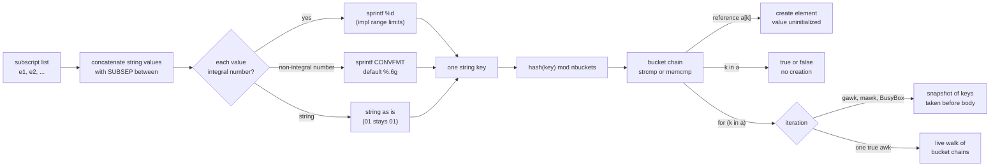

# awk Associative Arrays and Idioms

> [!summary] Claim
> An awk array is a string-keyed hash table whose keys are produced by a lossy number-to-string conversion and whose iteration order and mutation-during-iteration behavior differ by implementation, so every portable idiom must fix the key form, never depend on `for (k in a)` order, and never mutate the array it is walking.

Part of [Regular Expressions and Text Processing](README.md) in [Shell and Unix Engineering](../README.md).

## TL;DR

- Mechanism: `a[e1, e2]` becomes one string key `e1 SUBSEP e2`, where integral numbers convert with `"%d"` and others with `CONVFMT`, and the key indexes a chained hash table that every reference (but not `in`) grows.
- Rule: test membership with `(k in a)`, keep order in a second array (`order[++n] = k`), and sort output with `sort` rather than trusting `for (k in a)`.
- Trap: `for (k in a)` is a snapshot in gawk, mawk, and BusyBox but a live walk of the hash chains in the one true awk, so adding or deleting elements inside the loop gives different iteration counts (lab: 4 versus 5 visits for the same program).
- Portability fact: `delete a` and `length(a)` are POSIX only since POSIX.1-2024, `SUBSEP` is implementation-defined (all four common awks use `"\034"`), and arrays of arrays, `asort`, and `PROCINFO["sorted_in"]` are gawk-only.
- When not to use it: when the key set does not fit in RAM (about 100 to 360 bytes per element measured here), when keys come from an attacker and the awk is the one true awk or BusyBox (a 65536-key collision set took 12.7 s against 0.09 s, and 12.6 s against 0.04 s), or when you need ordered or nested structures portably.

## Mental model



A subscript expression list is first collapsed into exactly one string: each expression is converted to a string (integral numbers through `"%d"`, other numbers through `CONVFMT`, strings untouched) and the pieces are joined with the current value of `SUBSEP`.
That string is hashed into a bucket of a chained hash table, and the chain is searched by string comparison.
A plain reference such as `a[k]` on the right-hand side of an expression installs the key with the uninitialized value if it is missing, while `(k in a)` only searches.
`for (k in a)` then visits keys in bucket order, either from a key list built before the loop body runs (gawk, mawk, BusyBox) or by walking the live chains (the one true awk), which is why mutation inside the loop is the most implementation-dependent corner of the language.

## How it works

### What the standard requires

POSIX.1-2024 defines awk arrays in the EXTENDED DESCRIPTION, subsection "Expressions in awk", of the `awk` utility page (POSIX.1-2024 XCU awk, Expressions in awk).
Arrays "need not be declared", "shall initially be empty", and their "subscripts, or element identifiers, are strings, providing a type of associative array capability".
An unsubscripted array name may appear only as a function parameter or argument, after the keyword `in`, or after `delete`.
A comma-separated index is "converted to a single string by concatenating the string values of the separate expressions, each separated from the other by the value of the SUBSEP variable", so `var[expr1, expr2]` and `var[expr1 SUBSEP expr2]` are the same element.
"The in operator, which tests for the existence of a particular array element, shall not cause that element to exist. Any other reference to a nonexistent array element shall automatically create it."
A multi-dimensional index used with `in` must be parenthesized: `((i, j) in a)`.
The default value of `SUBSEP` "is implementation-defined" (POSIX.1-2024 XCU awk, Variables and Special Variables).

The number-to-string rule decides which element a numeric subscript names.
"A numeric value that is exactly equal to the value of an integer ... shall be converted to a string by the equivalent of a call to the sprintf function ... with the string "%d""; "any other numeric value shall be converted ... with the value of the variable CONVFMT" (POSIX.1-2024 XCU awk, Expressions in awk).
The rationale records why `CONVFMT` exists at all: `OFMT` is restricted to output, and `CONVFMT` "is used for internal conversions, such as comparisons or array indexing" (POSIX.1-2024 XCU awk, RATIONALE).
So `a[1/3]` is `a["0.333333"]`, `a[0.1 + 0.2]` is `a["0.3"]`, and `a[01]` (a numeric constant) is `a["1"]`, while `a["01"]` stays a distinct element; the lab proves all four on every awk (run on gawk, mawk, the one true awk, and BusyBox awk in the shell matrix images, 2026-11-14).

Iteration and deletion are specified in "Actions" (POSIX.1-2024 XCU awk, Actions).
`for (variable in array)` iterates "assigning each index of array to variable in an unspecified order", and "the results of adding new elements to array within such a for loop are undefined".
The standard is silent on deleting elements other than the current one during the loop; the lab shows that implementations split on it.
`delete array[index]` removes one element, and `delete array` removes all; Austin Group Defects 544 and 1136 made the unsubscripted form mandatory in Issue 8, and the rationale notes that `split("", array)` has "the same effect and efficiency" (POSIX.1-2024 XCU awk, RATIONALE and CHANGE HISTORY).
`length(array)` returning the element count is also new in Issue 8 (Austin Group Defect 1566).
`split(s, a, fs)` deletes all elements of `a` first and stores `a[1]` to `a[n]` with numeric-string values where appropriate (POSIX.1-2024 XCU awk, String Functions).
Function parameters that are arrays are passed by reference, and extra parameters used as arrays "shall be treated as uninitialized arrays" (POSIX.1-2024 XCU awk, User-Defined Functions), which is the only way to get a local array.
The same name may not be both a scalar and an array in one scope (POSIX.1-2024 XCU awk, Variables and Special Variables).

### The one true awk (BWK awk, macOS and FreeBSD `awk`)

Every array is an `Array` (`nelem`, `size`, `tab`) of chained `Cell` lists, created by `makesymtab(NSYMTAB)` with `NSYMTAB 50` buckets (onetrue `awk.h`; `tran.c`, `makesymtab`).
`setsymtab` appends a cell and calls `rehash` when `nelem > FULLTAB * size`, with `FULLTAB 2` and `GROWTAB 4`, so the table quadruples whenever the average chain passes two (onetrue `tran.c`, `setsymtab`, `rehash`).
The hash is `hashval = (*s + 31 * hashval)` over a NUL-terminated string, reduced `% n` (onetrue `tran.c`, `hash`), which is the same polynomial as Java's `String.hashCode`; keys are compared with `strcmp` and copied with `tostring` (onetrue `tran.c`, `lookup`), so a key cannot contain a NUL byte and a record `a<NUL>b` becomes the key `a` (lab: `length` of the stored key is 1).
`makearraystring` builds the joined subscript by appending each expression's `getsval` and `SUBSEP` (onetrue `run.c`, `makearraystring`), and `getsval` formats an integral value with `"%.30g"` (onetrue `tran.c`, the `update_str_val` macro around `modf`), so `a[1e30]` is `a["1.00000000000000001988462483866e+30"]` (lab, macOS `awk version 20200816`).
`array()` calls `setsymtab` and so creates the element; `intest()` calls only `lookup` (onetrue `run.c`, `array`, `intest`).
`awkdelete` with no subscript frees the whole table and allocates a fresh one; with a subscript it calls `freeelem` (onetrue `run.c`, `awkdelete`).
`instat`, the `for (k in a)` loop, walks `tp->tab[i]` from bucket 0 upward and saves `ncp = cp->cnext` before running the body (onetrue `run.c`, `instat`), with the source comment "this routine knows too much".
Consequences, read from that code: deleting the current element is safe, a newly added element is visited if it lands in a later bucket, an element deleted from a later bucket is never visited, and a body that deletes the saved next cell or deletes the whole array (`awkdelete` calls `freesymtab`, which frees the cells and the `Array` that `instat` still holds as `tp`) makes the loop read freed memory (derived from the source; the lab does not run these cases because they are memory errors).
A body that triggers `rehash` does not touch freed memory, because `rehash` relinks the existing cells into a table four times larger and frees only the old bucket vector, which `instat` rereads as `tp->tab[i]`; but the walk then continues at bucket `i` of the new layout, so keys can be visited twice or skipped (onetrue `tran.c`, `rehash`).

### gawk 5.4.1

gawk selects an array implementation per array when the first element is stored: `null_lookup` asks each registered type in reverse order whether it accepts the subscript, with `str_array_func` as the default and `int_array_func` and `cint_array_func` registered unless `-M` (MPFR) is in force (gawk-5.4.1 `array.c`, `array_init`, `null_lookup`).
`cint_array` stores non-negative integers in power-of-two leaf arrays indexed by `1 + floor(log2(n))`, a design the source credits to Bagwell's "Fast Functional Lists" (2002) and whose comment warns that "worst case memory waste > 99%" (gawk-5.4.1 `cint_array.c`).
`is_integer` accepts only values in the `int32_t` range whose string form is a standard integer, so `"03"` and `"+3"` stay string subscripts while `3` and `"3"` are the same element (gawk-5.4.1 `int_array.c`, `is_integer`).
String keys go to `str_array`: chained buckets, grown by `grow_table` through the primes 13, 127, 1021, 8191, 16381, and on up to 1073741827 when `table_size / array_size > STR_CHAIN_MAX`, with `STR_CHAIN_MAX = 10` in 5.4.1 (the comment records "2/2025: Bump it back up to 10") and overridable through the `STR_CHAIN_MAX` environment variable (gawk-5.4.1 `str_array.c`, `str_lookup`, `grow_table`).
The default hash is `awk_hash`, "Ozan Yigit's original sdbm hash"; `AWK_HASH=gst` or `AWK_HASH=fnv1a` in the environment selects another (gawk-5.4.1 `str_array.c`, `str_array_init`, `awk_hash`).
Keys are counted strings, so a NUL byte survives (lab: key length 3).
`Op_arrayfor_init` builds the full list of subscripts with `assoc_list` before the first iteration, and `Op_arrayfor_incr` just steps through that list; at the end of the list, with `--lint`, it warns when the array "changed size ... during loop execution" (gawk-5.4.1 `interpret.h`, `Op_arrayfor_incr`).
The list may be sorted: unless `--posix` is given, a non-empty `PROCINFO["sorted_in"]` names an order such as `@ind_str_asc`, `@ind_num_asc`, `@val_num_desc`, or `@val_type_asc`, or a user comparison function (gawk-5.4.1 `interpret.h`, `array.c` table `sort_funcs`).
`asort` and `asorti` reuse the same machinery, defaulting to `@val_type_asc` and `@ind_str_asc` (gawk-5.4.1 `array.c`, `asort_actual`).
gawk also has true arrays of arrays (`a[i][j]`), `isarray`, `typeof`, and the `SYMTAB` array, none of them portable (gawk-5.4.1 `doc/gawk.texi`, nodes "Arrays of Arrays" and "Auto-set").

### mawk 1.3.4

mawk's `ARRAY` is a dual structure: a split table (`AY_SPLIT`, a plain C vector filled by `split()`), or a hash table of `DUAL_LINK` heads whose nodes sit on an integer chain, a string chain, or both (`AY_INT`, `AY_STR`) (mawk `array.h`; `array.c`, `ANODE`).
A split array stays a vector while it is accessed with integers `1..size`; any other access converts it with `convert_split_array_to_table` (mawk `array.c`, `array_find`).
The table starts at `STARTING_HMASK 63` (64 buckets) and doubles when the average list passes `MAX_AVE_LIST_LENGTH 12` (mawk `array.c`).
String keys hash with 32-bit FNV-1 (`hash2` in mawk `hash.c`) and carry a length, so NUL bytes are representable.
An integral double becomes an `Int` through `d_to_I`, which clamps at `Max_Int` (mawk `cast.c`); when the clamped value is not equal to the double, `array_find` formats the key with `CONVFMT` instead, so `a[1e30]` is `a["1e+30"]` (mawk `array.c`, `array_find`; `Int` is `int64_t` when `<stdint.h>` provides it, per mawk `sizes.h`).
`for (k in a)` takes a vector of key strings from `array_loop_vector` before the body runs; with `WHINY_USERS` set in the environment that vector is `qsort`ed with `strcmp` (mawk `array.c`, `array_loop_vector`; `execute.c`, `SET_ALOOP`), a gawk 3.1 feature that gawk itself removed in 4.0.0 (mawk(1), ENVIRONMENT).

### BusyBox awk 1.37

BusyBox uses one `xhash` type for variables, functions, files, and arrays: `hash_init` allocates `FIRST_PRIME 61` buckets, and `hash_find` calls `hash_rebuild` when `++nel > csize * 8`, stepping through `PRIMES[] = { 251, 1021, 4093, 16381, 65521 }` (BusyBox `editors/awk.c`).
After 65521 buckets `hash_rebuild` returns without growing, so chains grow linearly: about 15 entries per bucket at one million keys and about 153 at ten million (arithmetic on those constants).
The hash is `idx = *name++ + (idx << 6) - idx`, that is `63 * idx + c`, over a NUL-terminated name compared with `strcmp` (BusyBox `editors/awk.c`, `hashidx`, `hash_search3`).
`fmt_num` prints an integral value with `"%lld"` only when `n == (long long)n`, and otherwise uses `CONVFMT` (BusyBox `editors/awk.c`, `fmt_num`), which sends `1e30` to `"1e+30"` (lab `bigkey`, measured in the Alpine and Debian matrix images).
`getvar_s` stores the formatted string in the variable and sets `VF_CACHED`, and nothing clears that flag when `CONVFMT` changes, so a variable converted once keeps its old string: after `x = 12.153; d[x] = 1; CONVFMT = "%2.2f"`, `(x in d)` is still true in BusyBox, while gawk, mawk, and the one true awk reformat `x` as `12.15` and miss (BusyBox `editors/awk.c`, `getvar_s`; lab `convfmt`, measured in the shell matrix).
Records are C strings too: `awk_getline` looks for the record separator with `strchr` and, failing that, takes a NUL byte as the end of the record, so the input `a<NUL>b<newline>` is two records, `a` and `b` (BusyBox `editors/awk.c`, `awk_getline`; lab `nulkey`, measured in the shell matrix).
Debian's `busybox` package (1:1.37.0-6+b9) is built without awk math support, so `^` aborts with "Math support is not compiled in" there while Alpine's BusyBox 1.37.0 evaluates it (measured in the shell matrix).
`hashwalk_init` copies every key name into a `walker_list` buffer before the loop starts, and `hashwalk_next` hands them out one by one (BusyBox `editors/awk.c`), so BusyBox iterates a snapshot; nested loops over the same variable chain their walkers through `prev`.

### Down to the system call

None of this touches the kernel directly: arrays live in the awk process heap, so the observable system-call footprint of a large array is `brk` or `mmap` growth from `malloc`, and the cost model is the allocator plus cache misses on chain walks.
That is why the limits below are memory per element and chain length, not file descriptors or pipe sizes.

## Numbers and limits

| Quantity | Value | Source |
|---|---|---|
| Default `SUBSEP` | `"\034"` (0x1C) in gawk, onetrue, mawk, BusyBox; POSIX: implementation-defined | onetrue `tran.c`; mawk `bi_vars.c`; BusyBox `awk.c`; lab `subsep` asserts `SUBSEP == "\034"` |
| onetrue initial buckets, growth | 50 buckets; x4 when elements > 2 x buckets | onetrue `awk.h` `NSYMTAB`, `tran.c` `FULLTAB`, `GROWTAB` (as of 2026-11) |
| gawk string table | primes 13 to 1073741827; grow when average chain > 10 | gawk-5.4.1 `str_array.c` |
| gawk integer arrays | `int32_t` range; cint leaf size up to 2^10 (`NHAT = 10`) | gawk-5.4.1 `int_array.c`, `cint_array.c` |
| mawk table | 64 buckets; doubles when average list > 12 | mawk `array.c` (`$MawkId: array.c,v 1.32 2026/01/17`) |
| BusyBox table | 61 buckets; up to 65521; grow when elements > 8 x buckets; no growth beyond | BusyBox `editors/awk.c` (master, fetched 2026-11-14) |
| 1M integer keys `a[i] = i` | macOS awk 20200816: 0.32 s, 107 MB max RSS; gawk 5.4.1: 0.15 s, 146 MB | measured here once, Apple M3 Pro, `/usr/bin/time -l`, 2026-11-14 |
| 1M string keys `a["k" i] = i` | macOS awk: 0.39 s, 107 MB; gawk: 0.31 s, 356 MB | measured here once, same host |
| 16384 colliding keys (`Aa`/`BB` x 14) | macOS awk 0.50 s versus 0.02 s for distinct keys; gawk 0.02 s | measured here once, same host |
| 65536 colliding keys (`Aa`/`BB` x 16) | macOS awk 12.68 s real, 6.60 s user, versus 0.09 s; gawk 0.07 s | measured here once; 4x keys cost about 16x user time, the quadratic signature; a second run on 2026-11-14 gave 9.47 s real, 6.55 s user |
| 65536 colliding keys (`A~`/`B?` x 16) | BusyBox awk 1.37.0: 12.57 s real, 12.49 s user, versus 0.04 s for distinct keys | measured once in the Alpine matrix image (aarch64, same host), 2026-11-14 |
| Subscript of `1e30` | gawk `1000000000000000019884624838656`; onetrue `1.00000000000000001988462483866e+30`; mawk and BusyBox `1e+30` | lab `bigkey`, run on all four in the shell matrix images (mawk 1.3.4 20250131, original-awk 20250116, BusyBox 1.37.0, gawk 5.2.1) and on the host (macOS awk, gawk 5.4.1) |

The collision set works because, under the one true awk's hash, `"Aa"` and `"BB"` both hash to `65 * 31 + 97 = 66 * 31 + 66 = 2112`, and the polynomial makes every equal-length concatenation of colliding blocks collide on the full 32-bit value, so no table size separates them and every insert scans one chain.
BusyBox's `63 * idx + c` has the same structure (for example `"A~"` and `"B?"` both give 4221), and the 65536-key set built from those blocks is just as quadratic there: 12.57 s against 0.04 s (measured in the shell matrix, Alpine BusyBox 1.37.0).

## Portability

The shell only quotes and launches the awk program, so the array semantics depend on which awk runs, never on the shell under test.
The lab runs every assertion under each shell of the vault matrix with identical expected values; on this host it ran under macOS `/bin/sh` (bash 3.2.57 in POSIX mode), and every mode was also run once under `sh` in the Debian 13 image (mawk 1.3.4 20250131, gawk 5.2.1, original-awk 20250116, BusyBox awk 1.37.0) and the Alpine 3.22 image (BusyBox awk 1.37.0) on 2026-11-14.

| Environment | Effect on array behavior | Evidence |
|---|---|---|
| POSIX sh, bash 3.2, bash 5.x, dash, ksh93, mksh, yash, posh, BusyBox ash | None: the single-quoted program reaches awk unchanged | lab runs the same assertions under each `LAB_SHELL` |
| zsh native and `zsh --emulate sh` | None, provided a multi-word awk command is split with `eval`, because native zsh does not field split `$AWK` | lab `run_awk` uses `eval`; native zsh splitting measured in the shell matrix |

| Feature | POSIX.1-2024 | gawk 5.4.1 | onetrue (macOS 20200816, Debian 20250116) | mawk 1.3.4 | BusyBox awk 1.37.0 |
|---|---|---|---|---|---|
| `(k in a)` does not create, `a[k]` does | required | yes (lab) | yes (lab) | yes (lab, matrix) | yes (lab, matrix) |
| Integral subscripts via `%d`, others via `CONVFMT` | required | yes (lab `keys`, `convfmt`) | yes (lab) | yes (lab, matrix) | yes (lab, matrix) |
| Stored variable rekeyed after a `CONVFMT` change | conversion uses `CONVFMT` | yes (lab `convfmt`) | yes (lab) | yes (lab, matrix) | no: cached string kept (lab, matrix) |
| Integral but huge (`1e30`) | `%d`, range unspecified | full integer digits | `%.30g` | `CONVFMT` | `CONVFMT` |
| Default `SUBSEP` | implementation-defined | `"\034"` | `"\034"` | `"\034"` | `"\034"` |
| `for (k in a)` model | order unspecified, adding undefined | snapshot | live chain walk | snapshot | snapshot |
| Visits in gawk's `loopcheck` program | undefined | 4 (lab) | 5 (lab, macOS) | 4 (gawk manual; lab, matrix) | 4 (source; lab, matrix) |
| Deleted later keys still visited | unspecified | yes (lab) | no (lab) | yes (source; lab, matrix) | yes (source; lab, matrix) |
| NUL byte in a key | input with NUL: undefined in EREs | kept (lab) | truncated (lab) | kept (source; lab, matrix) | ends the record: `a<NUL>b` is two records (source; lab, matrix) |
| `delete a`, `length(a)` | required since Issue 8 | yes | yes (`delete a` since Aug 15, 1995; `length(a)` since Jan 1, 2002) | yes | yes |
| Sorted iteration | none | `PROCINFO["sorted_in"]` (not under `--posix`) | none | `WHINY_USERS` env (string order) | none |
| Arrays of arrays, `asort`, `asorti`, `isarray`, `typeof` | none | yes | no | no | no |

The BusyBox column also depends on the build: Debian's `busybox` 1:1.37.0-6+b9 has no awk math support, so `^` fails with "Math support is not compiled in", while Alpine's BusyBox 1.37.0 evaluates it (measured in the shell matrix); the lab writes 2^53 as the constant `9007199254740992` for that reason.
GNU coreutils and uutils coreutils ship no awk (the uutils README lists no `awk`, as of 2026-11), so on a uutils system `awk` is still one of the four above.
Version detail for the one true awk: `FIXES.1e` records "delete arrayname is now legal; it clears the elements but leaves the array, which may not be the right behavior" under Aug 15, 1995, and "length(arrayname) returns number of elements" under Jan 1, 2002, so both predate their standardization by decades.

## Worked example

The [lab](../labs/07-awk-associative-arrays-and-idioms/) is one driver, `idioms.sh MODE [FILE...]`, with the awk chosen by the `AWK` environment variable, and a `test.bats` that runs every mode under every installed awk and asserts each implementation's output.
Excerpt (verbatim lines from `idioms.sh`): the invocation helper and four of the modes.

```sh
# run_awk ARG...: run the awk named by AWK (one or more words, for example "busybox awk").
# eval splits AWK in every shell, including native zsh, which does not split unquoted expansions.
run_awk() {
  eval "${AWK:-awk}"' "$@"'
}
```

```sh
  keys)
    # Integer values convert with "%d"; others through CONVFMT ("%.6g"); string subscripts stay as written.
    # 2^53 is written as a constant: Debian's BusyBox awk is built without "^" ("Math support is not compiled in").
    run_awk 'BEGIN { a[01]; a["01"]; a[0.1 + 0.2]; a[1 / 3]; a[9007199254740992]; for (k in a) print k }' | LC_ALL=C sort
    ;;
  bigkey)
    # An integral value beyond the C integer range: the spec says "%d", implementations disagree.
    run_awk 'BEGIN { a[1e30]; for (k in a) print k }'
    ;;
```

```sh
  loop-add)
    # The loopcheck program from the gawk manual: add elements inside for-in, count iterations.
    run_awk 'BEGIN {
      a["here"]; a["is"]; a["a"]; a["loop"]
      for (i in a) { j++; a[j] = j; n++ }
      print "visited=" n, "size=" length(a)
    }'
    ;;
  loop-delete)
    # Delete every other element during the first iteration; count iterations and live keys seen.
    run_awk 'BEGIN {
      a["x"]; a["y"]; a["z"]
      for (k in a) {
        n++
        if (k in a) live++
        if (n == 1) for (o in a) if (o != k) delete a[o]
      }
      print "visited=" n, "live=" live, "size=" length(a)
    }'
    ;;
```

Captured on this host (`AWK=awk` is macOS `awk version 20200816`, `AWK=gawk` is GNU Awk 5.4.1), one line per mode with `|` marking newlines:

```text
awk keys: 0.3|0.333333|01|1|9007199254740992|
awk bigkey: 1.00000000000000001988462483866e+30|
awk loop-add: visited=5 size=9|
awk loop-delete: visited=1 live=1 size=1|
gawk keys: 0.3|0.333333|01|1|9007199254740992|
gawk bigkey: 1000000000000000019884624838656|
gawk loop-add: visited=4 size=8|
gawk loop-delete: visited=3 live=1 size=1|
```

The same modes in the shell matrix images (Debian `mawk` 1.3.4 20250131, Alpine BusyBox awk 1.37.0), run once on 2026-11-14:

```text
mawk keys: 0.3|0.333333|01|1|9007199254740992|
mawk bigkey: 1e+30|
mawk loop-add: visited=4 size=8|
mawk loop-delete: visited=3 live=1 size=1|
busybox awk keys: 0.3|0.333333|01|1|9007199254740992|
busybox awk bigkey: 1e+30|
busybox awk loop-add: visited=4 size=8|
busybox awk loop-delete: visited=3 live=1 size=1|
```

The tests assert `1e+30`, `visited=4 size=8`, and `visited=3 live=1 size=1` for mawk and BusyBox awk, which the source predicted and the run above confirms; Debian's original-awk 20250116 matches macOS awk on all four modes.
The other modes are the idioms every awk programmer needs; all of them print the same output on every awk (asserted for all four, and run on all four in the shell matrix images):

| Mode | Program core | Output |
|---|---|---|
| `dedupe` | `!seen[$0]++` | `b`, `a`, `c` from `b a b c a` |
| `count` | `{ c[$1]++ } END { for (k in c) print k, c[k] }` then `sort` | `a 2`, `b 2`, `c 1` |
| `distinct` | `!seen[$1, $2]++ { n[$1]++ }` | `u1 2`, `u2 1` |
| `group` | `!($1 in g) { order[++n] = $1; ... }` | `x 1,3`, `y 2,5`, `z 4` in first-seen order |
| `transpose` | `m[NR, i] = $i`, then print by column | `1 4`, `2 5`, `3 6` |
| `join` | `NR == FNR { name[$1] = $2; next } $2 in name` | `o1 2 bob`, `o3 1 alice` |
| `antijoin-robust` | `FILENAME == ARGV[1] { known[$1]; next } !($2 in known)` | all three orders when the first file is empty |
| `reverse-bug` | `{ l[lines] = $0; ++lines }` | `[l3]`, `[l2]`, `[]`: line 1 was stored under `""` |
| `max-bug` | `{ if ($2 > m[$1]) m[$1] = $2 }` on `-5`, `-7` | `c=`: the missing element compared as 0 |
| `max-fixed` | `!($1 in m)` or-ed with `$2 > m[$1]` | `c=-5` |
| `byref` | `function count(x,    tmp)` | `1 1 2 2`: `tmp` is a fresh local array per call |

## Pitfalls

> [!warning] Relying on `for (k in a)` order
> Trigger: printing a report straight from `for (k in a)`, or a test that compares that output to a golden file.
> Symptom: the order changes between gawk, mawk, BusyBox, and the one true awk, and in gawk also with the array's internal type (integer keys go to `cint_array`, strings to `str_array`).
> Fix: pipe through `LC_ALL=C sort`, keep insertion order in `order[++n] = k`, or, gawk-only, set `PROCINFO["sorted_in"]`.

> [!warning] Mutating the array you are iterating
> Trigger: adding keys, deleting keys other than the current one, or `delete a` inside `for (k in a)`.
> Symptom: the lab's `loopcheck` visits 4 keys in gawk and 5 in the one true awk; deleting later keys still visits them in snapshot awks (and `a[k]` then silently re-creates them), and in the one true awk deleting the saved next cell or the whole table reads freed memory (onetrue `run.c`, `instat`).
> Fix: collect the keys to change in a second array, finish the loop, then apply the changes; deleting only the current key is the one safe mutation everywhere.

> [!warning] Testing for existence with a reference
> Trigger: `if (a[k] != "")` or `if (a[k])` to ask whether `k` is present.
> Symptom: the test creates `a[k]`, so `length(a)` grows, a later `for (k in a)` sees phantom keys, and a key whose value is `0` or `""` reads as absent (lab `autoviv`: `empty 1 0`).
> Fix: `(k in a)`; for multi-part keys `((i, j) in a)`.

> [!warning] Uninitialized or mixed-type subscripts
> Trigger: `l[lines] = $0; ++lines` with `lines` unset, or storing under `$1` from input `"01"` and looking up with the number `1`.
> Symptom: the first line is stored under `""`, not `"0"` (lab `reverse-bug`, also in the gawk manual node "Uninitialized Subscripts"); `"01"` and `1` are different elements (lab `keys`).
> Fix: use `l[lines++]` or initialize counters; normalize keys explicitly with `$1 + 0` or `$1 ""` at the point of storage and lookup.

> [!warning] `CONVFMT` and float subscripts
> Trigger: `a[x]` with a non-integral `x`, then a change of `CONVFMT`, or two distinct floats that agree to six significant digits.
> Symptom: `a[12.153]` is missed after `CONVFMT = "%2.2f"` in gawk, mawk, and the one true awk, but still found in BusyBox, which keeps the string it cached for `x` at the store (lab `convfmt`; BusyBox `getvar_s`); `a[1/3]` and `a[0.333333]` are one element; `a[1e30]` names one of three different strings depending on the implementation (lab `bigkey`).
> Fix: never subscript by computed floats; build keys with `sprintf` and an explicit format.

> [!warning] `SUBSEP` collisions
> Trigger: `a[$1, $2]` where fields can contain byte 0x1C, or a changed `SUBSEP` that also appears in the data.
> Symptom: `a["1" SUBSEP "2", "3"]` and `a["1", "2" SUBSEP "3"]` are one element (lab `subsep`: length 1), and `split(k, p, SUBSEP)` returns the wrong parts.
> Fix: choose a separator that the input cannot contain, or validate input with `index($0, SUBSEP) == 0`.

> [!warning] `NR == FNR` with an empty first file
> Trigger: the two-file join or anti-join idiom when the lookup file is empty, for example after an upstream job produced nothing.
> Symptom: `NR == FNR` is true throughout the second file, so the data file is loaded as the lookup table and nothing is printed (lab: the naive anti-join prints nothing, the robust one prints all three orders).
> Fix: `FILENAME == ARGV[1]` (an empty file yields no record, so no record is ever tested while `FILENAME` names it; lab `antijoin-robust`, run on all four awks), or check the file with `[ -s file ]` in the shell first; counting files with `FNR == 1 { f++ }` fails the same way, because an empty file has no first record.

> [!warning] Implicit zero in comparisons with missing elements
> Trigger: `if ($2 > max[$1]) max[$1] = $2` for a key's first record.
> Symptom: the uninitialized element compares as numeric 0, so all-negative groups report an empty maximum (lab `max-bug`: `c=`).
> Fix: `!($1 in max) || $2 > max[$1]`.

> [!warning] Memory blow-up on high-cardinality keys
> Trigger: `!seen[$0]++` or `count[$1]++` over a stream with tens of millions of distinct keys.
> Symptom: resident memory grows by about 107 bytes per key in the one true awk and 146 to 356 bytes in gawk on this host until the process is killed; BusyBox stops growing its table at 65521 buckets and degrades to long chains instead.
> Fix: `sort -u` or `sort | uniq -c`, which spill to disk, or a real database for joins.

## Security and robustness

- Hash flooding is real in the one true awk: its unseeded `31 * h + c` hash admits trivially generated collision sets, and 65536 such keys turned a 0.09 s job into 12.68 s on this host; any awk counting attacker-supplied keys (log fields, HTTP paths, user names) is a CPU denial-of-service target.
  BusyBox is just as exposed: 65536 keys built from `A~` and `B?` took 12.57 s against 0.04 s for distinct keys (measured in the shell matrix, Alpine BusyBox 1.37.0).
  gawk (sdbm) and mawk (FNV-1) also use fixed hash functions with no per-process seed, so collision sets for them are computable offline; none was constructed here, so their practical exposure is unmeasured (as of 2026-11).
- BusyBox awk has a record of memory-safety bugs reachable from "a crafted awk pattern", including a use-after-free in `hash_init` (CVE-2021-42381, versions before 1.34.0) and in `clrvar` (CVE-2021-42380), and use-after-free bugs in `evaluate` and `copyvar` in 1.36.1 (CVE-2023-42364, CVE-2023-42365); treat awk programs as code and never build them from untrusted input.
- The one true awk fixed "a use-after-free bug with ARGV for "delete ARGV"" on May 4, 2024 (onetrue `FIXES`), which is an array-deletion bug in the interpreter itself.
- Keys from input are data, not code, but a key used later as a file name (`print > k`) or command (`print | k`) is an injection vector; validate keys with an anchored regex before such use.
- A NUL byte truncates keys in the one true awk, so two different records can collide, and in BusyBox it ends the record, so one input line becomes two records and a counter sees keys that never appeared as lines (lab `nulkey`); strip or reject NUL (`tr -d '\000'`) before awk when inputs are untrusted.
- Pass untrusted values into awk through `ENVIRON` or `ARGV`, not by splicing them into the program text (see [[awk-Language]]).

## The principal's view

The decision is not "awk or not" but "is the key set bounded and the key form canonical".
awk's arrays are the cheapest hash join and group-by available on every Unix, with no runtime to install, and they beat a `sort`-based pipeline for small lookup tables because they avoid an `O(n log n)` sort and a second pass.
The trade-off is that the semantics you rely on (key conversion, iteration order, mutation during iteration, NUL handling) are defined by four different code bases, and the POSIX baseline leaves the interesting parts unspecified or undefined.
I standardize on three rules in reviewed code: keys are built explicitly (`sprintf` or string concatenation), membership uses `in`, and any ordered output goes through `sort` or an order array.
For production pipelines that must behave identically on macOS laptops, Alpine containers, and Debian hosts, pin the awk (install gawk and call `gawk` explicitly) or test against all four as this lab does.
Switch tools when the key set exceeds memory (use `sort`, `join`, or SQLite), when you need nested or ordered structures portably (Python or Perl), when keys are attacker-controlled and the awk is the one true awk or BusyBox (use a language with seeded hashing), or when the program grows past a screen of logic.

## Interview questions

> [!question] L5: What is the difference between `if (k in a)` and `if (a[k] != "")`?
>
> > [!success]- Answer
> > `(k in a)` only searches the table and never creates an element.
> > `a[k]` is a reference, and POSIX requires any reference to a nonexistent element to create it with the uninitialized value.
> > So the second form grows the array, makes later `for (k in a)` loops see phantom keys, and misreports keys whose stored value is `""`.
> >
> > Follow-up: How do you test membership for a two-part key?

> [!question] L5: Why does `a[01]` find the same element as `a[1]` but `a["01"]` does not?
>
> > [!success]- Answer
> > Subscripts are always strings.
> > `01` is a numeric constant with value 1, and an integral number converts with `"%d"`, giving `"1"`.
> > `"01"` is already a string and is used as is, so it names a different element.
> > The lab's `keys` mode prints both `01` and `1` as separate keys on every awk.
> >
> > Follow-up: What does `a[$1]` do when the input field is `01`?

> [!question] L5: Predict the output of `printf 'l1\nl2\nl3\n' | awk '{ l[lines] = $0; ++lines } END { for (i = lines - 1; i >= 0; i--) print "[" l[i] "]" }'`.
>
> > [!success]- Answer
> > It prints `[l3]`, `[l2]`, and `[]`.
> > On the first record `lines` is uninitialized, so as a subscript it is the empty string and `l1` is stored under `""`.
> > The loop then asks for `l[0]`, which is the string `"0"`, a different and newly created empty element.
> > Writing `l[lines++] = $0` fixes it because the post-increment yields numeric 0.
> >
> > Follow-up: How many elements does `l` have after the END loop, and why?

> [!question] L6: Explain how `a[i, j]` is stored and when it can collide.
>
> > [!success]- Answer
> > The comma list is converted into one string: each subscript's string value joined with the current `SUBSEP`, which defaults to `"\034"` in gawk, mawk, BusyBox, and the one true awk.
> > Once stored, awk has no record that the key had two parts.
> > If a component itself contains `SUBSEP`, then `a["1" SUBSEP "2", "3"]` and `a["1", "2" SUBSEP "3"]` are the same element.
> > Iterating requires `split(k, parts, SUBSEP)` to recover the parts.
> >
> > Follow-up: What happens to existing keys if the program changes `SUBSEP` halfway through?

> [!question] L6: The same program prints four lines under gawk and five under macOS awk. It adds elements inside `for (k in a)`. Why?
>
> > [!success]- Answer
> > POSIX says adding elements inside the loop has undefined results.
> > gawk builds the list of subscripts before the first iteration (`Op_arrayfor_init` calls `assoc_list`), and mawk and BusyBox also snapshot the keys, so new elements are never visited.
> > The one true awk's `instat` walks the live bucket chains from bucket 0 upward, so a new key that hashes to a later bucket is visited.
> > The count depends on hash positions, so it is deterministic per implementation but not portable.
> >
> > Follow-up: Which mutation inside the loop is safe on all four implementations?

> [!question] L6: Debug this script: `awk 'NR == FNR { bad[$1]; next } !($1 in bad)' blocklist.txt users.txt` sometimes prints nothing at all.
>
> > [!success]- Answer
> > When `blocklist.txt` is empty, the first record read comes from `users.txt`, where `NR` and `FNR` are both 1, and they stay equal for the rest of that file.
> > So every user is loaded into `bad` and skipped by `next`, and nothing reaches the filter.
> > Replace the test with `FILENAME == ARGV[1]`, which an empty first file cannot satisfy; the lab's `antijoin-robust` mode then prints every user.
> > Alternatively check the blocklist size in the shell before running awk.
> >
> > Follow-up: What else breaks if the same file name is passed twice?

> [!question] L6: Why is `CONVFMT` relevant to arrays, and what goes wrong with `a[x]` for a non-integer `x`?
>
> > [!success]- Answer
> > A non-integral number used as a subscript is converted with `sprintf(CONVFMT, x)`, default `"%.6g"`.
> > Two different values that agree to six significant digits become one key, so `a[1/3]` and `a[0.333333]` are the same element.
> > Changing `CONVFMT` after storing makes the same `x` map to a different string, so `(x in a)` turns false; the lab shows `missing` for `x = 12.153` after `CONVFMT = "%2.2f"` in gawk, mawk, and the one true awk, while BusyBox reuses the string it cached for `x` and still prints `found`.
> > Build float keys explicitly with `sprintf` and a fixed format.
> >
> > Follow-up: Which value does `OFMT` affect instead?

> [!question] L7+: A log pipeline uses `awk '{ hits[$7]++ }'` on request paths and occasionally pins a CPU for minutes. What do you suspect, and what do you change?
>
> > [!success]- Answer
> > Hash flooding: the one true awk hashes with an unseeded `31 * h + c`, so blocks like `Aa` and `BB` collide and their concatenations collide on the full hash, which no table resize can separate.
> > Each insert then scans one chain, so the cost is quadratic; on this host 65536 such keys took 12.7 s against 0.09 s for ordinary keys.
> > BusyBox's `63 * h + c` hash has the same weakness (65536 keys from `A~` and `B?` took 12.57 s against 0.04 s in the shell matrix), and it also stops growing its table at 65521 buckets.
> > Mitigate by canonicalizing and bounding keys (truncate, validate against a regex), by using gawk with a non-default hash only as defense in depth, or by moving the aggregation to `sort | uniq -c` or a language with seeded hashing.
> >
> > Follow-up: How would you prove the diagnosis on the production box without reading the awk source?

> [!question] L7+: You must ship one text-processing script that behaves identically on macOS, Alpine, and Debian. Which array features do you allow?
>
> > [!success]- Answer
> > Allow string-keyed arrays, `in`, `delete a[k]`, `delete a`, `length(a)`, `split`, and multi-part keys with a `SUBSEP` checked against the input.
> > Forbid output that depends on `for (k in a)` order, any mutation of an array being iterated other than deleting the current key, float subscripts, and NUL bytes in keys.
> > Forbid gawk extensions: arrays of arrays, `asort`, `asorti`, `PROCINFO["sorted_in"]`, `typeof`, `isarray`.
> > Enforce it with a test matrix over gawk, mawk, the one true awk, and BusyBox, as this note's lab does, because the shell cannot detect which awk will run.
> >
> > Follow-up: When would you instead install gawk and call it by name?

> [!question] L7+: How do gawk's and mawk's array implementations differ from a plain chained hash table, and why?
>
> > [!success]- Answer
> > gawk picks a representation per array at the first store: `cint_array` for non-negative integers (power-of-two leaf arrays), `int_array` for other `int32_t` integers, and `str_array` for strings, because integer-indexed arrays from `split` and `NR` loops dominate real programs.
> > mawk keeps a `split()` result as a plain vector (`AY_SPLIT`) until it is accessed with a non-dense index, then converts to a dual table whose nodes can sit on both an integer and a string chain.
> > Both exist to avoid formatting integers to strings and hashing them on every access, while keeping the string-key semantics POSIX requires.
> > The cost is complexity and iteration order that depends on the representation.
> >
> > Follow-up: What happens to gawk's integer arrays under `-M`?

## Related

Prerequisites: [[awk-Language]]

Next: [[awk-Implementations]]

See also: [[Sed-and-Awk-Stream-Processing]], [[Associative-Arrays]], [[join-and-comm]], [[Locale-and-LC_ALL]], [[Perl-One-Liners]]

## Further reading

- [POSIX.1-2024 `awk`](https://pubs.opengroup.org/onlinepubs/9799919799/utilities/awk.html) - the normative text for subscripts, `SUBSEP`, `in`, `delete`, `for (k in a)`, and the Issue 8 additions `delete a` and `length(a)`.
- [onetrue awk `tran.c`](https://raw.githubusercontent.com/onetrueawk/awk/master/tran.c) - the 50-bucket, grow-by-four symbol table and the `31 * h + c` hash every BWK-derived awk inherits.
- [onetrue awk `run.c`](https://raw.githubusercontent.com/onetrueawk/awk/master/run.c) - `makearraystring`, `array`, `intest`, `awkdelete`, and the live-walking `instat`.
- [gawk 5.4.1 release tarball](https://mirrors.kernel.org/gnu/gawk/gawk-5.4.1.tar.xz) - `array.c`, `str_array.c`, `int_array.c`, `cint_array.c`, `interpret.h`, and the manual's "Arrays" chapter in `doc/gawk.texi`.
- [mawk `array.c`](https://raw.githubusercontent.com/ThomasDickey/mawk-snapshots/master/array.c) - the split-vector and dual-chain design and the `array_loop_vector` snapshot.
- [BusyBox `editors/awk.c`](https://raw.githubusercontent.com/mirror/busybox/master/editors/awk.c) - the capped prime table, `hashidx`, and the `walker_list` snapshot.
- [CVE-2021-42381](https://cveawg.mitre.org/api/cve/CVE-2021-42381) - a use-after-free in BusyBox awk's `hash_init`, a reminder that array code is attack surface.
