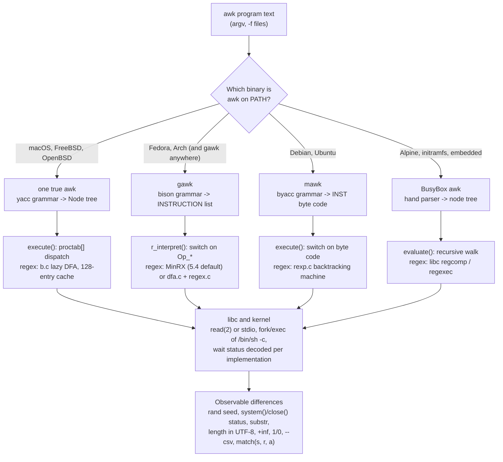

# awk Implementations

> [!summary] Claim
> There is no single `awk`: the four implementations a script actually meets (GNU `gawk`, `mawk`, the one true awk, and BusyBox `awk`) share the POSIX grammar but run it on different engines, with different regex matchers and number printers, and they disagree on a dozen behaviors that POSIX leaves unspecified, so portable `awk` means writing to the intersection and detecting the implementation when you cannot.

Part of [Regular Expressions and Text Processing](README.md) in [Shell and Unix Engineering](../README.md).

## TL;DR

- **Mechanism**: the one true awk walks a yacc parse tree through a function-pointer table, `gawk` (since 4.0.0) and `mawk` compile to byte code run by a `switch` interpreter, and BusyBox walks a hand-parsed node tree; each brings its own regex engine (lazy DFA, MinRX or GNU `dfa`+`regex`, a backtracking machine, or libc `regexec`).
- **Rule**: name the implementation you depend on (`gawk`, or "any POSIX awk"), detect it from `--version` and `-W version`, and test the behaviors you rely on against every `awk` your fleet ships.
- **Trap**: the defaults differ silently: Debian and Ubuntu run `mawk` as `awk`, BusyBox `system()` returns 0 for a child killed by a signal, the one true awk `close()` of a pipe always returns 0, and `rand()` without `srand()` repeated on every run in all four in the shell matrix, including Debian 13's `mawk` 20250131, whose documented clock seed did not take effect.
- **Portability fact**: in the lab, `substr("hello", -1, 3)` is `hel` in `gawk`, the one true awk, and BusyBox but `hell` in `mawk`, `length()` of a two-byte UTF-8 character is 1 only in `gawk` and the one true awk since 2023, and only `gawk` 5.3+ and the one true awk since its 2023 second edition parse `--csv`.
- **When not to use it**: when a script needs a feature outside POSIX (CSV, exact 64-bit integers, sub-match capture, sandboxing), either require `gawk` explicitly or move to [[Python-as-a-Shell-Companion]] rather than guessing which `awk` is on `PATH`.

## Mental model



The first arrow is the one people forget: the name `awk` is resolved through `PATH` to whatever the platform's packaging chose, so the same script runs on four different language engines depending on the base image.
Each engine compiles the program before reading input, but into a different representation: a parse tree for the one true awk and BusyBox, a linear instruction list for `gawk`, and a stack-machine byte code for `mawk`.
Below the engine sits the regex matcher, chosen independently by each implementation, which is why the same `/ERR[0-9]+x/` costs 7x more under one of `gawk`'s two matchers than under the other (measured below).
At the bottom all four meet libc and the kernel, where `system()`, `print | cmd`, and `cmd | getline` start `/bin/sh -c` and get back a raw `wait(2)` status; how each implementation decodes that status is a design choice, and the lab shows that it differs.

## How it works

### Lineage and who ships what

The language is named for Alfred Aho, Peter Weinberger, and Brian Kernighan, who wrote the first version at Bell Labs in 1977; the 1985 "new awk" added user-defined functions, multiple input streams, and computed regular expressions, and shipped widely with System V Release 3.1 in 1987 (GNU Awk User's Guide, History).
POSIX standardized "nawk", the language of the 1988 book, and its RATIONALE lists what it added to historical awk (POSIX.1-2024 XCU awk, RATIONALE).
Four implementations matter in practice (as of 2026-11):

- **The one true awk** (also "BWK awk", "nawk", `original-awk` on Debian): Kernighan's code, maintained by Ozan Yigit and others on GitHub, described in the 2023 second edition of the book, and the `awk` of macOS, FreeBSD, and OpenBSD; `FIXES` dates the second edition to September 2023.
  The repository's `main.c` says `version 20261106`; tags run `20180827`, `20220122`, `20230909`, `20240311`, `20240422`, `20240728`, `20250116`, `20251225`, `20260426`, and `20261106` (GitHub tags API, as of 2026-11).
  FreeBSD `main` carries `version 20250804` and OpenBSD carries `version 20250116` (their `main.c`), while macOS 27.3 still ships `awk version 20200816` (measured on the host).
- **GNU awk (`gawk`)**: written by Paul Rubin in 1986 and completed by Jay Fenlason, maintained by Arnold Robbins, who "Towards the end of 1993 ... became the primary maintainer" (GNU Awk User's Guide, Preface, History of This Book); 5.4.1 is current.
  Fedora's `gawk.spec` installs it as `awk` (`ln -sf gawk %{buildroot}%{_bindir}/awk`) and Arch's `PKGBUILD` declares `provides=('awk')`.
- **`mawk`**: Mike Brennan's independent implementation from 1991, maintained by Thomas Dickey since 2009; the current snapshot is `1.3.4` `20260302` (`patchlev.h`).
  Debian's `mawk` package is `Priority: required` and `Provides: awk` (`debian/control`), so it is `/usr/bin/awk` on Debian 13 and on Ubuntu; Debian 13 ships `mawk 1.3.4 20250131`.
- **BusyBox `awk`**: a single file, `editors/awk.c` (copyright 2002, Dmitry Zakharov), whose Kconfig entry advertises "awk (24 kb)"; it is `awk` on Alpine and on most initramfs and embedded images.

Smaller implementations exist and occasionally appear on `PATH`: GoAWK, a POSIX awk in Go that moved from a tree-walking interpreter to a byte-code compiler and virtual machine and has a CSV mode (GoAWK `README.md`), and toybox's `awk` by Ray Gardner (2024), which still sits in `toys/pending` with `default n` and whose header lists "Lazy field splitting" as a TODO.
The GNU Awk User's Guide also catalogues awka, the OpenSolaris POSIX awk derived from Mortice Kern Systems, libmawk, and others (Appendix B.5).
uutils coreutils reimplements GNU coreutils, which has no `awk`, and its `README.md` does not mention one (as of 2026-11).

### Detecting the implementation

No variable or option is common to all four, so detection is by banner:

- `gawk --version` prints `GNU Awk 5.4.1, API 4.1, ...` and `gawk` exposes `PROCINFO["version"]` (measured: `5.4.1`).
- The one true awk accepts `--version` and `-version` (`main.c`) and prints `awk version 20200816`.
- `mawk -W version` prints `mawk 1.3.4 20250131`, then `random-funcs:`, `regex-funcs:` (`internal` or `external`), and `compiled limits:` lines (`version.c`, `print_version`).
- BusyBox prints its `BusyBox v1.37.0` banner in the usage text for any unknown option.

The lab helper `lab_awk_flavor` runs both `--version` and `-W version` and matches `GNU Awk`, `mawk`, `BusyBox`, and `awk version 20`, in that order, because the one true awk prints "unknown option ... ignored" for `-W` and BusyBox prints usage for `--version`.
Version inside a family matters as much as family: `gawk` 5.2.1 and 5.4.1, and one true awk 20200816 and 20250116, give different answers in the lab, which therefore branches on both.

### Front ends and execution engines

All four compile the whole program before reading any input, but into different structures, and that choice drives speed and observability.

- **One true awk: tree walking.**
  `awkgram.y` (built with `bison` or `yacc`; the README shows 44 shift/reduce and 85 reduce/reduce conflicts) builds `Node` trees, and `execute()` in `run.c` dispatches each node through `proctab[a->nobj-FIRSTTOKEN]`, a function-pointer table generated at build time by `maketab` (`README.md`, `run.c`).
  Every evaluation is a C function call per node, with no separate compile-to-linear-code pass.
- **`gawk`: byte code since 4.0.0.**
  `gawk` 4.0.0 "Merged with John Haque's byte code internals" (`NEWS.1`); the grammar emits `INSTRUCTION` lists and `r_interpret()` in `interpret.h` runs them through a `switch` with 114 `case Op_` labels in 5.4.1 (counted with `grep -c`).
  Since 5.1 `--trace` (`-I`) prints each opcode as it executes (GNU Awk User's Guide, History of gawk Features), which makes the engine directly observable; for `{ s += $2 } END { print s }` on one line the trace includes `Op_get_record`, `Op_push_i`, `Op_field_spec`, `Op_push_lhs`, `Op_assign_plus`, and `Op_K_print` (captured on the host with `gawk` 5.4.1).
  Arrays are a pluggable family (`str_array_func` is the default, with `int_array_func` and `cint_array_func` for integer subscripts, `array.c`), and since 5.2.0 `AWK_HASH=fnv1a` selects a different string hash (`NEWS`).
- **`mawk`: byte code from the start.**
  `parse.y` emits stack-machine code (for example `func2(_BUILTIN, bi_match)` for `match()`), and `execute()` in `execute.c` runs it; `-W dump` "writes an assembler like listing of the internal representation of the program to stdout and exits 0" (`mawk(1)`).
  Its evaluation stack starts at 1024 cells and grows (`EVAL_STACK_SIZE`, `sizes.h`).
- **BusyBox: a hand-written parser and a recursive evaluator.**
  `next_token()` and `parse_expr()` build a tree of `node` structures tagged with `OC_*` opcodes, and `evaluate()` walks it recursively; builtins run in a separate `exec_builtin()` "to reduce stack usage in evaluate()" (`editors/awk.c`).

The measured consequence on one Apple M3 Pro host (macOS 27.3, a 2,000,000-line, 44,786,036-byte file, median of three runs, as of 2026-11): summing a column took 1.509 s in the one true awk 20200816 and 0.312 s in `gawk` 5.4.1, and counting keys in an array took 1.357 s and 0.343 s.
`mawk` and BusyBox were not available on the host, so this note gives no throughput numbers for them.

### Regex engines

The regex engine is a second, independent axis, and it changes both speed and which sub-match wins.

- **One true awk, `b.c`**: compiles each ERE into a position automaton (`first()` and `follow()` collect the leaf sets) and builds DFA states lazily in `cgoto()` as input demands them.
  Regex literals are compiled once at parse time; dynamic regexes (strings used as regexes) go through `makedfa()`, which keeps a 128-entry cache (`#define NFA 128`) keyed by the regex text and anchoring and evicts the least recently used entry.
  Interval expressions `{m,n}` arrived on Mar 5, 2019, backported via NetBSD from Apple awk (`FIXES.1e`), and the repetition count has been capped at 255 since Apr 26, 2026 "to prevent signed integer overflow" (`FIXES`).
  The Nov 6, 2026 entry added an ASCII fast path to the DFA's `gototab` lookup and removed a `strlen()` per decoded character that had made `length()`, `split()`, `substr()`, matching, and `gsub()` quadratic on multibyte records (`FIXES`).
- **`gawk` 5.4: MinRX by default.**
  5.4.0 "now uses Mike Haertel's MinRX regular expression matcher as the default regexp engine"; the old engines remain behind the `GAWK_GNU_MATCHERS` environment variable and "will eventually be removed" (`NEWS`, `README_d/README.matchers`), and `main.c` also has a `-G` option marked "FIXME: command line option is temporary".
  With the GNU matchers, `research()` in `re.c` first runs `dfaexec()` on a `dfasuperset()` of the pattern, then the full DFA, and calls the backtracking `re_search()` only when it needs match positions or the DFA reports a back-reference (`try_backref`); `GAWK_NO_DFA` disables the DFA step.
  MinRX "follows POSIX rules for finding the longest leftmost submatches" (`README.matchers`), and the lab shows the difference: `match("xyz", /(x|xy)(z|yz)/, m)` gives `m[1] = "xy"`, `m[2] = "z"` under MinRX and `x`, `yz` under `GAWK_GNU_MATCHERS=1`.
  It also costs time: `/ERR[0-9]+x/ { n++ }` over the 2,000,000-line file took 1.094 s with MinRX against 0.148 s with the GNU matchers in `en_US.UTF-8`, and 0.855 s against 0.150 s under `LC_ALL=C` (host, median of three, as of 2026-11), because the GNU path answers most lines with the DFA alone.
- **`mawk`, `rexp.c`**: its own matcher, compiled to a machine of `M_STR`, `M_CLASS`, `M_ANY`, `M_U` (for `.*`), jump states `M_1J`, `M_2JA` ("optional (undesirable) jump") and `M_2JB` ("optional (desirable) jump"), and `M_SAVE_POS`/`M_2JC` for loops (`rexp.h`); the `M_2J*` choice points make it a backtracking matcher.
  Brace repetitions are recent and still settling: `M_ENTER` and `M_LOOP` arrived in `20241231`, and `20250131` rewrote nested `+` into `{1,}` "to work with the runtime stack" (`CHANGES`).
  `-W traditional` omits "features such as interval expressions which were not supported by traditional awk" (`mawk(1)`).
- **BusyBox**: no engine of its own; it calls `xregcomp(re, s, REG_EXTENDED)` and libc `regexec()` (`editors/awk.c`), so the matcher, and its locale handling, is glibc's on Debian and musl's on Alpine.
  The GNU Awk User's Guide notes that BusyBox accepts back-references in dynamic regexes, as in `"aa" ~ "(.)\1"`, which is a libc feature leaking through.

See [[Regex-Engines-NFA-DFA-and-Backtracking]] for the engine families and [[POSIX-Leftmost-Longest-Matching]] for the sub-match rule MinRX implements.

### Input, child processes, and wait status

The one true awk reads records with stdio (`getc(inf)` in `readrec()`, `lib.c`), `mawk` reads with `read(2)` into its own `FIN` buffers (`fin.c`), BusyBox uses `safe_read()`, and `gawk` uses its own `IOBUF` layer.
For commands, the one true awk and BusyBox call `popen(3)` and `system(3)`, while `gawk` and `mawk` fork and `execl("/bin/sh", "sh", "-c", cmd, NULL)` themselves (`gawk` `io.c`; `mawk` `files.c`, which keeps a list of reaped children so `wait_for()` can find a status collected early).

The kernel hands every implementation the same 16-bit wait status; what `system()` and `close()` return is a decoding decision:

- `gawk` `sanitize_exit_status()` (`builtin.c`) returns `WEXITSTATUS` for a normal exit and `WTERMSIG + 256` for a signal (`+ 512` with a core dump), for both `system()` and `close()` of a pipe.
- `mawk` `wait_status()` (`files.c`) does the same, `256 + WTERMSIG`, for both; its `system()` has used the POSIX wait macros since `20160918` (`CHANGES`).
- The one true awk `system()` uses the same macros (`WTERMSIG(status) + 256`, plus 256 more for a core dump, `run.c`) since its "system-status" fix of March 12, 2016 (`FIXES.1e`), but `closefile()` returns `-1` or `0` from whether `pclose()` failed, never the command's status (`run.c`).
- BusyBox computes `system(L.s) >> 8` (`exec_builtin` case `F_sy`), which turns a signal death into 0, and returns the raw `pclose()` value from `close()`, so an exit status of 3 comes back as 768 (`case F_cl`).

POSIX requires only that `close()` "return zero" on success and "non-zero" otherwise (POSIX.1-2024 XCU awk, Input/Output and General Functions), so the one true awk's 0 for a failing command is a defensible reading, and BusyBox's 768 is "non-zero"; neither is what a `gawk` user expects.
See [[Exit-Status-and-Wait-Status]] for the encoding itself.

### Numbers, infinity, and division by zero

All four store numbers as C `double` (`mawk` adds `Long`/`ULong` fast paths for printing integers, `print.c` and `cast.c`), and only `gawk -M` switches to MPFR arbitrary precision, a feature "ON PAROLE" since 5.2.0 because it is maintained by a volunteer rather than the primary maintainer (`NEWS`).
The lab computes `2^64 + 1`: `gawk -M` prints `18446744073709551617`, while the one true awk ignores `-M` with a warning and prints `18446744073709551616`.

Infinity is where formatting diverges:

- `gawk` has printed `+inf`, `-inf`, `+nan`, and `-nan` with an explicit sign since `format_nan_inf()` was added on 2018-07-13, for output and for string conversion (`ChangeLog.1`; in 5.4.1 the function lives in `printf.c` and `r_format_val()` in `node.c` calls it).
- The one true awk adopted the same strings on December 18, 2020 ("Things are now pretty much the same as in gawk", `FIXES.1e`; `get_inf_nan()` in `tran.c`), so macOS 20200816 still prints `inf`.
- `mawk` adds the sign only in `print` (`print.c` formats `"+%g"` for an unsigned infinity), while string conversion goes through `DoubleToString` and `CONVFMT` and yields `inf`.
- BusyBox formats with `snprintf()` and `OFMT` or `CONVFMT` (`fmt_num()`), so it prints `inf`.

Division by zero is fatal in `gawk` ("division by zero attempted", exit 2), the one true awk (`FATAL("division by zero")`, exit 2), and BusyBox (`syntax_error(EMSG_DIV_BY_ZERO)`, which calls `bb_error_msg_and_die`, exit 1), but `mawk` checks only when built with `NOINFO_SIGFPE` (`execute.c`, `case _DIV`), so on IEEE hardware `1 / 0` is `inf` and the program continues.
Since 5.4.1, `gawk` treats a constant division by zero found at parse time as a lint warning and still dies at run time (`NEWS`).

### Strings, locale, and randomness

POSIX says `index`, `length`, `match`, and `substr` "deal with characters", unlike their C namesakes (POSIX.1-2024 XCU awk, APPLICATION USAGE), but only two implementations count characters:

- `gawk` works on wide characters when `gawk_mb_cur_max > 1` (for example `do_substr()` in `builtin.c`).
- The one true awk counted UTF-8 code points from the 2023 second edition (`README.md`: "Functions that process strings now count Unicode code points, not bytes"), and since Oct 30, 2023 only in a multibyte locale ("Disabled utf-8 for non-multibyte locales, such as C or POSIX", `FIXES`); `u8_strlen()` in `run.c` checks `awk_mb_cur_max`.
- `mawk` and BusyBox count bytes (BusyBox `length` is `strlen(L.s)`).

`substr()` with a start below 1 is unspecified in POSIX ("the at most n-character substring of s that begins at position m, numbering from 1"), and the implementations disagree.
`gawk` "treats it as if it was one" because "BWK awk acts this way" (GNU Awk User's Guide, String-Manipulation Functions), BusyBox clamps the start to 0 in C terms, and `mawk` `bi_substr()` runs `n -= i + 1` for a negative C index, which keeps `substr(s, 0, n)` at `n` characters but makes `substr("hello", -1, 3)` four characters long, `hell`.

POSIX leaves the initial `rand()` seed unspecified and says `srand()` with no argument uses "the seconds since the Epoch"; FUTURE DIRECTIONS anticipates requiring a random initial seed (POSIX.1-2024 XCU awk).
`gawk` calls `initstate(1, ...)` on first use (`builtin.c`), the one true awk calls `srandom(1)` at startup (`main.c`), and BusyBox calls libc `rand()` without seeding it, so all three print the same `rand()` on every run; `mawk` is configured by default to seed from `clock_gettime()` in nanoseconds at startup (`bi_funct_init()` and `initial_seed()`, `bi_funct.c`; `--disable-init-srand` turns it off, `configure.in`), and Debian's `rules` passes no such flag.
In practice the seed did not reach the generator in Debian 13's `mawk 1.3.4 20250131` (built with `random-funcs: srandom/random`): in the shell matrix `mawk 'BEGIN { print rand() }'` printed `0.118709` on three runs a second apart, while `srand()` returned a different nanosecond-scale previous seed each run.
Upstream's `20260129` entry reads "improve portability of initialization of srand (Debian #1124627, Original-Mawk #85)" (`CHANGES`); whether that release repeats is not measured here.
`mawk -W random=NUM` sets the seed explicitly (`mawk(1)`).

### Extension surfaces

Beyond POSIX, each implementation has its own surface, and most "portable awk" bugs are an extension used by accident:

- **`gawk`**: `BEGINFILE`/`ENDFILE`, `@include`, `@load`, `@namespace` and (5.4.0) `@nsinclude`, `PROCINFO`, `FPAT`, `gensub()`, `asort()`, three-argument `match()`, time functions, typed regex constants, `--csv` (5.3.0), `-M`, persistent memory through `GAWK_PERSIST_FILE` (5.2.0, "AN EXPERIMENTAL FEATURE"), a C extension API (`gawkapi.h`), `--sandbox`, `--posix`, `--traditional`, `--lint`, `--profile`, and a debugger (`-D`).
- **One true awk**: `**` and `**=`, `func`, `fflush()`, `/dev/stdin`/`/dev/stdout`/`/dev/stderr`, `--csv` and `\u` escapes (second edition), and an "unadvertised" `-safe` (added Jun 17, 1997, and extended to `system()` on Jan 17, 2006, `FIXES.1e`) that makes `system`, `cmd | getline`, and `print |`, `>`, `>>` syntax errors (`lex.c`, `awkgram.y`) and skips `ENVIRON` (`main.c`).
- **`mawk`**: `-W` options `dump`, `exec`, `interactive`, `posix`, `random=`, `sprintf=`, `traditional`, `usage`, and `version`, plus `BINMODE` and the `gawk` time functions (`mawk(1)`); it has no `**` and no `func` (`kw.c` lists `function` only, and `scan.c` reads `*` then optional `=`).
- **BusyBox**: with `FEATURE_AWK_GNU_EXTENSIONS` (default `y`) it adds `-e` and combining `-f` with `-e`, and its token table includes `**`, `func`, `gensub`, the bit functions, `systime`, `strftime`, and `mktime` (`editors/awk.c`).
  Exponentiation, `^` and `**` alike, also needs `FEATURE_AWK_LIBM` (default `y`); without it the evaluator calls `syntax_error(EMSG_NO_MATH)` (`editors/awk.c`), and Debian's `busybox` 1.37.0 package is built that way: in the shell matrix `busybox awk 'BEGIN { print 2 ** 3 }'` and even `2 ^ 3` fail with "Math support is not compiled in" and exit 1, while Alpine's BusyBox 1.37.0 prints `8`.

The GNU Awk User's Guide keeps a feature matrix (Appendix A.7, Common Extensions Summary) whose "Now standard" column lists only `delete` without a subscript, `fflush()`, and `nextfile`; for example it marks `**`, `func`, `\u`, and CSV support as present in BWK awk and `gawk` but not in `mawk`.

## Numbers and limits

| Quantity | Value | Source |
| :--- | :--- | :--- |
| Dynamic-regex DFA cache, one true awk | 128 entries, LRU eviction | `b.c`, `#define NFA 128` and `makedfa()` (as of 2026-11) |
| Regex repetition count cap, one true awk | 255 | `FIXES`, Apr 26, 2026 |
| Function call arguments plus locals, one true awk | 50 | `run.c`, `NARGS`, cited in [[awk-Language]] |
| Opcode `case` labels in `gawk` `r_interpret()` | 114 | `grep -c 'case Op_' interpret.h`, `gawk` 5.4.1 |
| `mawk` sprintf buffer | 8192 bytes, adjustable with `-W sprintf=` | `sizes.h`, `SPRINTF_LIMIT`; `mawk(1)` |
| `mawk` field bank and evaluation stack | 1024 fields per bank (`FB_SHIFT` 10), 1024 initial stack cells | `sizes.h`, `FBANK_SZ` and `EVAL_STACK_SIZE` |
| BusyBox initial hash table size | 61 buckets | `editors/awk.c`, `FIRST_PRIME` |
| BusyBox applet size estimate | 24 kb | `editors/awk.c` Kconfig text |
| Binary size on the host | one true awk 20200816: 465,408 bytes; `gawk` 5.4.1: 1,143,760 bytes | measured with `ls -lL`, macOS 27.3, as of 2026-11 |
| Startup, 200 runs of `BEGIN {}` from a bash loop | one true awk: 1.062 s (about 5.3 ms each); `gawk` 5.4.1: 4.562 s (about 22.8 ms each) | measured on the host, as of 2026-11 |
| Column sum, 2,000,000 lines (median of 3) | one true awk 1.509 s; `gawk` 0.312 s; `gawk` with `GAWK_GNU_MATCHERS=1` 0.269 s | measured on the host (Apple M3 Pro), as of 2026-11 |
| `/ERR[0-9]+x/` count, same file, `en_US.UTF-8` | one true awk 1.947 s; `gawk` MinRX 1.094 s; `gawk` GNU matchers 0.148 s | measured on the host, as of 2026-11 |
| Same, `LC_ALL=C` | one true awk 1.375 s; MinRX 0.855 s; GNU matchers 0.150 s | measured on the host, as of 2026-11 |
| `system("kill -TERM $$")` result | 271 (`256 + 15`) in `gawk`, `mawk`, one true awk; 0 in BusyBox | lab, measured on the host and in the Debian shell-matrix image (as of 2026-11) |
| `close()` of pipes exiting 3 and 5 | `3 5` in `gawk` and `mawk`; `0 0` in one true awk; `768 1280` in BusyBox | lab, same provenance |
| Valid `srand()` argument range | 0 to 2147483647 (`2^31 - 1`) | POSIX.1-2024 XCU awk, `srand` |

## Portability

The shell under test never changes the answer: the lab runs under every shell in the matrix and branches only on the `awk` implementation, because `bash`, `zsh`, `dash`, `ksh93`, `mksh`, `yash`, `posh`, and BusyBox `ash` all exec the same `awk` binary.
The shells matter only through quoting the program, which [[awk-Language]] covers (native `zsh` does not split an unquoted `$opts`).

| Behavior | POSIX.1-2024 | `gawk` (5.2.1 Debian, 5.4.1 host) | `mawk` 1.3.4 | one true awk (20200816 macOS, 20250116 Debian) | BusyBox 1.37.0 |
| :--- | :--- | :--- | :--- | :--- | :--- |
| Platforms where it is `awk` | any | Fedora, Arch | Debian, Ubuntu | macOS, FreeBSD, OpenBSD | Alpine, embedded |
| `rand()` with no `srand()` | seed unspecified | same every run | 20250131 (Debian 13): same every run, although a clock seed is the documented default | same every run | same every run |
| `system()` after `SIGTERM` | unspecified | 271 | 271 | 271 | 0 |
| `close()` of a pipe that exits 3 | zero on success, else non-zero | 3 | 3 | 0 | 768 |
| `2 ** 3` and `func` | not in the grammar | accepted | syntax error | accepted | `func` accepted; `**` gives `8` on Alpine, but fails with "Math support is not compiled in" (exit 1) in Debian's build |
| `substr("hello", -1, 3)` | unspecified for start below 1 | `hel` | `hell` | `hel` | `hel` |
| `length("\303\251")` in `C.UTF-8` / `C` | characters | 1 / 2 | 2 / 2 | 20200816: 2 / 2; 20250116: 1 / 2 | 2 / 2 |
| `print x, (x "")` for `x = 1e308 * 10` | infinities allowed, format unspecified | `+inf +inf` | `+inf inf` | 20200816: `inf inf`; 20250116: `+inf +inf` | `inf inf` |
| `1 / z` with `z = 0` | undefined | fatal, exit 2 | `inf`, continues | fatal, exit 2 | fatal, exit 1 |
| `--csv` | not specified | 5.3.0 and later | no | 20230909 and later | no |
| `match(s, r, arr)` | two arguments only | fills `arr` (5.4 MinRX: `[xy][z]`; 5.2: `[x][yz]`) | syntax error | syntax error | accepted, `arr` left empty |
| `--trace` byte codes | not specified | 5.1 and later | no (`-W dump` instead) | no | no |
| Sandbox | not specified | `--sandbox` | none | `-safe` | none |
| uutils coreutils | not applicable | not applicable | not applicable | not applicable | not applicable: uutils ships no `awk` |

In the four implementation columns, every row except the platform row is asserted by the [lab](../labs/07-awk-implementations/), with two limits: the sandbox row asserts that `--sandbox` and `-safe` refuse `system()` and that `mawk` and BusyBox run it by default (the absence of a sandbox flag comes from their sources), and `-W dump` comes from `mawk(1)`.
The values for one true awk 20200816 and `gawk` 5.4.1 were measured on the host; those for `mawk` 1.3.4 20250131, `gawk` 5.2.1, one true awk 20250116, and BusyBox 1.37.0 were measured by running the lab once in the Debian shell-matrix image, and the Alpine `**` value in the Alpine image (as of 2026-11); every one agrees with the source functions named in How it works except the `mawk` seed and the Debian BusyBox `**`.

## Worked example

The [lab](../labs/07-awk-implementations/) has one script that runs a named probe against any `awk` command, and a test file that loops over every installed `awk` (`lab_awks`) and asserts each implementation's real answer, branching on `lab_awk_flavor` and, where releases differ, on the version banner.

`awk-implementations.sh`:

```sh
#!/bin/sh
# shellcheck disable=SC2016 # every single-quoted program here is awk code, expanded by awk
# Probe the behaviors that differ between awk implementations (gawk, mawk,
# the one true awk, BusyBox awk). Every probe runs the awk command given
# after the probe name, so one script compares any implementation.
#
# usage: awk-implementations.sh PROBE AWK [AWK-ARG...]
#        awk-implementations.sh sandbox OPTION AWK [AWK-ARG...]
# PROBE is one of: all seed system close syntax substr length inf div0 csv
# submatch trace bignum. "all" runs every probe except sandbox. For sandbox,
# OPTION is the implementation's sandbox flag (--sandbox, -safe) or "-" for none.
set -eu

# capture CMD...: run CMD, keep stdout (stderr dropped) in OUT and the exit status in ST.
capture() {
  if OUT=$("$@" 2>/dev/null); then ST=0; else ST=$?; fi
}

probe_seed() {
  # rand() with no srand(): POSIX leaves the initial seed unspecified.
  first=$("$@" 'BEGIN { print rand() }')
  second=$("$@" 'BEGIN { print rand() }')
  if [ "$first" = "$second" ]; then default=same; else default=differs; fi
  first=$("$@" 'BEGIN { srand(1); print rand() }')
  second=$("$@" 'BEGIN { srand(1); print rand() }')
  if [ "$first" = "$second" ]; then seeded=same; else seeded=differs; fi
  printf 'seed: default=%s seeded=%s\n' "$default" "$seeded"
}

probe_system() {
  # The second command makes the shell that system() starts kill itself with SIGTERM (15).
  r=$("$@" 'BEGIN { a = system("exit 3"); b = system("kill -TERM $$"); print a, b }')
  printf 'system: %s\n' "$r"
}

probe_close() {
  # close() of an output pipe whose command exits 3, then of an input pipe that exits 5.
  r=$("$@" 'BEGIN {
    c1 = "cat >/dev/null; exit 3"; print "x" | c1; r1 = close(c1)
    c2 = "exit 5"; c2 | getline line; r2 = close(c2)
    print r1, r2
  }')
  printf 'close: %s\n' "$r"
}

probe_syntax() {
  # Two extensions outside POSIX: the ** operator and the func keyword.
  capture "$@" 'BEGIN { print 2 ** 3 }'
  pow="$OUT/$ST"
  capture "$@" 'func f(x) { return x + 1 } BEGIN { print f(1) }'
  printf 'syntax: pow=%s func=%s\n' "$pow" "$OUT/$ST"
}

probe_substr() {
  # A start position below 1: POSIX does not say how the length is adjusted.
  r=$("$@" 'BEGIN { print substr("hello", 0, 2), substr("hello", -1, 3) }')
  printf 'substr: %s\n' "$r"
}

probe_length() {
  # length() of U+00E9, two bytes in UTF-8, under a UTF-8 locale and under C.
  utf8=$(LC_ALL=C.UTF-8 "$@" 'BEGIN { print length("\303\251") }')
  c=$(LC_ALL=C "$@" 'BEGIN { print length("\303\251") }')
  printf 'length: utf8=%s c=%s\n' "$utf8" "$c"
}

probe_inf() {
  # Overflow to infinity without a division: print uses OFMT, concatenation uses CONVFMT.
  r=$("$@" 'BEGIN { x = 1e308 * 10; print x, -x, (x ""), (-x "") }')
  printf 'inf: %s\n' "$r"
}

probe_div0() {
  capture "$@" 'BEGIN { z = 0; x = 1 / z; print (x > 1e308 ? "inf" : "finite") }'
  printf 'div0: out=%s status=%s\n' "$OUT" "$ST"
}

csv_run() {
  printf '%s\n' 'a,"b,c",d' | "$@" --csv '{ printf "NF=%d 2=<%s>\n", NF, $2 }'
}

probe_csv() {
  # --csv: a quoted field may contain the separator.
  capture csv_run "$@"
  printf 'csv: %s status=%s\n' "$OUT" "$ST"
}

probe_submatch() {
  # Three-argument match() is a gawk extension; it exposes the matcher's subexpression choice.
  prog='BEGIN { match("xyz", /(x|xy)(z|yz)/, m); printf "[%s][%s]", m[1], m[2] }'
  capture "$@" "$prog"
  default="$OUT"
  dst=$ST
  capture env GAWK_GNU_MATCHERS=1 "$@" "$prog"
  printf 'submatch: default=%s gnu=%s status=%s\n' "$default" "$OUT" "$dst"
}

probe_trace() {
  # gawk --trace prints each byte code it executes on stderr.
  out=$(printf 'a 2\n' | "$@" --trace '{ s += $2 } END { print s }' 2>&1) || true
  case $out in
    *"+ Op_field_spec"*"+ Op_assign_plus"*) ops=yes ;;
    *) ops=no ;;
  esac
  printf 'trace: ops=%s\n' "$ops"
}

probe_bignum() {
  # 2^64 + 1 needs 65 bits; a double has a 53-bit significand.
  capture "$@" -M 'BEGIN { print 2^64 + 1 }'
  printf 'bignum: %s\n' "$OUT"
}

probe_sandbox() {
  option=$1
  shift
  if [ "$option" = - ]; then
    capture "$@" 'BEGIN { system("echo ran") }'
  else
    capture "$@" "$option" 'BEGIN { system("echo ran") }'
  fi
  printf 'sandbox: out=%s status=%s\n' "$OUT" "$ST"
}

[ "$#" -ge 2 ] || {
  echo "usage: $0 PROBE AWK [AWK-ARG...]" >&2
  exit 64
}
probe=$1
shift
case $probe in
  all)
    for p in seed system close syntax substr length inf div0 csv submatch trace bignum; do
      "probe_$p" "$@"
    done
    ;;
  seed | system | close | syntax | substr | length | inf | div0 | csv | submatch | trace | bignum | sandbox)
    "probe_$probe" "$@"
    ;;
  *)
    echo "unknown probe: $probe" >&2
    exit 64
    ;;
esac
```

Captured output of `./awk-implementations.sh all awk` (macOS one true awk 20200816) followed by `./awk-implementations.sh all gawk` (`gawk` 5.4.1), on the host:

```text
seed: default=same seeded=same
system: 3 271
close: 0 0
syntax: pow=8/0 func=2/0
substr: he hel
length: utf8=2 c=2
inf: inf -inf inf -inf
div0: out= status=2
csv: NF=1 2=<> status=0
submatch: default= gnu= status=2
trace: ops=no
bignum: 18446744073709551616
seed: default=same seeded=same
system: 3 271
close: 3 5
syntax: pow=8/0 func=2/0
substr: he hel
length: utf8=1 c=2
inf: +inf -inf +inf -inf
div0: out= status=2
csv: NF=3 2=<b,c> status=0
submatch: default=[xy][z] gnu=[x][yz] status=0
trace: ops=yes
bignum: 18446744073709551617
```

Read the two blocks against the Portability table: the same script, the same shell, and twelve probes, of which seven (`close`, `length`, `inf`, `csv`, `submatch`, `trace`, `bignum`) differ between two implementations that both implement POSIX `awk`.

## Pitfalls

> [!warning] Assuming `awk` is `gawk` on Debian and Ubuntu
> - **Trigger**: a script written and tested with `gawk` (for example on Fedora or with Homebrew) runs as `awk` on a Debian-based image.
> - **Symptom**: `2 ** 3` and `func` are syntax errors, `substr(s, -1, 3)` returns one character more, `RS = ""` with a custom `FS` keeps newlines inside fields (see [[awk-Language]]), and whether `rand()` without `srand()` changes between runs depends on the `mawk` build (it repeated in Debian 13's 20250131 in the shell matrix, although clock seeding is the documented default).
> - **Fix**: write `#!/usr/bin/gawk -f` or call `gawk` by name when you need `gawk`, or stick to POSIX (`^`, `function`, `substr` with start >= 1) and run the test suite under `mawk`.

> [!warning] BusyBox `system()` reports a killed command as success
> - **Trigger**: `if (system(cmd) != 0) exit 1` in a script that runs on Alpine or another BusyBox system.
> - **Symptom**: a command killed by `SIGTERM`, `SIGKILL`, or the OOM killer yields 0, because BusyBox returns `system(L.s) >> 8` (`editors/awk.c`), and the low byte that holds the signal is discarded; the failure is silent.
> - **Fix**: make the command report its own outcome (`cmd; echo $? >status`) and read it back, or run the command from the shell, not from `awk`.

> [!warning] `close()` of a pipe hides the command's failure
> - **Trigger**: `print data | "sort -o out"; if (close("sort -o out")) ...` used as an error check.
> - **Symptom**: the one true awk returns 0 whenever `pclose()` itself succeeded (`closefile()`, `run.c`), so a failing `sort` looks fine on macOS and the BSDs; BusyBox returns the raw status (768 for exit 3); only `gawk` and `mawk` return the exit status.
> - **Fix**: treat `close()` as "non-zero means something went wrong" at most, and check the command's result out of band.

> [!warning] `rand()` that is not random
> - **Trigger**: sampling (`rand() < 0.01`), shuffling, or temporary names built from `rand()` without `srand()`.
> - **Symptom**: `gawk`, the one true awk, and BusyBox produce the same sequence on every run (seed 1), and so did Debian 13's `mawk` 20250131 in the shell matrix, so every cron run samples the same lines; `srand()` with no argument seeds from whole seconds, so two runs in the same second still collide.
> - **Fix**: `srand()` once in `BEGIN` and pass entropy in when it matters (`-v seed="$(od -An -N4 -tu4 /dev/urandom)"`, then `srand(seed % 2147483647)` to stay inside the range POSIX specifies), and remember that `mawk` is designed to seed itself (`mawk(1)`), so tests that expect a fixed sequence must call `srand(N)` explicitly, and code that expects variety must not trust that a given `mawk` build actually does.

> [!warning] Three-argument `match()` silently ignored by BusyBox
> - **Trigger**: `match($0, /id=([0-9]+)/, m)` copied from `gawk` code into a BusyBox environment.
> - **Symptom**: BusyBox evaluates the arguments, runs `do_match(an[1], as[0])`, and never touches the array, so `m[1]` is empty and the script continues with blank IDs; `mawk` and the one true awk at least fail with a syntax error.
> - **Fix**: use the POSIX form, `match()` then `substr($0, RSTART, RLENGTH)`, and strip the known prefix.

> [!warning] Upgrading to `gawk` 5.4 changes sub-matches and regex speed
> - **Trigger**: moving from `gawk` 5.3 or earlier to 5.4.x, where MinRX replaced the GNU matchers as the default.
> - **Symptom**: `match()` sub-expression arrays and `gensub()` back-references can change where the old engine was not POSIX-correct (`[x][yz]` became `[xy][z]` in the lab), MinRX is "more strict as to regular expression syntax" in corner cases (`README.matchers`), and a regex-heavy job ran 5.7x to 7.4x slower on the host benchmark.
> - **Fix**: rerun regex-heavy tests on 5.4, set `GAWK_GNU_MATCHERS=1` as a stopgap only (the old matchers "will eventually be removed"), and report differences with `gawkbug` as the maintainers ask.

> [!warning] Counting bytes as characters
> - **Trigger**: `length($1) > 32`, `substr($0, 1, 80)`, or column alignment on UTF-8 text.
> - **Symptom**: `mawk`, BusyBox, and macOS's 20200816 one true awk count bytes, so non-ASCII names are "too long" and `substr()` can cut a character in half, while `gawk` and current one true awk count characters only under a UTF-8 locale.
> - **Fix**: set the locale explicitly (`LC_ALL=C.UTF-8`) and require `gawk` when character semantics matter, or set `LC_ALL=C` everywhere when byte semantics are what you want; see [[Unicode-and-UTF-8-in-Text-Tools]] and [[Locale-and-LC_ALL]].

> [!warning] Division by zero does not stop `mawk`
> - **Trigger**: averages such as `sum / n` where `n` can be 0.
> - **Symptom**: `gawk`, the one true awk, and BusyBox die (exit 2, 2, and 1), but `mawk` returns `inf` and keeps going, and prints it as `+inf` while string conversion gives `inf`, so downstream parsers see a value instead of a failed job.
> - **Fix**: guard every division (`n ? sum / n : 0`, or exit with an error), and never rely on the crash as validation.

## Security and robustness

- **Every implementation is C parsing attacker-shaped input, and each has a CVE history.**
  BusyBox's awk applet had nine use-after-free CVEs published on 2021-11-15, CVE-2021-42378 through CVE-2021-42386, in `getvar_i`, `next_input_file`, `clrvar`, `hash_init`, `getvar_s`, `evaluate` (twice), `handle_special`, and `nvalloc`, all affecting versions before 1.34.0 (CVE records).
  Against 1.36.1 came CVE-2023-42364, a use-after-free in `evaluate` reachable "via a crafted awk pattern", and CVE-2023-42366, a heap overflow in `next_token` at `awk.c:1159` (CVE records, published 2023-11-27).
  `gawk` 5.4.0 and earlier have CVE-2026-40467 (use-after-free in `do_getline_redir()`) and CVE-2026-40468 (integer overflow in `builtin.c`), published 2026-07-13 and fixed in 5.4.1 per [[awk-Language]].
  The one true awk's `FIXES` records the same class of bugs without CVE numbers: a use-after-free in `fnematch` (Mar 10, 2024), one with `delete ARGV` (May 4, 2024), the repetition-count overflow (Apr 26, 2026), and a missing NUL terminator in `split` found by "the Swival Security Scanner" (Nov 6, 2026).
- **Sandboxes are not portable.**
  `gawk --sandbox` refuses `system()` at run time ("'system' function not allowed in sandbox mode", measured) and, per the manual, also disables `getline` input redirection, `print` and `printf` output redirection, dynamic extensions, and adding new file names to `ARGV`; the one true awk's `-safe` rejects the same constructs at parse time and drops `ENVIRON`; `mawk` and BusyBox have no such mode, so an untrusted program there can run `system()`.
- **Every command string goes through `/bin/sh -c`**, in all four (`popen`, `system`, or an explicit `execl`), so interpolating input into `system()` or a pipe is [[Command-Injection]] regardless of implementation.
- **Resource exhaustion differs**: the one true awk had quadratic UTF-8 handling until Nov 2026, `mawk`'s matcher backtracks through `M_2JA` and `M_2JB` choice points, so its worst case is super-linear in principle (not measured here; see [[ReDoS]]), and `gawk` 5.2.0 made syntax errors "immediately fatal" to prevent "problems with errors from fuzzers" (`NEWS`).
- **Status decoding is a robustness hazard**: BusyBox's `system()` returning 0 for a killed child and the one true awk's `close()` returning 0 for a failed command both turn failures into success; treat `awk`'s view of child status as advisory.

## The principal's view

The decision is not "which awk is best" but "which contract does this script have".
There are two defensible contracts, and the expensive mistake is having neither.

- **Contract A, "any POSIX awk"**: the script uses only POSIX features, never depends on unspecified behavior (no `substr` start below 1, no `rand()` without `srand(N)`, no `close()` status, no division by zero, no `length` on non-ASCII), and CI runs it under `mawk`, BusyBox, and the one true awk, because those three are where the silent differences live.
  This is the right contract for scripts in base images, installers, initramfs, and anything that must run on Alpine, Debian, and macOS unchanged.
- **Contract B, "gawk, pinned"**: the script starts with `#!/usr/bin/env gawk -f` or calls `gawk` by name, pins a minimum version (5.3 for `--csv`, 5.4 for MinRX semantics), and uses `gawk`'s features on purpose, including `--sandbox` for untrusted programs and `-M` for exact large integers.
  The trade-off is an explicit dependency, 1.1 MB on the host, and about 23 ms of startup per invocation against 5 ms for the one true awk (host, as of 2026-11), which matters in a loop that forks `awk` per file.

Engine choice also has a performance dimension, but measure it rather than inheriting folklore: on this host `gawk` beat the one true awk 2.5x to 4.8x on field, array, and print work, and the regex matcher (MinRX versus GNU `dfa`) moved one workload by 7x within the same `gawk`.
When the program needs nested data, exact 64-bit integers, structured errors, or reliable child status, neither contract is enough; move to [[Python-as-a-Shell-Companion]] or [[Perl-One-Liners]], where `subprocess.run` or `$?` give the full wait status and the runtime is the same on every platform.

## Interview questions

> [!question] L5: How do you find out which awk implementation a script will run, and why is the name `awk` not enough?
>
> > [!success]- Answer
> > `awk` is resolved through `PATH` to whatever the platform installed: `mawk` on Debian and Ubuntu, BusyBox on Alpine, the one true awk on macOS and the BSDs, and `gawk` on Fedora and Arch.
> > Run `awk --version` and `awk -W version` and match the banner: `GNU Awk`, `mawk`, `BusyBox`, or `awk version 2026...`.
> > Inside `gawk`, `PROCINFO["version"]` gives the release.
> > The version matters too: one true awk 20200816 and 20250116 differ on infinity, UTF-8, and `--csv`.
> >
> > Follow-up: Why does a detection routine have to try both `--version` and `-W version`?

> [!question] L5: Predict the output of `awk 'BEGIN { print substr("hello", 0, 2), substr("hello", -1, 3) }'` under `gawk`, `mawk`, the one true awk, and BusyBox.
>
> > [!success]- Answer
> > `gawk`, the one true awk, and BusyBox print `he hel`: a start below 1 is clamped to 1 and the length is not reduced.
> > `mawk` prints `he hell`, because `bi_substr()` adds back `-(i + 1)` characters for a negative C index, which is 0 for start 0 and 1 for start -1.
> > POSIX does not specify the result for a start below 1, so all of these conform.
> >
> > Follow-up: Rewrite the call so every implementation agrees.

> [!question] L6: A nightly job samples 1% of log lines with `rand() < 0.01` and always picks the same lines, while on a colleague's Ubuntu laptop it picks different lines every run: explain both.
>
> > [!success]- Answer
> > POSIX leaves the initial seed unspecified.
> > `gawk` (`initstate(1, ...)`), the one true awk (`srandom(1)`), and BusyBox (unseeded libc `rand()`) start from seed 1 every run, so the sequence repeats.
> > Ubuntu's `awk` is `mawk`, which is designed to seed from `clock_gettime()` at startup unless built with `--disable-init-srand` or run with `-W random=N`.
> > That default is build-dependent in practice: Debian 13's `mawk` 20250131 repeated its sequence in the shell matrix, and upstream fixed srand initialization portability in `20260129` (`CHANGES`), so check with two runs of `awk 'BEGIN { print rand() }'` rather than trusting the version.
> > Fix it by calling `srand()` explicitly, with real entropy if two runs can start in the same second.
> >
> > Follow-up: What does `srand()` return, and how can you use it to log the seed for reproducibility?

> [!question] L6: Debug this script, which runs on Alpine and must stop when an upload fails or is killed (for example by the OOM killer).
> ```awk
> {
>   cmd = "upload " $1
>   if (system(cmd) != 0) { print "upload failed: " $1 > "/dev/stderr"; exit 1 }
>   print $1 | "sort -u > done.txt"
> }
> END { if (close("sort -u > done.txt")) exit 1 }
> ```
>
> > [!success]- Answer
> > On Alpine `awk` is BusyBox and `/bin/sh` is BusyBox `ash`, which execs a lone simple command, so `upload` is the shell's process; when `SIGKILL` kills it, BusyBox `system()` returns `status >> 8`, which is 0, and the failure is ignored.
> > On `gawk` or `mawk` the same kill returns 265 (256 + 9).
> > `$1` is interpolated into a shell command, so a field such as `x;rm -rf ~` is command injection.
> > The `close()` check is non-portable: BusyBox returns the raw wait status (non-zero, so this case works by accident), and the one true awk returns 0 even when `sort` fails.
> > Fix: do the uploads in the shell (`while IFS= read -r f; do timeout ... upload -- "$f" || exit 1; done`) and use `awk` only for the text work, or require `gawk` and quote the argument with a single-quote escaping function.
> >
> > Follow-up: What value does `system()` return in `gawk` when the child dumps core?

> [!question] L6: After upgrading `gawk` from 5.3 to 5.4, a log parser's sub-match results change and the job is several times slower: what happened, and what are your options?
>
> > [!success]- Answer
> > 5.4.0 made Mike Haertel's MinRX the default matcher.
> > MinRX follows the POSIX rule that each sub-expression, left to right, takes the longest match consistent with the overall leftmost-longest match, so `(x|xy)(z|yz)` on `xyz` now gives `xy` and `z` instead of `x` and `yz`.
> > The old path ran a DFA superset prefilter and full DFA before falling back to `re_search()`, and on the host benchmark it was 5.7x to 7.4x faster for a simple pattern.
> > Options: fix the regex to be unambiguous, set `GAWK_GNU_MATCHERS=1` as a temporary escape hatch, and report the regression with `gawkbug`, since the old matchers are slated for removal.
> >
> > Follow-up: Why can a DFA answer "does this line match" much faster than it can answer "where do the sub-expressions start and end"?

> [!question] L6: Why does `awk 'BEGIN { x = 1e308 * 10; print x, (x "") }'` print four different things on four implementations, and why does it matter?
>
> > [!success]- Answer
> > POSIX allows infinities but does not fix their spelling.
> > `gawk` and one true awk since December 2020 print `+inf +inf`; `mawk` prints `+inf inf` because only `print.c` adds the sign while `CONVFMT` conversion does not; BusyBox and macOS's 20200816 one true awk print `inf inf`.
> > It matters because downstream tools that parse the text (`sort -g`, a database loader, a JSON encoder) accept some spellings and reject others, so the same pipeline fails on one base image only.
> >
> > Follow-up: How would you make an `awk` report emit a portable sentinel for overflow?

> [!question] L7+: Compare the execution engines of the one true awk, `gawk`, `mawk`, and BusyBox, and say what each choice buys.
>
> > [!success]- Answer
> > The one true awk walks a yacc parse tree, dispatching each node through `proctab[]`; it is small (465,408 bytes on macOS) and simple, and on the host it was 2.5x to 4.8x slower than `gawk` on field, array, and print work.
> > `gawk` compiles to an `INSTRUCTION` list run by `r_interpret()`, a 114-label `switch`; that enabled `--trace`, the debugger, the profiler, and the extension API, at the cost of a 1.1 MB binary and a 23 ms startup on the host.
> > `mawk` compiled to byte code from 1991 and has its own regex machine, which is why it was historically the fast one; `-W dump` shows the code.
> > BusyBox hand-parses into a node tree evaluated recursively and borrows libc's regex, which minimizes size (a 24 kb estimate) and makes behavior depend on glibc or musl.
> >
> > Follow-up: Where would you expect the per-record cost to come from in a tree walker versus a byte-code loop, and how would you measure it?

> [!question] L7+: You own the base images for a company (Alpine, Debian, and macOS developer laptops): write the policy for `awk` in shipped scripts.
>
> > [!success]- Answer
> > Default to the POSIX contract: no `**`, no `func`, no three-argument `match()`, no `--csv`, no `substr` start below 1, `srand(N)` before `rand()`, guarded divisions, and no reliance on `system()` or `close()` status.
> > Enforce it with CI that runs every script under `mawk`, BusyBox `awk`, and the one true awk, since `gawk`-only testing hides most divergences, and `gawk --posix --lint` as a static check.
> > Allow `gawk` only by name with a minimum version, and install it explicitly in images that need it.
> > Treat untrusted `awk` programs as code: `gawk --sandbox` or no execution at all, since `mawk` and BusyBox cannot sandbox and every implementation has a recent memory-safety CVE or fix.
> >
> > Follow-up: Which three behaviors would you put in a conformance test that fails fastest on a new base image?

> [!question] L7+: A team wants to run customer-supplied `awk` filters over uploaded files: assess the risk per implementation.
>
> > [!success]- Answer
> > `system()`, pipes, and output redirection give shell access in all four, and only `gawk --sandbox` and one true awk `-safe` disable them; `mawk` and BusyBox cannot.
> > The interpreters themselves are C code with use-after-free and overflow history: BusyBox's nine awk CVEs before 1.34.0 and two more against 1.36.1, `gawk`'s CVE-2026-40467 and CVE-2026-40468 before 5.4.1, and the one true awk's 2024 and 2026 memory fixes.
> > Regex and string work can be super-linear (backtracking fallbacks, the one true awk's quadratic UTF-8 path before Nov 2026), so a filter can be a denial of service without any I/O.
> > So: `gawk --sandbox`, a current release, a process sandbox (no network, read-only file system, CPU and memory limits through `ulimit` or cgroups), and a wall-clock timeout.
> >
> > Follow-up: Which `gawk` features does `--sandbox` not disable that could still read files the filter should not see?

## Related

Prerequisites: [[awk-Associative-Arrays-and-Idioms]]

Next: [[Perl-One-Liners]]

See also: [[awk-Language]], [[Regex-Engines-NFA-DFA-and-Backtracking]], [[POSIX-Leftmost-Longest-Matching]], [[BRE-ERE-and-PCRE]], [[ReDoS]], [[Locale-and-LC_ALL]], [[Unicode-and-UTF-8-in-Text-Tools]], [[Python-as-a-Shell-Companion]], [[Exit-Status-and-Wait-Status]], [[Processes-fork-exec-and-wait]], [[Command-Injection]], [[sed-In-Place-Editing-Portability]]

## Further reading

- [POSIX.1-2024 XCU `awk`](https://pubs.opengroup.org/onlinepubs/9799919799/utilities/awk.html) - the contract all four implement; its RATIONALE and FUTURE DIRECTIONS explain what is left unspecified and why.
- [The GNU Awk User's Guide](https://www.gnu.org/software/gawk/manual/gawk.html) - Appendix A traces the language's history and keeps the cross-implementation extension matrix; Appendix B.5 lists other implementations.
- [`gawk` 5.4.1 source](https://mirrors.kernel.org/gnu/gawk/gawk-5.4.1.tar.xz) - `interpret.h`, `re.c`, `builtin.c`, `NEWS`, and `README_d/README.matchers` for the byte-code engine and the MinRX switch.
- [The one true awk `FIXES`](https://raw.githubusercontent.com/onetrueawk/awk/master/FIXES) - a dated log of every behavioral and security change since the second edition, with `FIXES.1e` for the earlier history.
- [`mawk(1)`](https://raw.githubusercontent.com/ThomasDickey/mawk-snapshots/master/man/mawk.1) - `-W` options, the random-seed policy, and documented POSIX deviations.
- [BusyBox `editors/awk.c`](https://raw.githubusercontent.com/mirror/busybox/master/editors/awk.c) - the whole implementation in one file, including the `system()` and `close()` status code.
- [GoAWK `README.md`](https://raw.githubusercontent.com/benhoyt/goawk/master/README.md) - a modern reimplementation whose author documents moving from a tree walker to a byte-code virtual machine.
