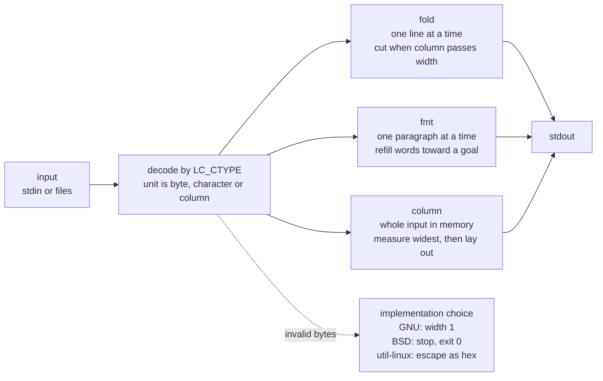

# column, fold, and fmt

> [!summary] Claim
> `fold` cuts each line at a width, `fmt` re-fills whole paragraphs toward a goal width, and `column` reads all of its input before laying it out in columns or a table, and the three disagree across GNU, BSD and macOS, BusyBox and util-linux on exactly the inputs that real data contains: multibyte text, invalid bytes, carriage returns, empty fields, and a missing final newline.

Part of [Regular Expressions and Text Processing](README.md) in [Shell and Unix Engineering](../README.md).

## TL;DR

- Mechanism: `fold` is a per-line state machine that tracks a display column and inserts a newline before the character that would pass the width; `fmt` splits paragraphs into words and re-breaks them (greedily in BSD, by a cost minimum in GNU); `column` buffers every record, measures the widest, then prints a grid or an aligned table.
- Rule: decide first what "width" means (bytes, characters, or terminal columns) and pin the locale, then check the one behavior you depend on on every platform you ship to.
- Trap: the failure modes are silent - BSD `fold` stops at the first invalid byte and exits 0, BSD `column -t` drops an unterminated last line, and `column -t -s,` merges empty fields on BSD but keeps them on util-linux.
- Portability: only `fold` is in POSIX.1-2024; `fmt` and `column` are not, and each has two or three incompatible lineages (GNU coreutils and BSD for `fmt`, BSD and util-linux for `column`).
- When not to use it: for machine-readable output or Unicode-correct alignment, emit the format directly (`printf` with computed widths, `awk`, `jq`) instead of padding with `column`, and never feed `column` output to another parser.

## Mental model



Input bytes are decoded under `LC_CTYPE`, and that decoding decides what a unit of width is; this is the single largest source of divergence between implementations.
`fold` never looks past the current line, so it streams and cannot join lines; `fmt` looks at one paragraph at a time and can join and split; `column` cannot print anything until it has seen the last input line, because the column width is the maximum over all lines.
Bytes that do not decode (the dotted arrow) are the case the standards do not settle: GNU counts them as one column and passes them through, BSD stops reading at the first one and still exits 0, and util-linux `column` rewrites them as `\x` hex escapes.

## How it works

### POSIX fold and what it leaves open

`fold` is the only one of the three in POSIX.1-2024; the utilities index lists `fold`, `expand`, `unexpand`, `pr`, `cut` and `paste`, and neither `fmt` nor `column` (POSIX.1-2024 XCU, utilities index).
The `fold` page (POSIX.1-2024 XCU fold) fixes these rules:

- The default width is 80, in column positions, or in bytes with `-b`.
- A line is never broken in the middle of a character, and the behavior is undefined if the width is smaller than the columns one character occupies.
- Without `-b`, a carriage return sets the count to zero, a backspace decrements it but never below zero, and a tab advances to the next tab stop; tab stops are fixed at every eighth column ("n modulo 8 equals 1" in the specification's 1-based numbering).
- `fold` shall not insert a newline immediately before or after a carriage return, nor before or after a backspace unless the following character is wider than one column and would pass the width.
- `-s` breaks after the last blank that fits within the width, and has no effect on a segment that contains no blank.
- `LC_CTYPE` decides how bytes become characters and how many columns a character occupies.
- The rationale says backspace backs up one column and not one character, and that the tab stops are hardcoded "to meet historical practice".
- The application usage section says to use `cut` when the number of lines must stay constant and `fold` when the content of long lines must stay contiguous.

POSIX leaves the edges outside its contract rather than silent: "The results are unspecified if width is not a positive decimal number", so `-w 0` is unspecified, and without `-b` "the input files shall be text files", so invalid byte sequences and a missing final newline (neither is a text file) are outside the specification.
Where the blank goes under `-s` is specified: the line breaks "after the last such `<blank>`", so the blank ends the earlier segment, which GNU and BSD do in the lab and BusyBox does by its source.
The unspecified edges are where the implementations diverge.

### GNU fold: a column state machine over characters

The GNU loop is `fold_file` in `src/fold.c` (coreutils git master, fetched 2026-11-21).
It reads one decoded character at a time through `mbbuf_get_char` and keeps a `column` and an output buffer `line_out` of `IO_BUFSIZE` bytes.
`adjust_column` computes where a character moves the cursor, by mode:

- `COUNT_BYTES` (`-b`): add the character's byte length `g.len`.
- Otherwise a backspace subtracts one (never below zero), a carriage return sets zero, a tab adds `TAB_WIDTH - column % TAB_WIDTH` with `TAB_WIDTH` defined as 8, and any other character adds `c32width` of it, or 1 when the width is negative (an invalid character).
- `COUNT_CHARACTERS` (`-c`, added in coreutils 9.8) adds 1 per character regardless of its display width.

When `column > width` the character does not fit.
With `-s` the code scans `line_out` for the last character that `c32issep` accepts, writes everything up to and including it plus a newline, moves the remainder to the start of `line_out`, recomputes the column by replaying `adjust_column` over the remainder, and jumps to `rescan` to place the current character again.
That is why the blank stays at the end of the segment: `the quick brown fox` with `-s -w 10` yields `the quick ` (with a trailing space) and `brown fox`.
With no blank found, or without `-s`, it writes the buffer and a newline and starts a new line with the current character; if the buffer is empty (the character alone is wider than the width) it keeps the character on the line, so an over-wide character is never dropped and never split.
A newline in the input writes the buffer and a newline and resets the column.
At end of input the code writes the remaining buffer with `newline=false`, so an input whose last line has no newline produces output whose last line has no newline.
Output goes through `fwrite` and `putchar` on `stdout`, so it is block-buffered into `write(2)` calls when stdout is a pipe or file and line-buffered on a terminal.
The `NEWS` file records a bug where `fold` delayed processing until 256 KiB had been read from a pipe, fixed in 9.11 (coreutils NEWS, 9.11); reading granularity matters for interactive pipelines.
`-w` is parsed with `xnumtoumax` with a minimum of 1, so `-w 0` is an error; a very large width once exhausted memory on large inputs, fixed in 9.8 (coreutils NEWS, 9.8).
The obsolete `-N` form is accepted as a width (`shortopts` includes the digits).

The multibyte rewrite is recent: `fold` supports multibyte characters, honoring their column width, and gained `-c`, in coreutils 9.8 released 2025-09-22 (coreutils NEWS, 9.8).
That release also introduced regressions that were fixed afterwards: a truncation at `0xFF` bytes and the 256 KiB delay in 9.11, and an over-eager wrap after a wide character followed by backspaces in the unreleased section of `NEWS` as fetched on 2026-11-21.
The same unreleased section fixes a 9.11 regression in which a `read` from a pipe or terminal that returned only part of a multibyte character made `fold` treat it as separate bytes, and changes backspace to back up one column instead of the whole width of the previous character (except with `--characters`), which `NEWS` says "aligns with POSIX and terminal behavior" (coreutils NEWS, as of 2026-11).
Before 9.8, `fold` counted bytes, so in a UTF-8 locale it cut multibyte characters in half; this is what the lab calls the `gnu-bytes` flavor.

### BSD fold and BusyBox fold

FreeBSD's `usr.bin/fold/fold.c` reads wide characters with `getwchar` under `setlocale(LC_CTYPE, "")`, accumulates a `wchar_t` buffer, and advances the column in `newpos`: a backspace decrements, a carriage return zeroes, a tab does `(col + 8) & ~7`, and a printable character adds `wcwidth` when it is positive.
In `-b` mode `newpos` adds the byte length given by `wcrtomb`.
The main loop is `while ((ch = getwchar()) != WEOF)`; `getwchar` returns `WEOF` on an encoding error as well as on end of file, and the function never checks `ferror` afterwards, so an invalid byte ends the output silently and `main` still exits with `rval` 0.
The lab measured exactly this on the macOS host: `ab\377cd` followed by `ef` prints `ab` and exits 0.
`-w` goes through `atoi` and a non-positive value is `illegal width value`.
In `-b` mode with a character wider than the width, `newpos` pushes the column past the width on an empty buffer, so the code prints an empty line before the character; the lab measured `\|[]\|x\|` for `-b -w 1` on `[]x`.

BusyBox `coreutils/fold.c` is a single-byte state machine (`fold_main`) declared `APPLET_NOEXEC`, with `adjust_column` that counts a byte as a column unless Unicode mode is on and the byte is a continuation byte (`(c & 0xc0) == 0x80`), so every code point counts as one column and double-width characters are not measured.
Its width is read with `xatou_range(w_opt, 1, 10000)`, so `-w 10000` is the largest accepted width.
It looks for blanks with `isblank` in `-s` mode, keeps a growing `line_out` in 0x1000-byte chunks, and a tab at the start of a line is never wrapped (a comment in the source says so).

### What fmt is, and the GNU cost model

`fmt` appeared in BSD and System V lineages and was never standardized, so each implementation defines "a paragraph" and "a good line" differently.
GNU `fmt` is Ross Paterson's program (header of `src/fmt.c`).
Its reading side defines a paragraph as a maximal run of non-blank lines subject to the indentation rules in `get_paragraph`: in the default mode every line must have the same indent as the first; `-c` (crown margin) lets the first line differ from the rest; `-t` (tagged) requires the first two lines to differ; `-s` (split-only) makes every line its own paragraph and only splits long lines; `-p STRING` restricts formatting to lines beginning with that prefix and re-attaches it; `-u` forces one space between words and two after a sentence.
A blank line, or a line not matching the prefix, is copied through unchanged by `copy_rest`.
A new indent starts a new paragraph, so bulleted lists (`- item`), numbered lists and indented code at one indent level are joined into one paragraph, because `fmt` has no list or markup awareness.

`get_line` splits a line into words: a word is a maximal run of characters that are not `c_isspace`, and the first character of a word is stored unconditionally; `get_space` skips only spaces and tabs.
Consequence: a carriage return is `c_isspace`, so after `bb` the scanner stops, but because `get_space` does not skip `\r` the next word starts with the `\r` itself.
CRLF input therefore turns every line ending into a one-character word `\r`, which `fmt` then treats like any word; the lab shows `aa bb^ cc dd^` (with `^` standing for carriage return) for GNU and `aa bb cc dd` for BSD, where `get_line` keeps only `iswprint` characters.
A word ending in `.`, `?` or `!` followed by optional closing characters `)`, `]`, `'` or `"` and then end of line or two spaces ends a sentence, as in Emacs (comment above `get_line`), and word spacing after a sentence is two spaces: the lab's `One.` plus `Two. Three.  Four` input becomes `One.  Two. Three.  Four`.
GNU `fmt` is byte-oriented: it uses `c_isspace` and `putchar` and has no multibyte calls, so widths are bytes; `NEWS` for 9.1 (2022-04-15) records a bug where on macOS it corrupted multibyte characters by misdetecting their component bytes as spaces.
Tabs are expanded on input with `TABWIDTH` 8, and `put_space` uses tabs on output for long runs of spaces only if the current input contained a tab (the `tabs` flag set in `get_space`).

The writing side is a dynamic program, `fmt_paragraph`.
Starting from the last word and working backwards, it computes for each word the cheapest way to format the paragraph suffix starting at that word, trying every line length up to `max_width`; so the cost is proportional to the number of words times the number of words per line.
The constants in `src/fmt.c` are the real specification of its taste:

- `WIDTH` 75 is the default maximum line length (`max_width`); `LEEWAY` 7 percent sets the goal: `goal_width = max_width * (2 * (100 - LEEWAY) + 1) / 200`, which is 70 for 75.
- Costs are squared departures scaled by ten: `SHORT_COST(n)` is `EQUIV(n * 10)` with `EQUIV(n)` equal to `n * n`, so a line 1 off the goal costs 100 and 5 off costs 2500; `RAGGED_COST(n)` is half of `SHORT_COST(n)` and penalizes a length change between adjacent lines; `LINE_COST` is `EQUIV(70)`, a fixed charge per line, which is why `fmt` prefers fewer lines.
- Breaking at the end of a sentence earns `SENTENCE_BONUS` (`EQUIV(50)`), before an open parenthesis `PAREN_BONUS` (`EQUIV(40)`), after other punctuation `PUNCT_BONUS` (`EQUIV(40)`); breaking after a period that does not end a sentence costs `NOBREAK_COST` (`EQUIV(600)`); `WIDOW_COST` and `ORPHAN_COST` discourage a one-word first or last line in a sentence.

Two bounds from the same file matter operationally.
`MAXWORDS` is 1000 and `MAXCHARS` is 5000, and a longer paragraph is flushed in pieces by `flush_paragraph`, which chooses a low-cost split point, so the optimum is only local for very long paragraphs; a `FIXME` in the source says `fmt` "misbehaves given large inputs or options".
`-w` is limited to `MAXCHARS / 2`, 2500, by `xnumtoumax`; on `gfmt` 9.12 on the host, `-w 2500` was accepted and `-w 2501` exited 1 with `Result too large` (ad hoc run, not in the lab).
The goal is checked against the maximum: `-g` larger than the width is an error, and the check uses the default 75 when `-w` is absent (so `gfmt -g 80` alone exits 1 with `invalid width`, measured on 9.12), after which a `-g` given without `-w` sets `max_width = goal_width + 10`.

The width semantics changed in coreutils 9.10 (2026-02-04): "`fmt -w,--width` no longer includes `\n` in the width of a line", so the width is an inclusive maximum (coreutils NEWS, 9.10).
Before it, `-w 9` could not hold the 9-byte line `aaaa bbbb`; from 9.10 it can; the lab asserts both (`aaaa\|bbbb` before, `aaaa bbbb` from 9.10).
The inner loop in the 2026-11-21 source is `while (len <= max_width)`, consistent with an inclusive maximum.

### BSD fmt: a greedy fill with a goal and a maximum

The BSD program (FreeBSD `usr.bin/fmt/fmt.c`, whose header carries `$OpenBSD: fmt.c,v 1.21` and Gareth McCaughan's 1997 copyright) is a greedy filler.
Its defaults are in `main`: goal 65, maximum goal plus 10, so 75; `-w N` sets both goal and maximum to N; positional `goal [max]` arguments (for example `fmt 30 40`) set them separately; `-N` is accepted as a width.
`output_word` adds words while `new_x <= goal_length`.
When a word would pass the goal it prints the line so far, and keeps the word on that line only if that fits within the maximum and is at least as close to the goal as stopping would be (`new_x - goal_length <= goal_length - x`); a tie goes over the goal, as the source header says.
A paragraph is a run of lines with the same leading-space count, and a blank line is its own paragraph; a line starting with `.` is a troff request and is copied through unformatted unless `-n` is given.
`-p` allows the first line to be indented differently, `-m` keeps mail headers on their own lines, `-s` coalesces internal whitespace, `-c` centers each line, `-d` sets the sentence-ending characters, `-t N` sets input tab width, and `-l N` converts each `N` leading spaces to a tab on output (default 8, hence the lab's `>aa bb cc dd` for an 8-space indent).
`get_line` keeps only `iswprint` characters, treats a tab as spaces to the next tab stop, erases on backspace, and drops every other control character, including carriage return and ESC; trailing blanks are removed.
Width is computed by `wcwidth`, with 1 for a character `wcwidth` rejects.
In the C locale the lab measured that the macOS `fmt` deletes non-ASCII bytes (`caf\303\251 ok` becomes `caf ok`), consistent with `iswprint` rejecting bytes above 0x7f there; GNU passes them through.

The default results differ in shape: for a 131-byte, 20-word paragraph the lab measured line lengths `71 59` for GNU 9.12 (optimizing toward 70 under a maximum of 75) and `62 68` for the macOS `fmt` (greedy toward 65).

### column: BSD and util-linux lineages

`column` appeared in 4.3BSD-Reno (util-linux `column.1.adoc`, HISTORY) and is not in POSIX.
The BSD version is `usr.bin/column/column.c`; util-linux has its own `text-utils/column.c` that uses `libsmartcols` for tables.
Both have three modes: fill columns before rows (the default), fill rows before columns (`-x`), and table (`-t`).
Both read the whole input before printing anything (`input` in BSD, `read_input` in util-linux), because the cell width is the maximum over all lines.
The BSD source skips lines that are only whitespace (`iswspace` test in `input`), and util-linux ignores empty lines unless `-L` (`--keep-empty-lines`) is given.

Fill modes:

- Width: BSD asks `ioctl(1, TIOCGWINSZ, ...)` on standard output, falls back to the `COLUMNS` environment variable, then 80; `-c N` overrides (`main`).
  util-linux uses `-c`/`--output-width`, else the terminal width, else the `COLUMNS` environment variable "if no other information is available", else 80 (`column.1.adoc`, ENVIRONMENT and `-c`); in the code, `get_terminal_width(80)` calls `get_terminal_dimension`, which asks `ioctl(STDOUT_FILENO, TIOCGWINSZ, ...)` and falls back to a positive integer `COLUMNS` (`lib/ttyutils.c`).
- Cell width: `maxlength = roundup(maxlength + 1, TAB)` with `TAB` equal to 8 in BSD, so every cell occupies a multiple of 8 columns, and entries are padded with tab characters to the next stop, not spaces (`r_columnate`, `c_columnate`); util-linux rounds the same way with `TABCHAR_CELLS` and pads with spaces instead under `-S N` (`--use-spaces`).
- Layout: `numcols = termwidth / maxlength`; the default `r_columnate` fills down columns (`base += numrows`), so entries run top to bottom then left to right, and `-x` (`c_columnate`) fills across rows.
  When `maxlength >= termwidth` both print one entry per line (`print` in BSD; `COLUMN_MODE_SIMPLE` in util-linux `main`).
  Because util-linux sets `termwidth` to 0 for `-c 0` or `-c unlimited`, a fill-mode run with that option also takes the one-per-line path, while the man page documents `0` and `unlimited` as "no width limit" for table output.

Table mode:

- BSD `maketbl` splits each line at any character in the separator set, default tab and space, and skips runs of separators (`while (*s && wcschr(separator, *s)) ++s`), so an empty field disappears and later fields shift left; the width of each column is the maximum `wcwidth`-based width, and fields are padded to that plus 2, except the last field of each line.
  `-s SEP` replaces the set, `-l N` limits the number of columns, and `-c`, `-x` do not apply.
- util-linux `add_line_to_table` splits with `local_wcstok`: with the default separators (whitespace) the split is "greedy" (`wcstok`, runs collapse); giving `-s` sets `greedy = 0` so adjacent separators produce empty fields.
  The man page BUGS section records the change at util-linux 2.23: `printf "a:b:c\n1::3\n" | column -t -s ':'` used to print `1  3` and now prints `1     3`.
  The output separator is two spaces (`-o` changes it), and extras include `-J` JSON output (needs `-N` names), `-N` and `-C` column definitions, `-R` right-align, `-T` truncate, `-W` wrap, `-H` hide, `-O` reorder, `-E` ignore extreme widths (on by default for the last column), `-l` column limit, `-m` fill the width, tree mode with `-r -i -p`, and `-K` to use the first line as the header.
  Output is aligned to the terminal width, or 80 columns when not interactive (the man page's wording; `COLUMNS` still wins over 80 in `lib/ttyutils.c`), and "very long table entries may be printed on multiple lines" unless the column is truncated; the man page recommends `-c unlimited` when redirecting to a file.

Input handling differs sharply:

- BSD reads with `fgetws` into a buffer of `LINE_MAX + 1` wide characters (`MAXLINELEN`); a chunk with no newline in it triggers `warnx("line too long")`, sets the exit status to 1 and is skipped, and the rest of the line is then read as the next record.
  Two measured consequences on the macOS host (the lab): a 3000-byte line leaves a 952-byte record and exit status 1 (3000 minus 2048), and a final line with no newline is dropped with status 1 (`a b` kept, `cc d` lost).
  An invalid multibyte byte ends `fgetws`, which the loop treats like end of file, so `a\377b x` followed by `c y` produced no output at all and exit status 0 in the lab.
- util-linux uses `getline`, so there is no line limit; it keeps an unterminated last line, and `mbs_invalid_encode` rewrites invalid bytes as `\xHH` (the man page says "all invalid multibyte sequences are encoded with the x<hex> convention"); the lab expects `a\xffb  x`.

## Numbers and limits

Measured means the lab asserts it (and, where marked, the pre-existing run on the host: gfold and gfmt 9.12 and the macOS BSD tools, 26 of 26 tests passing).
Source means read in the cited file on 2026-11-21.
Ad hoc means run once on the host during this drafting, not in the lab.

| Quantity | Value | Basis |
| --- | --- | --- |
| `fold` default width | 80 columns | POSIX.1-2024 XCU fold |
| Tab stop in `fold` and `fmt` | every 8 columns, not configurable in `fold` | POSIX.1-2024 XCU fold; `TAB_WIDTH`, `TABWIDTH` in coreutils source |
| GNU `fold` accepted width | 1 to `SIZE_MAX - 9` | source: `xnumtoumax (optarg, 10, 1, SIZE_MAX - TAB_WIDTH - 1, ...)`; `-w 0` exit 1 ad hoc |
| BusyBox `fold` accepted width | 1 to 10000 | source: `xatou_range(w_opt, 1, 10000)` |
| BSD `fold` width | any positive `atoi` value | source: `fold.c`, `main` |
| GNU `fmt` default maximum and goal | 75 and 70 (`LEEWAY` 7 percent) | source: `WIDTH`, `LEEWAY`, `goal_width` |
| GNU `fmt` line lengths, 131-byte paragraph | 71 and 59 | measured (lab), coreutils 9.12 |
| GNU `fmt -w 40` on that paragraph | 33 37 34 24 | ad hoc, coreutils 9.12 |
| GNU `fmt` paragraph limits | 1000 words, 5000 characters; `-w` up to 2500 | source; `-w 2500` ok and `-w 2501` exit 1 ad hoc |
| BSD `fmt` default goal and maximum | 65 and 75 | source: `fmt.c`, `main` |
| BSD (macOS) `fmt` line lengths, same paragraph | 62 and 68 | measured (lab) |
| BSD `fmt -w 40` on that paragraph | 39 40 34 15 | ad hoc, macOS host |
| GNU `fmt` inclusive width | from 9.10 (2026-02-04) | coreutils NEWS 9.10 |
| GNU `fold` multibyte and `-c` | from 9.8 (2025-09-22) | coreutils NEWS 9.8 |
| `column` cell size | `roundup(maxlength + 1, 8)` in BSD; util-linux rounds up with `TABCHAR_CELLS` | source: `main`, `columnate_fillcols` |
| BSD `column` line buffer | `LINE_MAX + 1` wide characters; 3000-byte line gives a 952-byte record and exit 1 | source and measured (lab) |
| util-linux `column` line length | unlimited (`getline`); 3000-byte line stays 3000 | source and lab expectation (not run on the host) |
| `column` default width, no terminal | `COLUMNS`, else 80 | source (BSD `main`); util-linux man page ENVIRONMENT |

Dates: coreutils 9.8 is 2025-09-22, 9.10 is 2026-02-04, 9.11 is 2026-04-20 and 9.12 is 2026-09-14 (coreutils `NEWS`, as of 2026-11).

## Portability

The three programs are external utilities, so the shell contributes only the argument vector and the environment.
`wrap_lab.sh` runs the utility under the shell under test and the bats file compares the same expected string for every shell family; the integrator's matrix run is the proof for the shell rows, and nothing in the lab branches on the shell.
As of 2026-11 only the macOS host `sh` (bash 3.2 in POSIX mode) has run this lab, so the other shell rows follow from the utilities being external programs that receive only argv and the environment, not from a run under each shell.
The one environment variable that matters, `COLUMNS` for `column`, is exported explicitly by the `column-env` probe, so it does not depend on whether a shell maintains `COLUMNS` itself.

| Shell | What the shell changes for `fold`, `fmt`, `column` | Basis |
| --- | --- | --- |
| POSIX sh, dash, posh, BusyBox ash | nothing: argv and environment pass through | design of the lab; run on host `sh` only |
| macOS bash 3.2, current bash | nothing | lab on host `sh` (bash 3.2); same design for current bash |
| zsh (native and `--emulate sh`) | nothing | design of the lab; not run |
| ksh93, mksh, yash | nothing | design of the lab; not run |

The utilities differ.
In the next tables, `|` stands for a newline (written `\|` inside a table cell), `>` for a tab, `^` for a carriage return, `[]` for U+00E9, `{~}` for U+4E2D and `#` for the byte `0xff`, exactly as `wrap_lab.sh` renders them; every cell below is an expected value in `column_fold_and_fmt.bats`.

`fold`:

| Probe | GNU 9.8 and later | GNU before 9.8 | BSD and macOS | BusyBox |
| --- | --- | --- | --- | --- |
| `-w 4` on `abcdefghij` | `abcd\|efgh\|ij\|` | same | same | same |
| `-s -w 10` on `the quick brown fox` | `the quick \|brown fox\|` | same | same | same |
| tab: `a<TAB>bcdefghijk`, `-w 10` | `a>bc\|defghijk\|` | same | same | same |
| carriage return: 13 bytes, `-w 8` | `abcdef^ghijkl\|` | same | same | same |
| no final newline, `-w 3` on `abcdefg` | `abc\|def\|g` (none added) | same | same | same |
| six `[]`, UTF-8 locale, `-w 3` | `[][][]\|[][][]\|` | `[][\|][]\|[][\|][]\|` (character cut) | `[][][]\|[][][]\|` | `[][][]\|[][][]\|` |
| six `[]`, C locale, `-w 3` | `[][\|][]\|[][\|][]\|` | same | `[][][][][][]\|` (never folds) | `[][\|][]\|[][\|][]\|` |
| three `{~}`, UTF-8, `-w 4` | `{~}{~}\|{~}\|` | `{~}{\|~}{~\|}\|` | `{~}{~}\|{~}\|` | `{~}{~}{~}\|` (1 column each) |
| `-b -w 1` on `[]x` | `[]\|x\|` | `[\|]\|x\|` | `\|[]\|x\|` (empty first line) | `[\|]\|x\|` |
| `ab#cd`, then `ef` | `ab#cd\|ef\|` | same | `ab` and exit 0 | `ab#cd\|ef\|` |

`fmt` (GNU before 9.10 and 9.10 or later; BSD means macOS in the lab):

| Probe | GNU 9.10 and later | GNU before 9.10 | BSD and macOS |
| --- | --- | --- | --- |
| line lengths, default width, 131-byte paragraph | `71 59` | `71 59` | `62 68` |
| `-w 9` on `aaaa bbbb` | `aaaa bbbb\|` | `aaaa\|bbbb\|` | `aaaa bbbb\|` |
| CRLF input `aa bb`, `cc dd` | `aa bb^ cc dd^\|` | same | `aa bb cc dd\|` |
| three-word `[][][]` lines, UTF-8, `-w 12` | one word per line | same | two words on the first line, then one |
| `caf[] ok`, C locale | `caf[] ok\|` | same | `caf ok\|` (bytes deleted) |
| 8-space indent on two lines | spaces kept | same | `>aa bb cc dd\|` (tab) |
| a line starting with `.` | joined: `aa bb .TH x cc dd\|` | same | kept alone: `aa bb\|.TH x\|cc dd\|` |
| `One.` then `Two. Three.  Four` | `One.  Two. Three.  Four\|` | same | same |

`column`:

| Probe | BSD and macOS | util-linux |
| --- | --- | --- |
| fill columns, eight entries, `-c 30` | `a>d>g\|b>e>h\|c>f\|` | same |
| `-x`, same input | `a>b>c\|d>e>f\|g>h\|` | same |
| width from `COLUMNS=20`, standard output a pipe | `a>e\|b>f\|c>g\|d>h\|` | same |
| `-t` on `name size`, `alpha 1`, blank, `b 22222` | `name   size\|alpha  1\|b      22222\|` | same |
| `-t -s ,` on `a,b,c` and `1,,3` | `a  b  c\|1  3\|` (empty field merged) | `a  b  c\|1     3\|` (kept) |
| `-t` on `a b` then `cc d` with no final newline | `a  b\|`, exit 1 (last line dropped) | `a   b\|cc  d\|`, exit 0 |
| `-t` on `a#b x`, `c y` in UTF-8 | no output, exit 0 | `a\xffb  x\|c       y\|` |
| 3000-byte line then `short`, `-c 80`, line lengths | `952 5`, exit 1 | `3000 5`, exit 0 |

Notes on the matrix: the lab loops over every installed implementation (`fold`, `gfold`, `busybox fold`, and the same for `fmt` and `column`), classifies each by its own `--version` and `--help` text, and fails when a flavor has no expectation, so an uutils build or a coreutils version outside the two assumed boundaries fails loudly instead of passing.
Coreutils releases older than 9.8 or 9.10 take the `gnu-bytes` and `gnu-pre910` columns.
The BusyBox and util-linux cells were not executed on the macOS host that ran the lab on 2026-11-21 (it has neither `busybox` nor util-linux `column`); the BusyBox `fold` cells follow `coreutils/fold.c` and the util-linux cells follow `text-utils/column.c`, and the matrix run is what confirms them.
BusyBox decides Unicode mode in `init_unicode` (`libbb/unicode.c`): with `ENABLE_UNICODE_USING_LOCALE` it calls `setlocale(LC_CTYPE, ...)` and checks that U+0394 has width 1, otherwise its own code turns Unicode on only when `LC_ALL`, `LC_CTYPE` or `LANG` contains `.utf` or `.UTF` (and only if `FEATURE_CHECK_UNICODE_IN_ENV` is built in), so the BusyBox UTF-8 cells depend on the build configuration and, for the locale path, on the libc accepting `C.UTF-8`.
util-linux `column` sets `TABCHAR_CELLS` to 8 and rounds cell widths with `(maxlength + TABCHAR_CELLS) & ~(TABCHAR_CELLS - 1)`, which equals `roundup(maxlength + 1, 8)` (`text-utils/column.c`).
The BusyBox, util-linux, "GNU before 9.8" and "GNU before 9.10" cells are derived from the cited sources and `NEWS`, not executed (as of 2026-11).

## Worked example

The lab is [lab](../labs/07-column-fold-and-fmt/).
`wrap_lab.sh PROBE CMD [ARG...]` writes a fixed input, runs the utility under one locale, and prints either the output rendered by `vis` (one ASCII line, `|` for newline) or the byte length of each line, followed by `status=N`.
This is a simplified excerpt of two probes and the renderer; the lab file has 26 probes in the same shape.

```sh
vis() {
  LC_ALL=C tr '\303\251\344\270\255\377\n\t\r' '[]{~}#|>^' <"$out"
}

run_tool() {
  loc=$1
  shift
  LC_ALL=$loc "$@" <"$in" >"$out" 2>"$work/err"
  status=$?
}

case $probe in
  fold-utf8)
    printf '\303\251\303\251\303\251\303\251\303\251\303\251\n' >"$in"
    run_tool C.UTF-8 "$@" -w 3
    report vis
    ;;
  fmt-exact)
    printf 'aaaa bbbb\n' >"$in"
    run_tool C "$@" -w 9
    report vis
    ;;
esac
```

The bats file runs every probe against each installed implementation and compares with the expectation for that implementation's flavor, for example:

```sh
@test "fold in a UTF-8 locale: multibyte-aware folds keep U+00E9 whole, coreutils before 9.8 splits it" {
  check fold fold-utf8 \
    "gnu=[][][]|[][][]| status=0" "gnu-bytes=[][|][]|[][|][]| status=0" \
    "bsd=[][][]|[][][]| status=0" "busybox=[][][]|[][][]| status=0"
}
```

Expected output, which is what the assertions require: with `fold-utf8`, GNU 9.8 or later prints `[][][]|[][][]| status=0`, coreutils before 9.8 prints `[][|][]|[][|][]| status=0` (a character cut in two by the byte count), and `fmt-exact` prints `aaaa bbbb| status=0` from coreutils 9.10 and `aaaa|bbbb| status=0` before it.
On the host, with `gfold` and `gfmt` 9.12 and the macOS BSD `fold`, `fmt` and `column`, all 26 tests passed in one `bats --tap` run on 2026-11-21 (macOS 27.3, arm64; `fmt` and `column` are the system ones, there is no `busybox` and no util-linux `column`).

## Pitfalls

> [!warning] fold -s leaves the blank at the end of the segment
> Trigger: `fold -s -w N` on text you later compare, hash or feed to a parser.
> Symptom: every folded segment except the last ends in a space, so `the quick brown fox` becomes `the quick ` and `brown fox`; the lab shows the trailing space in all four implementations.
> Fix: strip with `sed 's/[[:blank:]]*$//'` after `fold`, or use `fmt -w N`, which removes trailing blanks (BSD does it in `get_line`).

> [!warning] fold splits UTF-8 or never folds, depending on locale and version
> Trigger: folding non-ASCII text in the C locale, or with coreutils older than 9.8.
> Symptom: a two-byte character is cut between lines (`[][|][]`), which the next consumer reads as invalid UTF-8; the macOS `fold` in the C locale gives non-ASCII bytes zero width and never folds, so lines come out longer than the width.
> Fix: set `LC_ALL` to a UTF-8 locale for the command, and test the version: coreutils 9.8 introduced the multibyte logic (coreutils NEWS, 9.8).
> See [[Locale-and-LC_ALL]] and [[Unicode-and-UTF-8-in-Text-Tools]].

> [!warning] BSD fold and column stop at the first invalid byte and still exit 0
> Trigger: a log or CSV with one stray `0xff` or Latin-1 byte, piped through the macOS `fold` or `column -t` in a UTF-8 locale.
> Symptom: `fold` prints the text before the byte and nothing after it; `column -t` can print nothing at all; the exit status is 0, so `set -e` and `pipefail` see success.
> Cause: `getwchar` and `fgetws` fail on `EILSEQ`, and the loops treat the failure as end of file (FreeBSD `fold.c`, `fold`; `column.c`, `input`); the lab measured both on the macOS host.
> Fix: validate or transcode first (`iconv -f UTF-8 -t UTF-8 -c`), or use GNU `fold` (counts an invalid character as width 1 and passes it through) or util-linux `column` (escapes it).

> [!warning] column -t drops the last line when it has no newline
> Trigger: `printf '%s' "$text" | column -t` or any producer that omits the final newline, on BSD or macOS.
> Symptom: the last row is missing and the status is 1 with a `line too long` warning on standard error; with a 3000-byte line BSD keeps only the 952 bytes after its 2048-character buffer.
> Cause: `fgetws` returns a chunk with no newline, and `input` rejects any chunk lacking one (`column.c`, `input`, `MAXLINELEN`).
> Fix: end the data with a newline (`printf '%s\n'`), and keep the exit status in view; do not rely on a pipeline's last status.

> [!warning] column -t -s with empty fields shifts the columns
> Trigger: `column -t -s,` on CSV or TSV with empty cells.
> Symptom: BSD merges adjacent separators, so `1,,3` prints `1  3` and the value 3 moves under the wrong header; util-linux keeps the empty field and prints `1     3`.
> Cause: BSD `maketbl` skips separator runs, and util-linux made `-s` non-greedy in 2.23 (util-linux `column.1.adoc`, BUGS).
> Fix: never use `column` to align data that has empty fields on BSD; fill empties with a placeholder such as `-` first, or use `awk` with `printf` and computed widths.

> [!warning] fmt width changed meaning in coreutils 9.10
> Trigger: a script or test that relies on `fmt -w N` producing lines of exactly `N - 1` characters at most.
> Symptom: after upgrading to 9.10 or later, lines may be `N` characters long, so golden-file tests and column-limited output change by one.
> Fix: treat `-w N` as inclusive from 9.10 on (coreutils NEWS, 9.10), or pass `-w N+1` on old versions; the lab asserts both behaviors with `-w 9` on a 9-byte line.

> [!warning] fmt joins what you meant to keep apart
> Trigger: running `fmt` on Markdown, source code, tables or list text.
> Symptom: lines at the same indent are joined into one paragraph, so list items and code lines merge (`fmt` has no list awareness; paragraphs end only at a blank line or an indent change, `get_paragraph`); GNU also joins a line starting with `.`, which BSD treats as a troff request and leaves alone.
> Fix: use `fmt -s` (GNU split-only) or `fold -s` for text that must keep its line structure, and format prose with `fmt -p '> '` or an editor for quoted text.

> [!warning] column output depends on where standard output goes
> Trigger: the same `column` command run interactively and from cron or CI.
> Symptom: BSD reads the terminal width from `ioctl(1, TIOCGWINSZ)`, then `COLUMNS`, then 80; on a pipe it falls back to `COLUMNS` or 80, so the number of columns changes between a terminal and a file (`column.c`, `main`; the lab's `column-env` probe pins it with `COLUMNS=20`).
> Fix: pass `-c N` explicitly in scripts, and for util-linux table mode pass `-c unlimited` when the result goes to a file.

> [!warning] column cannot stream
> Trigger: `tail -f app.log | column -t`, or a producer that runs for a long time.
> Symptom: nothing appears until end of input; memory use equals the size of the input.
> Cause: both implementations buffer every record before printing, because the width is a maximum over all rows (`input` and `maketbl` in BSD, `read_input` in util-linux).
> Fix: align a bounded batch, or compute widths in a first `awk` pass.

## Security and robustness

- Silent truncation is the main integrity risk: BSD `fold` and BSD `column` lose data after an invalid byte or an unterminated last line without a nonzero exit in the `fold` case, so use them only on validated, newline-terminated text, or check line counts before and after.
- Do not use these tools on terminal escape sequences: `fold` has no special handling for ESC, so `adjust_column` counts the bytes of `ESC [ 31 m` as columns and can cut a colored line in the middle of an escape sequence; BSD `fmt` strips ESC (and every non-printable) in `get_line`, so colors turn into stray text like `[31m`.
- Treat width values from users as untrusted: GNU `fold` rejects zero and over-large values with exit status 1, and an unvalidated huge width used to exhaust memory on large inputs in releases before 9.8 (coreutils NEWS, 9.8); validate that a width is a small positive integer before use.
- A filename operand that starts with `-` is an option: write `fold -w 80 -- "$file"` or `./"$file"`, and note that GNU `fold` and GNU `fmt` also accept `-N` as an obsolete width, and `fmt` accepts it only as the first argument (`main` in `src/fmt.c`).
- `fmt` is bounded to 1000 words and 5000 characters per buffered paragraph (`MAXWORDS`, `MAXCHARS`); longer paragraphs are cut at a heuristic point, so the output of one huge paragraph is not the global optimum.
- Output of `column` is for display; the padding is tabs by default and spaces in table mode, and cells with embedded tabs or multibyte text misalign in tools that count bytes.
- I did not verify any CVE or published postmortem for these three tools, so none is cited; the failure modes above are derived from the source files and the lab.

## The principal's view

The decision is which layer owns width: the producer, a formatter in the pipeline, or the display.
For human-read text at a boundary (an email body, a commit message, a terminal) use `fmt`, set the width explicitly, and treat the optimizer as GNU-specific; a script that must produce the same bytes on macOS and Linux should not use `fmt` at all, because the two algorithms break lines at different places (the lab's `62 68` against `71 59` on one paragraph).
For hard-limit transports (a fixed-width printer, a legacy record format, a protocol that caps line length) use `fold -s -w N` or, better, the format's own wrapper, pin `LC_ALL`, and add a test with a multibyte line and a missing final newline.
For tables use `column -t` only for interactive output of data you control; for anything a program will read, emit TSV or JSON and render at the edge.
When widths must be correct for Unicode, ambiguous-width characters, emoji or combining marks, no one of these is reliable: BusyBox counts code points, GNU `fold` counts `c32width`, `fmt` GNU counts bytes, and util-linux `column` uses its own `width` loop over `wcwidth` that counts non-printable characters as 0 and discounts ANSI escape sequences (`text-utils/column.c`); use a real library (Python `wcwidth`, a Rust crate) in a program you can test.
The trade-off is a small dependency or a few more lines against a pipeline that cannot be proven portable.
See [[tr-cut-and-paste]] for the byte-level cousins, [[awk-Language]] for computed alignment with `printf`, and [[Python-as-a-Shell-Companion]] and [[Perl-One-Liners]] for when to stop writing shell.

## Interview questions

> [!question] L5: What does `fold -s -w 10` do to `the quick brown fox`, and what is the trap in the output?
>
> > [!success]- Answer
> > It breaks after the last blank that fits, giving `the quick ` and `brown fox`.
> > The blank stays at the end of the first segment, so the segment has a trailing space.
> > POSIX says to break "after the last such `<blank>`", so the blank belongs to the earlier segment (POSIX.1-2024 XCU fold).
> >
> > Follow-up: How would you produce the same wrap without the trailing space?

> [!question] L5: Predict the output of `printf 'abc defgh ij\n' | fold -s -w 5`.
>
> > [!success]- Answer
> > Three lines: `abc `, `defgh`, ` ij`.
> > `abc ` fits (4 columns) and the next word does not, so it breaks after the blank; `defgh` is exactly 5 and a segment with no blank is cut only when the character would pass the width; ` ij` starts with the blank that did not fit after `defgh`, because `-s` finds no blank inside `defgh` and breaks before the character that overflows.
> > The same output came from the macOS `fold` and `gfold` 9.12 in an ad hoc run (`abc |defgh| ij|`).
> >
> > Follow-up: What changes if the input has no final newline?

> [!question] L5: Why does `column -t` on macOS lose the last row of `printf 'a b\ncc d'`?
>
> > [!success]- Answer
> > BSD `column` reads with `fgetws` into a fixed buffer and requires a newline in each chunk (`input` in `column.c`).
> > The last chunk has no newline, so it is reported as `line too long` and skipped, and the exit status is 1.
> > util-linux `column` uses `getline` and keeps the row.
> >
> > Follow-up: How do you make the pipeline correct on both?

> [!question] L6: `fmt -w 9` on a 9-byte line produces one line on one machine and two on another; explain why.
>
> > [!success]- Answer
> > GNU coreutils before 9.10 counted the newline in the width, so a 9-byte line did not fit in `-w 9`.
> > From 9.10 the width is an inclusive maximum (coreutils NEWS, 9.10).
> > BSD `fmt -w 9` sets goal and maximum to 9 and `new_x <= goal_length` accepts 9.
> >
> > Follow-up: How would you write a test that is stable across versions?

> [!question] L6: Why do GNU `fmt` and BSD `fmt` give different line lengths on the same paragraph, and which should a portable script use?
>
> > [!success]- Answer
> > GNU `fmt_paragraph` is a dynamic program that minimizes a squared-error cost against a goal of 70 under a maximum of 75, with bonuses for sentence ends and penalties for widows and orphans.
> > BSD `output_word` is greedy: it fills toward goal 65 and keeps a word over the goal only if that is nearer the goal and within 75.
> > On the lab paragraph that gives `71 59` against `62 68`.
> > A script that needs identical bytes must not depend on `fmt`; use `fold -s` with a pinned locale, or a language library.
> >
> > Follow-up: Which tie-breaking rule does the BSD source document?

> [!question] L6: Debug this script: it prints a CSV as a table, but on a Mac the value `hello` sits under the wrong header and the last row is missing.
>
> ```sh
> data=$(printf 'id,name,note\n1,,hello\n2,bob,ok')
> printf '%s' "$data" | column -t -s,
> ```
>
> > [!success]- Answer
> > Two separate bugs.
> > `$(...)` removes trailing newlines and `printf '%s'` adds none, so the last line has no newline, and BSD `column` skips an unterminated line with `line too long` and exit 1.
> > Empty cells are merged by BSD `maketbl`, so the row `1,,hello` becomes two fields and `hello` lands under the `name` header; util-linux `-s` keeps the empty field.
> > Fix: `printf '%s\n' "$data"`, put a placeholder such as `-` in empty cells before `column`, and check the exit status.
> >
> > Follow-up: How would you detect the dropped row in a test?

> [!question] L7+: Two engineers fold UTF-8 text with `fold -w 80` on Debian and macOS and get different line counts; list every mechanism that could cause it.
>
> > [!success]- Answer
> > The locale: in the C locale GNU counts bytes and cuts characters, and the macOS `fold` gives non-ASCII bytes zero width.
> > The version: coreutils before 9.8 counts bytes in every locale, and from 9.8 counts `c32width` columns (coreutils NEWS, 9.8).
> > The width function: BusyBox counts code points as one column each, so double-width characters differ.
> > Invalid bytes: GNU counts one column, BSD stops reading.
> > Zero-width and combining marks: `wcwidth` returns 0, so they never advance the column.
> > Fix: pin `LC_ALL=C.UTF-8` (or `en_US.UTF-8`) and the implementation, and test with the lab's probes.
> >
> > Follow-up: When would `fold -b` be the right tool, and what does GNU do with a character wider than the byte width?

> [!question] L7+: Why is GNU `fmt` a dynamic program but BSD `fmt` greedy, and what does GNU's design cost?
>
> > [!success]- Answer
> > Greedy filling minimizes lines at the cost of ragged edges; GNU's `fmt_paragraph` minimizes a squared-error cost over the whole paragraph, preferring even lines and breaks at sentence ends.
> > The cost is complexity and limits: work proportional to words times words per line, a 1000-word and 5000-character buffer (`MAXWORDS`, `MAXCHARS`), a split heuristic for longer paragraphs (`flush_paragraph`), and a `-w` cap of 2500.
> > It is also byte-oriented, so width is wrong for multibyte text.
> >
> > Follow-up: What does `LINE_COST` do to the number of lines it produces?

> [!question] L7+: A report generator pipes `ls -l`-style rows to `column -t` and the output is aligned in a terminal but misaligned in the log file; what are the causes, and what do you change?
>
> > [!success]- Answer
> > The terminal width is read through `ioctl(1, TIOCGWINSZ)`; with a file or pipe it falls back to `COLUMNS` or 80, so wrapping and, in util-linux table mode, multi-line cells appear in the file (`column.c`, `main`; `column.1.adoc`).
> > Tabs: fill mode pads with tab characters to eight-column stops, so a viewer with different tab stops shifts the columns.
> > Width of multibyte cells depends on the `wcwidth` of the locale.
> > Change: pass `-c unlimited` (util-linux) or a fixed `-c`, use `-S`/`-o` for spaces, pin the locale, or render the table in a program that owns the widths.
> >
> > Follow-up: Why must `column` read all input before printing, and what does that mean for `tail -f`?

## Related

Prerequisites: [[join-and-comm]]

Next: [[Locale-and-LC_ALL]]

See also: [[tr-cut-and-paste]], [[Unicode-and-UTF-8-in-Text-Tools]], [[awk-Language]], [[sed-Pattern-and-Hold-Space]], [[grep-in-Depth]], [[Perl-One-Liners]], [[Python-as-a-Shell-Companion]]

## Further reading

- [POSIX.1-2024 XCU fold](https://pubs.opengroup.org/onlinepubs/9799919799/utilities/fold.html): the normative width, tab, backspace and `-s` rules, and the rationale for column positions.
- [POSIX.1-2024 utilities index](https://pubs.opengroup.org/onlinepubs/9799919799/idx/utilities.html): confirms which of the three are standard.
- [GNU coreutils `src/fold.c`](https://raw.githubusercontent.com/coreutils/coreutils/master/src/fold.c): the column state machine and `-s` rescan loop in the multibyte implementation.
- [GNU coreutils `src/fmt.c`](https://raw.githubusercontent.com/coreutils/coreutils/master/src/fmt.c): the cost constants, paragraph rules and limits of Ross Paterson's formatter.
- [GNU coreutils `NEWS`](https://raw.githubusercontent.com/coreutils/coreutils/master/NEWS): the dated record of the 9.8 `fold` rewrite, the 9.10 `fmt -w` change and the regressions in between.
- [FreeBSD `usr.bin/fold/fold.c`](https://cgit.freebsd.org/src/plain/usr.bin/fold/fold.c): the wide-character loop and why an invalid byte ends the output.
- [FreeBSD `usr.bin/fmt/fmt.c`](https://cgit.freebsd.org/src/plain/usr.bin/fmt/fmt.c): the header comment is the best description of the greedy algorithm and its differences from old `fmt`.
- [FreeBSD `usr.bin/column/column.c`](https://cgit.freebsd.org/src/plain/usr.bin/column/column.c): the fill and table layouts and the `LINE_MAX` input buffer.
- [util-linux `text-utils/column.c`](https://raw.githubusercontent.com/util-linux/util-linux/master/text-utils/column.c): the `libsmartcols` table path, `local_wcstok` and the greedy flag.
- [util-linux `column.1.adoc`](https://raw.githubusercontent.com/util-linux/util-linux/master/text-utils/column.1.adoc): options, `COLUMNS`, and the 2.23 note on empty fields.
- [BusyBox `coreutils/fold.c`](https://raw.githubusercontent.com/mirror/busybox/master/coreutils/fold.c): the byte-based applet and its 1 to 10000 width range.
