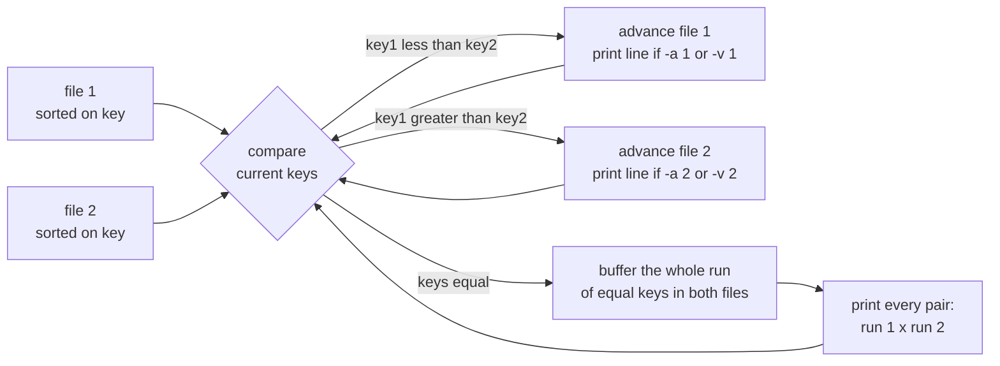

# join and comm

> [!summary] Claim
> `join` and `comm` are two-cursor merge algorithms over inputs that the caller must already have sorted in the collation they run under, so they are linear and streaming when the sort contract holds and silently wrong, or memory-hungry on duplicate keys, when it does not.

Part of [Regular Expressions and Text Processing](README.md) in [Shell and Unix Engineering](../README.md).

## TL;DR

- Mechanism: both read two sorted files with one cursor each and compare the current lines; `comm` compares whole lines and prints three columns, `join` compares one field and prints the cross product of each run of equal keys.
- Rule: sort both inputs on exactly the key `join` will use (`sort -t, -k1,1`, or `-k1b,1` without `-t`) in the same `LC_ALL` that `join` and `comm` will run under, which is `LC_ALL=C` unless you have a reason.
- Trap: an unsorted input is not an error in POSIX ("the results are unspecified"); GNU warns only after it has seen an unpairable line, BSD and BusyBox never warn, and the output simply loses matches.
- Portability fact: `join` and `comm` are POSIX, but `-i`, `--check-order`, `--header`, `-o auto`, `-z`, `--total`, and `-a` combined with `-v` are not; BSD and macOS `comm` has `-i` but no `--total`, BusyBox has `comm` and no `join` applet.
- When not to use: for an unsorted large input, a many-to-many join, a multi-column key, quoted CSV, or an inequality join, load one side into an awk array or use a real database instead (see [[awk-Associative-Arrays-and-Idioms]]).

## Mental model



The two input files feed one comparison; whichever side holds the smaller key is advanced and, if `-a` or `-v` selected that side, printed with the other side's fields left empty.
Equal keys do not advance one line at a time: the whole run of equal keys is read from both files into memory, the cross product is printed in file-1-major order, and both cursors then move to the first key after the run.
`comm` is the same loop with the key widened to the whole line and no run buffering, because equal whole lines are consumed one-for-one, which is why it treats its input as a multiset rather than a set.
The loop is correct only if "less than" in the comparison means the same thing as "before" in the order the files were sorted in, and that is the sole precondition the diagram does not show.

## How it works

### The specification

POSIX.1-2024 `join` "shall perform an equality join on the files file1 and file2" and writes "one line in the output for each pair of lines in file1 and file2 that have join fields that collate equally" (POSIX.1-2024 join, DESCRIPTION).
The inputs "shall be ordered in the collating sequence of sort -b on the fields on which they shall be joined", and "if the input files are not in the appropriate collating sequence, the results are unspecified" (POSIX.1-2024 join, DESCRIPTION).
With `-t char` the collating sequence becomes "the same as sort without the -b option" and "every appearance of char in a line shall be significant", so `a,,b` has an empty second field (POSIX.1-2024 join, OPTIONS).
Without `-t` the separators are `<blank>` characters, "multiple separators shall count as one field separator, and leading separators shall be ignored", and the output separator is a single `<space>` (POSIX.1-2024 join, DESCRIPTION).
The default output is the join field, then the other fields of file 1, then the other fields of file 2; `-o` replaces that with an explicit list of `file_number.field` items and `0` for the join field (POSIX.1-2024 join, STDOUT and OPTIONS).
"If the same key appears more than once in either file, all combinations of the set of remaining fields in file1 and the set of remaining fields in file2 are output in the order of the lines encountered" (POSIX.1-2024 join, DESCRIPTION).

POSIX.1-2024 `comm` reads two files "which should be ordered in the current collating sequence" and produces "lines only in file1, lines only in file2, and lines in both files" (POSIX.1-2024 comm, DESCRIPTION).
Column 1 is the bare line, column 2 is prefixed by one tab unless `-1` is set, and column 3 is prefixed by two tabs, one tab, or nothing depending on which of `-1` and `-2` are set (POSIX.1-2024 comm, STDOUT).
Issue 8 added a precise rule for locales whose collation is not a total order: lines that collate equally but differ are different lines and are expected in byte order, otherwise `comm` "can identify such lines as being both unique to file1 and unique to file2" (POSIX.1-2024 comm, DESCRIPTION).
If both operands are standard input or the same FIFO or device, the results are undefined (POSIX.1-2024 comm, OPERANDS).

### GNU join: the loop

The source cited for GNU is the coreutils `master` branch as fetched on 2026-11-21 (its file header says 1991-2026), while every behavior marked "measured" was observed with the installed GNU coreutils 9.12 binaries; the two were not diffed against each other (as of 2026-11).

GNU `join` (coreutils `src/join.c`, function `join`) reads the first line of each file into a `struct seq`, then loops while both sequences are non-empty.
It calls `keycmp` on the two heads; a negative result prints file 1's line if `print_unpairables_1` is set, advances file 1, and sets `seen_unpairable`; a positive result does the same for file 2.
On equality it keeps calling `advance_seq` on file 1 while `keycmp` of the new line against file 2's head is still zero, then does the same for file 2, so each `struct seq` ends up holding one complete run of equal keys plus one lookahead line.
If the `print_pairables` flag is set (it is cleared by `-v`), `join` then runs a double loop over `seq1.lines` and `seq2.lines` calling `prjoin`, and the lookahead line is swapped into slot 0 with `SWAPLINES` to start the next run (coreutils master `src/join.c`, `join`).
The consequence is that memory is proportional to the largest run of equal keys in each file, not to the file size, and output size is the product of the two run lengths.

`keycmp` treats a join field index beyond `nfields` as an empty field, an empty field as equal to another empty field and smaller than any non-empty one, and otherwise compares bytes: `memcasecmp` under `-i`, `xmemcoll` when `hard_locale(LC_COLLATE)` is true, and `memcmp` followed by a length comparison in the C locale (coreutils master `src/join.c`, `keycmp`).
The `-i` branch carries the source comment "FIXME: ignore_case does not work with NLS (in particular, with multibyte chars)" (coreutils master `src/join.c`, `keycmp`).
`xmemcoll` wraps `strcoll`; on a collation error it prints "string comparison failed", then "Set LC_ALL='C' to work around the problem.", and exits (gnulib `lib/xmemcoll.c`, `collate_error`).

Field splitting is `xfields`: with no `-t`, runs of `newline_or_blank` characters (`c32issep`) separate fields and leading ones are skipped; with `-t`, each occurrence of the tab character ends a field, so empty fields exist (coreutils master `src/join.c`, `xfields`).
`-t ''` sets the tab to newline, which makes the whole line one field, and `-t '\0'` selects NUL as the separator; any other multi-character argument fails with "multi-character tab" (coreutils master `src/join.c`, `main`).
That last rule is why `-t '\t'` is an error and not a tab: the backslash sequence is two characters and `join` does not interpret escapes.

### GNU join: order checking

`check_order` runs on every line read, but acts only when `check_input_order` is not disabled and either `--check-order` was given or `seen_unpairable` is already true (coreutils master `src/join.c`, `check_order`).
So by default a file that is out of order is reported only after the merge has hit an unpairable line, and an unsorted input whose every line happens to pair up produces correct output and no diagnostic (measured below with GNU 9.12).
When it fires it prints `FILE:LINE: is not sorted: TEXT` once per file, and at the end of the run `main` exits with "input is not in sorted order" and status 1; with `--check-order` the first violation is fatal (coreutils master `src/join.c`, `check_order`, `main`).
After the main loop, if checking is on, `join` reads the tails of both files so that disorder after the last match is still reported, and stops early once both files have warned unless unpairable lines must be printed.

### Option parsing quirks

`-v FILENUM` sets `print_pairables = false` and then falls through to the `-a` case, so GNU `-a 1 -v 2` prints the unpairable lines of both files and no pairs (coreutils master `src/join.c`, `main`).
POSIX writes the synopsis as `[-a file_number|-v file_number]`, a choice, and BSD `join` enforces it: "the -a and -v options are mutually exclusive" (POSIX.1-2024 join, SYNOPSIS; FreeBSD `usr.bin/join/join.c`, `main`).
`-o` takes a comma- or blank-separated list in one argument; POSIX removed the historical multi-argument form and the obsolescent `-j` options in Issue 6 (POSIX.1-2001, per the join CHANGE HISTORY), and POSIX.1-2024 still notes they "may be present in some implementations"; GNU still accepts them, with special `MIGHT_BE_O_ARG` and `MIGHT_BE_J1_ARG` states that decide late whether a following word was an option argument or a file name (POSIX.1-2024 join, RATIONALE; coreutils master `src/join.c`, `add_file_name`).
FreeBSD rewrites the old forms in `obsolete()` before `getopt`: `-j1 N` becomes `-1 N` and `-o a b` becomes `-o a -o b` (FreeBSD `usr.bin/join/join.c`, `obsolete`).
GNU adds `-o auto`, which fixes the field count of each side from the first line of each file, plus `--header`, `-i`, `-z`, `--check-order`, and `--nocheck-order` (coreutils master `src/join.c`, `longopts` and `join`).

### GNU comm

GNU `comm` (`src/comm.c`, function `compare_files`) keeps four line buffers per file in a rotating array so that at end of file it can look two lines back and re-check order; it never holds more than a handful of lines (coreutils master `src/comm.c`, `compare_files`).
Each iteration compares `thisline[0]` and `thisline[1]` with `xmemcoll` in a hard locale or `memcmp` plus length otherwise; a result of zero writes `thisline[1]` as column 3 and steps both files, a negative result writes `thisline[0]` as column 1, a positive one writes `thisline[1]` as column 2.
A line that is common is therefore written from file 2's copy, which matters only when two lines compare equal but are not identical (coreutils master `src/comm.c`, `compare_files`, `writeline`).
`writeline` emits `col_sep` once before a column 2 line when column 1 is shown, and twice before a column 3 line when both are shown, which is the POSIX tab rule generalized to `--output-delimiter=STR`.
`--total` appends a line with three counters and the word `total`, separated by the same delimiter; `-z` switches the line terminator to NUL (coreutils master `src/comm.c`, `compare_files`).
Order checking is a copy of `join`'s: warn once per file after an unpairable line has been seen, exit 1 at the end, or exit immediately under `--check-order` (coreutils master `src/comm.c`, `check_order`).
A trailing line with no newline is output with one: GNU 9.12 and macOS `comm` both printed `b` followed by a newline for an input ending in `b` (measured, 2026-11).

### BSD, macOS, BusyBox, uutils

FreeBSD `join` reads one run of equal keys at a time in `slurp`, with a one-line pushback when the key changes, and allocates line and field arrays in steps of 50 (FreeBSD `usr.bin/join/join.c`, `slurp`).
It has no order check at all, no `-i`, no `-z`, and no long options; its default separator set is the two characters space and tab, and `-t` takes one character and turns off span-collapsing (`spans = 0`) (FreeBSD `usr.bin/join/join.c`, `main`, `slurp`).
Its `cmp` treats a missing join field like GNU treats an empty one, then compares with `strcoll` or `wcscoll` (FreeBSD `usr.bin/join/join.c`, `cmp`, `mbscoll`).
FreeBSD `comm` has `-i`, implemented by converting each line with `mbstowcs`, lower-casing with `towlower`, and comparing with `wcscoll`, falling back to `strcmp` on an invalid multibyte string; it prints the common line from file 1 and has no order check (FreeBSD `usr.bin/comm/comm.c`, `main`, `convert`).
BusyBox has a `comm` applet that uses `strcmp`, ignoring the locale entirely, accepts only `-1`, `-2`, `-3` with exactly two operands, never checks order, and prints the common line from file 2; the `coreutils` directory of the BusyBox tree lists `comm.c` and no `join.c` (BusyBox `coreutils/comm.c`, `comm_main`; directory listing, 2026-11).
uutils (the Rust coreutils) implements both: its `join` source defines `--check-order`, `--nocheck-order`, `--header`, `-z`, and `-i`, and its `comm` source defines `--check-order`, `--nocheck-order`, `--output-delimiter`, `--total`, and `-z`; this note did not run uutils (uutils `src/uu/join/src/join.rs`, `src/uu/comm/src/comm.rs`).

### Why sort and join must agree

`join` and `comm` never sort; they trust the order.
The order they trust is defined by their own `LC_COLLATE` and, for `join`, by whether fields are delimited by blanks (`sort -b` order) or by `-t` (plain `sort` order) (POSIX.1-2024 join, DESCRIPTION and OPTIONS).
POSIX sort defines a field as "a maximal sequence of non-separating characters and, in the absence of option -t, any preceding field separator", so without `-t` the key of `sort -k1,1` includes the leading blanks and `-b` is needed to skip them (POSIX.1-2024 sort, EXTENDED DESCRIPTION).
GNU `join --help` states the same pairing: use `sort -k 1b,1` if `join` has no options, or use `join -t ''` if `sort` has no options (coreutils master `src/join.c`, `usage`).
The key must also end at the join field: `sort -k1` means "from field 1 to the end of the line", and the tail of the line leaks into the comparison (see the pitfalls and the numbers below).
The full set of `sort` key rules is in [[sort-Keys-and-Stability]], the memory behavior of a large sort in [[External-Merge-Sort]], and the locale rules in [[Locale-and-LC_ALL]].

## Numbers and limits

| Quantity | Value | Source |
| --- | --- | --- |
| Time to join a 2,000,000-line file with a sorted 1,000,000-line file, 1,000,000 output lines | GNU join 9.12: 1.19 s real; macOS `/usr/bin/join`: 2.62 s; macOS awk hash join: 6.25 s | measured here 2026-11-21, arm64 macOS host, single run each, warm cache; indicative only, not in the lab |
| Peak RSS for that join with distinct keys | GNU 1,605,632 bytes (1.5 MiB); macOS join 1,212,416 bytes; awk hash join 106,545,152 bytes | measured here, `/usr/bin/time -l`, same runs |
| Peak RSS when one key repeats on 2,000,000 lines of a 20.9 MB file joined to a one-line file | GNU 629,882,880 bytes (about 315 bytes per buffered line); macOS join 902,512,640 bytes (about 451 bytes per line) | measured here; the same RSS for GNU in either argument order |
| `comm` on the same two files (2,000,000 and 1,000,000 lines, the larger 34.9 MB) | 0.37 s, 1,622,016 bytes RSS, 3,000,000 output lines because whole lines `k0000001 v1` and `k0000001 w1` never match | measured here with GNU `comm` 9.12 |
| Line buffers kept by GNU `comm` | 4 per file (`lba[2][4]`) | coreutils master `src/comm.c`, `compare_files` |
| Output lines for a key repeated 3 times in file 1 and 4 times in file 2 | 12, first `k a1 b1`, last `k a3 b4` | the lab, mode `cross` |
| Largest GNU join field number | silently clamped to `PTRDIFF_MAX`; `0` or a non-number is "invalid field number" | coreutils master `src/join.c`, `string_to_join_field` |
| Allocation step in BSD `join` for lines and fields | 50 entries (minimum 100 bytes per line buffer) | FreeBSD `usr.bin/join/join.c`, `slurp` |
| Minimum `-k` keys a POSIX `sort` must support | 9 | POSIX.1-2024 sort, OPTIONS |
| Exit status for success, for a GNU disorder warning, for an option the implementation lacks (BSD `comm --total`, BusyBox `comm -i`) | 0, 1, 1 | the lab (`disorder`, `sortkey`, `ext-comm`) |
| Asymptotic cost | merge O(n + m + output) time, O(largest run) memory, plus O(n log n) for the `sort` that must precede it | derived from the source above |

The timings are one run each on a warm page cache and the awk figure is the one-true-awk shipped with macOS; a different awk will move it by a large factor.
An independent re-run on the same host on 2026-11-21 (same 34.9 MB and 17.4 MB inputs) reproduced the RSS figures within 2% (GNU join 1,589,248 bytes, macOS join 1,163,264, awk hash join 106,528,768, GNU `comm` 1,622,016 with 3,000,000 lines) but measured roughly half the wall time (GNU join 0.62 s, macOS join 1.04 s, awk 2.74 s, `comm` 0.33 s), so treat the seconds as order-of-magnitude only.
For the hot-key row, a 20.0 MB variant (`k NNNNNNN` lines) gave 630,177,792 bytes for GNU join, matching the table, but 1,222,656,000 bytes (about 611 bytes per line) for macOS join, so the macOS per-line cost depends on line shape and the table's 451 bytes per line is one data point.
The point of the table is the shape, not the constants: streaming join is memory-flat, a hash join is memory-proportional to the build side, and a single hot key makes `join` memory-proportional to that key's run.

## Portability

`join` and `comm` are external utilities, so the shell never changes their behavior; the shell matters only for how you feed them sorted input.

| Shell | `comm -12 <(...) <(...)` (process substitution) | Source |
| --- | --- | --- |
| POSIX `sh` grammar | not specified; do not use | the shells below that reject it |
| macOS bash 3.2 (`bash`) | works outside POSIX mode; in POSIX mode (`sh` on macOS) it is a syntax error | the lab, case `bash-posix-old` for bash before 5.1 in POSIX mode |
| current bash (5.1 and later) | works, also in POSIX mode | the lab, family `bash`; measured with bash 5.2.37 `--posix` on Debian; the bash 5.1 NEWS file lists "Process substitution is now available in posix mode" among the 5.1 new features |
| zsh native and `zsh --emulate sh` | works | the lab, families `zsh` and `zsh-sh`; measured on Debian and macOS |
| ksh93 (u+ and u+m) | works | the lab, family `ksh93`; measured with ksh93u+m 1.0.10 and macOS ksh93u+ |
| BusyBox ash 1.37.0 (Alpine and Debian builds) | works (`BASH_PROCESS_SUBST`, compiled in with `ASH_BASH_COMPAT`) | measured in the shell matrix images; BusyBox `shell/ash.c` |
| dash, posh, mksh | syntax error | the lab, families `dash`, `posh`, `mksh`; measured on Debian (dash 0.5.12, posh 0.14.1, mksh R59) |
| yash | `<(cmd)` is process redirection, expands to nothing, `comm` gets no operands | the lab, and measured with yash 2.58.1 on Alpine (`comm` printed its usage and exited 1) |

A literal tab for `-t` also differs by shell: dash 0.5.12 and posh 0.14.1 do not support `$'\t'` and read it as a literal `$` before a single-quoted word (measured in the shell matrix), so portable scripts build the tab as `tab=$(printf '\t')`, which is what the lab's `blanks` mode does.

| Feature | GNU coreutils (9.12 measured) | macOS `/usr/bin` | FreeBSD source | BusyBox | uutils (source only) |
| --- | --- | --- | --- | --- | --- |
| `join` exists | yes | yes | yes | no `join.c` in `coreutils/` | yes |
| `join` warns on unsorted input | yes, once per file, only after an unpairable line; `--check-order` is fatal | no (lab: `mixed: status=0 stderr=no`) | no | n/a | `--check-order` and `--nocheck-order` defined |
| `join -a 1 -v 2` together | accepted, prints both sides' unpairables, no pairs (lab) | error, status 1 (lab) | error "mutually exclusive" | n/a | not run |
| `join -i`, `--header`, `-o auto`, `-z` | all work (`-i` in the lab; `--header` and `-o auto` measured) | `-i` rejected, status 1 (lab); no long options | none of them | n/a | defined in source |
| `join -e STR` with no `-o`, empty field | fills (lab: `K,NA,x,y`) | fills (lab, Darwin) | does not fill an empty field (`outfield` returns early): `K,,x,y` | n/a | not run |
| `-t '\t'` | error "multi-character tab" (measured) | error "illegal tab character specification" (measured) | same text as macOS in source | n/a | not run |
| `comm` warns on unsorted input | yes (lab: status 1, stderr) | no (lab: status 0) | no | no (lab expects status 0) | `--check-order` defined |
| `comm -i` | rejected (lab) | works (lab: `||A`) | works | rejected (lab) | not in source list |
| `comm --total`, `--output-delimiter` | work (lab: `2\|2\|0\|total`; measured `::b`) | rejected (lab) | rejected | rejected (lab) | defined in source |
| Which side the common line is printed from | file 2 | file 1 (lab `ext-comm`: `comm -i` on `A` and `a` printed `\|\|A`) | file 1 | file 2 | not read |
| Collation | `strcoll` in a hard locale, `memcmp` in C | locale | `wcscoll` or `strcoll` | `strcmp`, byte order always | has a `use_locale` flag in both `join` and `comm` |

Where a cell says "lab", the lab asserts it per implementation by running `--version` on the utility (the shell under test never changes which `join` or `comm` runs); the BusyBox `comm` cells marked "lab" were run once in the Alpine image of the shell matrix (BusyBox 1.37.0, where `busybox join` reports "applet not found"), and the uutils cells marked "source" were not executed here.
The macOS `join -a` with no file number is rejected with "-a option file number not 1 or 2" on the host used here (measured), although the FreeBSD source has an `obsolete()` shim for it, so Apple's tree and FreeBSD's have diverged and a script should never rely on the historical form.

## Worked example

The lab is [lab](../labs/07-join-and-comm/): `join-comm.sh MODE DIR` runs one probe under `LC_ALL=C` and prints tabs as `|`, and `test.bats` asserts each mode per implementation.
This is a simplified excerpt of its `demo` mode, which joins a customer table to an order table and then shows the `comm` set operations on the key column.

```sh
printf '%s\n' 'c3,Carol' 'c1,Alice' 'c2,Bob' 'c4,Dan' >users.raw
printf '%s\n' 'c2,o-17' 'c1,o-11' 'c3,o-30' 'c1,o-12' 'c9,o-99' >orders.raw
sort -t, -k1,1 users.raw >users
sort -t, -k1,1 orders.raw >orders
join -t, users orders                                   # inner join
join -t, -a 1 -e NONE -o 0,1.2,2.2 users orders         # left outer join
join -t, -a 1 -a 2 -e NONE -o 0,1.2,2.2 users orders    # full outer join
join -t, -v 1 users orders                              # anti-join
cut -d, -f1 users | sort -u >ids.users
cut -d, -f1 orders | sort -u >ids.orders
comm -12 ids.users ids.orders                           # ids in both
comm -3 ids.users ids.orders                            # ids in exactly one
```

Expected output, which both GNU `join` 9.12 and macOS `join` printed when the probe was run once on 2026-11-21 (tabs shown as `|`):

```text
--- inner join
c1,Alice,o-11
c1,Alice,o-12
c2,Bob,o-17
c3,Carol,o-30
--- left outer join, -o 0 keeps the key of unpaired lines
c1,Alice,o-11
c1,Alice,o-12
c2,Bob,o-17
c3,Carol,o-30
c4,Dan,NONE
--- full outer join
c1,Alice,o-11
c1,Alice,o-12
c2,Bob,o-17
c3,Carol,o-30
c4,Dan,NONE
c9,NONE,o-99
--- anti-join: users with no order
c4,Dan
--- comm -12: ids in both
c1
c2
c3
--- comm -3: ids in exactly one file (file 2 indented)
c4
|c9
```

The `sortkey` mode is the trap in executable form: keys `1`, `10`, `2` with `:` as the separator, sorted once by whole line and once by key.
`:` (0x3a) sorts after the digits, so whole-line order is `10:y 1:x 2:z` and key order is `1:x 10:y 2:z`; `join -t:` on the whole-line-sorted file loses the `1:x` and `1:p` pair.

```text
line-sorted: 10:y 1:x 2:z
key-sorted:  1:x 10:y 2:z
10:y:q
2:z:r
mixed: status=1 stderr=yes      (GNU: warns once, exits 1)
mixed: status=0 stderr=no       (macOS and BSD: no check, exit 0, two of three pairs)
1:x:p
10:y:q
2:z:r
keyed: status=0 stderr=no
```

Other modes cover the multiset behavior of `comm`, a CRLF file whose carriage returns make every line differ (`common-raw=0`, `common-fixed=2`), blank-field handling, and the GNU-only options.
The `multiset` output is worth reading once: `comm` pairs occurrences one-for-one, so two bananas against one banana leaves one banana in column 1.

```text
apple
||banana
banana
||cherry
|cherry
|date
```

## Pitfalls

> [!warning] Sorting by whole line, or with an open-ended key
> Trigger: `sort file | join ...` with a key that is a prefix of a longer first field, or `sort -k1` instead of `sort -k1,1`.
> Symptom: pairs vanish with exit status 0; with GNU a warning appears only if an unpairable line was seen, with BSD never.
> Measured: `sort -t, -k1` put `a+,y` before `a,x` because the comparison ran into the tail of the line, and `-k1,1` put `a,x` first, which is the order `join -t,` expects.
> Fix: close the key (`-k1,1`), use `-b` when there is no `-t` (`-k1b,1`), and run `join --check-order` in CI; the lab's `sortkey` mode is the regression test.

> [!warning] Different locales for sort and join
> Trigger: `sort` runs in `en_US.UTF-8` in one stage and `join` or `comm` in `C` in another, or the reverse, for example after an `ssh` that forwards `LANG`.
> Symptom: the same file is "in order" for one tool and out of order for the other, so matches are missing, or GNU aborts with "string comparison failed" and "Set LC_ALL='C' to work around the problem." when `strcoll` fails (gnulib `lib/xmemcoll.c`).
> Fix: set `LC_ALL=C` on every stage of the pipeline, as POSIX recommends for pathnames, and see [[Locale-and-LC_ALL]]; POSIX itself warns that a collation without a total order makes `join` treat equal-collating, non-identical fields as the same key (POSIX.1-2024 join, APPLICATION USAGE).

> [!warning] An unsorted input that happens to pair up
> Trigger: both files are in the same wrong order, or every line pairs.
> Symptom: GNU 9.12 printed `b x 1` and `a y 2` for unsorted inputs with no warning and status 0, because the check is armed only by an unpairable line; the next input that has one will warn or lose lines.
> Fix: do not rely on the accident; sort always, or pass `--check-order` so the first violation is fatal.

> [!warning] Cross-product explosion and run buffering
> Trigger: a key that repeats in both files, such as a null customer id, a default timestamp, or an empty join field.
> Symptom: output of n x m lines and, since `join` buffers each run, memory proportional to the run; measured 629,882,880 bytes of RSS on GNU 9.12 for a 20.9 MB file with one key repeated on 2,000,000 lines, against 1.5 MiB for distinct keys.
> Fix: deduplicate or filter the hot key before the join (`sort -u`, `awk '$1 != ""'`), or switch to an aggregate; note that an empty join field joins to every other empty field, so blank lines pair with blank lines (lab `blanks` mode).

> [!warning] `comm` on whole lines when you meant a key
> Trigger: `comm a b` where the files have payload columns, or duplicates.
> Symptom: `k0000001 v1` and `k0000001 w1` never match, giving 3,000,000 output lines and no common line in the measurement above; duplicates pair one-for-one, so `banana banana` against `banana` leaves a banana in column 1.
> Fix: project the key and `sort -u` both sides first (`cut -d, -f1 f | sort -u`), or use `join` when payload columns must come along.

> [!warning] CRLF input
> Trigger: one file came from Windows or a spreadsheet export.
> Symptom: the carriage return is part of the last field and of the line, so `id1<CR>` never equals `id1` and the join or `comm` is silently empty (lab `crlf`: `common-raw=0`, `common-fixed=2`).
> Fix: `tr -d '\r'` on the input before sorting; see [[tr-cut-and-paste]].

> [!warning] Tab separator written as a backslash sequence
> Trigger: `join -t '\t'` or `join -t $'\t'` in a script run by dash or posh.
> Symptom: GNU: `join: multi-character tab '\\t'`; macOS: `join: illegal tab character specification`; both exit 1 (measured).
> In dash and posh, `$'\t'` is a literal `$` followed by the two characters `\t`, so the same error appears.
> Fix: `tab=$(printf '\t')` and `join -t "$tab"`.

> [!warning] Combining `-a` and `-v`, or `-e` without `-o`
> Trigger: `join -a 1 -v 2` or reliance on `-e` filling the default output.
> Symptom: GNU accepts the first and prints both sides' unpairable lines; BSD and macOS refuse it with status 1; POSIX says `-e` applies to the `-o` list and its rationale says an empty join field with `-e` "is not historical practice", yet GNU and macOS fill empty fields of the default output too, while FreeBSD's source does not.
> Fix: use `-a 1 -a 2` or a single `-v`, always pair `-e` with an explicit `-o`, and keep `-o 0` for the key.

> [!warning] Parsing the three-column output of `comm`
> Trigger: `comm a b | sed 's/^\t//'` on data that itself starts with a tab, or a script that counts tabs.
> Symptom: a data tab is indistinguishable from the column indent; with `--output-delimiter=:` the column 3 prefix is two delimiters (measured `::b`).
> Fix: select one column with the suppression flags (`comm -12`, `-23`, `-13`) instead of parsing, or use GNU `--output-delimiter` with a byte that cannot occur in the data and `-z` for newline-bearing lines.

> [!warning] Exit status lost in a pipeline
> Trigger: `join --check-order a b | head` or `sort | join ... | next` without `pipefail`.
> Symptom: the stage's status 1 for "input is not in sorted order" is replaced by the last stage's status, so a CI step goes green on a bad join; see [[Pipelines-and-And-Or-Lists]] and [[Exit-Status-and-Wait-Status]].
> Fix: write the sorted inputs to files or process substitutions and check `join`'s own status, or enable `pipefail` where the shell has it.

No public postmortem specific to `join` or `comm` was found while preparing this note; the evidence for every pitfall above is the specification text, the source, or the measurement named in it.

## Security and robustness

- Pathnames and untrusted text: POSIX recommends `LC_ALL=C` (or at least `LC_CTYPE` and `LC_COLLATE`) when these tools process pathnames, because bytes that are not valid characters in a multibyte locale make the behavior undefined; in the C locale each byte is a character (POSIX.1-2024 join and comm, APPLICATION USAGE).
- Newlines in names: both tools are line-oriented, so a filename with a newline splits into two records; GNU `-z` makes `join` and `comm` NUL-terminated (coreutils master `src/join.c`, `src/comm.c`, `longopts`) and pairs with `sort -z`; the BSD and BusyBox sources fetched here have no such option, so a portable script must reject newlines in names before the pipeline.
- Option injection: a file operand that starts with `-` is parsed as an option; write `join -- ./-weird other` or prefix a relative path with `./`, and never `./` an absolute path.
- Memory amplification: an attacker who controls a join key can make one run arbitrarily long, so an untrusted input needs a cap such as `awk 'c[$1]++ < 1000'` or a size limit (`ulimit -v`) before it reaches `join`; the run buffering is measured above.
- Collation failures abort: in a hard locale `xmemcoll` exits on a collation error, so malformed bytes can turn a join into an aborted job; `LC_ALL=C` removes the failure mode.
- Scratch data: `comm <(sort a) <(sort b)` creates no temp file in the script, but the `sort` behind it may spill to `TMPDIR`; for secrets set `TMPDIR` to a private directory and `umask 077`.
- Correctness over speed: add `--check-order` on GNU in scheduled jobs so a broken upstream sort fails loudly instead of returning a short result.

## The principal's view

The decision is whether a sort-merge over text is the right join at all.
`join` and `comm` are the right tools when both inputs are already sorted by an earlier stage, when the key is a single column, when the keys are mostly unique, and when memory must stay flat: the measurement above ran two million lines in about 1.5 MiB.
The trade-off is that correctness lives in a contract the tool cannot enforce: the collation, the key definition, the blank rules, and the line terminator must all agree, and BSD and BusyBox will not tell you when they do not.
For a one-off with an unsorted side, an awk hash join (`NR==FNR`) trades memory for the sort and the contract, and measured 106 MB of RSS here, which is usually the better answer under a few million rows.
For multi-column keys, outer joins on messy data, quoted CSV, inequality or fuzzy matches, or anything that will be run again by someone else, move to a database or a dataframe tool; `join -t,` does not parse quotes, so a comma inside a quoted field shifts every later column (see [[CSV-Quoting-and-Edge-Cases]]).
If you keep `join`, make the contract executable: `LC_ALL=C` on every stage, `--check-order` on GNU, the lab's `sortkey` case as a test, and a `tr -d '\r'` at the boundary.
Prefer `comm` over `grep -Fxvf` when both lists are already sorted, because it is one pass with a bounded buffer, and prefer a hash set when they are not.
Portable scripts should state their dependency: on macOS and Alpine there is no `--check-order`, and on Alpine with only BusyBox there is no `join` at all.

## Interview questions

> [!question] L5: What does `comm -12 a b` print, and what must be true of `a` and `b`?
>
> > [!success]- Answer
> > It prints the lines that appear in both files, because `-1` and `-2` suppress the unique columns and leave only column 3.
> > Both files must be sorted in the collation `comm` runs under, since it is a merge over two cursors.
> > POSIX says the results are unspecified otherwise, and BSD and BusyBox do not even warn.
> >
> > Follow-up: how do you get the lines only in `a`? Answer: `comm -23 a b`.

> [!question] L5: Why does `join` print nothing for a pair that is obviously there?
>
> > [!success]- Answer
> > The two files were not sorted on the join field in the same collation, so the merge advanced past the match.
> > The usual causes are a whole-line `sort`, an open-ended key (`-k1` instead of `-k1,1`), missing `-b` without `-t`, or a different `LC_ALL`.
> > GNU warns only after it has seen an unpairable line; BSD never warns.
> >
> > Follow-up: what single flag makes GNU fail on the first violation? Answer: `--check-order`.

> [!question] L5: How do you left-outer-join two sorted comma-separated files and fill missing right-hand values?
>
> > [!success]- Answer
> > `join -t, -a 1 -e NONE -o 0,1.2,2.2 users orders`.
> > `-a 1` keeps unpaired file-1 lines, `-o` fixes the column layout including the join field as `0`, and `-e` supplies the filler for the missing fields.
> > Pair `-e` with `-o`; only then is the filler defined by POSIX.
> >
> > Follow-up: how do you list customers with no orders instead? Answer: `join -t, -v 1 users orders`.

> [!question] L6: Predict the output of `comm` for `c1` = apple, banana, banana, cherry and `c2` = banana, cherry, cherry, date.
>
> > [!success]- Answer
> > ```text
> > apple
> > ||banana
> > banana
> > ||cherry
> > |cherry
> > |date
> > ```
> > Tabs are shown as `|`.
> > `comm` pairs occurrences one-for-one, so the first banana is common (two tabs) and the second banana is only in file 1 (no tab); the first cherry is common and the second is only in file 2 (one tab).
> > This is the multiset behavior that makes `sort -u` the first step of every set operation.
> >
> > Follow-up: how would you get a set difference that ignores duplicates? Answer: `sort -u` both sides, then `comm -23`.

> [!question] L6: Debug this script: `sort a.txt > a; sort b.txt > b; join -t: a b` loses the pair for key `1` when the keys are `1`, `10`, `2`.
>
> > [!success]- Answer
> > The whole-line sort orders `10:y` before `1:x` because `:` (0x3a) is greater than `0` (0x30), so the key order the file has is `10`, `1`, `2`, which is not the order `join` compares in.
> > `join` passes key `1` while file 1 is still at `10` and never matches `1:x` with `1:p`.
> > The fix is `sort -t: -k1,1` on both inputs, or `LC_ALL=C sort -t: -k1,1`, and `join --check-order` to catch the next mistake.
> >
> > Follow-up: why does GNU warn here and macOS stay silent? Answer: GNU checks order once it has seen an unpairable line; BSD `join` has no check.

> [!question] L6: Why is `join -t '\t'` an error and what is the portable fix?
>
> > [!success]- Answer
> > `-t` takes one character, and `\t` in single quotes is two characters, so GNU reports a multi-character tab and BSD an illegal tab specification.
> > `$'\t'` fixes it in bash, ksh93, and zsh but not in dash or posh.
> > The portable form is `tab=$(printf '\t')` followed by `join -t "$tab"`.
> >
> > Follow-up: what does `-t ''` do on GNU? Answer: it makes the whole line one field.

> [!question] L6: When is it safe for `join` inputs to be out of order?
>
> > [!success]- Answer
> > Never by contract: POSIX makes the results unspecified.
> > GNU happens to tolerate it when every line pairs, because `check_order` is armed only after an unpairable line, and measured output was correct with no diagnostic.
> > That is an implementation accident and BSD behaves differently, so a portable script must sort.
> >
> > Follow-up: how would you test that your sort and join agree? Answer: run `join --check-order` on a sample that includes unpairable lines in both files.

> [!question] L7+: A nightly `join` job that ran in constant memory is OOM-killed after a vendor feed change, so what do you look at first and why?
>
> > [!success]- Answer
> > Look for a key whose run length grew, such as a default or empty value, because `join` buffers each run of equal keys from both files and prints the cross product.
> > Measured here, one key on 2,000,000 lines cost 629,882,880 bytes on GNU 9.12 against 1.5 MiB for distinct keys, and the output is n x m lines.
> > The check is `cut -f1 | sort | uniq -c | sort -rn | head` on each side.
> > The remedies are filtering or aggregating the hot key before the join, or replacing the join with an aggregate that streams.
> >
> > Follow-up: why does the hash-join alternative not have this failure? Answer: it stores one side once and streams the other, so memory is the build side and output is still n x m but written incrementally.

> [!question] L7+: Design a portable "set difference of two big sorted lists" step for scripts that run on Linux, macOS, and Alpine.
>
> > [!success]- Answer
> > Use `LC_ALL=C sort -u` on both inputs and `LC_ALL=C comm -23`, which is POSIX and exists in GNU, BSD, and BusyBox.
> > Do not use `--check-order`, `--total`, `-i`, or `-z` unless the script detects GNU coreutils.
> > Keep the temp files in a private `mktemp -d` or use process substitution only in shells that have it, and the lab shows dash, posh, mksh, and yash do not (BusyBox ash 1.37.0 does, but only when built with `ASH_BASH_COMPAT`).
> > Validate order separately with `LC_ALL=C sort -c` on each input, since BusyBox and BSD `comm` will not.
> >
> > Follow-up: what breaks if one side was sorted under `en_US.UTF-8`? Answer: `comm` in `C` expects byte order, so lines are reported as unique to both files.

> [!question] L7+: Why did POSIX.1-2024 add wording about `comm` and locales with no total order, and what does it imply for implementers?
>
> > [!success]- Answer
> > Locales can collate different strings equally, so two lines may be "equal" to `sort` yet not identical bytes.
> > POSIX.1-2024 says `comm` treats such lines as different, expects them in byte order, and otherwise may report one line as unique to both files.
> > An implementer must therefore compare by collation and then by bytes, or document the loss; a script author avoids the problem by running everything in the `C` locale.
> >
> > Follow-up: what does the join page say for the same situation? Answer: `join` treats fields that collate equally but are not identical as the same key, so the two utilities differ.

## Related

Prerequisites: [[tr-cut-and-paste]]

Next: [[column-fold-and-fmt]]

See also: [[Structured-Data-Wrangling-Jq-Yq-and-Coreutils]], [[sort-Keys-and-Stability]], [[External-Merge-Sort]], [[Locale-and-LC_ALL]], [[Process-Substitution]], [[awk-Associative-Arrays-and-Idioms]], [[CSV-Quoting-and-Edge-Cases]]

## Further reading

- [POSIX.1-2024 join](https://pubs.opengroup.org/onlinepubs/9799919799/utilities/join.html): the contract, including the `-o 0` outer-join history and the sorted-input rule.
- [POSIX.1-2024 comm](https://pubs.opengroup.org/onlinepubs/9799919799/utilities/comm.html): the column format and the Issue 8 collation wording.
- [POSIX.1-2024 sort](https://pubs.opengroup.org/onlinepubs/9799919799/utilities/sort.html): the field and `-b` rules that define the order `join` trusts.
- [coreutils `src/join.c`](https://raw.githubusercontent.com/coreutils/coreutils/master/src/join.c): the run buffering, `keycmp`, and `check_order`.
- [coreutils `src/comm.c`](https://raw.githubusercontent.com/coreutils/coreutils/master/src/comm.c): the four-buffer merge and `--total`.
- [gnulib `lib/xmemcoll.c`](https://raw.githubusercontent.com/coreutils/gnulib/master/lib/xmemcoll.c): the collation-failure message and its `LC_ALL=C` advice.
- [FreeBSD `usr.bin/join/join.c`](https://raw.githubusercontent.com/freebsd/freebsd-src/main/usr.bin/join/join.c): the `slurp` pushback loop and the `obsolete()` option rewrites.
- [FreeBSD `usr.bin/comm/comm.c`](https://raw.githubusercontent.com/freebsd/freebsd-src/main/usr.bin/comm/comm.c): the `-i` implementation.
- [BusyBox `coreutils/comm.c`](https://raw.githubusercontent.com/mirror/busybox/master/coreutils/comm.c): the byte-order, no-check `comm`.
- [uutils `join.rs`](https://raw.githubusercontent.com/uutils/coreutils/main/src/uu/join/src/join.rs) and [`comm.rs`](https://raw.githubusercontent.com/uutils/coreutils/main/src/uu/comm/src/comm.rs): the Rust implementations and their option sets.
