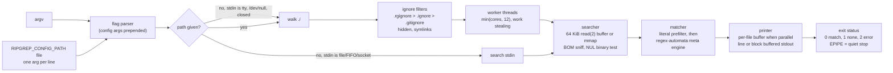

# ripgrep Internals

> [!summary] Claim
> ripgrep is a pipeline of heuristics - a config file prepended to argv, a stdin-or-cwd guess, ignore-file and hidden-file filters, a NUL-byte binary test, leftmost-first Unicode regexes, and a status that ignores broken pipes - so a script that calls `rg` inherits every one of those decisions unless it pins them with flags.

Part of [Regular Expressions and Text Processing](README.md) in [Shell and Unix Engineering](../README.md).

## TL;DR

- Mechanism: argv plus the `RIPGREP_CONFIG_PATH` file feed a parallel directory walker (the `ignore` crate) that hands each file to a searcher reading 64 KiB `read(2)` chunks (or a memory map), which runs a literal prefilter and a finite-automaton regex, then prints through a per-file buffer.
- Rule: in a script, always pass `--no-config`, an explicit path, and `</dev/null` or a real input, so neither the user's config nor the stdin heuristic changes what is searched.
- Trap: `rg pat file | head -n 1` exits 1 ("no match") although it printed a match, because ripgrep turns `EPIPE` into a quiet stop before it records the match; under `pipefail` that status leaks out.
- Portability fact: ripgrep "never was, isn't and never will be POSIX compatible" (FAQ): alternation is leftmost-first, `\w` is Unicode whatever the locale, and `.gitignore`, hidden, and binary files are skipped by default.
- When not to use it: portable `#!/bin/sh` scripts, anything that must behave identically on a host without ripgrep, and pipelines whose correctness depends on POSIX leftmost-longest matches or on grep's exit status through `head`.

## Mental model



Reading left to right: the flag parser sees the config file's lines before the real argv, so a later command-line flag overrides the file but an absent one inherits it.
If no path operand is given, ripgrep inspects file descriptor 0 and searches stdin only when it is a regular file, a FIFO, or a socket; otherwise it walks `./`.
The walker applies the ignore-file stack and the hidden-file rule per directory, before it stats entries, and distributes directories and files over up to 12 threads.
Each file goes through a searcher that either reads it into a reusable 64 KiB buffer or maps it, converts UTF-16 with a byte-order mark to UTF-8, and watches for a NUL byte.
The matcher first looks for literals the regex requires, then confirms candidate lines with a linear-time automaton (or PCRE2 under `-P`).
In parallel mode each file's output is assembled in memory and written in one piece, which is why output from different files never interleaves, and also why a broken pipe is noticed only at print time.

## How it works

### 1. Argument assembly and the config file

`crates/core/flags/config.rs` (`args()`) reads `RIPGREP_CONFIG_PATH`; if the variable is unset or empty no file is read.
Each line of the file, after trimming whitespace, is one argument verbatim, with no escaping, and lines starting with `#` are comments (GUIDE, Configuration file).
The arguments are prepended to the real argv, so the last occurrence wins and `--no-config` (checked in `crates/core/flags/parse.rs`) disables the file entirely.
The lab shows the consequence: with a config file containing `--ignore-case`, `rg -c needle` counts `Needle`, and with `--no-config` the same command exits 1.
A config file can also contain `--pre` and a program path, after which every plain `rg` spawns that program for every file it searches; the lab's `config` mode proves the program runs (`config_pre ran=yes`) and that `--no-config` stops it.

### 2. What gets searched: the stdin heuristic and the `./` prefix

`Paths::from_low_args` in `crates/core/flags/hiargs.rs` handles the no-operand case.
It calls `grep::cli::is_readable_stdin()` (`crates/cli/src/lib.rs`), which duplicates descriptor 0, calls `metadata()` on it (an `fstat`), and returns true only for `is_file() || is_fifo() || is_socket()`.
A terminal, `/dev/null` (a character device), or a closed descriptor (the duplication fails) makes ripgrep search `./` instead; the 0.5.0 changelog entry (BUG #35 and #81, 2017-03-12) reads "only read if it's a file or a fifo. i.e., ignore stdin in `rg foo < /dev/null`".
The source comment calls the heuristic "a terrible failure mode": exec APIs that leave a pipe on stdin make `rg foo` wait on that pipe and look hung.
The lab measures the four cases: a pipe and a regular file on stdin are searched as stdin, while `/dev/null` and a closed stdin (`<&-`) make ripgrep search the directory.
In a `while read` loop the loop's input file is ripgrep's stdin, so a bare `rg needle` drains the rest of the list and the loop runs once instead of three times (lab, `stdin` mode).
The same function records `has_implicit_path`; when it is true the printer strips the leading `./` from paths, so `rg needle` prints `f.txt:...` while `rg needle .` prints `./f.txt:...` ("This curious behavior matches what GNU grep does", per the source comment).

### 3. The walker: filters, order, and threads

The default filters are, per GUIDE "Automatic filtering": globs from `.gitignore` (plus `$GIT_DIR/info/exclude` and `core.excludesFile`), `.ignore`, and `.rgignore`, with `.rgignore` beating `.ignore` beating gitignore rules; hidden files and directories; binary files; and symbolic links, which are not followed without `-L`.
`.gitignore` rules apply only inside a git repository unless `--no-require-git` is given (added in 12.0.0).
In `crates/ignore/src/dir.rs` the "repository" test is `dir.join(".git")` (or `.jj`, since 15.0.0) in the searched directory or any parent added by `add_parents`, so the same command filters differently depending on whether the scratch directory sits inside some unrelated checkout; the lab reports this fact (`ancestor_vcs=`) instead of assuming it.
`.ignore` and `.rgignore` need no repository at all (lab: `dot_ignore_without_git: a.txt`).
Each `-u` removes one layer: `-u` is `--no-ignore`, `-uu` adds `--hidden`, and `-uuu` adds `--binary` (the 11.0.0 changelog: "`rg -uuu foo` should now be equivalent to `grep -r foo`"); the lab lists `a.txt sub/c.txt`, then `+ b.skipme`, then `+ .hid/h.txt`, then `+ bin.dat`.
An explicit path bypasses these filters: `rg needle .hid/h.txt` searches the hidden file.
`skip_entry` in `crates/ignore/src/walk.rs` checks the ignore rules "before any other potentially expensive operations (stat, filesystem other)", so an ignored subtree is never stat'ed or opened.
The parallel walker gives every thread its own `crossbeam_deque` deque with stealers for the others (`Stack::new_for_each_thread`), and the 14.0.0 changelog records the move to work stealing (PERF #2591).
`HiArgs::from_low_args` sets the thread count to 1 when `--sort` is given or the only operand is one file, else to `-j` or `min(available_parallelism, 12)`.
Output order with more than one thread is nondeterministic; the FAQ's only remedy is `--sort path`, which "will disable all parallelism".

### 4. Reading a file: line buffer, memory maps, encodings

The line buffer starts at `DEFAULT_BUFFER_CAPACITY`, 64 KiB, in `crates/searcher/src/line_buffer.rs`.
`fill()` first rolls the unconsumed tail (a partial line or context lines) to the front with `copy_within`, then loops on `read(2)` until the new bytes contain a line terminator, so a match never straddles two reads.
When the buffer is full and holds no complete line, `ensure_capacity()` adds twice the current length (the buffer triples), and the default allocation policy is `Eager`, "without a limit", so one 2 GiB line costs at least 2 GiB of memory.
With the default `--mmap` mode ripgrep tries a memory map only when at most 10 paths are given and all are files (`hiargs.rs`); a directory operand means `MmapChoice::never()`.
`MmapChoice::open` in `mmap.rs` returns `None` on macOS ("I guess memory maps on macOS aren't great", issues #36 and PR #3246), and 15.2.0 calls `madvise` with `Advice::Sequential` on the maps it does create (14.1.1's `mmap.rs` has the macOS refusal but no `madvise` call).
The `SAFETY` comment in `hiargs.rs` names the cost of maps: if the file is truncated while mapped, the process takes `SIGBUS` and aborts.
By default (`--encoding auto`) the searcher reads the first bytes for a byte-order mark and transcodes UTF-16 to UTF-8 through `encoding_rs_io::DecodeReaderBytes` (`searcher/mod.rs`, `bom_sniffing: true`); everything else is searched as raw bytes, and `-E none` turns all of this off (GUIDE, File encoding).
The lab's UTF-16LE file with a BOM matches `rg needle`, while macOS grep finds nothing in it.

### 5. Binary detection: three modes and a first-buffer rule

The NUL byte is the only binary signal ("a file is considered binary if and only if it contains a `NUL` byte", GUIDE, Binary data).
`BinaryDetection::from_low_args` in `hiargs.rs` builds two policies: walked files get `quit(0x00)`, explicit operands get `convert(0x00)`, and `-a` or `--null-data` give `none` for both; `--binary` makes walked files use `convert` too.
`quit` makes the line buffer behave as if it hit EOF at the NUL, and in `ReadByLine::fill` (`glue.rs`) the searcher stops before it searches the buffer in which the NUL arrived.
So a NUL anywhere in the first 64 KiB read hides a walked file completely: the lab's `early.dat` (NUL at offset 6) produces no output and status 1.
When the NUL arrives in a later read, the matches already printed stay printed and the standard printer adds `WARNING: stopped searching binary file after match (found "\0" byte around offset 80013)` on stdout (lab).
`convert` replaces each NUL with the line terminator and keeps searching; on a match the standard printer suppresses the line and prints `binary file matches (found "\0" byte around offset 6)` (the 13.0.0 format; before 13 it was `Binary file FOO matches`).
The summary printer (`crates/printer/src/summary.rs`) squashes the count to zero whenever `quit` detection fired, but `-l` and `-q` can stop at the first match before the NUL is seen; the source comment calls this "an unfortunate inconsistency" and accepts the bug for performance.
The lab reproduces it on one file: plain `rg` prints the early match, `rg -l` lists the file, and `rg -c` prints nothing and exits 1.
With memory maps the searcher checks only the first 64 KiB plus each matching line (`SliceByLine::run` uses `min(len, DEFAULT_BUFFER_CAPACITY)`), so whether a file counts as binary depends on whether it was mapped; GUIDE recommends `--no-mmap` for consistent results.

### 6. Matching: line-oriented, leftmost-first, Unicode, linear time

The pattern is parsed by `regex-syntax`; unless `-U` is given, `strip_from_match` (`crates/regex/src/strip.rs`) removes the line terminator from every class and rejects a literal one: `rg 'foo\nbar'` fails with `the literal "\n" is not allowed in a regex` and status 2 (lab).
Because matches cannot cross lines, `crates/regex/src/literal.rs` extracts "inner" literals from the regex, finds them with vectorized search, expands to the surrounding line, and runs the full regex only there; its doc comment gives `\s+(Sherlock|[A-Z]atso[a-z]|Moriarty)\s+` as the case the regex engine's own optimizer misses.
Inside the engine, the meta regex composes a prefilter (memchr, Teddy "ported out of Hyperscan", or Aho-Corasick), a lazy DFA, a full DFA, a one-pass DFA, a bounded backtracker, and the PikeVM (regex-internals post, 2023-07-05); [[Ripgrep-Internals-and-Fast-Text-Search]] walks through the SIMD layer.
ripgrep's `grep-regex` config passes `--regex-size-limit` (default 100 MiB) as the NFA size limit, caps the full DFA at 1 MiB and the one-pass DFA at 10 MiB, and passes `--dfa-size-limit` (default 1000 MiB) as the lazy DFA cache capacity (`crates/regex/src/config.rs`); `regex-automata` alone defaults that cache to 2 MiB (`hybrid/dfa.rs`, `get_cache_capacity`; the same value in 0.4.9 and 0.4.18, and ripgrep 15.2.0's `Cargo.lock` pins 0.4.15).
The meta engine gives up on the lazy DFA after at least 3 cache clears when fewer than 10 bytes were searched per state (`minimum_cache_clear_count(Some(3))`, `minimum_bytes_per_state(Some(10))` in `meta/wrappers.rs`) and falls back to a slower engine that is still linear.
The `regex` crate guarantees "worst case `O(m * n)` time complexity" for a search, which is why the default engine has no look-around and no back-references; `-P` switches to PCRE2, a backtracking engine (FAQ).
Alternation is leftmost-first: `x|y` means "x or y, prefer x" (regex docs), whereas POSIX requires the longest of the leftmost matches (POSIX.1-2024 XBD 9.1, the definition of "matched").
The lab prints `alternation rg=a rg_swapped=ab grep=ab` for `-o 'a|ab'` on `ab`; see [[POSIX-Leftmost-Longest-Matching]].
Unicode is on by default and the locale is ignored ("ripgrep doesn't respect your locale settings", FAQ): `\w` matches U+00E9 (`e` with an acute accent) even with `LC_ALL=C`, and `(?-u)\w` or `--no-unicode` restores ASCII (lab: 6 bytes, 6 bytes, 4 bytes).
`$` matches only before `\n`, so it fails on CRLF text unless `--crlf` is given; `--crlf` also makes ripgrep end its own summary lines, such as the `-c` count, in `\r\n` (`write_line_term` writes `searcher.line_terminator()`; lab: `count_line_has_cr=yes`).

### 7. Output: buffering, line numbers, and atomic per-file output

`HiArgs::stdout` picks a line-buffered writer when stdout is a terminal and a block-buffered one otherwise; `--line-buffered` and `--block-buffered` override it (15.1.0 fixed a `--line-buffered` regression introduced in 15.0.0).
Line numbers and headings default on only when stdout is a terminal, and line numbers stay off when the only input is stdin (`line_number` and `heading` in `hiargs.rs`), so a script sees `path:line` with no line number unless it passes `-n`.
In `search_parallel` (`crates/core/main.rs`) each worker searches a whole file into an in-memory buffer and then writes it with one `bufwtr.print`; in the lab's `-j2` run that buffer holds every line of the 2,288,895-byte `d/big.txt` plus a 10-byte `d/big.txt:` prefix per line, about 4.3 MB, before the first byte reaches the pipe (from the source; the lab shows the status, not the buffering).

### 8. Exit status and the broken pipe

`run()` in `main.rs` returns 0 if something matched and either `-q` was given or no error occurred, 2 if any error occurred, and 1 otherwise; this is GNU grep's rule (adopted in 11.0.0) and matches POSIX's `-q` clause ("the exit status shall be zero if an input line is selected, even if an error was detected", POSIX.1-2024 XCU grep, CONSEQUENCES OF ERRORS).
`main()` maps any `BrokenPipe` error to status 0, because "the Rust runtime doesn't ask for PIPE signals, and thus we get an I/O error instead" of dying by `SIGPIPE`.
The single-threaded `search()` loop, however, matches `Err(err) if err.kind() == BrokenPipe => break` before it executes `matched = matched || search_result.has_match()`, so the file whose output hit the closed pipe is never counted.
Result, measured in the lab with a 2.2 MiB (2,288,895-byte) result written into a FIFO read by `head -n 1`: one file gives status 1, a directory with `-j1` gives 1, and a directory with `-j2` gives 0 (the parallel path stores `matched` before printing).
grep in the same position dies of `SIGPIPE`, which the shell reports as 141 (269 in ksh93, 397 in yash).
The 14.1.1 `main.rs` has the same logic, so the Debian 13 and Alpine 3.22 packages (both 14.1.1 as of 2026-11) behave the same way.
`matches_possible()` short-circuits `-m 0` and an empty pattern list to status 1 without searching, and a search in which every file was filtered out prints "No files were searched, which means ripgrep probably applied a filter you didn't expect" and exits 2 (lab: `nothing_searched status=2`).

## Numbers and limits

| Quantity | Value | Source (ripgrep 15.2.0 unless stated, as of 2026-11) |
| --- | --- | --- |
| Default worker threads | `min(available_parallelism, 12)`; 1 with `--sort` or a single file operand | `hiargs.rs`, `HiArgs::from_low_args` |
| Line buffer initial size | 65,536 bytes | `line_buffer.rs`, `DEFAULT_BUFFER_CAPACITY` |
| Line buffer growth | adds 2x current length per step (x3), no cap by default | `line_buffer.rs`, `ensure_capacity`, `BufferAllocation::Eager` |
| Memory map eligibility | at most 10 operands, all files; never for a directory operand; never on macOS | `hiargs.rs`, `mmap.rs` |
| Binary scan window with mmap | first 64 KiB plus matching lines | `glue.rs`, `SliceByLine::run`; GUIDE |
| NUL offset hidden by first-read rule | any offset below the first `read(2)` size, nominally 65,536 | `glue.rs`, `ReadByLine::fill`; lab hides NUL at 6, reports NUL at 80,013 |
| NFA size limit (`--regex-size-limit`) | 100 MiB | `crates/regex/src/config.rs` |
| Lazy DFA cache (`--dfa-size-limit`) | 1000 MiB in ripgrep; 2 MiB `regex-automata` default | `config.rs`; `regex-automata` 0.4.18 `hybrid/dfa.rs` (same in 0.4.9; ripgrep 15.2.0 locks 0.4.15) |
| Full DFA / one-pass DFA limits | 1 MiB / 10 MiB | `config.rs` |
| Lazy DFA give-up rule | at least 3 cache clears and under 10 bytes searched per state | `regex-automata` 0.4.18 `meta/wrappers.rs` (same in 0.4.9) |
| Regex search worst case | `O(m * n)`; iterating all matches `O(m * n^2)` | `regex` 1.13.1 docs |
| Exit statuses | 0 match, 1 no match, 2 error (0 with `-q` and a match) | `main.rs`, `run` |
| Status after `EPIPE` | 1 single-threaded, 0 parallel (lab, 2,288,895 bytes into `head -n 1`) | `main.rs`; lab `pipe` mode |
| Config file syntax | one argument per line, no escaping, `#` comments | GUIDE |
| Packaged versions | Debian 13: 14.1.1-1 (with PCRE2); Alpine 3.22: 14.1.1-r0 (community) | packages.debian.org, pkgs.alpinelinux.org |

## Portability

ripgrep is one implementation, so its behavior does not change with the shell that runs it; what changes across hosts is which grep it is compared against and how the shell reports a signal death.

| Behavior | POSIX grep | GNU grep 3.x | macOS grep 2.6.0-FreeBSD | BusyBox grep 1.37 | ripgrep 15.2.0 (lab); 14.1.1 (source) |
| --- | --- | --- | --- | --- | --- |
| `-o 'a\|ab'` on `ab` | `-o` not specified; ERE matching is leftmost-longest (XBD 9.1) | `ab` (measured, GNU grep 3.11 in the Debian 13 image) | `ab` (lab, measured) | `ab` (measured, Alpine 3.22 image) | `a`, leftmost-first (lab) |
| Match plus an unreadable operand | `>1` means an error occurred | 2 (man page; measured, Debian 13) | 2 (lab, measured) | 2 (`grep.c`: `if (open_errors) return 2`; measured, Alpine 3.22) | 2 (`main.rs`; lab) |
| `-q` with a match and an error | 0 required | 0 (man page; measured, Debian 13) | 0 (lab, measured) | 0 (`grep.c`, exits on first match; measured, Alpine 3.22) | 0 (`main.rs`; lab) |
| Bad regex | `>1` | 2 (measured, Debian 13) | 2 (lab, measured) | 2 (measured, Alpine 3.22) | 2 (lab) |
| Recursion and filtering | no `-r` in POSIX | `-r` searches everything, follows command-line symlinks only (man page) | `-r` (measured: searched hidden, ignored, and binary files) | not covered | recursive by default; skips ignored, hidden, binary; no symlinks without `-L` (GUIDE; lab) |
| Binary files | input "shall be text files" | NUL or encoding error; "binary file matches" message on stderr (man page) | `Binary file ./bin.dat matches` on stdout (measured) | not covered | NUL only; walked files skipped, explicit files reported on stdout (lab) |
| Locale | honors `LC_ALL`, `LC_CTYPE` | honors locale (man page) | not covered | not covered | ignores the locale; Unicode by default (FAQ; lab) |
| UTF-16 with BOM | n/a | not covered | no match (measured) | not covered | transcoded and matched (GUIDE; measured) |
| Writer on a closed pipe | n/a | killed by `SIGPIPE` (measured: bash reports 141, Debian 13) | killed by `SIGPIPE` (lab, measured) | killed by `SIGPIPE` (measured: bash reports 141, Alpine 3.22) | never killed; status 1 or 0 (lab) |

How the shell reports the grep death in the lab's `pipe` mode (ripgrep reports 1 for one file in every shell, because it never dies of the signal):

| Shell | `grep` killed by `SIGPIPE` | `rg` one file into closed pipe |
| --- | --- | --- |
| POSIX sh | greater than 128, value implementation-defined (POSIX.1-2024 XCU 2.8.2) | 1 |
| macOS bash 3.2 (`/bin/sh`) | 141 (lab, measured) | 1 (lab, measured) |
| bash 4.x and 5.x | 141 (lab asserts; bash 5 measured in the Debian and Alpine images) | 1 |
| zsh native and `--emulate sh` | 141 (lab asserts) | 1 |
| dash, posh, mksh, BusyBox ash | 141 (lab asserts) | 1 |
| ksh93 | 269, 256 + 13 (lab asserts; measured in the shell matrix and on macOS ksh93u+ 2012-08-01) | 1 |
| yash | 397, 384 + 13 (lab asserts; measured in the shell matrix, yash 2.58.1) | 1 |

## Worked example

The [lab](../labs/07-ripgrep-internals/) is one POSIX `sh` probe, `rg-probe.sh`, with seven modes (`semantics`, `filter`, `binary`, `stdin`, `exit`, `pipe`, `config`) and a bats suite that asserts every line it prints.
Every scratch file lives in a `mktemp -d` directory under `TMPDIR`; every ripgrep call except the config test passes `--no-config`, and every walked search pins stdin.
The broken-pipe probe, verbatim from `rg-probe.sh`:

```sh
# into_fifo CMD...: run CMD with stdout on a FIFO whose reader, head -n 1,
# exits after one line; print CMD's exit status and the line head saw.
into_fifo() {
  rm -f "$work/fifo" "$work/head.out"
  mkfifo "$work/fifo"
  head -n 1 <"$work/fifo" >"$work/head.out" &
  reader=$!
  "$@" >"$work/fifo" 2>/dev/null
  st=$?
  wait "$reader"
  printf 'status=%s head_saw=<%s>' "$st" "$(joined "$work/head.out")"
}
pipe_mode() {
  mkdir -p "$work/d"
  awk 'BEGIN { for (i = 1; i <= 200000; i++) print "line", i }' >"$work/d/big.txt"
  printf 'output_bytes=%s\n' "$(bytes "$work/d/big.txt")"
  # Relative paths keep the printed file names short; -u keeps any ignore
  # file outside the scratch directory from hiding d/big.txt.
  cd "$work" || exit 1
  printf 'rg_one_file '
  into_fifo rgx line d/big.txt
  printf '\nrg_dir_j1 '
  into_fifo rgx -u -j1 line d
  printf '\nrg_dir_j2 '
  into_fifo rgx -u -j2 line d
  printf '\ngrep_one_file '
  into_fifo grep line d/big.txt
  printf '\n'
}
```

A FIFO instead of a shell pipeline keeps the result independent of the shell: ksh93u+m connects pipeline stages with sockets, but a FIFO is a pipe in every shell.
The writer cannot block forever, because its `open` of the FIFO waits only until the background `head` opens the read end, and the 2.2 MiB output exceeds the default pipe buffer (64 KiB on macOS and Linux, measured in the shell matrix), so the writer always meets a closed reader.
Output of `sh rg-probe.sh pipe` and `sh rg-probe.sh binary` (macOS bash 3.2 as `sh`, ripgrep 15.2.0, captured 2026-11-14):

```text
output_bytes=2288895
rg_one_file status=1 head_saw=<line 1>
rg_dir_j1 status=1 head_saw=<d/big.txt:line 1>
rg_dir_j2 status=0 head_saw=<d/big.txt:line 1>
grep_one_file status=141 head_saw=<line 1>
late_size=80026
walked_early status=1 stdout_bytes=0
explicit_early status=0 stdout=binary file matches (found "\0" byte around offset 6)
walked_late default status=0
  | late.dat:needle early
  | late.dat: WARNING: stopped searching binary file after match (found "\0" byte around offset 80013)
walked_late -c status=1
walked_late -l status=0
  | late.dat
walked_late --binary status=0
  | late.dat:needle early
  | late.dat: binary file matches (found "\0" byte around offset 80013)
walked_late -a -c: late.dat:2
```

Read the first block as three code paths: `search()` breaks on `EPIPE` before counting the match (status 1 twice), `search_parallel` counts it before printing (status 0), and grep takes the default `SIGPIPE` action (128 + 13 in this shell).
Read the second block as the two binary policies: the walked `early.dat` vanishes because its NUL is in the first 64 KiB read, the explicit `early.dat` is searched in `convert` mode, and `late.dat` (NUL at 80,013, past the first read) shows the printed-then-stopped warning, the `-l` versus `-c` inconsistency, and the full count of 2 under `-a`.

## Pitfalls

> [!warning] The stdin heuristic in loops, cron, and CI
> Trigger: `rg pattern` with no path inside `while read`, under `ssh host cmd`, cron, or a CI runner that attaches a pipe to stdin.
> Symptom: the loop runs once (ripgrep drained the list, lab: `iterations=1`), or ripgrep blocks reading a pipe nobody writes; the `hiargs.rs` comment calls this "a terrible failure mode".
> Fix: always give a path (`rg pattern .`) and redirect stdin (`</dev/null`) when stdin is not the input.

> [!warning] Status 1 after printing a match
> Trigger: `set -o pipefail; rg pattern file | head -n 1`, or any reader that exits early on a single-threaded search.
> Symptom: the pipeline reports 1, "no match", although a match was printed; with a directory and several threads the same command reports 0.
> Fix: test for a match with `rg -q` (which stops at the first match and never writes), or capture output and test it, never the status of a truncated pipeline.

> [!warning] `-c` and `-l` disagree on binary files
> Trigger: a walked file with a NUL after the first matching line, such as a log with a stray NUL or a UTF-16 file without a BOM.
> Symptom: `rg -l` lists the file, `rg -c` prints nothing and exits 1, and a NUL in the first 64 KiB hides the file from every mode without a message.
> Fix: pass `--binary` to search binary files to the end, `-a` to treat them as text, or name the file explicitly; the inconsistency is documented and accepted in `summary.rs`.

> [!warning] A user's config file changes your script
> Trigger: a script calls `rg` on a machine whose user exports `RIPGREP_CONFIG_PATH` with `--hidden`, `--ignore-case`, `--max-columns`, `--sort`, or `--pre`.
> Symptom: different matches, truncated lines, a single thread, or an arbitrary program spawned per file (lab: `config_pre ran=yes`).
> Fix: start every scripted call with `rg --no-config`.

> [!warning] Leftmost-first is not leftmost-longest
> Trigger: porting `grep -oE 'a|ab'`, an `-r` replacement, or a field extractor to ripgrep.
> Symptom: `rg -o 'a|ab'` prints `a` where grep prints `ab` (lab), so extracted tokens are truncated.
> Fix: order alternatives longest first, anchor them (`\b(ab|a)\b`), or keep POSIX tools for POSIX semantics.

> [!warning] Filtering that depends on where the script runs
> Trigger: relying on `.gitignore` in a scratch directory, or on hidden files being searched.
> Symptom: `.gitignore` is ignored outside a repository and honored inside any parent checkout (the lab reports `ancestor_vcs=`), hidden files and symlinks are skipped, and results differ between a laptop and CI.
> Fix: say what you mean: `-uuu` (or `--no-ignore --hidden --binary`) for grep-like coverage, `--no-require-git` to honor `.gitignore` everywhere, `-L` for symlinks.

> [!warning] CRLF input and CRLF output
> Trigger: Windows text, or `--crlf` added to fix `$`.
> Symptom: `foo$` never matches `foo\r\n` (lab: status 1); with `--crlf`, `n=$(rg -c --crlf ...)` captures `1` plus a carriage return, and `$((n + 1))` fails.
> Fix: use `--crlf` and strip the `\r` from summary output (`tr -d '\r'`), or normalize line endings first.

> [!warning] A false negative fixed in 14.1.1
> Trigger: ripgrep before 14.1.1 with certain case-insensitive alternations.
> Symptom: lines silently not reported; the changelog's example is `(?i:e.x|ex)` not matching `e-x`, caused by an inner-literal optimization in `grep-regex` (BUG #2884).
> Fix: run 14.1.1 or later (the version Debian 13 and Alpine 3.22 ship as of 2026-11), and pin the version a CI check depends on.

## Security and robustness

- CVE-2021-3013 (NVD API record, CVSS 3.1 base 9.8, vector `AV:N/AC:L/PR:N/UI:N/S:U/C:H/I:H/A:H`, as of 2026-11): "ripgrep before 13 on Windows allows attackers to trigger execution of arbitrary programs from the current working directory via the -z/--search-zip or --pre flag"; fixed in 13.0.0, and the lesson for Unix is the same: `-z` and `--pre` spawn programs resolved through `PATH`, so never run them in an untrusted directory with `.` in `PATH`.
- The config file is code: `--pre` in a file named by `RIPGREP_CONFIG_PATH` executes a program for every searched file, so treat that variable like `LD_PRELOAD` in privileged or CI contexts and pass `--no-config`.
- Untrusted patterns are safe in time with the default engine (`O(m * n)` per search) and bounded in memory by `--regex-size-limit` and `--dfa-size-limit`; `-P` gives up both guarantees, see [[ReDoS]].
- CVE-2022-24713 (CVE.org record from the GitHub CNA, CVSS 3.1 base 7.5): the `regex` crate up to 1.5.4 let crafted patterns bypass its parse-time mitigations; a service that passes user patterns to an old ripgrep build inherits that denial of service, so check the bundled `regex` version, not only ripgrep's.
- Matched lines are printed raw, and `-a` prints binary data raw, so searching untrusted files to a terminal is an escape-sequence injection vector; see [[Terminal-Escape-Injection]].
- File names can contain newlines; use `-0` (`--null`) with `-l` or `--files` and consume with `xargs -0` or `read -d ''` where available, and put `--` (or `-e`) before a pattern that starts with `-`.
- Long lines are buffered whole with no default cap, and a parallel search holds each file's entire output in memory before printing; use `--max-filesize`, globs such as `-g '!*.min.js'`, or `-M` (which limits only what is printed, not what is read).

## The principal's view

The decision is not grep versus ripgrep in general; it is which contract a given call site needs.
Interactive search and repository-scoped CI checks gain the most from ripgrep: ignore-aware traversal, parallelism, Unicode by default, and linear-time matching are exactly what a monorepo grep needs.
A script that ships to unknown hosts, or whose meaning is POSIX text processing, should use POSIX grep, because ripgrep may be absent, a different major version, or configured by the user, and because its matching and filtering semantics differ on purpose.
When ripgrep is the right tool inside automation, treat it like a dependency with a versioned interface: pin the version, pass `--no-config`, an explicit path, explicit filter flags (`-uuu` or a precise set), `--sort path` if order matters, and consume `--json` rather than parsing the human format.
The trade-off you accept is that ripgrep's speed comes from heuristics, and every heuristic (stdin detection, binary detection, ignore rules, memory maps) has an edge that changes results, not just timing.
At monorepo scale a scan is the wrong shape entirely, and an index (trigram or similar) replaces the walker; that is outside this note.

## Interview questions

> [!question] L5: Why does `rg foo` sometimes hang in a CI job but work in a terminal?
>
> > [!success]- Answer
> > With no path operand, ripgrep searches stdin if descriptor 0 is a regular file, FIFO, or socket.
> > CI runners and exec APIs often attach a pipe to stdin that is never written or closed, so ripgrep blocks reading it.
> > In a terminal stdin is a tty, so ripgrep searches `./` instead.
> > Fix it by passing a path and redirecting stdin from `/dev/null`.
> >
> > Follow-up: What does `rg foo <&-` search, and why?

> [!question] L5: What does `rg -o 'a|ab'` print for the input `ab`, and what does `grep -oE` print?
>
> > [!success]- Answer
> > ripgrep prints `a`, because its regex engine is leftmost-first: among matches starting at the same position, the first alternative wins.
> > grep prints `ab`, because POSIX ERE matching takes the longest of the leftmost matches (XBD 9.1).
> > Reordering to `ab|a` makes ripgrep print `ab`.
> >
> > Follow-up: Which other ripgrep features does leftmost-first change besides `-o`?

> [!question] L5: Predict the output of `rg needle`, `rg -l needle`, and `rg -c needle` in a directory holding only `late.dat`, whose line 1 is `needle early` and whose NUL byte is at offset 80,013.
>
> > [!success]- Answer
> > `rg needle` prints `late.dat:needle early` and then `late.dat: WARNING: stopped searching binary file after match (found "\0" byte around offset 80013)`, status 0.
> > `rg -l needle` prints `late.dat`, status 0, because it stops at the first match before the NUL is read.
> > `rg -c needle` prints nothing and exits 1, because the summary printer zeroes the count once quit-mode binary detection fires.
> > With the NUL in the first 64 KiB instead, all three would print nothing.
> >
> > Follow-up: Which flag makes all three agree, and what does each then print?

> [!question] L6: Debug this script: it should run `rg` once per name in `names.txt`, but it processes only the first name.
>
> ```sh
> while IFS= read -r name; do
>   rg -l -- "$name"
> done <names.txt
> ```
>
> > [!success]- Answer
> > `rg` has no path operand, so it checks stdin, which is `names.txt`, a regular file.
> > It searches stdin and reads it to EOF, so the shared file offset is at the end and the next `read` fails.
> > The fix is `rg -l -- "$name" . </dev/null`: an explicit path stops the heuristic and the redirection keeps ripgrep away from the loop's input.
> >
> > Follow-up: Why does the same bug not occur with `grep -rl -- "$name"`?

> [!question] L6: `set -o pipefail; rg ERROR app.log | head -n 1 || echo none` prints a matching line and then `none`; why?
>
> > [!success]- Answer
> > ripgrep runs with `SIGPIPE` ignored, so when `head` exits its next write fails with `EPIPE` instead of killing it.
> > For a single file the search is single-threaded, and `search()` breaks out on `BrokenPipe` before it records the file as matched.
> > `main()` then sees no error and no match and returns 1, which `pipefail` propagates.
> > Use `rg -q` for the test, or check the captured output.
> >
> > Follow-up: Why does the same pipeline over a directory usually return 0?

> [!question] L6: A teammate's `rg` finds a file that yours does not in the same checkout; which causes do you check, in order?
>
> > [!success]- Answer
> > First `RIPGREP_CONFIG_PATH`: a config with `--hidden`, `-u`, globs, or `--type` changes the candidate set; `--debug` prints the loaded arguments.
> > Then ignore sources outside the tree: `core.excludesFile`, `$GIT_DIR/info/exclude`, and parent `.gitignore`, `.ignore`, `.rgignore` files.
> > Then binary detection: a NUL in the first 64 KiB hides a walked file, and memory maps (Linux, a few file operands) change the detection window.
> > Then version differences, such as the gitignore fixes in 15.0.0 and the 14.1.1 false-negative fix.
> >
> > Follow-up: Which single invocation removes all of these differences at once?

> [!question] L7+: Why can ripgrep promise linear-time search, and what does it give up for that?
>
> > [!success]- Answer
> > The default engine compiles the pattern to automata (PikeVM, lazy DFA, and others) and never backtracks, giving `O(m * n)` per search.
> > Memory is bounded separately: 100 MiB for the NFA and a 1000 MiB lazy DFA cache in ripgrep, with a fallback when the cache thrashes (3 clears and under 10 bytes per state).
> > The cost is expressiveness: no back-references and no look-around, which need backtracking.
> > `-P` restores them through PCRE2 and loses the time guarantee, which matters for untrusted patterns.
> >
> > Follow-up: How would you expose user-supplied search patterns in a service built on ripgrep's crates?

> [!question] L7+: You are asked to replace `grep -r` with `rg` across a fleet of production scripts for speed; what is your rollout plan?
>
> > [!success]- Answer
> > Classify call sites by contract: POSIX text processing and output parsing stay on grep, repository search moves.
> > For moved sites, pin the ripgrep version, and use `--no-config`, explicit paths, `</dev/null`, `-uuu` (or a precise filter set), and `--sort path` where order matters.
> > Audit semantics: leftmost-first alternation, Unicode `\w` regardless of locale, the `./` prefix rule, `--crlf` output, and exit status through pipes.
> > Diff outputs of both tools on a corpus in CI before switching, and measure the speedup rather than assuming it.
> >
> > Follow-up: Which of these differences would a byte-for-byte output diff miss?

> [!question] L7+: Why does ripgrep avoid memory maps on directories and on macOS, and what correctness effect does the choice have?
>
> > [!success]- Answer
> > Mapping many small files costs a map and unmap per file, so ripgrep maps only when at most 10 file operands are given, and `mmap.rs` refuses maps on macOS entirely.
> > A map also risks `SIGBUS` if the file is truncated during the search, which aborts the process.
> > The correctness effect is on binary detection: a mapped file is checked only in its first 64 KiB plus matching lines, a read file in every byte read, so the same file can be text in one mode and binary in the other.
> > `--no-mmap` makes the result consistent.
> >
> > Follow-up: How would you show the difference on Linux with a file whose NUL is at offset 100,000?

## Related

Prerequisites: [[grep-in-Depth]]

Next: [[sed-Pattern-and-Hold-Space]]

See also: [[Ripgrep-Internals-and-Fast-Text-Search]], [[POSIX-Leftmost-Longest-Matching]], [[Regex-Engines-NFA-DFA-and-Backtracking]], [[ReDoS]], [[Unicode-and-UTF-8-in-Text-Tools]], [[Locale-and-LC_ALL]], [[SIGPIPE-and-EPIPE]], [[pipefail-and-PIPESTATUS]], [[Terminal-Escape-Injection]]

## Further reading

- ripgrep GUIDE.md (15.2.0): the maintainer's description of automatic filtering, the config file, encodings, binary modes, and preprocessors.
- ripgrep FAQ.md: the "Can ripgrep replace grep?" answer states the non-POSIX stance and the locale rule in the author's words.
- ripgrep CHANGELOG.md: dates every behavior change cited here (exit codes in 11.0.0, binary message in 13.0.0, `--no-require-git` in 12.0.0, the 14.1.1 false negative).
- ripgrep `crates/core/main.rs` and `crates/core/flags/hiargs.rs`: exit status, broken pipe, thread count, mmap choice, and the stdin heuristic, each in under a page.
- ripgrep `crates/searcher/src/line_buffer.rs` and `searcher/glue.rs`: the 64 KiB buffer, roll, growth, and the binary quit rule.
- Andrew Gallant, "Regex engine internals as a library" (2023-07-05): the meta engine, prefilters, and leftmost-first semantics behind `regex-automata`.
- `regex` crate documentation: the `O(m * n)` guarantee, Unicode classes, and the exact meaning of `\w`, `\d`, `\s`.
- POSIX.1-2024 XBD chapter 9 and XCU grep: the leftmost-longest rule and the exit-status and `-q` rules ripgrep is measured against.
- NVD CVE-2021-3013 and CVE-2022-24713: the two vulnerabilities in ripgrep and its regex engine, with scores and affected versions.
