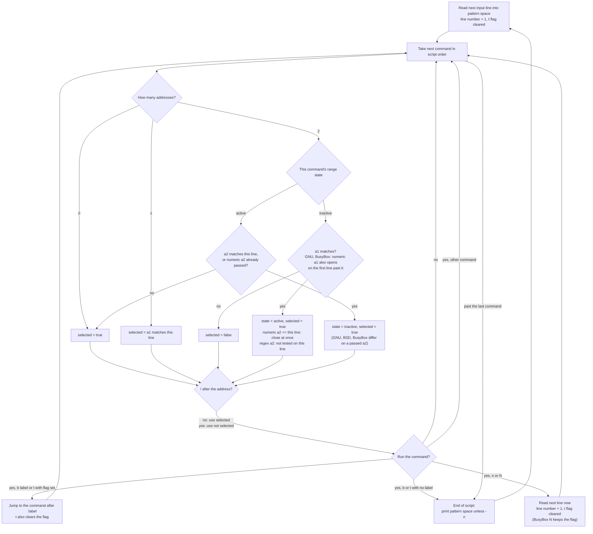

# sed: Addresses and Branching

> [!summary] Claim
> A `sed` address is not a per-line filter but a small state machine attached to one command and evaluated only when control reaches that command, so ranges, `!`, blocks, and the `b`, `t`, and `:` branch commands interact in ways that differ between GNU, BSD, and BusyBox sed exactly where a script jumps over a range endpoint, ends a label with `;`, or relies on when the `t` flag is cleared.

Part of [Regular Expressions and Text Processing](README.md) in [Shell and Unix Engineering](../README.md).

## TL;DR

- **Mechanism**: for each pattern space, `sed` walks the compiled script in order; each command's address (none, one, or a range with its own active or inactive state) is tested when control arrives there, `!` inverts the answer, and `b label`, `t label`, and GNU `T label` move control to a `:label` without reading input or printing.
- **Rule**: write portable scripts with only POSIX addresses (`N`, `$`, `/RE/`, `\cREc`, `addr1,addr2`, `!`) and end every label and every `b` or `t` with a newline, which separate `-e` options provide because POSIX joins them with newlines (POSIX.1-2024 XCU sed, OPTIONS).
- **Trap**: on FreeBSD and macOS sed, `:a;N;$!ba;s/\n/ /g` defines one label named `a;N;$!ba;s/\n/ /g`, runs no command at all, and exits 0 (lab), and the `t` flag is cleared by `N` in GNU and BSD but not in BusyBox (lab, BusyBox from source).
- **Portability fact**: `0,/re/`, `first~step`, `addr1,~N`, `T`, and labels ended by `;` or `}` are GNU extensions, and when a branch jumps over a numeric range endpoint GNU, FreeBSD, OpenBSD, and BusyBox give four different answers (GNU sed 4.1 NEWS; lab; source).
- **When not to use it**: past two or three labels, or when the state you carry is more than "inside this block or not", switch to [[awk-Language|awk]], which has variables, `if`, and `while` instead of jumps and a single success bit.

## Mental model



Read the diagram from the top: a line enters the pattern space, and control starts at the first command.
Every command decides for itself whether it is selected; a two-address command consults its private range state, so two identical `/a/,/b/` ranges in one script are independent and a range inside a block is evaluated only on lines that enter the block.
Opening a range never tests a regex second address on the opening line, which is why a range spans at least two lines, while a numeric second address that is not larger than the opening line closes the range immediately.
The `!` arrow shows that negation is applied after the range state has already been updated, so a negated range still opens and closes on the same lines.
The jump arrows leave the read step out entirely: `b label` and `t label` return to the command list without printing or reading, and only "end of script" prints and starts the next cycle, while `n` and `N` read in the middle of the script and so advance the line number that later addresses see.

## How it works

### The cycle and where addresses are evaluated

POSIX defines the cycle: `sed` appends a line of input, minus its newline, to the pattern space, applies "in sequence all commands whose addresses select that pattern space, until a command starts the next cycle or quits", and then writes the pattern space unless `-n` was given (POSIX.1-2024 XCU sed, EXTENDED DESCRIPTION).
The key word is "in sequence": an address is evaluated when control reaches its command, against the pattern space and line number as they are at that moment, not once per input line.
GNU sed 4.10 implements this as a flat array of `struct sed_cmd` walked by `execute_program` in `sed/execute.c`, which runs a command when `match_address_p (cur_cmd, input) != cur_cmd->addr_bang`.
The manual states the consequence for regex addresses directly: if an earlier `s` changed the pattern space, a later `/RE/` address matches the changed text (GNU sed manual, 4.3 "selecting lines by text matching").
A line-number address sees the line number as it is when evaluated, so after `N` has appended line 2 to line 1, an address `2` matches the combined pattern space.

### Address forms

POSIX defines three single addresses (POSIX.1-2024 XCU sed, Addresses in sed):

- A decimal number, which "counts input lines cumulatively across files".
- `$`, the last line of input.
- A context address `/RE/` or `\cREc`, where `c` is any character other than backslash or newline; inside it `\c` is a literal `c` when `c` is not a special RE character, and it is unspecified when it is (for example `\.` with `.` as the delimiter), so portable scripts put such a delimiter in a bracket expression (`\.[.][0-9].`).

An empty RE (`//`) reuses "the last RE used in the last command applied (either as an address or as part of a substitute command)", which makes `/^k=/{ s//K=/; }` substitute exactly what the address matched.
`\n` in a context address matches a newline embedded in the pattern space; a literal newline is not allowed in the RE.
Regex syntax itself, BRE versus ERE (`-E`, added to POSIX by Austin Group Defect 528), is the subject of [[BRE-ERE-and-PCRE]].

A command takes zero, one, or two addresses; POSIX marks each command `[0addr]`, `[1addr]`, or `[2addr]`: `:label` and `#` take none, `a`, `i`, `q`, `r`, and `=` take at most one, and the rest take up to two.
GNU accepts two addresses on `a`, `i`, `=`, and `r` as an extension, and under `--posix` rejects a second address on those and on `l` with "command only uses one address" (`sed/compile.c`, `compile_program`).
Omitting a component (`,5p` or `5,p`) is undefined in POSIX; GNU rejects `5,p` with "unexpected ','".

### Ranges: one bit of state per command

POSIX: a two-address command "shall select the inclusive range from the first pattern space that matches the first address through the next pattern space that matches the second", and "if the second address is a number less than or equal to the line number first selected, only one line shall be selected"; after the range, `sed` looks for the first address again (POSIX.1-2024 XCU sed, Addresses in sed).
"The next pattern space" means the second address is not tested on the line that opened the range, so `/x/,/x/` never selects a single line, and `4,2p` prints only line 4 (lab, `range /x/,/x/` and `range 4,2`).

The implementations store that state differently, and the representation explains every divergence below:

- GNU sed 4.10 keeps `enum addr_state { RANGE_INACTIVE, RANGE_ACTIVE, RANGE_CLOSED }` in each command (`sed/sed.h`); `RANGE_CLOSED` means "like RANGE_INACTIVE, but range has ended once", used so that a numeric range can never reopen.
- FreeBSD and macOS keep `u_long startline` in `struct s_command`, zero when inactive (`usr.bin/sed/defs.h`), and evaluate it in `applies()` in `process.c`.
- OpenBSD keeps a boolean `inrange` field in each command and evaluates it in `applies()` (`usr.bin/sed/process.c`, revision 1.39, as of 2026-11).
- BusyBox keeps `in_match:1` and overwrites `beg_line` with `-2` once a numeric range has fired, so it cannot fire again (`editors/sed.c`, `process_files`).

GNU's `match_address_p` handles a numeric first address as an absolute position: when the range is inactive it opens the range on any line `>= a1` unless the state is `RANGE_CLOSED`, and when a numeric second address has been passed it closes the range and returns false.
The GNU sed 4.1 NEWS entry gives the reason: "Line number addresses are not affected by jumping around them: they are activated and deactivated exactly where the script says, while previously `5,8b` / `1,5d` would actually delete lines 1,2,3,4 and 9 (!)."
FreeBSD's `applies()` opens a range only when `MATCH(cp->a1)` is true, which for a line number is `linenum == a1`, so a jumped-over numeric start never opens; but it closes a range whose numeric end was jumped over ("We missed the 2nd address due to a branch, so just close the range and return false").
OpenBSD's `applies()` has no such check: an active range ends only when `MATCH(cp->a2)` is true, so a jumped-over numeric end leaves the range open to end of input.
BusyBox opens a numeric range on `beg_line <= linenum` (its comment cites GNU), but computes `matched` before testing the end, so the first line past a jumped-over numeric end is still selected; for the NEWS example it deletes line 9, the pre-4.1 GNU behavior (source reading, confirmed by the lab's `jumped-end` case run with BusyBox 1.37.0 in the Alpine and Debian matrix images, which prints `5|6|7|8|10|11|12`).

### Negation with `!`

`!` after the address makes the command apply "if the addresses do not select the pattern space"; blanks before `!` are allowed, and whether blanks may follow it is unspecified (POSIX.1-2024 XCU sed, Editing Commands in sed).
GNU stores the flag as `addr_bang` and compares it with the address result, so the range state is updated identically with or without `!`.
GNU rejects `2!!p` with "multiple '!'s"; macOS sed accepts it as a single negation; BusyBox reads the second `!` as a command letter and fails with "unsupported command !" (lab, `double-bang`; BusyBox from `parse_cmd_args`).

### Blocks `{ ... }`

`[2addr] {` runs the enclosed commands only when the pattern space is selected; the `}` must be preceded by a newline or `;` (POSIX.1-2024 XCU sed), and since Austin Group Defect 961 a `}` may itself be followed by `;` and another command.
GNU compiles `{` as a conditional jump: `compile_program` flips `cur_cmd->addr_bang` for `{` and backpatches its `jump_index` to the matching `}`, so an unselected block costs one jump, and `execute_program` treats `{` and `b` with the same two lines.
FreeBSD links the block's commands as a sublist hanging off `u.c`, so an unselected `{` simply continues with `cp->next`.
BusyBox walks forward at run time, counting `{` and `}` to find the end of a skipped block, so skipping costs time proportional to the block's length (`process_files`).
GNU and BusyBox accept `1{p}`; FreeBSD and macOS reject it with "extra characters at the end of p command" (lab, `brace-close`).

### Labels and the branch commands

POSIX defines three commands (POSIX.1-2024 XCU sed, Editing Commands in sed):

- `[0addr]:label` does nothing and names a position.
- `[2addr]b [label]` branches to that label, or to the end of the script when the label is omitted.
- `[2addr]t [label]` branches "if any substitutions have been made since the most recent reading of an input line or execution of a t".

Branching to the end of the script is not `d`: the pattern space is still printed unless `-n`, and the next cycle starts normally.
Branching to a label, even one at the top of the script, neither prints nor reads, so `sed -e ':x' -e 'bx'` loops forever, as the GNU manual's own example warns (GNU sed manual, 6.4.1 "Branching and Cycles").

Where a label ends is the most consequential portability rule in `sed`.
POSIX lists `b`, `t`, and `:` among the commands that cannot be followed by `;` and another command, so a label portably runs to the newline; labels must be unique in at least their first 8 bytes, and labels longer than 8 bytes or outside the portable filename character set are unspecified.
The RATIONALE adds that historical implementations "assigned different locations to the labels 'x' and 'x '" and encourages warnings for unused labels, missing labels, and truncation.
The implementations:

- GNU `read_label` in `sed/compile.c` stops at a newline, blank, `;`, `}`, or `#`; no `posixicity` test guards it, so even `--posix` accepts `:a;N;$!ba`.
- FreeBSD and macOS `duptoeol` copies everything up to the newline into the label, warns "whitespace after label" when it ends in a blank, and `enterlabel` rejects duplicates while `uselabel` warns about unused ones (`usr.bin/sed/compile.c`).
- OpenBSD's `duptoeol` takes a third argument and, for `b`, `t`, and `:`, stops at `;` as well as at the newline (`usr.bin/sed/compile.c`, revision 1.54), so the BSDs disagree with each other here.
- BusyBox takes the label with `strcspn(cmdstr, "; \n\r\t\v")`, so it ends at `;` or blanks but not at `}` (`add_cmd`).
- uutils sed accepts only portable filename characters (letters, digits, `.`, `_`, `-`) in a label (`compile_label_command` in `src/sed/compiler.rs`; source reading, not run).

POSIX also says each `-e` option is added "to the end of the script", and that a newline is inserted before an addition that follows an `-e` addition (POSIX.1-2024 XCU sed, OPTIONS).
That is why `sed -e ':a' -e 'N' -e '$!ba'` is the portable spelling: each label and branch ends at an inserted newline.
The rule does not extend to text arguments on macOS: `-e '2,3c\' -e 'X'` fails there, while GNU and BusyBox (which glues a line ending in an odd number of backslashes to the next `-e` in `add_cmd`) accept it (lab, `c-split-e`).

Label resolution happens at different times:

- GNU records every jump and label during compilation and resolves them in `check_final_program`, writing the target array index into `x.jump_index`; a missing label calls `panic ("can't find label for jump to '%s'")`, which exits with `EXIT_PANIC` = 4 (`sed/utils.h`), even though the error is in the script (lab, `unreached-label`).
- GNU checks nothing for duplicates; labels are prepended to a list and the lookup takes the first entry found, so the last `:x` in the script wins (lab, `dup-label`: `2a`).
- FreeBSD resolves labels after parsing in `fixuplabel` through a 128-bucket hash table (`LHSZ`), failing with "undefined label" or "duplicate label", status 1.
- BusyBox resolves at run time: each taken `b` calls `branch_to`, a linear scan from the head of the command list comparing names with `strcmp`, so the first `:x` wins and a missing label is an error only if that branch actually executes (lab, `unreached-label`: BusyBox prints `a` and exits 0).
- Since GNU sed 4.3, `:` with no label is an error; before that it defined an empty label that label-less `b` and `t` would jump to (GNU sed NEWS, 4.3).

### The `t` flag

The flag is one bit: GNU's `static bool replaced` in `sed/execute.c`, FreeBSD's `static int sdone` in `process.c`, BusyBox's local `int substituted`.
Every successful `s` sets it, including a substitution whose replacement equals the matched text (POSIX: "A substitution shall be considered to have been performed even if the resulting replacement string is identical").
It is cleared in three places, and the implementations disagree on one of them:

- Taking a `t` branch clears it in every implementation, which is why `:a` / `s/x/y/` / `t a` loops until `s` fails.
- Reading a new line clears it: GNU sets `replaced = false` in `read_pattern_space`, which serves the new cycle, `n`, and `N` alike; FreeBSD clears `sdone` in `flush_appends`, which runs before every read, including `n` and `N`.
- BusyBox clears it at the start of a cycle and in `n`, but its `N` case does not touch `substituted`; uutils clears `substitution_made` only at the start of a cycle and in `t` and `T`, never in `n` or `N` (`process_file` in `src/sed/processor.rs`; source reading, not run).

The lab's `t-after-N` case (`s/a/X/`, `N`, `t done`, `s/$/ NO/`) prints `X` and `b NO` in GNU and BSD, as POSIX's "most recent reading of an input line" requires, and BusyBox 1.37.0 prints `X` and `b` (run in the Alpine and Debian matrix images).
`D` restarts the cycle "without reading any new input" when the pattern space still contains a newline, so in GNU (`case 'D'` jumps back to `vec->v` without calling `read_pattern_space`) the flag survives a `D`.
GNU `T label` (added in sed 3.95, GNU sed NEWS) branches when the flag is clear and clears the flag when it does not branch.
The idiom `t reset` followed by `:reset` clears a flag left over from an earlier `s`, so the next `t` tests only the substitution you meant.

### `n`, `N`, and the end of input

Branch loops almost always contain `n` or `N`, because they are the only way to make progress without starting a new cycle.
POSIX.1-2024: if no next line is available, `n` "shall branch to the end of the script and quit without starting a new cycle", and `N` "shall branch to the end of the script and quit without starting a new cycle or copying the pattern space to standard output".
GNU prints the pattern space when `N` hits end of input unless `POSIXLY_CORRECT` is set or `--posix` is given (`case 'N'` tests `posixicity == POSIXLY_EXTENDED`), "by design" (GNU sed manual, "N command on the last line"); BusyBox does the same, citing the GNU manual in a comment, and ignores `POSIXLY_CORRECT` (lab, `n-eof` and `n-eof-posix`).
Guard every `N` that can meet end of input with `$!`, or slurp with `:a` / `$!{` / `N` / `b a` / `}`, which never runs `N` on the last line (lab, `slurp 1 line`).

### How `$` is detected

`$` needs to know that no input follows, which a stream cannot know without reading ahead.
GNU's `test_eof` in `sed/execute.c` calls `getc` and `ungetc` on the current stream, and at end of file calls `last_file_with_data_p`, which closes the current file and opens the following operands until one yields a byte, which then becomes the current input.
FreeBSD's `lastline` in `main.c` does the same `getc` and `ungetc`, but its `next_files_have_lines` `fopen`s each later operand separately, reads one character, and `fclose`s it, discarding whatever the stdio buffer read; for a regular file that is harmless, for a FIFO or terminal operand it consumes data, which is why uutils deliberately does not probe later files and treats `$` as the last line of the last operand ("this can lead to destructive reads (e.g. from named pipes)", `match_address` in `src/sed/processor.rs`).
BusyBox always holds one line of lookahead (`get_next_line` before processing the current line), so `$` is free there but every line is delayed until the next one has been read.
In GNU and FreeBSD the lookahead happens only when a `$` address is evaluated, and on an empty stdio buffer the `getc` becomes a blocking `read(2)` on the pipe: a script such as `sed '$d'` in a `tail -f` pipeline emits each line only after the next one arrives (measured 2026-11-14 with `( printf 'a\n'; sleep 2; printf 'b\n'; sleep 2 ) | sed -u -n '$!p'`: macOS `sed` and GNU `sed` 4.10 printed `a` after 2 seconds, when `b` arrived, whereas `sed -u p` printed it at 0 seconds; the lab does not time this; BusyBox has no `-u` and was not timed).
With `-s` or `-i`, GNU resets the line number, the hold space, and every range at each file (`read_pattern_space`, `reset_at_next_file`), and `$` means the last line of each file; FreeBSD resets `linenum` and calls `resetstate()` per file for `-i` but not for `-I`; in-place editing itself is the subject of [[sed-In-Place-Editing-Portability]].

### GNU address extensions

All of these are GNU extensions, disabled by `--posix` (GNU sed NEWS, 4.2: "address kinds 'FIRST~STEP' and 'ADDR1,+N' and 'ADDR1,~N', line address 0").

| Form | Meaning | Implementation detail |
| --- | --- | --- |
| `0,/re/` | like `1,/re/`, but `/re/` may end the range on line 1 | `reset_addresses` starts any range whose first address is the number 0 in `RANGE_ACTIVE`; `compile_program` rejects 0 elsewhere with "invalid usage of line address 0" (`0,/re/` added in GNU sed 3.02a; the error for other uses since 4.1, both GNU sed NEWS) |
| `first~step` | lines `first + n*step` | `ADDR_IS_NUM_MOD`; `0~4` is lines 4, 8; `2~0` is just line 2 (measured here) |
| `addr1,+N` | `addr1` and the next N lines | `ADDR_IS_STEP`; the end is computed with `ckd_add` when the range opens, saturating at `INTMAX_MAX`; `5,+0` is one line (measured here) |
| `addr1,~N` | `addr1` through the next line whose number is a multiple of N | `ADDR_IS_STEP_MOD`; the end is `line + (N - line % N)`, so when `addr1` is already a multiple the range runs N more lines: `4,~4` is lines 4 to 8 (measured here) |
| `/re/I`, `/re/M` | case-insensitive, multi-line `^` and `$` | flags on the regex in `compile_address`; FreeBSD also accepts `I` |
| `0r file` | insert a file before line 1 | since GNU sed 4.9 (NEWS); rewritten to `1r` in prepend mode by `compile_program` |

FreeBSD and macOS support `addr1,+N` (`AT_RELLINE`) and `/re/I`, and reject `~` with "invalid command code ~" or "expected context address"; they accept `0` as a line number that never matches, silently (lab, `zero-alone`).
BusyBox supports `addr1,+N` and `T` but not `0,/re/`: its `beg_line == 0` is the "no address" sentinel, so `0p` behaves like `p` and `0,/x/p` never matches (source reading, confirmed by the lab's `zero-alone` and `zero-range` cases with BusyBox 1.37.0 in the Alpine and Debian matrix images).
OpenBSD's `compile_addr` knows only `/RE/`, `\cREc`, `$`, and line numbers, and its command table has no `T` (`usr.bin/sed/compile.c`, source reading).

## Numbers and limits

| Limit | Value | Source |
| --- | --- | --- |
| Label uniqueness | at least the first 8 bytes; longer labels unspecified | POSIX.1-2024 XCU sed |
| Pattern and hold space | at least 8192 bytes each | POSIX.1-2024 XCU sed |
| `w` files | at least 10 | POSIX.1-2024 XCU sed |
| Minimum range span | 2 lines with a regex second address; 1 line when a numeric second address <= the opening line | POSIX.1-2024 XCU sed; lab `range /x/,/x/`, `range 4,2` |
| GNU line counter | `intmax_t`; "line number overflow" at `INTMAX_MAX` (2^63 - 1 on LP64) | GNU sed 4.10 `read_pattern_space` |
| FreeBSD and macOS line counter | `u_long linenum` | FreeBSD `extern.h`, `defs.h` (as of 2026-11) |
| BusyBox line counter | `int linenum` (local to `process_files`) and `int beg_line`; signed overflow is undefined behavior, and BusyBox 1.37.0 on Alpine aarch64 wraps: `yes \| head -n 2147483650 \| busybox sed -n '$='` printed `-2147483646` (measured 2026-11-14; the run took about 5 minutes) | BusyBox master `editors/sed.c` (as of 2026-11) |
| macOS script line | a 2048-byte line with one context address works; 2049 bytes fails with "unterminated regular expression", because `compile_stream` reads into `lbuf[_POSIX2_LINE_MAX + 1]` | lab `address-2048` and `address-2049`, macOS 27.3, text_cmds-201, 2026-11-14; FreeBSD `compile.c` |
| `_POSIX2_LINE_MAX` on macOS | 2048 | `getconf _POSIX2_LINE_MAX` on macOS 27.3, 2026-11-14 |
| FreeBSD label table | 128 hash buckets (`LHSZ`) | FreeBSD `compile.c` |
| GNU exit statuses | 1 bad script; 4 panic, which includes a missing label | GNU sed 4.10 `utils.h`; lab `unreached-label` |
| BusyBox branch cost | one linear `strcmp` scan of the command list per taken branch | BusyBox `branch_to` |
| GNU branch cost | one array index per taken branch, resolved at compile time | GNU sed 4.10 `check_final_program`, `execute_program` |

## Portability

The shell never changes these results: `sed` is an external utility, and the lab runs the same scripts under every shell in the matrix (POSIX `sh`, macOS bash 3.2, current bash, zsh native and `--emulate sh`, dash, ksh93, mksh, yash, posh, BusyBox ash) with expectations that branch only on the `sed` implementation.
Cells marked "lab" are asserted by `labs/07-sed-addresses-and-branching/test.bats`; GNU and macOS cells were run on the host (GNU sed 4.10, macOS 27.3 text_cmds-201), the BusyBox cells were run with BusyBox 1.37.0 in the Alpine and Debian matrix images (where Debian's GNU sed 4.9 also gave the GNU 4.10 result in every case), and "src" cells come from reading the cited source without running it.

| Behavior | POSIX | GNU sed 4.10 | FreeBSD, macOS | BusyBox | OpenBSD | uutils sed |
| --- | --- | --- | --- | --- | --- | --- |
| Regex range spans >= 2 lines, restarts after closing | required | yes (lab) | yes (lab) | yes (lab) | yes (src) | yes (src) |
| `2b` then `2,4p` on lines 1 to 5 | not addressed | prints 3, 4 (lab) | prints nothing (lab) | prints 3, 4 (lab) | prints nothing (src) | prints 3, 4 (src) |
| `5,8b` then `1,5d` on lines 1 to 12 | not addressed | keeps 5 to 12 (lab) | keeps 5 to 12 (lab) | deletes 9 (lab) | deletes 9 to 12 (src) | keeps 5 to 12 (src) |
| `0,/re/` | no | yes (lab) | never matches, status 0 (lab) | never matches (lab) | never matches (src) | yes (src) |
| `0p` | no | error, status 1 (lab) | never matches, status 0 (lab) | same as `p` (lab) | not checked | not checked |
| Label ends at `;` | no, at newline | yes (lab) | no: label runs to newline (lab) | yes (lab) | yes (src) | yes (src) |
| `}` right after a command | no | accepted (lab) | rejected (lab) | accepted (lab) | not checked | not checked |
| `2!!p` | not addressed | error (lab) | one negation (lab) | error (lab) | not checked | not checked |
| `N` clears the `t` flag | required | yes (lab) | yes (lab) | no (lab) | not checked | no (src) |
| `N` at end of input prints | must not | prints unless `POSIXLY_CORRECT` (lab) | does not print (lab) | prints, ignores `POSIXLY_CORRECT` (lab) | not checked | not checked |
| Duplicate label | not addressed | last one wins (lab) | error, status 1 (lab) | first one wins (lab) | not checked | error (src) |
| Missing label in an unexecuted branch | not addressed | status 4 (lab) | status 1 (lab) | runs, status 0 (lab) | not checked | error (src) |
| `first~step`, `addr1,~N` | no | yes (lab) | error (lab) | error (lab) | no (src) | yes (src) |
| `addr1,+N` | no | yes (lab) | yes (lab) | yes (lab) | no (src) | yes (src) |
| `T` | no | yes (lab) | error (lab) | yes (lab) | no (src) | yes (src) |
| `/re/I` address | no | yes (lab) | yes (lab) | error (lab) | no (src) | yes (src) |
| `c\` text in the next `-e` | implied by `-e` joining | accepted (lab) | rejected (lab) | accepted (lab) | not checked | not checked |
| 2049-byte script line | not limited by sed's text | accepted (lab) | rejected (lab) | accepted (lab) | not checked | not checked |
| `$` looks past empty later files | "last line of input" | yes (measured here) | yes (measured here) | yes (src) | not checked | no: `$` is the last line of the last operand, so it never matches when that operand is empty (src) |

Two GNU portability aids do not catch the label problem: `--posix` rejects `1~2p` ("unknown command: '~'") but still accepts `:a;N;$!ba` (measured here with GNU sed 4.10), because `read_label` never consults `posixicity`.
FreeBSD and macOS print a warning such as `unused label 'a;N;$!ba;s/\n/+/g'` on standard error, which is the only symptom of the mis-parse, and still exit 0 (lab, `semicolon-label`).

## Worked example

The [lab](../labs/07-sed-addresses-and-branching/) has three scripts: `addresses.sh` runs portable programs that POSIX fully specifies, `sed-probe.sh CASE SED...` runs one divergent case and prints `out=<lines joined by |> st=<status>`, and `sed-flavor.sh` tells the tests which implementation a `sed` command is.
`test.bats` loops over every `sed` it finds (`sed`, `gsed`, `busybox sed`) and asserts the per-implementation result of every case.

`addresses.sh`, verbatim:

```sh
#!/bin/sh
# addresses.sh [SED [ARG...]]: run portable sed address and branching programs (only what
# POSIX.1-2024 requires) and print one "name: result" line each, with output lines joined by "|".
# Scripts with labels are passed as separate -e options, which POSIX joins with newlines,
# so every label ends at a newline, as FreeBSD and macOS sed require.
set -u
if [ "$#" -eq 0 ]; then
  set -- sed
fi
dir=$(mktemp -d "${TMPDIR:-/tmp}/sedaddr.XXXXXX") || exit 1
trap 'rm -rf "$dir"' EXIT

# show NAME: read the program's output on stdin and print "NAME: line1|line2|...".
show() {
  awk -v name="$1" 'BEGIN { printf "%s: ", name } { printf "%s%s", sep, $0; sep = "|" } END { print "" }'
}

# 1. Two numeric addresses select an inclusive range.
printf '%s\n' 1 2 3 4 5 6 | "$@" -n '2,4p' | show 'range 2,4'

# 2. A second address <= the line that opened the range selects one line only.
printf '%s\n' 1 2 3 4 5 6 | "$@" -n '4,2p' | show 'range 4,2'

# 3. The end regex is first tried on the line after the start, so a range spans
#    at least two lines, and after it closes sed looks for the start again.
printf '%s\n' x a x b x c | "$@" -n '/x/,/x/p' | show 'range /x/,/x/'

# 4. "!" inverts the selection: keep only the BEGIN..END blocks.
printf '%s\n' pre BEGIN x y END post | "$@" '/^BEGIN$/,/^END$/!d' | show 'keep blocks'

# 5. 1,/re/ cannot end on line 1; this replaces only the first match in the
#    whole stream portably: n prints and reads the next line, "b a" loops until
#    n finds no input and quits.
printf '%s\n' k=1 x k=2 k=3 | "$@" -e '/^k=/{' -e 's//K=/' -e ':a' -e 'n' -e 'b a' -e '}' \
  | show 'first match only'

# 6. A loop: join lines that end in a backslash. "$!N" never runs N on the last line.
printf '%s\n' 'a \' 'b \' c d | "$@" -e ':a' -e '/\\$/{' -e '$!N' -e 's/\\\n//' -e 't a' -e '}' \
  | show 'join continuations'

# 7. A t loop: insert thousands separators, one per successful substitution.
printf '%s\n' 1234567 12 | "$@" -e ':a' -e 's/\(.*[0-9]\)\([0-9]\{3\}\)/\1,\2/' -e 't a' \
  | show 'thousands'

# 8. Slurp the whole input with a newline-terminated label, then edit it as one string.
#    "$!{" guards N, so a one-line input never reaches N at end of input (BSD drops it there).
printf '%s\n' a b c | "$@" -e ':a' -e '$!{' -e 'N' -e 'b a' -e '}' -e 's/\n/+/g' | show 'slurp'
printf '%s\n' a | "$@" -e ':a' -e '$!{' -e 'N' -e 'b a' -e '}' -e 's/\n/+/g' | show 'slurp 1 line'

# 9. Line numbers and $ span all file operands: line 3 is the first line of the second file.
printf '%s\n' a b >"$dir/f1"
printf '%s\n' c d >"$dir/f2"
"$@" -n -e '2p' -e '3p' -e '$p' "$dir/f1" "$dir/f2" | show 'two files'

# 10. c with a range writes its text once, at the end of the range; with a
#     negated single address it writes the text for every selected line.
#     The text follows "c\" and a newline inside one script string: BSD sed does
#     not continue the text into the next -e option (see sed-probe.sh c-split-e).
printf '%s\n' 1 2 3 4 | "$@" '2,3c\
X' | show 'c on 2,3'
printf '%s\n' 1 2 3 | "$@" '3!c\
X' | show 'c on 3!'
```

Output captured on macOS 27.3 with `sh addresses.sh sed` (text_cmds-201) and `sh addresses.sh gsed` (GNU sed 4.10); both printed exactly these lines, which `test.bats` asserts for every `sed` it finds:

```text
range 2,4: 2|3|4
range 4,2: 4
range /x/,/x/: x|a|x|x|c
keep blocks: BEGIN|x|y|END
first match only: K=1|x|k=2|k=3
join continuations: a b c|d
thousands: 1,234,567|12
slurp: a+b+c
slurp 1 line: a
two files: b|c|d
c on 2,3: 1|X|4
c on 3!: X|X|3
```

The `c` lines show Austin Group Defect 1767 in action: `c` starts the next cycle on every line of its range but writes its text only at the end of the range, while `3!c` is a one-address command and writes the text for each selected line (GNU `case 'c'` prints only when `range_state != RANGE_ACTIVE`).

The divergent cases, captured from `sh sed-probe.sh CASE sed` and `sh sed-probe.sh CASE gsed` on the same host (BusyBox expectations are in `test.bats`, and BusyBox 1.37.0 in the Alpine and Debian matrix images printed exactly those):

```text
case              macOS sed                      GNU sed 4.10
skipped-start     out= st=0                      out=3|4 st=0
jumped-end        out=5|6|7|8|9|10|11|12 st=0    out=5|6|7|8|9|10|11|12 st=0
zero-range        out= st=0                      out=x st=0
zero-alone        out= st=0                      out= st=1
semicolon-label   out=a|b|c st=0                 out=a+b+c st=0
brace-close       out= st=1                      out=1 st=0
double-bang       out=1|3 st=0                   out= st=1
t-after-N         out=X|b NO st=0                out=X|b NO st=0
n-eof             out=a+b st=0                   out=a+b|c st=0
n-eof-posix       out=a+b st=0                   out=a+b st=0
dup-label         out= st=1                      out=2a st=0
unreached-label   out= st=1                      out= st=4
step              out= st=1                      out=1|3|5 st=0
plus              out=2|3 st=0                   out=2|3 st=0
tilde             out= st=1                      out=2|3|4 st=0
T                 out= st=1                      out=X!|b st=0
c-split-e         out= st=1                      out=1|X|4 st=0
address-2048      out=1 st=0                     out=1 st=0
address-2049      out= st=1                      out=1 st=0
icase             out=Foo st=0                   out=Foo st=0
```

## Pitfalls

> [!warning] A label swallows the rest of the line on FreeBSD and macOS
> Trigger: a one-liner from GNU documentation such as `sed ':a;N;$!ba;s/\n/ /g'` run on macOS or FreeBSD.
> Symptom: the input comes out unchanged with exit status 0, and the only clue is `unused label 'a;N;$!ba;s/\n/ /g'` on standard error (lab, `semicolon-label`); `b;s/a/X/` fails with `undefined label ';s/a/X/'` and `/a/{s/a/b/;b}` with "unexpected EOF (pending }'s)" (measured here).
> Fix: end every `:label`, `b`, and `t` with a newline, most readably as separate `-e` options (`sed -e ':a' -e 'N' -e '$!ba' -e 's/\n/ /g'`), and test scripts on both GNU and BSD `sed`; GNU `--posix` will not catch it.

> [!warning] A stale `t` flag branches on the wrong substitution
> Trigger: `s/^ *//; s/foo/bar/; t done` intending to test only the second `s`; the first one succeeds on any indented line and sets the flag.
> Symptom: lines branch to `done` although `foo` was never replaced; on BusyBox, a flag set before `N` also survives the `N` (lab, `t-after-N`).
> Fix: clear the flag right before the substitution you test with `t reset` followed by `:reset` on its own line, or restructure with an address (`/foo/{ s//bar/; b done; }`).

> [!warning] A `t` loop that cannot fail never ends
> Trigger: a loop whose substitution can match without making progress, such as `:a` / `s/x*/-/` / `t a` (an empty match always succeeds), or `:x` / `bx`, which the GNU manual itself shows as an infinite loop.
> Symptom: `sed` spins at 100% CPU and prints nothing; in a pipeline the downstream reader waits forever.
> Fix: make each successful substitution strictly shrink the work left (the lab's thousands loop consumes three digits per pass and stops when fewer than four remain), and bound untrusted or generated scripts with `timeout`.

> [!warning] A branch jumps over a numeric range endpoint
> Trigger: `5,8b` before `1,5d`, or an `N` inside a range block that consumes the line a numeric end address names.
> Symptom: GNU and FreeBSD close the range, BusyBox selects one extra line, OpenBSD keeps the range open to end of input, and FreeBSD never opens a range whose numeric start was jumped over (lab, `skipped-start` and `jumped-end`; OpenBSD from `applies()`); GNU itself behaved like BusyBox before 4.1 (GNU sed NEWS, 4.1).
> Fix: never let control skip a line-number endpoint; use regex endpoints, or test the condition inside the block (`/start/,/end/{ ... }`) instead of branching around the range.

> [!warning] A regex range that never closes, or closes one line late
> Trigger: `/^\[db\]$/,/^\[/d` to delete an INI section, or `/BEGIN/,/END/` where an `END` is missing.
> Symptom: the first command also deletes the next section's header, because the end line is part of the range; the second runs to end of input, and `/x/,/x/` never selects a lone `x` because the end regex is not tried on the opening line (lab, `range /x/,/x/`).
> Fix: inside the range, act on the endpoints explicitly (`-e '/^\[db\]$/,/^\[/{' -e '/^\[db\]$/d' -e '/^\[/!d' -e '}'`), and validate that an end marker exists when a missing one would destroy data.

> [!warning] `N` on the last line loses data on BSD and in POSIX mode
> Trigger: `sed 'N;s/\n/ /'` on input with an odd number of lines.
> Symptom: GNU and BusyBox print the unpaired last line; macOS, FreeBSD, and GNU with `POSIXLY_CORRECT` drop it silently, as POSIX.1-2024 requires (lab, `n-eof` and `n-eof-posix`).
> Fix: guard with `$!N`, or slurp with `$!{ N; b a; }`, which never executes `N` at end of input.

> [!warning] `0,/re/` and `addr1,~N` are not what they look like outside GNU
> Trigger: `sed '0,/foo/s//bar/'` to replace only the first `foo`, run on macOS or BusyBox.
> Symptom: macOS and BusyBox accept the script and change nothing, with status 0 (lab, `zero-range`); in GNU, `4,~4` runs to line 8 rather than stopping at 4, because the end is the next multiple strictly after the start (measured here).
> Fix: the portable first-match replacement is `/foo/{ s//bar/; :a; n; b a; }` with newline-terminated labels (lab, `first match only`).

> [!warning] `$` reads from later operands
> Trigger: `sed '$d' file1 /path/to/fifo` or any `$` address with a FIFO or terminal among later operands on FreeBSD or macOS.
> Symptom: `next_files_have_lines` in FreeBSD `main.c` opens each later operand with `fopen`, reads a character through a full stdio buffer, and closes it, so data read from a FIFO that way is lost (source reading in FreeBSD `main.c`; measured on macOS 27.3, 2026-11-14: with a writer doing `printf 'abc\ndef\n' > fifo` and the command `sed '$d' file fifo`, the writer completed, `sed` printed nothing and blocked until `timeout 10` killed it, while GNU `sed` 4.10 printed the file's lines and `abc`; the lab does not run this).
> Fix: do not combine `$` with non-regular file operands on BSD `sed`; feed one stream on standard input instead.

## Security and robustness

A context address is code: whoever controls the text between the delimiters controls the rest of the script.
CVE-2026-118905 (CWE-78 and CWE-94, published 2026-10-29) is exactly this: nvm 0.31.2 through 0.40.5 built `\#${SEARCH_PATTERN}# !d;` in `nvm_ls`, escaping `.` and, since 0.40.4, `#` with `s|#|\\#|g`, but not the backslash, so before 0.40.4 a bare `#` closed the address and since then a version string containing `\#` became `\\#`, an escaped backslash followed by a closing `#`, and the rest of the string was parsed as `sed` commands (`e` runs a shell command in GNU sed; `w` and `r` write and read files in BSD sed) (CVE record; `nvm.sh` at tag v0.40.5, line 1604).
It was reachable through a malicious `.nvmrc` via the auto-switch hooks in nvm's own README, and 0.40.6 routes any pattern containing `#` or a newline through the `.nvmrc` parser first (commit 82315e2b).
CVE-2026-61898 is the same class in a substitution: Ubuntu's accountsservice helper interpolated the user's `LANGUAGE` value unescaped into a GNU `sed` replacement, allowing an `e` flag and commands run as root (CVE record, fixed in accountsservice 23.13.9-8ubuntu7 and matching Ubuntu updates).

Rules that follow:

- Never interpolate untrusted text into a `sed` script; match fixed strings with `grep -F` or `awk 'index($0, s)'` with `s` passed through `ENVIRON`, as [[awk-Language]] shows.
- If you must build an address, escape the backslash first, then the delimiter, then every BRE special character, and reject newlines, because a newline ends the command.
- Run GNU sed with `--sandbox` when the script is not fully trusted: it rejects `e`, `r`, and `w` at compile time (GNU sed manual, `--sandbox`).
- Bound execution time: branches make `sed` scripts loops, and a loop that cannot fail never ends; `timeout 10 sed ...` turns a hang into an error.
- Bound memory: a slurp loop holds the whole input in the pattern space, and GNU grows it without limit, so use it only on inputs whose size you control.
- Pin the implementation in CI: run scripts against both GNU and BSD (or BusyBox, if you ship on Alpine), because the divergences above produce exit status 0 with wrong output, not an error.

The labs on injection in general are in [[Command-Injection]].

## The principal's view

The decision is how much control flow to put in `sed`.
Addresses, `!`, and blocks are declarative and portable, and a one-line range such as `/^BEGIN$/,/^END$/!d` is clearer than any equivalent loop in another language.
Branches are `goto` with a single success bit and no variables, and each label is a portability hazard, so the staff-plus rule is: one loop (`:a ... b a` or `:a ... t a`) is fine, two is a code smell, and a script that needs the hold space as a second variable plus labels belongs in `awk` (variables, `getline`, `while`) or Python, where the next reader can follow it.
The trade-off is startup and availability: `sed` is in every base image and starts in milliseconds, while a Python dependency is not always available in minimal containers; `awk` is the usual middle ground.
When a team standardizes, it should pick a dialect explicitly: either strict POSIX `sed` with newline-terminated labels, tested in CI on both GNU and BSD, or GNU sed everywhere (install `gsed` on macOS and call it by name), but never "whatever `sed` is on the PATH" with GNU idioms copied from the web.

## Interview questions

> [!question] L5: Predict the output of `printf '%s\n' x a x b x c | sed -n '/x/,/x/p'`.
>
> > [!success]- Answer
> > It prints `x`, `a`, `x`, `x`, `c`.
> > The first `x` opens the range, and the end regex is not tested on the opening line, so the range runs to the second `x`.
> > `b` is outside any range; the third `x` opens a new range that never finds a closing `x`, so `c` is printed up to end of input.
> >
> > Follow-up: what does `sed -n '4,2p'` print on six lines, and which sentence of POSIX requires it?

> [!question] L5: What is the difference between `b` with no label, `d`, and `q` in the middle of a script?
>
> > [!success]- Answer
> > `b` jumps to the end of the script, so the pattern space is still printed (unless `-n`) and the next cycle starts normally.
> > `d` deletes the pattern space and starts the next cycle without printing it.
> > `q` prints the pattern space (unless `-n`), writes any pending `a` or `r` text, and exits without reading more input.
> >
> > Follow-up: which of the three makes `sed` stop reading a large file early, and why does that matter in a pipeline?

> [!question] L5: Why does `sed ':a;N;$!ba;s/\n/ /g' file` work on Linux and print the file unchanged on macOS, and how do you write it portably?
>
> > [!success]- Answer
> > POSIX lets a label run to the end of the line, and FreeBSD and macOS `sed` (`duptoeol` in `compile.c`) do exactly that, so the whole remainder becomes one label named `a;N;$!ba;s/\n/ /g` and no `N`, `b`, or `s` command exists.
> > GNU's `read_label` stops at `;`, which is a GNU extension.
> > The portable form passes each piece as its own `-e`, which POSIX joins with newlines: `sed -e ':a' -e 'N' -e '$!ba' -e 's/\n/ /g'`.
> >
> > Follow-up: why does GNU `--posix` not reject the original script, and what would catch it in CI?

> [!question] L6: When exactly is the `t` flag set and cleared, and what does `t reset` followed by `:reset` do?
>
> > [!success]- Answer
> > Any successful `s` sets it, even one whose replacement is identical to the match.
> > POSIX clears it at "the most recent reading of an input line or execution of a t": GNU clears it in `read_pattern_space` (new cycle, `n`, `N`), FreeBSD in `flush_appends`, while BusyBox does not clear it on `N`.
> > `D` restarts the cycle without reading when a newline remains, so the flag survives it in GNU.
> > `t reset` then `:reset` is a no-op jump that clears any flag left by earlier substitutions, so the next `t` tests only the substitution between them.
> >
> > Follow-up: write a script that tests whether the second of two substitutions succeeded, portably.

> [!question] L6: Debug this script, meant to delete the `[db]` section of an INI file: `sed '/^\[db\]$/,/^\[/d' app.ini`.
>
> > [!success]- Answer
> > The range includes its end line, so the next section's header (for example `[web]`) is deleted too.
> > If `[db]` is the last section, the range never closes and runs to end of input, which happens to be correct here but would be data loss for a `/BEGIN/,/END/` pair with a missing `END`.
> > If a second `[db]` section appears later, the range reopens and deletes it too, which may or may not be intended.
> > Fix: `sed -e '/^\[db\]$/,/^\[/{' -e '/^\[db\]$/d' -e '/^\[/!d' -e '}' app.ini`, which deletes the opening header and every body line but keeps the next header; the newline-separated form also parses on BSD.
> >
> > Follow-up: how would you make the script fail loudly when the file has no `[db]` section?

> [!question] L6: Why does `0,/foo/s//bar/` replace only the first `foo` in GNU sed while `1,/foo/s//bar/` can replace two, and what is the portable replacement?
>
> > [!success]- Answer
> > The end regex of a range is never tested on the line that opened it, so `1,/foo/` with `foo` on line 1 runs to the second `foo` and replaces both.
> > GNU starts a `0,/re/` range already active (`reset_addresses`), so line 1 is tested against the end regex.
> > macOS and BusyBox accept `0,/re/` and never match it, exiting 0.
> > The portable form loops after the first match: `/foo/{`, `s//bar/`, `:a`, `n`, `b a`, `}` on separate lines; `n` prints and reads each remaining line and quits at end of input.
> >
> > Follow-up: what does the empty regex in `s//bar/` refer to, and when is reusing it unsafe?

> [!question] L7+: A script contains `5,8b` followed by `1,5d`. Explain what GNU, FreeBSD, BusyBox, and OpenBSD print for `seq 12` and why, in terms of each implementation's range state.
>
> > [!success]- Answer
> > Lines 5 to 8 never reach `1,5d`, so the question is what that range does on line 9 after its end address was skipped.
> > GNU (`match_address_p`) treats a numeric end as absolute: on line 9 it sees `9 >= 5`, sets `RANGE_CLOSED`, and returns false, so 5 to 12 survive, as its 4.1 NEWS promises.
> > FreeBSD's `applies()` has an explicit "missed the 2nd address due to a branch" branch with the same result.
> > BusyBox computes `matched` from `in_match` before testing the end, so line 9 is still deleted, the pre-4.1 GNU behavior.
> > OpenBSD keeps `inrange` set until `linenum == 5`, which never happens again, so it deletes 9 to 12.
> >
> > Follow-up: which of these also differ when the start address, not the end, is jumped over, and why does GNU need a third state, `RANGE_CLOSED`?

> [!question] L7+: How does `sed` know a line is the last one, and what does that cost in a streaming pipeline and with FIFO operands?
>
> > [!success]- Answer
> > It reads ahead: GNU `test_eof` calls `getc` and `ungetc`, and at end of file opens later operands until one has data; FreeBSD `lastline` does the same but probes later operands with a separate `fopen`, `getc`, and `fclose`; BusyBox always holds one line of lookahead.
> > On a pipe with an empty stdio buffer, that `getc` is a blocking `read(2)`, so in GNU and BSD a script that evaluates `$` on every line emits each line only after the next arrives, and BusyBox delays every line regardless.
> > FreeBSD's separate probe discards whatever it buffered, which consumes data from a FIFO operand; uutils refuses to look past the current file for that reason.
> >
> > Follow-up: how would you design `$` detection that is both correct across empty trailing files and non-destructive?

> [!question] L7+: A build tool interpolates a user-supplied version string into `sed -e "\#${pattern}# !d"`, escaping `#` as `\#`. Show the attack and the fix.
>
> > [!success]- Answer
> > Input containing `\#` becomes `\\#` after the escaping, which is an escaped backslash followed by an unescaped `#` that closes the address, so the rest of the input is parsed as commands: `e cmd` runs a shell command in GNU sed, and `w file` writes a file in any sed.
> > This is CVE-2026-118905 in nvm 0.31.2 through 0.40.5.
> > Escaping must handle the backslash first, then the delimiter, then every RE special character, and must reject newlines; the robust fix is to not generate code at all and compare fixed strings with `grep -F` or `awk` with the value passed through `ENVIRON`.
> > GNU `--sandbox` blocks `e`, `r`, and `w`, which limits the damage but not the logic change.
> >
> > Follow-up: what other `sed` constructs (replacement text, `y` strings, `a` text) need the same treatment, and which can still execute code?

> [!question] L7+: Compare how GNU, FreeBSD, and BusyBox implement `{`, `b`, and label lookup, and what that means for the cost of a branch-heavy script.
>
> > [!success]- Answer
> > GNU compiles the script into an array, backpatches every jump to an index in `check_final_program`, and compiles `{` as a jump with inverted negation to its `}`, so a branch or a skipped block costs one assignment.
> > FreeBSD builds a linked list with blocks as sublists and resolves labels through a 128-bucket hash table at compile time, so branches are a pointer move.
> > BusyBox resolves each taken branch with a linear `strcmp` scan from the head of the list and skips an unselected block by walking to its `}`, so branch cost grows with script length and a missing label is only detected when the branch runs.
> >
> > Follow-up: what does compile-time resolution buy besides speed, and which failure does BusyBox's design hide?

## Related

Prerequisites: [[sed-Pattern-and-Hold-Space]]

Next: [[sed-In-Place-Editing-Portability]]

See also: [[Sed-and-Awk-Stream-Processing]], [[BRE-ERE-and-PCRE]], [[POSIX-Leftmost-Longest-Matching]], [[awk-Language]], [[Command-Injection]], [[Pipes-and-FIFOs]], [[Locale-and-LC_ALL]]

## Further reading

- [POSIX.1-2024 sed](https://pubs.opengroup.org/onlinepubs/9799919799/utilities/sed.html): the normative cycle, address, label, `t`, and `N` rules, and the RATIONALE on label whitespace.
- [GNU sed manual](https://www.gnu.org/software/sed/manual/sed.html): chapters 4 (addresses, `0,/re/`, `~`, `+N`) and 6.4 (branching), and the "N command on the last line" note.
- [GNU sed 4.10 source](https://ftpmirror.gnu.org/sed/sed-4.10.tar.xz): `sed/execute.c` (`match_address_p`, `execute_program`, `test_eof`) and `sed/compile.c` (`compile_address`, `read_label`, `check_final_program`); `NEWS` records when each extension and behavior change arrived.
- [FreeBSD sed process.c](https://raw.githubusercontent.com/freebsd/freebsd-src/main/usr.bin/sed/process.c): `applies()`, the BSD range state machine with its missed-endpoint handling, which macOS text_cmds shares.
- [OpenBSD sed process.c](https://raw.githubusercontent.com/openbsd/src/master/usr.bin/sed/process.c): the minimal `inrange` version, useful for seeing what the FreeBSD and GNU special cases fix.
- [BusyBox editors/sed.c](https://raw.githubusercontent.com/mirror/busybox/master/editors/sed.c): `process_files` and `branch_to`, the run-time label lookup and the `in_match` range logic.
- [uutils sed processor.rs](https://raw.githubusercontent.com/uutils/sed/main/src/sed/processor.rs): a modern reimplementation whose comments explain its choices on `$` and numeric ranges.
- [CVE-2026-118905](https://cveawg.mitre.org/api/cve/CVE-2026-118905) and [nvm commit 82315e2b](https://github.com/nvm-sh/nvm/commit/82315e2b189528a006da6701eac30e8c364ffd22): a real context-address injection and its fix.
