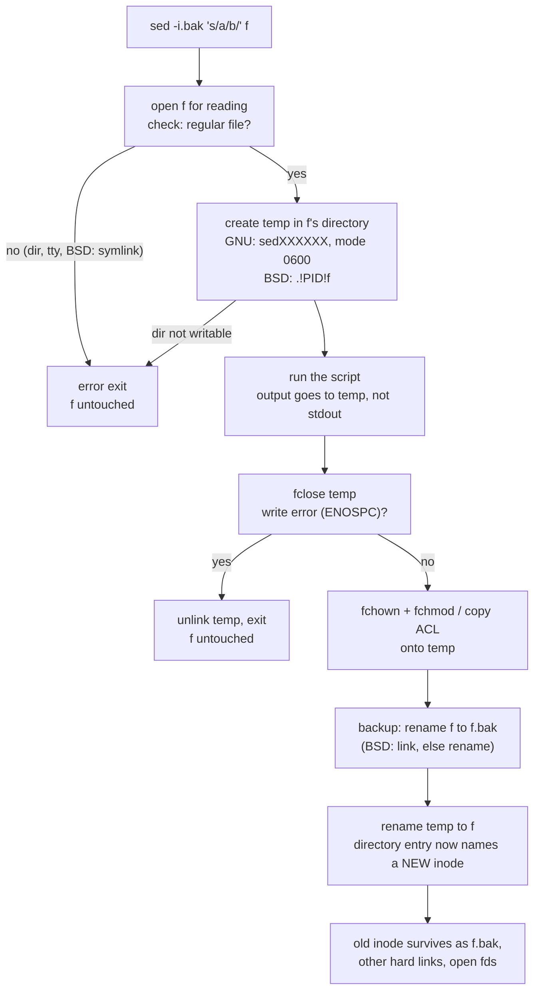

# sed: In-Place Editing Portability

> [!summary] Claim
> `sed -i` is not in POSIX and does not edit anything in place: every implementation writes a new file beside the old one and `rename(2)`s it over the name, so the inode, hard links, symlinks, and open descriptors all change meaning, and the only option spelling GNU, BSD/macOS, and BusyBox all parse the same way is an attached suffix such as `-i.bak`.

Part of [Regular Expressions and Text Processing](README.md) in [Shell and Unix Engineering](../README.md).

## TL;DR

- **Mechanism**: `sed -i` streams its output into a temporary file in the target's directory, copies owner and mode onto it, optionally renames the original to a backup name, then calls `rename(temp, file)`; the old inode lives on as the backup, under any other hard link, and behind any descriptor still open on it (sed-4.10 `sed/execute.c`, `open_next_file` and `closedown`; FreeBSD `usr.bin/sed/main.c`, `mf_fgets`).
- **Rule**: In portable scripts write `sed -i.bak -e 'SCRIPT' FILE && rm -f FILE.bak`, or skip `-i` entirely and write `sed 'SCRIPT' FILE >TMP` followed by `mv` (atomic, new inode) or `cat TMP >FILE` (same inode, not atomic), choosing on purpose.
- **Trap**: `-i` takes an optional option-argument in GNU and BusyBox (`-i[SUFFIX]`) but a mandatory one in FreeBSD and macOS (`-i extension`), so `sed -i -e s/a/b/ f` silently creates the backup `f-e` on a Mac, `sed -i '' s/a/b/ f` makes GNU try to read a file named `s/a/b/` (exit 2), and `sed -i s/a/b/ f` on a Mac takes `s/a/b/` as the suffix and `f` as the script (all measured by the lab).
- **Portability fact**: POSIX.1-2024 `sed` has only `-E`, `-e`, `-f`, and `-n`; the Austin Group rejected standardizing `-i` in 2012 because "implementations differ on its behavior" and option-arguments "should not be optional" (Austin Group bug 0000530; POSIX.1-2024 XBD 12.2 Guideline 7).
- **When not to use it**: Do not use `sed -i` on a file another process holds open for appending, on a file whose hard links, ACLs, extended attributes, or inode identity matter, on a symlink you have not resolved yourself, or for edits that must survive a power cut (no implementation calls `fsync`); and do not use any `sed` for structured formats such as JSON, YAML, or TOML.

## Mental model



The command line is parsed first, and that is where implementations split: the same argv can name a different suffix, script, and file list depending on whether `-i` takes its argument optionally (GNU, BusyBox, OpenBSD, NetBSD) or always (FreeBSD, macOS).
For each input file, sed opens the original for reading and refuses anything that is not a regular file; FreeBSD and macOS check with `lstat` and so also refuse a symbolic link.
It creates a temporary file in the same directory as the target, because `rename(2)` only works within one file system, and that is why a read-only directory blocks the edit even when the file itself is writable.
The script runs exactly as it would for standard output, but the default output, `p`, `=`, `a`, `i`, `c`, and `l` all land in the temporary file.
Only after the temporary file closes cleanly does sed copy ownership and permissions across, rename the original to the backup name if a suffix was given, and rename the temporary file over the original name.
The last step swaps a directory entry, not file contents, so everything that referred to the old inode rather than the name keeps seeing the old bytes.

## How it works

### What POSIX specifies, and what it refused to specify

The POSIX.1-2024 synopsis is `sed [-En] script [file...]` plus the `-e` and `-f` forms, and the description says the utility "shall read one or more text files, make editing changes ... and write the results to standard output" (POSIX.1-2024 XCU `sed`, DESCRIPTION).
With several file operands, "the named files shall be read in the order specified and the concatenation shall be edited" (XCU `sed`, OPERANDS), so line numbers and `$` span files in standard sed; per-file numbering exists only as an `-i`, `-s`, or BSD `-i` extension.
There is no in-place option in any edition, and the Issue 8 CHANGE HISTORY for `sed` lists no defect that adds one.

In December 2011 David A. Wheeler filed Austin Group bug 0000530, "Support in-place editing in sed (-iEXTENSION)", proposing `-iEXTENSION` with the suffix always attached plus a new `-N` for no backup.
Eric Blake's 2012-03-08 note answered that "the use of -i (lowercase), although common, is not a candidate for standardization because implementations differ on its behavior", and suggested standardizing `-I` instead if a fuller proposal settled whether multiple files are edited as one concatenation or separately.
A 2012-09-10 note added that the group would prefer the operation "to fail up front if the file cannot be written by the current user", because GNU `-i` replaces a read-only file under a new inode; the bug was closed as rejected.
No follow-up proposal has been adopted (as of 2026-11).

The second objection is structural.
POSIX.1-2024 XBD 12.2 Guideline 7 says "Option-arguments should not be optional", and XBD 12.1 says that when a synopsis does show an optional option-argument, a conforming application "shall place any option-argument for that option directly adjacent to the option in the same argument string" and the utility "shall not treat the next argument (if any) as the option-argument".
GNU's `-i[SUFFIX]` follows the second rule; FreeBSD's `-i extension` reads the next argument as the extension, which is what Guideline 6 asks of a mandatory argument.
Both are reasonable `getopt` designs, and they cannot both be right for the same argv.

### Option parsing: where the implementations split

| argv after `sed` | GNU and BusyBox (`i::`, optional) | FreeBSD and macOS (`i:`, mandatory) |
| --- | --- | --- |
| `-i.bak s/a/b/ f` | suffix `.bak`, script `s/a/b/`, file `f` | suffix `.bak`, script `s/a/b/`, file `f` |
| `-i s/a/b/ f` | no backup, script `s/a/b/`, file `f` | suffix `s/a/b/`, script `f`: a compile error here, and a valid script would then hit `-I or -i may not be used with stdin` |
| `-i -e s/a/b/ f` | no backup, `-e` script, file `f` | suffix `-e`, script `s/a/b/`, file `f`: backup `f-e` |
| `-i '' s/a/b/ f` | no backup, the empty string as the script, files `s/a/b/` and `f` | no backup, script `s/a/b/`, file `f` |
| `-Ei s/a/b/ f` | `-E` then `-i` with no backup | `-E` then suffix `s/a/b/`, script `f` |
| `-iE s/a/b/ f` | suffix `E` (backup `fE`) | suffix `E` (backup `fE`) |

The GNU column follows `SHORTOPTS "bsnrzuEe:f:l:i::V:"` in sed-4.10 `sed/sed.c`, `main`, and the BusyBox column follows `getopt32long(argv, "^" "i::rEne:*f:*" ...)` in `editors/sed.c`, `sed_main`.
The BSD column follows `getopt(argc, argv, "EI:ae:f:i:lnru")` in FreeBSD `main.c` and Apple's `"EHI:ae:f:i:lnru"` (Apple adds `-H` for `REG_ENHANCED`).
The GNU manual spells out the `-Ei` and `-iE` rows ("Because -i takes an optional argument, it should not be followed by other short options", sed-4.10 `doc/sed.texi`).
On a Mac, `sed -i s/a/b/ dd` printed `sed: 1: "dd` and, on the next line, `": extra characters at the end of d command` (the quoted script includes the newline sed appends to it) and exited 1, because `dd` had become the script (measured on macOS 27.3, as of 2026-11).
In the shell, `-i''` is not a way out: quote removal turns it into the single word `-i` before sed sees it (see [[Quote-Removal]]), so BSD sed still consumes the next word as the extension.

FreeBSD's maintainers know the split hurts.
On 2021-03-08 Ed Maste proposed on freebsd-current to move FreeBSD in stages to GNU-style optional arguments (document the attached form, warn on `-I .bak`, then make the argument optional and phase out `-I ''`), citing PR 254091 and review D29128.
As of 2026-11 FreeBSD `main` still declares `i:` and `I:` as mandatory-argument options and still documents `sed -i '' -e 's/foo/bar/g' test.txt` in EXAMPLES, so the plan did not get past documentation.

### The GNU algorithm, call by call (sed-4.10)

`-i` sets `separate_files = true` and stores the suffix; with no suffix it stores `"*"`, and a suffix without `*` is stored as `"*"` followed by the suffix (`sed/sed.c`, `main`, `case 'i'`).
So `-i`, `-i''`, and `--in-place=` all mean no backup, and `-ibak/*` is kept verbatim so that each `*` expands to the file name (`execute.c`, `get_backup_file_name`); the GNU manual adds "(provided the directory already exists)".
With `-i` and no file operands, `process_files` calls `panic(_("no input files"))`, which exits with `EXIT_PANIC` (4); the lab measured status 4 for GNU against 1 for BSD.
`-` is not standard input under `-i` (`open_next_file` tests `name[0] == '-' && name[1] == '\0' && !in_place_extension`), so `sed -i s/x/y/ -` edits a file literally named `-` (NEWS for 4.1.1: "do not interpret - as stdin when using in-place editing mode").

For each operand, `open_next_file` does the following:
1. With `--follow-symlinks`, resolve the name with `follow_symlink`, which loops over `readlink` and panics after `__eloop_threshold()` links (`utils.c`).
2. `ck_fopen` the input; on failure print `can't read NAME: ERROR`, count a bad file, and move on, which is why the final status is 2.
3. Refuse a terminal (`couldn't edit %s: is a terminal`) and, after `fstat`, anything not `S_ISREG` (`couldn't edit %s: not a regular file`), both through `panic`, which exits 4 immediately and abandons later operands.
4. Under SELinux, copy the original's context with `lgetfilecon` and `setfscreatecon` so the temporary file is created with it.
5. Call `ck_mkstemp(&out_file_name, tmpdir, "sed", write_mode)`, where `tmpdir` is the operand's directory: the template is `DIR/sedXXXXXX`, created with `mkostemp` under a temporary `umask(0077)` so the new file starts at mode 0600 and "unauthorized users cannot nip in before the file is ready" (`utils.c`, `ck_mkstemp`), and registered for removal by an `atexit` handler.

At end of file, `closedown` runs:
1. `fchown(output_fd, uid, gid)`, falling back to `fchown(output_fd, -1, gid)`, with failure ignored, so a non-root user editing someone else's file gets a file they own.
2. `xcopy_acl(...)` copies the ACL and `st_mode` from the input descriptor to the output descriptor.
3. `ck_fclose` both files; a write or close error panics, and the `atexit` handler unlinks the temporary file, leaving the original untouched.
4. If the suffix is not exactly `*`, `ck_rename(target_name, backup_file_name)`.
5. `ck_rename(out_file_name, target_name)`, then `cancel_cleanup()`.

Two consequences follow directly.
With a backup, there is an instant between steps 4 and 5 when the original name does not exist at all; without one, `rename` replaces the name atomically, because POSIX requires that "a directory entry named new shall remain visible to other threads throughout the renaming operation and refer either to the file referred to by new or old" (POSIX.1-2024 XSH `rename`).
No step calls `fsync` or `fdatasync` (no occurrence in any file under sed-4.10 `sed/`), so durability across a crash is whatever the file system provides for rename-over-replace.

`read_pattern_space` resets per-file state when it moves to the next file: line number to 0, hold space emptied (`hold.length = 0`), ranges reset, and `R` files rewound (`execute.c`); NEWS for 4.2 records "hold-space is reset between different files in -i and -s modes".

### FreeBSD and macOS

Apple's `text_cmds/sed/main.c` differs from FreeBSD's only in the `getopt` string, `-H`, the usage text, and an `__builtin_unreachable`; the in-place code is the same.
`mf_fgets` refuses standard input with `errx(1, "-I or -i may not be used with stdin")`, then for each file:
1. `lstat(fname, &sb)` and `errx(1, "%s: in-place editing only works for regular files")` unless `S_ISREG`; because it is `lstat`, a symbolic link is refused, and the lab measured status 1 with the link and its target unchanged.
2. Build `oldfname` (the backup name) and `tmpfname = "%s/.!%ld!%s"` from `dirname`, `getpid()`, and `basename`, both bounded by `PATH_MAX` buffers (`errx(1, "%s: name too long")`).
3. `unlink(tmpfname)`, then `fopen(tmpfname, "w")`, then `fchown(sb.st_uid, sb.st_gid)` and `fchmod(sb.st_mode & ALLPERMS)`, ignoring both results.
4. With `-i` (not `-I`), reset `linenum` and call `resetstate()`, which clears range state and empties the hold space (`process.c`, `resetstate`).

At end of file the old file is closed, an existing backup is unlinked, the backup is made with `link(fname, oldfname)` and only if that fails with `rename(fname, oldfname)`, the output is `fclose`d (failure: unlink the temp, exit 1), and `rename(tmpfname, fname)` installs the new file.
Because the backup is a hard link, the original name is never missing during a backed-up edit on BSD, which is the reverse of GNU's order.
The temporary name is predictable and created with `fopen("w")`, which neither uses `O_EXCL` nor refuses to follow a symlink; see Security and robustness.

FreeBSD and Apple also have `-I extension`: in-place editing with one continuous line-number space over all files, so "the `$` address matches only the last line of the last file" (FreeBSD and Apple `sed.1`).
The lab measured `sed -I.bak '$d' a b` removing only `b`'s last line on macOS, while GNU rejected `-I` with status 1.
The same pages warn that a zero-length extension risks "corruption or partial content in situations where disk space is exhausted"; in the current code the rename happens only after a successful `fclose`, so that warning now describes crash durability more than `ENOSPC`.

### OpenBSD and NetBSD

OpenBSD declares `i::` (`-i[extension]`, optional and attached like GNU), uses `stat` rather than `lstat`, creates `DIR/sedXXXXXXXXXX` with `mkstemp`, and resets line numbers, ranges, and the hold space for every file ("In -i mode, the hold space, line numbers, and ranges are reset between files", OpenBSD `sed.1`).
With `-i` it narrows its `pledge` to `"stdio rpath wpath cpath fattr chown"` (OpenBSD `main.c`, `main`).
The backup is made with `rename`, as in GNU.
NetBSD declares both `I::` and `i::`, so it has BSD's `-I`/`-i` split with GNU's optional attached argument, and keeps FreeBSD's `lstat` check and `.!PID!name` temporary name (NetBSD `main.c`).

### BusyBox

`sed_main` answers `--version` (only as the first argument) with "This is not GNU sed version 4.0" and exit 0, a deliberate lie to autoconf, so a script that tests `sed --version` to choose GNU syntax picks the right syntax for BusyBox by accident.
With `-i` and no operand it dies with `-i requires an argument` (exit 1).
For each operand it calls `stat` (which follows symlinks), creates `FILEXXXXXX` with `xmkstemp` beside the operand's name, `fchmod`s to the target's mode, then `fchown`s; a source comment notes that "chmod'ing AFTER chown would preserve suid/sgid bits, but GNU sed 4.2.1 does not preserve them either".
After processing it checks `ferror` on the output and dies with status 4 on a write error, then renames the original to `FILE` + suffix if a suffix was given, and renames the temporary file over the operand name (`//TODO: rollback backup on error?`).
Line numbers restart per file because `process_files` keeps `linenum` in a local variable, but `G.hold_space` is global and nothing in the per-file loop clears it, so the hold space carries over from one file to the next under `-i` (source reading, confirmed by running `sed -i x a b` under BusyBox 1.37.0 on Alpine 3.22, which left `b` as `a2|b1|`, as of 2026-11).
Until commit `5dc9ece3` ("sed: check errors writing file with sed -i", authored 2023-09-19, committed 2024-01-01), BusyBox did not check for write errors: on a full tmpfs, `busybox sed -i -e 's/.*/bar/' /tmp/m/foo` exited 0 and left `foo` empty, and after the fix it prints `sed: write error`, exits 4, and leaves `foo` intact (commit message by Dominique Martinet).
BusyBox 1.37.0 (2024-09-27, announced on busybox.net as an "unstable" release) includes the fix: on a 64 KiB tmpfs it printed `sed: write error`, exited 4, and left the original intact (measured on Alpine 3.22, as of 2026-11).

### What the rename preserves and what it destroys

| Property of the edited name | After `sed -i` | Evidence |
| --- | --- | --- |
| Inode number | new (`f_inode=new`); the backup keeps the original (`bak_inode=original`) | lab `inode`, GNU 4.10 and macOS |
| Hard links | broken: `f=b`, the other name `g=a`, `nlink_f=1`, `nlink_g=2` | lab `hardlink` |
| Symbolic link operand | GNU and BusyBox replace the link with a regular file and leave the target alone; BSD refuses; GNU `--follow-symlinks` edits the target | lab `symlink`, `follow` |
| Permission bits | copied (`-rw-------` stays), unlike `sed >tmp && mv`, which gave `-rw-r--r--` under umask 022 | lab `perms` |
| Owner and group | copied with `fchown` when allowed, failure ignored | GNU `closedown`, FreeBSD `mf_fgets`, BusyBox `sed_main` |
| Write permission on the file | irrelevant: a mode 444 file is replaced and stays 444 | lab `readonly`; GNU manual, "-i clobbers read-only files" |
| Write permission on the directory | required: without it the edit fails (GNU 4, BSD 1) and nothing is left behind | lab `rodir` |
| ACLs | GNU copies them (`xcopy_acl`); BSD, OpenBSD, and BusyBox call only `fchown` and `fchmod` | source |
| SELinux context | GNU copies it (`setfscreatecon`) | GNU `open_next_file` |
| Other extended attributes, BSD file flags, birth time | not copied by any of the four (no such call in their in-place paths) | source |
| Writers with the file already open | keep writing into the old inode: `late` landed in `f.bak`, not `f` | lab `held-fd` |
| Missing final newline | preserved (`f=b`, one byte) | lab `noeol` |

The inode change is the root of most surprises.
A daemon that opened a log or config file before the edit holds a descriptor to the old open file description, so it keeps reading or appending to the old inode (see [[File-Descriptors-and-Open-File-Descriptions]]).
Container bind mounts of a single file bind the inode, not the name, so a `sed -i` on the source path is invisible through the mount point, and a `sed -i` on the mount point itself fails, because `rename` over a mount point returns `EBUSY` (GNU sed 4.9 printed `cannot rename ./sedXXXXXX: Device or resource busy`, exited 4, and removed its temporary file; both measured with `mount --bind` of a single file on Debian 13, as of 2026-11).

### Per-file state

`-i` implies GNU's `-s` (`separate_files = true`): "line numbers are relative to the start of each file, `$` refers to the last line of each file", and ranges cannot span files (sed-4.10 `doc/sed.texi`).
FreeBSD and macOS `-i`, OpenBSD `-i`, and BusyBox `-i` also restart line numbers and make `$` per-file; the lab measured `sed -i.bak '$d' a b` deleting the last line of each file with GNU and BSD.
The hold space is the exception: GNU, FreeBSD, macOS, and OpenBSD empty it per file, BusyBox does not (lab `hold`); address semantics themselves are covered in [[sed-Addresses-and-Branching]], and the hold space in [[sed-Pattern-and-Hold-Space]].

### Durability

None of GNU, FreeBSD, OpenBSD, or BusyBox calls `fsync` in the in-place path (searched their sources for `fsync` and `fdatasync`: zero hits).
POSIX gives no ordering guarantee between a file's data and a later `rename` without `fsync` (POSIX.1-2024 XSH `fsync`).
ext4's default `auto_da_alloc` detects the "replace-via-rename" pattern and forces the new file's delayed-allocation blocks to disk before the rename commits in `data=ordered` mode, which "avoids the 'zero-length' problem that can happen when a system crashes" (Linux `Documentation/admin-guide/ext4.rst`); other file systems and mount options make no such promise.
A script that must survive a power cut should write its own temporary file, `fsync` it (for example with `dd conv=fsync`, or a language runtime), `mv` it, and `fsync` the directory; `conv=fsync` is not in POSIX.1-2024 XCU `dd`, but GNU coreutils, BusyBox, and FreeBSD and macOS `dd` all accept it (macOS `dd(1)`; GNU and BusyBox `dd` accepted it on Debian 13, as of 2026-11).

### Distribution patches

Fedora's `sed.spec` (`Version: 4.10`, `Release: 2` in the rawhide spec, as of 2026-11) applies `sed-c-flag.patch` (Paolo Bonzini, 2024-01-30), which adds `-c`/`--copy`, "use copy instead of rename when shuffling files in -i mode": the backup is copied with `ck_fccopy` and the result is written over the original with `fopen(to, "w")`, so the inode and hard links survive but the update is no longer atomic, and `-c` without `-i` is a usage error.
Upstream GNU sed has no `-c`, so a script that uses it works only on Fedora-family systems.

## Numbers and limits

| Quantity | Value | Source |
| --- | --- | --- |
| In-place option in POSIX `sed` | none; options are `-E`, `-e`, `-f`, `-n` | POSIX.1-2024 XCU `sed` SYNOPSIS |
| Austin Group bug 0000530 | filed 2011-12-21, status Closed 2012-03-08, resolution set to Rejected 2012-09-10 | austingroupbugs.net, fetched 2026-11 |
| Pattern and hold space minimum | 8192 bytes each | POSIX.1-2024 XCU `sed`, EXTENDED DESCRIPTION |
| GNU temporary name | `DIR/sedXXXXXX` (6 random characters), created mode 0600 via `umask(0077)` | sed-4.10 `utils.c`, `ck_mkstemp` |
| OpenBSD temporary name | `DIR/sedXXXXXXXXXX` (10 random characters) via `mkstemp` | OpenBSD `main.c` (as of 2026-11) |
| BusyBox temporary name | `FILEXXXXXX` (6 random characters) via `xmkstemp` | BusyBox `editors/sed.c` (as of 2026-11) |
| FreeBSD, macOS, NetBSD temporary name | `DIR/.!PID!NAME`, no random part, `fopen("w")` | FreeBSD and NetBSD `main.c`, Apple `text_cmds` (as of 2026-11) |
| FreeBSD and macOS name buffers | `PATH_MAX`: 1024 on macOS (`getconf PATH_MAX /`, measured here), 4096 in Linux `include/uapi/linux/limits.h` | FreeBSD `main.c`; measured; Linux source |
| Extra disk space during an edit | one full copy of each file until its rename | all four algorithms above |
| `rename` calls per file | 1 without a backup; 2 with one in GNU, OpenBSD, BusyBox; BSD uses `link` plus 1 `rename` | source |
| GNU exit codes | 0 success, 1 bad usage, 2 an input file could not be opened, 4 panic (I/O error, non-regular file, no input files) | sed-4.10 `sed/utils.h` |
| Exit status, `-i` with no operand | GNU 4, macOS 1, BusyBox 1.37.0 1 (`-i requires an argument`) (all measured) | lab `stdin` |
| Exit status, read-only directory | GNU 4, macOS 1 (measured); BusyBox 1 (source, matrix) | lab `rodir` |
| CVE-2026-5958 | GNU sed 4.1e to before 4.10, `-i --follow-symlinks` TOCTOU; CVSS 4.0 base 2.1 (LOW); published 2026-04-20 | CVE record (CERT-PL) |
| GNU sed 4.10 release | 2026-04-21 | sed-4.10 `NEWS` |
| BusyBox write-error fix | commit `5dc9ece3`, committed 2024-01-01; first release 1.37.0 (2024-09-27) | GitHub mirror; busybox.net |

## Portability

The shell never changes which `sed` runs; it only decides what argv sed receives.
The utility table carries the behavior, and the shell table records the two places the shell matters: quote removal of `''` and `-i''`, and the descriptor in the `held-fd` probe.

| Implementation | No-backup spelling | `-i -e S f` | `-i '' S f` | `-i S f` | Symlink operand | Hold space across files | `-I` | `*` in suffix | Evidence |
| --- | --- | --- | --- | --- | --- | --- | --- | --- | --- |
| POSIX `sed` | no `-i` at all | n/a | n/a | n/a | n/a | n/a (files are one concatenation) | n/a | n/a | XCU `sed` |
| GNU sed 4.10 (Homebrew) | `-i`, `--in-place` | edits, no backup | status 2, `f` unchanged | edits | replaced by a regular file; `--follow-symlinks` edits target | cleared | rejected, status 1 | expands to file name | lab, measured |
| GNU sed 4.9 (Debian 13) | as 4.10 | as 4.10 | as 4.10 | as 4.10 | as 4.10, but `--follow-symlinks` has CVE-2026-5958 | cleared | rejected | expands | source diff 4.9 to 4.10 shows no change in these paths except the CVE fix; measured on Debian 13 (as of 2026-11) |
| GNU sed, Fedora build | as 4.10, plus `-c`/`--copy` | as 4.10 | as 4.10 | as 4.10 | as 4.10 | cleared | rejected | expands | `sed-c-flag.patch` |
| macOS `/usr/bin/sed` (macOS 27.3) | `-i ''` | backup `f-e` | edits, no backup | status 1, `f` unchanged | refused (`lstat`), status 1 | cleared | spans files | literal; status 1, `f` unchanged | lab, measured |
| FreeBSD `sed` (main) | `-i ''` | backup `f-e` | edits | treats `S` as suffix | refused (`lstat`) | cleared (`resetstate`) | spans files | literal | `main.c`, `process.c` |
| OpenBSD `sed` | `-i` | edits, no backup | treats `''` as script | edits | follows (`stat`), then replaces the link | cleared | not an option | literal | `main.c`, `sed.1` |
| NetBSD `sed` | `-i` | edits, no backup | treats `''` as script | edits | refused (`lstat`) | cleared (`resetstate`) | spans files (`I::`) | literal | `main.c`, `process.c`, `sed.1` |
| BusyBox sed 1.37.0 | `-i` | edits, no backup | status 1, `f` unchanged | edits | replaced by a regular file | carried over | rejected, status 1 | literal; status 1, `f` unchanged | `editors/sed.c`; every cell measured on Alpine 3.22 (as of 2026-11) |
| uutils `sed` 0.3.0 | `-i`, `--in-place` (GNU style) | edits, no backup | status 1, `f` unchanged (docs: not supported) | edits | replaced by a regular file; `--follow-symlinks` edits target | cleared | rejected, status 1 | literal (suffix appended: `p_*` gives `fp_*`; `bak/*` gives status 1, `f` unchanged) | `docs/src/extensions.md`: "a backup suffix must be attached ... BSD's `-i .bak` and `-i ''` are not supported"; every other cell measured with the lab probe on the macOS host, built by `cargo install sed --version 0.3.0` (as of 2026-11); the lab has no uutils branch |

| Shell | `-i''` and `-i ''` | `exec 3>>f` writer after `sed -i` | Evidence |
| --- | --- | --- | --- |
| POSIX sh | `-i''` is one word `-i`; `''` is one empty argument | writes go to the old inode | XCU 2.6.7 Quote Removal; lab `held-fd` |
| macOS bash 3.2 (`/bin/sh`) | as POSIX | as POSIX | lab, measured on bash 3.2.57 |
| bash 4.4 to 5.3 | as POSIX | as POSIX | XCU 2.6.7; lab not yet run under this shell |
| zsh (native) and `zsh --emulate sh` | as POSIX: a quoted empty word is kept even in native zsh | as POSIX | quote removal measured on the macOS host zsh (`f -i '' x` gives 3 arguments, the second empty); `held-fd` not yet run |
| dash, ksh93, mksh, yash, posh, BusyBox ash | as POSIX | as POSIX | XCU 2.6.7; quote removal measured for dash; lab not yet run under these shells |

The lab runs the same 22 tests with `LAB_SHELL` set to each shell; the full shell matrix has not been run for it yet (as of 2026-11), and on the macOS host the suite was run once under `/bin/sh` with the system sed and once with GNU sed 4.10 first in `PATH`, and passed 22 of 22 both times.

## Worked example

The [lab](../labs/07-sed-in-place-editing-portability/) is `sed-inplace.sh`, a probe with one mode per behavior that prints `key=value` lines computed from the file system after the edit, and `sed-inplace.bats`, which asserts each mode per sed implementation (detected from `sed --version`, never from the shell).
File contents are printed with each newline shown as `|`, so `f=b|` means the two bytes `b` and newline.

Excerpt, lines copied verbatim from `sed-inplace.sh` (the three argument-parsing modes):

```sh
  dash-e)
    # `-i -e`: is "-e" the backup suffix (BSD) or the next option (GNU, BusyBox)?
    printf 'a\n' >f
    sed -i -e 's/a/b/' f 2>../err
    echo "status=$?"
    show f f
    entries entries .
    ;;
  empty-arg)
    # `-i ''`: the BSD spelling of "no backup"; GNU and BusyBox read '' as the script.
    printf 'a\n' >f
    sed -i '' 's/a/b/' f 2>../err
    echo "status=$?"
    show f f
    entries entries .
    stderr_seen
    ;;
  bare)
    # The GNU habit `sed -i 'script' file`: BSD takes the script as the suffix and the file name as the script.
    printf 'a\n' >f
    sed -i 's/a/b/' f 2>../err
    echo "status=$?"
    show f f
    entries entries .
    ;;
```

Excerpt, lines copied verbatim from `sed-inplace.sh` (inode identity and hard links):

```sh
  inode)
    # Does -i rewrite the inode, and what does the backup hold?
    printf 'a\n' >f
    before=$(inode f)
    sed -i.bak 's/a/b/' f
    echo "status=$?"
    show f f
    show bak f.bak
    after=$(inode f)
    bak=$(inode f.bak)
    if [ "$after" = "$before" ]; then echo 'f_inode=same'; else echo 'f_inode=new'; fi
    if [ "$bak" = "$before" ]; then echo 'bak_inode=original'; else echo 'bak_inode=other'; fi
    entries entries .
    ;;
  hardlink)
    # A second name for the same inode keeps the old bytes: -i breaks hard links.
    printf 'a\n' >f
    ln f g
    sed -i.bak 's/a/b/' f
    echo "status=$?"
    show f f
    show g g
    nlink nlink_f f
    nlink nlink_g g
    ;;
```

One test, verbatim from `sed-inplace.bats`:

```sh
@test "sed -i '' works only in BSD; GNU and BusyBox read '' as the script" {
  probe empty-arg
  [ "$status" -eq 0 ]
  case $(sed_flavor) in
    gnu) [ "$output" = "$(printf '%s\n' status=2 'f=a|' 'entries=f' stderr=yes)" ] ;;
    busybox) [ "$output" = "$(printf '%s\n' status=1 'f=a|' 'entries=f' stderr=yes)" ] ;;
    bsd) [ "$output" = "$(printf '%s\n' status=0 'f=b|' 'entries=f' stderr=no)" ] ;;
    *) false ;;
  esac
}
```

Output captured on macOS 27.3 with `/bin/sh` (bash 3.2.57), first with `/usr/bin/sed`, then with GNU sed 4.10 first in `PATH` (as of 2026-11):

```text
mode        macOS /usr/bin/sed                 GNU sed 4.10
dash-e      status=0 f=b| entries=f f-e        status=0 f=b| entries=f
empty-arg   status=0 f=b| entries=f stderr=no  status=2 f=a| entries=f stderr=yes
bare        status=1 f=a| entries=f            status=0 f=b| entries=f
inode       status=0 f=b| bak=a| f_inode=new bak_inode=original entries=f f.bak   (both)
hardlink    status=0 f=b| g=a| nlink_f=1 nlink_g=2                               (both)
symlink     status=1 link_kind=symlink link=a| target=a| stderr=yes
            | GNU: status=0 link_kind=regular link=b| target=a| stderr=no
held-fd     f=b| bak=a|late|                                                     (both)
hold        a=|a1| b=|b1|                                                        (both)
span        status=0 a=1|2| b=3|                | GNU: status=1 a=1|2| b=3|4|
star        status=1 f=a| bak_f=<none> entries=bak f
            | GNU: status=0 f=b| bak_f=a| entries=bak f
```

The probe prints one `key=value` per line; the block above joins each mode's lines with spaces to fit, and `bare` comes from the passing bats run rather than a separate capture.
For BusyBox the lab asserts the values derived from `editors/sed.c`: like GNU for `dash-e`, `bare`, and `symlink`; status 1 with `f=a|` for `empty-arg`; `b=a2|b1|` for `hold`, because the hold space is not cleared; the same commands run by hand under BusyBox 1.37.0 on Alpine 3.22 gave exactly these values (as of 2026-11).

## Pitfalls

> [!warning] The `-i` argument split
> Trigger: a script written on Linux as `sed -i 's/old/new/' file` runs on macOS, or one written on macOS as `sed -i '' 's/old/new/' file` runs on Linux or Alpine.
> Symptom: on macOS `s/old/new/` becomes the backup suffix and `file` becomes the script, giving an error such as `extra characters at the end of d command` and status 1; on GNU the empty string is the script, `s/old/new/` is a missing input file, the status is 2, and the real file is rewritten unchanged; with `sed -i -e ...` on macOS the edit works but a stray backup `file-e` appears.
> Fix: always attach a suffix (`sed -i.bak -e 'SCRIPT' file && rm -f file.bak`), which the lab shows every implementation parses identically; never branch on `uname`, because GNU sed is common on macOS (Homebrew) and BusyBox on Linux.

> [!warning] Broken hard links and replaced symlinks
> Trigger: `sed -i` on a file that has a second hard link (dotfile farms, `cp -al` snapshots, package-managed files) or on a symlink (`/etc/resolv.conf` on systemd systems, stow-managed dotfiles).
> Symptom: the other link keeps the old content; with GNU or BusyBox the symlink silently becomes a regular file and the real target never changes; with BSD the command fails with `in-place editing only works for regular files`.
> Fix: resolve the target yourself (`readlink -f` where available) and edit that, or use GNU `--follow-symlinks` on sed 4.10 or later (CVE-2026-5958 affects 4.1e through 4.9); to keep the inode, write a temporary file and copy it back with `cat TMP >FILE`.

> [!warning] Editing a file someone is writing
> Trigger: `sed -i` on an active log, a database's text side file, or a file a daemon re-reads by descriptor.
> Symptom: the writer's later output lands in the old inode, which is now the backup or, without a backup, an unlinked file that vanishes on close; the lab printed `bak=a|late|` and `f=b|`.
> Fix: stop or signal the writer first, use the application's own reload or rotation, or rewrite through the existing inode (`cat TMP >FILE`) accepting the torn-read window.

> [!warning] `-n` with `-i` truncates
> Trigger: `sed -n -i 's/foo/bar/' FILE` (or `-ni`) without a `p` command or flag.
> Symptom: the file becomes empty, because `-n` suppresses the output and the output is the new file; the GNU manual labels `sed -ni 's/foo/bar/' FILE` "WRONG USAGE", and the lab printed `f=` with the backup intact.
> Fix: keep a backup suffix while developing an `-n` script, or write `s/foo/bar/p`.

> [!warning] Silent truncation on a full disk in old BusyBox
> Trigger: BusyBox sed before 1.37.0 on a nearly full file system.
> Symptom: `busybox sed -i ...` exited 0 and left the file empty (reproduced on tmpfs in commit `5dc9ece3`).
> Fix: upgrade to 1.37.0 or later, where the error is `sed: write error` with status 4 and the original survives; check free space before bulk in-place edits on old embedded images.

> [!warning] Read-only is not protection
> Trigger: relying on `chmod 444` to stop automation from changing a file.
> Symptom: `sed -i` replaces it anyway and the new file is 444 too (lab `readonly`), because only the directory's write bit is checked.
> Fix: make the directory read-only, set an immutable flag (`chattr +i`, `chflags uchg`), or check `[ -w "$file" ]` yourself, which is what the Austin Group suggested a standardized option should do.

> [!warning] `-I` and `-s` semantics differ by implementation
> Trigger: a BSD script that uses `-I` for in-place editing of several files, or a GNU script that relies on per-file `$`.
> Symptom: BSD `-I` treats all files as one stream, so `sed -I.bak '$d' a b` edits only `b`; GNU and BusyBox reject `-I` with status 1.
> Fix: use `-i`, or loop over files and run one `sed` per file, which also makes the hold space per-file on BusyBox.

## Security and robustness

**CVE-2026-5958 (GNU sed, `-i --follow-symlinks`).**
Through sed 4.9, `open_next_file` resolved the symlink with `readlink` and then opened the original symlink path in a separate call, so an attacker who swapped the link between the two could make sed read attacker-chosen content and write it to the originally resolved target, "enabling arbitrary file overwrite" (sed-4.10 `ChangeLog`; CVE record by CERT-PL, reported by Michal Majchrowicz and Marcin Wyczechowski of AFINE).
The fix in 4.10 opens the resolved path (`ck_fopen (input->in_file_name, ...)` instead of `name`).
The parent directories are still resolved more than once: the comment above `follow_symlink` in sed-4.10 `utils.c` still says "We should get a file descriptor on the parent directory, to avoid resolving that directory name more than once (which can lead to races)".
Never run `sed -i --follow-symlinks` as root in a directory another user can write.

**Predictable temporary names on FreeBSD, macOS, and NetBSD.**
`.!PID!NAME` is guessable, and the code calls `unlink` and then `fopen(tmpfname, "w")`, which has no `O_EXCL` and follows a symlink.
In a directory where another user can create entries, such as a sticky `/tmp`, that user can plant `.!PID!NAME` as a symlink; in a sticky directory the victim's `unlink` of a file it does not own fails, and the `fopen` then truncates and writes through the planted link (inferred from FreeBSD `main.c`; no CVE found, as of 2026-11).
The window between `fopen` and `fchmod` also leaves the temporary file with umask permissions, so a 0600 secret is briefly readable at 0644 under umask 022; GNU avoids this by creating at 0600 under `umask(0077)`, and OpenBSD and BusyBox by using `mkstemp`, which creates mode 0600 per POSIX.1-2024 XSH `mkstemp`.
Do not edit files in shared writable directories with BSD `sed -i`.

**Ownership handover.**
GNU tries `fchown` to the original owner and, when that fails (any non-root user editing a file owned by someone else in a directory they can write), falls back to setting only the group, and BSD and BusyBox ignore the failure, so the edited file silently becomes owned by the editing user.
Root keeps ownership, but BusyBox's `fchmod`-then-`fchown` order means `chown` can clear set-user-ID and set-group-ID bits, as its own comment states.

**Script injection through the script argument.**
GNU sed's `e` command and `s///e` flag run shell commands, and `w FILE` writes arbitrary paths; interpolating untrusted text into a sed script that runs with `-i` therefore risks both command execution and writes outside the target.
GNU `--sandbox` rejects `e`, `r`, and `w` (sed-4.10 `sed/sed.c` usage text); escaping rules for regexes and replacements are in [[BRE-ERE-and-PCRE]].

**Robust shape for automation.**
Check that the target is a regular file you own and can write, edit with an attached suffix or your own temporary file in the same directory, verify the result (for example with `cmp` or a parser) before removing the backup, and treat a nonzero status as "original intact" only after confirming the implementation's error path, which the lab's `rodir` and `star` modes show leave no temporary files behind on GNU and macOS.

## The principal's view

The decision is not "which `-i` spelling" but "what kind of replacement does this file need".
There are three, and `sed -i` gives you exactly one of them:
1. **Atomic replace by rename** (`sed -i`, `mv TMP FILE`, `perl -i`): readers see old or new, never half; costs inode identity, hard links, symlinks, metadata the tool does not copy, and open writers.
2. **Rewrite through the inode** (`cat TMP >FILE`, `ed`, Fedora `sed -c`): keeps identity, links, and every attribute; costs atomicity, because a reader can see a truncated or half-written file, and a crash mid-copy can leave it that way.
3. **Durable atomic replace** (temporary file, `fsync`, `rename`, `fsync` the directory): what configuration management tools should do; no `sed` implementation does it.

For one-off interactive work, `sed -i` is fine on whatever machine you are on.
For anything checked into a repository and run on more than one system, ban bare `sed -i` in review (ShellCheck 0.11.0 with `--enable=all` flags none of `sed -i S f`, `sed -i '' S f`, or `sed -n -i S f`, checked here), require the attached-suffix form or a small `replace_file` helper that does the temporary-file dance explicitly, and decide per call site whether identity or atomicity matters.
Pin the dependency instead when the fleet is homogeneous: requiring GNU sed (`gsed` on macOS) is a legitimate choice, and cheaper than supporting both dialects, as long as the script fails fast when `sed --version` does not say GNU.
When the edit is structural (a key in JSON, YAML, TOML, or INI), use a parser (`jq`, `yq`, or a short program, see [[Python-as-a-Shell-Companion]]), and when it spans lines or needs fields, use [[awk-Language]] or [[Perl-One-Liners]]; regex-on-text edits to structured files are how config drift and silent corruption start.

## Interview questions

> [!question] L5: Why can `sed -i` modify a file whose mode is 0444, and why can it fail on a file whose mode is 0666?
>
> > [!success]- Answer
> > `sed -i` never opens the original for writing.
> > It creates a new file in the same directory and renames it over the old name, and both creating and renaming entries are directory operations.
> > So the file's mode is irrelevant and the directory's write permission is what counts: a 0444 file in a writable directory is replaced (and the replacement keeps 0444), while a 0666 file in a read-only directory cannot be edited at all.
> > GNU fails with status 4 and BSD with status 1, and neither leaves a temporary file behind.
> >
> > Follow-up: What would a standardized in-place option have to do differently, according to the Austin Group's 2012 note on bug 530?

> [!question] L5: Predict the output. On macOS with the system sed, in an empty directory: `printf 'a\n' >f; sed -i -e 's/a/b/' f; ls; cat f`
>
> > [!success]- Answer
> > `ls` prints `f` and `f-e`, and `cat f` prints `b`.
> > macOS sed declares `i:` in `getopt`, so `-i` consumes the next argument, `-e`, as the backup suffix.
> > `s/a/b/` then becomes the script (the first operand) and `f` the file, so the edit works and a backup named `f-e` holding `a` is left behind.
> > With GNU or BusyBox sed the same line prints only `f`, because `-i` takes no separate argument there.
> >
> > Follow-up: What does `sed -i '' -e 's/a/b/' f` do on each implementation?

> [!question] L5: What single spelling of in-place editing works with GNU, macOS, FreeBSD, OpenBSD, NetBSD, and BusyBox sed?
>
> > [!success]- Answer
> > An attached, non-empty suffix: `sed -i.bak -e 'SCRIPT' FILE`, then `rm -f FILE.bak`.
> > Mandatory-argument parsers (FreeBSD, macOS) accept an attached option-argument, and optional-argument parsers (GNU, BusyBox, OpenBSD, NetBSD) require it to be attached, so both read `.bak` as the suffix.
> > The lab shows this form giving the same result on GNU and macOS and asserts it for BusyBox.
> >
> > Follow-up: Why does `-i''` not work as a portable "no backup" spelling?

> [!question] L6: Debug this script. It runs nightly on Linux hosts and should bump a version in a config file that is a symlink into a shared repository: `sed -i "s/^version=.*/version=$NEW/" /etc/app/app.conf`. Afterwards the repository copy is unchanged but `/etc/app/app.conf` shows the new version. What happened, and what are the fixes?
>
> > [!success]- Answer
> > GNU sed without `--follow-symlinks` treats the symlink name as the file to replace.
> > It reads through the link, writes a temporary file in `/etc/app`, and renames it over `app.conf`, so the symlink is replaced by a regular file and the repository target is never touched.
> > Fixes: edit the resolved path (`sed -i ... "$(readlink -f /etc/app/app.conf)"`), or use `--follow-symlinks` on GNU sed 4.10 or later, because earlier versions have the CVE-2026-5958 race.
> > Also quote or escape `$NEW` for the replacement, since a `/`, `&`, or newline in it breaks or changes the `s` command.
> > On macOS or FreeBSD the same command would have failed loudly instead, because BSD sed refuses symlinks after `lstat`.
> >
> > Follow-up: Why is `--follow-symlinks` still not safe as root in a directory other users can write?

> [!question] L6: A log shipper keeps a file open with `O_APPEND`. An operator runs `sed -i '/password=/d' app.log`. What does the shipper write afterwards, and where does it go?
>
> > [!success]- Answer
> > The shipper's descriptor refers to the open file description of the old inode.
> > `sed -i` gave the name `app.log` a new inode, so later writes go to the old inode: to the backup if a suffix was used, otherwise to an unlinked file that disappears when the last descriptor closes.
> > The scrubbed `app.log` stops growing, and new lines, possibly including new secrets, accumulate where nobody looks.
> > The lab reproduces this with `exec 3>>f`: the late write ends up in `f.bak`.
> >
> > Follow-up: How would `cat TMP >app.log` behave differently, and what new race would it introduce?

> [!question] L6: Why do GNU and BSD sed leave the original intact when the disk fills up during `sed -i`, and what was different in BusyBox before 2024?
>
> > [!success]- Answer
> > Both write the complete new content to a temporary file and only rename it over the original after the output closes without error.
> > On `ENOSPC` the write or close fails, they unlink the temporary file and exit nonzero (GNU 4, BSD 1), and the rename never happens.
> > BusyBox did not check for write errors before commit `5dc9ece3`, so it renamed a truncated temporary file over the original and exited 0, leaving an empty file; 1.37.0 and later report `sed: write error` with status 4.
> > None of them calls `fsync`, so a crash rather than a full disk can still lose the new data on file systems without ext4's `auto_da_alloc` heuristic.
> >
> > Follow-up: What sequence of calls gives a crash-safe replacement?

> [!question] L7+: You own the shell style guide for a company with macOS laptops, Alpine containers, and Debian build hosts. What is the rule for in-place edits, and how do you enforce it?
>
> > [!success]- Answer
> > Ban bare `sed -i` and `sed -i ''` in committed scripts, because each one is wrong on at least one of the three platforms (the Mac and GNU parsers disagree on the next argument).
> > Allow `sed -i.bak -e ... && rm -f ....bak` for simple cases, and provide a reviewed `replace_file` helper that writes a temporary file in the target's directory, preserves the mode explicitly, and states whether it renames (atomic, new inode) or copies back (same inode, not atomic).
> > Enforce it with a lint rule in CI (a grep or a custom check, since ShellCheck has no rule for it) and a test job that runs the scripts under BusyBox and macOS, not only GNU.
> > For structured files, require a parser instead of regex edits.
> > The trade-off is a few extra lines per call site against a class of bugs that only appear on the platform where nobody tested.
> >
> > Follow-up: When would you instead mandate GNU sed everywhere, and what does that cost on macOS?

> [!question] L7+: POSIX had a concrete proposal for `sed -i` in 2011. Why did it fail, and what would a proposal need to settle to succeed?
>
> > [!success]- Answer
> > The Austin Group closed bug 0000530 as rejected because existing `-i` implementations differ (GNU's optional attached suffix against BSD's mandatory separate one) and because XBD 12.2 Guideline 7 discourages optional option-arguments.
> > It suggested `-I` as an unused letter, but BSD already uses `-I` for spanning in-place editing, so even that collides.
> > A successful proposal must choose per-file or concatenated addressing, define the backup naming, say whether symlinks are followed or refused, require failure when the user cannot write the file, and specify the error path (original untouched, no temporary left).
> > It should probably also specify whether the replacement is atomic, which today is an implementation property, not a guarantee.
> >
> > Follow-up: Which of those choices would break existing GNU users, and which would break BSD users?

> [!question] L7+: Under GNU sed, `sed -i 'x' a b` with `a` holding `a1 a2` and `b` holding `b1 b2` gives `b` the content `(empty) b1`. Under BusyBox it gives `a2 b1`. Explain, and say what it implies for writing portable multi-file in-place scripts.
>
> > [!success]- Answer
> > `x` swaps pattern and hold space, so each output line is the previous line's content within the stream that sed believes it is processing.
> > GNU, FreeBSD, macOS, and OpenBSD clear the hold space when `-i` moves to the next file (GNU `read_pattern_space` sets `hold.length = 0`; FreeBSD `resetstate` empties `HS`), so `b`'s first output is empty.
> > BusyBox keeps `G.hold_space` across its per-file loop, so the last line of `a` leaks into `b`.
> > Any script that uses `h`, `H`, `g`, `G`, or `x` should run one `sed -i` per file, which makes per-file state explicit everywhere.
> >
> > Follow-up: What else, besides the hold space, does GNU reset per file under `-s` and `-i`?

## Related

Prerequisites: [[sed-Addresses-and-Branching]]

Next: [[awk-Language]]

See also: [[sed-Pattern-and-Hold-Space]], [[BRE-ERE-and-PCRE]], [[Perl-One-Liners]], [[Python-as-a-Shell-Companion]], [[awk-Implementations]], [[File-Descriptors-and-Open-File-Descriptions]], [[Quote-Removal]], [[Locale-and-LC_ALL]]

## Further reading

- [POSIX.1-2024 XCU sed](https://pubs.opengroup.org/onlinepubs/9799919799/utilities/sed.html): the baseline, with no in-place option and concatenated multi-file input.
- [POSIX.1-2024 XBD Chapter 12, Utility Conventions](https://pubs.opengroup.org/onlinepubs/9799919799/basedefs/V1_chap12.html): Guideline 7 and the optional option-argument rule that split `-i`.
- [POSIX.1-2024 XSH rename](https://pubs.opengroup.org/onlinepubs/9799919799/functions/rename.html): the atomic-visibility guarantee every `sed -i` relies on.
- [Austin Group bug 0000530](https://austingroupbugs.net/view.php?id=530): the 2011 proposal to standardize `-i` and why it was rejected.
- [GNU sed 4.10 source](https://ftpmirror.gnu.org/sed/sed-4.10.tar.xz): `sed/execute.c` (`open_next_file`, `closedown`), `sed/utils.c` (`ck_mkstemp`, `follow_symlink`), `doc/sed.texi`, and `NEWS`.
- [CVE-2026-5958](https://cveawg.mitre.org/api/cve/CVE-2026-5958): the `--follow-symlinks` TOCTOU record.
- [FreeBSD sed main.c](https://raw.githubusercontent.com/freebsd/freebsd-src/main/usr.bin/sed/main.c): `mf_fgets`, the `lstat` check, `.!PID!name`, and link-then-rename backups.
- [Apple text_cmds sed](https://raw.githubusercontent.com/apple-oss-distributions/text_cmds/main/sed/main.c): the macOS sed, FreeBSD's code plus `-H`.
- [OpenBSD sed main.c](https://raw.githubusercontent.com/openbsd/src/master/usr.bin/sed/main.c): `-i[extension]` with `mkstemp` and `pledge`.
- [BusyBox editors/sed.c](https://raw.githubusercontent.com/mirror/busybox/master/editors/sed.c): `sed_main`'s per-file loop, the `--version` lie, and the uncleared hold space.
- [BusyBox commit 5dc9ece3](https://github.com/mirror/busybox/commit/5dc9ece3b9e87af0dcb01449821ac827391ac116): the silent-truncation-on-ENOSPC bug and its reproduction.
- [Ed Maste, "Rationalizing sed -i/-I argument handling"](https://lists.freebsd.org/pipermail/freebsd-current/2021-March/079055.html): FreeBSD's staged plan to converge on GNU syntax.
- [Fedora sed-c-flag.patch](https://src.fedoraproject.org/rpms/sed/raw/rawhide/f/sed-c-flag.patch): the downstream `--copy` mode that keeps the inode.
- [Linux ext4 documentation](https://raw.githubusercontent.com/torvalds/linux/master/Documentation/admin-guide/ext4.rst): `auto_da_alloc`, the heuristic that makes rename-without-fsync mostly survive crashes on ext4.
