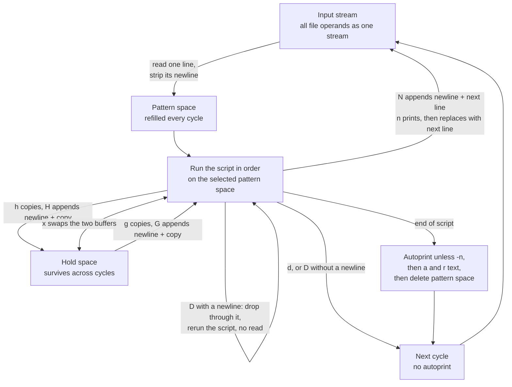

# sed: Pattern Space and Hold Space

> [!summary] Claim
> `sed` is a two-register machine: the pattern space is refilled from input and discarded every cycle, the hold space persists until the program changes it, and every multiline technique in `sed` is a choreography of `h`, `H`, `g`, `G`, `x`, `n`, `N`, `P`, and `D` between those two buffers, whose cost and edge behavior differ by implementation.

Part of [Regular Expressions and Text Processing](README.md) in [Shell and Unix Engineering](../README.md).

## TL;DR

- **Mechanism**: each cycle reads one line without its newline into the pattern space, runs the script, autoprints unless `-n`, and deletes the pattern space; the hold space is never touched by the cycle itself (POSIX.1-2024 XCU sed, EXTENDED DESCRIPTION).
- **Rule**: guard every `N` with `$!N` and seed accumulators with `1h;1!H`, so the script is correct on the last line and on the first line in every implementation.
- **Trap**: `N` on the last line prints the pattern space in GNU and BusyBox sed but silently discards it in BSD and macOS sed and in GNU with `POSIXLY_CORRECT` (measured in the lab).
- **Portability fact**: the hold space is one buffer across all file operands; GNU (`-s`, `-i`) and BSD (`-i`) clear it per file, BusyBox `-i` does not (GNU `NEWS` 4.2; FreeBSD `main.c`, `resetstate`; BusyBox `sed.c`, `sed_main`).
- **When not to use it**: when the state is more than one saved string, needs counters or keys, must survive NUL bytes on BusyBox, or would make a loop rescan a growing buffer; use [[awk-Language]] or [[Python-as-a-Shell-Companion]].

## Mental model



Input enters only through the top arrow and through `n` and `N`, which pull the next line in the middle of a cycle and advance the line number.
The pattern space is the only buffer that regular expressions, addresses, `s`, `y`, `p`, and the autoprint see; the hold space is invisible until `g`, `G`, or `x` brings it back.
The two arrows between the buffers are copies (`h`, `H`, `g`, `G`) or a swap (`x`), and every copy direction has a replace form and an append form that inserts one newline first.
`D` is the only arrow that loops back to the top of the script without passing through input or output: it removes text through the first newline and restarts, which is what makes sliding windows possible.
The cycle's exit points are the autoprint at the end of the script and the two delete paths, and only the autoprint path writes the pattern space.

## How it works

### The cycle as POSIX defines it

POSIX defines the cycle in one paragraph: `sed` "cyclically shall append a line of input, less its terminating <newline> character, into the pattern space", applies every command whose address selects that pattern space "until a command starts the next cycle or quits", and, if nothing started a new cycle, at the end of the script copies the pattern space to standard output (except with `-n`) and deletes it (POSIX.1-2024 XCU sed, EXTENDED DESCRIPTION).
The same paragraph contains the one exception that makes `D` work: "Reading from input shall be skipped if a <newline> was in the pattern space prior to a D command ending the previous cycle."
Whenever the pattern space is written, to standard output or a `w` file, `sed` "shall immediately follow it with a <newline>", which is why the stripped newline reappears.
The hold space gets one sentence: some commands "use a hold space to save all or part of the pattern space for subsequent retrieval", and both spaces "shall each be able to hold at least 8192 bytes".
POSIX never says in so many words that the hold space starts empty; the GNU manual does ("Both are initially empty", GNU sed manual 6.1 How sed Works), and every implementation in the lab behaves that way.

The commands that move data are defined in Editing Commands in sed (POSIX.1-2024 XCU sed):

| Command | POSIX definition (paraphrased only where marked) | Reads input | Ends cycle |
| --- | --- | --- | --- |
| `g` | Replace the contents of the pattern space by the contents of the hold space. | no | no |
| `G` | Append to the pattern space a newline followed by the contents of the hold space. | no | no |
| `h` | Replace the contents of the hold space with the contents of the pattern space. | no | no |
| `H` | Append to the hold space a newline followed by the contents of the pattern space. | no | no |
| `x` | Exchange the contents of the pattern and hold spaces. | no | no |
| `n` | Write the pattern space (unless `-n`), replace it with the next line; at end of input "branch to the end of the script and quit without starting a new cycle". | yes | only at EOF |
| `N` | Append a newline and the next line; "Note that the current line number changes"; at end of input quit "without starting a new cycle or copying the pattern space to standard output". | yes | only at EOF |
| `P` | Write the pattern space, up to the first newline. | no | no |
| `D` | No newline: behave as `d`; otherwise delete through the first newline and "start the next cycle with the resultant pattern space and without reading any new input". | no | yes |
| `d` | Delete the pattern space and start the next cycle. | no | yes |
| `z` | GNU extension: empty the pattern space (GNU `execute.c`, `case 'z'` sets `line.length = 0`). | no | no |

The append forms always insert exactly one newline, even when the source buffer is empty, which is why `sed G` double-spaces a file and why `H` on line 1 leaves a leading newline in the hold space.
The `1h;1!H` pair exists to avoid that leading newline: line 1 replaces the hold space and every later line appends.
Because the cycle strips each line's newline, the only ways a newline gets into the pattern space are the one that `G`, `H`, and `N` insert, an escaped newline in an `s` replacement, and `\n` in a `y` string (which POSIX.1-2024 defines as a newline; `printf 'a b\n' | sed 'y/ /\n/;P;D'` printed `a` and `b` with macOS sed, measured on the host), so `\n` in a regex can only ever match a newline that the script itself put there (POSIX.1-2024 XCU sed, APPLICATION USAGE: "<newline> characters appear in the pattern space as a result of the N editing command").
The one exception is GNU `-z`, where records end at NUL and any newline in the input arrives inside the pattern space.

POSIX.1-2024 also pins when queued `a` and `r` text appears relative to these commands: "just before the next attempt to fetch a line of input when executing the c, D, d, N, or n commands, just before executing the q command, or when reaching the end of the script" (Austin Group Defect 1319, applied in Issue 8).
A `D` that finds a newline does not attempt to fetch input, so queued text waits: with GNU sed 4.10, `printf '1\n2\n' | gsed -e '1{N;a\' -e 'APP' -e '}' -e 'P;D'` printed `1`, `2`, then `APP`, because the queue was flushed only when the second, restarted cycle ended and `sed` tried to read (measured on the host; BSD sed rejected that `a\` split across `-e` arguments, so the comparison is GNU only).

### GNU sed: `struct line` and pointer arithmetic

GNU sed 4.10 keeps four buffers of one type, `struct line`, in `sed/execute.c`: `line` (the pattern space), `hold`, `s_accum` (the scratch buffer that `s` and `e` build their result in), and `buffer` (input look-ahead).
The struct has `text` (the `malloc` block), `active` (the start of the not-yet-consumed part), `length`, `alloc`, a `bool chomped` ("Was a trailing newline dropped?"), and an `mbstate_t` for multibyte decoding.
`process_files` initializes the pattern space with `line_init (&line, NULL, INITIAL_BUFFER_SIZE)` (50 bytes) and the hold space with `line_init (&hold, NULL, 0)`, so the hold space costs nothing until it is used.
Every allocation reserves `DFA_SLOP` (1) extra byte because the DFA matcher reads one byte past the end.

The five transfer commands map onto four helpers (GNU `execute.c`, `execute_program`):
- `h` is `line_copy (&line, &hold, true)` and `g` is `line_copy (&hold, &line, true)`: a `memcpy` of `length` bytes into the destination, which is grown first with `free` plus `xpalloc` (not `realloc`, to avoid copying text that is about to be overwritten).
- `H` is `line_append (&line, &hold, true)` and `G` is `line_append (&hold, &line, true)`: `str_append` of one `buffer_delimiter` byte and then the source text; `str_append` calls `resize_line` only when `alloc - length` is too small.
- `x` is `line_exchange (&line, &hold, false)`: three `memcpy` calls of `SIZEOF_LINE`, defined as `offsetof (struct line, mbstate)`, so the swap is O(1) regardless of buffer size and moves the `chomped` flag with the text while leaving each buffer's multibyte state in place.
- `s` builds its output in `s_accum` and then swaps it in with `line_exchange (&line, &s_accum, false)`, so a substitution never copies its result twice.
The source comments are candid that the multibyte-state argument is a guess: for `g`, "We do not have a really good choice for the third parameter ... We keep it true because it's what sed <= 4.1.5 did."

`resize_line` grows through gnulib `xpalloc`, which grows "by about 50%" once the array is past a small threshold (`lib/xmalloc.c`, `xpalloc`, `ckd_add (&n, n0, n0 >> 1)`), so `H` and `N` accumulation is amortized O(bytes appended).
`D` does not move bytes at all: it finds the first delimiter with `memchr`, advances `line.active` past it, subtracts the same amount from `length` and `alloc`, and sets `cur_cmd = vec->v` to restart the script.
The consumed prefix stays allocated until `resize_line` needs room and sees that "the inactive part has got to more than two thirds of the buffer", at which point one `memmove` compacts it; GNU `NEWS` for release 3.95 records the optimization ("cases when pattern space is truncated at its start or at its end by 'D' or by a substitution command with an empty RHS"), after which such scripts, "whose behavior was quadratic with previous versions of sed, have now linear behavior".
`N` appends the delimiter and calls `read_pattern_space (input, vec, true)`; at end of input it removes the delimiter again and prints the pattern space only when `posixicity == POSIXLY_EXTENDED` (the default), which is the documented GNU choice: "GNU sed prints pattern space before exiting unless of course the -n command switch has been specified. This choice is by design" (GNU sed manual 10, Reporting Bugs).
Setting `POSIXLY_CORRECT` selects `POSIXLY_CORRECT` mode and `--posix` (long option code `'p'`) selects `POSIXLY_BASIC` (`sed/sed.c`, `main`), and both make `N` at end of input quit silently; GNU `NEWS` for 4.0.9 records restoring the printing behavior, which "is only enabled if POSIXLY_CORRECT behavior is not requested".

Every call to `read_pattern_space` also resets `replaced`, the flag that `t` tests, so an `N` clears the record of earlier substitutions, which matches POSIX ("since the most recent reading of an input line"); a `D` restart does not reset it, because it does not read.
At the start of each file, when `input->reset_at_next_file` is set, `read_pattern_space` sets `hold.length = 0`; that flag is true for the first file and afterwards equals `separate_files`, which `-s` and `-i` set, so GNU clears the hold space between files only in those modes (GNU `NEWS` 4.2: "hold-space is reset between different files in -i and -s modes").

The trailing-newline bookkeeping lives in `chomped`: `read_file_line` sets `line.chomped = false` when `getdelim` returned a last line without a delimiter, and `output_line` writes the delimiter only when the buffer being printed has `chomped` set.
Because `line_init` sets `chomped = true` for the empty hold space, and `x` and `G` carry the hold buffer's flag into the pattern space, GNU writes a final newline after `x` or `G` even when the input's last line had none (lab, `noeol` mode).
`buffer_delimiter` is a newline by default and NUL under `-z`, and GNU uses it, not a hard-coded newline, in `G`, `H`, `N`, `P`, and `D`: `printf 'a\0b\0' | gsed -z 'H;$!d;x'` printed the bytes `\0 a \0 b \0` (measured on the host), so under `-z` a `\n` regex does not match the joints that `N` creates.

GNU's `--debug` (since 4.6) prints both buffers after each command, which is the fastest way to see the choreography:

```text
$ printf '1\n2\n' | gsed --debug -n '1!G;h;$p'
SED PROGRAM:
  1! G
  h
  $ p
INPUT:   'STDIN' line 1
PATTERN: 1
COMMAND: 1! G
COMMAND: h
HOLD:    1
COMMAND: $ p
END-OF-CYCLE:
INPUT:   'STDIN' line 2
PATTERN: 2
COMMAND: 1! G
PATTERN: 2\n1
COMMAND: h
HOLD:    2\n1
COMMAND: $ p
2
1
END-OF-CYCLE:
```

That trace was captured from GNU sed 4.10 on the host; GNU `NEWS` lists "New option, --debug" under release 4.6 (2018-12-19).

### BSD and macOS sed: `SPACE` and `memmove`

FreeBSD's sed (the base of macOS `/usr/bin/sed`) declares `static SPACE HS, PS, SS, YS;` in `process.c`, where `SPACE` (`defs.h`) holds `space`, `len`, `deleted`, `append_newline` ("If originally terminated by \n"), and the backing `back` and `blen`.
All four transfers go through one function, `cspace (SPACE *sp, const char *p, size_t len, enum e_spflag spflag)`, which grows the backing store to `tlen + 1024` bytes when needed ("ramp up quickly"), then `memmove`s the new bytes in and NUL-terminates; `G` and `H` are two `cspace` calls, one for `"\n"` and one for the other buffer.
`x` swaps the whole `SPACE` structs, but first, "If the hold space is null, make it empty but not null. Otherwise the pattern space will become null after the swap, which is an abnormal condition", and then restores the *current input line's* `append_newline` into the new pattern space (`psanl = tspace.append_newline`).
That one assignment is the BSD half of the trailing-newline divergence: after `x` on an unterminated last line, BSD prints the held text without a newline, while GNU prints it with one (lab, `noeol` mode).
`D` with a newline does `psl -= (p + 1) - ps; memmove(ps, p + 1, psl); goto top;`, so each `D` costs O(remaining bytes), and a `P;D` loop over one long buffer is quadratic (measured below).
`N` calls `flush_appends()`, appends `"\n"`, and returns `exit(0)` if `mf_fgets` finds no more input, which is the POSIX behavior: the pattern space is not printed.
`flush_appends` also resets `sdone`, the `t` flag ("Always called before reading a line, therefore it also resets the substitution done (sdone) flag"), so BSD agrees with GNU that `N` clears it.
In-place editing calls `resetstate()` at every new file unless FreeBSD's `-I` (`ispan`) is in effect, and `resetstate` ends with `cspace(&HS, "", 0, REPLACE)`, clearing the hold space; the FreeBSD manual describes `-i` as treating "each file independently", while `-I` "still takes place in a single continuous line address space covering all files" (`sed.1`).
macOS 27.3's `/usr/bin/sed` usage line lists `[-EHalnru] [-i extension]`, so `-I` is a FreeBSD option that the host does not offer (measured on the host).
OpenBSD's `process.c` has the same `cspace` growth (`tlen + 1024`), the same `x` swap with `append_newline`, and the same `exit(0)` in `N`.

### BusyBox sed: C strings

BusyBox's `editors/sed.c` (read in the BusyBox 1.37.0 release tarball, the version Alpine 3.22 ships as busybox 1.37.0-r20, and on the `master` branch as of 2026-11; every behavior below is identical in both) keeps the pattern space as a local `char *pattern_space` in `process_files` and the hold space as `G.hold_space`, both plain NUL-terminated strings.
Every transfer recomputes lengths: `h` is `free` plus `xstrdup`; `H` is `strlen` of both strings, `xrealloc`, then `strcat` of `"\n"` and `strcat` of the pattern space; `G` is the mirror image; `x` swaps pointers and substitutes `xzalloc(1)` for a NULL hold space.
Because `strcat` and `strlen` rescan the whole destination, each `H`, `G`, and `N` costs O(total buffer length), so accumulating `k` lines with `H` costs O(k x total) byte scans; the 2000-line, 1001999-byte hold space in the lab stays well under a second only because the line count is small (source analysis of 1.37.0; not timed on BusyBox here).
Input comes from `bb_get_chunk_from_file` (`libbb/get_line_from_file.c`), which reads one `getc` at a time, grows the line by 256 bytes per `xrealloc`, and stops at a newline *or a NUL byte*, so in BusyBox a NUL byte ends a line, where GNU and BSD keep it inside the pattern space (lab, `nul` mode).
BusyBox tracks the trailing newline per line in `last_gets_char`, and `G` and `x` both set `last_gets_char = '\n'`, so it agrees with GNU, not BSD, on the newline after `x` and `G` (lab expectation from source).
`N` at end of input jumps to `discard_commands`, which autoprints; the source quotes the GNU manual and marks the choice "GNU behavior", and nothing in `sed.c` reads `POSIXLY_CORRECT`.
`case 'n'` sets `substituted = 0`, but `case 'N'` does not, so in BusyBox a `t` after `N` still sees a substitution made before the `N`, which is a deviation from POSIX's "since the most recent reading of an input line" (lab expectation from source).
`-i` runs `process_files` once per file, resetting range state afterwards but never `G.hold_space`, so the hold space leaks from one in-place file into the next (lab expectation from source).
The line counter is an `int` (`int linenum = 0;` in `process_files`), where GNU uses `intmax_t` and rejects the program with "line number overflow" at `INTMAX_MAX`.

### Below the buffers: system calls

None of the hold-space commands makes a system call; they are `memcpy`, `memmove`, `strcat`, and pointer swaps on heap memory, and the heap grows through `malloc` and `realloc`, which reach the kernel only through the allocator's `mmap` or `brk`.
Input reaches the pattern space through stdio: GNU `read_file_line` calls `ck_getdelim` (a checked `getdelim`), BSD `mf_fgets` calls `getline`, and BusyBox calls `getc`, so the `read(2)` calls are stdio-buffer sized, not line sized.
Output goes through `fwrite` (GNU `ck_fwrite`, BSD `OUT()`), so the `write(2)` calls are also buffer sized unless GNU `-u` makes `flush_output` call `ck_fflush` after each line, or BSD `-l` makes output line buffered.
The practical consequence is that a hold-space program that prints only at `$` produces no output and no `write(2)` until end of input, so in a pipeline it looks hung, and its memory high-water mark is the size of whatever it accumulated.

## Numbers and limits

| Quantity | Value | Source |
| --- | --- | --- |
| Minimum size of each of the pattern and hold spaces | 8192 bytes | POSIX.1-2024 XCU sed, EXTENDED DESCRIPTION |
| Historical sizes the standard rejected | 4000 bytes (some historical implementations), 20480 bytes (an early proposal) | POSIX.1-2024 XCU sed, RATIONALE |
| GNU built-in line length limit | none, "as long as it can malloc() more (virtual) memory" | GNU sed manual 8, Limitations |
| GNU initial pattern space, hold space | 50 bytes, 0 bytes | GNU sed 4.10 `execute.c`, `INITIAL_BUFFER_SIZE`, `process_files` |
| GNU growth factor | about 1.5x (`n0 + (n0 >> 1)`) | gnulib `lib/xmalloc.c`, `xpalloc`, in the sed-4.10 tarball |
| GNU `D` compaction threshold | consumed prefix greater than 2/3 of the block | GNU sed 4.10 `execute.c`, `resize_line` |
| BSD growth step | `len + appended + 1 + 1024` bytes | FreeBSD and OpenBSD `process.c`, `cspace` |
| BusyBox input growth step | 256 bytes per `xrealloc` | BusyBox `libbb/get_line_from_file.c`, `bb_get_chunk_from_file` |
| BusyBox line counter | C `int` | BusyBox `editors/sed.c`, `process_files` |
| Hold space reached in the lab | 1001999 bytes (2000 lines of 500 bytes plus 1999 newlines; 1002000 bytes of output with the final newline), 122x the POSIX minimum | lab `big` mode, BSD and GNU on the host (as of 2026-11) |
| `H;$!d;x` on 400000 lines (9.6 MB) | 0.12 s BSD, 0.05 s GNU (a verifier rerun gave 0.10 s and 0.08 s) | measured on the host, Apple M3 Pro, macOS 27.3, GNU sed 4.10, one run each (as of 2026-11) |
| `P;D` restart loop over one slurped buffer of 25000, 50000, 100000 lines (8 bytes each), `sed -n -e :a -e '$!{N;ba' -e '}' -e 'P;D'` | BSD 0.08, 0.63, 1.36 s; GNU 0.03, 0.04, 0.02 s | same host, one run each (as of 2026-11); BSD's `memmove` per `D` is quadratic, GNU's pointer advance is linear |
| `sed -e :a -e '$!{N;s/\n/ /;ba' -e '}'` on 10000, 20000, 40000 lines (24 bytes each) | BSD 0.68, 2.90, 9.89 s; GNU 0.93, 3.64, 13.52 s | same host, one run each (as of 2026-11); both quadratic because `s` rescans the growing buffer |
| `sed -e :a -e '$!{N;ba' -e '}' -e 's/\n/ /g'` on the same 40000 lines | 0.02 s BSD, 0.04 s GNU | same host, one run each (as of 2026-11) |

The last three rows are the operational lesson: implementation details change the constant (BSD `D` is about 68x slower than GNU at 100000 lines), but a loop that runs a regex over the whole accumulated buffer on every iteration is quadratic everywhere, and the fix is to accumulate first and substitute once.
The scripts are split into `-e` arguments because POSIX.1-2024 lets a `;` follow any editing command except `a`, `b`, `c`, `i`, `r`, `t`, `w`, `:`, and `#` (XCU sed, EXTENDED DESCRIPTION): BSD and macOS sed read the rest of the line as the label, so the common one-liner `:a;N;$!ba;s/\n/ /g` makes macOS sed warn "unused label 'a;N;$!ba;s/\n/ /g'" and pass the input through unjoined with exit status 0 (measured on the host), while GNU accepts it as an extension.

## Portability

The shell under test has no effect on any row: `sed` is an external utility, the lab runs the same `sed` under every shell in the matrix, and its tests branch on the `sed` implementation, not on the shell family.

| Behavior | POSIX.1-2024 | GNU sed (4.9 in the Debian trixie image; 4.10 on the host) | BSD and macOS sed | BusyBox 1.37 sed |
| --- | --- | --- | --- | --- |
| Hold space at start | empty, by every implementation; not stated in the standard | empty (lab `firstx`) | empty (lab `firstx`) | empty (lab `firstx`, expected from source) |
| `N` on the last line | quit, no autoprint | autoprints; silent with `POSIXLY_CORRECT` or `--posix` (lab `nlast`) | silent (lab `nlast`) | autoprints, ignores `POSIXLY_CORRECT` (lab `nlast`, expected from source) |
| `$!N` guard | portable | prints every line (lab) | prints every line (lab) | prints every line (lab, expected) |
| Newline after `x` or `G` when the last input line had none | input must be text files, so unspecified | written (lab `noeol`) | not written (lab `noeol`) | written (lab `noeol`, expected from source) |
| NUL byte in a line | input must be text files, so unspecified | kept inside the line (lab `nul`) | kept inside the line (lab `nul`) | ends the line (lab `nul`, expected from source) |
| `t` flag after `N` | reset ("most recent reading of an input line") | reset (lab `tflag`) | reset (lab `tflag`) | not reset (lab `tflag`, expected from source) |
| Hold space across file operands | one input stream | kept (lab `files`) | kept (lab `files`) | kept (lab `files`, expected) |
| Hold space across `-i` files | `-i` is not in POSIX | cleared, also with `-s` (lab `files`; `NEWS` 4.2) | cleared with `-i`, kept with FreeBSD `-I` (lab `files`; `main.c`) | kept (lab `files`, expected from source) |
| Cost of `D` | not specified | O(1) pointer advance, amortized compaction | O(remaining) `memmove` | O(remaining) `overlapping_strcpy` |
| Cost of `H`, `G`, `N` | not specified | amortized O(appended) | O(appended) plus `realloc` every 1024 bytes | O(whole buffer) `strlen` and `strcat` per call |
| Separator for `G`, `H`, `N` under `-z` | no `-z` | NUL (measured on the host) | no `-z` | no `-z` |
| `--debug` trace of both buffers | no | yes (measured on the host) | no | no |
| `;` after `:label` or `b label` | not allowed (XCU sed, EXTENDED DESCRIPTION) | accepted as an extension | the `;` and the rest of the line join the label; `:a;N;$!ba` warns "unused label" and does nothing (measured on the host) | accepted: a label ends at `;` or a blank (`sed.c`, `strcspn` over `semicolon_whitespace`) but not at `}`, so `ba}` names the label `a}` (source analysis; not run here) |

Debian trixie packages sed 4.9-2+deb13u1 (Debian package index, as of 2026-11), and every GNU behavior in this table traces to a `NEWS` entry from release 4.6 or earlier, so the 4.9 and 4.10 columns agree; the lab ran only on 4.10 here.

uutils `sed`, a Rust reimplementation, says it "implements all POSIX features" and aims at GNU compatibility (uutils/sed `README.md`, as of 2026-11); it is not in the matrix, so no cell here claims its behavior, and the lab's `sed_flavor` reports it as `uutils` and fails every implementation-specific test until someone measures it.

## Worked example

The [lab](../labs/07-sed-pattern-and-hold-space/) is one probe script, `hold-space.sh MODE [DIR]`, with nine modes (`idioms`, `firstx`, `restart`, `nlast`, `noeol`, `nul`, `tflag`, `files`, `big`) and a `test.bats` that asserts each mode per `sed` implementation.
Simplified excerpt of `hold-space.sh` (two of the nine modes; `join` prints lines joined with `|`, `hex` prints bytes in hex):

```sh
  idioms)
    printf 'tac: '
    printf '1\n2\n3\n' | sed '1!G;h;$!d' | join
    printf 'double: '
    printf 'a\nb\n' | sed G | join
    printf 'commas: '
    printf 'a\nb\nc\n' | sed '1h;1!H;$!d;x;s/\n/,/g' | join
    printf 'pairs: '
    printf '1\n2\n3\n4\n5\n' | sed '$!N;s/\n/ /' | join
    printf 'tail2: '
    printf '1\n2\n3\n4\n5\n' | sed '$!N;$!D' | join
    printf 'uniq: '
    printf 'a\na\nb\nb\nb\nc\na\n' | sed '$!N;/^\(.*\)\n\1$/!P;D' | join
    printf 'before: '
    printf 'a\nb\nc\nd\nc\n' | sed -n '/^c/{x;p;x;};h' | join
    printf 'odd: '
    printf '1\n2\n3\n4\n5\n' | sed 'n;d' | join
    ;;
  noeol)
    printf 'x: '
    printf 'a\nb' | sed x | hex
    printf 'G: '
    printf 'a' | sed G | hex
    ;;
```

Output captured on the host with macOS `/usr/bin/sed` and with GNU sed 4.10 first on `PATH` (the `idioms` lines are identical; the other modes differ where the Portability table says they do):

```text
idioms> tac: 3|2|1
idioms> double: a||b|
idioms> commas: a,b,c
idioms> pairs: 1 2|3 4|5
idioms> tail2: 4|5
idioms> uniq: a|b|c|a
idioms> before: b|d
idioms> odd: 1|3|5
firstx> 0a 61 0a
restart> 2|1|3|2|3|3

                     macOS sed       GNU sed 4.10
nlast> N:            a|b             a|b|c
nlast> N posixly:    a|b             a|b
nlast> guarded:      a|b|c           a|b|c
noeol> x:            0a 61           0a 61 0a
noeol> G:            61 0a           61 0a 0a
nul> lines:          1               1
nul> G:              61 00 62 0a 0a  61 00 62 0a 0a
tflag>               A|b no          A|b no
files> stream:       0a 31 0a        0a 31 0a
files> in-place f1:  0a              0a
files> in-place f2:  0a              0a
big> bytes:          1002000         1002000
big> lines:          1               1
```

The two-column block is a side-by-side layout of the two captured runs, not literal script output; every value in it is what `test.bats` asserts for the `bsd` and `gnu` flavors, and the BusyBox column the tests assert (`N` prints `a|b|c` in both modes, `x` and `G` match GNU, `nul` gives `lines: 2` and `61 0a 0a 62 0a 0a`, `tflag` gives `A|b yes`, `in-place f2` is `31 0a`) comes from the BusyBox source and has not been run here.

How to read the idioms:
- `1!G;h;$!d` (tac): every line except the first appends the reversed-so-far hold space under itself, `h` saves the result, and `$!d` suppresses output until the last line, whose autoprint is the whole file reversed; memory is the whole file.
- `1h;1!H;$!d;x;s/\n/,/g` (join): `1h` and `1!H` avoid the leading newline that a bare `H` would put first; one `s///g` at the end keeps it linear.
- `$!N;$!D` (tail -2): the pattern space is a two-line window; `D` drops the oldest line and restarts without reading, and on the last line neither command runs, so the window is printed.
- `$!N;/^\(.*\)\n\1$/!P;D` (uniq): the window holds the current and next line, `P` prints the first only when it differs from the second, and `D` slides; the backreference across `\n` compares the two lines.
- `/^c/{x;p;x;};h` (line before each match): `h` keeps a copy of the previous line, and on a match `x;p;x` prints it and swaps the current line back.
- `restart` mode (`$!N;=;P;D`) prints `3` twice because the second `3` comes from a cycle that `D` restarted without reading, so the line number did not advance.

## Pitfalls

> [!warning] `N` on the last line
> Trigger: an unguarded `N`, for example `sed 'N;s/\n/ /'`, on input with an odd number of lines.
> Symptom: the last line silently disappears on macOS and BSD and under GNU with `POSIXLY_CORRECT` or `--posix`, while GNU in default mode and BusyBox keep it, so the same script passes CI on Debian and loses data on a Mac (lab, `nlast` mode).
> Fix: write `$!N`; the GNU manual also suggests `$d;N` for scripts that rely on the traditional behavior (GNU sed manual 10, Reporting Bugs).

> [!warning] The empty hold space on line 1
> Trigger: `x`, `G`, or `H` before anything has been held, for example `sed x` or `sed -n 'H;${x;p;}'`.
> Symptom: `x` prints an empty first line and leaves the real last line stranded in the hold space (lab, `firstx` mode prints `0a 61 0a` for input `a b`); `H` produces a leading empty line.
> Fix: seed the hold space on line 1 (`1h;1!H`, or `1{h;d;}`), and remember that whatever is in the hold space at end of input is discarded unless the script prints it.

> [!warning] Quadratic loops over an accumulated buffer
> Trigger: a loop that runs `s` on the whole pattern space every time it appends, such as `sed -e :a -e '$!{N;s/\n/ /;ba' -e '}'`, or a `P;D` loop over one huge buffer on BSD.
> Symptom: run time grows about four times when input doubles (9.9 s with BSD and 13.5 s with GNU for 40000 short lines, measured on the host); BSD's `D` alone took 1.36 s on a 100000-line buffer where GNU took 0.02 s.
> Fix: accumulate first and substitute once (`sed -e :a -e '$!{N;ba' -e '}' -e 's/\n/ /g'`, 0.02 s BSD and 0.04 s GNU for the same input), keep sliding windows small, or move the job to `awk` or `tr` (for this example, `paste -sd ' ' -` from [[tr-cut-and-paste]]).
> Write the loop with separate `-e` arguments: the one-line `:a;N;$!ba;s/\n/ /g` is GNU syntax, and macOS sed takes the whole line as the label and passes the input through unjoined; the unguarded `N;$!ba` form also prints nothing for one-line input on macOS (measured on the host), which is the `N` on the last line pitfall again.

> [!warning] The hold space leaks across files
> Trigger: a hold-space program run on several file operands, or with `-i` on BusyBox.
> Symptom: the first line of the second file receives the last saved line of the first file (lab, `files` mode: `stream: 0a 31 0a`); with BusyBox `-i` that leak is written into the second file on disk (expected from source).
> Fix: process one file per `sed` invocation when state must not cross files, or use GNU `-s`; see [[sed-In-Place-Editing-Portability]] for the rest of `-i`.

> [!warning] Missing final newline
> Trigger: input whose last line has no newline, combined with `x` or `G` on that line.
> Symptom: GNU and BusyBox add a newline that the input did not have, BSD does not, so byte-for-byte diffs and checksums differ between platforms (lab, `noeol` mode).
> Fix: normalize input to text files first (POSIX requires text-file input), or compare with a tool that ignores the final newline.

> [!warning] `t` state across `N`
> Trigger: `s` before an `N`, then `t` after it.
> Symptom: GNU and BSD branch only on substitutions made after the `N` (lab, `tflag` mode: `A|b no`), BusyBox also counts the earlier one (expected from source: `A|b yes`).
> Fix: put the `t` right after the `s` whose success it tests, before any `N`; branching itself is covered in [[sed-Addresses-and-Branching]].

> [!warning] NUL bytes and `-z`
> Trigger: binary or NUL-delimited data, for example `find -print0` output.
> Symptom: BusyBox ends a line at each NUL and then writes newlines where `G` or `N` joined them (lab, `nul` mode); GNU `-z` switches the separator that `G`, `H`, and `N` insert to NUL, so `s/\n/ /` no longer matches the joints.
> Fix: use `-z` only with GNU and write the regex for NUL joints, or use a tool that is defined on binary data.

## Security and robustness

Two 2026 CVEs show the real attack surface of `sed` programs: data spliced into the program text becomes code.
CVE-2026-61898 (CVE record by Canonical, published 2026-08-20) is the Ubuntu-specific language helper scripts of `accountsservice` interpolating a user-controlled `LANGUAGE` value "unescaped into a GNU sed replacement expression, allowing an attacker to inject a sed 'e' flag and arbitrary shell commands" running with real UID 0.
CVE-2026-118905 (CVE record, published 2026-10-29) is `nvm` 0.31.2 through 0.40.5 building a `\#...#` address in `nvm_ls` from a version string without escaping backslash, so a crafted version string, for example a `.nvmrc` read by the README's `cdnvm` or `load-nvmrc` auto-switch hooks, closes the address early and "with GNU sed, the `e` command runs a shell command as the user; with BSD sed, the `w` and `r` commands write and read files"; it was fixed in nvm 0.40.6.
Hold-space programs are prone to the same mistake because they are usually long and generated from templates; keep untrusted data out of the program text, pass it as input lines instead (a first line that `1h` stores is data, not code), and run GNU sed with `--sandbox`, which rejects `e`, `w`, and `r` (GNU sed manual 2.2, Command-Line Options).
For the injection mechanics in general, see [[Command-Injection]].

Robustness hazards specific to the two buffers:
- Unbounded accumulation is a memory exhaustion bug: `H` or `:a;N;$!ba` on untrusted input holds the whole input in RAM with no limit in GNU ("no built-in limit on line length"), so cap input size upstream (for example with `head -c`) when the input is attacker controlled.
- Quadratic patterns are an algorithmic-complexity denial of service: an attacker who controls line count controls run time in any loop that rescans the buffer (see the Numbers table).
- In BusyBox, a NUL byte splits one line into two records, so a line-oriented filter built on `sed` can be bypassed by inserting a NUL, while the same filter on GNU sees one line (source analysis, `bb_get_chunk_from_file`).
- A program that prints only at `$` emits nothing until EOF, so a downstream consumer with a timeout sees silence, and a crash or `SIGPIPE` before EOF loses all accumulated output; prefer streaming windows (`$!N;P;D`) to whole-file accumulation when partial output is useful.
- GNU 4.10's `NEWS` records a TOCTOU fix in `--follow-symlinks -i`; in-place safety belongs to [[sed-In-Place-Editing-Portability]].

## The principal's view

The decision is not "can `sed` do this", because the hold space makes `sed` able to do nearly anything, but "can the next engineer read this and will it behave identically on every platform it ships to".
Hold-space `sed` is the right tool for a short list of streaming shapes: a fixed window of k lines (`$!N;P;D`), a one-line lookbehind (`h` plus `x;p;x`), a whole-file join followed by one substitution, and reversal; each is one line, constant memory except for slurp and reversal, and available on every Unix without a runtime.
Beyond those shapes, the costs compound: there is exactly one saved register, no arithmetic, no named state, and control flow is `b` and `t` to labels, so a program with two pieces of state encodes them as delimited text inside the hold space and parses them back with regexes on every cycle, which is both unreadable and frequently quadratic.
The portability surface is wider than it looks, because three mainstream implementations disagree on `N` at EOF, the final newline, NUL bytes, `t` after `N`, and hold-space reset under `-i`, and containers routinely swap GNU for BusyBox under the same `sed` name.
My rule for reviews: accept hold-space `sed` when it is one of the canonical idioms with the `$!N` and `1h;1!H` guards and a test on BusyBox if it ships in an Alpine image; move to `awk` as soon as there is a second piece of state, a counter, or a key (an `awk` array is the hold space with names; see [[awk-Associative-Arrays-and-Idioms]]); move to Python when the input is structured, binary, or larger than memory should hold.
The trade-off of moving is a dependency and a few more lines; the trade-off of staying is a program whose behavior depends on which of three C implementations a base image happens to ship.

## Interview questions

> [!question] L5: What is the difference between `h` and `x`, and why does `sed x` print an empty first line?
>
> > [!success]- Answer
> > `h` copies the pattern space into the hold space and leaves the pattern space unchanged; `x` swaps the two buffers.
> > The hold space starts empty, so on line 1 `x` puts the empty string into the pattern space, which autoprints as an empty line.
> > Each later cycle prints the previous line, and the real last line is left in the hold space and never printed.
> > In GNU `x` is an O(1) swap of `struct line` headers, in BSD a swap of `SPACE` structs, in BusyBox a pointer swap, while `h` copies bytes.
> >
> > Follow-up: How would you write a script that prints each line followed by the previous one?

> [!question] L5: Predict the output of `printf '1\n2\n3\n' | sed -n '$!N;=;P;D'`.
>
> > [!success]- Answer
> > `2`, `1`, `3`, `2`, `3`, `3`, one per line (the lab's `restart` mode asserts it).
> > Cycle 1 reads `1`, `N` appends `2` and moves the line number to 2, `=` prints 2, `P` prints `1`, and `D` leaves `2` and restarts without reading.
> > The restart's `N` appends `3` (line 3), so `=` prints 3, `P` prints `2`, and `D` leaves `3`.
> > The next restart is on the last line, so `$!N` does not run, `=` prints 3 again, `P` prints `3`, and `D` finds no newline and ends the cycle like `d`.
> >
> > Follow-up: What changes if you remove `-n`?

> [!question] L5: Explain how `sed '1!G;h;$!d'` reverses a file and what it costs.
>
> > [!success]- Answer
> > On every line after the first, `G` appends a newline and the hold space, which holds all earlier lines in reverse order, below the current line.
> > `h` stores that new reversed prefix back into the hold space.
> > `$!d` deletes the pattern space on every line except the last, so only the final, fully reversed buffer is autoprinted.
> > Memory is the whole file held twice (pattern and hold space) on the last line, and each `G` and `h` copies the whole accumulated buffer, so the program is quadratic in total bytes; `tail -r` or `tac` is linear.
> >
> > Follow-up: Why does BusyBox make every `G` here even more expensive?

> [!question] L6: Debug this script. It joins pairs of lines and works on Debian, but on macOS the last line of a 5-line file disappears: `sed 'N;s/\n/ /'`.
>
> > [!success]- Answer
> > On line 5 there is no next line, and POSIX says `N` then quits "without ... copying the pattern space to standard output".
> > BSD and macOS sed follow POSIX (`exit(0)` in `process.c`), while GNU in its default mode prints the pattern space first by design, so Debian hides the bug.
> > Fix it with `sed '$!N;s/\n/ /'`, which never runs `N` on the last line and gives `1 2`, `3 4`, `5` everywhere.
> > To reproduce the macOS behavior on Linux, run GNU sed with `POSIXLY_CORRECT=1` or `--posix`.
> >
> > Follow-up: Which other commands read input mid-cycle, and how do they behave at end of input?

> [!question] L6: Why is `:a;N;$!ba;s/\n/ /g` fast and `:a;$!{N;s/\n/ /;ba}` slow on the same input?
>
> > [!success]- Answer
> > The first appends every line first and runs one global substitution at the end, so the regex scans the buffer once; 40000 lines took 0.02 s with BSD and 0.04 s with GNU.
> > The second runs `s` after every `N`, and each run scans from the start of a buffer that keeps growing, so total work is quadratic; the same 40000 lines took 9.9 s with BSD and 13.5 s with GNU.
> > Both timings used the portable spelling with separate `-e` arguments and a `$!` guard on `N`; as written in the question, the scripts are GNU-only, because BSD and macOS sed read the `;` and the rest of the line into the label (POSIX does not allow `;` after `:` or `b`).
> > Both use amortized linear appends, so the difference is entirely the repeated scan, not the buffer management.
> > Rule: accumulate, then transform once, or use a tool that streams the transformation, such as `paste -sd ' ' -`.
> >
> > Follow-up: Where is the regex engine's cost model described, and when does backtracking make a single scan expensive too?

> [!question] L6: A script ends with `x` on the last line; GNU and macOS outputs differ by one byte on files without a final newline. Explain the mechanism.
>
> > [!success]- Answer
> > Both implementations remember whether each line had a newline: GNU in `struct line`'s `chomped`, BSD in `SPACE`'s `append_newline`.
> > GNU's `x` swaps the whole header including `chomped`, and the empty hold space was initialized with `chomped = true`, so the swapped-in text is printed with a newline.
> > BSD's `x` swaps the structs and then copies the current input line's `append_newline` into the new pattern space, so the missing newline stays missing.
> > POSIX allows both, because it requires text-file input and a file without a final newline is not a text file.
> >
> > Follow-up: Which BusyBox variable plays the same role, and which side does BusyBox take?

> [!question] L6: Does a `t` after `N` branch on a substitution made before the `N`?
>
> > [!success]- Answer
> > POSIX defines `t` over substitutions "since the most recent reading of an input line or execution of a t", and `N` reads an input line, so it should not.
> > GNU resets its `replaced` flag in `read_pattern_space`, which `N` calls, and BSD resets `sdone` in `flush_appends`, which `N` calls, so both agree.
> > BusyBox resets `substituted` in `n` but not in `N`, so it does branch, per its source.
> > A `D` restart does not read input, so no implementation resets the flag there.
> >
> > Follow-up: How would you write the script so the answer does not matter?

> [!question] L7: A fleet job runs `sed -i` with a hold-space script over thousands of config files; it is correct on Debian hosts and corrupts files in the Alpine-based container. How do you diagnose it and what do you change?
>
> > [!success]- Answer
> > First, find out which `sed` runs: on Alpine it is BusyBox unless GNU sed was installed, and `sed --version` prints "This is not GNU sed version 4.0".
> > GNU `-i` implies separate files and clears the hold space per file (GNU `NEWS` 4.2), but BusyBox runs `process_files` once per file without clearing `G.hold_space`, so state from file N leaks into file N+1.
> > Reproduce with two two-line files and `sed -i.bak x`, which the lab does, then fix by running one `sed` per file, installing GNU sed in the image, or moving the transformation to `awk`, whose state you reset explicitly on `FNR == 1`.
> > Then add a test that runs on the production image, not on the developer's machine, because `sed` is three different programs behind one name.
> >
> > Follow-up: What other hold-space behaviors would you add to that test?

> [!question] L7: How do GNU and BSD implement `D`, and when does the difference matter?
>
> > [!success]- Answer
> > GNU advances the `active` pointer past the first delimiter, shrinks `length` and `alloc`, and restarts the script; the consumed prefix is reclaimed by one `memmove` only when it exceeds two thirds of the block, so a long `P;D` loop is linear.
> > BSD `memmove`s the remaining bytes to the front on every `D`, which is O(remaining), so a `P;D` loop over one long buffer is quadratic; on a 100000-line buffer it took 1.36 s against GNU's 0.02 s on the same host.
> > For the usual two-line window the difference is invisible, because the remaining buffer is one line.
> > It matters for scripts that slurp a file and then emit it record by record with `P;D`, which should instead split with `tr` or `awk`.
> >
> > Follow-up: GNU `NEWS` 3.95 names another command whose cost the same change fixed; which one and why?

> [!question] L7+: When would you reject a hold-space `sed` program in review, and what would you ask for instead?
>
> > [!success]- Answer
> > Reject it when it keeps more than one piece of state, because the single hold space forces the author to encode state as delimited text and reparse it with regexes every cycle.
> > Reject it when it relies on implementation behavior: unguarded `N`, `x` on unterminated input, NUL bytes, `t` after `N`, or `-i` across files.
> > Reject it when a loop rescans an accumulated buffer, because run time becomes quadratic in attacker- or growth-controlled input.
> > Ask for `awk` with named variables and arrays when there are keys or counters, Python when the input is structured or binary, and keep `sed` for the canonical one-line idioms with guards and a test on every shipped image.
> >
> > Follow-up: What is the smallest test matrix that catches the divergences in this note?

## Related

Prerequisites: [[ripgrep-Internals]]

Next: [[sed-Addresses-and-Branching]]

See also: [[Sed-and-Awk-Stream-Processing]], [[sed-In-Place-Editing-Portability]], [[BRE-ERE-and-PCRE]], [[awk-Language]], [[awk-Associative-Arrays-and-Idioms]], [[tr-cut-and-paste]], [[Command-Injection]], [[Python-as-a-Shell-Companion]]

## Further reading

- [POSIX.1-2024 sed](https://pubs.opengroup.org/onlinepubs/9799919799/utilities/sed.html): the cycle, the 8192-byte minimum, every editing command, and the RATIONALE for the historical sizes.
- [GNU sed manual](https://www.gnu.org/software/sed/manual/sed.html): chapter 6 on cycles and buffers, chapter 8 on limits, and chapter 10 on the `N` design choice.
- [GNU sed 4.10 source](https://ftpmirror.gnu.org/sed/sed-4.10.tar.xz): `sed/execute.c` (`struct line`, `line_copy`, `line_append`, `line_exchange`, `resize_line`, `read_pattern_space`, `execute_program`) and `NEWS`.
- [FreeBSD sed process.c](https://raw.githubusercontent.com/freebsd/freebsd-src/main/usr.bin/sed/process.c): `cspace`, `process`, and `resetstate`, the code behind macOS `/usr/bin/sed`.
- [OpenBSD sed process.c](https://raw.githubusercontent.com/openbsd/src/master/usr.bin/sed/process.c): the same design in the other living BSD lineage.
- [BusyBox editors/sed.c](https://raw.githubusercontent.com/mirror/busybox/master/editors/sed.c): the C-string implementation that Alpine ships as `sed`.
- [CVE-2026-118905](https://services.nvd.nist.gov/rest/json/cves/2.0?cveId=CVE-2026-118905): a 2026 sed program injection in `nvm`, with the GNU `e` and BSD `w` and `r` consequences spelled out.
