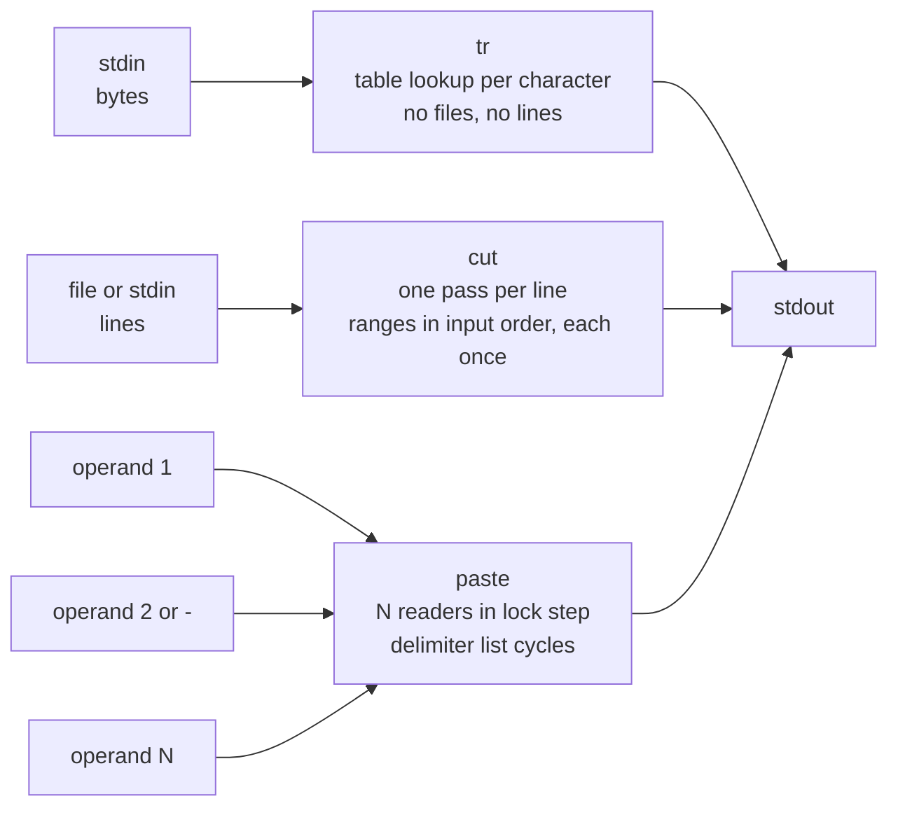

# tr, cut, and paste

> [!summary] Claim
> `tr` is a character map with no notion of lines, `cut` is a per-line positional selector with no quoting model, and `paste` is a lock-step line merger, and all three are specified tightly enough to be portable only inside a narrow intersection that excludes multibyte text, short operands, and exhausted inputs.

Part of [Regular Expressions and Text Processing](README.md) in [Shell and Unix Engineering](../README.md).

## TL;DR

- Mechanism: GNU `tr` builds a 256-entry byte table (`xlate`, `in_delete_set`, `in_squeeze_set`) and runs every input byte through it, `cut` walks each line once against a sorted list of ranges, and `paste` holds one open reader per operand and emits one output line per round.
- Rule: quote every `tr` operand that contains `[` or `*`, pin `LC_ALL=C` when you mean bytes, and never rely on `cut` or `paste` behavior that POSIX calls unspecified (an empty `-d`, a short `string2`, a zero field number).
- Trap: the same command is a different program on GNU, BSD/macOS, and BusyBox: `tr` is byte-oriented on GNU and BusyBox but character-oriented on macOS, `cut -c` was an alias of `-b` in GNU until coreutils 9.11, and BusyBox `paste` skips an exhausted file instead of emitting empty fields.
- Portability fact: POSIX.1-2024 requires `paste` to accept at least 12 file operands, and parallel `paste` needs one descriptor per operand, so `paste f*` is an `EMFILE` failure waiting for a long glob.
- When not to use: the moment data has quoting (CSV), multibyte columns, headers, or a validation requirement, use `awk` or a real parser, because `cut` and `tr` cannot say "this input is malformed".

## Mental model



`tr` consumes the whole stream as one sequence of characters, so a newline is just another table entry and the program has no line state at all.
`cut` reads a line, walks it once against a sorted list of selected positions or fields, writes the selection in input order with each position at most once, and then forgets the line.
`paste` is the only one of the three with more than one input: it opens every operand, reads one line from each per round, joins them with a delimiter taken cyclically from the `-d` list, and ends the round with a newline.
The arrows into `paste` are the source of its failure modes: more operands than descriptors, an operand that runs out early, and a `-` operand that makes several readers share one stream.

## How it works

### tr: three sets and one table

POSIX.1-2024 defines `tr` as copying standard input to standard output "with substitution or deletion of selected characters" (POSIX.1-2024 XCU tr, DESCRIPTION).
Its operands are not regular expressions; they are *arrays of characters* built from a small construct language (POSIX.1-2024 XCU tr, EXTENDED DESCRIPTION): a literal character, `\octal` (one to three digits), the escapes `\\ \a \b \f \n \r \t \v`, a range `c-c`, a class `[:class:]`, an equivalence class `[=equiv=]`, and the repetition `[x*n]`.
The options are `-c` (complement the *values* of `string1`, ordered by binary value), `-C` (complement the *characters*, ordered by collation), `-d` (delete), and `-s` (squeeze), and the four legal operand shapes are `string1 string2`, `-s string1`, `-d string1`, and `-ds string1 string2`.

The processing order is fixed: delete first, then translate, then squeeze using the *last* operand as the squeeze set (POSIX.1-2024 XCU tr, EXTENDED DESCRIPTION: "after any deletions or translations have taken place, repeated sequences of the same character shall be replaced by one occurrence ... if the character is found in the array specified by the last operand").
This is why `tr -s '[:upper:]' '[:lower:]'` squeezes only lowercase letters: the squeeze set is the toupper/tolower second members, not the input letters.

GNU `tr` turns this into three static tables of `N_CHARS = UCHAR_MAX + 1` entries and a `BUFSIZ` buffer (coreutils master `src/tr.c`: `xlate[N_CHARS]`, `in_delete_set[N_CHARS]`, `in_squeeze_set[N_CHARS]`, `io_buf[BUFSIZ]`).
`main` picks one of four loops from the option and operand counts, using `min_operands = 1 + (delete == squeeze_repeats)` and `max_operands = 1 + (delete <= squeeze_repeats)`, which reproduces exactly the four POSIX shapes; `tr -d a b` is rejected with "extra operand" followed by "Only one string may be given when deleting without squeezing repeats".
The translate loop is `read_and_xlate`, which reads up to `BUFSIZ` bytes with `read(2)` and does `buf[i] = xlate[to_uchar (buf[i])]` in place, then `fwrite`s the buffer; deletion is `read_and_delete`, which compacts survivors in place and loops until it has at least one byte so that a buffer that was entirely deleted is not mistaken for EOF.
The squeeze filter (`squeeze_filter`) has one optimization worth knowing: while no run is in progress it steps through the buffer two bytes at a time looking for a squeeze-set member, because a run can only exist if two adjacent bytes match, at the cost of up to twice the work when most of the input is squeezed away (the comment in `squeeze_filter` says "most uses ... seem to remove less than 20-30% of the input").
Nothing in this design is line-aware, so `tr` has no line-length limit and uses constant memory; the cost is that it cannot be told about files, which is why `tr a b file` is an error in GNU (`extra operand`) and the idiom is `tr a b <file`.

`-c` and `-C` are the same flag in GNU: both cases set one `complement` variable (`src/tr.c`, `main`).
BSD and macOS distinguish them, and for `-C` they iterate the single-byte range in `charcoll` order (`mergesort(carray, ... charcoll)` in `text_cmds/tr/tr.c`).

#### Short string2 and the repetition construct

When `string2` is shorter than `string1`, POSIX says the result is unspecified and records the split: BSD pads `string2` with its last character, System V does not, so `tr 0123456789 d` is portable only to BSD-lineage implementations, and the portable spelling is `tr 0123456789 '[d*]'` (POSIX.1-2024 XCU tr, APPLICATION USAGE and RATIONALE).
The rationale states the design decision plainly: the behavior was left unspecified "to preserve System V and XPG3 scripts, which might find difficulty with the BSD method", because the repetition sequence can reproduce the BSD behavior while nothing can reproduce the System V one.
In practice all three implementations measured here pad: GNU extends `string2` through `string2_extend` unless `-t` (`--truncate-set1`) is given, and errors with "when not truncating set1, string2 must be non-empty" if `string2` is empty; BSD says "If string2 runs out of characters, use the last one specified" (`text_cmds/tr/tr.c`); BusyBox's `map()` keeps a `last` variable and reuses it (`coreutils/tr.c`).

`[x*n]` is valid only in `string2`; omitted or zero `n` means "enough to reach the length of `string1`", and a leading zero makes `n` octal (POSIX.1-2024 XCU tr, EXTENDED DESCRIPTION).
GNU parses it in `find_bracketed_repeat` with `xstrtoumax (digit_str, &d_end, *digit_str == '0' ? 8 : 10, ...)` and rejects `[c*]` in `string1` and a second `[c*]` in `string2`; BSD parses the count with `strtol(s->str, &ep, 0)` in `usr.bin/tr/str.c`, so base 0 also accepts a `0x` hex count.
BusyBox does not implement it at all: the comment in `coreutils/tr.c` lists "[x*N] - repeat char x N times" and "[x*] - repeat char x until it fills STRING2" under "not supported", so on BusyBox the brackets, star, and digits are ordinary characters and `tr 0-9 '[d*]'` maps every digit to `[`, `d`, `*`, or `]`.
The lab shows this exact split: on BusyBox `tr 0-9 '[d*]'` prints `[d*]]]]]]]` for `0123456789`.

#### Ranges, classes, and the locale

POSIX defines a range `c-c` only in the POSIX locale: "In locales other than the POSIX locale, this construct has unspecified behavior", and a range whose end precedes its start is either empty or invalid (POSIX.1-2024 XCU tr).
The three families took all three options: GNU exits 1 with "range-endpoints of 'z-a' are in reverse collating sequence order" (`src/tr.c`, `append_range`); BSD's `genrange` returns 0 and rewinds so the `-` is an ordinary character and `z-a` is the three characters `z`, `-`, `a` (`usr.bin/tr/str.c`); BusyBox's `while (i <= ac)` loop runs zero times, so the range is empty (`coreutils/tr.c`, `expand`).
Both BSD-style `tr a-z A-Z` and System V `tr '[a-z]' '[A-Z]'` work everywhere because POSIX deliberately lets the System V brackets be translated to themselves (POSIX.1-2024 XCU tr, RATIONALE); only a script that relied on `a-z` meaning the three characters `a`, `-`, `z` breaks, and the fix is to write `az-`.

Classes are expanded in an unspecified order, so they are legal in `string2` only for case conversion, and then only if the matching class sits in the same relative position in `string1`; with both `-d` and `-s` any class is allowed in `string2` (POSIX.1-2024 XCU tr).
GNU enforces this with the error "when translating, the only character classes that may appear in string2 are 'upper' and 'lower'", BSD and BusyBox do not (`tr abc '[:digit:]'` prints `012` on both).
The class list is also an implementation difference: BusyBox's table has `alpha alnum digit lower upper space blank punct cntrl xdigit` and has `graph` and `print` commented out (`coreutils/tr.c`, the `CLASS_graph` and `CLASS_print` lines), so `tr -d '[:graph:]'` deletes the literal characters `[`, `:`, `g`, `r`, `a`, `p`, `h`, and `]` there instead of a class (`a b` becomes ` b`, measured with BusyBox 1.37.0 on Alpine).
Equivalence classes are weaker than the POSIX example suggests: GNU's `is_equiv_class_member` is just `equiv_class == c` (`src/tr.c`), so `tr '[=e=]' '[e*]'` strips no accents on GNU, and BSD's `genequiv` has the comment "Equivalence classes not supported in multibyte locales".

#### Bytes versus characters

This is the largest real divergence.
POSIX says octal escapes in a range always denote single bytes, and that multibyte characters require "multiple, concatenated escape sequences" (POSIX.1-2024 XCU tr, `\octal` and RATIONALE).
GNU `tr` is a byte machine and says so, in the BUGS section of its man page:
"Full support is available only for safe single-byte locales, in which every possible input byte represents a single character."
The same section continues: "The C locale is safe in GNU systems, so you can avoid this issue in the shell by running LC_ALL=C tr".
macOS and FreeBSD `tr` read with `getwchar` and write with `putwchar` and look characters up in a `cmap` (`text_cmds/tr/tr.c`), so a UTF-8 locale gives true character semantics and an invalid byte is a hard error: the lab shows `tr a x` on `a\377b` emitting `x` and then exiting 1 with `tr: Illegal byte sequence` under `LC_ALL=C.UTF-8`, but passing the byte through under `LC_ALL=C`.
Consequences visible in the lab: in a UTF-8 locale `tr '[:lower:]' '[:upper:]'` upper-cases the two-byte `e-acute` on macOS but leaves it untouched on GNU and BusyBox, and `tr '\303\251' xy` replaces both bytes on GNU and BusyBox but matches nothing on macOS, where the two octal escapes are the two wide characters U+00C3 and U+00A9 rather than one `e-acute`.

NUL is not special: POSIX states that `tr` "correctly processes NUL characters" and gives `tr -d '\000'` as the stripping idiom (POSIX.1-2024 XCU tr, APPLICATION USAGE and RATIONALE), which is also what makes `tr '\0' '\n'` the standard bridge from NUL-delimited to line-oriented tools (see [[find-print0-and-exec-Plus]]).

### cut: positions, not parsing

`cut` has three modes sharing one list grammar (POSIX.1-2024 XCU cut, OPTIONS): a comma- or blank-separated list of positive numbers and ranges `N`, `N-M`, `N-`, and `-M`.
The semantic that surprises people is stated in the rationale and is not a bug: "The list option-arguments are historically used to select the portions of the line to be written, but do not affect the order of the data", and the example is `echo abcdefghi | cut -c6,2,4-7,1` which yields `abdefg`.
Elements may repeat or overlap, but each position is "written exactly once", and selecting positions that do not exist "shall not be an error".
The `-o` option that would preserve list order was proposed and not adopted (POSIX.1-2024 XCU cut, RATIONALE), which is why reordering columns is an `awk` job.

For `-f`, lines "with no field delimiters shall be passed through intact, unless -s is specified", fields are separated in the output by a single delimiter, and the delimiter is exactly one character (`-d delim`, default tab).
Adjacent delimiters therefore delimit empty fields: `cut` never merges runs, so `printf 'a  b\n' | cut -d ' ' -f2` is an empty line and `-f3` is `b` (lab, `cutdelim` mode).
Input files are text files "except that line lengths shall be unlimited", and standard input is used when there are no file operands or an operand is `-`.

GNU's design follows from "unlimited lines": `cut_bytes` does `read(2)` into a fixed `IO_BUFSIZE` buffer and scans for `line_delim` with `search_bytes`, advancing a pointer `current_rp` through the sorted, merged range list (`set_fields` builds it), so memory is constant regardless of line length (coreutils master `src/cut.c`).
There is one deliberate exception.
When the field list and `-s` interact so that the answer for field 1 depends on whether a delimiter follows it, "the entire first field must be read into this buffer to determine whether it is followed by a delimiter or a newline before any of it may be output" (`field_1_buffer` comment in `src/cut.c`); in `cut_fields_bytesearch` the condition is `buffer_first_field = suppress_non_delimited ^ !print_kth (1)`.
So `cut -s -f1` and `cut -f2` buffer a whole first field, and a multi-gigabyte first field with no delimiter is the one input that makes GNU `cut` use memory proportional to the input.

#### Multibyte `cut`: a 2026 change

For most of its history GNU `cut` accepted `-c` and `-n` and ignored their meaning: `-c` was an alias of `-b` and `-n` was a no-op.
GNU coreutils 9.11 (2026-04-20) changed this (coreutils NEWS, release 9.11):
"'cut' now supports multi-byte input and delimiters."
"Consequently the -c option is now honored, and no longer an alias for -b, and the -n option is now honored, and no longer ignored."
"Also the -d option supports multi-byte delimiters."
The same release added `-w`/`--whitespace-delimited`, `-O` as an alias of `--output-delimiter`, and `-F` as an alias of `-w -O ' '`, the last two "for better compatibility with busybox/toybox" (coreutils NEWS, release 9.11).
Release 9.12 (2026-09-14) fixed `cut -d` with several multibyte delimiter options ("bug introduced with multi-byte support in coreutils-9.11") and made `cut -w` more efficient "when extracting the start of a line in multi-byte locales, giving 4x more throughput with typical input".
The unreleased section of NEWS (as of 2026-11) lists more fixes for the rewrite: a multibyte character split across a short `read` from a pipe or terminal ("bug introduced in coreutils-9.11"), and `cut -w`, and `cut -d` in some multibyte locales, delaying output of an already read line ("bug introduced in coreutils-9.12"), plus "'cut -c' is up to 10x faster in UTF-8 locales".
The dispatch is visible in `main`: bytes mode uses `cut_bytes` when `MB_CUR_MAX <= 1 || !no_split` and `cut_bytes_no_split` otherwise; characters mode uses `cut_bytes` when `MB_CUR_MAX <= 1` and `cut_characters` otherwise; fields mode uses `cut_fields_ws` for `-w`, else `cut_fields_bytesearch` when `bytesearch_field_delim_ok ()` holds and `cut_fields_mb` when it does not (`src/cut.c`).
Practical consequence: the answer to "does `cut -c` count characters" is "yes on macOS, yes on GNU 9.11 and later in a multibyte locale, no on GNU before 9.11, no on BusyBox", which is why the lab keys its assertions on the version string.

GNU `-d ''` is a documented special case in the source: "Interpret -d '' to mean 'use the NUL byte as the delimiter.'", and a multi-character operand is the fatal "the delimiter must be a single character".
`-b`, `-c`, or `-f` given twice is "only one list may be specified", and `-d` or `-s` with `-b` or `-c` is rejected ("an input delimiter makes sense only when operating on fields").
GNU also rejects field `0` with "fields are numbered from 1" (observed with coreutils 9.12 `gcut` on 2026-11-21, `gcut -d: -f0`, and with coreutils 9.7 on Debian 13).

The BSD and macOS implementation is a different program, in three functions chosen in `main`: `b_cut` (byte loop on `getc`), `c_cut` (`getwc`, used when `MB_CUR_MAX > 1`), and `b_n_cut` (`-b -n` in a multibyte locale, using `mbrlen`) (`text_cmds/cut/cut.c`).
The field path `f_cut` reads whole lines with `fgetln` and decodes with `mbrtowc`; on an invalid sequence it calls `warnc(EILSEQ, ...)` and returns 1, and `main` then drops the return value for file operands (`fcn(fp, *argv);`) while keeping it for stdin (`rval |= fcn(stdin, "stdin")`), so `cut -d: -f2 file` exits 0 after silently truncating its output at the first bad line while `cut -d: -f2 <file` exits 1 (lab, `cutbad` mode).
BSD parses lists with `strsep(&list, ", \t")` and rejects a zero with "[-bcf] list: values may not include zero".

BusyBox `cut` reads each line into a C string with `xmalloc_fgetline`, whose reader `bb_get_chunk_from_file` stops at a NUL as well as at a newline (`libbb/get_line_from_file.c`), so a NUL splits the line in two and the bytes after it are cut as a separate line (`printf 'a\0b\tc\n' | cut -f2` prints `a` and `c` on two lines with BusyBox 1.37.0 on Alpine), and a huge line is allocated whole; it takes only `*delim` (the first byte) of `-d`, treats an empty `-d` as tab, documents `-n` as "Ignored", sorts the list with `qsort` unless `-D` is given, and accepts position `0` as the first (`coreutils/cut.c`); `-b` and `-c` are the same branch.

### paste: N readers and a cycle of delimiters

POSIX.1-2024 `paste` concatenates "the corresponding lines of the given input files", replacing the newline of every line except the last operand's with a tab.
If a file reaches end of file before the others, `paste` "shall behave as though empty lines were read" from it, unless `-s` is given.
`-d list` supplies delimiter *elements* used circularly; the recognized escapes are `\n`, `\t`, `\\`, and `\0`, where `\0` is "Empty string (not a null character)", and the rationale explains why it exists: historical `paste` did not follow the utility syntax guidelines, so `paste -d"" ...` could not be handled by `getopt()`, and "`paste -d "\0" ...` and `paste -d "" ...` are not necessarily equivalent; the latter is not specified" (POSIX.1-2024 XCU paste, OPTIONS and APPLICATION USAGE).
With `-s` the delimiter list restarts at the first element after each file; without it, the list restarts every output line.
`-` operands read standard input "one line at a time, circularly, for each instance of '-'", which is the basis of `ls | paste - - - -` and `paste -s -d '\t\n' file`.
The conformance floor is one sentence: "Implementations shall support pasting of at least 12 file operands".
The failure rule matters for scripts: "If one or more input files cannot be opened when the -s option is not specified, a diagnostic message shall be written to standard error, but no output is written to standard output" (POSIX.1-2024 XCU paste, CONSEQUENCES OF ERRORS).

GNU `paste_parallel` implements that rule literally: it opens every operand in a first loop and calls `error (EXIT_FAILURE, errno, ...)` on the first `fopen` failure, before anything is written, with the comment that the file count "could be expanded to an infinite number of files, but at the (considerable) expense of remembering each file and its current offset, then opening/reading/closing" (`src/paste.c`).
Then it loops: for each of `nfiles` slots it reads characters with `getc` up to the line delimiter, writes them, and writes the next delimiter from a flattened `delims` array with a parallel `delim_lens` array of per-element byte lengths (so `\0` is a length-0 element, and multibyte delimiters are legal since coreutils 9.10, per its NEWS).
A file that has hit EOF is closed and its slot becomes empty, and the delimiters for empty slots are accumulated in `delbuf` (sized `(nfiles - 1) * MB_CUR_MAX + 1`) so that the tabs of an exhausted file still appear as long as some later file produced data; this is what turns `paste three one` into `1<TAB>x`, `2<TAB>`, `3<TAB>`.
The last file's final line gets a newline even if the input lacked one ("If the last line of the last file lacks a newline, print one anyhow.  POSIX requires this.").
`paste_serial` is simpler: one file at a time, `fopen` failures are reported and skipped with a nonzero final status rather than aborting, and an empty file produces a lone newline (the `charold != line_delim` test fires with `charold == EOF`), matching POSIX's "If an input file is empty, the output line corresponding to that file shall consist of only a <newline> character".
`-z` (NUL as line delimiter) is a GNU extension.
An odd number of trailing backslashes in `-d` is "delimiter list ends with an unescaped backslash", the fix for a bug present since 1992: "paste -d'\' file no longer overruns memory (heap since coreutils-5.1.2, stack before then) [bug present in the original version, in 1992]" (coreutils NEWS, release 6.11, 2008-04-19).

BSD and macOS `paste` is wide-character code: `parallel` builds a linked list of open `FILE *` for every operand (so it also opens them all first and `err(1, "%s", p)` on failure), reads with `getwc`, and `tr()` converts the delimiter list, treating `\0` as an empty element and rejecting an empty list with "no delimiters specified" (`text_cmds/paste/paste.c`).
Differences from POSIX that the lab confirms: BSD `-s` on an empty file writes nothing instead of a newline; BSD `-s` does not add a final newline to input that lacks one (`needdelim` is set only when a `\n` is read); and an invalid byte makes `getwc` stop, giving `errx(EX_IOERR, "Error reading %s", ...)` which is exit status 74 in parallel mode and a silent exit 0 in `-s` mode.

BusyBox `paste` keeps an array of `FILE *`, reads each with `xmalloc_fgetline`, and when a file returns NULL it closes it and *skips the slot* (`if (files[i] == NULL) continue;`) instead of emitting an empty field, so `paste three one` prints `1<TAB>x`, then `2<TAB>3<TAB>` with no newline (lab, `pastelayout` mode).
It also refuses the empty delimiter list: `-d '' is not supported`, and for `-` repeated it shares one `FILE *` across slots, so an odd number of input lines leaves the last output line without its newline.
Unlike GNU and BSD, it opens every operand in `main` before it looks at `-s` (`fopen_or_warn_stdin` in a loop, then `xfunc_die()` on the first failure), so `paste -s` needs one descriptor per operand too: with `ulimit -n 20` and 40 operands it prints "paste: f25: No file descriptors available", exits 1, and writes nothing (measured with BusyBox 1.37.0 on Alpine).

### The uutils implementation

uutils `coreutils` is a Rust reimplementation that tracks GNU's options.
Its `tr` takes operands as bytes (`os_str_as_bytes` in `src/uu/tr/src/tr.rs`) and implements `--truncate-set1`, its `cut` carries multibyte `-n` handling (`src/uu/cut/src/cut.rs`), and its `paste` parses delimiters into a list of byte strings (`parse_delimiters` in `src/uu/paste/src/paste.rs`).
The lab does not run uutils (the matrix has no uutils image), so no uutils behavior in this note is asserted beyond what those three files show (as of 2026-11).

## Numbers and limits

| Quantity | Value | Source |
|---|---|---|
| GNU `tr` table size | 256 entries per table (`N_CHARS = UCHAR_MAX + 1`), three tables | coreutils master `src/tr.c` |
| GNU `tr` I/O buffer | `BUFSIZ` bytes (`io_buf[BUFSIZ]`) | `src/tr.c` |
| BusyBox `tr` buffers | `TR_BUFSIZ`, the larger of `BUFSIZ` and 512 | busybox `coreutils/tr.c` |
| `string1` length for a complemented set in GNU | `card_of_complement`, starts from 256 | `src/tr.c` |
| `paste` minimum operands | at least 12 | POSIX.1-2024 XCU paste, OPERANDS |
| `LINE_MAX` on the host | 2048 (`getconf LINE_MAX` and `_POSIX2_LINE_MAX`) | measured here, macOS 27.3, 2026-11-21 |
| `cut`, `paste`, `tr` on a 1 MiB line | `cut -d: -f1` output is 1048577 bytes; `paste -d, big big` output is 2097158 bytes; `tr -d a` leaves `:z` and a newline | lab, `longline` mode (macOS arm64, 2026-11-21) |
| Descriptors needed by parallel `paste` | one per operand; with `ulimit -n 20` and 40 operands the parallel run writes 0 bytes and the `-s` run writes 40 lines on GNU and BSD, while BusyBox `-s` also fails (status 1, 0 lines) because it opens every operand first | lab, `pastefd` mode (GNU 9.7, GNU 9.12, macOS, BusyBox 1.37.0) |
| BSD `paste` read error status | 74 (`EX_IOERR` from `sysexits.h`) in parallel mode | macOS `text_cmds/paste/paste.c`, lab `pastebad` mode |
| GNU `cut` multibyte support | coreutils 9.11, released 2026-04-20 | coreutils NEWS |
| GNU `cut -c` UTF-8 speedup | "up to 10x faster", unreleased as of 2026-11 | coreutils NEWS, top section |
| GNU `tr -u` | accepted, undocumented, unbuffered output; unreleased as of 2026-11 | coreutils NEWS, top section |
| Delimiter-list memory in GNU `paste` | `(nfiles - 1) * MB_CUR_MAX + 1` bytes for `delbuf` | `src/paste.c` |

## Portability

The three utilities do not run "in" the shell, so no shell changes what `tr`, `cut`, or `paste` do; the shell decides only how the operands reach them.

| Environment | What differs | Evidence |
|---|---|---|
| GNU coreutils 9.12 | `tr` is bytes; `-t` exists; `[c*n]` works; reversed range is an error; `cut -c` and `-n` are character-aware (since 9.11); `cut -d ''` is NUL; `paste` pads exhausted files with empty fields | `src/tr.c`, `src/cut.c`, `src/paste.c`, NEWS 9.11; lab arms `gnu`, probe run with Homebrew coreutils 9.12 on PATH (2026-11-21) |
| GNU coreutils before 9.11 | `cut -c` is `-b`, `-n` is ignored | NEWS 9.11; lab arm `gnu-no`, probe run with coreutils 9.7 on Debian 13 (2026-11-21) |
| macOS and FreeBSD | `tr`, `cut`, `paste` decode wide characters in a multibyte locale; reversed `tr` range is literal; `cut -d ''` is an error; `paste -s` on an empty file prints nothing | `text_cmds` and `usr.bin/tr/str.c`; lab arms `bsd`, probe run on macOS 27.3 |
| BusyBox (1.37.0 in the matrix) | `tr` has no `[c*n]`, `graph`, or `print`; `cut` has no multibyte mode, takes only the first byte of `-d`, and splits a line at a NUL; `paste` skips exhausted files and opens every operand even with `-s` | busybox `coreutils/*.c` and `libbb/get_line_from_file.c`; lab arms `busybox`, probe run on Alpine (2026-11-21) |
| uutils | byte-oriented `tr` operands, `--truncate-set1`, multibyte-aware `cut -n` in source | `src/uu/*/src/*.rs`; not run in the lab |

| Shell | Effect on these utilities |
|---|---|
| POSIX sh | Only quoting matters: POSIX says "string1 and string2 can be quoted to avoid pattern matching by the shell" |
| macOS bash 3.2 (`/bin/sh` and `/bin/bash`) | Unquoted `tr [a-z] [A-Z]` with files `a` and `Z` in the directory runs `tr a Z`; measured ad hoc 2026-11-21 |
| bash 5.3.15 | Same measured result: output `hello Z` for input `hello a` |
| zsh 5.9.2 native | Same measured result, because the globs match files; native zsh does not field split an unquoted parameter, so `tr $set1 $set2` is one operand |
| zsh `--emulate sh` | Same measured result; unquoted parameters are split |
| dash | Same measured result (Homebrew dash); dash 0.5.12 does not support `$'...'` (measured in the shell matrix, and Debian dash prints `$\t` for `printf '%s' $'\t'`), so `cut -d $'\t'` passes a word that starts with a literal `$` |
| ksh93 (macOS `/bin/ksh`, 93u+ 2012) | Same measured result |
| mksh, yash, posh, BusyBox ash | Not run for this note; shell matrix facts: posh 0.14.1 also lacks `$'...'`; BusyBox 1.37.0 ash supports it but not `\c`, `\e`, `\E`, `\u`, or `\U` (it keeps the backslash) |

The lab's utility arms branch on the implementation the probe detects (`gnu`, `bsd`, `busybox`), never on the shell family, because `LAB_SHELL` does not change which `tr`, `cut`, or `paste` is found on `PATH`.

## Worked example

The lab is [lab](../labs/07-tr-cut-and-paste/): `tcp-probe.sh MODE DIR` runs the utilities on small inputs and prints one line per case, and `tcp.bats` asserts the exact lines per implementation.
Simplified excerpt of the probe's reporting helper and two of its modes:

```sh
vis() {
  od -An -v -t o1 | awk '...escape every byte that is not printable ASCII...'
}

run() {
  name=$1
  input=$2
  shift 2
  "$@" <"$input" >"$name.out" 2>"$name.err"
  rc=$?
  out=$(vis <"$name.out")
  err=$(sed -n 1p "$name.err")
  printf '%s: out=<%s> rc=%s err=<%s>\n' "$name" "$out" "$rc" "$err"
}

# mode cutlist
printf 'abcdefghi\n' >alpha
run order alpha cut -c6,2,4-7,1
printf 'a:b:c\n' >abc
run field_order abc cut -d: -f3,1
printf 'nodelim\na:b\n' >mixed
run passthrough mixed cut -d: -f2
run suppress mixed cut -s -d: -f2

# mode pastelayout
run long_first empty paste three one
run stdin_twice five paste - -
```

Expected lines, which the tests assert (BSD arm for the `cutlist` zero case, GNU and BSD for `pastelayout`):

```text
order: out=<abdefg\n> rc=0 err=<>
field_order: out=<a:c\n> rc=0 err=<>
passthrough: out=<nodelim\nb\n> rc=0 err=<>
suppress: out=<b\n> rc=0 err=<>
zero: out=<> rc=1 err=<cut: [-bcf] list: values may not include zero>
long_first: out=<1\tx\n2\t\n3\t\n> rc=0 err=<>
stdin_twice: out=<a\tb\nc\td\ne\t\n> rc=0 err=<>
```

The BusyBox arm of the same tests asserts `long_first: out=<1\tx\n2\t3\t>` and `stdin_twice: out=<a\tb\nc\td\ne\t>`, and the GNU arm of `zero` asserts `cut: fields are numbered from 1`.

Captured run on macOS 27.3 (arm64, BSD `tr`, `cut`, `paste`), 2026-11-21, `bats --tap labs/07-tr-cut-and-paste/tcp.bats` under the host `/bin/sh`: all 15 tests passed.

```text
1..15
ok 1 the probe recognizes the tr, cut, and paste implementations
ok 2 tr pads a short string2 with its last character, and [c*] and [c*n] fill it portably
ok 3 a reversed tr range is an error in GNU, literal in BSD, and empty in BusyBox
ok 4 tr class rules in string2 and missing classes differ by implementation
ok 5 BSD tr decodes characters and dies on an invalid byte; GNU and BusyBox tr map bytes
ok 6 cut writes selections in input order once, passes undelimited lines, and rejects zero
ok 7 cut -d accepts exactly one character, and an empty -d means NUL only in GNU
ok 8 cut -c and -n are character aware only in BSD and GNU 9.11 or later
ok 9 BSD cut -f stops at an invalid byte and exits 0 for a file operand
ok 10 a final line without a newline gets one, except BSD cut -c past the end
ok 11 paste fills exhausted files with empty lines, except BusyBox, which skips them
ok 12 paste -s on an empty or unterminated file, an empty -d, and no operands differ
ok 13 BSD paste stops at an invalid byte: status 74 in parallel, a silent 0 with -s
ok 14 parallel paste needs one descriptor per operand and writes nothing when one fails
ok 15 cut, paste, and tr handle a 1 MiB line, far past LINE_MAX
```

The GNU and BusyBox arms were not executed by that `bats` run (no BusyBox on the host; the Homebrew GNU tools are named `gtr`, `gcut`, `gpaste`, not `tr`, `cut`, `paste`).
The probe itself was then run once per mode, on 2026-11-21, with GNU coreutils 9.7 (Debian 13 image), BusyBox 1.37.0 (Alpine image), and Homebrew coreutils 9.12 linked onto `PATH` as `tr`, `cut`, and `paste`: every GNU line matched the `gnu` arms, and every BusyBox line matched except two that the tests now assert, `empty_delim: out=<a\nc\n>` (a NUL splits the line) and `serial: rc=1 lines=0` in `pastefd` (BusyBox opens every operand even with `-s`).

## Pitfalls

> [!warning] Unquoted bracket operands are globs
> Trigger: `tr [a-z] [A-Z]` run in a directory that contains files named `a` and `Z`.
> Symptom: the shell expands each bracket expression to a matching filename, so the command becomes `tr a Z`; measured on 2026-11-21 in bash 3.2, bash 5.3.15, zsh 5.9.2 native and `--emulate sh`, dash, and ksh93u+, all printing `hello Z` for the input `hello a`.
> Fix: always quote operands, `tr '[:lower:]' '[:upper:]'`; POSIX says the same ("string1 and string2 can be quoted to avoid pattern matching by the shell").
> Native zsh with no matching file fails at the shell with `zsh:1: no matches found: [a-z]` (measured 2026-11-21), which hides the bug until the directory happens to contain a one-letter file.

> [!warning] `tr` on multibyte text
> Trigger: `tr '[:lower:]' '[:upper:]'` or `tr -d` on UTF-8 input under a UTF-8 locale.
> Symptom: GNU and BusyBox leave the two-byte `e-acute` untouched and treat each byte of a multibyte character separately, macOS upper-cases it and aborts on an invalid byte with `Illegal byte sequence`; the same script gives different bytes on the two platforms.
> Fix: use `LC_ALL=C tr` when you mean bytes (the GNU man page's own advice), and use `sed`, `awk`, or Perl when you need real character semantics; see [[Unicode-and-UTF-8-in-Text-Tools]] and [[Locale-and-LC_ALL]].

> [!warning] Short `string2` and the `[c*]` spelling
> Trigger: `tr -cs '[:alpha:]' '[\n*]'` (the POSIX example) on BusyBox, or `tr 0123456789 d` on a strict System V `tr`.
> Symptom: BusyBox has no `[c*]` and prints `hello]world]` for `hello,  world 42!`; a System V `tr` truncates `string1` and leaves the digits 1 to 9 alone.
> Fix: pick the spelling per target: `tr -cs '[:alpha:]' '\n'` works on all three implementations measured here but relies on padding that POSIX leaves unspecified, while `[\n*]` is the specified form and needs GNU or BSD; where both matter, give `string2` its full length.

> [!warning] `cut -d ' '` does not squeeze runs
> Trigger: `ps` or `ls -l` style output with aligned columns, then `cut -d ' ' -f2`.
> Symptom: `printf 'a  b\n' | cut -d ' ' -f2` is an empty line and `-f3` is `b`, because each space is a delimiter and runs make empty fields (lab, `cutdelim` mode).
> Fix: normalize first with `tr -s ' '`, use `awk '{print $2}'` (see [[awk-Language]]), or on GNU 9.11 and later and macOS use `cut -w` (GNU 9.11 added `-F` as an alias of `-w -O ' '` for compatibility with BusyBox and toybox; BusyBox's regex-based `-F` exists only when built with `FEATURE_CUT_REGEX`).

> [!warning] `cut -f` passes undelimited lines through
> Trigger: `cut -d: -f2` over input that contains a line with no colon.
> Symptom: that line is printed whole, which looks like a "field 2" containing the entire line; the lab shows `passthrough` printing `nodelim` between real fields.
> Fix: add `-s` when lines without the delimiter are errors or noise (POSIX.1-2024 XCU cut: "Lines with no field delimiters shall be passed through intact, unless -s is specified"), or validate with `awk`.

> [!warning] `cut -c` before GNU coreutils 9.11 is `-b`
> Trigger: `cut -c1-3` on a UTF-8 file under an old or Debian-stable coreutils, or on BusyBox.
> Symptom: lines are cut inside a character, producing invalid UTF-8 (lab: `cut -c1` on `etude` with a leading `e-acute` prints the single byte 0303 on GNU before 9.11 and on BusyBox, but both bytes on macOS and GNU 9.11 or later).
> Fix: do not use `cut -c` for non-ASCII; on GNU 9.11 or later and macOS it is correct, elsewhere use a UTF-8 aware `awk` or Perl with UTF-8 enabled (see [[Perl-One-Liners]]).

> [!warning] BSD `cut` hides an encoding error behind exit status 0
> Trigger: `cut -d: -f2 file` on macOS, in a UTF-8 locale, where the file contains an invalid byte.
> Symptom: output stops at the bad line, `cut: bad: Illegal byte sequence` appears on stderr, and the exit status is 0 because `main` ignores `f_cut`'s return for file operands (macOS `cut.c`: `fcn(fp, *argv);`); `cut -d: -f2 <file` exits 1.
> Fix: check stderr or feed through stdin, run `LC_ALL=C cut` for byte-clean data, and never treat `cut`'s zero status as proof that the whole file was processed.

> [!warning] `paste` on unequal inputs is not portable
> Trigger: `paste three one` where the second file is shorter, or `paste - -` over an odd number of lines.
> Symptom: GNU and BSD emit empty fields (`2<TAB>` on its own line), BusyBox skips the exhausted slot and drops the trailing newline in `paste - -` (`e<TAB>` with no newline); the lab asserts all three.
> Fix: keep the inputs equal length by construction, or use `awk` for ragged data, which behaves the same on every platform.

> [!warning] Parallel `paste` needs one descriptor per operand
> Trigger: `paste f*` over thousands of files, or any shell with a low `ulimit -n`.
> Symptom: `paste` fails at the first `fopen` that returns `EMFILE`, before writing any output, as POSIX requires (lab: `ulimit -n 20` with 40 operands gives `parallel: rc=1 stdout_bytes=0`, while `paste -s` over the same 40 files writes 40 lines on GNU and BSD); `ARG_MAX` can fail the glob even earlier.
> Fix: use `paste -s` (GNU and BSD open one file at a time; BusyBox opens them all and fails the same way), batch the operands, raise the descriptor limit, or switch to `awk` or `sort`/`join` (see [[join-and-comm]]).

> [!warning] `-d ''` and `-d '\0'` are different requests
> Trigger: `paste -d '' a b` on a non-GNU system.
> Symptom: POSIX leaves it unspecified; GNU treats it as an empty delimiter and prints `xx` for two `x` files, BSD exits 1 with "no delimiters specified", BusyBox exits with "-d '' is not supported".
> Fix: write `-d '\0'`, which POSIX defines as the empty string and which produced `123` for `paste -s -d '\0'` on all three (lab, `serial_nodelim`); the POSIX rationale explains this is why `\0` exists.

> [!warning] Historical `paste` and `cut` bugs are real incidents
> Trigger: `paste -d'\' file` on coreutils before 6.11; `cut -d$'\n'` across 8.21 to 8.23.
> Symptom: memory corruption in `paste` ("heap since coreutils-5.1.2, stack before then", present since 1992, fixed in 6.11, 2008-04-19); `cut -d$'\n'` stopped outputting the lines named by `--fields` in 8.21 (2013-02-14, "to align with other implementations and to avoid delayed output of lines") and was restored in 8.23 (2014-07-18) with the warning "Note using this non portable functionality will result in the delayed output of lines"; `paste` truncated output at a `\n` at the 4 GiB offset on 32-bit systems (fixed in 8.24, 2015-07-03).
> Fix: never pass a newline or a lone backslash as a delimiter, and keep `paste`/`cut` updated on systems that process attacker-influenced input; all four entries are in the coreutils NEWS file.

## Security and robustness

- Treat every delimiter-based tool as a trust boundary: if a field value can contain the delimiter, `cut -d: -f3` returns a different field, which is a classic way to forge a record in a colon-separated file; validate with `awk -F:` and check `NF`, or reject values that contain the delimiter before writing them.
- A deny-list `tr -d` is fragile; prefer an allow-list such as `LC_ALL=C tr -cd 'A-Za-z0-9._-'`, which also needs `LC_ALL=C` because ranges are unspecified outside the POSIX locale (POSIX.1-2024 XCU tr) and macOS `tr` would otherwise treat bytes as characters.
- Line-oriented does not mean bounded: BusyBox `cut` and `paste` read each line whole with `xmalloc_fgetline`, macOS `cut -f` uses `fgetln`, and GNU `cut` buffers a whole first field in the cases described above, so an untrusted newline-free stream can exhaust memory in all three; cap input with `head -c` or `timeout` plus `ulimit -v`.
- NUL bytes: `tr` and GNU `cut -z` and `paste -z` handle them; BusyBox `cut` splits a line at every NUL because its line reader stops there, so the bytes after a NUL become a separate line; do not route NUL-delimited data (`find -print0`) through BusyBox `cut`, and use `tr '\0' '\n'` only when names cannot contain newlines (see [[find-print0-and-exec-Plus]]).
- A pipeline reports only its last command's status, so `cut ... | tr ...` hides a `cut` failure, and macOS `cut` may already have returned 0 on an encoding error; see [[Pipelines-and-And-Or-Lists]] and [[Exit-Code-Contracts]].
- Pin the locale in scripts that must be reproducible (`LC_ALL=C`), and pin the tools too if you depend on 9.11 behavior, by feature detection rather than version strings where possible.
- Do not build `paste -d` lists or `tr` operands from untrusted data: a trailing backslash is a fatal error in GNU and was heap corruption before 6.11, and `tr` treats `-` and `[` as syntax.

## The principal's view

The decision is about the contract of the data, not the tool.
`tr` is the right tool for byte-level, ASCII-range work: case folding under `LC_ALL=C`, deleting `\r`, squeezing blanks, converting NUL and newline, and making a word list from prose; it is constant-memory, line-agnostic, and as fast as a 256-entry table lookup per byte.
`cut` is right when the data is machine-generated with a single-character delimiter that cannot occur inside a field, or when columns are positional and the content is ASCII; it is wrong the moment fields are quoted, aligned with runs of spaces, or multibyte, and the portability wall (GNU before 9.11, BusyBox, and macOS disagreeing on `-c`) makes "it worked on my machine" the default failure.
`paste` is right for gluing equal-length streams and for the `paste -s -d,` join idiom, and wrong for ragged inputs because exhausted-file behavior is where the implementations part.
The trade-off is terseness and streaming against silence: none of the three can say "this line is malformed", so each unvalidated assumption becomes a silent data bug, and the bug surfaces far from the cause.
When any of the following holds, switch tools: quoting or escaping in the data (use a CSV parser in Python, see [[Python-as-a-Shell-Companion]]); field reordering, validation, or ragged joins (use `awk`, see [[awk-Language]]); multibyte-aware column extraction on a mixed fleet (use `awk` or Perl; see [[Unicode-and-UTF-8-in-Text-Tools]]); keyed merges of sorted files (use [[join-and-comm]]); width-based column layout (use [[column-fold-and-fmt]]).
If the script must run on GNU, macOS, and BusyBox, restrict it to the intersection the lab proves: `tr` with BSD-style ranges under `LC_ALL=C`, quoted operands, no `[c*]`, no classes outside `alpha digit upper lower space` unless on GNU or BSD only; `cut -d` with a single ASCII delimiter and `-f` lists; `cut -c` or `-b` for ASCII only; and `paste -s -d` with `\0` when an empty delimiter is wanted.

## Interview questions

> [!question] L5: What does `echo abcdefghi | cut -c6,2,4-7,1` print, and why is the order not 6, 2, 4-7, 1?
>
> > [!success]- Answer
> > It prints `abdefg`.
> > POSIX says the selected bytes, characters, or fields are written "in the order of the input data" and each position is written exactly once, so the list is a set of positions, not a sequence.
> > The `-o` option that would preserve list order was proposed and not adopted, so reordering columns needs `awk`.
> >
> > Follow-up: How do you get list order instead? (Not with `cut`; use `awk` and print the fields in the order you want.)

> [!question] L5: Why does `printf 'a  b\n' | cut -d ' ' -f2` print an empty line?
>
> > [!success]- Answer
> > `cut` treats each delimiter character as a field boundary and never merges runs.
> > Two adjacent spaces delimit an empty field between them, so field 2 is empty and field 3 is `b`.
> > Use `tr -s ' '` first, `awk '{print $2}'`, or `cut -w` on GNU 9.11 or later and macOS.
> >
> > Follow-up: What does `cut -d ' ' -f2` print for the line `nodelim` with no space? (The whole line, because `-s` was not given.)

> [!question] L5: Predict the output: in a directory containing only the files `a` and `Z`, what does `echo 'hello a' | tr [a-z] [A-Z]` print?
>
> > [!success]- Answer
> > It prints `hello Z`.
> > The shell expands `[a-z]` to the file `a` and `[A-Z]` to the file `Z`, so the command run is `tr a Z`, which maps `a` to `Z` and leaves the rest of `hello a` alone.
> > This was measured in bash 3.2, bash 5.3.15, zsh 5.9.2 (native and `--emulate sh`), dash, and ksh93u+ with identical results.
> >
> > Follow-up: What changes in native zsh when no file matches? (Native zsh stops with "no matches found" before running `tr`.)

> [!question] L6: Debug this script: `paste $(ls *.txt) > merged.tsv` works with 10 files and fails with 5000.
>
> > [!success]- Answer
> > Parallel `paste` opens every operand before writing any output, so it needs one file descriptor per operand and exits before writing anything when an open fails (POSIX.1-2024 XCU paste, CONSEQUENCES OF ERRORS; GNU `paste_parallel` calls `error (EXIT_FAILURE, ...)` in its open loop).
> > The lab reproduces this with `ulimit -n 20` and 40 files: `rc=1`, zero output bytes.
> > An earlier failure can also be `ARG_MAX` on the glob.
> > Fix with `paste -s` (one file open at a time on GNU and BSD, but not on BusyBox, which opens every operand first) or batching, or raise `ulimit -n`; unquoted `$(ls ...)` also breaks on spaces in names.
> >
> > Follow-up: What is the minimum number of operands POSIX requires `paste` to support? (12.)

> [!question] L6: Why does `cut -d: -f2` print a line that contains no colon at all, and how do you stop it?
>
> > [!success]- Answer
> > POSIX requires that lines "with no field delimiters shall be passed through intact, unless -s is specified".
> > So the line is printed whole, which looks like a field.
> > Add `-s` to suppress it, or validate the delimiter count with `awk -F:`.
> > The lab shows `passthrough: out=<nodelim\nb\n>` and `suppress: out=<b\n>`.
> >
> > Follow-up: In GNU `cut`, what memory cost does `-s` introduce for field 1? (The first field must be buffered whole to decide whether a delimiter follows, per the `field_1_buffer` comment.)

> [!question] L6: Explain `tr -cs '[:alpha:]' '[\n*]'` and what breaks on BusyBox.
>
> > [!success]- Answer
> > `-c` complements `string1` (everything that is not a letter), `-s` squeezes repeats of what the last operand contains, and `[\n*]` pads `string2` with newlines up to the length of the complemented set, so every run of non-letters becomes one newline: one word per line.
> > The form is the POSIX example.
> > BusyBox has no `[c*]` construct, so `[\n*]` is the four characters `[`, newline, `*`, `]`, and the lab shows the result `hello]world]` instead of `hello` and `world` on separate lines.
> > `tr -cs '[:alpha:]' '\n'` works on all three but depends on padding that POSIX leaves unspecified.
> >
> > Follow-up: What does `-c` versus `-C` change for this command? (Nothing in the C locale, since values and characters coincide; they differ for multibyte or collation-ordered sets, and GNU treats them as the same flag.)

> [!question] L7+: Why did POSIX leave a short `string2` unspecified instead of choosing the BSD or the System V behavior?
>
> > [!success]- Answer
> > The behaviors differ: BSD pads with the last character of `string2`, System V does not.
> > The rationale says the standard "unspecified the behavior and preserve[d] System V and XPG3 scripts, which might find difficulty with the BSD method", on the assumption that BSD users could use the repetition sequence `[d*]` to get the BSD effect, while no construct can reproduce the System V effect.
> > Choosing the BSD behavior would have broken scripts that had no remedy; leaving it unspecified breaks nothing, at the cost of portability for scripts that use the padding.
> > In practice GNU, BSD, and BusyBox all pad, which is a de facto behavior but not a conformance guarantee.
> >
> > Follow-up: What do you write if the script must run on a strict System V `tr` and on BusyBox? (Give `string2` its full length, since neither `[d*]` nor padding is available on both.)

> [!question] L7+: Design a portable column extractor for UTF-8 data that runs on GNU 9.10, GNU 9.12, macOS, and BusyBox.
>
> > [!success]- Answer
> > `cut -c` is wrong on GNU before 9.11 and on BusyBox, and `cut -d` accepts one byte on BusyBox, so `cut` is out for non-ASCII columns.
> > Use an `awk` that is multibyte aware in a pinned UTF-8 locale (gawk is), or Perl with UTF-8 enabled, or Python for anything with quoting, and detect the implementation by feature test rather than by `uname`.
> > If the data is ASCII-only, `cut -b` or `cut -c` is safe everywhere, because both reduce to the same byte loop.
> > Put the contract in a test: the lab's `cutmb` mode shows the byte-versus-character split directly.
> >
> > Follow-up: How do you detect GNU 9.11 behavior without parsing a version string? (Run `printf '\303\251x\n' | LC_ALL=C.UTF-8 cut -c1` and count the output bytes: two means character-aware, one means byte-oriented; this is what the lab's `cutmb` mode does.)

> [!question] L7+: What guarantee does `cut -n` give, and how does the POSIX `cut -b 1-500 -n file` plus `paste -d '\0'` round trip work?
>
> > [!success]- Answer
> > With `-b`, `-n` adjusts each `low-high` range so that no character is split: `low` moves back to the first byte of its character, `high` moves back to the last byte of the previous character, and an element that becomes empty is dropped for that line without an error.
> > Therefore `cut -b 1-500 -n file > file1` and `cut -b 501- -n file > file2` put every character in exactly one of the two files, each with a newline for every newline in `file`.
> > `paste -d '\0' file1 file2` rejoins them, because `\0` is the empty delimiter, recreating the original lines.
> > The wrinkle is that this is guaranteed only when `-n` is implemented: BusyBox ignores `-n`, and GNU ignored it before 9.11.
> >
> > Follow-up: Why must the delimiter be `\0` and not the empty string? (POSIX specifies only `\0`; `-d ''` is unspecified and BSD and BusyBox reject it.)

> [!question] L6: Debug this: on macOS a nightly job runs `cut -d, -f3 data.csv > col3.txt` and the exit code is 0, yet col3.txt stops halfway.
>
> > [!success]- Answer
> > macOS `cut` returns the status of `f_cut` only for standard input; for file operands `main` calls `fcn(fp, *argv)` and discards it, so an invalid byte sequence in a UTF-8 locale prints `cut: data.csv: Illegal byte sequence`, stops processing, and still exits 0.
> > The data is probably not valid UTF-8, or the locale is UTF-8 while the file is Latin-1.
> > Reproduce with `printf 'x:1\n\377:2\nz:3\n'` and `LC_ALL=C.UTF-8`; the lab shows `file_operand: out=<1\n> rc=0` and `stdin_input: out=<1\n> rc=1`.
> > Fix by validating encoding upstream, running `LC_ALL=C cut` when the data is bytes, or feeding stdin and checking the status; also note `-d,` cannot parse quoted CSV fields anyway.
> >
> > Follow-up: Why is the GNU result for the same input different? (GNU `cut` is byte-oriented for single-byte delimiters via `cut_fields_bytesearch` and does not decode lines it does not need to.)

## Related

Prerequisites: [[Python-as-a-Shell-Companion]]

Next: [[join-and-comm]]

See also: [[column-fold-and-fmt]], [[Locale-and-LC_ALL]], [[Unicode-and-UTF-8-in-Text-Tools]], [[awk-Language]], [[sed-Pattern-and-Hold-Space]], [[grep-in-Depth]], [[Field-Splitting-and-IFS]], [[Pathname-Expansion]], [[Dollar-Single-Quotes]], [[Pipes-and-FIFOs]], [[find-print0-and-exec-Plus]], [[Four-Userlands-GNU-BSD-BusyBox-uutils]], [[Userland-Portability-Traps]], [[uniq-and-Counting]], [[sort-Keys-and-Stability]]

## Further reading

- POSIX.1-2024 `tr` (https://pubs.opengroup.org/onlinepubs/9799919799/utilities/tr.html): the construct language, the unspecified short-`string2` rule, and the rationale for BSD versus System V behavior.
- POSIX.1-2024 `cut` (https://pubs.opengroup.org/onlinepubs/9799919799/utilities/cut.html): the list grammar, `-n`, the `abdefg` rationale example, and the rejected `-o`.
- POSIX.1-2024 `paste` (https://pubs.opengroup.org/onlinepubs/9799919799/utilities/paste.html): the 12-operand floor, the `\0` rationale, the no-output-on-open-failure rule, and the `-s` empty-file rule.
- GNU coreutils `src/tr.c`, `src/cut.c`, `src/paste.c` (https://raw.githubusercontent.com/coreutils/coreutils/master/src/): the table-driven `tr`, the range-walking `cut`, and the lock-step `paste` loops cited above.
- GNU coreutils `NEWS` (https://raw.githubusercontent.com/coreutils/coreutils/master/NEWS): the 9.11 multibyte `cut`, the `paste -d'\'` 1992 bug, and the `cut -d$'\n'` history.
- GNU `tr(1)` man page (https://man7.org/linux/man-pages/man1/tr.1.html): the BUGS paragraph about single-byte locales and `LC_ALL=C tr`.
- Apple `text_cmds` (https://github.com/apple-oss-distributions/text_cmds): the actual macOS `tr`, `cut`, and `paste`, including the file-operand exit-status behavior.
- FreeBSD `usr.bin/tr/str.c` (https://raw.githubusercontent.com/freebsd/freebsd-src/main/usr.bin/tr/str.c): how BSD parses ranges, classes, and `[c*n]`.
- BusyBox `coreutils/tr.c`, `cut.c`, `paste.c` (https://raw.githubusercontent.com/mirror/busybox/master/coreutils/): the "not supported" list and the exhausted-file skip.
