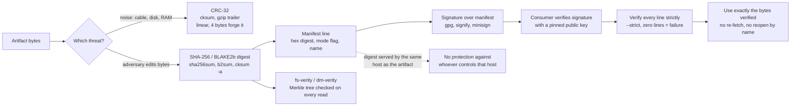

# Checksums and Integrity

> [!summary] Claim
> A checksum proves integrity only against the threat it was designed for and only relative to a reference value that arrived over a channel the attacker does not control, so the engineering is in choosing the function (CRC for noise, SHA-256 or BLAKE2b for adversaries, a signature for authenticity) and in verifying strictly, because every userland's `-c` mode can report success while checking nothing.

Part of [Coreutils and the Userland](README.md) in [Shell and Unix Engineering](../README.md).

## TL;DR

- **Mechanism**: `cksum` is the POSIX 32-bit CRC of the bytes followed by their length, which catches random bit errors but is linear and forgeable; `sha256sum`, `b2sum`, and `cksum -a` compute collision-resistant digests that bind exact bytes, and a signature over a manifest of those digests binds them to a publisher.
- **Rule**: get the reference digest from a second, authenticated channel (a signed `SHA256SUMS`, a pinned lockfile, a commit ID), verify with `--strict`, and fail when zero files were verified.
- **Trap**: without `--strict`, GNU `sha256sum -c` exits 0 while skipping lines it cannot parse, and macOS `sha256sum -c` exits 0 on a manifest with no valid lines at all, such as an HTML error page (the lab asserts both; measured with GNU coreutils 9.7 on Debian and on macOS 27.3).
- **Portability fact**: only `cksum` is in POSIX.1-2024, and its output is identical everywhere (`3015617425 6` for `hello` plus a newline); `sha256sum` output and `-c` parsing differ between GNU coreutils, BusyBox, macOS, FreeBSD, and uutils in escaping, CRLF, comments, and exit status.
- **When not to use it**: do not use a checksum where you need authenticity (use a signature or HMAC), continuous at-rest protection (use fs-verity, dm-verity, or filesystem checksums), or reproducibility of regenerated archives (pin the content, for example a commit ID, not the compressed bytes).

## Mental model



Read the diagram from the threat, not from the tool.
Random corruption is the left branch: a CRC is cheap, detects every burst of up to 32 flipped bits, and is what `cksum`, Ethernet, and the gzip trailer use, but anyone who can edit the bytes can also fix the CRC with four more bytes.
An adversary moves you to the middle branch: a cryptographic digest makes it infeasible to find a second input with the same value, but only shifts the problem to protecting the digest itself, so the digest goes into a manifest and the manifest gets a signature checked against a key the consumer already trusts.
The dotted arrow is the most common real failure: a digest fetched from the same place as the artifact protects against a flipped bit, not against whoever controls that place.
The verification step is its own failure point, because the `-c` modes skip, tolerate, or misparse lines differently in each userland, and the final arrow says the bytes you use must be the bytes you hashed.
The bottom branch is the kernel doing the same job continuously, hashing blocks on every read instead of once at download time.

## How it works

### Three different guarantees

Error detection asks whether random noise changed the data, and a short code such as a CRC answers it with a known miss rate.
Integrity against an adversary asks whether anyone could have produced different data with the same check value, which needs collision and second-preimage resistance, the properties of a cryptographic hash.
Authenticity asks who produced the data, which a bare hash never answers: it needs a secret (an HMAC key) or a private key (a signature).
The POSIX `cksum` page states the first boundary itself: the comparison "cannot be considered cryptographically secure" and the utility "should be avoided whenever non-trivial requirements (including safety and security) have to be fulfilled" (POSIX.1-2024 XCU cksum, APPLICATION USAGE).

### The POSIX cksum CRC

POSIX defines `cksum` as a CRC with generator polynomial `x^32 + x^26 + x^23 + x^22 + x^16 + x^12 + x^11 + x^10 + x^8 + x^7 + x^5 + x^4 + x^2 + x + 1`, the Ethernet frame check sequence polynomial from ISO/IEC 8802-3, which is `0x04c11db7` with the leading term implied (POSIX.1-2024 XCU cksum, DESCRIPTION).
The message is the file's bits, most significant bit of the first octet first, followed by the file length as a binary number in the fewest octets, least significant octet first; the polynomial is multiplied by `x^32`, divided by G, and the 32-bit remainder is complemented.
The output format is `"%u %d %s\n"` with the CRC, the octet count, and the pathname, and the pathname and its space are omitted when reading standard input.
The RATIONALE gives a table-driven C model from Sarwate's 1988 CACM article: for each byte, `s = (s << 8) ^ crctab[(s >> 24) ^ c]`, then the same step for each length octet, then `~s`.
The register starts at 0, so leading zero bytes leave it at 0; the RATIONALE says the length is folded in precisely because it "guards against inadvertent collisions between files that begin with different series of zero octets".
The lab proves both halves: without the length octets one zero byte and two zero bytes give the same value (4294967295), while `cksum` prints `4215202376 1` and `4135437457 2`.
POSIX.1-2024 `cksum` has no options at all, and its FUTURE DIRECTIONS encourage treating a pathname containing a newline as an error (Austin Group Defect 251).

A CRC is linear over GF(2): the register after a block is a linear function of the register before it and of the block's bits.
Two consequences follow.
Any error pattern whose polynomial is not a multiple of G is detected; a burst confined to 32 consecutive bits has an error polynomial `x^i * B(x)` with `deg B < 32`, and because G has degree 32 and a nonzero constant term it divides neither factor, so every such burst is caught.
The same linearity makes forgery trivial: after any prefix, the register is an affine function of the next four bytes, so solving a 32 by 32 linear system gives four bytes that drive it to any chosen value.
The lab's `crcforge.c` does exactly this with Gaussian elimination and turns `approve:eve 9999` into a file with the same `cksum` as `approve: alice 0100`.

### sum, the algorithms POSIX refused to choose

Before `cksum`, BSD and System V each shipped a `sum` with a different default algorithm, so the same command printed different numbers on different systems.
The BSD algorithm rotates a 16-bit accumulator right by one bit before adding each byte and reports 1 KiB blocks; the System V algorithm adds all bytes, folds the 32-bit sum into 16 bits, and reports 512-byte blocks (FreeBSD `cksum(1)`, algorithms 1 and 2; BusyBox `coreutils/sum.c`, `sum_file`).
POSIX picked neither: "no realistic compromise was available if either were selected", so it invented the name `cksum` (POSIX.1-2024 XCU cksum, RATIONALE).
SUSv2 listed `sum` as LEGACY with an unspecified `-r` alternative algorithm, and POSIX.1-2024 has no `sum` page (the URL returns 404).
Today GNU `sum` defaults to BSD and takes `-s` for System V, BusyBox does the same, and macOS and FreeBSD `sum` are `cksum -o 1`, with `cksum -o 2` for System V and `cksum -o 3` for the gzip-style CRC-32; the lab asserts that `sum` of `hello` plus a newline is 36979 in one block on every implementation it meets.
`gsum -s` and `cksum -o 2` both print 542 for that input, and `gcksum -a crc32b` and `cksum -o 3` both print 909783072, measured here.

### Cryptographic digests

A cryptographic hash should resist three attacks: finding any two inputs with one digest (collision), finding a second input matching a given input's digest (second preimage), and inverting a digest (preimage).
For an n-bit digest the generic birthday attack finds a collision in about `2^(n/2)` evaluations, so SHA-256 offers 128-bit collision resistance, which is also the figure RFC 7693 lists for BLAKE2b-256.
MD5 is broken for collisions: RFC 6151 records the first MD5 collision pairs in 2004, collisions "in about one minute on a standard notebook PC" in 2006, and "10 seconds or less" on a 2.6 GHz Pentium 4 in 2007, and concludes that MD5 "is no longer acceptable where collision resistance is required such as digital signatures".
SHA-1 fell in two steps: the 2017 SHAttered collision cost the equivalent of `2^63.1` SHA-1 compressions, about 6,500 CPU years and 100 GPU years (Stevens et al., IACR ePrint 2017/190), and the 2020 chosen-prefix collision cost `2^63.4` and ran for two months on 900 rented GTX 1060 GPUs, which its authors used to forge PGP key certifications (CVE-2019-14855).
A chosen-prefix collision is the dangerous kind: the attacker picks two different meaningful prefixes and then appends blocks that make the digests equal, which is how certificate and signature forgeries work.
NIST announced on 2022-12-15 that SHA-1 should be phased out by 2030-12-31 and that FIPS 180-5 will remove it.
Git, which names objects by SHA-1, has used a hardened SHA-1 by default since Git 2.13.0 that detects SHAttered-style inputs, and picked SHA-256 as its successor hash in late 2018 (Git `hash-function-transition`); the `sha1collisiondetection` library behind that detects collision attacks using the top 32 disturbance vectors with a false-positive probability below `2^-90`.
A Git blob ID is itself a digest you can recompute: `git hash-object hello` and `printf 'blob 6\0hello\n' | shasum -a 1` both print `ce013625030ba8dba906f756967f9e9ca394464a`, measured here.
GNU documents SHA-2, SHA-3, and BLAKE2b as the `cksum -a` algorithms "currently considered secure against malicious tampering" (coreutils manual, cksum general options).

### One source file behind every GNU checksum tool

In coreutils (master as of 2026-11) one file, `src/cksum.c`, written originally by Ulrich Drepper as `md5sum`, builds `md5sum`, `sha1sum`, `sha224sum`, `sha256sum`, `sha384sum`, `sha512sum`, `b2sum`, `sum`, and `cksum`, selected by `HASH_ALGO_*` macros that set `PROGRAM_NAME`, `DIGEST_BITS`, and `DIGEST_STREAM`.
Since coreutils 9.0 (2021-09-24), `cksum -a` selects any of them and "coreutils will introduce no future standalone checksum utility"; `sm3` arrived in 9.0, `--base64` and `--raw` in 9.2, `crc32b` in 9.6, and `sha2` and `sha3` with `-l` lengths in 9.8 (coreutils NEWS).
For each operand, `digest_file()` calls `fopen()` (so `open(2)`), then `fadvise(fp, FADVISE_SEQUENTIAL)` (gnulib's wrapper for `posix_fadvise(2)`), then the algorithm's `*_stream()` function, which reads through stdio (`read(2)`) to end of file; `output_file()` then prints the line with `printf` and stdio writes it.
The CRC path uses a slice-by-8 table since 9.0 (up to 4 times faster) and `pclmul`, AVX2, AVX512, and ARMv8 instructions where available (9.6 claims time reductions of up to 40%, 60%, and 80%), and since 9.8 the `GLIBC_TUNABLES` variable can disable those, for example `glibc.cpu.hwcaps=-AVX512F` (coreutils NEWS).
Since 8.22 the digests can use OpenSSL's libcrypto, and 9.12 (2026-09-14) removed the `--with-linux-crypto` build option that used the kernel's `AF_ALG` sockets, noting the API "will be deprecated in Linux 7.2 and is less performant than OpenSSL" (coreutils NEWS).

The default untagged line is the hex digest, a space, a mode flag (`*` for binary, a space for text), and the name; `--tag` (since 8.20) prints the BSD form `SHA256 (name) = hex`, which `cksum -a` uses by default.
On POSIX systems the mode flag is decoration: `-b` "merely flags each input mode as binary: the checksum is unaffected" (coreutils manual).
If a name contains a backslash, newline, or carriage return, `output_file()` prints a backslash before the whole line and escapes those characters (`problematic_chars()`), so `sha256sum 'a\b'` prints `\2d71...  a\\b`; the lab asserts this for GNU and asserts that BusyBox and macOS print the raw name, and all three were measured that way (GNU coreutils 9.7 on Debian, BusyBox 1.37.0 on Alpine, macOS 27.3).
When standard output is a terminal, the current master quotes names with the `shell-escape` style and honors `QUOTING_STYLE` (NEWS for the next release; `shell_escape_quoting_style` is the default in `src/cksum.c`), which protects a terminal from escape sequences in hostile names.

### The check-file grammar and how GNU decides the exit status

`digest_check()` reads the manifest with `getline()`, skips lines starting with `#` and empty lines, strips a trailing newline and then a trailing carriage return (CRLF support since 9.0), and hands the rest to `split_3()`.
`split_3()` accepts a leading backslash as the escaped-name marker, tries the BSD tagged form `ALGO (name) = digest` and the OpenSSL form `ALGO(name)= digest` through `bsd_split_3()`, and otherwise parses the untagged form.
The untagged parser also accepts the BSD "reversed" form, a digest and a single space, but refuses to mix it with GNU lines in one file "to minimize security issues with attackers renaming files with leading spaces" (source comment in `split_3()`); since the next release this is decided per checksum file (NEWS).
Hex comparison ignores case, and `cksum --check` also accepts base64 digests, which must match the `=` padding exactly (coreutils manual).
A line that fails to parse increments `n_misformatted_lines` and, with `--warn`, prints `improperly formatted ... checksum line`; it never fails the run unless `--strict` (since 8.13) is given.
The return value is `properly_formatted_lines && matched_checksums && n_mismatched_checksums == 0 && n_open_or_read_failures == 0 && (!strict || n_misformatted_lines == 0)`, so a file with zero parsable lines fails ("no properly formatted checksum lines found"), and with `--ignore-missing` (since 8.25) a run where every listed file is missing fails with "no file was verified".
`--quiet` drops the `OK` lines, `--status` drops all output, and `-z` NUL-terminates generated lines but is not accepted by `--check` (coreutils manual).
Each listed file is opened by name and read to end of file, so a line naming `/dev/zero` or a FIFO keeps `sha256sum -c` reading until something kills it, which happened here after the 5-second alarm.

### macOS and FreeBSD: one md5(1) binary in three modes

macOS ships FreeBSD's `md5(1)` program in `/sbin` under the names `md5`, `sha1`, `sha256`, `sha512`, `md5sum`, `sha1sum`, `sha256sum`, and `sha512sum` (on macOS 27.3, hard links to two 218,208-byte builds of it), and `sha256sum --version` prints `sha256sum (Darwin) 1.0` (measured here).
Invoked as `md5` or `sha256` it is in BSD mode: output `MD5 (name) = hex`, `-r` reverses it, `-q` prints only the digest, `-s string` hashes a string, and `-c string` compares one digest given on the command line, exiting 2 on a mismatch and 1 when a file cannot be read (Apple `md5(1)`, EXIT STATUS).
Invoked with a name ending in `sum` it is in GNU mode with `-c`, `--strict`, `--status`, `--ignore-missing`, `--tag`, and `-z`; invoked as `shasum` it imitates the Perl script, but macOS actually installs the Perl `shasum` (Digest::SHA 6.02) at `/usr/bin/shasum`, measured here.
GNU mode parses a manifest in `gnu_check()`, which accepts a BSD tagged line or a line of exactly the expected number of hex digits followed by a space, counts everything else in `malformed`, and does not skip `#` comments.
At exit, `main()` returns 1 only if `checksFailed != 0 || (strict && malformed > 0)`, or if a file could not be read; there is no "no properly formatted lines" check, so an empty manifest, an HTML page, or a manifest of MD5 digests checked with `sha256sum -c` exits 0 (Apple `text_cmds` `md5/md5.c`; the lab asserts the HTML case).
It strips only the trailing newline, so a CRLF manifest leaves a carriage return in each name and the open fails.
FreeBSD main changed on 2026-04-29 to encode non-printable names with `strnvis(3)` in `VIS_CSTYLE | VIS_OCTAL` style on output and to decode them on `-c`, a commit that says it "breaks compatibility with GNU coreutils" (FreeBSD commit "md5: Encode non-printable filenames"); Apple's copy does not have it.

### BusyBox: strict by accident

BusyBox's `md5sum`, `sha1sum`, `sha256sum`, `sha512sum`, and `sha3sum` applets are one function, `md5_sha1_sum_main()` in `coreutils/md5_sha1_sum.c`, which picks the algorithm from the fourth letter of the applet name and accepts only the short options `-c`, `-s` (status only), `-w`, and the ignored `-b` and `-t` (getopt string `scwbt`, plus `a:` for the width option of `sha3sum`); there is no `--strict`, `--quiet`, `--ignore-missing`, `--tag`, or `-z`.
It reads each manifest line with `xmalloc_fgetline()`, which removes only a trailing `\n` (`libbb/get_line_from_file.c`), splits at the first space, skips one more space or `*`, and compares with `strcasecmp()`.
Any line without a space counts as a failed check, and a line with a space treats everything after it as a file name whose open then fails, so BusyBox fails on garbage that GNU and macOS tolerate, and it also fails on `#` comments, CRLF line ends, BSD tagged lines, and GNU escaped names; an empty manifest fails with "no checksum lines found" (all measured with BusyBox 1.37.0 on Alpine).
Generation prints `printf("%s  %s\n", hash, name)` with no escaping, and the data is read with `safe_read()` into a buffer of at least 4096 bytes (`BUFSZ`, from `CONFIG_FEATURE_COPYBUF_KB`).
BusyBox `cksum` follows POSIX, and the separate `crc32` applet prints the gzip-style CRC-32 in hex (`coreutils/cksum.c`), but only in builds with `CONFIG_CRC32`; Alpine's BusyBox 1.37.0 has no `crc32` applet (measured).

### uutils

The Rust uutils `cksum` (documentation for v0.13.0) offers the GNU options and the same algorithm list (`sysv`, `bsd`, `crc`, `crc32b`, `md5`, `sha1`, `sha2`, `sha3`, `blake2b`, `sm3`; the list is the `cksum-after-help` text in `src/uu/cksum/locales/en-US.ftl` on the main branch, as of 2026-11, because the rendered docs page shows that help as an untranslated placeholder), and its main-branch source also parses lengths for `blake3`, `shake128`, and `shake256` and has a `--debug` that reports `pclmul`, AVX2, AVX512, or ARM `vmull` support (`src/uu/cksum/src/cksum.rs`).
Its `-c` edge cases were not measured here.

### The kernel's version: verify on every read

fs-verity (ext4, f2fs, and btrfs) builds a Merkle tree for a file when user space calls the `FS_IOC_ENABLE_VERITY` ioctl, makes the file read-only, and then verifies every read against the tree; a corrupted block makes `read()` fail with `EIO` and an `mmap` access raise `SIGBUS`, and `FS_IOC_MEASURE_VERITY` returns the file digest in constant time regardless of file size (kernel `fsverity.rst`).
dm-verity does the same for a read-only block device during verified boot: hashes are "verified on-demand" against a root hash the caller must have authenticated, and `ignore_corruption`, `restart_on_corruption`, and `panic_on_corruption` choose what a mismatch does (kernel `verity.rst`).
Both move the check from "once, when downloaded" to "every time, when read", which is the only form that catches corruption after verification.

## Numbers and limits

| Quantity | Value | Source |
| --- | --- | --- |
| `cksum` of `hello` plus newline | `3015617425 6` on GNU 9.12, macOS 27.3, and the POSIX model | measured here; the lab asserts it |
| `cksum` of empty input | `4294967295 0` | measured here; the lab asserts it |
| CRC-32 miss rate for random corruption | `2^-32` per comparison | follows from a 32-bit check value |
| Files until a 50% chance two share a CRC-32 | about 77,000 (`sqrt(2 * 2^32 * ln 2)`) | birthday-bound arithmetic |
| Burst errors always detected by the cksum CRC | every burst of length 32 bits or less | follows from G having degree 32 and a constant term |
| Bytes needed to forge any target `cksum` | 4 | the lab (`crcforge.c`) |
| MD5 collision cost (2007) | 10 seconds or less on a 2.6 GHz Pentium 4 | RFC 6151 citing Stevens 2007 |
| SHA-1 identical-prefix collision (2017) | `2^63.1` compressions, about 6,500 CPU years and 100 GPU years | IACR ePrint 2017/190 |
| SHA-1 chosen-prefix collision (2020) | `2^63.4`, two months on 900 GTX 1060 GPUs | SHA-1 is a Shambles |
| SHA-1 phase-out deadline | 2030-12-31 | NIST, 2022-12-15 |
| Digest sizes | MD5 128, SHA-1 160, SHA-256 256, SHA-512 512, BLAKE2b up to 512 bits | coreutils `src/cksum.c` `DIGEST_BITS`; RFC 7693 |
| BLAKE2b-256 collision security | `2^128` | RFC 7693 section 4 |
| GitHub source archive stability promise | at least one year from 2023-02-21 | GitHub blog |
| Codecov uploader tampering | 108 windows between 2021-01-31 and 2021-04-01 | Codecov security update |
| Throughput over a cached 1 GiB random file, Apple M3 Pro, best of 2 (as of 2026-11) | `gsha256sum` 0.48 s, `gsha1sum` 0.48 s, `gcksum` (CRC) 0.57 s, `gcksum -a crc32b` 0.59 s, `gsha512sum` 0.75 s, `gcksum -a sha3 -l 256` 1.16 s, `gcksum -a blake2b` 1.16 s, `gmd5sum` 1.48 s, macOS `/sbin/md5` 1.74 s, `/usr/bin/cksum` 2.69 s | measured here with coreutils 9.12, re-run 2026-11-15 |

The throughput row matters more than it looks: on this ARMv8 machine SHA-256 is three times faster than MD5, because the CPU has SHA-256 instructions and MD5 has none, so "MD5 for speed" is wrong on current hardware; measure on your own fleet before choosing.

## Portability

| Implementation | Tools | `-c` with zero valid lines | Malformed line beside a valid one | CRLF manifest | `#` comment line | Backslash in a name, generated | Strictness options |
| --- | --- | --- | --- | --- | --- | --- | --- |
| POSIX.1-2024 | `cksum` only, no options | not specified | not specified | not specified | not specified | not specified (newline in a name encouraged to be an error) | none |
| GNU coreutils 9.12 | `cksum -a`, `md5sum`, `sha*sum`, `b2sum`, `sum` | exit 1 (lab; measured on 9.7 too) | exit 0, exit 1 with `--strict` (lab; measured on 9.7 too) | accepted (lab; measured on 9.7 too) | skipped (measured, 9.12 and 9.7) | `\` prefix and `\\` (lab; measured on 9.7 too) | `--strict`, `--warn`, `--quiet`, `--status`, `--ignore-missing` |
| macOS 27.3 `md5(1)` in GNU mode | `md5sum`, `sha1sum`, `sha256sum`, `sha512sum` and BSD `md5`, `sha256` | exit 0 (lab) | exit 0, exit 1 with `--strict` (lab) | open fails, exit 1 (lab) | counted malformed, exit 0 (measured) | raw name (lab) | same long options; `--ignore-missing` with every file missing exits 0 (measured) |
| FreeBSD main `md5(1)` | as macOS plus `sha512t256`, `rmd160`, `skein*` | same `main()` exit logic as macOS (source) | same (source) | same (source) | same (source) | `strnvis(3)` C-style octal escapes since 2026-04-29 (source) | same as macOS |
| BusyBox (master source; 1.37.0 measured on Alpine) | `md5sum`, `sha1sum`, `sha256sum`, `sha512sum`, `sha3sum`, `cksum`, `sum`, and `crc32` when built with `CONFIG_CRC32` (absent on Alpine) | exit 1 (lab; measured) | exit 1, and `--strict` is an unknown option (lab; measured) | open fails, exit 1 (lab; measured) | counted failed (source; measured) | raw name (lab; measured) | `-c`, `-s`, `-w` only (source; its `--help`) |
| uutils 0.13 | `cksum -a` with the GNU algorithm list | not measured | not measured | not measured | not measured | not measured | GNU option names (documentation) |
| Perl `shasum` (Digest::SHA 6.02, macOS) | `shasum -a 1, 224, 256, 384, 512` | exit 1 (measured) | not measured | not measured | not measured | `\` prefix like GNU (measured) | `--strict`, `--status`, `--warn`, `--quiet`, `--ignore-missing` (its `--help`) |

`cksum` output and `sum` checksums agree across GNU, macOS, and BusyBox, and the lab asserts both; `sum` output spacing differs (`36979     1` from GNU, `36979 1` from macOS), so compare fields, not lines.

The verifier in the lab is plain POSIX sh: `read -r` with `IFS=` (POSIX.1-2024 XCU read), `${var%% *}` and `${#var}` (XCU 2.6.2), `$(( ))` (XCU 2.6.4), and `case`, so it should behave identically in every shell; the lab's verifier tests have no per-shell branches, but the lab was run only under macOS `/bin/sh`, and no other shell was run (as of 2026-11).

| Shell | `verify-manifest.sh` behavior | Evidence |
| --- | --- | --- |
| POSIX sh, macOS `/bin/sh` (bash 3.2.57 in POSIX mode) | all eight verifier tests pass | the lab, run here |
| bash 3.2 to 5.3, zsh native and `zsh --emulate sh`, dash, ksh93u+m, mksh, yash, posh, BusyBox ash | expected identical: the tests assert one output and have no per-shell branches | not run; this is a prediction from the POSIX constructs used (as of 2026-11) |

Native zsh does not field-split unquoted expansions, which is why the script quotes every expansion and never relies on splitting; posh 0.14.1 inherits `IFS` from the environment (measured in the shell matrix), which is why the loop sets `IFS=` for each `read`.

## Worked example

The [lab](../labs/08-checksums-and-integrity/) has three parts: `crcforge.c` computes and forges the POSIX CRC, `verify-manifest.sh` is a strict portable verifier, and `checksums.bats` asserts how each userland's `-c` behaves.

The forgery test, verbatim from `checksums.bats`:

```bash
@test "four rewritten bytes give a different file the same cksum but a different SHA-256" {
  build_forge
  printf 'approve: alice 0100\n' >target
  printf 'approve:eve 9999ZZZZ' >source
  ./crcforge target source >forged
  run cmp -s target forged
  [ "$status" -eq 1 ]
  run_lab_c 'dd if=forged bs=16 count=1 2>/dev/null; echo'
  [ "$output" = "approve:eve 9999" ]
  run_lab_c 'cksum <target; cksum <forged'
  [ "$status" -eq 0 ]
  [ "${lines[0]}" = "${lines[1]}" ]
  [ "${lines[0]}" = "3194571458 20" ]
  run_lab_c 'sha256sum <target; sha256sum <forged'
  [ "$status" -eq 0 ]
  [ "${lines[0]}" != "${lines[1]}" ]
}
```

The same steps by hand, captured here:

```text
$ ./crcforge target source >forged && cksum target forged
3194571458 20 target
3194571458 20 forged
$ od -c forged
0000000    a   p   p   r   o   v   e   :   e   v   e       9   9   9   9
0000020  027   ^  \n   _
0000024
$ shasum -a 256 target forged
f623dbcca2e5c4fe42c115cf06c57aa1ed5866cb787e7ac676ab49cfe3cdff2a  target
d8de916fb8be9df67775f42e16c7b5ba62a680303570b0aed43a89ec217778f1  forged
```

The four bytes `\027 ^ \n _` replaced `ZZZZ`; the CRC and the length agree, and SHA-256 tells the files apart at once.

The verifier, verbatim from `verify-manifest.sh`:

```sh
#!/bin/sh
# verify-manifest.sh MANIFEST: verify a sha256sum-format manifest strictly, in any POSIX shell.
#
# Every line must be 64 lowercase hex digits, a space, a mode flag (a space or '*'), and a
# relative file name, resolved from the current directory as `sha256sum -c` resolves it.
# Unlike `sha256sum -c`, it never skips a line it cannot parse: a malformed line, an unsafe
# name (absolute, or with a `..` component), a missing file, or a mismatch makes it exit 1,
# and so does a manifest with no lines at all. It exits 2 on a usage or tool error.
# Each file is hashed through standard input, so the tool never escapes its name.
# SHA256SUM names the hashing command (default sha256sum); it must print the hex digest first.

set -u
LC_ALL=C
export LC_ALL

die() {
  printf 'verify-manifest: %s\n' "$*" >&2
  exit 2
}

[ "$#" -eq 1 ] || die "usage: verify-manifest.sh MANIFEST"
manifest=$1
[ -f "$manifest" ] || die "$manifest: not a regular file"
tool=${SHA256SUM:-sha256sum}
command -v "$tool" >/dev/null 2>&1 || die "$tool: not found (set SHA256SUM)"

complain() {
  printf 'verify-manifest: %s:%s: %s\n' "$manifest" "$lineno" "$1" >&2
  bad=1
}

lineno=0
bad=0
while IFS= read -r line || [ -n "$line" ]; do
  lineno=$((lineno + 1))
  want=${line%% *}
  rest=${line#* }
  case $want in
    *[!0-9a-f]*) want= ;;
    *) ;;
  esac
  if [ "${#want}" -ne 64 ] || [ "$rest" = "$line" ]; then
    complain "malformed checksum line"
    continue
  fi
  case $rest in
    " "?* | "*"?*) name=${rest#?} ;;
    *)
      complain "malformed checksum line"
      continue
      ;;
  esac
  case /$name/ in
    //* | */../*)
      complain "unsafe file name"
      continue
      ;;
    *) ;;
  esac
  if [ ! -f "$name" ] || [ ! -r "$name" ]; then
    printf '%s: FAILED open or read\n' "$name"
    bad=1
    continue
  fi
  if ! got=$("$tool" <"$name" 2>/dev/null); then
    printf '%s: FAILED open or read\n' "$name"
    bad=1
    continue
  fi
  got=${got%% *}
  [ "${#got}" -eq 64 ] || die "$tool printed an unexpected digest for $name"
  if [ "$got" = "$want" ]; then
    printf '%s: OK\n' "$name"
  else
    printf '%s: FAILED\n' "$name"
    bad=1
  fi
done <"$manifest"

if [ "$lineno" -eq 0 ]; then
  printf 'verify-manifest: %s: no checksum lines\n' "$manifest" >&2
  exit 1
fi
[ "$bad" -eq 0 ] || exit 1
exit 0
```

Four design decisions carry the robustness.
Hashing through `<"$name"` makes every `sha256sum` print `hex  -`, so the GNU backslash escape can never leak into the digest field.
`[ -f "$name" ]` refuses devices and FIFOs, so a hostile manifest naming `/dev/zero` cannot hang it, and the `case /$name/` test refuses absolute names and `..` components.
`|| [ -n "$line" ]` processes a last line with no newline, which `read` reports as end of file.
The exit status is computed from counters in the current shell, because the loop's input is a redirection rather than a pipeline, so `bad` survives the loop.

What the lab asserts the verifier prints (all from `checksums.bats`):

```text
$ verify-manifest.sh m.sum            # good manifest, one name with a space
hello: OK
my file: OK                           # exit 0
$ verify-manifest.sh m.sum            # second line is "this line is not a checksum"
hello: OK
verify-manifest: m.sum:2: malformed checksum line      # exit 1
$ verify-manifest.sh empty.sum
verify-manifest: empty.sum: no checksum lines          # exit 1
$ verify-manifest.sh m.sum            # lines name ../outside and an absolute path
verify-manifest: m.sum:1: unsafe file name
verify-manifest: m.sum:2: unsafe file name             # exit 1
```

The lab run on the macOS host printed:

```text
1..18
ok 1 cksum prints the POSIX CRC and the octet count, and omits the name for stdin
ok 2 crcforge -p reproduces the system cksum for several inputs
ok 3 without the length octets, one and two zero bytes have the same CRC; cksum differs
ok 4 four rewritten bytes give a different file the same cksum but a different SHA-256
ok 5 sha256sum reproduces the FIPS 180-4 abc example
ok 6 sum defaults to the BSD rotate-and-add algorithm in 1 KiB blocks everywhere
ok 7 sha256sum -c passes a malformed line next to a good one unless --strict
ok 8 sha256sum -c on a file with no checksum lines (an HTML error page)
ok 9 sha256sum -c on a manifest with CRLF line endings
ok 10 sha256sum escapes a backslash in a file name only in GNU coreutils
ok 11 verify-manifest accepts a good manifest, including a name with spaces
ok 12 verify-manifest reads a last line that has no trailing newline
ok 13 verify-manifest reports a tampered file and exits 1
ok 14 verify-manifest fails on a malformed line that sha256sum -c would skip
ok 15 verify-manifest fails on an empty manifest and on a GNU-escaped line
ok 16 verify-manifest fails on a listed file that is missing
ok 17 verify-manifest refuses absolute and dot-dot names even when the digest matches
ok 18 verify-manifest exits 2 when the hashing tool is missing
```

## Pitfalls

> [!warning] The reference digest came from the same place as the artifact
> Trigger: a download page lists an MD5 or SHA-256 next to the file, both served by one web host.
> Symptom: an attacker who controls the host replaces both, and verification passes; on 2016-02-20 attackers "managed to hack our website" to point Linux Mint 17.3 Cinnamon downloads at a backdoored ISO, and the project's advice was to compare `md5sum` output against MD5 values in its blog post (Linux Mint blog, 2016-02-21).
> Fix: take the digest from a second authenticated channel, ideally a signed manifest such as Ubuntu's `SHA256SUMS` plus `SHA256SUMS.gpg` checked with `gpg --keyid-format long --verify SHA256SUMS.gpg SHA256SUMS`, or OpenBSD's `signify -C`, which verifies a signed checksum list and then each file.

> [!warning] Trusting the exit status of -c without --strict
> Trigger: `sha256sum -c SHA256SUMS && install` on a manifest that is truncated, hand-edited, or partly in another format.
> Symptom: GNU and macOS print a warning about an improperly formatted line, skip it, and exit 0 as long as one other line matched, so the file on the skipped line was never checked (the lab asserts exit 0, then exit 1 with `--strict`).
> Fix: always pass `--strict`, and where BusyBox may run (no `--strict`), or where the manifest format is not yours, use a verifier that fails on every unparsable line, such as the lab's.

> [!warning] macOS -c reports success after checking nothing
> Trigger: on macOS, `curl -o SHA256SUMS` without `--fail` saves a 404 page, or the manifest holds MD5 lines, and the script runs `sha256sum -c SHA256SUMS`.
> Symptom: exit 0 with only `WARNING: 2 lines are improperly formatted` on stderr, because `main()` in `md5.c` never fails for zero parsed lines; `--status` hides even the warning; `--ignore-missing` with every listed file missing also exits 0 (measured here, macOS 27.3; GNU exits 1 in all of these).
> Fix: use `--strict`, which turns the malformed lines into exit 1, use `curl --fail` (here curl exited 0 on a 404 without it and 22 with it), and count the `OK` lines yourself or use a verifier that requires at least one.

> [!warning] Parsing generated lines with cut
> Trigger: `sum=$(sha256sum "$f" | cut -d' ' -f1)` for a name containing a backslash or newline.
> Symptom: GNU and Perl `shasum` prefix the line with `\`, so the digest field becomes `\2d71...` and never matches; a newline in the name splits the record in BSD and BusyBox output, which do not escape it (the lab asserts the backslash case per implementation).
> Fix: hash standard input, `sha256sum <"$f"`, and take the field before the first space; see [[Hostile-Filenames]].

> [!warning] Checksums of regenerated archives
> Trigger: a build pins the SHA-256 of a GitHub "Source code (tar.gz)" download.
> Symptom: on 2023-01-30 GitHub deployed Git 2.38, which switched `git archive` from external `gzip` to an internal implementation; the files inside were identical but every archive checksum changed, breaking builds until GitHub reverted (GitHub changelog 2023-01-30 and blog 2023-02-21).
> Fix: pin what is actually stable: a commit ID with the source-archive API for content, or an uploaded release asset whose bytes never change, as GitHub's post recommends; a checksum covers the compressed byte stream, so any change in compressor settings changes it (see [[Compression-gzip-zstd-xz]]).

> [!warning] The signed tarball is not the reviewed source
> Trigger: verifying a release tarball's signature and digest and assuming it matches the repository.
> Symptom: CVE-2024-3094: "Malicious code was discovered in the upstream tarballs of xz, starting with version 5.6.0", where the build extracts an object file from a disguised test file; the digests and signatures were those of the malicious tarball (NVD).
> Fix: a checksum proves you got the bytes the publisher published, not that they are benign; compare tarballs against the tagged tree or build from the tree, and see [[xz-Utils-Backdoor]].

> [!warning] Verifying once, then using different bytes
> Trigger: `curl -fsSLo x.sh URL && sha256sum -c x.sha256 && curl -fsSL URL | sh`, or verifying a path that another process can replace before it is used.
> Symptom: the second fetch or the later open sees different bytes from the ones verified; `curl | sh` cannot be verified at all.
> Fix: download once to a private file made by [[mktemp]], verify that file, and execute or install that same file, ideally with an atomic rename into place ([[install-and-Atomic-Deployment]], [[Path-Resolution-and-Symlink-Races]]); Codecov's 2021 uploader compromise was detected exactly this way in reverse, when a customer compared "the shasum on Github and the shasum calculated from the downloaded Bash Uploader" (Codecov security update).

> [!warning] Hashing a string with echo
> Trigger: `echo hello | sha256sum` to check a published digest of `hello`.
> Symptom: the digest covers `hello` plus a newline, so it never matches; `echo -n` is not portable ([[printf-versus-echo]]).
> Fix: `printf %s hello | sha256sum`, or `md5 -s hello` on BSD; Apple's own `md5(1)` example notes "the absence of the newline character in the input string".

## Security and robustness

Treat a manifest as untrusted input until its signature verifies: GNU `sha256sum -c` opens every name it lists, absolute paths and devices included, so an unsigned manifest can make a verifier read files it should not or hang on `/dev/zero`, as measured here.
Sign the manifest, not each file, and pin the public key out of band (in the image, the package, or the repository), because a key fetched from the same server repeats the same-origin mistake.
signify and minisign keep this small: Ed25519 keys, one signature file, and `signify -C` checks the signature and then every listed digest in one step (OpenBSD `signify(1)`).
When both ends share a secret and need authenticity rather than public verifiability, use an HMAC, for example `openssl dgst -sha256 -hmac KEY file`, not a bare hash with the key concatenated; a shell `[ "$a" = "$b" ]` comparison is not constant-time, which does not matter for public digests but does for secret MACs checked by a network service.
Never use `cksum`, `sum`, CRC-32, or MD5 as tamper evidence: the lab forges `cksum` with four bytes, and MD5 collisions take seconds (RFC 6151).
SHA-1 is acceptable only where no attacker can choose inputs; for new designs use SHA-256 or BLAKE2b, and for long-lived artifacts SHA-512 or SHA-256 both leave a wide margin.
File names in manifests and diagnostics can carry terminal escape sequences, so prefer tools that quote on a terminal (GNU master quotes with `shell-escape`) and see [[Terminal-Escape-Injection]].
Download-time verification says nothing about bit rot afterwards; fs-verity, dm-verity, or a checksumming filesystem with periodic scrubs cover data at rest, and `EIO` on a verity file is a feature, not a bug to retry.
Exit codes need care in pipelines: `sha256sum -c m | grep -v OK` reports `grep`'s status, not the verifier's, unless the shell has `pipefail` ([[pipefail-and-PIPESTATUS]]).

## The principal's view

The decision is not which hash, it is where the trust anchor lives and what fails closed.
For artifacts you ship, publish one signed manifest per release, generated in the build and verified by every consumer with a pinned key, and make verification strict and mandatory in your installer rather than documented as optional.
For artifacts you consume, pin content by digest in the lockfile, image reference, or commit ID, and treat a digest change as a supply-chain event to investigate, not a flake to re-run ([[Supply-Chain-Pinning-and-Verification]]).
For data in flight, TLS and the CRCs built into frames and formats already handle noise; adding `md5sum` beside `rsync` or `scp` buys little unless the data crosses an untrusted hop or untrusted storage.
For data at rest, a one-time checksum is a snapshot; pick fs-verity or dm-verity for immutable content and filesystem checksums with scrubbing for mutable content.
The trade-off is operational: signatures need key custody, rotation, and revocation, and a strict verifier turns every malformed manifest into an outage, which is the right failure mode for software supply but the wrong one for, say, an optional cache warm-up.
Shell is fine for invoking `sha256sum --strict -c` or `signify -C`; once you are parsing several manifest formats, handling key rotation, or consulting a transparency log, stop writing shell and use the ecosystem's verifier (the package manager, `gpgv`, `signify`, `minisign`, or a small program with a real crypto library) ([[When-to-Stop-Writing-Shell]]).
Measure before choosing on speed: on the M3 Pro here SHA-256 ran at about 2.1 GiB/s and MD5 at about 0.7 GiB/s, so the fast choice and the safe choice are the same one.

## Interview questions

> [!question] L5: What does `cksum` compute, and why does POSIX say not to rely on it for security?
>
> > [!success]- Answer
> > It computes a 32-bit CRC with the Ethernet polynomial over the file's bytes followed by its length in the fewest octets, then complements the result, and prints it with the octet count.
> > A CRC is linear over GF(2), so anyone who can change the data can recompute or force the check value; four chosen bytes make any file match any target CRC.
> > It reliably detects random errors, including every burst of up to 32 bits, but POSIX's APPLICATION USAGE says it "cannot be considered cryptographically secure".
> >
> > Follow-up: Why does the CRC include the file length?

> [!question] L5: Predict the output on GNU/Linux, where `hello` holds `hello` and a newline.
>
> ```sh
> printf '%s  hello\nnot a checksum\n' "$(sha256sum <hello | cut -d' ' -f1)" >m
> sha256sum -c m; echo "exit=$?"
> ```
>
> > [!success]- Answer
> > It prints `hello: OK`, then `sha256sum: WARNING: 1 line is improperly formatted` on stderr, then `exit=0`.
> > GNU counts the second line as misformatted and only fails on it under `--strict`.
> > `sha256sum -c --strict m` prints the same lines and exits 1.
> >
> > Follow-up: What does BusyBox `sha256sum -c m` exit with, and why?

> [!question] L5: Why does `echo hello | sha256sum` not match the published SHA-256 of the string `hello`?
>
> > [!success]- Answer
> > `echo` appends a newline, so the digest covers six bytes, not five.
> > Use `printf %s hello | sha256sum`, or `md5 -s hello` on BSD for MD5.
> > `echo -n` is not portable: POSIX.1-2024 makes the result implementation-defined when the first operand is `-n` (XCU echo, OPERANDS).
> >
> > Follow-up: How would you hash a string that contains a NUL byte?

> [!question] L6: Debug this installer, which "verified" a tampered binary on a developer's Mac.
>
> ```sh
> curl -so tool.tgz "$MIRROR/tool.tgz"
> curl -so SHA256SUMS "$MIRROR/SHA256SUMS"
> sha256sum -c --ignore-missing SHA256SUMS && tar -xzf tool.tgz
> ```
>
> > [!success]- Answer
> > The digests come from the same mirror as the tarball, so whoever controls the mirror controls both; the manifest needs a signature checked with a pinned key.
> > Without `-f`, curl saves an error page and exits 0; on macOS `sha256sum -c` exits 0 on a file with no valid lines, and `--ignore-missing` also exits 0 when no listed file exists.
> > There is no `--strict`, so even GNU skips malformed lines.
> > The fix is `curl -fsSo`, `gpg --verify` (or `signify -C`) on the manifest, `sha256sum --strict -c` without `--ignore-missing`, or a verifier that requires the named file's line, then extracting the same file that was verified.
> >
> > Follow-up: How would you make this installer work with BusyBox, which has no `--strict`?

> [!question] L6: How do you forge a file with the same `cksum` as a target, and how many bytes must you control?
>
> > [!success]- Answer
> > Make the forged file the same length, so the appended length octets match.
> > Process the forged prefix to get a register value, then solve for four bytes that drive the register to the target's value; by linearity the effect of the four bytes is a 32 by 32 linear map over GF(2), invertible for a degree-32 generator, so Gaussian elimination finds them.
> > Four bytes suffice for any 32-bit CRC; the lab's `crcforge.c` does it.
> >
> > Follow-up: Why does the same trick not work against SHA-256?

> [!question] L6: Why does GNU `sha256sum` sometimes print a line that starts with a backslash, and how should a script extract the digest?
>
> > [!success]- Answer
> > When a name contains a backslash, newline, or carriage return, GNU escapes those characters and marks the line with a leading backslash so `-c` can parse it back.
> > `cut -d' ' -f1` then yields `\hex`, which never matches.
> > Hash standard input instead, `sha256sum <"$f"`, so the name is `-`, and take the text before the first space.
> >
> > Follow-up: What do BusyBox and macOS print for a name containing a newline, and why is that worse?

> [!question] L6: What changed when GitHub archive checksums broke many builds in January 2023, and what should a build pin instead?
>
> > [!success]- Answer
> > GitHub deployed Git 2.38, which uses an internal gzip for `git archive`; the files inside were identical but the compressed bytes, and so every checksum of them, changed.
> > A digest covers a byte stream, and generated archives are not guaranteed byte-stable.
> > Pin a commit ID for content, or an uploaded release asset whose bytes are fixed, and verify that.
> >
> > Follow-up: How do reproducible builds change what you can pin?

> [!question] L7+: Design integrity for software artifacts distributed to a fleet of 50,000 hosts, from build to runtime.
>
> > [!success]- Answer
> > The build emits artifacts and a manifest of SHA-256 digests, signed with a key held in an HSM or signing service, never on build agents.
> > Hosts carry the public key in their base image and verify the signature and then every digest strictly before install, fetching over TLS but not trusting TLS for integrity.
> > Install from the verified file with an atomic rename, record the digest deployed, and alert on any digest the manifest does not list.
> > Protect immutable content at rest with dm-verity or fs-verity so tampering surfaces as `EIO` instead of silent execution.
> > Plan key rotation (two trusted keys during overlap) and revocation, and consider a transparency log so a stolen key's signatures are visible.
> >
> > Follow-up: What breaks when the signing key is compromised, and how do you recover?

> [!question] L7+: How worried should you be that Git object IDs are SHA-1, and what has the ecosystem done?
>
> > [!success]- Answer
> > Practical SHA-1 collisions exist (SHAttered 2017) and chosen-prefix collisions cost `2^63.4` in 2020, so an attacker who can get one colliding object accepted could later swap it.
> > Git 2.13.0 and later use a hardened SHA-1 that detects the known cryptanalytic collision patterns, and Git chose SHA-256 as its successor with an interoperability plan.
> > Signed tags and commits inherit SHA-1's weakness, so high-assurance users should move to SHA-256 repositories when their hosting supports them.
> >
> > Follow-up: Why is a chosen-prefix collision more dangerous than an identical-prefix one?

> [!question] L7+: When is MD5 still an acceptable engineering choice?
>
> > [!success]- Answer
> > Only where no adversary can choose inputs, such as detecting accidental duplicates or corruption in data you fully control, and only when interoperability requires it.
> > Even then it is rarely faster: on the ARMv8 machine measured here SHA-256 was three times faster than MD5 because of hardware SHA instructions.
> > Picking SHA-256 by default removes a class of future vulnerability for no cost, so MD5 should need a written justification.
> >
> > Follow-up: How would you migrate a system that stores MD5 digests for billions of objects?

## Related

Prerequisites: [[Compression-gzip-zstd-xz]]

Next: [[rsync-Algorithm-and-Usage]]

See also: [[Supply-Chain-Pinning-and-Verification]], [[Piped-Installers]], [[xz-Utils-Backdoor]], [[install-and-Atomic-Deployment]], [[Atomic-Rename-and-fsync]], [[tar-and-Archives]], [[Hostile-Filenames]], [[Four-Userlands-GNU-BSD-BusyBox-uutils]], [[Userland-Portability-Traps]], [[The-read-Builtin]], [[mktemp]], [[Path-Resolution-and-Symlink-Races]], [[Terminal-Escape-Injection]], [[pipefail-and-PIPESTATUS]], [[printf-versus-echo]], [[curl-in-Depth]], [[When-to-Stop-Writing-Shell]]

## Further reading

- [POSIX.1-2024 XCU cksum](https://pubs.opengroup.org/onlinepubs/9799919799/utilities/cksum.html): the normative CRC definition, the C model, and the rationale for rejecting both `sum` algorithms.
- [GNU coreutils `src/cksum.c`](https://raw.githubusercontent.com/coreutils/coreutils/master/src/cksum.c): `split_3()`, `digest_check()`, and `output_file()` are the reference behavior every other `-c` is compared with.
- [GNU coreutils NEWS](https://raw.githubusercontent.com/coreutils/coreutils/master/NEWS): dated history of `--strict`, `--ignore-missing`, escaping, CRLF, `cksum -a`, and the hardware CRC paths.
- [Apple `md5/md5.c`](https://raw.githubusercontent.com/apple-oss-distributions/text_cmds/main/md5/md5.c): `gnu_check()` and the exit logic behind macOS's lenient `-c`.
- [BusyBox `coreutils/md5_sha1_sum.c`](https://raw.githubusercontent.com/mirror/busybox/master/coreutils/md5_sha1_sum.c): a minimal checker that is strict by construction and lacks the GNU options.
- [RFC 6151](https://www.rfc-editor.org/rfc/rfc6151.txt): the IETF's statement of MD5's collision status and what to use instead.
- [RFC 7693](https://www.rfc-editor.org/rfc/rfc7693.txt): BLAKE2's specification, including output lengths and their security levels.
- [Stevens et al., The first collision for full SHA-1](https://eprint.iacr.org/2017/190): the SHAttered paper with its cost figures.
- [SHA-1 is a Shambles](https://sha-mbles.github.io/): the chosen-prefix collision and its PGP forgery.
- [NIST retires SHA-1](https://www.nist.gov/news-events/news/2022/12/nist-retires-sha-1-cryptographic-algorithm): the 2030 deadline and FIPS 180-5 plan.
- [Git hash-function transition](https://raw.githubusercontent.com/git/git/master/Documentation/technical/hash-function-transition.adoc): how a content-addressed system migrates away from a weakened hash.
- [GitHub, stability of source code archives](https://github.blog/2023-02-21-update-on-the-future-stability-of-source-code-archives-and-hashes/): the January 2023 incident and what to pin.
- [Codecov security update](https://about.codecov.io/security-update/): a supply-chain compromise caught by comparing a checksum from a second channel.
- [Linux Mint, hacked ISOs](https://blog.linuxmint.com/?p=2994): the same-origin checksum failure mode in a real incident.
- [Linux fs-verity](https://docs.kernel.org/filesystems/fsverity.html) and [dm-verity](https://docs.kernel.org/admin-guide/device-mapper/verity.html): integrity checked on every read rather than once at download.
- [OpenBSD signify(1)](https://man.openbsd.org/signify.1): a minimal signed-checksum-list design worth copying.
