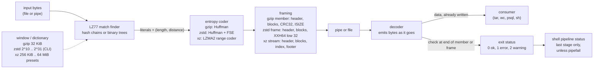

# Compression: gzip, zstd, and xz

> [!summary] Claim
> gzip, zstd, and xz are the same idea (LZ77 matching followed by entropy coding, wrapped in a self-checking container) built three times with different window sizes, entropy coders, and framing, and those three choices, far more than the `-1` to `-9` level, decide the ratio, the speed, the decoder's memory, and which failures a shell pipeline silently swallows.

Part of [Coreutils and the Userland](README.md) in [Shell and Unix Engineering](../README.md).

## TL;DR

- Mechanism: every one of them replaces repeats with (length, distance) back-references into a sliding window, then entropy-codes the result: DEFLATE with Huffman codes and a 32 KiB window, zstd with Huffman plus finite-state entropy and a window from 1 KiB up to 3.75 TB, xz with an LZMA2 range coder and a dictionary of 256 KiB to 64 MiB at the presets.
- Rule: choose by window and decoder cost, not by habit: zstd `-3` for anything streamed or hot (measured here at 244 MB/s and 18.8% of the input, against 58 MB/s and 20.5% for gzip `-6`), xz or zstd `-19` for write-once archives, and gzip only where the reader is fixed (HTTP `Content-Encoding`, old tooling, BusyBox-only images).
- Trap: decompressors emit data before they verify the trailer, so `gzip -dc f.gz | consumer` hands a truncated or corrupt payload to the consumer and the pipeline still exits 0 unless `set -o pipefail` is on (lab test 8).
- Portability fact: none of the three is a POSIX utility; POSIX.1-2024 only standardizes `compress`, `uncompress`, and `zcat` in the XSI option, with LZW as the default and a new `-g` (`-m gzip`) that macOS 27.3's `compress` still rejects, and the gzip headers you get differ by implementation (GNU, Apple, BusyBox; lab tests 2 to 4).
- When not to use it: do not compress already-compressed or encrypted data (it grows: lab test 11), do not compress secrets alongside attacker-chosen text (CRIME, cited in RFC 8878 section 8), and do not treat a compressor's checksum as an authenticity check; sign the artifact instead ([[Checksums-and-Integrity]]).

## Mental model



Bytes enter the match finder, which looks back through the window for the longest earlier occurrence of what comes next; the window size on the dotted edge is the single parameter that most bounds the ratio, because a repeat farther back than the window is invisible (lab test 10).
The match finder emits a stream of literals and (length, distance) pairs, and the entropy coder spends fewer bits on the symbols that occur more often.
The framing layer wraps the coded blocks with a magic number, the metadata the decoder needs to size its buffers, and a checksum of the uncompressed data.
On the way back, the decoder writes output as soon as each block decodes and only compares the checksum at the end of the member or frame, so the consumer has already received every byte when the verdict arrives.
That verdict travels only as an exit status, and a shell pipeline reports the last stage's status unless `pipefail` is set, which is where most production corruption goes unnoticed.

## How it works

### The shared core: LZ77 plus entropy coding

All three formats are dictionary coders in the LZ77 family: the encoder keeps the last W bytes (the window), and when the upcoming bytes match an earlier position it emits a back-reference instead of the bytes.
DEFLATE allows match lengths of 3 to 258 bytes and distances up to 32768 bytes (RFC 1951 section 2 and section 3.2.5).
A back-reference costs bits whatever its length, so the maximum DEFLATE expansion factor is bounded: zlib's documentation derives a theoretical limit of 1032:1 because one length/distance pair produces at most 258 bytes from at least two bits ("eight bits in give 1032 bytes out"), and says the implementation reaches about 1030.3:1 (zlib technical details).
The lab host compressed 100 MiB of zeros to 101941 bytes with Apple gzip `-9`, a ratio of 1029:1, against 32373:1 for zstd `-19`, 6814:1 for xz `-9 -T1`, and 927943:1 for bzip2 `-9` (measured here, 2026-11-15).
That ceiling is why a gzip bomb needs nested layers, while a single zstd or xz stream can expand thousands to tens of thousands of times.

The match finder is where the levels differ.
GNU gzip's `configuration_table` in `deflate.c` (gzip-1.14) sets, per level, the match length that stops lazy evaluation, the "nice" length that stops the search, and `max_chain`, the number of hash-chain entries examined: level 1 checks 4 entries without lazy matching, level 6 checks 128, and level 9 checks 4096 with `nice_length` 258.
zlib, which Apple gzip uses, has its own table, and on this host `-9` took about twice as long as `-6` for 0.6% smaller output (measured on the corpus below: 1348607 bytes versus 1340337 bytes).

Entropy coding then exploits the skew in the symbol stream.
DEFLATE uses Huffman codes, either the fixed table from the RFC or a dynamic table sent at the start of each block (RFC 1951 sections 3.2.6 and 3.2.7).
zstd codes literals with Huffman and the three sequence fields (literal length, match length, offset) with FSE, "Finite State Entropy, ... an entropy codec based on [ANS]" whose bitstreams are read from end to beginning (RFC 8878 sections 3.1.1.3 and 4.1).
LZMA2, the filter inside xz, wraps LZMA, which "is based on LZ77 and range coding algorithms", and adds flushing, uncompressed chunks, and better multithreading support (.xz format 1.2.1 section 5.3.1); of the three it compressed best and decoded slowest here (measured below).

The window bounds what any level can find.
The lab writes a random block twice in a row: with a 30000-byte block, gzip finds the repeat and the 60000 bytes compress to about 30400; with a 40000-byte block, the repeat sits beyond DEFLATE's reach and gzip emits 80043 bytes, while zstd and xz both land near 40000 (lab test 10; the boundary measured here falls between 32000 and 33000 bytes, matching zlib's documented maximum distance of `2^windowBits - 262` = 32506 bytes).
Scale that up and the window dominates everything else: eight concatenated copies of a 6.6 MB source tarball compress to 20.45% with gzip `-6` (no copy is within 32 KiB of the previous one) and to 18.80% with zstd `-3` (2 MiB window), but to 2.24% with `zstd -3 --long=27` (128 MiB window) and 1.71% with `xz -6 -T1` (8 MiB dictionary, larger than one copy) (measured here).

### gzip: RFC 1951 blocks inside RFC 1952 members

A gzip file is "a series of members" that "simply appear one after another in the file, with no additional information before, between, or after them" (RFC 1952 section 2.2).
Each member is a 10-byte fixed header, optional fields, DEFLATE blocks, and an 8-byte trailer (RFC 1952 section 2.3):

| Offset | Field | Meaning |
| --- | --- | --- |
| 0-1 | ID1 ID2 | `1f 8b` |
| 2 | CM | 8 = deflate (0-7 reserved) |
| 3 | FLG | bit 0 FTEXT, 1 FHCRC, 2 FEXTRA, 3 FNAME, 4 FCOMMENT, 5-7 reserved and must be zero |
| 4-7 | MTIME | Unix seconds, little-endian; 0 means no timestamp |
| 8 | XFL | 2 = maximum compression, 4 = fastest |
| 9 | OS | 3 = Unix, 255 = unknown |
| end-8 | CRC32 | CRC-32 of the uncompressed data |
| end-4 | ISIZE | uncompressed length modulo 2^32 |

The compliance rules are deliberately loose: a compressor must get ID1, ID2, CM, CRC32, and ISIZE right and may zero everything else, and a decompressor must check ID1, ID2, and CM and reject reserved FLG bits, but "need not examine any other part of the header or trailer" (RFC 1952 section 2.3.1.2).
Every implementation the lab covers checks CRC32 (lab test 7), and GNU and BusyBox also compare ISIZE (`unzip.c`; `unpack_gz_stream()` in `decompress_gunzip.c`), but that is a quality-of-implementation choice, not a requirement.

Inside the member, DEFLATE data is a sequence of blocks, each with a 3-bit header: one BFINAL bit and two BTYPE bits, 00 for stored, 01 for fixed Huffman, 10 for dynamic Huffman, and 11 reserved (RFC 1951 section 3.2.3).
A stored block carries LEN and its one's complement NLEN, so it holds at most 65535 bytes (RFC 1951 section 3.2.4), which is what bounds incompressible-input growth: the RFC quotes "5 bytes per 32K-byte block" (section 1.1) and zlib's documentation "five bytes per 16 KB block (about 0.03%)" for its defaults.
Random input always grows: 65536 random bytes became 65574 with gzip, 65549 with zstd, 65600 with xz, and 66190 with bzip2 (measured here; lab test 11 asserts growth for all three).

What lands in the header depends on the implementation, and that decides reproducibility:

- GNU gzip stores FNAME and MTIME for a named regular file unless `-n`, and since gzip 1.10 (2018-12-29) writes MTIME 0 when the input is not a regular file, "to make gzip's behavior more reproducible when used as part of a pipeline" (gzip-1.14 NEWS).
  `no_name` defaults to the value of `decompress` (`gzip.c`, `main`), which is why `-n` is the default only when decompressing.
- Apple gzip, a fork of the FreeBSD and NetBSD code, also stores FNAME and MTIME, clears both under `-n` (`gz_compress()` sets `mtime = 0` and `origname = ""`), but for standard input that is not a regular file it stamps `time(NULL)` (`handle_stdout()` in FreeBSD `gzip.c`, which compresses standard input to standard output), so `printf x | gzip` is different every second there (lab test 2).
- BusyBox gzip writes the constant `0x00088b1f` then a zero timestamp in `zip()` and accepts `-n` as a no-op ("our -n is a nop", `archival/gzip.c`), so its output never carries a name or time (lab tests 3 and 4).

MTIME is unsigned 32-bit, so a timestamp at or after 2106-02-07 06:28:16 UTC (2^32 seconds) cannot be stored; GNU gzip 1.9 started substituting zero instead of the low-order bits "as per Internet RFC 1952" (gzip-1.14 NEWS), and the manual's `--name` entry gives the same bound.
ISIZE is the length modulo 2^32, so for a 5 GiB input it is wrong by 4 GiB; before gzip 1.12 (2022-04-07) `gzip -l` printed that stored value, and since 1.12 it decompresses the whole file to count, trading speed for correctness (gzip-1.14 NEWS).
The 1.14 manual still says that for a multi-member file `--list` reports the last member only, while the 1.14 NEWS says "'gzip -l' no longer misreports lengths of multimember inputs"; treat `gzip -l` as advisory and count with `gzip -dc f.gz | wc -c` (the manual's own advice).

Multiple members are a feature: `gzip -c a >f.gz; gzip -c b >>f.gz` makes a file that decompresses to `cat a b` (gzip manual, "Advanced usage"; lab test 6).
That is how log rotators append and how parallel compressors join independently compressed chunks; the cost is that each member restarts with an empty window.
What follows the last member is where implementations split.
GNU `get_method()` returns -3 for trailing NUL bytes (warned only with `-v`) and -2 for anything else after warning "decompression OK, trailing garbage ignored", and `WARN` sets exit status 2 (gzip-1.14 `gzip.c` and `gzip.h`); the manual explains the NUL case as tape padding.
FreeBSD and Apple gzip warn "trailing garbage ignored" and set `exit_value = 2` for any byte that is not `0x1f`, NULs included.
BusyBox `unpack_gz_stream()` loops while the next two bytes are `1f 8b` and otherwise stops silently, the GNU message left commented out (lab test 9).

Down at the system call level, gzip is a plain `read(2)`/`write(2)` filter.
GNU gzip uses 256 KiB input and output buffers (`INBUFSIZ` and `OUTBUFSIZ` are `0x40000` unless `SMALL_MEM`, `gzip.h`) around a 32 KiB window (`WSIZE 0x8000`), and its `unzip()` inflates and flushes the output window before it reads the 8-byte trailer and compares CRC and length (`unzip.c`), which is the mechanism behind "data before verdict".
When it writes to a named output file rather than standard output and the input turns out not to be gzip, it removes the partial file (`remove_output_file()`), and with `--synchronous` (gzip 1.7, 2016-03-27) it uses "fsync and similar primitives to transfer output data to the output file's storage device" (gzip-1.14 NEWS), the guard the manual describes against a crash in which "the user might lose both FOO and FOO.gz".
`--rsyncable` (also 1.7) keeps a rolling sum over the last `RSYNC_WIN` = 4096 bytes and ends a block whenever the sum is a multiple of 4096 (`deflate.c`), so a local edit in the input changes only nearby compressed bytes; the manual prices it at about 1% of size.
gzip 1.14 (2025-04-09) now ignores every option in the `GZIP` environment variable except `-1` to `-9`, `--rsyncable`, and `--synchronous` (gzip-1.14 NEWS).

zlib and gzip are different containers for the same DEFLATE data: RFC 1950 (zlib) has a 2-byte header and an Adler-32 trailer, RFC 1952 (gzip) the 10-byte header and CRC-32 trailer described above.
The zlib documentation gives the error-detection difference: a random-error false-positive probability of 2.3283e-10 for CRC-32 and 2.3294e-10 for Adler-32.
HTTP inherits the confusion: the `deflate` content coding is the zlib format, and RFC 9110 notes that "some non-conformant implementations send the 'deflate' compressed data without the zlib wrapper", while the `gzip` coding is the RFC 1952 format (RFC 9110 sections 8.4.1.2 and 8.4.1.3).

### zstd: RFC 8878 frames

zstd data is "made up of one or more frames", each independent, and "the decompressed content of multiple concatenated frames is the concatenation of each frame's decompressed content" (RFC 8878 section 3.1).
A frame starts with the little-endian magic `0xFD2FB528` (bytes `28 b5 2f fd`), then a 2 to 14 byte header, blocks, and an optional 4-byte content checksum, the low 32 bits of XXH64 with seed 0 (RFC 8878 section 3.1.1).
The first header byte, `Frame_Header_Descriptor`, packs the fields that decide how the decoder allocates memory (RFC 8878 section 3.1.1.1.1):

- bits 7-6, `Frame_Content_Size_Flag`: 0, 2, 4, or 8 bytes of decompressed size follow (0 becomes 1 byte when `Single_Segment_Flag` is set);
- bit 5, `Single_Segment_Flag`: the whole output fits one buffer, so no `Window_Descriptor` is sent and the window equals the content size;
- bit 2, `Content_Checksum_Flag`;
- bits 1-0, `Dictionary_ID_Flag`.

The `Window_Descriptor` byte encodes `windowLog = 10 + Exponent` plus `Mantissa` eighths, so the minimum window is 1 KB and the maximum 3.75 TB, and the RFC recommends that decoders support up to 8 MB and encoders not exceed it (RFC 8878 section 3.1.1.1.2).
Blocks are raw, RLE, or compressed, and each is limited to the smaller of the window and 128 KB, decompressed or compressed, so a decoder can size its block buffers from the header (RFC 8878 sections 3.1.1.2.2 and 3.1.1.2.4).

The CLI's header choices follow from what it knows about the input.
Compressing the 5-byte file `hello` gives `Frame_Header_Descriptor` `0x24`: single segment, checksum, and a 1-byte content size; compressing the same bytes from a pipe gives `0x04` and `Window_Descriptor` `0x58`, a 2 MiB window and no content size, because a pipe's length is unknown when the header is written (lab test 12).
`zstd --show-default-cparams` on this host reports `windowLog` 21 for level 3 and 23 for level 19 with unknown size, and 19 for level 1.
The decoder enforces a memory limit from the header alone: "By default, `zstd` uses 128 MiB for decompression as the maximum amount of memory" (zstd(1), `--memory`), and the lab shows `zstd -dc -M1MB` refusing even the 5-byte piped frame with "Frame requires too much memory for decoding", "Window size larger than maximum : 2097152 > 1048576", and the hint "Use --long=21 or --memory=2MB" (lab test 13 asserts the refusal and the "too much memory" text; the full messages are from zstd 1.5.7, measured here).
That is the same check that makes a `--long=30` archive undecodable on a default decoder: per zstd(1), a `windowLog` above 27 needs `--long=windowLog`, `--max`, or `--memory=windowSize` on the decompression side too.

Skippable frames, magic `0x184D2A50` to `0x184D2A5F` followed by a 4-byte length and up to 2^32 - 1 bytes of user data, are skipped by every compliant decoder (RFC 8878 section 3.1.2); the lab builds one with `printf` between two frames and `zstd -dc` returns `helloworld` (lab test 14).
They exist to allow "the insertion of user-defined metadata into a flow of concatenated frames" (RFC 8878 section 3.1.2), and the RFC warns that they can also carry a watermark that tracks a payload (section 8).

The CLI differs from gzip on purpose (zstd(1), "DESCRIPTION"): "Source files are preserved by default" (use `--rm`; lab test 18), "`zstd` does not accept input from console", and "`zstd` does not store the input's filename or attributes, only its contents", which makes its output reproducible by construction.
Levels run 1 to 19 (default 3), `--ultra` unlocks 20 to 22, and `--fast=N` trades ratio for speed below level 1.
`--long[=windowLog]` defaults to 27 (128 MiB) with a maximum of 31; `-T#` caps at 256 workers on 64-bit builds; `ZSTD_CLEVEL` and `ZSTD_NBTHREADS` are the only environment variables read, and `ZSTD_NBTHREADS` defaults to `max(1, min(4, nbLogicalCores/4))` (zstd(1)).
Multithreading became the CLI default in v1.5.7 (Feb 2025) and v1.3.8 (Dec 2018) added `--rsyncable` (zstd CHANGELOG).
The dev-branch CHANGELOG also lists a v1.6.0 heading dated Dec 2025 that disables legacy-format decoding by default (`ZSTD_LEGACY_SUPPORT` defaults to 0), but no v1.6.0 release tag exists and v1.5.7 is the latest release (as of 2026-11, GitHub releases), so treat that change as unreleased.
Thread count does not change the bytes: `-T1` and `-T4` produced identical output for a 13 MB awk-generated log, while `--single-thread` (compression serialized with I/O) produced a different stream, as zstd(1) documents ("Final compressed result is also slightly different from `-T1`") (lab test 21).
`--adapt` is the exception the manual calls out: "compressed result is not reproducible".
zstd is also a front end for other formats: `--format=gzip`, `xz`, `lzma`, and `lz4` when built with those libraries, and `-M` also limits `.xz` and `.lzma` decoding (zstd(1)).

### xz: the .xz container around LZMA2

An .xz file is one or more Streams, optionally separated or followed by Stream Padding, and "the size of every valid .xz file MUST be a multiple of four bytes" (.xz format 1.2.1 section 2).
A Stream is a 12-byte Stream Header (magic `fd 37 7a 58 5a 00`, two bytes of Stream Flags, and their CRC32), zero or more Blocks, an Index, and a 12-byte Stream Footer (CRC32, Backward Size, a copy of the Stream Flags, and the magic `59 5a`, "YZ") (sections 2.1.1 and 2.1.2).
The low nibble of the second Stream Flags byte is the check type: 0x00 none, 0x01 CRC32, 0x04 CRC64, 0x0A SHA-256 (section 2.1.1.2); xz writes CRC64 by default and always protects its own headers with CRC32 (xz(1), `--check`; lab test 17).
Each Block has its own header with a chain of one to four filters (section 3.1.2), such as LZMA2, Delta, or the branch/call/jump filters for x86, PowerPC, IA64, ARM, ARM Thumb, SPARC, ARM64, and RISC-V machine code (section 5.3.2), and the Index lists every Block's sizes so that a reader can seek, verify, or split work without decompressing.
The footer's job is detection: "If the file does not end with Footer Magic Bytes (excluding Stream Padding ...), it cannot be undamaged" (section 2.1.2.4).
Stream Padding "MUST contain only null bytes" in "a multiple of four bytes", and a decoder that supports concatenated Streams must reject anything else (section 2.2): four NULs after a stream decode cleanly, three NULs fail with "Compressed data is corrupt", and `junk` fails with "Unexpected end of input" unless `--single-stream` is given (lab tests 15 and 16).

The presets are dictionary sizes, and the dictionary size is also the decoder's memory bill (xz(1), `-0` ... `-9`):

| Preset | DictSize | CompMem | DecMem |
| --- | --- | --- | --- |
| `-0` | 256 KiB | 3 MiB | 1 MiB |
| `-6` (default) | 8 MiB | 94 MiB | 9 MiB |
| `-9` | 64 MiB | 674 MiB | 65 MiB |

Multithreaded mode is the only way xz parallelizes: it "split[s] the input into blocks and compress[es] them independently", and because no size information is stored in single-threaded Block headers, "files created in single-threaded mode won't be identical to files created in multi-threaded mode" (xz(1), `--threads` and `--block-size`).
xz 5.6.0 (2024-02-24) made it the default ("Multithreaded mode is now the default ... The downsides are increased memory usage and slightly worse compression ratio", xz NEWS); 5.4.x and older default to `-T1`.
The lab shows both halves: on this host `xz`, `xz -T2`, and `xz -T4` produce identical bytes for `hello` (72 bytes, with sizes stored in the Block header), while `xz -T1` produces a different 64-byte stream (lab test 20).
The default block is "three times the LZMA2 dictionary size or 1 MiB, whichever is more", and only multithreaded mode stores block sizes in the Block headers, which multithreaded decompression requires, so a `-T1` file can never be decompressed in parallel (xz(1), `--block-size`).
Independent blocks also cost ratio when the data has long-range repeats: on the eight-copy tarball, default multithreaded `xz -6` reached 4.03% while `xz -6 -T1` reached 1.71% (measured here), because each block restarts its dictionary.
xz reads options from `XZ_DEFAULTS` then `XZ_OPT` before the command line, and the manual warns that "scripts should never set or unset XZ_DEFAULTS" (xz(1), ENVIRONMENT); exit status is 0, 1 for an error, and 2 for a warning (xz(1), EXIT STATUS).
The manual also warns that "the exact compressed output ... may vary between XZ Utils versions even if compression options are identical" (xz(1), NOTES), so reproducibility needs a pinned xz, not just pinned flags.

### What POSIX says, and what it leaves out

POSIX.1-2024 has no gzip, zstd, or xz utility.
It specifies `compress`, `uncompress`, and `zcat` on one page under the XSI option, with adaptive LZW (`.Z`) as the default algorithm and a new `-m algo` option whose required values are `lzw`, `deflate`, and `gzip`, plus `-g` as a synonym for `-m gzip` whose output "shall be in the GZIP format described in RFC 1952" (POSIX.1-2024 XCU compress, applied from Austin Group Defect 1041).
The same page fixes the exit statuses for `compress`: 1 for an error and 2 when "one or more files were not compressed because they would have increased in size", and, in a paragraph marked obsolescent ([OB]), it lets an implementation refuse an input with multiple hard links with a diagnostic and a non-zero exit status.
The `pax` rationale lists compression among the things "better handled by separate utilities" and deliberately left out of the archive format (POSIX.1-2024 XCU pax, RATIONALE).
On macOS 27.3, `compress -g` fails with "illegal option -- g", so the 2024 addition is not yet portable in practice (measured here).
The one POSIX feature that matters most for compression pipelines is the pipeline status: since POSIX.1-2024, `set -o pipefail` makes a pipeline's status the last non-zero stage status (POSIX.1-2024 XCU 2.9.2; Austin Group Defect 789), which is the only portable way to see a decompressor's failure from inside a pipeline such as `gzip -dc f | tar -xf -` ([[pipefail-and-PIPESTATUS]]).

## Numbers and limits

Format and implementation limits, each from the cited source:

| Quantity | Value | Source |
| --- | --- | --- |
| DEFLATE window, match length, distance | 32 KiB; 3 to 258; 1 to 32768 | RFC 1951 sections 2, 3.2.5 |
| zlib usable distance | 32506 bytes (`2^15 - 262`) | zlib technical details |
| DEFLATE stored block | at most 65535 bytes | RFC 1951 section 3.2.4 |
| DEFLATE ratio ceiling | 1032:1 theory, about 1030.3:1 zlib | zlib technical details |
| gzip MTIME, ISIZE | unsigned 32-bit; length mod 2^32 | RFC 1952 section 2.3.1 |
| GNU gzip buffers | 256 KiB in and out, 32 KiB window | gzip-1.14 `gzip.h` |
| zlib memory, default settings | deflate 268 KB, inflate typically at most 40 KB (64-bit) | zlib technical details |
| CRC-32 random false-positive rate | 2.3283e-10 | zlib technical details |
| zstd window | 1 KB to 3.75 TB; 8 MB recommended | RFC 8878 section 3.1.1.1.2 |
| zstd block | at most min(window, 128 KB) | RFC 8878 section 3.1.1.2.4 |
| zstd skippable user data | at most 2^32 - 1 bytes | RFC 8878 section 3.1.2 |
| zstd CLI decode memory limit | 128 MiB default (`-M`) | zstd(1) (dev, as of 2026-11) |
| zstd `--long` | default 27, maximum 31 | zstd(1) |
| zstd workers | at most 256 (64-bit), 64 (32-bit) | zstd(1) |
| xz Index, Stream | Index at most 16 GiB; Stream under 8 EiB | .xz format 1.2.1 section 2.1 |
| xz memory, four threads at `-6` | 660 to 670 MiB | xz(1) |

Measured by hand on this host (Apple M3 Pro, 12 cores, macOS 27.3; Apple gzip 487.60.2, zstd 1.5.7, xz 5.8.4, bzip2 1.0.8, lz4 1.11.1; 2026-11-15), compressing the 6594560-byte GNU gzip 1.14 source tarball; best of five wall-clock runs including process start, round trip verified with `cmp`:

| Command | Size | Ratio | Compress | Decompress |
| --- | --- | --- | --- | --- |
| `gzip -1` | 1644328 | 24.93% | 0.044 s | 0.018 s |
| `gzip -6` | 1348607 | 20.45% | 0.113 s | 0.017 s |
| `gzip -9` | 1340337 | 20.32% | 0.235 s | 0.016 s |
| `lz4 -1` | 2092292 | 31.73% | 0.018 s | 0.015 s |
| `zstd -1` | 1437604 | 21.80% | 0.017 s | 0.017 s |
| `zstd -3` | 1239976 | 18.80% | 0.027 s | 0.017 s |
| `zstd -19` | 914203 | 13.86% | 1.261 s | 0.017 s |
| `bzip2 -9` | 1080317 | 16.38% | 0.298 s | 0.106 s |
| `xz -0` | 1297432 | 19.67% | 0.040 s | 0.026 s |
| `xz -6` | 894116 | 13.56% | 1.182 s | 0.048 s |
| `xz -9e` | 885756 | 13.43% | 1.804 s | 0.048 s |

At this size the decompression column is dominated by process start (about 15 ms for every tool), so it understates the gap; on the 52.8 MB eight-copy corpus the same host decompressed gzip `-6` output at 898 MB/s, zstd `-3` at 845 MB/s, `xz -6 -T1` at 471 MB/s, and bzip2 at 69 MB/s (measured here; Apple's gzip is built on zlib, and GNU gzip's own inflate will differ).
The shape, not the digits, is what transfers: zstd `-3` beats gzip `-6` on both ratio and speed, zstd `-19` and xz `-6` reach about the same ratio, and only xz pays for its ratio again on every decompression.

The lab itself asserts these: the 32 KiB window boundary (test 10), growth on random input (test 11), the 2 MiB window for piped zstd input (test 12), and the 1 MiB versus 2 MiB decoder limit (test 13).

## Portability

Behavior of the compressors, by implementation; "lab N" means the lab asserts it per implementation, and the matrix supplies GNU gzip on Debian, BusyBox gzip on Alpine, and Apple gzip on the macOS host.
The GNU and BusyBox cells are also confirmed against source: in gzip-1.14 `gzip.c`, `WARN` sets status 2 for trailing garbage and for a second hard link, trailing NULs return -3 with no warning unless `-v`, and only a regular file's mtime is stored; in BusyBox, `zip()` writes a zero MTIME, `unpack_gz_stream()` continues only while `1f 8b` follows, and `bbunzip.c` has no hard-link check:

| Behavior | GNU gzip 1.10+ | Apple gzip (FreeBSD code) | BusyBox 1.37 gzip | zstd 1.5.x | xz 5.x |
| --- | --- | --- | --- | --- | --- |
| Name and MTIME for a named file | stored unless `-n` (lab 3) | stored unless `-n` (lab 3) | never; `-n` is a no-op (lab 3) | never stored (zstd(1)) | no such field (.xz format section 2.1) |
| MTIME for piped input | 0 (lab 2) | current time (lab 2) | 0 (lab 2) | n/a | n/a |
| Concatenated members or frames | decoded (lab 6) | decoded (lab 6) | decoded (lab 6) | decoded (lab 14) | decoded; padding rules (lab 16) |
| Trailing junk after the data | warning, status 2 (lab 9) | warning, status 2 (lab 9) | ignored, status 0 (lab 9) | error (lab 15), status 1 (measured here) | error (lab 15), status 1 (measured here); `--single-stream` ignores (lab 15) |
| Trailing NUL bytes | ignored, status 0 (lab 9) | warning, status 2 (lab 9) | ignored, status 0 (lab 9) | error (measured here) | allowed in multiples of four (lab 16) |
| Input file after success | removed (lab 18) | removed (lab 18) | removed (lab 18) | kept unless `--rm` (lab 18) | removed (lab 18) |
| Input with a second hard link | skipped, status 2 (lab 19) | skipped, status 1 (lab 19) | compressed and removed (lab 19) | `--rm` removes the link (lab 19) | skipped, status 2 (lab 19) |
| Output identical across thread counts | n/a (single-threaded) | n/a | n/a | yes for `-T1`..`-T4`, not `--single-thread` (lab 21) | yes for `-T2`+, not `-T1` (lab 20) |
| Default threads | none (no threads option in the manual) | none (gzip(1)) | none (usage text) | multithreaded since 1.5.7 (CHANGELOG) | `-T0` since 5.6.0, `-T1` before (lab 20) |
| Compression | yes | yes | yes; `-1` to `-4` share one setting (`gzip_main()`) | yes | yes; BusyBox `xz` decompresses only (`bbunzip.c`) |

Shell side: the shell never changes which compressor runs, so the only shell-dependent fact here is whether the shell can surface a failing decompressor in a pipeline.

| Shell | status of a failing decompressor piped into `wc -c` | `set -o pipefail` available |
| --- | --- | --- |
| POSIX sh (POSIX.1-2024) | 0 (last stage) | required (XCU 2.9.2, XCU 2.15 `set`) |
| bash 3.2 (macOS `/bin/sh`) and current bash | 0 (lab 8) | yes, gives 1 (lab 8 on the host) |
| zsh native and `--emulate sh` | 0 (lab 8) | yes (per [[pipefail-and-PIPESTATUS]]) |
| dash | 0 (lab 8) | 0.5.13 or Debian's patched 0.5.12 only (per [[pipefail-and-PIPESTATUS]]); measured as of 2026-11: macOS `/bin/dash` rejects `set -o pipefail` (`Illegal option -o pipefail`), Homebrew dash-shell 0.5.13.5 accepts it; lab 8 detects it |
| ksh93, mksh, yash, BusyBox ash | 0 (lab 8) | yes (per [[pipefail-and-PIPESTATUS]]) |
| posh | 0 (lab 8) | no (per [[pipefail-and-PIPESTATUS]]) |

Lab test 8 runs under every shell in the matrix: it asserts status 0 without `pipefail` everywhere and status 1 with it wherever `set -o pipefail` succeeds, so the cells above that cite the sibling note are re-proved per shell when the matrix runs.
gzip, zstd, and xz are separate packages, not part of GNU coreutils, so uutils (a coreutils reimplementation) does not replace them, and a uutils system runs the same GNU, BSD, or BusyBox compressors ([[Four-Userlands-GNU-BSD-BusyBox-uutils]]).
In a BusyBox-based image, `gzip` may be the BusyBox applet and `xz` the decompress-only applet (`bbunzip.c`), and there is no BusyBox zstd, so a script that runs on a full distribution can fail or change behavior in the container; check with `gzip --version` (the lab's `flavor` mode) and install the real packages ([[Userland-Portability-Traps]]).

## Worked example

The [lab](../labs/08-compression-gzip-zstd-xz/) has two files: `compress_probe.sh`, a POSIX `sh` script that parses gzip, zstd, and xz headers with `od` and `awk` (awk does the arithmetic because mksh integers are 32-bit and MTIME is unsigned 32-bit), and `compression.bats`, 21 tests that run the probe under the shell under test and assert each implementation's real behavior.

Excerpt from `compress_probe.sh`, verbatim: the gzip header parser.

```sh
gzip_header() {
  [ -r "$1" ] || die "cannot read $1"
  dec_bytes "$1" 266 | awk '{
    if ($1 != 31 || $2 != 139) { print "not gzip"; exit 1 }
    flg = $4
    mtime = $5 + 256 * $6 + 65536 * $7 + 16777216 * $8
    printf "id=1f8b cm=%d flg=%02x mtime=%.0f xfl=%d os=%d", $3, flg, mtime, $9, $10
    # FNAME (bit 3) follows the 10-byte header unless FEXTRA (bit 2) puts XLEN bytes first.
    if (int(flg / 8) % 2 == 1 && int(flg / 4) % 2 == 0) {
      name = ""
      for (i = 11; i <= NF && $i != 0; i++) name = name sprintf("%c", $i)
      printf " name=%s", name
    }
    printf "\n"
  }'
}
```

Excerpt from `compression.bats`, verbatim: the test that a pipeline hides a truncated stream.

```sh
@test "a truncated stream fails the decompressor, but the pipeline hides it unless pipefail is set" {
  gzip -n -c hello >good.gz
  n=$(size good.gz)
  head -c $((n - 3)) good.gz >short.gz
  run gzip -dc short.gz
  [ "$status" -eq 1 ]
  # shellcheck disable=SC2016 # the expansion belongs to the shell under test
  run_lab_c 'gzip -dc "$1" 2>/dev/null | wc -c >/dev/null; echo "$?"' sh short.gz
  [ "$output" = 0 ]
  run_lab_c 'set -o pipefail'
  if [ "$status" -eq 0 ]; then
    # shellcheck disable=SC2016 # the expansion belongs to the shell under test
    run_lab_c 'set -o pipefail; gzip -dc "$1" 2>/dev/null | wc -c >/dev/null; echo "$?"' sh short.gz
    [ "$output" = 1 ]
  fi
}
```

Captured on the macOS host (Apple gzip 487.60.2, zstd 1.5.7, xz 5.8.4), with `hello` holding the five bytes `hello` and an mtime of 2020-01-01 00:00:00 UTC; each line is a value the lab asserts (tests 3, 5, 12, 17, and 1):

```text
$ sh compress_probe.sh flavor
apple
$ gzip -c hello >named.gz && sh compress_probe.sh gzip-header named.gz
id=1f8b cm=8 flg=08 mtime=1577836800 xfl=0 os=3 name=hello
$ gzip -n -c hello >anon.gz && sh compress_probe.sh gzip-header anon.gz
id=1f8b cm=8 flg=00 mtime=0 xfl=0 os=3
$ sh compress_probe.sh gzip-trailer anon.gz
crc32=3610a686 isize=5
$ sh compress_probe.sh zstd-header file.zst
single_segment=1 checksum=1 content_size=present
$ sh compress_probe.sh zstd-header pipe.zst
single_segment=0 checksum=1 content_size=absent window=2097152
$ sh compress_probe.sh xz-flags h.xz
check=crc64 footer=YZ size_mod4=0
$ sh compress_probe.sh magic h.xz
xz
```

The whole suite ran once on the host under `sh` (bash 3.2.57 in POSIX mode): `1..21`, all 21 `ok`.
On BusyBox gzip the `named.gz` line becomes `flg=00 mtime=0` with no name, which is the difference test 3 asserts.

## Pitfalls

> [!warning] A pipeline reports the consumer, not the decompressor
> Trigger: `gzip -dc dump.sql.gz | psql`, `zstd -dc backup.zst | tar -xf -`, or `curl ... | xz -d | sh` in a script without `pipefail`.
> Symptom: the decompressor prints "unexpected end of file" or "crc error" and exits 1, but the consumer already received and acted on the partial or corrupt data, and the pipeline's status is the consumer's 0 (lab tests 7 and 8).
> Fix: `set -o pipefail` (POSIX.1-2024) or check `PIPESTATUS`; for anything that applies data, decompress to a temporary file, check the status (or run `gzip -t`, `zstd -t`, `xz -t` first), then apply ([[pipefail-and-PIPESTATUS]], [[mktemp]]).

> [!warning] gzip and xz delete the input; zstd does not
> Trigger: a script switches `gzip "$f"` to `zstd "$f"`, or the reverse.
> Symptom: with zstd, disks fill because every original stays next to its `.zst`; with gzip or xz, a script that later reads `"$f"` finds it gone (lab test 18).
> Fix: always say what you mean: `-k` (all three) to keep, `--rm` for zstd to remove, or `-c` with an explicit output redirection and an explicit `rm` after checking the status.

> [!warning] Non-reproducible gzip output from names and timestamps
> Trigger: `gzip file` or `tar -czf` in a build; Apple and BSD gzip on piped input.
> Symptom: byte-different artifacts from identical inputs, cache misses, and checksum mismatches between hosts; GNU and Apple embed FNAME and MTIME, and Apple stamps the wall clock on piped input (lab tests 2 to 4).
> Fix: `gzip -n` (honored by GNU and Apple; BusyBox never stores them), or switch to zstd, which stores neither; also pin the compressor version, because xz(1) says output may vary between versions.

> [!warning] Multithreaded xz changes the bytes and loses long-range matches
> Trigger: upgrading to xz 5.6.0 or later, where `-T0` is the default, in a pipeline that compares artifacts or relies on ratio.
> Symptom: the same input and flags give different `.xz` bytes than on a 5.4 host, and data with repeats farther apart than a block (by default three times the dictionary, 24 MiB at `-6`, xz(1) `--block-size`) compresses worse (4.03% versus 1.71% on the eight-copy tarball, measured here; lab test 20).
> Fix: pass `-T1` for byte-stable or maximum-ratio archives, or pass an explicit `-T2` or higher everywhere so every host uses the thread-count-independent multithreaded format.

> [!warning] A zstd archive that the default decoder refuses
> Trigger: compressing with `--long=30`, `--ultra -22`, or a large `wlog`, then decompressing elsewhere with plain `zstd -d`.
> Symptom: "Frame requires too much memory for decoding" and exit 1, even for small payloads, because the decoder checks the window declared in the header against its limit (128 MiB by default; lab test 13).
> Fix: keep archives at `windowLog` 27 or below unless every reader passes `--long=N` or `--memory=`, and record the flag next to the artifact.

> [!warning] Trusting the suffix instead of the magic bytes
> Trigger: `case $f in *.gz) gzip -dc ;; esac` on files that came from elsewhere, or tools that guess by extension.
> Symptom: zstd-compressed data in a `.gz`, or plain text in a `.zst`, fails late or passes through: `gzip -dcf` and `zstd -dcf` copy unrecognized input unchanged to standard output (gzip manual, `--force`; zstd(1), `--pass-through`).
> Fix: sniff the first bytes (`1f 8b`, `28 b5 2f fd`, `fd 37 7a 58 5a 00`), as `compress_probe.sh magic` does (lab test 1), and never add `-f` to a decompression in a pipeline.

> [!warning] `gzip -l` and ISIZE lie past 4 GiB
> Trigger: sizing a restore from `gzip -l` or from the trailer of a large dump.
> Symptom: the reported size is the true size modulo 4 GiB on gzip before 1.12, and on any tool that reads ISIZE directly (RFC 1952 section 2.3.1; gzip-1.14 NEWS).
> Fix: count with `gzip -dc f.gz | wc -c`, or use zstd, which stores a content size of up to 8 bytes when the input size is known (`zstd -l`; lab test 12).

> [!warning] The zgrep newline file name (CVE-2022-1271)
> Trigger: `zgrep` (GNU gzip 1.3.10 to 1.11) applied to an attacker-chosen file name containing two or more newlines.
> Symptom: "an arbitrary file write ... can overwrite an attacker's content to an arbitrary attacker-selected file" (NVD CVE-2022-1271); gzip 1.12 fixed it (gzip-1.14 NEWS).
> Fix: upgrade gzip, pass file names after `--`, and prefer `gzip -dc -- "$f" | grep` in scripts over the wrapper scripts ([[Command-Injection]]).

## Security and robustness

Treat every compressed input as untrusted code for the decoder.
The RFC 8878 security section requires decoders to bound memory and to survive tampered `Number_of_Sequences` values and a `Frame_Content_Size` smaller than the real output, and recommends fuzzing; the gzip and xz histories show why.
CVE-2010-0001 was an integer underflow in gzip's `unlzw()` before 1.4 on 64-bit platforms that could allow code execution through a crafted LZW archive (NVD), reachable because `gzip -d` still decodes `.Z` input.
zlib before 1.2.12 could corrupt memory while compressing input with many distant matches (CVE-2018-25032), and zlib through 1.2.12 had a heap over-read or overflow in `inflate` via a large gzip header extra field for callers of `inflateGetHeader` (CVE-2022-37434) (NVD).
In XZ Utils, CVE-2025-31115 (5.3.3alpha to 5.8.0) let invalid input crash the multithreaded decoder with a heap use-after-free, and CVE-2026-34743 (before 5.8.3) was a buffer overflow in `lzma_index_append()` after decoding an Index with no Records (NVD; xz NEWS).
zstd before 1.4.1 created output files with default permissions and fixed them only at completion (CVE-2021-24031), and the fix left a window until 1.4.9 (CVE-2021-24032), so for a moment the output could be "readable or writable to unintended parties" (NVD).
Mitigations that hold across all three: decompress as an unprivileged user into a private directory created with `mktemp -d`, set `umask 077` first, cap memory (`zstd -M`, `xz --memlimit-decompress`, a `ulimit -v`, or a cgroup), and cap output size by piping through `head -c LIMIT` and checking the result ([[Resource-Limits-and-ulimit]]).

Decompression bombs are a ratio problem, not a bug: DEFLATE tops out near 1032:1 per layer, but zstd reached 32373:1 and bzip2 927943:1 on zeros here, so a 1 MB upload can expand to tens of gigabytes.
Any service that decompresses user input must bound both the output bytes and the declared window before allocating, which is what the zstd CLI's `-M` check does from the header alone (lab test 13).

The integrity checks detect accidents, not attacks.
CRC-32, the XXH64 low 32 bits, and CRC64 are unkeyed, so anyone who can change the data can recompute them; integrity against an adversary needs a signature or a MAC over the compressed artifact ([[Checksums-and-Integrity]]).
And compressing secrets together with attacker-influenced data leaks the secrets through the output length, the CRIME attack that RFC 8878 section 8 names: never compress a cookie or token in the same stream as reflected user input.

The supply-chain lesson is the xz backdoor (CVE-2024-3094).
Malicious code was "discovered in the upstream tarballs of xz, starting with version 5.6.0" (NVD), and Andres Freund's report shows the build extracting the payload from test files with a shell pipeline: `sed rpath ../../../tests/files/bad-3-corrupt_lzma2.xz | tr "\t \-_" " \t_\-" | xz -d | /bin/bash` (oss-security, 2024-03-29; the tab characters are written here as `\t`).
The release tarballs contained a modified `build-to-host.m4` that the git repository did not, and the bulk of the payload sat in two committed binary test files, `tests/files/bad-3-corrupt_lzma2.xz` and `tests/files/good-large_compressed.lzma`, which, Freund notes, were not used by any test in 5.6.0 (oss-security, 2024-03-29); xz 5.6.2 removed the backdoor (xz NEWS).
Two shell habits would have narrowed it: build from the tagged repository or verify that the tarball matches it, and treat any `| sh` or `| bash` at the end of a decompression in a build script as a finding to review.

Robust pipelines also respect the stream semantics.
Decompress with `-c` to a pipe only when the consumer can tolerate partial input, and otherwise write to a temporary file, check the status, then rename into place ([[install-and-Atomic-Deployment]]).
When piping a decompressor into a reader that may stop early (`zcat log.gz | head`), the decompressor dies of `SIGPIPE` or gets `EPIPE`; GNU gzip 1.13 exits 2 rather than 1 for `EPIPE` when `SIGPIPE` is ignored (gzip-1.14 NEWS), and `pipefail` will report that as a failure unless you allow it ([[SIGPIPE-and-EPIPE]]).

## The principal's view

The decision is which format your organization writes by default, and it is almost always zstd for anything produced and consumed by your own systems: at level 3 it compressed this corpus about 4x faster than gzip `-6` and 8% smaller (measured here, both at default settings), its decoder speed "remains roughly stable at all compression settings" (zstd(1)), its frames carry up to an 8-byte content size when the input size is known and an optional checksum, and its CLI stores no name or timestamp, so artifacts are reproducible without flags.
The trade-off is reach and ratio.
gzip is the only one of the three that a stock BusyBox build can both write and read (BusyBox has no zstd applet, and its `xz` only decompresses, `bbunzip.c`), and it is the long-standing HTTP `gzip` content coding (RFC 9110 section 8.4.1.3), while `zstd` was registered as a content coding by RFC 8878 (section 7.2).
xz `-6` still edged out zstd `-19` on ratio here (13.56% versus 13.86%) with a 9 MiB decoder, at about twice zstd `-3`'s decompression time on the 52.8 MB corpus (0.112 s versus 0.062 s, measured), which suits write-once distribution archives.
So set the policy by data flow, not by tool familiarity: zstd `-3` (or `--fast`) for logs, backups in flight, build caches, and inter-service payloads; zstd `-19 --long` or `xz -6 -T1` for release archives where size dominates and decoders are known; gzip `-n` only where a third party's decoder is fixed.
Pin compressor versions in reproducible builds, because neither xz nor zstd promises identical bytes across releases, and decide `-T` explicitly.
Treat every decompression of external data as a parsing problem with a memory budget, run in a sandbox, and check exit statuses with `pipefail` in every script that applies decompressed data.
When the job is random access into compressed data, columnar scans, or per-record compression, stop using stream compressors from the shell: use a container that compresses per block and indexes its blocks (the .xz Index already lists every Block's sizes; columnar formats carry their own codecs) from a real program, where errors are values, not exit statuses lost in a pipe.
When the data is already compressed or encrypted, the right compressor is none: lab test 11 shows every one of them growing random input.

## Interview questions

> [!question] L5: Why does gzip's compression ratio stop improving on data whose repeats are far apart, while zstd and xz keep improving?
>
> > [!success]- Answer
> > DEFLATE can refer back at most 32768 bytes, so any repeat farther back than that is invisible to the match finder at every level.
> > zstd's window is declared per frame and defaults to 2 MiB at level 3 for unknown sizes, up to 128 MiB with `--long`, and xz's dictionary is 8 MiB at `-6`.
> > The lab shows the boundary directly: a random block repeated at a distance of 30000 bytes compresses by half under gzip, and at 40000 bytes it does not compress at all, while zstd and xz still halve it.
> >
> > Follow-up: Why does `xz -6` in its default multithreaded mode lose some of that advantage on large inputs?

> [!question] L5: Predict the output: `printf x | gzip >f.gz; printf junk >>f.gz; gzip -dc f.gz; echo " $?"` on GNU gzip, Apple gzip, and BusyBox gzip.
>
> > [!success]- Answer
> > All three print `x`, because the member decodes before the trailing bytes are examined.
> > GNU and Apple gzip then warn "trailing garbage ignored" and exit 2, so the line ends ` 2`.
> > BusyBox stops silently when the next two bytes are not `1f 8b` and exits 0.
> > With four NUL bytes instead of `junk`, GNU exits 0 (it treats trailing zeros as tape padding), Apple still exits 2, and BusyBox still exits 0.
> >
> > Follow-up: What does `xz -dc` do with the same four NUL bytes, and with three?

> [!question] L5: Why did the disk fill up after a teammate replaced `gzip "$f"` with `zstd "$f"` in a cleanup cron job?
>
> > [!success]- Answer
> > zstd keeps the source file by default, while gzip and xz remove it after success.
> > Every run therefore left both the original and the `.zst` behind.
> > The fix is to say the intent explicitly with `zstd --rm "$f"` (or `-k` everywhere when keeping is intended) and to check the exit status before any manual `rm`.
> >
> > Follow-up: What does `zstd --rm` do to a file that has a second hard link, and what do gzip and xz do?

> [!question] L6: Debug this script: `curl -fsS "$url" | gzip -dc | psql "$db"` sometimes loads half a dump and the job still reports success.
>
> > [!success]- Answer
> > Without `pipefail` the pipeline's status is `psql`'s, so a failure in `curl` or `gzip` never reaches the job.
> > gzip writes decompressed data before it reads the trailer, so on a truncated download `psql` has already executed every complete statement it received when gzip reports "unexpected end of file".
> > Add `set -o pipefail` to see the failure, but also change the design: download to a temporary file, run `gzip -t` or decompress to a second temporary file, and load only after every status is zero, inside a single transaction.
> >
> > Follow-up: Which shells in a mixed fleet lack `set -o pipefail`, and how do you detect it at run time?

> [!question] L6: Why is `tar -czf` output not reproducible across builds, and how do you fix it at the compression layer?
>
> > [!success]- Answer
> > GNU and Apple gzip store the input's name and modification time in the member header when they compress a named file, and Apple gzip stamps the current time for piped input.
> > `gzip -n` clears both (and BusyBox never writes them), giving MTIME 0 and no FNAME.
> > The tar layer has its own timestamps, owners, and ordering, so the archive also needs normalized metadata, but the compressor is the part people forget.
> > zstd stores neither name nor attributes, so `tar ... | zstd` avoids the problem, provided the zstd version and `-T` mode are pinned.
> >
> > Follow-up: Why can `xz` output still differ between two hosts with identical flags?

> [!question] L6: Why would a zstd archive that decompresses fine on the backup host fail on the restore host with "Frame requires too much memory for decoding"?
>
> > [!success]- Answer
> > The frame header declares the window size, and the decoder refuses any frame whose window exceeds its memory limit before decoding a single block.
> > The CLI defaults to 128 MiB, so an archive made with `--long=30` or a large `wlog` decodes only where the decoder is also given `--long=30` or a large enough `--memory=`; the backup host's scripts pass the flag, and the restore runbook (or a library with its own lower limit) does not.
> > The lab shows the same check with `-M1MB` against a frame whose declared window is 2 MiB, even though the payload is five bytes.
> >
> > Follow-up: Why does the same input compressed from a file sometimes avoid the problem?

> [!question] L6: What exactly does the CRC-32 in a gzip trailer protect, and what does it not?
>
> > [!success]- Answer
> > It is the CRC-32 of the uncompressed data of that member, checked after decoding, together with ISIZE, the length modulo 2^32.
> > It catches accidental corruption with a random false-positive rate of about 2.3e-10, but it is unkeyed, so an attacker can change the data and recompute it.
> > It does not cover the header unless FHCRC is set, and it says nothing about members that are missing entirely or appended.
> > Authenticity needs a signature or MAC over the compressed file.
> >
> > Follow-up: How does the xz Stream Footer let a reader detect truncation without decompressing?

> [!question] L7+: As owner of the default compression policy for build artifacts, logs, and backups, what do you choose and how do you roll it out?
>
> > [!success]- Answer
> > Default to zstd: level 3 or `--fast` for logs and transient data, higher levels with `--long` for archives, because it is faster than gzip at a better ratio and its decode speed is flat across levels.
> > Keep gzip with `-n` only at boundaries you do not control, such as HTTP clients and third-party ingest, and use xz `-T1` only for distribution archives where size beats decode cost.
> > Pin compressor versions and thread mode in the build image, cap decoder memory and output size everywhere external data is decompressed, and require `pipefail` or temporary files in scripts that apply decompressed data.
> > Measure on your own corpus before and after, because the ratio and speed gaps depend on the data's redundancy and repeat distances.
> >
> > Follow-up: What would make you choose a block-indexed format over a stream compressor for logs?

> [!question] L7+: What does the xz backdoor (CVE-2024-3094) teach about compression tooling in build pipelines?
>
> > [!success]- Answer
> > The payload lived in committed binary test files (`bad-3-corrupt_lzma2.xz` and `good-large_compressed.lzma`), and a modified `build-to-host.m4` present only in the release tarballs decompressed it with `xz -d` and piped it into `/bin/bash` during the build.
> > Compressed blobs are opaque to code review, so a repository that carries them, and a build that decompresses them into a shell, deserve the same scrutiny as executable code.
> > Building from the tagged repository or verifying tarballs against it, reviewing every `| sh` in build scripts, and pinning and diffing dependency sources would each have narrowed the window.
> >
> > Follow-up: Which other compression-library bugs listed here were reachable simply by decompressing untrusted input?

## Related

Prerequisites: [[tar-and-Archives]]

Next: [[Checksums-and-Integrity]]

See also: [[pipefail-and-PIPESTATUS]], [[SIGPIPE-and-EPIPE]], [[rsync-Algorithm-and-Usage]], [[Four-Userlands-GNU-BSD-BusyBox-uutils]], [[Userland-Portability-Traps]], [[install-and-Atomic-Deployment]], [[mktemp]], [[Resource-Limits-and-ulimit]], [[Command-Injection]], [[dd-and-Block-IO]]

## Further reading

- RFC 1951, DEFLATE: the block types, length and distance codes, and the 32 KiB window that every gzip limit comes from.
- RFC 1952, GZIP file format 4.3: the member header and trailer, and the loose compliance rules that let implementations differ.
- RFC 1950, ZLIB format: the other container for DEFLATE, and why HTTP `deflate` and `gzip` differ.
- RFC 8878, Zstandard: frames, window descriptor, skippable frames, and a security section every decoder author should read.
- The .xz file format 1.2.1 (tukaani.org): Streams, Blocks, Index, Footer, and the four-byte padding rule.
- zstd(1) manual (facebook/zstd `programs/zstd.1.md`): CLI defaults, memory limit, `--long`, threads, and reproducibility notes.
- xz(1) manual (tukaani.org): presets and their memory, threading, environment variables, and output variability.
- zlib technical details (zlib.net): expansion bound, the 1032:1 ceiling, memory footprint, and CRC-32 versus Adler-32.
- GNU gzip manual and NEWS (gzip 1.14 tarball): concatenation, `--rsyncable`, `--synchronous`, `GZIP`, and the timestamp and `-l` changes.
- POSIX.1-2024 XCU compress: the only standardized compression utility, LZW by default, with `-g` new in Issue 8.
- Andres Freund, "backdoor in upstream xz/liblzma leading to ssh server compromise" (oss-security, 2024-03-29): the primary account of CVE-2024-3094.
