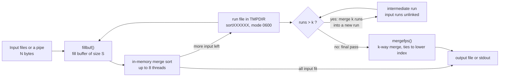

# External Merge Sort

> [!summary] Claim
> `sort` handles input larger than memory by writing sorted runs to temporary files and merging at most a fixed number of them per pass, so its cost is set by the buffer size, the fan-in, and the temporary directory, and each userland gets those three differently.

Part of [Coreutils and the Userland](README.md) in [Shell and Unix Engineering](../README.md).

## TL;DR

- Mechanism: fill a memory buffer, sort it, write it as a run in `TMPDIR`, repeat; then merge at most k runs at a time (GNU k = 16, BSD 15) until one stream remains, so the passes over the data are 1 + ceil(log_k(runs)).
- Rule: give `sort` a real buffer (`-S`), a big private temporary directory (`-T`, or several), and `LC_ALL=C` when byte order is enough, and use one ordering and one locale for both the run sort and the merge.
- Trap: `sort -m` never checks its input, so unsorted runs or runs sorted under other options give silently wrong output; on macOS, `sort -m -o ./x x y` truncates `x` before reading it.
- Portability fact: POSIX specifies only `-m`, `-o`, and `TMPDIR` (added in Issue 8); `-S`, `-T`, `--batch-size`, `--compress-program`, and `--parallel` are extensions, and BusyBox accepts `-m`, `-S`, and `-T` but sorts everything in memory.
- When not to use it: data that does not fit on the temporary file system, non-line records, a need for transactional output, or more than one machine; reach for a database or a distributed shuffle instead.

## Mental model



Input flows into a buffer; when the buffer fills before the input ends, the sorted buffer becomes a run file in the temporary directory and the buffer is reused.
If the whole input fits, the sorted buffer goes straight to the output and no temporary file is created.
Once input ends, runs are merged k at a time into new runs (each consumed run is unlinked) until at most k remain, and the last pass merges those directly into the output.
Ties in every merge go to the run that came from earlier input, which is why a stable sort stays stable across runs.

## How it works

### What POSIX requires

POSIX.1-2024 XCU `sort` defines three modes: sort, merge (`-m`, "the input file shall be assumed to be already sorted"), and check (`-c`, `-C`).
It says `-o` names an output file that "can be the same as one of the input files", which forces every implementation to read all input before it destroys the output.
It specifies no memory or temporary-file option: the RATIONALE notes that "an undocumented `-T` option exists in some implementations" and encourages `TMPDIR` instead, and Issue 8 applied Austin Group Defect 862 to add `TMPDIR` to the ENVIRONMENT VARIABLES section ("a pathname that shall override the default directory for temporary files, if any").
The same RATIONALE omits the historical `-z` (record size) option because "it is not standard practice on most systems and is inconsistent with using sort to sort several files individually and then merge them together", noting that its historical text "appeared to require implementations to determine the proper buffer length during the sort phase of operation, but not during the merge".
So spilling to disk is invisible to the standard: a conforming `sort` may sort entirely in memory (BusyBox does) or externally (GNU, BSD, uutils do).

### The algorithm

External merge sort has two phases.
Run formation reads as much input as fits in M bytes of memory, sorts it, and writes it out, giving R = ceil(N / M) runs for load-sort-store (GNU, BSD, uutils all use this).
Merging reads k runs at once through one buffer each, repeatedly emits the smallest head line, and writes one longer run; each pass divides the run count by k, so the merge needs ceil(log_k(R)) passes.
Every pass reads and writes all N bytes, so temporary I/O is about 2N per pass, and the final pass writes the output instead of a temporary file.
The fan-in k trades memory against passes: each open run needs a buffer and a file descriptor, so k is bounded by M divided by the buffer size and by `RLIMIT_NOFILE`.
Aggarwal and Vitter (CACM 31(9):1116-1127, 1988, [doi:10.1145/48529.48535](https://doi.org/10.1145/48529.48535)) proved that this shape, with k close to M/B for block size B, is optimal to a constant factor in I/O count: Theta((N/B) log_{M/B}(N/B)) block transfers.
Replacement selection (Knuth, TAOCP Vol. 3, Section 5.4.1, "Multiway Merging and Replacement Selection") keeps a heap of M records and emits the smallest one still not below the last output, which produces runs of about 2M on random input; an awk simulation on this host with M = 200 and N = 200000 measured an average run of 398 lines, a ratio of 1.99.
None of the four userlands uses it: they load, sort, and store, because an in-memory merge sort over a line-pointer array is cache-friendly and parallelizes, while a heap does one cache-missing comparison chain per record.

### GNU coreutils: `sort.c`

The functions below are the same in the 9.12 release and in `master` (as of 2026-11), which differ only in temporary-directory bookkeeping and an unreleased fix for compressed duplicate inputs.
`sort()` loops over the inputs calling `fillbuf()`, which reads into one buffer split into line text growing up and an array of `struct line` (four pointer-sized fields: `text`, `length`, `keybeg`, `keylim`, 32 bytes on LP64) growing down from the end.
The per-line reservation is `sizeof (struct line) * 3 / 2` = 48 bytes with one thread, because `sequential_sort()` uses the trick from Knuth exercise 5.2.4-10 (credited in the source to D. A. Bell, 1958) that needs room for 1.5N line records instead of 2N; with T threads it is `mult * sizeof (struct line)` where `mult` is 1 + ceil(log2 T), so 128 bytes at 8 threads.
That is the source of the manual's "using n threads increases the memory usage by a factor of log n".
When the buffer is full, the sorted lines go to `create_temp()`, which builds `TMPDIR/sortXXXXXX` and calls `mkostemp(file, O_CLOEXEC)` inside a critical section that blocks the caught signals, then appends the node to the `temphead` list.
If the input ended and nothing was spilled, the buffer is written straight to the output; this is also why `sort -o f f` is safe: the output is only truncated after all input is in memory.
After input ends, `merge()` runs: `while (nmerge < nfiles)` it performs as many full `nmerge`-way merges as fit, then one short merge sized so the leftovers plus the new outputs fit into the next pass ("merge as few files as possible, to avoid needless I/O").
`mergefps()` is the k-way merge: it keeps an `ord` permutation of the inputs sorted by their current line, outputs `cur[ord[0]]`, and reinserts that input by binary search, breaking ties with `cmp == 0 && ord0 < ord[probe]`, so the input with the lower index (earlier run) wins and the merge is stable.
Each merge input gets a buffer of `MAX (merge_buffer_size, sort_size / nfiles)`, where `merge_buffer_size` starts at 256 KiB.
Inputs are opened with `O_RDONLY | O_CLOEXEC` and `fadvise (fp, FADVISE_SEQUENTIAL)`.
`zaptemp()` unlinks each temporary file as soon as its merge consumes it, so peak temporary space is about N plus one pass of output, not N per pass.
If `open` fails with `EMFILE` mid-merge, the final loop in `merge()` closes one input, merges what it has into a new temporary file, and retries, as long as it can still open at least 2 inputs.

The buffer size limit comes from `default_sort_size()`: start at the smaller of `RLIMIT_DATA` and `RLIMIT_AS`, halve it, cap at 15/16 of `RLIMIT_RSS`, cap at 75% of physical memory, then take the minimum with the larger of available memory and 1/8 of total memory, and never go below `MIN_SORT_SIZE` (`nmerge * (2 + sizeof (struct line))`, 544 bytes at the default fan-in).
`-S` replaces that limit; a bare number means KiB, `b` means bytes, `%` is a share of physical memory, and `K M G T P E Z Y R Q` (and lowercase `k m g t`, from the suffix string `"EgGkKmMPQRtTYZ"`) are powers of 1024 (`specify_sort_size()`); several `-S` options keep the largest ("so that option order does not matter").
Since 9.12 (2026-09-14) the buffer starts small and grows by a factor of 3 up to the limit (`maybe_growbuf()`), and NEWS says sort "will now better use available memory and parallel operation when reading from unknown sized inputs like pipes"; for a pipe it first guesses 128 KiB of input (`INPUT_FILE_SIZE_GUESS`).
`--batch-size` sets `nmerge` (default `NMERGE_DEFAULT` 16, minimum 2); `specify_nmerge()` rejects anything above `RLIMIT_NOFILE` minus 3 with "maximum --batch-size argument with current rlimit is N", although the manual says sort "silently uses a smaller value" (the lab shows the error: 17 under `ulimit -n 20`).
`-T` may be repeated; `create_temp_file()` cycles `temp_dir_index` through the directories round-robin, which is how the manual's advice to put temporaries "on different file systems" spreads I/O.
`--parallel` defaults to `MIN (num_processors, DEFAULT_MAX_THREADS)` with `DEFAULT_MAX_THREADS = 8`, and threads only help the in-memory sort of each buffer; the merge of runs is single-threaded.
`--compress-program=PROG` starts `PROG` with `posix_spawnp()` (no shell) for every temporary file and `PROG -d` for every read-back, allows at most `nmerge + 2` children, and since 9.9 continues uncompressed with a warning if `PROG` cannot run.
Signals in `term-sig.h` (`SIGALRM`, `SIGINT`, `SIGQUIT`, `SIGHUP`, `SIGTERM`, `SIGUSR1`, `SIGUSR2`, `SIGILL`, `SIGTRAP`, `SIGABRT`, `SIGBUS`, `SIGFPE`, `SIGSEGV`, `SIGXCPU`, `SIGXFSZ` and others) get `sighandler()`, which unlinks every file on the list, restores `SIG_DFL`, and re-raises; a signal already ignored at startup is left ignored, and `SIGKILL` leaves `sortXXXXXX` files behind.

### FreeBSD and macOS: `bsdsort` (`2.3-FreeBSD`, `2.3-Apple`)

macOS ships the FreeBSD sort rewrite (`VERSION "2.3-Apple (" SORT_VERSION ")"` in Apple's `sort.h`; this host prints `2.3-Apple (201)`).
`set_hw_params()` sets `free_memory` to physical memory (`_SC_PHYS_PAGES * _SC_PAGESIZE`, despite the name) and `available_free_memory` to half of it, at least 1024 bytes.
`procfile()` adds each line to a list and, once `list->memsize >= available_free_memory`, sorts the list into a temporary file with `sort_list_to_file()`.
`-S` accepts a number with an uppercase suffix `K M G T P E Z Y` or `b` (a bare number is KiB) or `%` of `available_free_memory`, so `-S 50%` is a quarter of RAM; any other suffix, including lowercase `k`, prints a warning and falls back to the default (`parse_memory_buffer_value()`).
`max_open_files` defaults to 16 and `shrink_file_list()` merges groups of `max_open_files - 1` = 15 files while 16 or more remain; `--batch-size=N` sets `max_open_files = N + 1` when N is at least 2 (a smaller value is silently ignored), so the fan-in is N, and the value is not checked against `RLIMIT_NOFILE` (macOS `probe.sh batch-limit` gives `status=0` under `ulimit -n 20`).
The merge (`file_headers_merge()`) is a binary heap whose comparator `file_header_cmp()` breaks ties by `file_pos`, so it is stable too.
The default directory is `/var/tmp` (`tmpdir` in `file.c`), overridden by `TMPDIR` and then `-T`.
FreeBSD creates `TMPDIR/.bsdsort.XXXXXXXXXX` with `mkstemp(3)` since commit `3f9e5e59` (2022-10-12, "sort: use mkstemp(3) instead of reinventing it"); Apple's `text_cmds` still builds `TMPDIR/.bsdsort.PID.N` with `sprintf` and opens it with `fopen(fn, "w")`, which follows a symlink (the lab plants one).
`--compress-program` runs through `popen()` and `/bin/sh`: `"%s > %s"` to write and `"cat %s | %s -d"` to read, with neither name quoted.
Apple sizes that command buffer as `strlen(fn) + 128` and fills it with `snprintf(cmd, cmdsz - 1, ...)`, so a program path longer than about 116 bytes truncates the read command and one longer than about 123 bytes truncates the write command; `sort` then exits 0 with empty output (lab: `status=0 lines=0` with a 200-byte path), while FreeBSD now uses `asprintf()`.
When `-o` names an input by the same string (`strcmp`, not inode), `main()` writes to `outfile.tmp` (appending `.tmp` until the name is free), then `unlink()`s and `rename()`s it over the original; that name is registered as a temporary file, so `openfile()` creates it under `umask(S_IWGRP | S_IWOTH | S_IRGRP | S_IROTH)` (066), and the result is mode 0600 with a new inode.
Threads (`SORT_THREADS`) default to the online CPU count capped at 32, `--parallel` is capped at 1024, and `nthreads` is forced to 1 when the output is standard output or there are no file operands (input from standard input).
`sig_handler()` handles `SIGTERM`, `SIGHUP`, `SIGINT`, `SIGQUIT`, `SIGABRT`, `SIGBUS`, `SIGSEGV`, `SIGUSR1`, and `SIGUSR2` by calling `clear_tmp_files()` (which takes a semaphore) and `exit(-1)`, so an interrupted sort exits 255.

### BusyBox and uutils

BusyBox `coreutils/sort.c` (1.37.0) has no external phase at all: it reads every line with `xmalloc_fgetline()` into a `char **` grown by `xrealloc_vector()`, counts them in an `int linecount`, and calls `qsort()` once.
Its option string `"nghMVucszbrdfimS:T:o:k:*t:"` accepts `-m`, `-S`, and `-T`, and the source marks all three "ignored for GNU compatibility"; `-m` therefore performs a full sort, which is correct but needs memory for all input.
It opens `-o FILE` with `O_WRONLY|O_CREAT|O_TRUNC` only after reading all input, so in-place sorting keeps the inode.
uutils (`main`, as of 2026-11) uses two threads and two chunks: one thread reads, the other sorts, and full chunks are written to a `tempfile` directory named `uutils_sort*` created with mode 0700 (files inside are 0600); an explicit `-S`, or an automatic size above 512 MiB, is split between the two chunks, and an automatic chunk is at least 8 MiB (`ext_sort/threaded.rs`).
Without `-S` the buffer is the smaller of 12 times the input file size and a quarter of available (Linux) or physical memory, clamped to 512 KiB through 1 GiB, with a 32 MiB fallback (`buffer_hint.rs`).
Its merge is a `BinaryHeap` whose comparator breaks ties by `file_number`; the default fan-in is 64, or on Linux `RLIMIT_NOFILE / 4` clamped to 32 through 256, and an explicit `--batch-size` above `RLIMIT_NOFILE - 3` is rejected like GNU.

### A hand-built external sort

When the `sort` on a box cannot spill (BusyBox) or you need control over each phase, the lab's `extsort.sh` builds the same algorithm from POSIX tools: `awk` cuts runs and closes each file (`close()` keeps the descriptor count at one), `sort -o r r` sorts each run in place, and `sort -m` merges groups of `FANIN`.
It sets `LC_ALL=C` once and exports it, so run formation and merging cannot disagree on order.
Unlike GNU's `merge()`, it does not size the first pass to fill the last one, so it can do slightly more I/O than necessary; the pass count is still ceil(log_FANIN(runs)).

## Numbers and limits

| Quantity | Value | Source |
|---|---|---|
| GNU default fan-in | 16 (`NMERGE_DEFAULT`) | `sort.c` (as of 2026-11) |
| GNU fan-in bounds | 2 to `RLIMIT_NOFILE` - 3; above that is a fatal error | `specify_nmerge()`; lab: 17 at `ulimit -n 20` |
| GNU `struct line` | 32 bytes on LP64 | `sort.c` |
| GNU per-line reservation | 48 bytes at 1 thread, 128 bytes at 8 threads | `sort()` in `sort.c` |
| GNU minimum buffer | `nmerge` x 34 bytes = 544 bytes at fan-in 16 | `MIN_SORT_SIZE` |
| GNU merge buffer per input | at least 256 KiB, or `sort_size / nfiles` | `mergefps()` |
| GNU default buffer cap | 75% of physical memory since 8.18 (2012-08-12); was 100% from 8.16 | NEWS |
| GNU threads | min(CPUs, 8) | `DEFAULT_MAX_THREADS`, manual |
| GNU pipe size guess | 128 KiB | `INPUT_FILE_SIZE_GUESS` |
| BSD default buffer | half of physical memory, at least 1024 bytes | `set_hw_params()` |
| BSD fan-in | 15 by default; N with `--batch-size=N` | `shrink_file_list()`; lab: 213 and 401 temporary files |
| BSD threads | CPUs capped at 32; 1 when writing to stdout or reading stdin | `set_hw_params()`, `main()` in `sort.c` |
| Apple compress command buffer | `strlen(tmpname) + 128` bytes | Apple `file.c` `openfile()`; lab |
| uutils fan-in | 64; Linux `RLIMIT_NOFILE / 4` in 32..256 | `sort.rs` (as of 2026-11) |
| uutils automatic buffer | 512 KiB to 1 GiB, fallback 32 MiB | `sort.rs`, `buffer_hint.rs` |
| BusyBox limit | all lines in RAM; `int` line count | `sort.c` 1.37.0 |
| Temporary files for 200 short lines, `-S 1b` | Apple: 213 (fan-in 16), 401 (fan-in 2); GNU 9.12, 12 CPUs: 53 and 98 | lab, this host, 2026-11-15 |
| 2,000,000 lines (18 MB), GNU 9.12, `LC_ALL=C`, `--parallel=1` | 0.79 s at `-S 1M` (116 temporary files), 0.71 s at `-S 1G`; a second run on other random 8-digit lines: 1.28 s and 0.91 s | measured here, single runs, 2026-11-15 |
| Same input, `--parallel=8 -S 1G` | 0.27 s; second run 0.35 s | measured here, single runs |
| Same input in `en_US.UTF-8`, `--parallel=1` | 4.69 to 5.29 s; second run 5.55 s | measured here, single runs |
| Replacement selection run length | 1.99 M (M = 200, N = 200000) | awk simulation here |

The host was an Apple M3 Pro (12 CPUs, 36 GiB) on macOS 27.3 with GNU coreutils 9.12 from Homebrew and `/usr/bin/sort` `2.3-Apple (201)`.
The spill at `-S 1M` cost only about 11% in the first run and about 40% in the second, because the temporary files never left the page cache; on a cold disk the same plan costs a full extra read and write of 18 MB.
The locale cost (about 6x to 6.5x here) dwarfs the spill cost, which is the usual result: the comparison function, not the disk, is the bottleneck until the data exceeds RAM.

## Portability

What the shell under test must provide for `extsort.sh` (`set -eu`, `mktemp -d`, `trap ... EXIT`, `$(( ))`, `set --` with `${1+"$@"}`):

| Shell | Runs `extsort.sh` | Evidence |
|---|---|---|
| POSIX sh | yes; only `mktemp` is outside POSIX.1-2024 | spec; lab |
| macOS bash 3.2 (`/bin/sh`) | 18 of 18 tests pass | lab run here, 2026-11-15 |
| bash 5.3 | 18 of 18 | lab run here |
| zsh 5.9 native | 18 of 18 (the script never relies on field splitting) | lab run here |
| `zsh --emulate sh` | 18 of 18 | lab run here |
| dash | 18 of 18 | lab run here |
| posh 0.14.1 | needs `${1+"$@"}`: it aborts on an empty `"$@"` under `set -u` | measured in the shell matrix |

How each `sort` behaves (GNU and Apple cells are lab assertions run on this host; BusyBox cells are lab assertions the matrix has not run yet, backed by the cited `sort.c` lines; FreeBSD and uutils cells are cited source lines):

| Behavior | GNU coreutils 9.12 | macOS `2.3-Apple` | FreeBSD | BusyBox 1.37 | uutils |
|---|---|---|---|---|---|
| Spills to `TMPDIR` | yes (lab) | yes (lab) | yes (`procfile()`) | never: one `qsort()` (source, lab) | yes (`ext_sort`) |
| Default directory | `/tmp` (`DEFAULT_TMPDIR`) | `/var/tmp` | `/var/tmp` | none | `TMPDIR` or system default |
| Temporary name | `sortXXXXXX`, `mkostemp` | `.bsdsort.PID.N`, `fopen` | `.bsdsort.XXXXXXXXXX`, `mkstemp` | none | `uutils_sort*/`, 0700 |
| `-S` suffixes | `b % K M G T P E Z Y R Q`, also `k m g t` | `b % K M G T P E Z Y`; `k` warns and is ignored | as macOS | parsed, ignored | own parser |
| Fan-in | 16, `--batch-size` max `NOFILE - 3` (lab) | 15, `--batch-size=N` unchecked (lab) | as macOS | none; no long options, so `--batch-size` is a usage error (source, lab) | 64 or Linux heuristic |
| `--compress-program` | `posix_spawnp`, no shell | `popen` via sh; long path gives empty output, status 0 (lab) | `popen` via sh, `asprintf` | rejected as a usage error (source, lab) | spawned directly |
| `-o f f` | same inode, mode kept (lab) | rename of a new 0600 file, hard links split (lab) | as macOS (source) | same inode: `O_TRUNC` open after reading (source, lab) | not tested |
| `-m -o ./x x y` | detects by inode, safe (lab) | compares names, truncates `x` (lab) | as macOS (source) | safe, reads all first (source, lab) | not tested |
| `-m` on unsorted input | garbage, status 0 (lab) | garbage, status 0 (lab) | as macOS | sorts it: `FLAG_m` is ignored (source, lab) | not tested |
| Merge ties | lower input index first (lab: stable) | lower `file_pos` first (lab: stable) | as macOS | single `qsort` with position key for `-s` | lower `file_number` first |

## Worked example

The [lab](../labs/08-external-merge-sort/) has three scripts and one test file.
`extsort.sh` is the hand-built external sort; this is the full file:

```sh
#!/bin/sh
# extsort.sh: a portable external merge sort built from awk, sort, and sort -m.
#
# Usage: extsort.sh [-o OUTPUT] RUN_LINES FANIN [FILE...]
#
# Phase 1 cuts the input into runs of RUN_LINES lines and sorts each run.
# Phase 2 merges at most FANIN runs at a time until one run is left.
# With -o, the result goes to OUTPUT and "runs=R passes=P" goes to stdout;
# without -o, the result goes to stdout and nothing else is printed.
# Ordering is byte order (LC_ALL=C) in every phase, so runs and merges agree.
set -eu

usage() {
  printf 'usage: extsort.sh [-o OUTPUT] RUN_LINES FANIN [FILE...]\n' >&2
  exit 2
}

output=
if [ "${1-}" = -o ]; then
  [ "$#" -ge 2 ] || usage
  output=$2
  shift 2
fi
[ "$#" -ge 2 ] || usage
run_lines=$1
fanin=$2
shift 2
case $run_lines in
  '' | *[!0-9]* | 0) usage ;;
  *) ;;
esac
case $fanin in
  '' | *[!0-9]* | 0 | 1) usage ;;
  *) ;;
esac

LC_ALL=C
export LC_ALL

work=$(mktemp -d "${TMPDIR:-/tmp}/extsort.XXXXXX")
trap 'rm -rf "$work"' EXIT
trap 'exit 129' HUP
trap 'exit 130' INT
trap 'exit 143' TERM

# Phase 1: run formation. awk writes r0.1, r0.2, ... and prints the run count.
nruns=$(awk -v n="$run_lines" -v dir="$work" '
  (NR - 1) % n == 0 { if (f != "") close(f); f = dir "/r0." (++k) }
  { print > f }
  END { print k + 0 }' ${1+"$@"})
i=1
while [ "$i" -le "$nruns" ]; do
  sort -o "$work/r0.$i" "$work/r0.$i"
  i=$((i + 1))
done

# Phase 2: merge passes. Pass p reads r<p>.1..n and writes r<p+1>.1..out.
pass=0
n=$nruns
while [ "$n" -gt "$fanin" ]; do
  next=$((pass + 1))
  j=1
  out=0
  while [ "$j" -le "$n" ]; do
    set --
    while [ "$#" -lt "$fanin" ] && [ "$j" -le "$n" ]; do
      set -- ${1+"$@"} "$work/r$pass.$j"
      j=$((j + 1))
    done
    out=$((out + 1))
    sort -m -o "$work/r$next.$out" "$@"
    rm -f "$@"
  done
  pass=$next
  n=$out
done

# Final pass: merge the last n <= FANIN runs straight into the destination.
set --
j=1
while [ "$j" -le "$n" ]; do
  set -- ${1+"$@"} "$work/r$pass.$j"
  j=$((j + 1))
done
passes=$pass
if [ "$n" -gt 1 ]; then
  passes=$((pass + 1))
fi
if [ -n "$output" ]; then
  if [ "$n" -eq 0 ]; then
    : >"$output"
  else
    sort -m -o "$output" "$@"
  fi
  printf 'runs=%s passes=%s\n' "$nruns" "$passes"
elif [ "$n" -gt 0 ]; then
  sort -m "$@"
fi
```

With 2000 scrambled lines, runs of 10 lines, and a fan-in of 3, the lab asserts this output and a byte-for-byte match with `LC_ALL=C sort` (200 -> 67 -> 23 -> 8 -> 3 -> 1):

```console
$ ./extsort.sh -o got 10 3 in
runs=200 passes=5
```

For 10 runs the lab asserts `passes=4` at fan-in 2, `passes=3` at 3, `passes=2` at 9, and `passes=1` at 10.

`probe.sh` interrogates the `sort` on `PATH`; `count-compress.sh` is a pass-through `--compress-program` that logs one `write` per temporary file and one `read` per read-back.
Captured on this host with `/usr/bin/sort` (`2.3-Apple (201)`) and then GNU 9.12 first on `PATH`; the lab asserts these values per implementation:

```console
$ ./probe.sh temps 16              # macOS
status=0 written=213 read=213 sorted=yes
$ ./probe.sh temps 2               # macOS
status=0 written=401 read=401 sorted=yes
$ ./probe.sh longprog              # macOS
status=0 lines=0
$ ./probe.sh inplace               # macOS
f=a b link=split mode=-rw-------
$ ./probe.sh merge-alias           # macOS
x=b
$ ./probe.sh predict               # macOS
victim=overwritten
$ ./probe.sh temps 16              # GNU, 12 CPUs
status=0 written=53 read=53 sorted=yes
$ ./probe.sh longprog              # GNU
status=0 lines=200
$ ./probe.sh inplace               # GNU
f=a b link=shared mode=-rw-r--r--
$ ./probe.sh merge-alias           # GNU
x=a b c
$ ./probe.sh batch-limit           # GNU
status=2
with current rlimit is 17
```

The macOS count follows from the source: `-S 1b` makes every line its own run (200), fan-in 16 merges them into 13, and the final pass writes the output, so 213 files are written and 213 read back.

## Pitfalls

> [!warning] The temporary directory fills up
> Trigger: a sort larger than free space in `TMPDIR` (often a small `/tmp` or a container's tmpfs).
> Symptom: GNU dies with `sort: write failed: /tmp/sortXXXXXX: No space left on device` (the format from `sort_die()`), status 2, after doing most of the work; on tmpfs the "spill" also consumes RAM, so the sort competes with itself.
> Fix: point `-T` (or `TMPDIR`) at a large disk-backed file system, repeat `-T` to spread runs across disks, budget about the input size plus one merge output of free space, and consider `--compress-program=zstd` (it reads stdin, writes stdout, and accepts `-d`).

> [!warning] `sort -m` trusts its inputs
> Trigger: merging files that were not sorted, were sorted with other keys or options (`-f`, `-n`, `-k`), or were sorted under another `LC_COLLATE`.
> Symptom: output that is not sorted, with status 0; the lab shows `sort -m` of `b a` and `c` printing `b a c` in GNU and macOS.
> Fix: use the identical options and locale for the run sort and the merge (export `LC_ALL` once, as `extsort.sh` does), and verify runs with `sort -c` (status 1 on disorder, which the lab asserts) when they come from elsewhere.

> [!warning] macOS `sort -m -o` destroys an input named differently
> Trigger: `sort -m -o ./x x y`, `sort -m -o /abs/x x y`, or any alias of an input through `..` or a symlink.
> Symptom: macOS `2.3-Apple` compares `-o` with each operand by `strcmp`, sees no match, opens `./x` for writing before reading `x`, and leaves only `b` (lab); with 300000-line files the same command left 300000 of 600000 lines.
> Fix: never let `-o` alias an input on BSD-derived sort; write to a new file in the same directory and `mv` it (see [[install-and-Atomic-Deployment]]), or use GNU sort, which compares inodes in `avoid_trashing_input()`.

> [!warning] macOS `sort -o f f` changes the file's identity
> Trigger: in-place sort with the same name on macOS or FreeBSD.
> Symptom: the file is replaced by `rename()` of a new `f.tmp` created under a 066 umask: mode becomes 0600, the inode changes, hard links keep the old content, and ownership becomes the caller's (lab: `link=split mode=-rw-------`).
> Fix: sort to a temporary file and copy back over the original if identity matters, or use GNU or BusyBox, which keep the inode (lab).

> [!warning] A long `--compress-program` path silently empties the output on macOS
> Trigger: `--compress-program` with a path longer than about 116 bytes (deep build or CI workspace paths can exceed this) and enough input to spill.
> Symptom: the `popen()` command is truncated at `strlen(tmpname) + 126` characters, `sh` reports "No such file or directory", and `sort` exits 0 with zero lines (lab); a missing compressor gives the same silent empty result on macOS, while GNU 9.9 and later warn and continue uncompressed.
> Fix: pass a short name found through `PATH` (the lab's `temps` mode does this), check the output line count, or use GNU sort.

> [!warning] Suffix spelling of `-S` differs
> Trigger: `sort -S 4k` or `-S 2g` on macOS or FreeBSD.
> Symptom: macOS prints `sort: 4k: Invalid argument`, exits 0, and uses its default of half of physical memory (measured here); GNU accepts both cases.
> Fix: write uppercase suffixes (`4K`, `2G`) or plain KiB counts, which every implementation that honors `-S` reads the same way.

> [!warning] GNU `--batch-size` above the descriptor limit is fatal
> Trigger: a script that sets `--batch-size=1000` and runs under a low `ulimit -n` (systemd services, containers).
> Symptom: `sort: --batch-size argument '1000' too large` and `maximum --batch-size argument with current rlimit is N`, status 2, although the manual says the value is silently reduced (lab with `ulimit -n 20`).
> Fix: compute the value from `ulimit -n` minus 3 or leave the default; see [[Resource-Limits-and-ulimit]].

> [!warning] The default buffer is sized from the machine, not your share of it
> Trigger: many parallel `sort` processes, or one in a memory-limited container.
> Symptom: GNU sizes each buffer up to 75% of physical memory (8.18 NEWS) and `sort.c` itself has no cgroup logic, so N concurrent sorts can overcommit and swap or meet the OOM killer; gnulib's `physmem_available()` and `physmem_total()` read host-wide `sysconf(_SC_AVPHYS_PAGES)`, `/proc/meminfo`, or `sysinfo()` and contain no cgroup code ([`physmem.c`](https://raw.githubusercontent.com/coreutils/gnulib/master/lib/physmem.c), as of 2026-11), so in a container the default can exceed the cgroup memory limit (the floor alone is 1/8 of the host's memory).
> Fix: set `-S` explicitly per process (for example the job's memory budget divided by its concurrency) and remember that `--parallel=T` multiplies the per-line overhead by 1 + ceil(log2 T).

> [!warning] BusyBox cannot sort more than memory
> Trigger: an Alpine or embedded image where `sort` is BusyBox, given a large file.
> Symptom: `-S` and `-T` are accepted and ignored, memory grows with the input, and the process is killed; `-m` performs a full in-memory sort (lab: `spill 1b` succeeds with a missing `TMPDIR`).
> Fix: install GNU coreutils, or chunk and merge with `extsort.sh`, knowing its `sort -m` calls are still in-memory sorts of each group, so keep groups small.

## Security and robustness

Temporary runs are full copies of the input, so sorting secrets puts them on disk: GNU creates them 0600 with `mkostemp()`, BSD sets a 066 umask around `fopen()` of temporary files, and uutils makes its directory 0700, but unlinking does not scrub blocks, and a crashed or `SIGKILL`ed sort leaves them in place.
Predictable temporary names are an old class of bug in this exact utility: CVE-1999-1095 records that "sort creates temporary files and follows symbolic links, which allows local users to modify arbitrary files that are writable by the user running sort, as observed in updatedb and other programs that use sort", and FreeBSD-SA-01:13 (CVE-2001-0310, announced 2001-01-29) covers FreeBSD's sort using "easily predictable temporary file names" so that an attacker could make it abort ("This allows an attacker to cause the sort(1) command to abort").
FreeBSD's current bsdsort moved to `mkstemp(3)` in 2022, but Apple's `text_cmds` version still names files `.bsdsort.PID.N` and opens them with `fopen(fn, "w")`; the lab plants a symlink at `.bsdsort.PID.0` (the pid is known because `sh -c '...; exec sort'` keeps it) and the target file is overwritten with the first run.
The exposure needs a `TMPDIR` that another user can write: macOS gives each user a private 0700 `DARWIN_USER_TEMP_DIR` under `/var/folders`, but bsdsort falls back to the world-writable `/var/tmp` (mode 1777 here) when `TMPDIR` is unset, which can happen for daemons and cron jobs; no CVE for the current Apple code was found (as of 2026-11).
Pass `-T` to a private directory for any privileged or batch sort.
BSD's `--compress-program` is interpolated unquoted into a `/bin/sh` command line, so a `TMPDIR` containing spaces or shell metacharacters breaks it or runs code; treat `TMPDIR` as trusted input there, and read [[Command-Injection]].
GNU spawns the compressor without a shell; its development tree also fixed `--compress-program` treating an unset `PATH` like an empty one, which could run a same-named program from the current directory ("bug introduced in coreutils-9.9", fixed after 9.12 as of 2026-11).
A hostile or runaway input becomes a disk-exhaustion attack on the shared temporary file system; cap it with a dedicated volume or quota, or with `ulimit -f`, which turns an oversized temporary file into `SIGXFSZ`, a signal GNU catches to remove its files.
GNU's handler only calls `unlink()` before re-raising and protects the list with blocked signals (`cs_enter()`), while BSD's handler takes a semaphore and calls `exit()`, neither of which is async-signal-safe (see [[Async-Signal-Safety]]).
When `sort` writes to a closed pipe, GNU ignores `SIGPIPE` internally and re-raises it on `EPIPE` only if it was at its default at startup, so pipelines see the usual 141 (see [[SIGPIPE-and-EPIPE]]).
For robust scripts, check the exit status, check that output line counts match input line counts when the stakes are high, and never write the output over an input except by `-o` with the exact same name on GNU.

## The principal's view

On one machine, GNU `sort` is a well-engineered external sorter: stable merges, inode-based alias detection, bounded descriptors, cleanup on catchable signals, and threads for run formation.
The staff-plus decision is less about the algorithm than about the three resources it consumes: memory per process (`-S`), temporary space and its bandwidth (`-T`), and comparison cost (`LC_ALL`, key options).
Measure before tuning: on this host, an 18 MB sort that spilled to about a hundred runs was 11% to 40% slower than an in-memory one (two single runs), while switching from `C` to `en_US.UTF-8` cost about 6x to 6.5x.
Standardize on GNU coreutils for data pipelines on macOS (Homebrew `gsort`) and Alpine: the macOS sort has silent data-loss modes (aliased `-m -o`, truncated compressor commands) that its exit status does not report.
Hand-rolling an external sort in shell (`extsort.sh`) is the right call only when the platform sort cannot spill or when runs must be produced or merged by separate jobs; otherwise one `sort` invocation does fewer passes and fewer forks.
Move off `sort` when records are not lines, when the job needs restartable checkpoints (a killed sort loses all work), when output must be transactional, or when the data exceeds one machine's temporary storage; then a database's external sort or a distributed shuffle (sorting by sampled range partition, then per-partition sorts) is the tool.
For joins and deduplication downstream, sorted order is the contract: [[join-and-comm]] and [[uniq-and-Counting]] silently misbehave on input sorted under another locale, so the locale belongs in the pipeline's interface, not in the user's environment.

## Interview questions

> [!question] L5: How many passes does an external merge sort make over the data?
>
> > [!success]- Answer
> > Run formation is one pass and creates R = ceil(N / M) runs for load-sort-store.
> > Each merge pass divides the run count by the fan-in k, so merging takes ceil(log_k(R)) passes.
> > The total is 1 + ceil(log_k(R)); the lab shows 200 runs at fan-in 3 needing 5 merge passes.
> >
> > Follow-up: Why does GNU's `merge()` do one short merge before the last pass?

> [!question] L5: Predict the output of `printf 'b\na\n' >x; printf 'c\n' >y; sort -m x y` with GNU sort, then with BusyBox sort.
>
> > [!success]- Answer
> > GNU prints `b`, `a`, `c`: `-m` assumes sorted inputs and merges head to head, so `b` beats `c`, then `a` beats `c`.
> > BusyBox prints `a`, `b`, `c` because it ignores `-m` and sorts everything in memory.
> > Neither reports an error; `sort -c x` exits 1 in both.
> >
> > Follow-up: How would you make a merge pipeline fail fast on unsorted input?

> [!question] L5: Why is `sort -o f f` safe but `sort f >f` empties the file?
>
> > [!success]- Answer
> > The shell performs `>f` with `O_TRUNC` before `sort` starts, so `sort` reads an empty file.
> > With `-o`, POSIX allows the output to be an input, so `sort` reads all input before writing.
> > GNU opens the file at startup without truncating it and calls `ftruncate()` only when it begins writing the result.
> >
> > Follow-up: What does macOS do differently, and what does it break?

> [!question] L6: Debug this script, which loses data on a Mac but not on Linux: `sort -m -o ./all.txt all.txt new.txt`.
>
> > [!success]- Answer
> > macOS sort decides whether `-o` aliases an input by comparing strings, and `./all.txt` is not the string `all.txt`.
> > So it opens and truncates `./all.txt` before reading `all.txt`, and only `new.txt` survives.
> > GNU compares device and inode in `avoid_trashing_input()` and copies the input to a temporary file first.
> > Fix: merge into `all.txt.new` in the same directory and `mv` it into place.
> >
> > Follow-up: Which other in-place behavior of macOS sort changes the file's mode?

> [!question] L6: A nightly job runs 12 `sort` processes on a 64 GiB box and starts swapping: what do you change?
>
> > [!success]- Answer
> > Each GNU sort may size its buffer up to 75% of physical memory, so 12 of them overcommit.
> > Set `-S` per process to the memory budget divided by concurrency, and account for the thread overhead factor of 1 + ceil(log2 T).
> > Put `-T` on a disk-backed volume, not tmpfs, so spilled runs do not also consume RAM.
> > Set `LC_ALL=C` if byte order is acceptable, because comparison cost usually dominates.
> >
> > Follow-up: How would you confirm from the outside that a sort is spilling, and how much?

> [!question] L6: Why does stability survive an external merge in GNU sort?
>
> > [!success]- Answer
> > Runs are created in input order, so for equal keys the earlier line is in the lower-numbered run.
> > `mergefps()` breaks comparison ties with `ord0 < ord[probe]`, so the lower-indexed input always goes first.
> > With `-s` the last-resort whole-line comparison is off, so equal keys keep input order; the lab checks this with 60 lines forced into many runs.
> >
> > Follow-up: What breaks if a hand-built merge passes the runs to `sort -m` in a different order?

> [!question] L7+: Design the sort of a 10 TB line file on one host with 64 GiB RAM and two NVMe drives.
>
> > [!success]- Answer
> > With a 48 GiB buffer, run formation yields about 200 runs (10 TiB / 48 GiB is 213); a fan-in of 256 merges them in one pass, so the data is read twice and written twice (runs, then output).
> > Give each merge input a buffer of about 4 MiB so reads stay sequential, which at fan-in 256 is about 1 GiB of merge buffers.
> > Put runs on one drive and output on the other (`-T` per drive), and budget at least 10 TB of temporary space.
> > Check `ulimit -n` against the fan-in, consider a fast compressor if the drives, not the CPUs, are the bottleneck, and set `LC_ALL=C`.
> > A crash loses everything, so for this size prefer a job that writes runs as durable chunks and can resume the merge.
> >
> > Follow-up: When does replacement selection's 2M run length save a pass?

> [!question] L7+: Why do GNU, BSD, and uutils use load-sort-store instead of replacement selection, which halves the number of runs?
>
> > [!success]- Answer
> > Halving runs saves a merge pass only when R is just above a power of the fan-in; with fan-ins of 16 to 256 that is rare.
> > Load-sort-store sorts an array of line records with a cache-friendly merge sort that parallelizes across threads; replacement selection does a heap operation per record, which is serial and cache-hostile.
> > Variable-length lines also make a fixed-M heap of records awkward to manage in one buffer.
> >
> > Follow-up: For what input order does replacement selection produce a single run?

> [!question] L6: Why does a `--compress-program` that works on Linux make the job print nothing and exit 0 on macOS?
>
> > [!success]- Answer
> > macOS sort builds the compressor command for `popen()` in a buffer of `strlen(tmpname) + 128` bytes, so a long program path is truncated.
> > The shell fails to run the truncated command, each temporary file reads back empty, and sort still exits 0.
> > Use a short program name found through `PATH`, or GNU sort, which spawns the program without a shell.
> >
> > Follow-up: What other property of a `popen()` command line makes `TMPDIR` a security input on BSD?

## Related

Prerequisites: [[sort-Keys-and-Stability]]

Next: [[uniq-and-Counting]]

See also: [[mktemp]], [[Resource-Limits-and-ulimit]], [[Locale-and-LC_ALL]], [[join-and-comm]], [[Compression-gzip-zstd-xz]], [[install-and-Atomic-Deployment]], [[Async-Signal-Safety]], [[SIGPIPE-and-EPIPE]], [[Traps-and-EXIT]], [[Command-Injection]], [[Four-Userlands-GNU-BSD-BusyBox-uutils]], [[Userland-Portability-Traps]]

## Further reading

- [POSIX.1-2024 XCU sort](https://pubs.opengroup.org/onlinepubs/9799919799/utilities/sort.html): the three modes, `-o` aliasing an input, `TMPDIR`, and the rationale for leaving `-T` and `-z` out.
- [GNU coreutils `sort.c`](https://raw.githubusercontent.com/coreutils/coreutils/master/src/sort.c): `fillbuf()`, `default_sort_size()`, `merge()`, `mergefps()`, and `avoid_trashing_input()` are the whole external sort in one file.
- [GNU coreutils manual source, sort invocation](https://raw.githubusercontent.com/coreutils/coreutils/master/doc/coreutils.texi): `-S`, `-T`, `--batch-size`, `--compress-program`, and `--parallel` as documented (the source shows where the text and code differ).
- [GNU coreutils NEWS](https://raw.githubusercontent.com/coreutils/coreutils/master/NEWS): when `--batch-size` (7.0), `--compress-program` (6.8), threads (8.6), the 75% cap (8.18), and growable buffers (9.12) arrived.
- [FreeBSD `usr.bin/sort/file.c`](https://raw.githubusercontent.com/freebsd/freebsd-src/main/usr.bin/sort/file.c): `procfile()`, `shrink_file_list()`, and the heap merge of bsdsort.
- [Apple `text_cmds` `sort/file.c`](https://raw.githubusercontent.com/apple-oss-distributions/text_cmds/main/sort/file.c): the macOS variant, with predictable temporary names and the fixed-size `popen()` buffer.
- [BusyBox `coreutils/sort.c`](https://raw.githubusercontent.com/mirror/busybox/master/coreutils/sort.c): a single in-memory `qsort()` and the options it ignores.
- [uutils `merge.rs`](https://raw.githubusercontent.com/uutils/coreutils/main/src/uu/sort/src/merge.rs): a heap merge with file-number tie-breaking and descriptor-aware batching.
- [FreeBSD-SA-01:13.sort](https://security.freebsd.org/advisories/FreeBSD-SA-01:13.sort.asc): the advisory on predictable temporary names in sort.
- [Aggarwal and Vitter, "The Input/Output Complexity of Sorting and Related Problems", CACM 31(9):1116-1127, 1988](https://doi.org/10.1145/48529.48535): the lower bound that makes multiway merge sort optimal.
- Knuth, The Art of Computer Programming, Vol. 3, Section 5.4: external sorting, replacement selection, and the merge patterns that `sort.c` cites.
