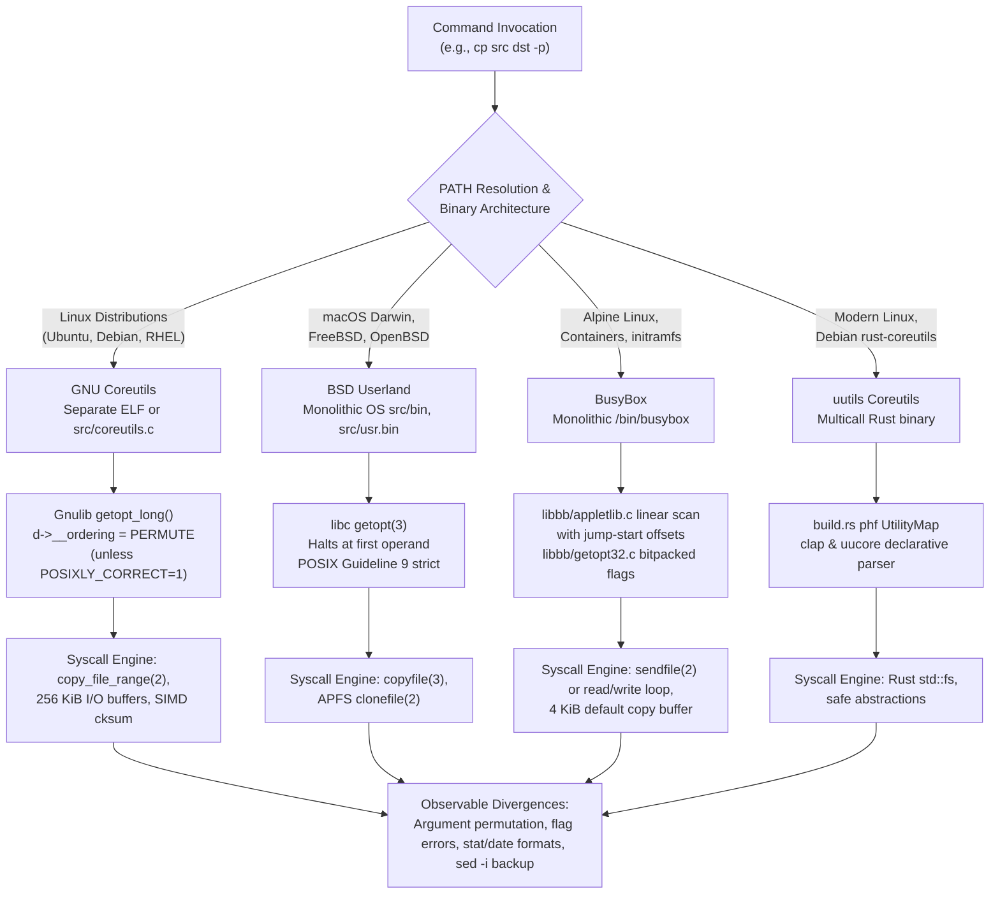

# Four Userlands: GNU, BSD, BusyBox, and uutils

> [!summary] Claim
> Cross-platform shell portability in production fails primarily at the utility boundary rather than the shell grammar, because the four prevailing userlands - GNU Coreutils, BSD/macOS, BusyBox, and Rust uutils - enforce conflicting argument permutation models, divergent CLI flag dialects, fundamentally different binary dispatch architectures, and disparate memory-safety bounds.

Part of [Coreutils and the Userland](README.md) in [Shell and Unix Engineering](../README.md).

## TL;DR

- **Mechanism**: GNU coreutils permutes `argv` via Gnulib `getopt_long()` while BSD strictly halts option processing at the first non-option operand (POSIX.1-2024 Guideline 9), BusyBox multiplexes hundreds of applets through a linear scan of a sorted name table (sped up by at most 8 precomputed jump-start offsets) with bitpacked `getopt32()` flags, and Rust `uutils` executes safe multicall routines dispatched through a generated `phf` perfect-hash map, with `clap` and `uucore` parsing arguments.
- **Rule**: Never place command options after positional operands, avoid implementation-specific flags (`stat -c` vs `-f`, `date -d` vs `-r`, `sed -i` vs `-i ''`), and test scripts under both POSIX strict ordering (`POSIXLY_CORRECT=1`) and minimal container userlands.
- **Trap**: Scripts tested only on developer workstations fail silently or catastrophically in deployment: under GNU and BusyBox `sed -i ''` takes the empty argument as the (empty) script and the real script as an input file, `cp ... -v` treats `-v` as a destination directory under BSD, and `uutils` `rm` accepted the abbreviation `--no` for `--no-preserve-root` until [PR #10205](https://github.com/uutils/coreutils/pull/10205) (2026-01).
- **Portability fact**: Measured in the shell matrix images and on the macOS host, `cp src dst -p` succeeds via argument permutation under GNU coreutils 9.7 (Debian 13) and BusyBox 1.37.0, but aborts under macOS with `cp: -p: Not a directory` unless options precede operands; `POSIXLY_CORRECT=1` forces GNU coreutils (and BusyBox built on glibc) into strict POSIX Guideline 9 ordering, while BusyBox on musl (Alpine) ignores it and keeps permuting.
- **When not to use it**: When a workflow requires complex filesystem introspection, sub-second high-volume loops, or multi-platform date and string manipulation, replace shell-orchestrated external userland utilities with a portable compiled or scripting runtime ([[Python-as-a-Shell-Companion]] or Go).

## Mental model



When a shell executes an external command, the kernel loader resolves the binary through `PATH` to one of four distinct userland architectures.
GNU Coreutils and BSD invoke discrete binaries compiled against distinct C libraries, whereas BusyBox and uutils resolve commands through single-binary multicall dispatchers that inspect `argv[0]`.
Once loaded, the command parses its argument vector using an implementation-specific parser: Gnulib `getopt_long()` permutes trailing options to the front by default, while BSD `getopt(3)` halts option evaluation at the very first non-option operand in accordance with POSIX.1-2024 Guideline 9.
BusyBox unpacks flags into compact bitmasks via `getopt32()` after a linear scan of its sorted applet name table, while uutils delegates argument validation to the Rust `clap` engine.
Finally, each userland binds to the operating system through different system calls and I/O buffer geometries - from GNU's `copy_file_range(2)` with a 256 KiB read/write fallback to Darwin's `copyfile(3)` and BusyBox's low-footprint `sendfile(2)` or `read(2)`/`write(2)` loops - producing observable differences in flags, exit codes, and stream buffering.

## How it works

### Lineage, Governance, and Ecosystem Role

The Unix utility landscape is divided across four major implementations, each shaped by distinct architectural priorities, licensing frameworks, and operating environments (as of 2026-11):

1. **GNU Coreutils**:
   Created under the Free Software Foundation (FSF) by Richard Stallman, David MacKenzie, Jim Meyering, and others.
   In 2003, GNU Coreutils 5.0 merged three previously separate packages: `fileutils` (`cp`, `ls`, `mv`, `rm`), `textutils` (`cat`, `sort`, `uniq`, `wc`), and `sh-utils` (`date`, `echo`, `env`, `true`, `who`).
   GNU coreutils is licensed under GPLv3+ and forms the default userland for standard Linux distributions, including Debian, Ubuntu, Fedora, Red Hat Enterprise Linux, Arch Linux, and openSUSE.
   Coreutils 9.5 (released 2024-03-28) doubled default I/O buffers to 256 KiB, and Coreutils 9.6 (released 2025-01-17) made `cksum -a crc` use AVX2, AVX512, and ARMv8 SIMD extensions alongside POSIX.1-2024 additions such as `timeout -f` (`--foreground`) and `timeout -p` (`--preserve-status`) ([coreutils NEWS](https://raw.githubusercontent.com/coreutils/coreutils/master/NEWS)).
   Coreutils 9.12 (released 2026-09-14) is the latest release (as of 2026-11, per NEWS); stable distributions lag, for example Debian 13 ships 9.7 (measured in the shell matrix).

2. **BSD Userland (FreeBSD, OpenBSD, and Apple macOS Darwin)**:
   Descended from the Computer Systems Research Group (CSRG) 4.4BSD-Lite2 release at UC Berkeley.
   BSD utilities are maintained as an integral part of the operating system base repository (`src/bin` and `src/usr.bin`), co-developed and versioned directly with the kernel and C library.
   Apple's macOS Darwin userland derives primarily from FreeBSD and NetBSD, maintained within open-source packages such as `file_cmds`, `text_cmds`, and `shell_cmds`.
   Because Apple adopted a strict policy against incorporating GPLv3 software into macOS base systems, Darwin userland tools remained frozen to BSD-licensed utilities and pre-GPLv3 versions (for example, keeping Bash 3.2.57 and BSD-derived userland utilities).
   BSD tools adhere strictly to classical Unix conventions and avoid gratuitous extensions.

3. **BusyBox**:
   Created by Bruce Perens in 1995 as a utility for the Debian bootloader, later maintained by Erik Andersen and currently maintained by Denys Vlasenko ([Landley's BusyBox forensics](https://busybox.net/~landley/forensics.txt) for Perens, 1995, and Andersen; [busybox.net](https://www.busybox.net/about.html) for the current maintainer).
   Known as "The Swiss Army Knife of Embedded Linux", BusyBox combines tiny versions of hundreds of Unix utilities into a single multicall executable: `busybox --list` prints 304 applets in Alpine 3.22's 1.37.0 build and 271 in Debian 13's (measured in the shell matrix).
   Licensed under GPLv2 only, BusyBox is engineered specifically for constrained environments: embedded systems, OpenWrt routers, initramfs/initrd rootfs environments, and lightweight container images such as Alpine Linux.
   Its core design prioritizes minimal binary size and low memory consumption over exhaustive flag compatibility.

4. **uutils Coreutils**:
   Initiated in 2013 by Jordi Boggiano (the repository's initial commit, by Boggiano, is dated 2013-08-02; [uutils/coreutils](https://github.com/uutils/coreutils)) and lead-maintained by Sylvestre Ledru; Ledru, Samuel Tardieu, and Stefano Zacchiroli describe it in "Rust Coreutils: Rebuilding Unix Foundations in a Modern Language" ([arXiv:2608.07135](https://arxiv.org/abs/2608.07135), first submitted 2026-08-07, with IEEE Software DOI 10.1109/MS.2026.3733266).
   Written in Rust and licensed under the permissive MIT license, uutils is a clean-room, memory-safe drop-in replacement for GNU Coreutils.
   The project tracks upstream GNU Coreutils bug-for-bug, targeting full compatibility across CLI flags, error messages, and POSIX/GNU test suites.
   Release 0.11.0 (2026-08-31) reported 653 passing GNU tests, a 95.33% pass rate, and the latest release is 0.12.0 (2026-09-17) (as of 2026-11, [releases](https://github.com/uutils/coreutils/releases)).
   Ubuntu 25.10 made it the default coreutils, with GNU kept installable as `coreutils-from-gnu` ([Ubuntu Discourse](https://discourse.ubuntu.com/t/migration-to-rust-coreutils-in-25-10/59708)); it is also packaged in Debian (`rust-coreutils`), and Fedora and Arch packages exist ([Repology](https://repology.org/project/uutils-coreutils/versions), as of 2026-11).

### Binary Architecture: Discrete vs Multicall Dispatch

The four userlands employ fundamentally different process execution and dispatch architectures:

```
Discrete Execution (Standard GNU / BSD):
execve("/bin/cp", ["cp", "src", "dst"], envp)
  -> Kernel loads ELF/Mach-O binary
  -> Dynamic linker resolves glibc / libSystem
  -> main() in cp.c executes directly

Multicall Binary Execution (BusyBox / uutils / GNU single-binary):
execve("/bin/cp", ["cp", "src", "dst"], envp)   [symlink to /bin/busybox]
  -> Kernel loads single multicall executable
  -> Dispatcher inspects argv[0] ("cp")
  -> BusyBox: find_applet_by_name() linear scan -> cp_main()
  -> uutils: UtilityMap (phf) lookup -> uutils_cp::uumain()
```

In GNU Coreutils and BSD, each utility traditionally compiles to an independent binary executable.
When a script executes `ls` followed by `cp`, the kernel handles two independent `execve(2)` system calls, resolving and loading two distinct ELF or Mach-O binaries and their dynamic libraries.
GNU Coreutils also supports an optional multicall configuration via `./configure --enable-single-binary=symlinks` (introduced in GNU Coreutils 8.23, released 2014-07-18 per NEWS; `src/coreutils.c` credits Alex Deymo as author).
When enabled, `src/coreutils.c` acts as a multiplexer: it inspects `argv[0]` or the `--coreutils-prog=NAME` option and calls the target utility entry point function, which the build renames from each program's `main` to `single_binary_main_<name>` (e.g., `single_binary_main_ls`).

BusyBox is inherently a multicall binary.
In `libbb/appletlib.c`, execution enters `main(int argc, char **argv)`.
BusyBox strips the leading path from `argv[0]` to extract the command name.
It then resolves the command using `find_applet_by_name(const char *name)`.
At build time, `applets/applet_tables.c` sorts the applet names with `qsort()`, packs them into one NUL-separated string `applet_names`, and emits `KNOWN_APPNAME_OFFSETS` jump-start offsets (8 by default, 4 when there are fewer than 128 applets, 0 when there are fewer than 32).
At run time, `find_applet_by_name()` picks the last offset whose name sorts at or before the target and then scans linearly, stopping early once it has gone past the name alphabetically (simplified excerpt of upstream `libbb/appletlib.c`):

```c
p = applet_names;
#if KNOWN_APPNAME_OFFSETS <= 0
i = 0;
#else
i = NUM_APPLETS * (KNOWN_APPNAME_OFFSETS - 1);
for (j = ARRAY_SIZE(applet_nameofs)-1; j >= 0; j--) {
    const char *pp = applet_names + applet_nameofs[j];
    if (strcmp(name, pp) >= 0) {
        p = pp;
        break;
    }
    i -= NUM_APPLETS;
}
i /= (unsigned)KNOWN_APPNAME_OFFSETS;
#endif
/* Open-coded linear search without strcmp/strlen calls for speed */
while (*p) {
    for (j = 0; *p == name[j]; ++j) {
        if (*p++ == '\0')
            return i; /* found */
    }
    if (*p > name[j])
        break;  /* gone too far alphabetically */
    while (*p++ != '\0')
        continue;
    i++;
}
return -1;
```

This is a linear search over roughly one eighth of the table, not a binary search: the names are stored as one packed string with no per-applet name pointers, which keeps the table small at the cost of a short scan per lookup.
Furthermore, when BusyBox is compiled with `CONFIG_FEATURE_SH_STANDALONE=y` and run under its internal `ash` shell, `ash` checks the internal applet table before searching `PATH`.
NOFORK applets then run in-process without a `fork(2)`, NOEXEC applets run in the forked child without an `execve(2)`, and all other applets are started by re-executing the BusyBox binary itself (`bb_busybox_exec_path`) rather than a separate file on disk (`shell/ash.c`: `evalcommand()` and `tryexec()`).

In uutils Coreutils, multi-call dispatch is handled in `src/bin/coreutils.rs`.
The binary inspects `uucore::args_os()` to determine the invoked name (`src/bin/coreutils.rs`).
At build time, the top-level `build.rs` (not a procedural macro) writes `uutils_map.rs` with `phf_codegen`, defining `type UtilityMap<T> = phf::OrderedMap<&'static str, (fn(T) -> i32, fn() -> Command)>` and a `util_map()` function that maps utility names to their entry points (`uumain`) and `clap` command builders; lookup is a compile-time perfect hash, so it is O(1).
If invoked as `coreutils <utility> [args]`, the dispatcher shifts the arguments and routes execution to the specified crate; if invoked via a symlink, it uses the basename of `argv[0]`.

### Argument Parsing Engines and Permutation Rules

Command-line option parsing is a leading source of cross-userland production failures.
The divergence stems directly from whether an implementation conforms strictly to POSIX Utility Syntax Guidelines or implements GNU argument permutation.

POSIX.1-2024 Base Definitions Chapter 12 sets the standard for Unix command syntax:
- **Guideline 3**: Each option name should be a single alphanumeric character from the portable character set.
- **Guideline 7**: Option-arguments should not be optional.
- **Guideline 9**: All options should precede operands on the command line.
- **Guideline 10**: The first `--` argument that is not an option-argument should be accepted as a delimiter indicating the end of options; any following arguments should be treated as operands.

#### The Permutation Divergence

In GNU Coreutils, command-line arguments are parsed using Gnulib's `getopt_long()` in `lib/getopt.c`.
By default, Gnulib initializes the internal ordering mode to permutation (simplified excerpt of `_getopt_initialize()`; the full code first checks for a leading `-` in the optstring, which selects `RETURN_IN_ORDER`, and a leading `+`, which selects `REQUIRE_ORDER`):

```c
if (posixly_correct || !!getenv ("POSIXLY_CORRECT"))
  d->__ordering = REQUIRE_ORDER;
else
  d->__ordering = PERMUTE;
```

When `d->__ordering == PERMUTE`, `getopt_long()` scans the entire `argv` array from left to right.
If it encounters a non-option operand (such as a source filename), it does not halt.
Instead, it skips past the operand, continues scanning, and when it encounters subsequent options (such as `-v` or `--preserve`), it permutes `argv` in memory, shifting the options to precede the operands.
Consequently, in GNU Coreutils:
`cp file1 file2 -v`
is automatically rearranged and executed as:
`cp -v file1 file2`

In BSD and macOS Darwin libc (`lib/libc/stdlib/getopt.c`), standard `getopt(3)` enforces POSIX Guideline 9 (excerpt of FreeBSD's `getopt()`):

```c
place = nargv[optind];
if (optind >= nargc || *place++ != '-') {
    /* Argument is absent or is not an option */
    place = EMSG;
    return (-1);
}
```

Standard BSD `getopt(3)` does not permute arguments.
The moment it encounters `file1`, it detects that the argument does not begin with `-`.
It terminates option parsing immediately, sets `optind` to point to `file1`, and returns `-1`.
When BSD `cp` evaluates its remaining operands, it sees three positional operands: `file1`, `file2`, and `-v`.
Because copying multiple source files requires the final operand to be an existing directory, BSD `cp` attempts to open `-v` as a directory and fails with:
`cp: -v: Not a directory` (measured on macOS 27.3 with `cp src dst -p`, exit status 1)

In BusyBox, command-line options are parsed through `libbb/getopt32.c`.
`vgetopt32()` calls the C library's `getopt_long()` (when long options are compiled in) or `getopt()`, and packs matched boolean flags into a single 32-bit unsigned integer (`uint32_t`, also exposed as `option_mask32`).
`getopt32.c` itself never reads `POSIXLY_CORRECT`, so ordering comes from the libc: an applet options string beginning with `+` stops at the first operand everywhere, while `POSIXLY_CORRECT` disables permutation only where the libc honors it.
Measured in the shell matrix: Debian's BusyBox 1.37.0 (glibc) rejects `POSIXLY_CORRECT=1 busybox cp s d -p` (`cp: can't create '-p/s'`), but Alpine's BusyBox 1.37.0 (musl) still permutes and copies successfully.

In uutils Coreutils, arguments are processed using the `clap` crate and `uucore` wrappers.
By default, `clap` permits options to appear anywhere on the command line, mimicking GNU permutation.
Unlike GNU, `POSIXLY_CORRECT` does not switch uutils to strict ordering: `POSIXLY_CORRECT=1 cp s d -p` still succeeds with the uutils 0.12.0 release binaries, measured on Linux (aarch64, glibc) and on macOS (as of 2026-11).

### System Call Specialization and Performance Paths

Behind identical CLI commands, the four userlands invoke entirely different operating system primitives:

1. **File Copying (`cp`, `install`, `mv`)**:
   - **GNU Coreutils**: Since 9.0, `cp`, `install`, and `mv` use `copy_file_range(2)` when available (NEWS) to perform in-kernel, server-side offloaded copies without transferring data between kernel and user space.
     If `copy_file_range(2)` returns `EXDEV` or is unsupported, `cp` falls back to standard read/write loops; NEWS records no `splice(2)` path for `cp` (release 9.11 added zero-copy I/O to `cat` only).
     GNU `cp --reflink=auto` issues the `FICLONE` ioctl (the generic name of the former `BTRFS_IOC_CLONE`) to create copy-on-write extents on filesystems that support it, such as Btrfs and XFS ([ioctl_ficlone(2)](https://man7.org/linux/man-pages/man2/ioctl_ficlone.2.html)).
     As of version 9.5, `cp`, `mv`, `install`, `cat`, and `split` read and write a minimum of 256 KiB at a time instead of 128 KiB, which NEWS reports increased throughput by 10% to 20% when reading cached files.
   - **BSD / macOS Darwin**: Uses Darwin's `copyfile(3)` library interface and `clonefile(2)` system call to achieve zero-copy copy-on-write clones on APFS volumes.
     Standard BSD `cp` supports `-X` to strip extended attributes and prevent generating AppleDouble (`._*`) metadata files on non-HFS/APFS volumes.
   - **BusyBox**: Replaces heavy copy abstraction layers with libbb's shared file-descriptor copy loop, which `libbb/copy_file.c` calls.
     With the default `CONFIG_FEATURE_USE_SENDFILE=y` it copies with `sendfile(2)` and falls back to a `read(2)`/`write(2)` loop when `sendfile()` does not work; `CONFIG_FEATURE_COPYBUF_KB` defaults to 4 KiB (range 1 to 1024), kept on the stack at 4 KiB or less and `mmap`-allocated above that ([libbb/Config.src](https://raw.githubusercontent.com/mirror/busybox/master/libbb/Config.src)), trading peak streaming I/O throughput for minimal resident memory.
   - **uutils Coreutils**: Implements file copying via Rust's standard library `std::fs::copy`, which internally issues `copy_file_range(2)` on modern Linux targets.
     For reflinks it calls `rustix::fs::ioctl_ficlone` on Linux (`platform/linux.rs`) and `clonefile(2)`, resolved at run time with `dlsym`, on macOS (`platform/macos.rs`); the non-reflink fast path goes through `uucore::buf_copy::copy_fast` (`src/uu/cp`).

2. **File and Filesystem Metadata (`stat`, `ls`)**:
   - **GNU Coreutils**: Relies on `fstatat(2)` and `statx(2)`.
     The `statx(2)` Linux system call allows GNU `stat` to selectively request only required metadata fields (such as creation time / btime), avoiding expensive disk seeks for unused attributes.
     Format strings use `-c` with percent directives (`%s` for size in bytes, `%a` for octal mode, `%Y` for mtime epoch).
   - **BSD / macOS**: Uses `fstatat(2)` and classical `stat(2)`.
     BSD `stat` rejects `-c` (`stat: illegal option -- c`, exit status 1, measured on macOS 27.3) and requires `-f` for custom formatting (`%z` for size in bytes, `%p` for octal mode including file type, `%m` for mtime epoch).
     In BSD `stat`, `-f` always takes a format argument (the usage line is `[-f format | -l | -r | -s | -x]`); BSD `stat` has no filesystem-status mode, which BSD systems leave to `df`, so `stat -f s file` simply prints `s` (measured on macOS 27.3).
   - **BusyBox**: The `stat` applet is optional (`CONFIG_STAT`).
     When enabled with `CONFIG_FEATURE_STAT_FORMAT=y`, BusyBox supports a subset of GNU `-c` format directives, and like GNU it uses `-f` for filesystem status (both measured in Alpine's build).
     Custom formats (`CONFIG_FEATURE_STAT_FORMAT`) and filesystem status (`CONFIG_FEATURE_STAT_FILESYSTEM`) are separate build options in `coreutils/stat.c`, so a trimmed build can lack either.
   - **uutils Coreutils**: Emulates GNU `stat -c` and `stat --format` syntax, parsing format tokens through a custom format scanner and mapping them to platform metadata queries.

3. **Date and Time Processing (`date`)**:
   - **GNU Coreutils**: Features a natural-language date parser implemented in Gnulib (`parse-datetime.y`, formerly `getdate.y`).
     It accepts complex human-readable date strings via `date -d "<string>"`, including `date -d "yesterday"`, `date -d "+3 days"`, and `date -d "@1700000000"`.
     GNU `date -r <file>` reads the modification timestamp of a reference file; it rejects integer epoch timestamps as file arguments.
   - **BSD / macOS Darwin**: Lacks natural-language parsing.
     BSD `date` uses `-r` for dual purposes: `date -r <file>` queries a reference file's timestamp, while `date -r <seconds>` parses an integer epoch timestamp directly into human-readable text.
     Relative date arithmetic requires the BSD-specific `-v` flag (for example, `date -v+1d`).
     BSD `date` completely rejects GNU's `-d` option (`date: illegal option -- d`, measured on macOS 27.3).
   - **BusyBox**: Implements a compact date parser in `coreutils/date.c`.
     BusyBox accepts `-d <string>`, but supports only a fixed set of numeric formats (such as `YYYY-MM-DD hh:mm[:ss]`) and `@<seconds>` epoch formats; English phrases cause a parse failure (`date -d yesterday` gives `date: invalid date 'yesterday'`, measured in Alpine's BusyBox 1.37.0).
   - **uutils Coreutils**: Re-implements GNU date parsing in Rust with the `parse_datetime` and `jiff` crates (`src/uu/date/Cargo.toml`), and accepts `-d @<seconds>` (measured with 0.12.0).

4. **In-Place Stream Editing (`sed -i`)**:
   - Although `sed` is maintained separately from coreutils in GNU (in GNU `sed`), it is universal to the userland ecosystem.
   - **GNU sed**: The `-i` option takes an *optional* backup suffix.
     If no suffix is provided, changes are written directly to the file without creating a backup (`sed -i 's/a/b/' file`).
     If an extension argument is provided, it *must* be concatenated directly with the flag without a space (`sed -i.bak 's/a/b/' file`).
     Passing a separate empty string (`sed -i '' 's/a/b/' file`) causes GNU sed to take `''` as the (empty) script and `s/a/b/` as an input file, failing with `sed: can't read s/a/b/: No such file or directory` and exit status 2 while leaving `file` unedited (measured in the shell matrix with GNU sed on Debian 13; the errno text read `Not a directory` there because a file named `s` existed in the working directory).
   - **BSD sed**: The `-i` option takes a *mandatory* backup suffix argument (consistent with POSIX Guideline 7, although POSIX does not standardize `sed -i`).
     To edit in-place without creating a backup, scripts must explicitly supply an empty string argument (`sed -i '' 's/a/b/' file`).
     If a script omits the empty string (`sed -i 's/a/b/' file`), BSD sed consumes `'s/a/b/'` as the backup extension and parses the file name as the sed script, so the error depends on the name's first character: `invalid command code f` for `file`, `command c expects \ followed by text` for `config.env`, and `undefined label 'est.txt'` for `test.txt` (measured on macOS 27.3).
   - **BusyBox sed**: Matches GNU syntax: `-i` takes an optional backup extension and does not accept a separate empty string argument; `sed -i '' 's/a/b/' f` fails with `sed: s/a/b/: ...` and exit status 1, leaving `f` unedited (measured in Alpine's BusyBox 1.37.0; the errno text depends on what the path `s/a/b/` resolves to).
   - **uutils**: Currently focuses on core utilities; stream editor tasks in uutils environments typically rely on GNU sed, BusyBox sed, or native Rust text filters.

## Numbers and limits

The following table compares architectural metrics, default resource limits, and measured behaviors across the four userlands (as of 2026-11):

| Dimension / Metric | GNU Coreutils (9.12; Debian 13 ships 9.7) | BSD / macOS (macOS 27.3) | BusyBox (1.37.0) | uutils Coreutils (0.12.0) | Primary Source / Authority |
| :--- | :--- | :--- | :--- | :--- | :--- |
| **Binary Footprint** | ~9.5 MB (sum of the 106 ELF files in Debian 13's `coreutils` 9.7 package, aarch64) | Not summed (no fixed coreutils set; macOS 27.3 has 37 entries in `/bin` and 936 in `/usr/bin`) | ~0.9 MB (919,304 bytes in Alpine 3.22; 920,280 bytes in Debian 13; one ELF binary) | ~12.7 MB (Linux aarch64 glibc) and ~14.2 MB (macOS aarch64); one multicall binary holding all utilities | Measured: `dpkg -L coreutils` and file sizes in Debian 13; `/bin/busybox` sizes; uutils 0.12.0 release binaries |
| **Applet / Utility Count** | 106 files in Debian 13's `coreutils` 9.7 package | No fixed set (see the footprint row) | 304 applets in Alpine 3.22's build, 271 in Debian 13's (configurable via Kconfig) | 107 (`coreutils --list`, 0.12.0) | `busybox --list \| wc -l` measured in the shell matrix; `dpkg -L coreutils`; `coreutils --list` |
| **Default I/O Copy Buffer** | 256 KiB minimum (raised in 9.5 from 128 KiB) | No figure given | 4 KiB default, range 1 to 1024 (`CONFIG_FEATURE_COPYBUF_KB`) | No fixed constant in `cp` (copies via `std::fs::copy` or `uucore::buf_copy::copy_fast`) | GNU Coreutils 9.5 NEWS; BusyBox `libbb/Config.src`; uutils `src/uu/cp` |
| **Option Ordering Default** | `PERMUTE` (options allowed after operands) | `REQUIRE_ORDER` (halts at first operand) | `PERMUTE` (libc `getopt_long()`; a leading `+` in the applet optstring forces strict order) | `PERMUTE` (via `clap`; `cp s d -p` succeeds, measured with 0.12.0) | Measured in the shell matrix; Gnulib `getopt.c`; FreeBSD `getopt.c`; BusyBox `getopt32.c` |
| **`POSIXLY_CORRECT` Support** | Yes (forces `REQUIRE_ORDER`, changes blocks) | No effect (already strictly non-permuting) | Depends on the libc: honored on glibc (Debian), ignored on musl (Alpine) | No (`POSIXLY_CORRECT=1 cp s d -p` still succeeds, measured with 0.12.0) | Gnulib `getopt.c`; BusyBox `getopt32.c` (never reads it); measured in the shell matrix and with the uutils release binaries |
| **Dispatch Lookup Complexity** | O(1) direct `execve(2)` per utility | O(1) direct `execve(2)` per utility | Linear scan from the nearest of up to 8 jump-start offsets (about N/8 names) | O(1) compile-time perfect hash (`phf::OrderedMap`) | `libbb/appletlib.c`, `applets/applet_tables.c`; uutils `build.rs` |
| **SIMD Hardware Acceleration** | Yes (AVX2, AVX512, and ARMv8 SIMD in `cksum -a crc` since 9.6; NEON in `wc -l` since 9.11) | Not assessed | Optional hardware-accelerated SHA-1 and SHA-256 where available (`CONFIG_SHA1_HWACCEL`, `CONFIG_SHA256_HWACCEL`) | Yes (the workspace depends on the `blake2b_simd`, `base64-simd`, and `blake3` crates) | GNU Coreutils 9.6 and 9.11 NEWS; BusyBox `libbb/Config.src`; uutils `Cargo.toml` |
| **Upstream Test Suite Pass Rate** | 100% (reference baseline implementation) | N/A (independent POSIX/BSD testsuites) | Not measured (the GNU suite is not run against BusyBox) | 95.33% (653 GNU tests passing in 0.11.0, 2026-08-31) | uutils release notes (as of 2026-11) |
| **Software License** | GPLv3+ (Free Software Foundation) | 2-Clause / 3-Clause BSD, Apple PSL | GPLv2 only (Denys Vlasenko / Erik Andersen) | MIT License (permissive) | Repository LICENSE files (as of 2026-11) |
| **Memory Safety Model** | C manual allocation (`malloc`/`free`) | C manual allocation (`malloc`/`free`) | C manual allocation (`xmalloc`/stack) | Safe Rust (borrow checker, zero UB by default) | Source implementations; CVE vulnerability records |
| **In-Place `sed -i` Syntax** | `-i[SUFFIX]` (no separate empty arg) | `-i <SUFFIX>` (requires `''` for no backup) | `-i[SUFFIX]` (no separate empty arg) | N/A (uses host `sed`) | Measured in the shell matrix and on macOS; `sed -i` is not in POSIX.1-2024 |
| **`stat` File Size Specifier** | `-c '%s'` | `-f '%z'` | `-c '%s'` (`CONFIG_FEATURE_STAT_FORMAT`) | `-c '%s'` (measured with 0.12.0) | Lab probe; measured in the shell matrix and on macOS |
| **Epoch Timestamp Parsing** | `date -d '@<sec>'` | `date -r <sec>` | `date -d '@<sec>'` | `date -d '@<sec>'` (measured with 0.12.0) | Lab probe; measured in the shell matrix and on macOS |

## Portability

The table below details cross-platform behaviors across the four userlands and standard shell environments, as measured in the shell matrix (GNU coreutils 9.7 on Debian 13, BusyBox 1.37.0 on Alpine 3.22) and on the macOS 27.3 host, or as cited; no uutils binary is in the matrix, so every uutils cell is unmeasured:

| Utility Invocation / Syntax | POSIX.1-2024 Standard | GNU Coreutils (glibc / Linux) | BSD Userland (macOS / FreeBSD) | BusyBox (Alpine Linux) | uutils Coreutils (Rust) | Portability Rule / Workaround |
| :--- | :--- | :--- | :--- | :--- | :--- | :--- |
| `cp src dst -p` (Option trailing operand) | Unspecified (Guideline 9 says options should come first) | Succeeds (`-p` permuted to option) | Fails (`cp: -p: Not a directory`, exit 1) | Succeeds (`-p` permuted to option) | Succeeds (`-p` permuted to option; measured with 0.12.0) | Always place all options before operands: `cp -p src dst`. |
| `POSIXLY_CORRECT=1 cp src dst -p` | Guideline 9 enforced | Fails (`cp: target '-p': No such file or directory`) | Fails (`cp: -p: Not a directory`) | Succeeds on Alpine (musl ignores `POSIXLY_CORRECT`); Debian's glibc build fails (`cp: can't create '-p/s'`) | Succeeds (`POSIXLY_CORRECT` does not disable permutation; measured with 0.12.0) | Permutation is not universally disabled: BusyBox on musl and uutils still permute, so fix the argument order instead. |
| `stat -c '%s' file` | Not standardized by POSIX | Prints byte size | Fails (`stat: illegal option -- c`, exit 1) | Prints byte size if compiled in | Prints byte size (measured with 0.12.0) | Use `wc -c < file \| tr -d ' '` for portable script size checks. |
| `stat -f '%z' file` | Not standardized by POSIX | Fails (`cannot read file system information for '%z'`, exit 1) and dumps filesystem info for `file` | Prints byte size | Fails (`can't read file system information for '%z'`, exit 1) and dumps filesystem info for `file` | Fails (`cannot read file system information for '%z'`, exit 1) and dumps filesystem info for `file` (measured with 0.12.0) | Do not use `stat -f` in scripts destined for Linux environments. |
| `date -d '@1700000000'` | Not standardized by POSIX | Formats epoch timestamp | Fails (`date: illegal option -- d`) | Formats epoch timestamp | Formats epoch timestamp (measured with 0.12.0) | Use `date -r 1700000000` on BSD, or format via `awk` / Python. |
| `date -r 1700000000` | Unspecified (POSIX `-u` only) | Fails (`date: 1700000000: No such file or directory`) | Formats epoch timestamp | Fails (`date: can't stat '1700000000': No such file or directory`) | Fails (`date: 1700000000: No such file or directory`, exit 1; measured with 0.12.0) | In GNU/BusyBox, `-r` expects a file path, not integer seconds. |
| `sed -i '' 's/a/b/' file` | Not standardized by POSIX | Fails (`sed: can't read s/a/b/: ...`, exit 2; `''` is taken as the script) | In-place edit without backup | Fails (`sed: s/a/b/: ...`, exit 1) | Host sed dependent | Test `sed -i ''` in probe or use temporary file with `mv`. |
| `xargs` on empty standard input | Executes utility exactly once without `-r`, zero times with `-r` ([xargs](https://pubs.opengroup.org/onlinepubs/9799919799/utilities/xargs.html)) | Executes utility once (GNU findutils) | Does not execute utility (`-r` accepted as a no-op) | Executes utility once | N/A (`xargs` is not part of coreutils) | Pass `-r`, now in POSIX.1-2024, which GNU, BusyBox, and BSD all accept. |
| `readlink -f symlink` | Not standardized (`readlink [-n] file`, new in Issue 8) | Resolves canonical path | Resolves canonical path on macOS 27.3 (measured) | Resolves canonical path | Resolves canonical path (measured with 0.12.0) | Use POSIX.1-2024 standard `realpath file` instead of `readlink -f`. |
| `echo -n "text"` | Implementation-defined; XSI systems print `-n` as text | `sh` (dash) and `bash` builtins print `text` (no newline) | macOS `/bin/sh` prints `-n text`; macOS `/bin/ksh` prints `text` | Builtin prints `text` (no newline) | Utility prints `text` (no newline; measured with 0.12.0) | Use `printf '%s' "text"` portably across all shells and userlands. |
| Long options (`--help`, `--version`) | Not required by POSIX | Universally supported | Rejected on almost all tools (`ls --version` and `cp --reflink` fail on macOS) | Build-dependent: Alpine's build accepts `cp --parents` and `--reflink` but rejects `cp --version` (`unrecognized option: version`) | Supported (`cp --version` and `cp --reflink=auto` measured with 0.12.0) | Never pass `--long-options` in scripts requiring BSD compatibility. |
| `cp --reflink=auto src dst` | Not standardized by POSIX | Supported (Btrfs, XFS copy-on-write) | Rejected (`cp: illegal option -- -`, exit 64) | Accepted by Alpine's build (exit 0) | Accepted (`cp --reflink=auto` exits 0 on Linux and macOS; measured with 0.12.0) | Gate reflink options behind explicit OS and userland detection. |
| `printf 'a\nb\nc\n' \| head -n -1` | Not standardized by POSIX | Prints `a` and `b` | Fails (`head: illegal line count -- -1`, exit 1) | Prints `a` and `b` (Alpine's build; needs `CONFIG_FEATURE_FANCY_HEAD`) | Prints `a` and `b` (measured with 0.12.0) | Use `sed '$d'` to drop the last line portably. |
| `printf 'a10\na2\n' \| sort -V` | Not standardized by POSIX | Prints `a2`, `a10` | Prints `a2`, `a10` (macOS 27.3) | Prints `a2`, `a10` (Alpine's build; needs `CONFIG_FEATURE_SORT_BIG`) | Prints `a2`, `a10` (measured with 0.12.0) | Do not assume `-V` on a trimmed BusyBox build or an older BSD. |

## Worked example

The companion [lab](../labs/08-four-userlands-gnu-bsd-busybox-uutils/) implements a probe script (`probe_userland.sh`) that detects userland flavor, verifies argument permutation dynamics, normalizes `stat` and `date` divergences, and performs safe in-place stream editing across GNU, BSD, BusyBox, and uutils environments.

Here is `probe_userland.sh`, verbatim from the lab:

```sh
#!/bin/sh
# probe_userland.sh: probe userland traits across GNU, BSD, BusyBox, and uutils.

set -eu

probe_flavor() {
  cp_out=$(cp --version 2>&1 || true)
  case "${cp_out}" in
    *"GNU coreutils"*)
      printf 'gnu\n'
      ;;
    *"BusyBox"*)
      printf 'busybox\n'
      ;;
    *"uutils coreutils"* | *"coreutils (uutils)"*)
      printf 'uutils\n'
      ;;
    *)
      ls_err=$(ls --version 2>&1 || true)
      case "${ls_err}" in
        *"illegal option"* | *"invalid option"* | *"unrecognized option"* | *"usage:"*)
          printf 'bsd\n'
          ;;
        *)
          printf 'unknown\n'
          ;;
      esac
      ;;
  esac
}

probe_permute() {
  dir="$1"
  src="${dir}/perm_src"
  dst="${dir}/perm_dst"
  printf 'data\n' >"${src}"
  if cp "${src}" "${dst}" -p >/dev/null 2>&1; then
    printf 'permute\n'
  else
    printf 'strict\n'
  fi
}

probe_stat_size() {
  file="$1"
  if [ ! -f "${file}" ]; then
    printf 'error: file not found\n' >&2
    return 1
  fi
  size=$(stat -c '%s' "${file}" 2>/dev/null || true)
  if [ -n "${size}" ]; then
    printf '%s\n' "${size}"
    return 0
  fi
  size=$(stat -f '%z' "${file}" 2>/dev/null || true)
  if [ -n "${size}" ]; then
    printf '%s\n' "${size}"
    return 0
  fi
  raw_wc=$(wc -c <"${file}")
  size=$(printf '%s\n' "${raw_wc}" | tr -d ' ')
  printf '%s\n' "${size}"
}

probe_date_epoch() {
  epoch="$1"
  res=$(date -u -d "@${epoch}" '+%Y-%m-%d %H:%M:%S' 2>/dev/null || true)
  if [ -n "${res}" ]; then
    printf '%s\n' "${res}"
    return 0
  fi
  res=$(date -u -r "${epoch}" '+%Y-%m-%d %H:%M:%S' 2>/dev/null || true)
  if [ -n "${res}" ]; then
    printf '%s\n' "${res}"
    return 0
  fi
  printf 'unsupported\n'
  return 1
}

probe_sed_inplace() {
  file="$1"
  pattern="$2"
  replacement="$3"
  tmp_test="${file}.probe_tmp"
  cp "${file}" "${tmp_test}"
  if sed -i '' "s/${pattern}/${replacement}/" "${tmp_test}" 2>/dev/null; then
    sed -i '' "s/${pattern}/${replacement}/" "${file}"
    rm -f "${tmp_test}"
  else
    rm -f "${tmp_test}"
    sed -i "s/${pattern}/${replacement}/" "${file}"
  fi
}

mode="${1:-help}"
case "${mode}" in
  flavor)
    probe_flavor
    ;;
  permute)
    if [ "$#" -lt 2 ]; then
      printf 'usage: %s permute <dir>\n' "$0" >&2
      exit 1
    fi
    probe_permute "$2"
    ;;
  stat_size)
    if [ "$#" -lt 2 ]; then
      printf 'usage: %s stat_size <file>\n' "$0" >&2
      exit 1
    fi
    probe_stat_size "$2"
    ;;
  date_epoch)
    if [ "$#" -lt 2 ]; then
      printf 'usage: %s date_epoch <seconds>\n' "$0" >&2
      exit 1
    fi
    probe_date_epoch "$2"
    ;;
  sed_inplace)
    if [ "$#" -lt 4 ]; then
      printf 'usage: %s sed_inplace <file> <pattern> <replacement>\n' "$0" >&2
      exit 1
    fi
    probe_sed_inplace "$2" "$3" "$4"
    ;;
  *)
    printf 'usage: %s {flavor|permute <dir>|stat_size <file>|date_epoch <seconds>|sed_inplace <file> <pat> <rep>}\n' "$0" >&2
    exit 1
    ;;
esac
```

When executed on the macOS 27.3 host with BSD base utilities, the probe produces the following captured output (run with `/bin/sh` during verification on 2026-11-15):

```text
$ ./probe_userland.sh flavor
bsd
$ ./probe_userland.sh permute "$TMPDIR"
strict
$ POSIXLY_CORRECT=1 ./probe_userland.sh permute "$TMPDIR"
strict
$ echo "test_payload" > "$TMPDIR/sample.txt"
$ ./probe_userland.sh stat_size "$TMPDIR/sample.txt"
13
$ ./probe_userland.sh date_epoch 1700000000
2023-11-14 22:13:20
$ ./probe_userland.sh sed_inplace "$TMPDIR/sample.txt" "payload" "verified"
$ cat "$TMPDIR/sample.txt"
test_verified
```

Inside a Debian container running GNU Coreutils, `cp src dst -p` succeeds (measured in the shell matrix), so the first probe reports `gnu` and the second `permute`, while the normalization probes are designed to produce identical results.
The Bats suite asserts the per-flavor expectations (BSD `strict`, GNU, BusyBox, and uutils `permute`; `POSIXLY_CORRECT` strict except BusyBox on musl and uutils); this output is from one run on the macOS host with the default `LAB_SHELL=sh`, and the matrix was not rerun in this pass:

```text
1..7
ok 1 detect userland flavor from core utilities
ok 2 argument permutation: GNU, BusyBox and uutils permute, BSD stops at the first operand
ok 3 POSIXLY_CORRECT disables permutation where the getopt honors it (glibc, BSD), not BusyBox on musl or uutils
ok 4 file size probe normalizes stat differences across implementations
ok 5 epoch timestamp formatting resolves date option incompatibilities
ok 6 in-place sed probe reconciles backup extension syntax
ok 7 shell builtin echo differs across families while printf is portable
```

## Pitfalls

> [!warning] Trailing options breaking under BSD / macOS
> **Trigger**: Writing a shell script on Linux that places flags after file arguments (such as `cp src.tar.gz /opt/dest/ -v` or `chown user:group /var/log/app.log -R`).
> **Symptom**: On Linux (GNU Coreutils), the command succeeds because Gnulib `getopt_long()` permutes trailing options to the front.
> On macOS or FreeBSD, BSD `getopt(3)` halts at `src.tar.gz`, treating `-v` as an operand; `cp` errors with `cp: -v: Not a directory`, and `chown` errors with `chown: -R: No such file or directory` (both error forms measured on macOS 27.3).
> **Fix**: Strict adherence to POSIX.1-2024 Guideline 9: place all options and flags immediately after the command name and before any positional operands (`cp -v src.tar.gz /opt/dest/`).
> Run CI validation with `export POSIXLY_CORRECT=1` to force GNU Coreutils to reject trailing options during development.

> [!warning] The `sed -i` empty string argument divergence
> **Trigger**: Running `sed -i '' 's/old/new/g' file` inside a Linux container, or running `sed -i 's/old/new/g' file` on macOS.
> **Symptom**: On macOS BSD sed, omitting the empty string consumes `'s/old/new/g'` as the backup extension and tries to parse the file name as the script, failing with an error that depends on the name (`invalid command code f` for `file`, `undefined label 'est.txt'` for `test.txt`; measured on macOS 27.3).
> On Linux GNU sed or BusyBox, providing `''` as a separate argument causes `sed` to take `''` as the (empty) script and `'s/old/new/g'` as an input file, failing with `sed: can't read s/old/new/g: No such file or directory` (BusyBox: `sed: s/old/new/g: ...`) while leaving the original file unedited (measured in the shell matrix).
> The error names a missing file rather than the flag, which is why this mismatch is slow to diagnose when a pipeline moves from macOS runners to Linux containers.
> **Fix**: Never pass `sed -i ''` blindly across platforms.
> Either probe `sed` behavior dynamically as shown in `probe_userland.sh`, write transformations to a temporary file via standard redirection and atomically rename with `mv`, or use `perl -pi -e 's/old/new/g' file`.

> [!warning] Stat format string collisions
> **Trigger**: Using `stat -c %s "$file"` to check file sizes in a script executed on macOS, or using `stat -f %z "$file"` on Linux.
> **Symptom**: On macOS, `stat -c` fails with `stat: illegal option -- c`.
> On Linux, GNU `stat -f` is the flag for reporting *filesystem* status rather than *file* status; GNU `stat` interprets `"%z"` as a non-existent file operand, prints `cannot read file system information for '%z': No such file or directory`, dumps raw filesystem block metrics for the target file, and exits 1 (measured in the shell matrix; BusyBox behaves the same).
> Scripts relying on size integers receive empty strings or multiline text, causing catastrophic arithmetic evaluation errors in downstream scripts.
> **Fix**: For file sizes, avoid `stat` completely in portable shell scripts; use `wc -c < "$file" | tr -d ' '`.
> When detailed metadata is required, branch explicitly on `uname -s` or userland detection.

> [!warning] Root-deletion guard bypass via `clap` option prefix matching in `uutils`
> **Trigger**: Invoking `rm` with an abbreviated long flag such as `rm -rf --no /` under `uutils/coreutils` releases from before January 2026.
> **Symptom**: GNU `rm` contains an explicit security guardrail in `src/rm.c`:
> `if (! streq (argv[optind - 1], "--no-preserve-root")) error (EXIT_FAILURE, 0, _("you may not abbreviate the --no-preserve-root option"));`
> GNU `getopt_long()` accepts unambiguous abbreviations in general, so GNU `rm` adds this check to reject abbreviating this one option and prevent accidental destruction of the root filesystem.
> Because uutils lets `clap` infer unambiguous long-option prefixes, `uutils` `rm` accepted `--no` as `--no-preserve-root`, bypassing the intentional barrier against root deletion ([issue #10188](https://github.com/uutils/coreutils/issues/10188), filed 2026-01-11).
> [PR #10205](https://github.com/uutils/coreutils/pull/10205) (opened 2026-01-12, merged 2026-01-19) added the same check: `rm.rs` now scans the raw arguments and fails with `MayNotAbbreviateNoPreserveRoot` unless the literal `--no-preserve-root` is present.
> **Fix**: Ensure `uutils` is updated to a release that includes PR #10205; the first tagged release after the merge is 0.6.0 (2026-02-02, [releases](https://github.com/uutils/coreutils/releases)).
> In infrastructure scripts, never rely on option abbreviations: specify full, unabbreviated flags and use `--` before path operands.

> [!warning] `date` epoch calculation divergence
> **Trigger**: Attempting to convert Unix epoch timestamps to UTC strings using `date -d @1700000000` on macOS or `date -r 1700000000` on Linux.
> **Symptom**: macOS BSD date aborts with `date: illegal option -- d`.
> GNU date interprets `-r` as `--reference=FILE`, sees `1700000000` as a filename, and aborts with `date: 1700000000: No such file or directory`.
> Build pipelines generating reproducible build timestamps or token expirations fail immediately upon switching runner architectures.
> **Fix**: Use `date -u -d "@$epoch"` on GNU/BusyBox and `date -u -r "$epoch"` on BSD, or delegate epoch conversions to `awk 'BEGIN{print strftime("%Y-%m-%d %H:%M:%S", 1700000000)}'` (where supported) or Python.

> [!warning] Unintended executions from `xargs` on empty input
> **Trigger**: Piping an empty find or grep output into `xargs rm` or `xargs curl` on Linux systems, after testing only on macOS.
> **Symptom**: POSIX.1-2024 specifies that without `-r`, `xargs` executes the utility exactly once when no arguments are supplied on standard input, and zero times with `-r` ([xargs](https://pubs.opengroup.org/onlinepubs/9799919799/utilities/xargs.html)).
> GNU findutils and BusyBox follow that rule: `printf '' | xargs echo RAN` prints `RAN` (measured in the shell matrix).
> macOS and FreeBSD do not: their `xargs` never runs the utility on empty input, and their manual page documents `-r` as accepted only for GNU compatibility and doing nothing (measured on macOS 27.3).
> If the command is `rm`, it may display a usage error; if the command is a deployment script expecting arguments, it runs unparameterized on Linux although it never ran on the developer's Mac.
> **Fix**: Pass `-r`: it is now in POSIX.1-2024 and GNU, BusyBox, and BSD `xargs` all accept it; on older systems without it, prepend a check ensuring input is non-empty before invoking `xargs`.

> [!warning] BusyBox Kconfig feature stripping in minimal containers
> **Trigger**: Deploying a script that uses GNU-only behavior (such as `date -d yesterday` or `cp --version`) into an Alpine Linux container, or GNU flags such as `head -n -5`, `sort -V`, `cp --parents`, or `find -mindepth 1` into a trimmed custom BusyBox initramfs build.
> **Symptom**: The command fails with `unrecognized option` or unexpected syntax errors: Alpine's BusyBox 1.37.0 prints `date: invalid date 'yesterday'` and `cp: unrecognized option: version`, although its stock build does accept `head -n -5`, `sort -V`, `cp --parents`, and `find -mindepth 1` (all measured in the shell matrix).
> BusyBox strips non-essential options at compile time to keep its binary footprint small, so a custom build can lack what Alpine's has.
> For example, negative line offsets in `head` require `CONFIG_FEATURE_FANCY_HEAD=y`, version sorting requires `CONFIG_FEATURE_SORT_BIG=y`, and long options require the per-applet `CONFIG_FEATURE_<APPLET>_LONG_OPTIONS=y`, for example `CONFIG_FEATURE_CP_LONG_OPTIONS`, which itself depends on `CONFIG_LONG_OPTS` (`coreutils/head.c`, `coreutils/sort.c`, `coreutils/cp.c`).
> **Fix**: Audit container scripts against baseline POSIX utilities.
> If GNU extensions are unavoidable, explicitly install `coreutils`, `findutils`, and `grep` packages in Alpine (`apk add --no-cache coreutils findutils grep`) rather than assuming BusyBox applets provide GNU parity.

## Security and robustness

Userland utility boundaries introduce critical security implications that differ sharply between C-based suites and modern memory-safe implementations:

### Option Hijacking and Defensive Operands

When user-controlled input is passed directly to command operands, leading hyphens cause utilities to interpret data as command-line options.
For example, if an application processes a file named `-rf`, invoking `rm $file` results in `rm` interpreting `-rf` as recursive force options.
POSIX.1-2024 Guideline 10 says the first `--` that is not an option-argument should be accepted as a delimiter marking the end of command options, with any following arguments treated as operands even if they begin with `-` (XBD 12.2).
In all four userlands, any argument following `--` is treated strictly as an operand:

```sh
# Vulnerable to option injection if file begins with '-'
rm "$file"

# Robust: options terminated before variable operands
rm -- "$file"

# Robust: path prefix prevents hyphen interpretation
rm "./$file"
```

A severe historical instance of argument injection occurred in `scp` (CVE-2020-15778): in OpenSSH through 8.3p1, the `toremote` function in `scp.c` passed the destination argument to the remote shell unescaped, so backtick characters in it allowed command injection ([NVD](https://nvd.nist.gov/vuln/detail/CVE-2020-15778)); the vendor declined to add validation, citing compatibility.

### Memory Safety: C Vulnerabilities vs Rust Guarantees

GNU Coreutils, BSD utilities, and BusyBox are implemented in C, relying on manual memory management.
Historically, parsing complex multibyte character sequences, structured text streams, or crafted files has triggered severe memory corruption:

1. **GNU Coreutils `sort` Heap Overflow (CVE-2015-4041)**:
   A heap-based buffer overflow existed in `keycompare_mb()` in `sort.c` of GNU Coreutils through 8.23 on 64-bit platforms ([NVD](https://nvd.nist.gov/vuln/detail/CVE-2015-4041), published 2020-01-24); `keycompare_mb()` comes from the downstream multibyte (i18n) patch that distributions apply, not from upstream `sort.c` (the name does not appear in upstream `src/sort.c` at tag v8.23 or on master).
   When sorting long UTF-8 strings, a size calculation that did not account for the number of bytes occupied by multibyte characters caused `sort` to write beyond its allocated heap buffer, leading to a crash or possibly other impact.
2. **GNU Coreutils `split` Heap Overflow (CVE-2024-0684)**:
   A heap-based buffer overflow occurred in `line_bytes_split()` in `src/split.c` ([NVD](https://nvd.nist.gov/vuln/detail/CVE-2024-0684) lists coreutils 9.2, 9.3, and 9.4 as affected, published 2024-02-06).
   When processing files with a mixture of very long and short lines under the `--line-bytes` option, `split` overwrote the heap, crashing the utility.
   The flaw was resolved in Coreutils 9.5 (released 2024-03-28): "split --line-bytes with a mixture of very long and short lines no longer overwrites the heap (CVE-2024-0684)" (NEWS).
3. **BusyBox `awk` Use-After-Free (CVE-2021-42378)**:
   Uncovered during security audits of BusyBox applets (Claroty Team82 and JFrog, per the [NVD](https://nvd.nist.gov/vuln/detail/CVE-2021-42378) references; affected BusyBox 1.16.0 through 1.33.1), the `getvar_i` function in the awk applet (`editors/awk.c`) suffered from a use-after-free when processing a crafted awk pattern, leading to denial of service and possibly code execution ([NVD](https://nvd.nist.gov/vuln/detail/CVE-2021-42378), published 2021-11-15).

In contrast, **uutils Coreutils** eliminates entire classes of spatial and temporal memory vulnerabilities by construction.
Because Rust enforces compile-time ownership, reference lifetimes, and bounds checking, vulnerabilities such as buffer overflows, use-after-free, double frees, and uninitialized memory access are prevented in safe Rust.
However, uutils introduces different robustness trade-offs: an unhandled failure triggers a thread panic (`panic!`), which by default prints a panic message (a backtrace only when `RUST_BACKTRACE` is set) and exits with status 101 rather than a classic C abort or signal, requiring verification that error exit codes match expected GNU standards.

### Symlink Race Conditions in Recursive Traversal

Recursive directory operations (`chmod -R`, `chown -R`, `rm -rf`) are vulnerable to time-of-check to time-of-use (TOCTOU) symlink substitution attacks.
If a low-privileged local user replaces a directory traversed by `chmod -R 777 /var/app` with a symbolic link pointing to `/etc`, an unhardened traversal utility might follow the symlink and modify permissions on sensitive system files.
GNU Coreutils 9.5 fixed a long-standing race condition in `chmod -R`: NEWS says it "now avoids a race where an attacker may replace a traversed file with a symlink, causing chmod to operate on an unintended file", by walking with gnulib `fts` and calling `fchmodat(2)` relative to the traversal directory descriptor (`fts_cwd_fd`) with `AT_SYMLINK_NOFOLLOW` for entries below the top level (`src/chmod.c`).
FreeBSD's `chmod -R` uses `fts(3)` with `FTS_PHYSICAL` unless `-L` is given, so symbolic links are not traversed recursively by default (`bin/chmod/chmod.c`; macOS userland derives from FreeBSD but its source was not read).

## The principal's view

From the perspective of a Principal or Staff Systems Engineer, userland divergence is an architectural risk that must be governed through standard engineering controls:

1. **Standardize Infrastructure Userlands**:
   Never allow production runtime environments to drift across userland flavors.
   Standardize container base images across the enterprise: if production services execute in Alpine Linux, developers must test against BusyBox userland in local containers, not against macOS BSD utilities or Ubuntu GNU utilities.
   If production operates on Debian or RHEL, enforce GNU Coreutils parity across all local development containers.

2. **Enforce POSIX Strictness in CI**:
   Export `POSIXLY_CORRECT=1` in continuous integration linting and test stages.
   Setting `POSIXLY_CORRECT=1` disables GNU argument permutation, immediately surfacing latent bugs where developers placed flags after operands.
   Combine this with ShellCheck checks (such as SC2086 for quoting and SC2248/SC2312) to catch portability defects prior to deployment.

3. **Strategic Adoption of Rust `uutils`**:
   The transition toward Rust-based core utilities (`uutils`) represents a fundamental architectural improvement for memory safety in Linux foundations.
   Ubuntu made `rust-coreutils` its default coreutils in 25.10, and Debian packages it as an opt-in alternative to GNU Coreutils.
   Enterprise engineering teams should monitor and benchmark uutils, particularly in security-critical edge environments, container base images, and systems where GPLv3 restrictions preclude GNU Coreutils.

4. **The Transition Boundary: When to Abandon Shell**:
   Shell scripts should act strictly as coordination glue between robust binaries.
   The moment a shell script requires:
   - Complex date or calendar math across heterogeneous servers;
   - Parsing binary data, high-precision timing, or raw filesystem inodes;
   - Complex in-place text replacement across macOS development laptops and Linux production servers;
   it has exceeded the domain of portable shell engineering.
   Mandate that such logic transition immediately to a compiled language (Go, Rust) or a standardized scripting runtime ([[Python-as-a-Shell-Companion]]).
   A single ten-line Python script or twenty-line Go binary eliminates thousands of dollars in debugging costs caused by subtle userland flag divergence.

## Interview questions

> [!question] L5: Predict the output and exit status of `cp file1 file2 -v` when executed on macOS Darwin versus Ubuntu Linux.
>
> > [!success]- Answer
> > On Ubuntu Linux running GNU Coreutils, the command succeeds with exit status 0 and prints `'file1' -> 'file2'`.
> > Gnulib `getopt_long()` permutes arguments by default, shifting trailing options to the front of `argv`.
> > On macOS Darwin running BSD userland, standard `getopt(3)` halts option processing at the first non-option operand (`file1`).
> > BSD `cp` interprets `file1`, `file2`, and `-v` as three positional operands.
> > Because copying multiple operands requires the target operand to be an existing directory, BSD `cp` attempts to open `-v` as a directory and exits with status 1, printing `cp: -v: Not a directory`.
> >
> > Follow-up: How does exporting `POSIXLY_CORRECT=1` affect the command's execution under GNU Coreutils?

> [!question] L5: Debug this script: an engineer tests `sed -i '' 's/localhost/127.0.0.1/g' config.env` on a macOS laptop, but it fails in a Linux Docker container during CI.
>
> > [!success]- Answer
> > BSD sed on macOS requires a mandatory argument for the `-i` option, where `''` signifies an empty extension to prevent creating a backup file.
> > GNU sed on Linux treats the backup extension for `-i` as optional and expects it concatenated directly (for example, `-i.bak`).
> > When GNU sed encounters `''` as a separate argument, it takes `''` as the (empty) script and `s/localhost/127.0.0.1/g` as an input file.
> > GNU sed attempts to open a file named `s/localhost/127.0.0.1/g`, fails with `sed: can't read s/localhost/127.0.0.1/g: No such file or directory`, and exits with status 2 without changing `config.env` (the empty script copies it unchanged; behavior measured in the shell matrix).
> > The robust fix is to avoid `-i` differences by redirecting stream output to a temporary file in the same filesystem and atomically replacing it via `mv`, or writing a platform probe that conditionally omits the empty string on GNU systems.
> >
> > Follow-up: Why does using a temporary file with `mv` provide stronger operational safety than `sed -i`?

> [!question] L6: Explain how GNU Coreutils `getopt_long()` implements argument permutation internally, and explain how the `POSIXLY_CORRECT` environment variable changes that behavior.
>
> > [!success]- Answer
> > Inside Gnulib `getopt.c`, the parser maintains an internal ordering state `d->__ordering`.
> > By default, `d->__ordering` is initialized to `PERMUTE`.
> > When `getopt_long()` encounters a non-option operand, it advances past it and records the start and end indices of the non-option slice.
> > As subsequent option arguments are discovered further along in `argv`, `getopt_long()` rotates memory elements in `argv` so options precede non-options.
> > If the option string starts with `+`, or the environment variable `POSIXLY_CORRECT` is set, `d->__ordering` is set to `REQUIRE_ORDER` (a leading `-` is checked first and selects `RETURN_IN_ORDER`).
> > Under `REQUIRE_ORDER`, option scanning terminates immediately upon encountering the first non-option argument, conforming strictly to POSIX.1-2024 Guideline 9.
> >
> > Follow-up: If an optstring begins with `-`, how does GNU `getopt()` handle non-option operands?

> [!question] L6: Contrast the architectural execution model and invocation latency of BusyBox multicall binaries against discrete GNU Coreutils executables.
>
> > [!success]- Answer
> > GNU Coreutils installs dozens of individual ELF executables into `/bin` and `/usr/bin`.
> > Each invocation requires the kernel to perform full `execve(2)` processing, loading the binary and mapping dynamic libraries (such as `libc.so`).
> > BusyBox packages hundreds of applets into a single binary, dispatched by inspecting `argv[0]`.
> > In `libbb/appletlib.c`, `find_applet_by_name()` jumps to the nearest of up to 8 precomputed offsets into a compile-time sorted, NUL-separated string of applet names and then scans linearly to locate the entry point; it is not a binary search.
> > When executed under BusyBox's `ash` shell with `CONFIG_FEATURE_SH_STANDALONE=y`, `ash` finds applets before searching `PATH`, and NOFORK applets run in-process without `fork(2)` or `execve(2)`, NOEXEC applets skip only the `execve(2)`, and other applets re-execute the BusyBox binary (`shell/ash.c`).
> > This architecture skips the per-applet `execve(2)` and dynamic-linking work for NOFORK and NOEXEC applets, which matters for embedded boot sequences.
> >
> > Follow-up: What trade-offs in debugging and process monitoring arise when using standalone shell multicall execution?

> [!question] L6: How do file copying implementations differ at the system call level between GNU `cp`, macOS Darwin `cp`, and BusyBox `cp`?
>
> > [!success]- Answer
> > GNU `cp` prioritizes kernel-assisted zero-copy mechanisms: on modern Linux, it issues `copy_file_range(2)` to duplicate extents within the kernel.
> > If supported by the filesystem (such as Btrfs or XFS), GNU `cp --reflink` invokes `FICLONE` ioctls to generate copy-on-write references without duplicating disk blocks.
> > For buffered fallbacks, GNU `cp` 9.5+ uses a 256 KiB I/O buffer to maximize page cache sequential throughput.
> > macOS Darwin `cp` calls the Apple-specific `copyfile(3)` library interface and issues `clonefile(2)` to create zero-copy clones on APFS volumes.
> > BusyBox `cp` omits complex copy-offload heuristics: with the default `CONFIG_FEATURE_USE_SENDFILE=y` it copies with `sendfile(2)`, falling back to a tight `read(2)`/`write(2)` loop with a minimal buffer (4 KiB by default, `CONFIG_FEATURE_COPYBUF_KB`) to conserve memory.
> >
> > Follow-up: Why can `copy_file_range(2)` fail with `EXDEV`, and how must an application handle that failure?

> [!question] L7+: Evaluate the architectural, security, and operational trade-offs of replacing GNU Coreutils with Rust `uutils` in an enterprise Linux distribution.
>
> > [!success]- Answer
> > The primary architectural benefit of `uutils` is memory safety: implementing core utilities in safe Rust eliminates entire vulnerability classes (buffer overflows, heap corruptions, use-after-free).
> > Vulnerabilities such as CVE-2015-4041 (`sort`) and CVE-2024-0684 (`split`) are prevented in safe Rust by bounds-checked slices, ownership rules, and safe abstractions (an out-of-bounds index panics instead of corrupting the heap).
> > Permissive licensing (MIT vs GPLv3) enables deployment in proprietary firmware and cloud appliances where GPLv3 source disclosure requirements are prohibited.
> > The primary operational risk is subtle compatibility divergence: GNU Coreutils has accrued decades of idiosyncratic edge-case behaviors and flag combinations.
> > Although `uutils` 0.11.0 passed 95.33% of GNU's upstream test suite (release notes, 2026-08-31), gaps in argument parsing (such as `clap` option prefix matching, which let `rm` accept `--no` for `--no-preserve-root` until PR #10205 in 2026-01) can introduce regressions into complex shell automation scripts.
> > Binary size is also larger than BusyBox (about 12.7 MB for the 0.12.0 Linux aarch64 release binary against about 0.9 MB for Alpine's BusyBox), and panic behaviors (exit status 101) must be carefully aligned with POSIX exit status expectations.
> >
> > Follow-up: How would you design an automated test harness to detect semantic drift between GNU Coreutils and uutils across millions of legacy shell scripts?

> [!question] L7+: Explain what occurs when a script executing `stat -c %s "$file"` is deployed across mixed Linux and FreeBSD hosts, and design an impenetrable metadata pipeline.
>
> > [!success]- Answer
> > On Linux running GNU Coreutils, `stat -c %s` outputs the exact file size in bytes with exit status 0.
> > On FreeBSD and macOS Darwin running BSD userland, `-c` is an illegal option, causing `stat` to exit with status 1 (measured on macOS 27.3).
> > If a developer attempted to fix this by blindly switching to `stat -f %z`, the script succeeded on BSD but failed catastrophically on Linux.
> > On Linux, GNU `stat -f` is the flag for filesystem status, so GNU `stat` treated `"%z"` as a missing file operand, printed an error, dumped multiline filesystem data for the real file, and exited 1, breaking downstream arithmetic (measured in the shell matrix).
> > An impenetrable pipeline must eliminate tool-specific dialects: for file sizes, standard POSIX byte counting `wc -c < "$file" | tr -d ' '` works universally without spawning `stat`.
> > For complex metadata, scripts should query a standardized runtime like Python's `os.stat` or Go, completely abstracting underlying userland differences.
> >
> > Follow-up: Why does `wc -c < file` avoid printing the filename while `wc -c file` prints it?

> [!question] L7+: Explain how argument injection vulnerabilities manifest when shell scripts pass untrusted parameters to userland utilities, and formulate the defense-in-depth principles required to prevent them.
>
> > [!success]- Answer
> > Argument injection occurs when an untrusted input begins with a hyphen `-` and is interpreted as a command option rather than an operand.
> > For example, if a file named `-rf` or `--checkpoint-action=exec=sh shell.sh` is passed to `rm $file` or `tar -cf archive.tar $file`, the utility treats the filename as operational flags.
> > In GNU Coreutils, permutation exacerbates this vulnerability because options are recognized even when placed after other positional operands.
> > Defense-in-depth requires four strict practices:
> > First, always prefix variable path expansions with a relative directory indicator (`"./$file"`), ensuring the first character is `.` rather than `-`.
> > Second, terminate option processing explicitly using `--` before any variable operands (`rm -- "$file"`).
> > Third, enforce strict variable quoting (`"$file"`) to prevent field splitting and glob expansion.
> > Fourth, audit scripts with automated linters that flag missing `--` delimiters before external command operands.
> >
> > Follow-up: How does CVE-2020-15778 in `scp` illustrate the failure of sanitizing operands before remote shell evaluation?

## Related

- Prerequisites: [[Bash-POSIX-Mode]], [[Field-Splitting-and-IFS]]
- Next: [[Userland-Portability-Traps]]
- See also: [[find-Expressions]], [[xargs-and-Argument-Batching]], [[sort-Keys-and-Stability]], [[External-Merge-Sort]], [[cp-mv-and-Rename-Semantics]], [[Reflinks-and-copy_file_range]], [[dd-and-Block-IO]], [[stdio-Buffering-and-stdbuf]], [[Python-as-a-Shell-Companion]]

## Further reading

- [POSIX.1-2024 Base Definitions Chapter 12: Utility Conventions](https://pubs.opengroup.org/onlinepubs/9799919799/basedefs/V1_chap12.html): Official specification defining Utility Syntax Guidelines 1 through 14, including Guideline 9 option placement and Guideline 10 option delimiters.
- [POSIX.1-2024 Shell and Utilities (XCU) Volume](https://pubs.opengroup.org/onlinepubs/9799919799/utilities/V3_chap01.html): The standard specifying mandatory options, operand rules, and rationale for standard Unix utilities.
- [GNU Coreutils Documentation and Source Repository](https://www.gnu.org/software/coreutils/manual/coreutils.html): Comprehensive manual detailing GNU extensions, buffer optimizations, and single-binary multicall compilation.
- [FreeBSD libc getopt and getopt_long Source Code](https://raw.githubusercontent.com/freebsd/freebsd-src/main/lib/libc/stdlib/getopt.c): The authoritative reference implementation demonstrating strict non-permuting option parsing under BSD.
- [BusyBox Documentation and appletlib.c Architecture](https://git.busybox.net/busybox/tree/libbb/appletlib.c): Primary source code detailing multicall dispatch (a sorted name table scanned linearly from jump-start offsets) and embedded optimization strategies.
- [Rust Coreutils: Rebuilding Unix Foundations in a Modern Language (arXiv:2608.07135)](https://arxiv.org/abs/2608.07135): Sylvestre Ledru, Samuel Tardieu, and Stefano Zacchiroli's account of the Rust reimplementation of GNU coreutils (preprint, v2 2026-09-10, IEEE Software DOI 10.1109/MS.2026.3733266).
- [NVD CVE-2015-4041 Detail](https://nvd.nist.gov/vuln/detail/CVE-2015-4041): Vulnerability record for the heap-based buffer overflow in GNU Coreutils `sort.c` multibyte key comparison.
- [NVD CVE-2024-0684 Detail](https://nvd.nist.gov/vuln/detail/CVE-2024-0684): Vulnerability record for the heap buffer overflow in GNU Coreutils `split.c` line-bytes processing.
- [NVD CVE-2021-42378 Detail](https://nvd.nist.gov/vuln/detail/CVE-2021-42378): Vulnerability record for the use-after-free flaw in BusyBox `awk` expression evaluation.
