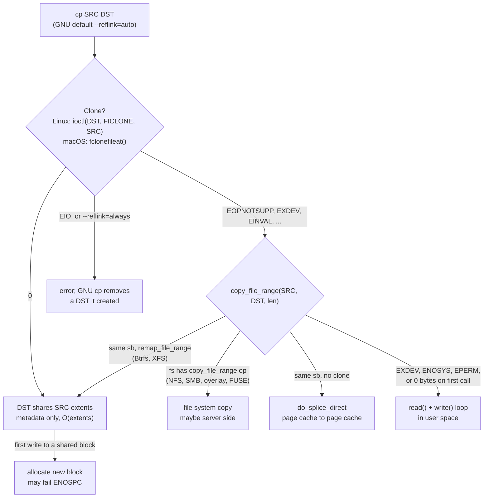

# Reflinks and copy_file_range

> [!summary] Claim
> A reflink clone makes a second file that shares the first one's disk blocks until either is written, so it costs metadata instead of bytes, but it exists only on some file systems behind non-POSIX calls (`ioctl(FICLONE)` on Linux, `clonefile(2)` on macOS), and `copy_file_range(2)` is a separate in-kernel copy that may clone, server-side copy, splice, or refuse - so treat both as optimizations with a mandatory read/write fallback, never as semantics.

Part of [Coreutils and the Userland](README.md) in [Shell and Unix Engineering](../README.md).

## TL;DR

- Mechanism: a clone points a new inode at the source's extents and marks them shared; the first write to a shared block allocates a new one (copy on write), while `copy_file_range(2)` moves bytes inside the kernel and lets the file system clone, offload to an NFS or SMB server, or splice through the page cache.
- Rule: call the cheapest primitive first and fall back on any "not supported" error: clone (`FICLONE`, `clonefile`), then `copy_file_range`, then `read`/`write`; GNU `cp` (9.0+) already does exactly this by default (`--reflink=auto`).
- Trap: a clone takes no space now and needs space later, so an overwrite can fail with `ENOSPC` on a disk that `df` showed as having room, and `du` counts the clone as if it were a full copy.
- Portability fact: POSIX `cp` only promises that the contents are written; GNU and uutils `cp` clone by default, macOS `/bin/cp` clones only with `-c` (and silently falls back), BusyBox clones only with `--reflink`, and macOS has no `copy_file_range` at all.
- When not to use it: never rely on a clone as a backup (one bad block hurts every clone), as a snapshot of a file that is still being written, or as proof that data was physically duplicated; use `--reflink=never` (or a different file system) when you need independent copies.

## Mental model



`cp` first asks the file system to clone the whole file: on Linux that is `ioctl(dst_fd, FICLONE, src_fd)`, on macOS `fclonefileat()`, and success means the destination is a new inode whose extent map points at the source's blocks, with no data moved.
If the clone is refused with a "not supported" error, `cp` asks the kernel to copy with `copy_file_range(2)`, and the kernel picks the cheapest route it has: the file system's own `copy_file_range` method (an NFS or SMB server-side copy, or overlayfs and FUSE passing the call down), a clone through `remap_file_range` when both files are on one Btrfs or XFS superblock, or an in-kernel splice.
If even that is refused, or it returns 0 on the very first call (the signature of a pseudo-file whose size is reported as 0), `cp` falls back to the classic user-space `read`/`write` loop.
Whatever path made the clone, the sharing ends block by block on the first write, and that write is the moment the space is actually allocated.

## How it works

### What a reflink is

A reflink is two inodes whose logical blocks map to the same physical extents, plus a reference count on each shared extent so that the file system knows not to overwrite it in place.
The Linux man page defines it as making "some of the data in the src_fd file appear in the dest_fd file by sharing the underlying storage", with the rule that a write to a shared region "must ensure that the changes remain private to the file being written", which "is commonly referred to as copy on write" (Linux man-pages, `ioctl_ficlone(2)`).
On XFS the reference counts live in a separate reference count B-tree per allocation group, which "removes the uniqueness requirement, allowing up to four billion arbitrary inode/logical block pairs to map to a physical block"; a write to a multiply referenced block "will be redirected to a new block" (Linux man-pages, `mkfs.xfs(8)`, `reflink=value`).
APFS on macOS implements the same idea and reports it per file through `getattrlist(2)` extended flags: `EF_MAY_SHARE_BLOCKS` (`0x00000001`) and `EF_SHARES_ALL_BLOCKS` (`0x00000040`) in `<sys/stat.h>` (macOS 27.2 SDK on a macOS 27.3 host).
On Linux the per-extent view is `ioctl(FS_IOC_FIEMAP)`, whose `FIEMAP_EXTENT_SHARED` flag (`0x00002000` in `include/uapi/linux/fiemap.h`) marks an extent that another file also references.
The lab reads both: right after a clone both files report `shared all`, and after one byte of the clone is overwritten in place, the clone reports `shared some` while the source still reads `a` at offset 0 (lab, macOS 27.3 APFS, 2026-11).

A clone is not a hard link.
A hard link is a second name for the same inode, so a write through either name is seen through both (see [[Inodes-and-Links]]).
A clone is a different inode with its own mode, owner, timestamps, and extended attributes; only the data blocks are shared, and only until written.

### What POSIX says: nothing

POSIX `cp` specifies the result, not the mechanism: for a regular file "the contents of source_file shall be written to the file descriptor" opened on the destination (POSIX.1-2024 XCU `cp`, DESCRIPTION, step 3).
A clone satisfies that, because reading the destination yields the same bytes, so a cloning `cp` conforms; but POSIX defines no option to request or forbid cloning, and its `cp` synopsis has no `-c` or `--reflink`.
Neither `copy_file_range` nor `clonefile` appears in the POSIX.1-2024 System Interfaces index (checked 2026-11), and Apple's page says outright that "POSIX conforming applications cannot use clonefile()" (XNU `bsd/man/man2/clonefile.2`).
Everything below is therefore implementation-specific, which is why the portable shell code in the worked example detects the `cp` implementation before choosing flags.

### Linux: FICLONE, FICLONERANGE, FIDEDUPERANGE

Linux 4.5 hoisted Btrfs's private clone ioctls into the VFS: `BTRFS_IOC_CLONE` became `FICLONE`, `BTRFS_IOC_CLONE_RANGE` became `FICLONERANGE`, and `BTRFS_IOC_FILE_EXTENT_SAME` became `FIDEDUPERANGE` (Linux man-pages, `ioctl_ficlone(2)` and `ioctl_fideduperange(2)`, HISTORY).
The request number did not change: GNU `cp` defines `FICLONE` as `_IOW (0x94, 9, int)` when the headers lack it (coreutils `src/copy.c`), and BusyBox defines `BTRFS_IOC_CLONE` as `_IOW (BTRFS_IOCTL_MAGIC, 9, int)` with `BTRFS_IOCTL_MAGIC` set to `0x94`, the same number (BusyBox `libbb/copy_file.c`).

The call is `ioctl(dest_fd, FICLONE, src_fd)`: the destination must already be open for writing, which is the opposite of macOS, where `clonefile` creates the destination itself.
In mainline, `ioctl_file_clone()` in `fs/ioctl.c` calls `vfs_clone_file_range()` in `fs/remap_range.c`, which checks, in order:
1. the two inodes are on the same superblock, else `-EXDEV`;
2. `generic_file_rw_checks()`: neither is a directory (`-EISDIR`), both are regular files (`-EINVAL`), the source is open for reading and the destination for writing and not `O_APPEND` (`-EBADF`);
3. the source's file operations have a `remap_file_range` method, else `-EOPNOTSUPP`.
That third check is the whole answer to "does this file system support reflinks": ext4 and tmpfs have no `remap_file_range` (neither `fs/ext4/file.c` nor `mm/shmem.c` defines one, mainline as of 2026-11), so a clone there fails with `EOPNOTSUPP` before any data is looked at; overlayfs has one (`ovl_remap_file_range` in `fs/overlayfs/file.c`) that forwards to the upper file system.

`FICLONERANGE` takes a `struct file_clone_range` (`src_fd`, `src_offset`, `src_length`, `dest_offset`) and runs `generic_remap_checks()`: both start offsets must be aligned to the destination file system's block size, else `-EINVAL`; the length must also be block aligned unless the range ends at the source's end of file; and overlapping ranges within one file are refused (`fs/remap_range.c`).
A `src_length` of 0 means "to the end of the source" (Linux man-pages, `ioctl_ficlonerange(2)`), and the man page promises that clones "are atomic with regards to concurrent writes".

`FIDEDUPERANGE` is compare-and-share: for each destination it compares the byte range with the source and shares the storage only "if the file data is identical", reporting `FILE_DEDUPE_RANGE_SAME` or `FILE_DEDUPE_RANGE_DIFFERS` per destination (Linux man-pages, `ioctl_fideduperange(2)`).
Its whole argument (header plus destination array) must fit in one page, else `-ENOMEM` (`ioctl_file_dedupe_range()` in `fs/ioctl.c`); with a 24-byte header and 32-byte destination records (`include/uapi/linux/fs.h`) that is at most 127 destinations per call on 4 KiB pages.
The man page says the maximum `src_length` "is typically 16 MiB"; current Btrfs splits a longer request internally into `BTRFS_MAX_DEDUPE_LEN` (`SZ_16M`) chunks in `btrfs_extent_same()` (`fs/btrfs/reflink.c`, mainline as of 2026-11).
Offline deduplicators use this call because the comparison happens in the kernel and, per the man page, "is atomic with regards to concurrent writes", so data that changed between the user-space scan and the call is simply not shared.

### Linux: copy_file_range

`copy_file_range(fd_in, off_in, fd_out, off_out, len, flags)` copies up to `len` bytes inside the kernel and returns how many it copied, which "could be less than the size originally requested" (Linux man-pages, `copy_file_range(2)`).
It appeared in Linux 4.5; `flags` must be 0 (`SYSCALL_DEFINE6(copy_file_range, ...)` in `fs/read_write.c` returns `-EINVAL` otherwise).
The kernel path in mainline `fs/read_write.c` (as of 2026-11) is:
1. `generic_copy_file_checks()` runs `generic_file_rw_checks()` (same rules as the clone: regular files, read and write modes, no `O_APPEND`), then the cross-file-system rule: if the destination has a `->copy_file_range` method, the source must have the same one, else `-EXDEV`; if it has none, both files must be on the same superblock, else `-EXDEV`.
2. It refuses an immutable destination (`-EPERM`) and a swap file (`-ETXTBSY`), checks for offset overflow (`-EOVERFLOW`), and then shortens the count to the source's end of file as given by `i_size_read()`, so a source whose inode claims size 0 copies nothing.
3. It refuses overlapping ranges within one file (`-EINVAL`).
4. `vfs_copy_file_range()` caps `len` at `MAX_RW_COUNT` unless the destination's own `->copy_file_range` method will handle it, then dispatches: the file system's `->copy_file_range` (the comment names NFS and CIFS; overlayfs and FUSE also set it), else `->remap_file_range` with `REMAP_FILE_CAN_SHORTEN` when both files share a superblock, else `do_splice_direct()` for a same-superblock copy.
Step 4 means a plain `copy_file_range` on Btrfs or XFS silently produces a reflink: the kernel comment says "we implement copy on same sb using clone", and if the clone is refused (for example because the range is not block aligned) it falls back to splice.
The man page states the intent: the call "gives filesystems an opportunity to implement copy acceleration techniques, such as the use of reflinks ... or server-side-copy (in the case of NFS)".

Network file systems implement the method themselves, and the kernel comment says that "for filesystems where both clone and copy are supported (e.g. nfs,cifs), we only call the copy method" (`vfs_copy_file_range()`, `fs/read_write.c`).
NFS (`nfs4_copy_file_range()` in `fs/nfs/nfs4file.c`) offloads only when the source is also an NFSv4 file (else `EXDEV`), when both servers advertise the copy capability, and when the two files are different inodes (else `EOPNOTSUPP`).
A copy of at most two read-size (`rsize`) payloads is made synchronous, and a copy between two different servers, which needs a `COPY_NOTIFY` first, is refused with `EOPNOTSUPP` when it is that small; on `EOPNOTSUPP` or `EXDEV` the method itself falls back to `splice_copy_file_range()`.
SMB (`cifs_copy_file_range()` in `fs/smb/client/cifsfs.c`) tries a server-side `copychunk_range` and falls back to `splice_copy_file_range()` the same way.
NFS also has a real clone, `nfs42_remap_file_range()`: it requires offsets aligned to the server's `clone_blksize` and refuses dedupe with `EOPNOTSUPP`, so `FICLONE` can work over NFS when the server supports clone, while plain `copy_file_range` takes the copy method.

The cross-file-system rule has a history that still bites.
Before Linux 5.3 any cross-file-system call failed with `EXDEV`.
Linux 5.3 reworked the call and let the generic splice fallback copy between any two file systems; the man page now records that "on some virtual filesystems, the call failed to copy, while still reporting success" (Linux man-pages, `copy_file_range(2)`, BUGS).
The failure was the size check in step 2: procfs files report size 0, so the kernel copied 0 bytes and returned 0, which looks exactly like end of file; sysfs files instead "claim to be 4,096 bytes long" (LWN, "How useful should copy_file_range() be?", 2021-02-18).
Go hit it first: its `io.Copy` used `copy_file_range`, and copying `/proc/self/cmdline` produced an empty file on Linux 5.7.17 ([golang/go#44272](https://github.com/golang/go/issues/44272), 2021-02).
Linux 5.19 restored the restriction for file systems without a shared `->copy_file_range` method, the behavior the man page tells applications to target and says "was also backported to earlier stable kernels".
The lab asserts the modern answer in its Linux arm (not run on the macOS host): `copy_file_range` from `/proc/self/status` to a regular file fails with `EXDEV` and copies nothing; the probe printed exactly `cfr EXDEV bytes=0` in the Debian matrix container (Linux 7.2.12, 2026-11).

glibc gained a wrapper in 2.27 with a user-space emulation for kernels that lacked the call; glibc 2.30 removed the emulation, so the wrapper now fails with `ENOSYS` on such kernels (Linux man-pages, `copy_file_range(2)`, HISTORY).
glibc 2.41 and 2.42 had a separate bug: the internal cancellation path passed the system call result through an `int`, which corrupts return values above `INT_MAX`, "such as copy_file_range" ([glibc BZ #33245](https://sourceware.org/bugzilla/show_bug.cgi?id=33245), opened 2025-08-01, fixed in 2.43 and backported to the 2.41 and 2.42 branches).
It surfaced as corrupted large copies by `cp` on ZFS ([openzfs/zfs#17629](https://github.com/openzfs/zfs/issues/17629)), and coreutils 9.8 "now avoid[s] possible data corruption on glibc 2.41 and 2.42 systems when copy_file_range is used with ranges > 2GiB" (coreutils NEWS, 9.8).

### macOS: clonefile, fclonefileat, copyfile

macOS 10.12 added `clonefile(src, dst, flags)`, `clonefileat()`, and `fclonefileat(srcfd, dst_dirfd, dst, flags)` (`<sys/clonefile.h>`, `__OSX_AVAILABLE(10.12)`).
The clone "shares its data blocks with the src file but has its own copy of attributes and extended attributes", with three exceptions: ownership is set as if the caller created the file (unless privileged), "setuid and setgid bits are turned off", and the target directory's ACLs are inherited (XNU `clonefile.2`).
The destination "must not exist for the call to be successful" (`EEXIST`), the call is "expected to be atomic", it fails with `ENOTSUP` on a volume that cannot clone and `EXDEV` across volumes, and the page warns that "it is possible for a subsequent overwrite of an existing data block to return ENOSPC" (XNU `clonefile.2`).
Flags in the macOS 27.2 SDK (`<sys/clonefile.h>`) are `CLONE_NOFOLLOW`, `CLONE_NOOWNERCOPY`, `CLONE_ACL`, `CLONE_NOFOLLOW_ANY`, and `CLONE_RESOLVE_BENEATH`; a volume advertises support with `VOL_CAP_INT_CLONE` from `getattrlist(ATTR_VOL_CAPABILITIES)`.
`clonefile` on a directory clones the hierarchy, but Apple says doing so "is strongly discouraged" and points to `copyfile(3)`.
`copyfile(3)` offers `COPYFILE_CLONE`, "a best try flag i.e. if cloning fails, fallback to copying the file", and `COPYFILE_CLONE_FORCE`, where "if cloning fails, an error is returned" (Apple `copyfile.3`).
There is no `copy_file_range` in macOS: the lab's probe looks the symbol up with `dlsym` at run time and finds nothing.

### FreeBSD and ZFS

FreeBSD added `copy_file_range(2)` in 13.0, declared "compatible with the Linux system call of the same name"; its page does not restrict the call to one file system (it "may" use a file-system-specific technique when both files are on the same one), and it recommends calling it "with the largest len value possible ... even SSIZE_MAX" (FreeBSD `lib/libsys/copy_file_range.2`, main, dated 2025-08-16).
FreeBSD 15.0 introduced the `COPY_FILE_RANGE_CLONE` flag (commit `37b2cb5ecb0f`, August 2025) and the `_PC_CLONE_BLKSIZE` `pathconf(2)` query, allowing callers to enforce block cloning and return `EOPNOTSUPP` if block cloning is unavailable.
FreeBSD `cp` calls `copy_file_range(from_fd, NULL, to_fd, NULL, SSIZE_MAX, 0)` in a loop and switches to its read/write fallback only on `EINVAL`, and any other error ends the copy (FreeBSD `bin/cp/utils.c`, main), so on FreeBSD a plain `cp` can clone without any flag when the file system implements cloning.
OpenZFS added block cloning (the block reference table, BRT) in 2.2.0, exposed through the kernel copy and clone interfaces on Linux and FreeBSD (PR #15529 added an off switch to both: its diff touches `module/os/freebsd` and `module/os/linux`); it was disabled by default in 2.2.1 after data corruption reports (see Pitfalls).

### The userland: what each cp actually calls

GNU coreutils (master as of 2026-11, release 9.12):
- `copy_reg()` in `src/copy.c` first tries `fclonefileat()` on macOS when it can do so without a permissions race, then, after opening the destination, `clone_file()`, which is `ioctl (dest_fd, FICLONE, src_fd)`.
- `handle_clone_fail()` decides whether a clone failure is fatal: it is fatal only for `--reflink=always` or `EIO` (because of Linux kernel bugs reported in 2023, [bug 60489](https://bugs.gnu.org/60489)); in those cases `cp` also removes a destination it created.
- Otherwise `copy_file_data()` in `src/copy-file-data.c` calls `infer_scantype()` to look for holes with `SEEK_DATA`/`SEEK_HOLE`, and `sparse_copy()` loops on `copy_file_range (src_fd, NULL, dest_fd, NULL, MIN (max_n_read, copy_max), 0)` when it is not punching holes.
- A 0 return on the first call falls back to `read`, with the comment "copy_file_range incorrectly returns 0 when reading from the proc file system on the Linux kernel through at least 5.6.19 (2020)".
- `is_CLONENOTSUP()` lists the errors that mean "not supported, fall back": `ENOSYS`, `ENOTTY`, `ENOTSUP`/`EOPNOTSUPP`, `EINVAL`, `EBADF`, `EXDEV`, `ETXTBSY`, `EPERM`, `EACCES`; `EPERM` is in the list because "copy_file_range not enabled in seccomp filters" is a real container configuration, and `ENOENT` is tolerated for CIFS.
- `cp --debug` (9.2+) prints one line per file, `copy offload: ..., reflink: ..., sparse detection: ...` (`emit_debug()` in `src/copy.c`).
On the lab's APFS volume GNU `cp` 9.12 printed `copy offload: unknown, reflink: yes, sparse detection: unknown` for a default copy and `copy offload: avoided, reflink: no, sparse detection: no` for `--reflink=never` (lab host, 2026-11).

The GNU timeline matters when you read old advice (all from coreutils NEWS):
- 7.5 (2009-08-20): `cp --reflink` added, "currently only supported within a btrfs file system"; 7.6 (2009-09-11) added `--reflink=auto`.
- 8.24 (2015-07-03): `mv` tries a reflink before a copy when it must cross Btrfs subvolumes; 8.30 (2018-07-01): `--reflink=never`.
- 9.0 (2021-09-24): `cp` and `install` "now default to copy-on-write (COW) if available", and `cp`, `install`, and `mv` use `copy_file_range`.
- 9.1 (2022-04-15): macOS `cp -p`/`cp -a` clone with `fclonefileat`; `cat` uses `copy_file_range`.
- 9.2 (2023-03-20): `--reflink=always` no longer leaves an empty destination behind; transient clone errors are no longer retried with other copy methods "which may have resulted in data corruption"; macOS clones in more cases; `--debug` added.
- 9.4 (2023-08-29): `copy_file_range` is avoided on Linux kernels before 5.3, and `--sparse=never` now disables cloning and copy offload "to ensure no holes present in the destination copy".
- 9.8 (2025-09-22): the glibc 2.41 and 2.42 workaround; 9.12 (2026-09-14): a `--reflink=auto` clone that fails with `EDQUOT`, `ENOMEM`, or `ENOSPC` falls back to a copy, because "with XFS, a clone can exhaust metadata space in an allocation group, while a standard copy works".

macOS `/bin/cp` (Apple `file_cmds`, main): `-c` calls `clonefileat(cwd, src, to.dir, to.path, 0)`; on `EXDEV` or `ENOTSUP` it continues to the normal copy, and only other errors are reported ("clonefile failed") (`cp/utils.c`).
The man page says the same: "if the source and target are on different filesystems, or the target filesystem does not support cloning, cp will fallback to using copyfile(2)".
Without `-c` it copies data with `fcopyfile(from_fd, to_fd, ..., COPYFILE_DATA | COPYFILE_NOCACHE [| COPYFILE_DATA_SPARSE])`, which does not clone; the lab measures `shared none` for plain `cp` and `shared all` for `cp -c` on APFS.

BusyBox (master): `--reflink[=auto|always]` exists only when built with `FEATURE_CP_REFLINK` (default `y`, added 2018-07-13 in commit `79fb6ac7a5ac`), and a bare `--reflink` means `always` (`coreutils/cp.c`).
Without the option it never clones; data moves through `bb_copyfd_eof()`, which uses `sendfile()` in 16 MiB chunks when `FEATURE_USE_SENDFILE` is on (`libbb/copyfd.c`).
On a failed `always` clone it prints "failed to clone" and jumps to closing the destination, without removing it (`libbb/copy_file.c`), so the empty destination stays.
Measured with BusyBox 1.37.0 in the Alpine matrix container on tmpfs (2026-11): both `cp --reflink` and `cp --reflink=always` printed `cp: failed to clone '...' from '...': Not supported`, exited 1, and left a 0-byte destination.

uutils (main): `ReflinkMode::default()` is `Auto` on Linux, Android, and Apple targets and `Never` elsewhere (`src/uu/cp/src/cp.rs`); Linux uses `ioctl_ficlone` and on `--reflink=always` failure removes a destination it created only if the path still names that inode (`platform/linux.rs`); macOS resolves `clonefile` with `dlsym` (`platform/macos.rs`).

## Numbers and limits

| Quantity | Value | Source |
|---|---|---|
| Time to clone a 1 GiB file, `cp -c` | 0.00 s (below `time -p` resolution) in 3 of 3 runs, in each of two separate sessions | Lab host, macOS 27.3 arm64, APFS, `/usr/bin/time -p /bin/cp -c`, 2026-11 |
| Time to copy the same file, `cp` | 0.43 s, 0.61 s, 0.47 s in one session; 2.50 s, 5.09 s, 2.07 s in a re-run on a loaded host | Same runs: the copy time moves with load and cache state, the clone time does not |
| `du -k` of the clone vs the copy | 1048576 and 1048576 | Same run: `du` cannot see sharing; coreutils manual says `du` "typically counts the space that would be consumed if all files' non-holes were rewritten" |
| Shared state after a clone, then after a 1-byte overwrite | `shared all`, then `shared some` | Lab probe (`getattrlist` extended flags), APFS, 2026-11 |
| `FICLONE` request number | `_IOW(0x94, 9, int)` | coreutils `src/copy.c`, BusyBox `libbb/copy_file.c` |
| Clone alignment | start offsets aligned to `s_blocksize`; length aligned unless it ends at source EOF | `generic_remap_checks()`, `fs/remap_range.c`, mainline 2026-11 |
| `MAX_RW_COUNT` (per-call cap for splice and for file systems without their own method) | `INT_MAX & PAGE_MASK` = 2147479552 bytes on 4 KiB pages | `include/linux/fs.h`; arithmetic: 0x7FFFFFFF with the low 12 bits cleared |
| GNU `cp` request per `copy_file_range` call | `MIN (SSIZE_MAX, SIZE_MAX) >> 30 << 30` = 9223372035781033984 on LP64 | `sparse_copy()`, `src/copy-file-data.c` |
| FreeBSD `cp` request per call | `SSIZE_MAX` | `bin/cp/utils.c` |
| BusyBox `sendfile` chunk | 16 MiB (`SENDFILE_BIGBUF`) | `libbb/copyfd.c` |
| `FIDEDUPERANGE` destinations per call | 127 on 4 KiB pages (24-byte header + 32 bytes each <= `PAGE_SIZE`) | `ioctl_file_dedupe_range()` and `struct file_dedupe_range`, mainline |
| Btrfs dedupe chunk | 16 MiB (`BTRFS_MAX_DEDUPE_LEN`) | `fs/btrfs/reflink.c`, mainline 2026-11 |
| XFS references per physical block | "up to four billion" | `mkfs.xfs(8)`; reflink is the default with `-m crc=1` |
| `copy_file_range` kernel history | 4.5 added; 5.3 cross-fs via splice; 5.19 cross-fs only with a shared method | Linux man-pages `copy_file_range(2)` |
| glibc wrapper | 2.27 with user-space emulation; 2.30 emulation removed; 2.41-2.42 return value above `INT_MAX` corrupted, fixed 2.43 | man page; glibc BZ #33245 |
| Lab: 3 MiB `copy_file_range` | all 3145728 bytes, >= 2 calls (the last returns 0); measured `cfr ok bytes=3145728 calls=2` | Lab assertion; probe run in the Debian matrix container, Linux 7.2.12, 2026-11; not run on the macOS host, where the symbol is absent |

## Portability

The shells add nothing here: `cp` and the probe are external programs in every family, so the lab runs them through the shell under test and branches only on the file system type and the `cp` implementation.
The lab passed all 10 tests under bash 5.3 with `/bin/cp` and under dash with GNU `cp` 9.12 first in `PATH` on the macOS host (2026-11), and all 10 under bash in the Debian container (Linux 7.2.12, overlay root that clones).
The full shell matrix was not run for this revision.
The probe carries its own copies of the `FICLONE` and `FIEMAP` definitions for images without kernel headers (Alpine); it compiled with `-O2 -Wall -Wextra -Werror -D_FORTIFY_SOURCE=2` and ran by hand in the Alpine container, but the bats arms were not run there, so Alpine's `cp` arms are unproven (as of 2026-11).

| Environment | Clone by default | Clone or fail | `copy_file_range` | Evidence |
|---|---|---|---|---|
| POSIX `cp` | unspecified | no option | not in POSIX | POSIX.1-2024 XCU `cp`; functions index |
| Shells (POSIX sh, bash 3.2 and 5.x, zsh, `zsh --emulate sh`, dash, ksh93, mksh, yash, posh, BusyBox ash) | not a shell feature | - | - | Lab: expectations do not branch on the family |
| GNU coreutils `cp` 9.0+ | yes (`--reflink=auto`), `install` too; `mv` tries a clone when `rename` fails (8.24+) | `--reflink=always`, removes the destination (9.2+) | yes, avoided on Linux < 5.3 (9.4+) | NEWS; `src/copy.c`; lab |
| GNU `cp` on macOS | yes via `fclonefileat` when no mode race | `--reflink=always` | no (absent) | `src/copy.c`; lab (`shared all`) |
| macOS `/bin/cp` | no (`fcopyfile` without `COPYFILE_CLONE`) | none: `-c` falls back silently on `EXDEV`/`ENOTSUP`; `--reflink` is a usage error, status 64 | absent | `file_cmds` `cp/utils.c`; `cp(1)`; lab |
| FreeBSD `cp` 13+ | whatever `copy_file_range` does on that file system | no option | yes, `SSIZE_MAX` per call | `bin/cp/utils.c` |
| BusyBox `cp` | no | `--reflink` or `--reflink=always` (with `FEATURE_CP_REFLINK`), leaves an empty destination | no (uses `sendfile`) | `coreutils/cp.c`, `libbb/copy_file.c`, `libbb/copyfd.c`; measured with BusyBox 1.37.0 on Alpine tmpfs |
| uutils `cp` | yes on Linux, Android, macOS; no elsewhere | `--reflink=always`, removes a destination it created | via its copy helpers | `cp.rs`, `platform/linux.rs` |
| Linux ext4, tmpfs | `FICLONE` -> `EOPNOTSUPP` | - | yes (splice, same superblock) | `fs/remap_range.c`; tmpfs measured in the Debian container (`clone EOPNOTSUPP`, `cfr ok`); ext4 and tmpfs define no `remap_file_range` (`fs/ext4/file.c`, `mm/shmem.c`) |
| Linux Btrfs, XFS (`reflink=1`) | `FICLONE` works; `copy_file_range` clones | - | yes | `fs/read_write.c`; `mkfs.xfs(8)` |
| Linux overlayfs | forwards to the upper file system: `EOPNOTSUPP` over ext4, a real clone over XFS with reflink or Btrfs | - | forwards (`ovl_copy_file_range`) | `fs/overlayfs/file.c`; the lab classifies an overlay by what a clone does there; the Debian container's overlay root (OrbStack, Linux 7.2.12) cloned: `clone ok`, `shared all` |
| macOS APFS | `clonefile` works; HFS+ and others: `ENOTSUP` | `clonefile`, `COPYFILE_CLONE_FORCE` | absent | XNU `clonefile.2`; `copyfile.3`; lab |

## Worked example

The [lab](../labs/08-reflinks-and-copy_file_range/) has a C probe (`probe.c`) that calls `clonefile` or `FICLONE`, reads the shared-block flags, and drives `copy_file_range`, plus `reflink_tool.sh`, whose `best-copy` command picks the cheapest correct `cp` invocation for the local implementation.
This is the `cmd_best_copy` function from `reflink_tool.sh`, unchanged:

```sh
cmd_best_copy() {
  src=${1:?missing source}
  dst=${2:?missing destination}
  flavor=$(cmd_cp_flavor)
  case ${flavor} in
    gnu | uutils)
      # Default since coreutils 9.0, spelled out so older releases clone too.
      set -- cp --reflink=auto
      ;;
    busybox)
      dst_dir=$(dirname -- "${dst}")
      option=$(busybox_reflink_option "${dst_dir}")
      set -- cp ${option:+"${option}"}
      ;;
    bsd)
      # macOS cp -c tries clonefile(2) and falls back to a copy on EXDEV or ENOTSUP;
      # FreeBSD 13+ cp already calls copy_file_range(2), which may clone on its own.
      sysname=$(uname -s)
      if [ "${sysname}" = Darwin ]; then
        set -- cp -c
      else
        set -- cp
      fi
      ;;
    *)
      set -- cp
      ;;
  esac
  printf 'via: %s\n' "$*"
  "$@" -- "${src}" "${dst}"
}
```

`cmd_cp_flavor` identifies `cp` from what `cp --version` prints (GNU and uutils name themselves, BusyBox prints its banner, BSD prints `usage: cp`), never from the platform.
The BusyBox branch uses plain `cp` when the option probe returns no flag and propagates failures to prepare or clean up the probe directory.
Captured on the macOS 27.3 host on APFS (2026-11), first with `/bin/cp`, then with GNU coreutils 9.12 first in `PATH`, checking the result with the probe:

```text
$ sh reflink_tool.sh cp-flavor
bsd
$ sh reflink_tool.sh best-copy src dst
via: cp -c
$ ./probe shared dst
shared all
$ PATH=/opt/homebrew/opt/coreutils/libexec/gnubin:$PATH sh reflink_tool.sh best-copy src dst2
via: cp --reflink=auto
$ ./probe shared dst2
shared all
$ ./probe clone src dst
clone EEXIST
$ ./probe cfr src x
cfr absent
```

The bats suite asserts each of these per file system and per `cp` implementation; on the macOS host every test passed:

```text
ok 1 probe compiles with the C compiler
ok 2 a clone is a separate file whose writes stay private (copy on write)
ok 3 a clone shares all its blocks; a read-write copy shares none
ok 4 cloning onto an existing destination: EEXIST on APFS, replace on Linux
ok 5 copy_file_range copies a 3 MiB file in the kernel, or is absent on macOS
ok 6 copy_file_range from /proc fails with EXDEV instead of copying zero bytes
ok 7 copy_file_range rejects an O_APPEND destination with EBADF
ok 8 cp --reflink=always fails instead of falling back to a copy
ok 9 best-copy clones when the file system can and copies when it cannot
ok 10 macOS cp clones only with -c; GNU cp clones by default
```

On Linux the same tests take their other arms: on ext4, tmpfs, or overlayfs over an upper file system without reflinks (an overlay whose upper layer clones, such as XFS with reflink or Btrfs, is classified `overlay-reflink` by what `clone` does there and takes the clone arms instead) the probe prints `clone EOPNOTSUPP`, GNU `cp --reflink=always` exits 1 with "failed to clone" and leaves no destination, `copy_file_range` copies the 3 MiB file, and `/proc/self/status` gives `cfr EXDEV bytes=0`; those arms are not exercised on this host.
A hand run of the probe in the Debian matrix container (Linux 7.2.12, 2026-11) confirmed the tmpfs arm on `/dev/shm` (`clone EOPNOTSUPP`, `shared EOPNOTSUPP`, and GNU `cp --reflink=always` printing `cp: failed to clone '...' from '...': Operation not supported`, status 1, no destination left), the 3 MiB copy (`calls=2`), `cfr EXDEV bytes=0` from `/proc/self/status`, and `cfr EBADF bytes=0` for an `O_APPEND` destination.
That container's overlay root clones (`clone ok`, `shared all`, GNU `cp --reflink=always` succeeds), so the suite classifies it `overlay-reflink` and all 10 tests pass there under bash; on it the plain-copy half of test 3 is not asserted, because `FIEMAP` through that overlay reported even a fresh read-write copy as `shared all`.

## Pitfalls

> [!warning] Zero-byte copies from pseudo-files
> Trigger: a program copies `/proc`, `/sys`, or another generated file with `copy_file_range` on Linux 5.3 to 5.18 (or a kernel without the 5.19 backport).
> Symptom: the call returns 0 and the destination is empty, indistinguishable from end of file; Go's `io.Copy` produced empty copies of `/proc/self/cmdline` this way ([golang/go#44272](https://github.com/golang/go/issues/44272)), and the man page's BUGS section records that the call "failed to copy, while still reporting success".
> Fix: treat 0 on the first call as "unsupported" and retry with `read`, as GNU `cp` does in `sparse_copy()` and Go adopted in its fix for issue 44272; on current kernels the call fails with `EXDEV` instead.

> [!warning] Clones defer the space, then fail the write
> Trigger: cloning large files (VM images, databases, build caches) on a nearly full volume, then modifying them.
> Symptom: `cp` succeeded instantly, `df` showed room, yet a later `write` fails with `ENOSPC`, because every first write to a shared block allocates a new one; `clonefile(2)` warns of exactly this, and XFS can run out of metadata space for the clone itself (coreutils NEWS 9.12).
> Fix: budget capacity for the fully unshared size, or unshare before handing the file to a writer: Linux `fallocate(2)` with `FALLOC_FL_UNSHARE_RANGE` makes shared extents "private to the file to guarantee that a subsequent write will not fail due to lack of space" (where the file system supports it).

> [!warning] OpenZFS 2.2.0 block cloning corrupted copies
> Trigger: OpenZFS 2.2.0 with coreutils 9.x `cp`, which uses `SEEK_DATA`/`SEEK_HOLE` and copy offload.
> Symptom: copied files had "chunks replaced by zeros"; building Go on Gentoo produced corrupt compiler binaries ([openzfs/zfs#15526](https://github.com/openzfs/zfs/issues/15526), 2023-11-14).
> Fix: OpenZFS 2.2.1 disabled block cloning by default ([PR #15529](https://github.com/openzfs/zfs/pull/15529), tunable `zfs_bclone_enabled`); 2.2.2 fixed the root cause, "an incorrect dirty dnode check" that is "very hard to hit, and really only came to light due to changes in cp in coreutils 9.x" ([zfs-2.2.2 release notes](https://github.com/openzfs/zfs/releases/tag/zfs-2.2.2)); upgrade to 2.2.2 or 2.1.14.

> [!warning] Corrupted return values above 2 GiB on glibc 2.41 and 2.42
> Trigger: a single `copy_file_range` call that copies more than `INT_MAX` bytes, which only a destination file system with its own `->copy_file_range` method can return, because the kernel caps every other path at `MAX_RW_COUNT`; the reports came from ZFS.
> Symptom: the returned count is truncated, so the caller's loop recopies or skips data; seen as corrupted large `cp` copies on ZFS ([openzfs/zfs#17629](https://github.com/openzfs/zfs/issues/17629)).
> Fix: glibc 2.43 or the 2.41 and 2.42 branch backports ([BZ #33245](https://sourceware.org/bugzilla/show_bug.cgi?id=33245)); coreutils 9.8+ works around it (NEWS 9.8).

> [!warning] `cp -c` on macOS is not "clone or fail"
> Trigger: a script uses `cp -c` to promise an instant, space-free copy.
> Symptom: across volumes or on a non-APFS volume it quietly does a full copy (`file_cmds` `cp/utils.c` ignores `EXDEV` and `ENOTSUP`), taking minutes and the full space.
> Fix: when cloning is a requirement, use `clonefile(2)` or `copyfile(3)` with `COPYFILE_CLONE_FORCE`, or GNU `cp --reflink=always`, and check the result.

> [!warning] BusyBox `--reflink` means always, and leaves debris
> Trigger: a script written for GNU passes bare `--reflink` to BusyBox `cp` on ext4.
> Symptom: the copy fails with "failed to clone" and an empty destination file remains, which a later step may treat as valid (BusyBox `libbb/copy_file.c`).
> Fix: pass `--reflink=auto` unless you mean to fail, and on failure remove the destination yourself.

> [!warning] `--sparse=never` and `--reflink=always` conflict in GNU cp
> Trigger: `cp --reflink=always --sparse=never a b`.
> Symptom: `cp: --reflink can be used only with --sparse=auto` and status 1 (lab host, GNU 9.12); and since 9.4, `--sparse=never` silently turns the default `--reflink=auto` into `never` (`src/cp.c`).
> Fix: decide which property you need: a fully allocated file (`--sparse=never`, no clone) or a clone (default `--sparse=auto`).

> [!warning] Seccomp and old kernels make copy_file_range fail with EPERM or ENOSYS
> Trigger: a container runtime whose seccomp profile does not allow the call, or a kernel older than 4.5 with glibc 2.30+.
> Symptom: `EPERM` or `ENOSYS` from a call that "should" work; coreutils 9.2 once failed outright here, fixed in 9.3 ("on more restricted systems like android or containers").
> Fix: treat every error before the first byte as "unsupported" and fall back, as `is_CLONENOTSUP()` does.

## Security and robustness

- Shared fate: the GNU manual warns that after a clone "if an I/O error affects data blocks of one of the files, the other suffers the same fate"; a clone on the same volume is never a backup.
- Overwriting does not erase: on a copy-on-write file system an in-place overwrite of a clone writes new blocks while the old ones stay referenced by the other file, so `shred` gives no guarantee; the coreutils manual lists Btrfs, XFS, and ZFS among file systems where `shred` is not effective when they journal data.
- Metadata on clones: `clonefile` turns off setuid and setgid and sets ownership as for a new file unless privileged (XNU `clonefile.2`); `copyfile` clones never copy setuid or setgid bits (`copyfile.3`).
- Race-free cloning: GNU `cp` passes `CLONE_NOFOLLOW` "to avoid security issues that could occur if writing through dangling symlinks", and skips `fclonefileat` when it would have to fix the mode afterwards, to avoid "the race when using chown and/or chmod" (`src/copy.c`); `CLONE_NOFOLLOW_ANY` and `CLONE_RESOLVE_BENEATH` close the path-traversal versions of the same problem (see [[Path-Resolution-and-Symlink-Races]]).
- Dedupe permission: `FIDEDUPERANGE` onto a file is allowed with `CAP_SYS_ADMIN`, a write-mode descriptor, ownership, or write permission (`may_dedupe_file()` in `fs/remap_range.c`), so an unprivileged user cannot rewrite the extent map of a file they cannot write.
- Immutable and swap files: both calls refuse an immutable destination (`EPERM`) and any swap file (`ETXTBSY`) (`generic_copy_file_checks()` in `fs/read_write.c` for `copy_file_range`, `__generic_remap_file_range_prep()` in `fs/remap_range.c` for clones and dedupe).
- A clone is consistent only against single writes: clones "are atomic with regards to concurrent writes" (Linux), but a database that spreads one transaction across many writes, or across a file and its journal, must be quiesced first or the clone is a crash-consistent image at best.
- Never trust a 0: `copy_file_range` returning 0 is end of file only if the source's size is real; verify with a read when the source might be generated.

## The principal's view

The decision is whether cloning is an optimization your systems may enjoy or a property they depend on.
As an optimization it is close to free: GNU `cp`, uutils, and the kernel's own `copy_file_range` already clone where they can, and the right engineering move is to choose file systems that make it work (XFS with `reflink=1`, Btrfs, APFS, OpenZFS 2.2.2+ with block cloning enabled) for workloads dominated by near-identical copies: VM and container images, CI workspaces, database clones for tests, artifact caches.
As a dependency it is an overcommitment of storage, the same trade as thin provisioning: the copy succeeds now and the bill arrives at the first write, possibly on another team's volume and at a bad moment.
So capacity planning uses the unshared size, monitoring watches real free space rather than `du`, and tools that need a guarantee either unshare (`FALLOC_FL_UNSHARE_RANGE`) or use `--reflink=never`.
Use `--reflink=always` only where failing fast is the feature, for example a provisioning script that must not silently copy 500 GiB.
Roll new copy paths out like any other data-path change: the OpenZFS 2.2.0 corruption and the glibc 2.41 return-value bug both reached production through a routine `cp`, which argues for checksumming copies in the pipelines that matter (see [[Checksums-and-Integrity]]).
Across hosts none of this applies; use [[rsync-Algorithm-and-Usage]], or an NFS 4.2 or SMB mount where `copy_file_range` turns into a server-side copy.
In a program rather than a script, call the primitives directly in the same order `cp` does (clone, then `copy_file_range` with the zero-on-first-call rule, then `read`/`write`), because shelling out to `cp` loses the error detail you need to choose a fallback.

## Interview questions

> [!question] L5: What is the difference between a hard link, a symlink, and a reflink clone?
>
> > [!success]- Answer
> > A hard link is a second directory entry for the same inode, so data, mode, and owner are shared and a write through either name is visible through both.
> > A symlink is a separate small file holding a path, resolved at open time.
> > A reflink clone is a new inode with its own metadata whose data extents are shared copy-on-write, so a write to either file changes only that file.
> > The lab shows it: the clone has a different inode number, and after one byte of the clone is overwritten the source still reads `a`.
> >
> > Follow-up: Which of the three survives deleting the original name, and which uses extra space when you write to it?

> [!question] L5: When GNU `cp` on Btrfs copies a 50 GiB file in 10 ms, what occurred in the kernel and what will `du` report?
>
> > [!success]- Answer
> > Since coreutils 9.0 `cp` defaults to `--reflink=auto`, so it called `ioctl(FICLONE)` and the kernel shared the extents instead of copying bytes.
> > `du` typically reports the full size for both files, because it counts the space that would be used if every non-hole block were rewritten.
> > Real free space barely changed and will drop as either file is modified.
> >
> > Follow-up: How would you confirm the blocks are shared?

> [!question] L6: Predict the output: On a GNU/Linux host with coreutils 9.7 and /srv on ext4, what is the output and exit status of `cp --reflink=always big.img /srv/big.img; echo "status=$?"; ls /srv/big.img`?
>
> > [!success]- Answer
> > `cp` prints `cp: failed to clone '/srv/big.img' from 'big.img': Operation not supported`, because ext4 has no `remap_file_range` and `FICLONE` returns `EOPNOTSUPP`; if `big.img` is on another file system the error is `Invalid cross-device link` (`EXDEV`) instead.
> > Then `status=1`.
> > Then `ls` fails with "No such file or directory", because since 9.2 `cp` removes a destination it created when an `always` clone fails.
> > BusyBox `cp --reflink=always` would instead leave an empty `/srv/big.img`.
> >
> > Follow-up: What does the same command do with `--sparse=never` added?

> [!question] L6: Debug this script: What defect occurs when running this backup script on macOS before a risky migration?
> ```sh
> #!/bin/sh
> db=$HOME/Library/App/data.sqlite
> if cp -c "$db" /Volumes/Backup/data.sqlite.snap; then
>   echo "instant snapshot taken, no extra space used"
> fi
> ```
>
> > [!success]- Answer
> > `/Volumes/Backup` is a different volume, so `clonefile` fails with `EXDEV` and Apple's `cp -c` silently falls back to a full copy: the message is false, the copy takes as long as the file is big, and it uses the full space.
> > Even on the same volume the "snapshot" is not consistent if the application is running, because SQLite may have a transaction spread across the database and its `-wal` file.
> > Fix: quiesce the application or use SQLite's backup API, clone with `clonefile(2)` or `copyfile(3)` `COPYFILE_CLONE_FORCE` (or GNU `cp --reflink=always`) when an instant copy is a requirement, and verify with the extended flags (`EF_SHARES_ALL_BLOCKS`).
> > A clone on the same disk is also not a backup.
> >
> > Follow-up: How would you detect up front whether a volume can clone?

> [!question] L6: Why does `copy_file_range` on XFS produce a reflink even though the caller asked for a copy, and when does it not?
>
> > [!success]- Answer
> > `vfs_copy_file_range()` tries the destination's `->copy_file_range` method first; XFS has none, so for two files on the same superblock it calls `->remap_file_range` with `REMAP_FILE_CAN_SHORTEN`, which is a clone.
> > The clone requires block-aligned offsets, so an unaligned range (or a refused remap) falls back to `do_splice_direct()`, a real in-kernel copy.
> > Across two XFS file systems the call fails with `EXDEV` (no shared method, different superblocks), and the caller must copy in user space.
> >
> > Follow-up: Why does the kernel not do the same for NFS?

> [!question] L6: Why is GNU `cp`'s fallback to `read` when the first `copy_file_range` call returns 0 necessary, and what is its performance cost?
>
> > [!success]- Answer
> > On Linux 5.3 to 5.18 a cross-file-system copy from a pseudo-file whose inode reports size 0 (procfs, tracefs) returned 0 without copying, which is indistinguishable from end of file.
> > Treating 0 on the first call as "maybe unsupported" and retrying with `read` makes the copy correct on those kernels.
> > The cost is one extra system call for every genuinely empty file, a trade Go also accepted in its fix.
> >
> > Follow-up: Why does a later 0 not need the same treatment?

> [!question] L7+: When a CI fleet on XFS with reflinks clones 200 GiB workspaces per job and volumes show 60% free in `df`, what failure modes must you plan for and how do you design around them?
>
> > [!success]- Answer
> > Each clone costs almost nothing at creation but each job's writes unshare blocks, so concurrent jobs can drive the volume to `ENOSPC` mid-build even though every clone succeeded and `df` looked fine.
> > XFS can also fail the clone itself when an allocation group runs out of metadata space, which coreutils 9.12 now handles by falling back to a full copy, which makes the space problem worse at the worst moment.
> > Design: admission control on real free space against the expected write set per job, a reserved headroom, per-job quotas, and eviction of old clones; measure unshared growth per job rather than `du`.
> > For jobs that must not fail on space, unshare up front with `FALLOC_FL_UNSHARE_RANGE` or use `--reflink=never`, trading time and space for predictability.
> >
> > Follow-up: What metric would you alert on, and why is `du` the wrong one?

> [!question] L7+: After the OpenZFS 2.2.0 block-cloning corruption, what process changes would you make for storage-path upgrades?
>
> > [!success]- Answer
> > The bug was a dirty-dnode race in ZFS that coreutils 9.x's new copy pattern (`SEEK_DATA`/`SEEK_HOLE` plus offload) made reachable, so neither component's tests caught it alone.
> > Treat a file system feature flag or a coreutils, glibc, or kernel upgrade that changes the copy path as a data-path change: canary it on non-critical data, keep the feature off by default until it has soaked (2.2.1 did exactly that with `zfs_bclone_enabled`), and checksum copies end to end in pipelines that produce artifacts.
> > Keep the ability to turn the optimization off quickly (`--reflink=never`, the ZFS tunable) without a code change.
> >
> > Follow-up: What common property do the OpenZFS 2.2.0 and glibc 2.41 incidents share?

> [!question] L7+: When would you use `FIDEDUPERANGE` instead of `FICLONERANGE`, and why can an unprivileged deduplicator use it safely?
>
> > [!success]- Answer
> > Use dedupe when the files already exist with identical content and you want to reclaim space, for example an offline scan of a build cache; use clone when you are creating a new copy.
> > Dedupe compares the bytes in the kernel and shares storage only if every byte matches, otherwise it reports `FILE_DEDUPE_RANGE_DIFFERS`, so a racing writer cannot cause wrong data to be shared.
> > The kernel still requires the caller to be able to write the destination (write-mode descriptor, owner, write permission, or `CAP_SYS_ADMIN`), so it cannot rewrite the extent map of someone else's read-only file.
> >
> > Follow-up: What limits the size of one call, and how does Btrfs handle longer ranges?

## Related

Prerequisites: [[cp-mv-and-Rename-Semantics]]

Next: [[dd-and-Block-IO]]

See also: [[Sparse-Files-and-Holes]], [[Inodes-and-Links]], [[Atomic-Rename-and-fsync]], [[Path-Resolution-and-Symlink-Races]], [[seccomp]], [[System-Calls-and-strace]], [[Checksums-and-Integrity]], [[rsync-Algorithm-and-Usage]], [[tar-and-Archives]], [[install-and-Atomic-Deployment]], [[Four-Userlands-GNU-BSD-BusyBox-uutils]], [[Userland-Portability-Traps]], [[The-proc-Filesystem]]

## Further reading

- [POSIX.1-2024 cp](https://pubs.opengroup.org/onlinepubs/9799919799/utilities/cp.html): the specification only requires the contents to be written, which is why cloning is legal and unrequestable.
- [copy_file_range(2)](https://man7.org/linux/man-pages/man2/copy_file_range.2.html): the Linux contract, its errors, and the 5.3 to 5.19 history.
- [ioctl_ficlone(2)](https://man7.org/linux/man-pages/man2/ioctl_ficlone.2.html) and [ioctl_fideduperange(2)](https://man7.org/linux/man-pages/man2/ioctl_fideduperange.2.html): clone and dedupe semantics, alignment, and errors.
- [fs/read_write.c](https://raw.githubusercontent.com/torvalds/linux/master/fs/read_write.c) and [fs/remap_range.c](https://raw.githubusercontent.com/torvalds/linux/master/fs/remap_range.c): `vfs_copy_file_range()` and `vfs_clone_file_range()`, the actual dispatch and checks.
- [LWN: How useful should copy_file_range() be?](https://lwn.net/Articles/846403/): the design argument behind the 5.19 restriction.
- [coreutils src/copy.c](https://raw.githubusercontent.com/coreutils/coreutils/master/src/copy.c) and [copy-file-data.c](https://raw.githubusercontent.com/coreutils/coreutils/master/src/copy-file-data.c): the reference fallback ladder, with comments naming every kernel bug it works around.
- [coreutils NEWS](https://raw.githubusercontent.com/coreutils/coreutils/master/NEWS): the dated history of reflink and copy offload behavior in GNU `cp`.
- [XNU clonefile.2](https://raw.githubusercontent.com/apple-oss-distributions/xnu/main/bsd/man/man2/clonefile.2) and [copyfile.3](https://raw.githubusercontent.com/apple-oss-distributions/copyfile/main/copyfile.3): Apple's clone semantics, flags, and the best-try versus force distinction.
- [Apple file_cmds cp/utils.c](https://raw.githubusercontent.com/apple-oss-distributions/file_cmds/main/cp/utils.c): why `cp -c` never fails for lack of cloning.
- [FreeBSD copy_file_range.2](https://raw.githubusercontent.com/freebsd/freebsd-src/main/lib/libsys/copy_file_range.2): the cross-file-system variant and the clone-only flag.
- [FreeBSD commit 37b2cb5ecb0f](https://github.com/freebsd/freebsd-src/commit/37b2cb5ecb0fb1b1f5a98ff4c08b61b8c05ec1d7): the commit introducing COPY_FILE_RANGE_CLONE and _PC_CLONE_BLKSIZE for FreeBSD 15.
- [OpenZFS #15526](https://github.com/openzfs/zfs/issues/15526) and the [zfs-2.2.2 release notes](https://github.com/openzfs/zfs/releases/tag/zfs-2.2.2): the block-cloning corruption incident and its root cause.
- [glibc BZ #33245](https://sourceware.org/bugzilla/show_bug.cgi?id=33245): the return-value truncation that corrupted large copies on glibc 2.41 and 2.42.
- [golang/go#44272](https://github.com/golang/go/issues/44272): the first widely seen zero-byte copy from procfs.
