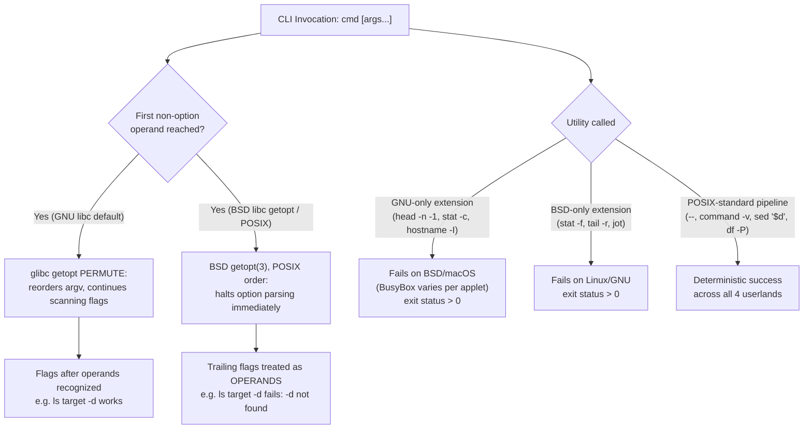

# Userland Portability Traps

> [!summary] Claim
> Portable shell scripting depends on userland utility contracts rather than shell syntax alone: GNU Coreutils, BSD/macOS userland, BusyBox, and uutils diverge fundamentally in argument permutation, non-standard flags, output formatting, and missing utilities, requiring POSIX-standard utility invocation and strict option-operand demarcation.

Part of [Coreutils and the Userland](README.md) in [Shell and Unix Engineering](../README.md).

## TL;DR

- **Mechanism**: Implementations parse arguments and execute tasks through divergent libc functions and command structures: GNU `getopt` permutes `argv` to hoist flags past operands unless `POSIXLY_CORRECT` is set, while BSD `getopt(3)` halts option scanning at the first non-option operand (POSIX.1-2024 XBD 12.2 Guideline 9), although BSD `getopt_long(3)` permutes like glibc; utilities outside POSIX (such as `stat`, `which`, and `hostname`) or non-standard flags (such as `head -n -1` and `readlink -f`) lack uniform interfaces across operating systems.
- **Rule**: Write strictly to the POSIX.1-2024 utility specification: pass options before operands, terminate option lists with `--` before user-controlled paths, use `command -v` instead of `which`, use `wc -c < FILE` instead of `stat` for file sizes, use `sed '$d'` instead of negative `head` counts, and normalize utility output with arithmetic expansion or `awk`.
- **Trap**: Placing an option after a filename operand (such as `rm file.txt -f` or `ls dir -l`) on BSD/macOS treats `-f` as a second file operand (`rm` removes `file.txt`, then fails with `rm: -f: No such file or directory`), while GNU silently succeeds; calling `head -n -1` aborts with `head: illegal line count -- -1` on BSD and macOS; and relying on `stat -c` fails with `illegal option -- c` on FreeBSD and Darwin (measured on macOS 27.3).
- **Portability fact**: POSIX specifies neither `stat`, `which`, `hostname`, `seq`, nor `tac`; POSIX.1-2024 standardized `realpath` and `readlink` (without `-f`), but historical scripts relying on GNU extensions fail when executed on macOS or BSD, and some of them (`realpath --relative-to`, `hostname -I`) also fail on Alpine BusyBox.
- **When not to use it**: Do not rely on ad hoc platform-detection switches (`if [ "$(uname)" = "Darwin" ]`) in shell scripts when standard POSIX pipelines or modern programming languages (Python, Go, Rust) provide robust, cross-platform system call interfaces without shell invocation overhead.

## Mental model



The command-line parser in the C runtime library evaluates `argv` sequentially and determines whether options and operands can interleave.
On GNU systems using glibc `getopt` or `getopt_long`, the default mode is `PERMUTE`, which rearranges the elements of `argv` in place so that all options appear before non-option operands regardless of their original command-line order.
On BSD systems (including FreeBSD, OpenBSD, NetBSD, and macOS) and on GNU systems where `POSIXLY_CORRECT` is set, `getopt(3)` strictly follows POSIX.1-2024 XBD 12.2 Guideline 9 and terminates option scanning at the very first non-option argument.
The exception is BSD `getopt_long(3)`, which permutes by default like glibc (FreeBSD `lib/libc/stdlib/getopt_long.c`, `FLAG_PERMUTE`), so BSD tools built on it accept trailing flags: `grep ALPHA f -i` matches on macOS (measured on macOS 27.3).
Any subsequent token starting with a hyphen is treated as a positional operand rather than a flag, causing commands like `ls target -l` to report that a file named `-l` does not exist.
Beyond option parsing, utilities diverge between operating systems: GNU Coreutils introduces non-standard extensions like negative line slicing and dedicated format flags, BSD provides alternate tools and incompatible formatting options, and POSIX standardizes clean alternatives that function identically across all environments.

## How it works

### The Option Parsing and Argument Permutation Split

POSIX.1-2024 Base Definitions Chapter 12 defines the standard conventions for utility command lines.
Guideline 9 of Section 12.2 states explicitly: "All options should precede operands on the command line" (POSIX.1-2024 XBD 12.2).
Guideline 10 establishes the universal end-of-options delimiter: "The first -- argument that is not an option-argument should be accepted as a delimiter indicating the end of options. Any following arguments should be treated as operands, even if they begin with the '-' character." (POSIX.1-2024 XBD 12.2).
The same section turns "should" into "shall" for every standard utility that claims conformance to the guidelines, while noting that some implementations also accept violating usage for backwards compatibility.

Implementations of `getopt(3)` diverge fundamentally in how they enforce Guideline 9:
In glibc (`posix/getopt.c`, with its private state in `posix/getopt_int.h`), option scanning operates by default in `PERMUTE` mode.
When glibc encounters a non-option argument followed later in `argv` by an argument beginning with `-`, it swaps blocks of `argv` in place (the `exchange` function, driven by the `__first_nonopt` and `__last_nonopt` indices) so that the option is processed as a flag and the non-option argument is deferred to the end of the list.
This permutation allows interactive users on Linux to append flags at the end of a typed command, such as `grep pattern file.txt -i`.
However, glibc disables permutation under two conditions:
First, if the environment variable `POSIXLY_CORRECT` is set to any value, glibc sets its internal ordering mode to `REQUIRE_ORDER`, terminating option scanning at the first operand (`posix/getopt.c`, `_getopt_initialize`, which `_getopt_internal_r` calls on the first scan).
Second, if the caller prefixes the `optstring` argument with `+`, glibc enforces `REQUIRE_ORDER` unconditionally.

In FreeBSD libc (`lib/libc/stdlib/getopt.c`) and macOS `libSystem`, the standard `getopt` function never permutes `argv`; only the separate `getopt_long` permutes, and it too stops permuting when `POSIXLY_CORRECT` is set or the option string starts with `+` (FreeBSD `lib/libc/stdlib/getopt_long.c`).
It halts immediately upon encountering the first argument that does not begin with `-` or upon encountering `--`.
If a shell script invokes `rm file.txt -f` on macOS, BSD `rm` interprets `file.txt` as the first operand, halts option parsing, and then interprets `-f` as a second operand naming a file to be deleted.
If a file named `-f` does not exist in the working directory, BSD `rm` still removes `file.txt`, then prints `rm: -f: No such file or directory` and exits with status 1 (measured on macOS 27.3).
On Linux, GNU `rm file.txt -f` permutes `-f` to the front, deletes `file.txt` with force mode enabled, and exits with status 0.

Omitting the `--` delimiter creates severe argument injection vulnerabilities (CWE-88).
If a script takes user input and executes `cat "$file"` or `rm "$file"`, and the variable contains `-n` or `-rf`, the command-line parser treats the variable expansion as an option switch.
Placing `--` immediately before the operands instructs all conforming parsers across all userlands to cease option interpretation and treat all subsequent tokens strictly as paths.

### Path Resolution and Binary Discovery: which versus command -v

The utility `which` is not specified in POSIX.
Historically originating in the C shell (`csh`), `which` was distributed on Linux systems as a standalone script or binary (Debian's `debianutils` ships `/usr/bin/which` as a POSIX `sh` script, GNU `which` is a C program, and Alpine's `/usr/bin/which` is a BusyBox applet, measured in the shell matrix's Debian 13 and Alpine 3.22 images).
On macOS and BSD, `/usr/bin/which` is an external compiled binary (a Mach-O executable on macOS 27.3).
Because `which` is an external executable that runs in its own process, it can only search directories listed in the environment variable `PATH`.
It has no visibility into the parent shell's internal symbol table: it cannot inspect shell functions, aliases, compound builtins, or special builtins.
When a script executes `which echo` or `which test`, the external binary finds `/bin/echo` or `/bin/test` on disk, even though the invoking shell executes its own built-in implementation with completely different semantics and options.

In August 2021, `debianutils` 5.0-1 (2021-08-17) deprecated `which`, which then printed `/usr/bin/which: this version of 'which' is deprecated and should not be used.` to standard error ([debianutils changelog](https://metadata.ftp-master.debian.org/changelogs//main/d/debianutils/debianutils_5.7-0.5~deb12u1_changelog); [Debian bug #992383](https://bugs.debian.org/cgi-bin/bugreport.cgi?bug=992383)); 5.4-1 reworded the warning "so people won't need to read the man page".
Because numerous build scripts and continuous integration pipelines treat any output on standard error as a build failure, the warning caused package build failures (FTBFS), which were cited when the Debian Technical Committee was asked to revert the change ([Debian bug #994275](https://bugs.debian.org/cgi-bin/bugreport.cgi?bug=994275)).
Although the warning was later reverted (the Technical Committee ruling was implemented in `debianutils` 5.6-0.1, 2022-01-21), it highlighted the fragility of relying on `which` in automated scripts.

POSIX specifies `command -v` as the universal, portable mechanism for command resolution (POSIX.1-2024 XCU `command`).
Because `command` is a built-in shell utility, `command -v name` checks alias definitions, functions, builtins, and `PATH` in the exact precedence order used during shell execution.
If `name` is found, `command -v` writes its invocation pathname or shell name to standard output and exits with status 0; if `name` is not found, it exits with status > 0 without emitting spurious diagnostics (POSIX.1-2024 XCU `command`: "no output shall be written and the exit status shall reflect that the name was not found").

### Path Canonicalization: realpath versus readlink -f

Scripts frequently need to canonicalize a relative path, resolve intermediate symbolic links, and determine an absolute physical location.
In GNU Coreutils, developers historically used `readlink -f path`.
However, `readlink` was not standardized in POSIX until Issue 8 (POSIX.1-2024).
In POSIX.1-2024, `readlink` is specified strictly as `readlink [-n] file` (POSIX.1-2024 XCU `readlink`).
The standard POSIX `readlink` utility displays only the immediate contents of a symbolic link and does not accept `-f`, `-e`, or `-m`.
If `file` is a regular file or directory, POSIX `readlink` fails and exits with a non-zero status.

To provide standardized path canonicalization, POSIX.1-2024 added the `realpath` utility (POSIX.1-2024 XCU `realpath`).
The synopsis is `realpath [-E|-e] file`.
POSIX `realpath` resolves all symbolic links, extra `/` characters, and relative references (`.` and `..`), outputting an absolute pathname.
Under `-e`, it is an error if the last component of the canonicalized path does not exist (`ENOENT`); under `-E`, a missing last component is permitted; with neither option the result is unspecified, and some implementations behave as if `-e` were given (POSIX.1-2024 XCU `realpath`, OPTIONS and RATIONALE).
Implementations lag the standard: GNU `realpath` has long had `-e` but gained `-E` only in coreutils 9.8 (2025-09-22, coreutils NEWS), so Debian 13's coreutils 9.7 rejects `realpath -E` with `invalid option -- 'E'`; macOS `realpath` accepts only `-q` (`usage: realpath [-q] [path ...]`); and BusyBox 1.37.0 `realpath` treats `-e` and `-E` as file operands (measured on macOS 27.3 and in the shell matrix, as of 2026-11).
GNU `realpath` provides additional non-standard options such as `--relative-to=DIR` and `-s` (`--strip`).
Executing `realpath --relative-to=/dir /target` on macOS or BSD results in a fatal error: `realpath: illegal option -- -` (measured on macOS 27.3); BusyBox treats `--relative-to=/dir` as a missing file and exits 1.
Portable scripts requiring relative path calculations must compute path prefixes using standard parameter expansions or `awk`.

### File Metadata Inspection: The stat Format Chasm

POSIX defines the C library functions `stat()`, `lstat()`, and `fstatat()` in the System Interfaces volume (`XSH`), but POSIX defines no command-line utility named `stat` in the Shell and Utilities volume (`XCU`).
Because no standard exists, GNU Coreutils and BSD developed mutually incompatible command-line interfaces for `stat(1)`.

GNU `stat` uses `-c, --format=FORMAT` to specify custom output formatting (GNU Coreutils `src/stat.c`):
- `%s`: Total size in bytes.
- `%Y`: Time of last data modification as seconds since the Unix Epoch.
- `%a`: Permission bits in octal.
- `%u` and `%g`: User ID and group ID numbers.
- `-f, --file-system`: Display file system status (using `statfs(2)`) instead of file status.

BSD `stat` on FreeBSD and macOS uses `-f format` to specify custom output formatting (FreeBSD `usr.bin/stat/stat.c`):
- `%z`: Total size in bytes.
- `%m`: Time of last data modification as seconds since the Unix Epoch.
- `%p`: File type and permissions in octal.
- `%u` and `%g`: User ID and group ID numbers.
- `-c`: Unrecognized; triggers `stat: illegal option -- c` and exits with status 1.

The collision on the `-f` flag is particularly hazardous:
On BSD, `stat -f '%z' file` prints the file size in bytes.
On GNU, `-f` is a flag without an argument that instructs `stat` to inspect the underlying file system, so `%z` becomes a file operand: GNU `stat` prints `cannot read file system information for '%z'`, then prints the file system status of `file`, and exits with status 1; BusyBox 1.37.0 behaves the same way (measured in the shell matrix's Debian 13 and Alpine 3.22 images).
BusyBox `stat` supports `-c FMT` only when the build option `FEATURE_STAT_FORMAT` ("Enable custom formats (-c)", default `y`) is enabled, and `-f` only with `FEATURE_STAT_FILESYSTEM` (BusyBox `coreutils/stat.c`, Kconfig help text), so a minimal embedded build can lack `-c` entirely; Alpine's build has both and accepts `stat -c '%s'` (measured in the shell matrix's Alpine 3.22 image).

For extracting file size portably without platform branches, standard POSIX provides `wc -c < file`.
Because input is redirected via standard input, `wc` outputs only the byte count.
However, output formatting differences in `wc` present their own portability trap.

### Stream Metrics and Whitespace Padding in wc

POSIX.1-2024 specifies that `wc` writes counts to standard output in the format `"%d %d %d %s\n"` (POSIX.1-2024 XCU `wc`), and XBD 5 File Format Notation lets an implementation precede a `%d` field that has no width with `<blank>` characters, so padding is conforming.
When reading standard input without file operands, GNU `wc` writes a single raw count with no leading whitespace padding (GNU Coreutils `src/wc.c`, `write_counts`), and BusyBox 1.37.0 does the same (measured in the shell matrix).
In contrast, BSD `wc` on FreeBSD and macOS formats each count as a space followed by a seven-column field (`" {:lines/%7ju/%ju}"` in FreeBSD `usr.bin/wc/wc.c` and Apple `text_cmds/wc/wc.c`).
A 3-line input fed into `wc -l` on macOS produces seven leading spaces followed by `3` and a newline (measured on macOS 27.3).

If a shell script tests counts using string comparison:
```sh
[ "$(printf 'a\nb\nc\n' | wc -l)" = "3" ]
```
The test succeeds on GNU Linux (`"3" = "3"`) but fails on macOS and BSD (`"       3" = "3"`).
To normalize whitespace portably across all userlands, wrap the command substitution inside an arithmetic expansion:
```sh
lines=$(( $(wc -l < file.txt) ))
```
Because the shell evaluates arithmetic expressions by stripping surrounding whitespace, `lines` evaluates cleanly to `3` on all operating systems.
Alternatively, pipe the output through `tr -d ' '` or parse it using `awk '{ print $1 }'`.

### Stream Slicing and Text Transformation: head, tail, tr, and cut

The standard utility `head` copies the first `n` lines of each file to standard output (POSIX.1-2024 XCU `head`).
POSIX.1-2024 specifies the synopsis as `head [-c number|-n number] [file...]`, and explicitly mandates: "The application shall ensure that the number option-argument is a positive decimal integer" (POSIX.1-2024 XCU `head`, OPTIONS).
GNU Coreutils implemented an extension allowing negative line counts: `head -n -K` outputs all lines of a file except the last `K` lines, and BusyBox 1.37.0 accepts the same form (measured in the shell matrix's Alpine 3.22 image).
BSD `head` strictly adheres to the positive-integer specification, to the point of rejecting `head -n 0` as well.
When `head -n -1` is executed on macOS or FreeBSD, BSD `head` emits `head: illegal line count -- -1` and exits with status 1 (`errx(1, "illegal line count -- %s", optarg)` in FreeBSD `usr.bin/head/head.c`; measured on macOS 27.3).
To remove the final line of a stream portably across all platforms, use `sed`:
```sh
sed '$d' file.txt
```
To drop the last `K` lines portably without negative `head`, use standard `sed` hold space logic or an `awk` circular buffer.

In `tail`, POSIX requires support for a leading `+` sign on the `-n` option: `tail -n +K` begins copying at the `K`-th line from the beginning of the file (1-based, POSIX.1-2024 XCU `tail`).
However, BSD `tail` historically offered `tail -r` to reverse file lines.
GNU `tail` does not support `-r` (`tail: invalid option -- 'r'`); GNU systems provide the separate utility `tac` for line reversal.
BusyBox provides `tac` only when `CONFIG_TAC` is enabled, and its `tail` also rejects `-r` (`tail: unrecognized option: r` in BusyBox 1.37.0; both measured in the shell matrix).
The universal POSIX method for line reversal is `awk '{ a[NR] = $0 } END { for (i = NR; i >= 1; i--) print a[i] }'`.

The utility `tr` translates or deletes characters from standard input (POSIX.1-2024 XCU `tr`).
A frequent portability error is writing `tr '[a-z]' '[A-Z]'`, which only works by accident: the brackets on both sides map onto each other.
In regular expressions, square brackets denote a character set.
In `tr`, however, square brackets are not syntax delimiters: outside the `[:class:]`, `[=equiv=]`, and `[x*n]` forms they are literal characters.
POSIX.1-2024 specifies range expressions as `a-z` without surrounding brackets.
When a script executes `tr '[a-z]' 'A-Z'`, string1 contains 28 characters: `[`, `a`, `b`, ..., `z`, `]`.
String2 contains 26 characters: `A`, `B`, ..., `Z`.
The character `[` is mapped to `A`, `a` is mapped to `B`, and all subsequent letters are shifted by one position.
POSIX leaves the result unspecified when string2 is shorter than string1, but BSD `tr` pads string2 with its last character (POSIX.1-2024 XCU `tr`, RATIONALE), so `]` maps to `Z`; GNU coreutils 9.7 and BusyBox 1.37.0 pad the same way (measured in the shell matrix).
The string `[hello]` is translated into `AIFMMPZ` on macOS, GNU, and BusyBox.
The correct POSIX syntax uses unadorned ranges (`tr 'a-z' 'A-Z'`) or POSIX character classes (`tr '[:lower:]' '[:upper:]'`).

The utility `cut` extracts sections from each line of input (POSIX.1-2024 XCU `cut`).
Under POSIX, the delimiter option `-d delim` requires that `delim` be a single character.
Passing a multi-character delimiter such as `cut -d '::' -f 1` triggers an immediate error in both GNU and BSD (`cut: bad delimiter` on macOS 27.3; `cut: the delimiter must be a single character` on GNU coreutils 9.7), while BusyBox 1.37.0 silently uses only the first character and exits 0 (all measured, as of 2026-11).
Furthermore, `cut -c` counts characters only where the implementation is locale-aware: macOS `cut -c1` keeps the whole two-byte UTF-8 sequence for e-acute (`\303\251`) under a UTF-8 locale, whereas GNU coreutils 9.7 and BusyBox 1.37.0 treat `-c` as bytes even under `LC_ALL=C.UTF-8` and bisect the sequence (measured); GNU made `-c` honor multibyte characters only in coreutils 9.11 (2026-04-20, coreutils NEWS).
To split on multi-character delimiters or multibyte fields portably, use `awk -F '::' '{ print $1 }'`.

### Host Introspection and Reporting: hostname, nproc, and df -P

Scripts that inspect hardware configurations, IP addresses, or disk utilization frequently call non-portable host utilities.
On Linux, developers frequently execute `hostname -I` to list all network interface addresses.
The `-I` flag is a Linux extension of the `hostname` package that Debian ships (not part of GNU Coreutils), and BusyBox 1.37.0 rejects it (`hostname: unrecognized option: I`, measured in the shell matrix).
On FreeBSD and macOS, `hostname` accepts only `-f`, `-s`, and `-d` (`usage: hostname [-f] [-s | -d] [name-of-host]`); executing `hostname -I` fails with `hostname: illegal option -- I` (measured on macOS 27.3).
Obtaining interface addresses portably across systems requires querying `ip` on modern Linux, `ifconfig` on BSD/macOS, or parsing socket connections via scripting languages.

To determine the number of available processing cores, GNU systems provide `nproc`.
macOS does not provide `nproc` natively and requires querying the kernel state using `sysctl -n hw.ncpu`; FreeBSD added its own `nproc` in 2023 (`bin/nproc/nproc.c`), so older BSD systems lack it.
POSIX.1-2024 defines the standard portable interface using `getconf`, with the names `NPROCESSORS_CONF` and `NPROCESSORS_ONLN` (Austin Group Defect 339, POSIX.1-2024 XCU `getconf` and XSH `sysconf`).
The older underscore spelling `_NPROCESSORS_ONLN` is the one every measured `getconf` accepts (glibc, musl, macOS), while musl's `getconf` rejects the POSIX spelling (`getconf: NPROCESSORS_ONLN: unknown variable` on Alpine 3.22, measured in the shell matrix), so try both:
```sh
cores=$(getconf NPROCESSORS_ONLN 2>/dev/null || getconf _NPROCESSORS_ONLN 2>/dev/null || sysctl -n hw.ncpu 2>/dev/null || echo 1)
```

The utility `df` reports file system disk space usage (POSIX.1-2024 XCU `df`).
Historically, the default `df` format broke lines when a device pathname was exceptionally long (such as logical volume paths like `/dev/mapper/system-root`); GNU `df` did so until coreutils 8.11 (2011-04-13), whose NEWS says it "no longer wraps entries with longer device identifiers, over two lines", but the default format remains unspecified by POSIX and differs between userlands.
When a line breaks, column-parsing scripts reading field 5 (`$5`) consume data from the wrong row.
POSIX solves this via the Portable Format option: `df -P` (or `df -Pk` for 1024-byte blocks).
POSIX.1-2024 guarantees that `df -P` writes exactly one header line and then "one line of information for each specified file system", formatted as six fields under the header
`Filesystem 512-blocks Used Available Capacity Mounted on` (`1024-blocks` with `-k`).
Two caveats remain: the last field is a pathname, so a mount point containing spaces yields more than six whitespace-delimited words, and GNU coreutils 9.7 and BusyBox 1.37.0 print `1024-blocks` for plain `df -P` unless `POSIXLY_CORRECT` is set (measured in the shell matrix), so pass `-k` explicitly whenever the unit matters.

## Numbers and limits

| Limit / Metric | POSIX.1-2024 | Linux / GNU Coreutils | macOS / BSD | Source |
| :--- | :--- | :--- | :--- | :--- |
| `ARG_MAX` (execve limit) | `>= 4096` bytes | `2097152` bytes with glibc (a quarter of the 8 MiB stack limit); musl `getconf` reports `131072` | `1048576` bytes (1 MiB) | `getconf ARG_MAX` measured in the shell matrix and on macOS 27.3; macOS `kern.argmax` (as of 2026-11) |
| `getopt` permutation default | Disallowed (Guideline 9) | Permute enabled (`PERMUTE`) | Strict ordering (`REQUIRE_ORDER`) | POSIX.1-2024 XBD 12.2; glibc `getopt.c` |
| `POSIXLY_CORRECT` effect | N/A (standard requirement) | Forces `REQUIRE_ORDER` | No effect on `getopt`; disables `getopt_long` permutation | glibc `posix/getopt.c`, `_getopt_initialize`; FreeBSD `getopt_long.c` |
| `wc -l` stdin padding | Blanks permitted (XBD 5) | `0` spaces | `7` spaces (`" %7ju"`) | Measured in lab; FreeBSD `usr.bin/wc/wc.c` |
| `head` default line count | `10` lines | `10` lines | `10` lines | POSIX.1-2024 XCU `head` |
| `head -n -K` support | Invalid (positive integer only) | Supported (prints all but last K) | Rejected (`illegal line count`) | POSIX.1-2024 XCU `head`; FreeBSD and Apple `head.c` |
| `cut -d` delimiter length | Exactly 1 character | Exactly 1 byte before 9.11, 1 character from 9.11 | Exactly 1 character | POSIX.1-2024 XCU `cut`; coreutils NEWS; measured on macOS 27.3 |
| `df -P` default block unit | `512` bytes | `1024` bytes (`512` under `POSIXLY_CORRECT`) | `512` bytes | POSIX.1-2024 XCU `df`; measured in the shell matrix and on macOS 27.3 |
| `df -Pk` block unit | `1024` bytes | `1024` bytes | `1024` bytes | POSIX.1-2024 XCU `df` |
| `tr '[a-z]'` literal elements | 28 characters | 28 characters | 28 characters | POSIX.1-2024 XCU `tr`; measured in lab |
| `stat` command existence | Not in POSIX | Built-in Coreutils binary | Built-in BSD binary | POSIX.1-2024 XCU |
| `stat` size format flag | None | `-c '%s'` | `-f '%z'` | GNU `stat.c`; FreeBSD `stat.c` |
| `stat` mtime epoch flag | None | `-c '%Y'` | `-f '%m'` | GNU `stat.c`; FreeBSD `stat.c` |
| `hostname -I` support | Not in POSIX | Supported by Debian's `hostname` package (not coreutils) | Rejected (`illegal option -- I`) | Linux `hostname(1)`; Darwin `hostname(1)`; measured |

## Portability

The table below contrasts userland behavior across the primary utility implementations and shell runtime environments (measured in the lab, on macOS 27.3, and in the shell matrix's Debian 13 and Alpine 3.22 images, and sourced from implementation repositories, as of 2026-11).
The uutils column was measured with the uutils 0.12.0 release binary for aarch64 macOS, run through its multicall `coreutils` program (as of 2026-11); no uutils build is in the shell matrix, and the Rust code paths are the same on Linux.

| Feature / Utility Construct | POSIX.1-2024 | GNU Coreutils | macOS / FreeBSD BSD | BusyBox Userland | uutils (Rust Coreutils) |
| :--- | :--- | :--- | :--- | :--- | :--- |
| Option permutation (`cmd arg -opt`) | Prohibited (Guideline 9) | Permuted by default | Halts at first operand (`getopt`); `getopt_long` tools such as `grep` permute | Permuted (`ls target -d` succeeds in Alpine 3.22) | Permuted by default (`ls target -d` succeeds, uutils 0.12.0) |
| `POSIXLY_CORRECT=1` | Required baseline | Halts at first operand | Strict (already default) | Still permuted in Alpine 3.22 (musl) | Still permuted (`ls target -d` succeeds under `POSIXLY_CORRECT=1`, uutils 0.12.0) |
| `--` end-of-options delimiter | Required (Guideline 10) | Supported universally | Supported universally | Supported universally | Supported universally |
| `head -n -K` (negative count) | Prohibited (positive integer only) | Supported | Rejected (status 1) | Supported (BusyBox 1.37.0) | Supported (uutils 0.12.0) |
| `tail -n +K` (from start) | Supported (1-based) | Supported | Supported | Supported | Supported |
| `tail -r` (reverse lines) | Not specified | Unsupported (use `tac`) | Supported | Unsupported (use `tac`) | Unsupported (use `tac`) |
| `stat -c '%s'` (file size) | Not in POSIX | Supported | Rejected (`illegal option`) | Supported (if config enabled) | Supported (`-c` is the short `--format`, uutils `stat.rs`) |
| `stat -f '%z'` (file size) | Not in POSIX | Fails: `%z` taken as a file operand (status 1) | Supported | Fails: `%z` taken as a file operand (status 1) | Fails: `%z` taken as a file operand (status 1, uutils 0.12.0) |
| `wc -c < file` (file size) | Standard portable | Supported (unpadded) | Supported (padded) | Supported (unpadded) | Supported (unpadded) |
| `wc -l` leading whitespace (stdin) | Blanks permitted (XBD 5) | No padding | Padded (`" %7ju"`) | No padding | No padding |
| `which` on shell builtins | Not in POSIX | Finds disk binary (Debian's `which` is a `sh` script) | Finds disk binary | Applet finds disk binary (Alpine 3.22) | Not in coreutils |
| `command -v` on shell builtins | Standard portable | Resolves builtin name | Resolves builtin name | Resolves builtin name | Resolves builtin name |
| `readlink -f` (canonicalize) | Not in POSIX | Supported | Supported (measured on macOS 27.3) | Supported (Alpine 3.22) | Supported (uutils 0.12.0) |
| `realpath [-E\|-e]` | Standardized | `-e` supported; `-E` only from coreutils 9.8 (9.7 rejects it) | `realpath` present but only `-q` (both rejected) | Applet takes no options (`-e`, `-E` become operands) | Accepts both `-e` and `-E` (uutils 0.12.0) |
| `realpath --relative-to` | Not specified | Supported | Rejected (`illegal option`) | Unsupported (taken as an operand, status 1) | Supported (uutils 0.12.0) |
| `tr '[a-z]' 'A-Z'` | Literal brackets | Literal brackets | Literal brackets | Literal brackets | Literal brackets |
| `cut -d` multi-character delimiter | Prohibited (1 char) | Rejected (status 1) | Rejected (status 1) | Accepted silently, first character used (status 0) | Rejected (`the delimiter must be a single character`, status 1, uutils 0.12.0) |
| `df -P` (POSIX single-line) | Standard portable | Single line, 6 cols | Single line, 6 cols | Single line, 6 cols | Single line, 6 cols |
| `hostname -I` (all addresses) | Not in POSIX | Not in coreutils; Debian's `hostname` package supports it | Rejected (`illegal option`) | Rejected (`unrecognized option: I`, 1.37.0) | Not in coreutils |
| `getconf _NPROCESSORS_ONLN` | Extension spelling; POSIX names it `NPROCESSORS_ONLN` | Both spellings (glibc) | Both spellings (macOS 27.3) | Underscore spelling only (musl) | Not applicable |

## Worked example

The test script below from the lab suite demonstrates ten distinct userland traps and their POSIX solutions.
The probe script is linked at [lab](../labs/08-userland-portability-traps/).

```sh
#!/bin/sh
# traps.sh: probe userland utility portability traps and POSIX workarounds.
# Usage: traps.sh MODE PARENT_DIR
# Each run creates an isolated scratch directory under PARENT_DIR.
# Output is key=value lines computed from actual command execution.

set -eu

mode=${1:?usage: traps.sh MODE PARENT_DIR}
parent=${2:?usage: traps.sh MODE PARENT_DIR}
work=$(mktemp -d "$parent/traps.XXXXXX") || exit 99
cd "$work" || exit 99
mkdir t && cd t || exit 99

case $mode in
  permute)
    # Tests whether option parsing permutes options appearing after operands.
    # GNU getopt permutes by default; BSD getopt stops at the first non-option operand.
    mkdir target
    if ls target -d >/dev/null 2>&1; then
      echo "permuted=yes"
    else
      echo "permuted=no"
    fi
    if POSIXLY_CORRECT=1 ls target -d >/dev/null 2>&1; then
      echo "permuted_posix=yes"
    else
      echo "permuted_posix=no"
    fi
    ;;

  head_neg)
    # Tests negative line counts: GNU head supports -n -1; BSD head rejects it.
    # POSIX standard alternative is sed '$d'.
    printf 'alpha\nbravo\ncharlie\n' >f
    if head -n -1 f >out 2>err; then
      echo "head_neg_status=0"
      printf 'head_neg_lines='
      tr '\n' '|' <out
      printf '\n'
    else
      echo "head_neg_status=fail"
    fi
    sed '$d' f >sed_out
    printf 'sed_fallback='
    tr '\n' '|' <sed_out
    printf '\n'
    ;;

  wc_padding)
    # Tests leading whitespace in wc -l output from stdin.
    # BSD wc formats with leading spaces; GNU wc omits spaces when reading stdin.
    printf 'alpha\nbravo\ncharlie\n' | wc -l >wc_raw
    raw=$(cat wc_raw)
    # Count leading spaces
    trimmed=$(printf '%s' "$raw" | tr -d ' ')
    spaces=$(($(printf '%s' "$raw" | wc -c) - $(printf '%s' "$trimmed" | wc -c)))
    echo "wc_raw_trimmed=$trimmed"
    if [ "$spaces" -gt 0 ]; then
      echo "wc_has_padding=yes"
    else
      echo "wc_has_padding=no"
    fi
    # Portable shell arithmetic strips whitespace automatically
    normalized=$(($(cat wc_raw)))
    echo "wc_normalized=$normalized"
    ;;

  which_builtin)
    # Tests resolution of a shell builtin (echo) with which vs command -v.
    # which inspects PATH on disk; command -v recognizes shell builtins.
    # "command which" skips a shell's own "which" builtin (zsh has one) and runs the external program.
    which_out=$(command which echo 2>/dev/null || echo "<none>")
    command_out=$(command -v echo 2>/dev/null || echo "<none>")
    case $which_out in
      /*) echo "which_finds_disk_binary=yes" ;;
      *) echo "which_finds_disk_binary=no" ;;
    esac
    case $command_out in
      echo | *builtin*) echo "command_v_finds_builtin=yes" ;;
      *) echo "command_v_finds_builtin=no" ;;
    esac
    ;;

  stat_format)
    # Tests stat format specifiers across GNU (-c %s), BSD (-f %z), and POSIX wc -c.
    printf '0123456789' >f
    # GNU stat reads -f as "file system status" and prints that to stdout before failing,
    # so test the exit status and discard the output instead of using "|| echo".
    if gnu_size=$(stat -c '%s' f 2>/dev/null); then :; else gnu_size=fail; fi
    if bsd_size=$(stat -f '%z' f 2>/dev/null); then :; else bsd_size=fail; fi
    posix_size=$(wc -c <f | tr -d ' ')
    echo "gnu_stat_size=$gnu_size"
    echo "bsd_stat_size=$bsd_size"
    echo "posix_wc_size=$posix_size"
    ;;

  tr_brackets)
    # Tests character translation bracket trap.
    # In POSIX and BSD tr, [a-z] literally contains [ and ], mapping [ to A.
    # shellcheck disable=SC2021,SC2019 # intentionally testing literal bracket trap
    t_mismatch=$(printf '[hello]' | tr '[a-z]' 'A-Z')
    # shellcheck disable=SC2018,SC2019 # intentionally comparing character range vs class
    t_range=$(printf '[hello]' | tr 'a-z' 'A-Z')
    t_posix=$(printf '[hello]' | tr '[:lower:]' '[:upper:]')
    echo "tr_mismatch=$t_mismatch"
    echo "tr_range=$t_range"
    echo "tr_posix=$t_posix"
    ;;

  cut_delim)
    # Tests a multi-character cut delimiter: POSIX requires one character.
    # GNU, BSD, and uutils reject it; BusyBox silently keeps the first character.
    printf 'a::b\n' >f
    if cut -d '::' -f 1 f >out 2>/dev/null; then
      cut_out=$(cat out)
      echo "cut_multichar_status=0"
      echo "cut_multichar_out=$cut_out"
    else
      echo "cut_multichar_status=fail"
    fi
    awk_out=$(awk -F '::' '{ print $1 }' f)
    echo "awk_split=$awk_out"
    ;;

  tail_r)
    # Tests tail -r (BSD line reversal, not POSIX) against the portable awk reversal.
    printf 'alpha\nbravo\ncharlie\n' >f
    if tail -r f >out 2>/dev/null; then
      echo "tail_r_status=0"
      printf 'tail_r_lines='
      tr '\n' '|' <out
      printf '\n'
    else
      echo "tail_r_status=fail"
    fi
    awk '{ a[NR] = $0 } END { for (i = NR; i >= 1; i--) print a[i] }' f >awk_out
    printf 'awk_reverse='
    tr '\n' '|' <awk_out
    printf '\n'
    ;;

  df_portable)
    # Tests POSIX df -P output structure: exactly one header and 6 columns.
    df -P . >df_raw
    header_ok="no"
    if head -n 1 df_raw | grep 'Filesystem' >/dev/null 2>&1; then
      header_ok="yes"
    fi
    col_count=$(sed -n '2p' df_raw | awk '{ print NF }')
    echo "df_header_ok=$header_ok"
    echo "df_col_count=$col_count"
    ;;

  arg_injection)
    # Tests command-line option injection and double-dash delimiter.
    # A file named -n would trigger option parsing in cat unless -- is used.
    printf 'secret_payload\n' >'-n'
    safe_out=$(cat -- -n)
    echo "safe_cat=$safe_out"
    ;;

  *)
    echo "unknown mode: $mode" >&2
    exit 1
    ;;
esac
```

Executing the lab probe on macOS produces the following captured output:

```text
=== permute ===
permuted=no
permuted_posix=no

=== head_neg ===
head_neg_status=fail
sed_fallback=alpha|bravo|

=== wc_padding ===
wc_raw_trimmed=3
wc_has_padding=yes
wc_normalized=3

=== which_builtin ===
which_finds_disk_binary=yes
command_v_finds_builtin=yes

=== stat_format ===
gnu_stat_size=fail
bsd_stat_size=10
posix_wc_size=10

=== tr_brackets ===
tr_mismatch=AIFMMPZ
tr_range=[HELLO]
tr_posix=[HELLO]

=== cut_delim ===
cut_multichar_status=fail
awk_split=a

=== tail_r ===
tail_r_status=0
tail_r_lines=charlie|bravo|alpha|
awk_reverse=charlie|bravo|alpha|

=== df_portable ===
df_header_ok=yes
df_col_count=6

=== arg_injection ===
safe_cat=secret_payload
```

The bats suite `traps.bats` has 11 tests, one per mode above plus a flavor-detection test, and each asserts the exact value measured for the userland it detects (GNU, uutils, BusyBox, or BSD).
The flavor comes from `ls --version`, so a run on an unrecognized userland fails loudly instead of passing by default.

## Pitfalls

> [!warning] Argument Permutation and Accidental Option Slicing
> **Trigger**: Placing an option switch after a target operand, such as `rm "$file" -f` or `ls "$dir" -l`.
> **Symptom**: On Linux with GNU Coreutils, the script executes cleanly because `getopt` permutes `-f` to an option; on macOS, FreeBSD, or Linux with `POSIXLY_CORRECT=1`, the utility treats `-f` as a file operand, reports that no file named `-f` exists (`rm: -f: No such file or directory` on macOS), and exits with status 1.
> **Fix**: Place all option flags strictly before operands (`rm -f -- "$file"`) and always terminate option parsing with `--` (POSIX.1-2024 XBD 12.2 Guideline 9 and Guideline 10).

> [!warning] Argument Injection via Unprefixed User Filenames (CWE-88)
> **Trigger**: Passing user-controlled variables as operands without prepending `--`, such as `cat "$user_file"` or `git checkout "$branch"`.
> **Symptom**: When a user creates a branch or file named `-n` or `--output=target`, the utility interprets the filename as an option switch; in real incidents (for example CVE-2023-26143, where the `blamer` npm package before 1.0.4 passed a user-supplied path to `git blame` without `--`), this lets an attacker inject arbitrary `git` options, such as ones that write output files.
> **Fix**: Insert the double-dash delimiter `--` immediately before variable operands (`cat -- "$user_file"`), or prepend `./` to relative paths (`cat "./$user_file"`).

> [!warning] Negative Head Counts Aborting in Cross-Platform CI
> **Trigger**: Using `head -n -1` or `head -n -K` to strip trailing lines from a file or pipeline.
> **Symptom**: The script runs successfully on Linux developers' machines but crashes in CI workflows on macOS runners with `head: illegal line count -- -1` (exit status 1).
> **Fix**: Replace `head -n -1` with standard POSIX `sed '$d'`, which operates identically across GNU, BSD, BusyBox, and uutils.

> [!warning] The Stat Format Chasm
> **Trigger**: Calling `stat -c '%s'` to extract file size or `stat -c '%Y'` to extract modification timestamps in build scripts.
> **Symptom**: The command fails on macOS and FreeBSD with `stat: illegal option -- c` (exit status 1); alternatively, calling `stat -f '%z'` on Linux queries the file system metadata and fails to extract file size.
> **Fix**: For file sizes, use POSIX `wc -c < "$file"`; for timestamps or complex metadata, write an inline `awk` script using `ls -l` or call a scripting language runtime (`python3 -c 'import os, sys; print(os.stat(sys.argv[1]).st_mtime)' "$file"`).

> [!warning] Which Deprecation and Stderr Corruption
> **Trigger**: Invoking `which binary_name` to test whether a command exists in the environment.
> **Symptom**: `which` fails to detect shell functions and builtins, and with the 2021 `debianutils` 5.x releases before the revert (5.0-1 through 5.5, Debian bug #994275), it emitted deprecation warnings to standard error, causing strict CI gates that treat stderr output as failure (`warnings-as-errors`) to fail.
> **Fix**: Replace all calls to `which` with the POSIX built-in `command -v binary_name >/dev/null 2>&1`.

> [!warning] Wc Output Whitespace Padding Breaking Conditional Tests
> **Trigger**: Comparing the output of `wc -l` directly against an expected integer string, e.g. `[ "$(wc -l < file)" = "1" ]`.
> **Symptom**: On macOS and BSD, `wc` formats output with seven leading spaces (`"       1"`), causing the string equality test to evaluate to false even when the line count matches exactly.
> **Fix**: Strip whitespace by wrapping the command substitution inside shell arithmetic: `[ "$(( $(wc -l < file) ))" -eq 1 ]`.

> [!warning] Literal Bracket Mapping in tr Translations
> **Trigger**: Writing `tr '[a-z]' '[A-Z]'` under the mistaken belief that `tr` parses regular expression character sets.
> **Symptom**: In POSIX and BSD `tr`, square brackets are literal elements of the translation set; if string2 lacks matching brackets (e.g. `tr '[a-z]' 'A-Z'`), `[` translates to `A` and all letters shift by one, converting `[hello]` into `AIFMMPZ`.
> **Fix**: Use unbracketed ranges `tr 'a-z' 'A-Z'` or standard POSIX character classes `tr '[:lower:]' '[:upper:]'`.

> [!warning] Non-Portable System Introspection Utilities
> **Trigger**: Calling Linux-specific utilities like `hostname -I`, `nproc`, or `free -m` in cross-platform deployment scripts.
> **Symptom**: The script aborts on macOS and FreeBSD with `illegal option` or command not found (exit status 127).
> **Fix**: Query CPU counts using POSIX `getconf NPROCESSORS_ONLN` with a fallback to the widely implemented `getconf _NPROCESSORS_ONLN`; obtain disk stats using `df -Pk`; and avoid invoking platform-specific memory or networking tools in shell scripts.

## Security and robustness

Userland portability issues directly affect system security and pipeline robustness.
The most critical security failure in CLI scripting is argument injection (CWE-88).
When scripts concatenate untrusted variables into command invocations without the `--` delimiter, attacker-controlled strings starting with `-` divert utility execution.
For example, if an attacker controls the repository argument that a script passes to `git ls-remote` or `git fetch`, the value `--upload-pack=evil_script` is parsed as an option that names the program `git` runs, so it executes arbitrary code; `git ls-remote -- "$repo"` keeps it an operand.
Conforming to POSIX.1-2024 XBD 12.2 Guideline 10 by placing `--` before all variable operands closes this attack surface.

A second security hazard arises from differing error handling and exit codes.
In-place editing shows how far this goes, because `sed -i` is not in POSIX.1-2024 at all (the XCU `sed` synopsis is `sed [-En] script [file...]`, and Austin Group bug 0000530, which proposed `-i`, was closed as rejected), so each userland defines its own failure modes:
GNU `sed -i` takes an optional backup suffix attached to the flag, while BSD `sed -i` requires a suffix argument, so `sed -i 's/a/b/' f` on macOS consumes the script as the suffix, parses `f` as the script, fails with `sed: 1: "f": invalid command code f`, and exits 1 without editing anything (measured on macOS 27.3; see [[sed-In-Place-Editing-Portability]]).
Scripts running in automated deployment pipelines must check exit statuses explicitly and must avoid assuming that a utility failure on one userland produces the same exit status number on another.

A third robustness requirement is locale sanitization.
Utilities like `sort`, `tr`, and `cut` change behavior based on `LC_COLLATE` and `LC_CTYPE`.
Under non-C locales, `tr 'a-z' 'A-Z'` can yield unspecified transformations (POSIX leaves range expressions outside the POSIX locale unspecified) or corrupt multibyte UTF-8 sequences.
Robust production scripts must enforce a deterministic environment at the shebang or entry point by setting `export LC_ALL=C` or `export LC_ALL=C.UTF-8` before invoking text-processing utilities (see [[Locale-Collation-and-Unicode-in-CLI-Tools]]).

## The principal's view

A staff-plus engineer approaches userland portability through architecture and tool selection rather than extensive platform branching.
Writing nested shell conditional blocks (`case "$(uname)" in Darwin) ... ;; Linux) ... ;; esac`) across hundreds of shell scripts creates an unmaintainable testing burden.
Every operating system branch doubles the required matrix verification and introduces subtle production drift.

The principal engineer enforces three architectural rules:

1. **The Strict POSIX Subset Rule**:
Shell scripts committed to the repository must target the POSIX.1-2024 standard utility specification.
Non-standard GNU flags (`head -n -1`, `readlink -f`, `stat -c`, `hostname -I`) are forbidden in core repository scripts.
Automated linter checks (`shellcheck`, `checkbashisms`) run in pre-commit hooks to reject unportable syntax before code reaches review.

2. **The Two-Utility Rule**:
If a task requires chaining more than two non-trivial userland utilities with stateful stream parsing, regex manipulation, or file metadata inspection (such as extracting timestamps, file sizes, or permissions), do not write it in shell.
Implement the task in a compiled language (Go, Rust) or a standard scripting language (Python 3).
A Python script calling `os.stat(path).st_size` uses the operating system's native `stat` system call directly through the C library, eliminating process forks, option parsing differences, and string formatting mismatches.

3. **Hermetic Execution Environments**:
Where shell scripting is required for build and deployment orchestration, decouple the script from the developer's host userland.
Provide hermetic execution environments via DevContainers or Nix shells.
Pinning the userland to GNU Coreutils inside a container guarantees identical option parsing and utility behavior regardless of whether the developer runs macOS, Ubuntu, or Windows WSL.

## Interview questions

> [!question] L5: Why does `rm "$file" -f` fail on macOS while succeeding on Linux, and what POSIX guideline governs this behavior?
>
> > [!success]- Answer
> > GNU Coreutils on Linux uses glibc `getopt`, which permutes `argv` by default, reordering `-f` before `$file` so it is parsed as an option.
> > macOS uses BSD `getopt`, which strictly stops scanning options at the first non-option operand according to POSIX.1-2024 XBD 12.2 Guideline 9.
> > On macOS, `-f` is interpreted as a second filename operand, causing `rm` to fail if no file named `-f` exists.
> > The fix is to place all options before operands and separate them with `--`: `rm -f -- "$file"`.
> >
> > Follow-up: How can you force GNU `rm` on Linux to exhibit the same strict parsing behavior as macOS?

> [!question] L5: Explain why `[ "$(wc -l < file.txt)" = "5" ]` evaluates to false on macOS even when `file.txt` has exactly 5 lines, and how to write a portable test.
>
> > [!success]- Answer
> > GNU `wc` writes unpadded counts when reading from standard input.
> > BSD `wc` on macOS formats each count as a space plus a seven-column field (`" %7ju"`), producing seven leading spaces before a one-digit number; XBD 5 File Format Notation permits these blanks.
> > The string comparison `"       5" = "5"` evaluates to false.
> > The portable solution is to evaluate the output inside shell arithmetic `[ "$(( $(wc -l < file.txt) ))" -eq 5 ]`, which strips surrounding whitespace, or to pipe the output into `tr -d ' '`.
> >
> > Follow-up: Does `wc -l file.txt` without redirection behave the same way across GNU and BSD?

> [!question] L6: Predict the output: What does `printf '[hello]' | tr '[a-z]' 'A-Z'` output on GNU, BSD, and BusyBox systems, and why?
>
> > [!success]- Answer
> > The command outputs `AIFMMPZ`.
> > In `tr`, square brackets are not syntax delimiters for character classes; they are literal characters in the translation set.
> > The first string `[a-z]` expands to 28 characters starting with `[` and ending with `]`.
> > The second string `A-Z` contains only 26 characters.
> > The character `[` maps to `A`, `h` maps to `I`, `e` maps to `F`, `l` maps to `M`, `o` maps to `P`, and `]` maps to `Z`.
> > POSIX leaves a shorter string2 unspecified; `]` maps to `Z` because BSD, GNU, and BusyBox `tr` all pad string2 with its last character (measured on macOS 27.3 and in the shell matrix).
> >
> > Follow-up: How do you write this translation portably using POSIX character classes?

> [!question] L6: Why is `which` unsafe to use in production shell scripts, what broke across Debian when debianutils 5.0 deprecated it, and what should be used instead?
>
> > [!success]- Answer
> > `which` is not in POSIX and is an external binary that searches `$PATH` on disk, giving it no visibility into shell builtins, functions, or aliases.
> > When `debianutils` 5.0-1 (2021-08-17) added a deprecation warning to `which` that printed to standard error, automated package builds (FTBFS) and strict scripts failed because they treated stderr output as a build error; the Technical Committee was asked to revert it (Debian bug #994275), and 5.6-0.1 (2022-01-21) did.
> > Production scripts should use the POSIX standard shell built-in `command -v name >/dev/null 2>&1`.
> >
> > Follow-up: What is the exit status contract of `command -v` when a command is found versus when it is absent?

> [!question] L6: Debug this script: Identify the three cross-platform userland bugs in the following deployment snippet and provide the corrected POSIX script:
> ```sh
> #!/bin/sh
> count=$(cat access.log | head -n -1 | wc -l)
> if [ "$count" = "10" ]; then
>   size=$(stat -c %s access.log)
>   echo "Log size: $size"
> fi
> ```
>
> > [!success]- Answer
> > Bug 1: `head -n -1` is a GNU extension that fails on BSD and macOS with `head: illegal line count -- -1`.
> > Bug 2: `wc -l` on BSD/macOS outputs leading whitespace padding, causing string equality `"$count" = "10"` to fail.
> > Bug 3: `stat -c %s` is a GNU-specific flag that fails on macOS with `stat: illegal option -- c`.
> > Corrected POSIX script:
> > ```sh
> > #!/bin/sh
> > count=$(( $(sed '$d' access.log | wc -l) ))
> > if [ "$count" -eq 10 ]; then
> >   size=$(wc -c < access.log | tr -d ' ')
> >   printf 'Log size: %s\n' "$size"
> > fi
> > ```
> >
> > Follow-up: Why is `wc -c < access.log` preferred over `wc -c access.log`?

> [!question] L7: How does GNU libc `getopt` implement argument permutation internally, how does setting `POSIXLY_CORRECT` alter that algorithm, and what security implications arise in multi-user environments?
>
> > [!success]- Answer
> > In glibc `posix/getopt.c`, `_getopt_internal_r` tracks non-option arguments using internal index markers (`__first_nonopt` and `__last_nonopt` in `struct _getopt_data`).
> > When an option argument is found after non-option arguments, glibc's `exchange` function swaps the block of skipped non-options with the block of options that followed it, so the options end up ahead of the operands.
> > Setting the environment variable `POSIXLY_CORRECT` makes `_getopt_initialize` (called from `_getopt_internal_r` on the first scan) choose `REQUIRE_ORDER` instead of `PERMUTE`, terminating scanning immediately at the first non-option.
> > In multi-user environments, permutation allows attackers who can control file names or trailing arguments to inject flags into commands that developers assumed had already transitioned to operand parsing, leading to argument injection vulnerabilities (CWE-88).
> >
> > Follow-up: How does glibc allow a C program to enforce `REQUIRE_ORDER` programmatically without relying on `POSIXLY_CORRECT`?

> [!question] L7: Given that `stat(1)` is not in POSIX, how do you reliably extract the byte size and modification timestamp of a file across GNU Coreutils, FreeBSD, macOS, and BusyBox without third-party dependencies?
>
> > [!success]- Answer
> > Because `stat(1)` is not specified in POSIX and uses conflicting flags (`-c %s / -c %Y` on GNU versus `-f %z / -f %m` on BSD), portable shell code should avoid calling `stat`.
> > For file size, standard POSIX `wc -c < "$file"` redirected through standard input reliably yields the byte count across all platforms.
> > For modification timestamps, standard POSIX provides `ls -l` or `pax`, but parsing their date formatting across different locales and age boundaries is notoriously fragile.
> > The robust engineering solution is to invoke a small inline probe in an omnipresent runtime such as `awk` with `system()` or `perl`/`python3` if available; if restricted to pure POSIX sh, test for `stat -f %m` (BSD) and fallback to `stat -c %Y` (GNU) inside an isolated feature-probe function.
> >
> > Follow-up: Why is `date -r "$file"` also non-portable between GNU and BSD?

> [!question] L7: Explain how `df` output breaks shell pipelines on Linux with long device names, how POSIX.1-2024 specifies `df -P`, and how a systems architect enforces portability standards across a heterogeneous developer fleet.
>
> > [!success]- Answer
> > The default `df` format is unspecified; historical implementations, including GNU `df` before coreutils 8.11 (2011), broke records onto two lines when a device pathname exceeded column limits, causing column-based tools like `awk '{print $5}'` to read incorrect fields.
> > POSIX.1-2024 XCU `df -P` guarantees the Portable Format: exactly one header line, then one line per file system with six fields, the last being the mount point (which can itself contain spaces).
> > A systems architect enforces userland standards by instituting automated pre-commit linting using `shellcheck` with strict portability rules, rejecting unportable extensions in code review, and providing containerized or hermetic development environments (DevContainers, Nix) so all engineers build and test against a uniform userland.
> >
> > Follow-up: What unit block size does `df -P` output by default versus with the `-k` option?

## Related

Prerequisites: [[Four-Userlands-GNU-BSD-BusyBox-uutils]]

Next: [[find-Expressions]]

See also: [[Locale-Collation-and-Unicode-in-CLI-Tools]], [[sed-In-Place-Editing-Portability]], [[date-and-Time-Zones]], [[mktemp]], [[xargs-and-Argument-Batching]], [[sort-Keys-and-Stability]], [[uniq-and-Counting]], [[cp-mv-and-Rename-Semantics]]

## Further reading

- [POSIX.1-2024 Base Definitions Chapter 12: Utility Conventions](https://pubs.opengroup.org/onlinepubs/9799919799/basedefs/V1_chap12.html) - The formal specification for command-line syntax, option arguments, and the `--` delimiter.
- [POSIX.1-2024 Shell and Utilities: head](https://pubs.opengroup.org/onlinepubs/9799919799/utilities/head.html) - Authoritative reference defining the positive integer constraint for line slicing.
- [POSIX.1-2024 Shell and Utilities: command](https://pubs.opengroup.org/onlinepubs/9799919799/utilities/command.html) - Authoritative reference for portable command and builtin resolution.
- [POSIX.1-2024 Shell and Utilities: realpath](https://pubs.opengroup.org/onlinepubs/9799919799/utilities/realpath.html) - The standard path canonicalization specification introduced in Issue 8.
- [GNU libc getopt implementation (posix/getopt.c)](https://sourceware.org/git/?p=glibc.git;a=blob;f=posix/getopt.c) - Primary source code illustrating the `PERMUTE` and `REQUIRE_ORDER` argument scanning algorithms.
- [FreeBSD libc getopt implementation (lib/libc/stdlib/getopt.c)](https://raw.githubusercontent.com/freebsd/freebsd-src/main/lib/libc/stdlib/getopt.c) - Primary source code demonstrating strict POSIX option ordering in BSD.
- [Debian Bug #994275: Reverting breaking changes in debianutils](https://bugs.debian.org/cgi-bin/bugreport.cgi?bug=994275) - Technical Committee record of the `which` deprecation, including the build failures caused by its runtime warning.
