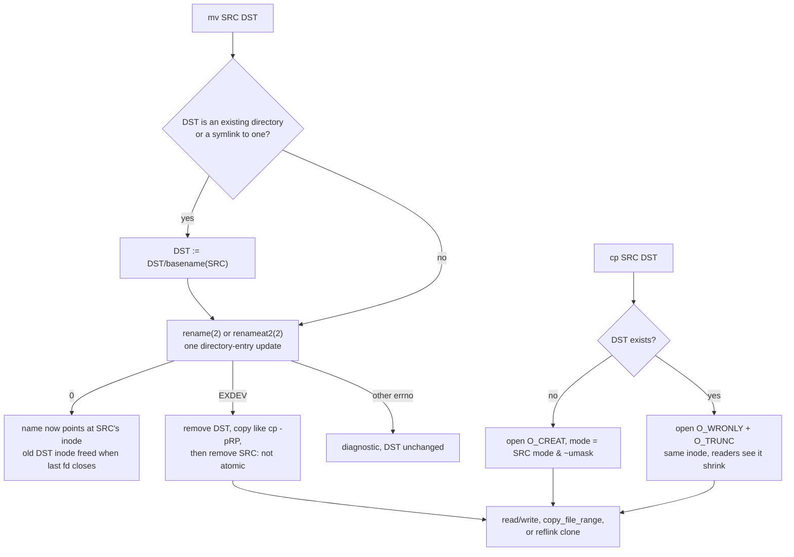

# cp, mv, and Rename Semantics

> [!summary] Claim
> `mv` within one file system is a single `rename(2)` that swaps which inode a name points to, atomically and without touching data, while `cp` and a cross-device `mv` move bytes through `open`, `write`, and `unlink`, so only the rename path gives readers an old-or-new guarantee, and every implementation layers different policy (overwrite, symlinks, exit status, trailing slashes) on top.

Part of [Coreutils and the Userland](README.md) in [Shell and Unix Engineering](../README.md).

## TL;DR

- Mechanism: `mv a b` on one file system is `rename("a", "b")` (or `renameat2` with flags in GNU), which replaces the directory entry `b` in one step; `cp a b` opens an existing `b` with `O_WRONLY|O_TRUNC` and rewrites the same inode in place (`(POSIX.1-2024 XCU cp, DESCRIPTION)`, lab tests 1-2).
- Rule: to replace a file that others read, write a temporary file in the same directory, set its mode, flush it, and `mv` it over the target; never `cp` onto a live file, and never stage the temporary file on another file system, where `mv` silently degrades to copy-and-delete.
- Trap: `mv src dst` means "rename" the first time and "move into" the second time once `dst` exists as a directory (or a symlink to one), so the same command nests on a rerun (lab test 11); `cp -R src/ dst` copies the contents on BSD and macOS but the directory on GNU and BusyBox (lab test 10).
- Portability fact: `-n` never overwrites anywhere, but `cp -n` exits 1 on macOS and FreeBSD, 0 on GNU 9.5+ and BusyBox, and 1 on GNU 9.2 to 9.4 (lab test 18, GNU NEWS 9.2 and 9.5); `mv --exchange` exists only in GNU 9.5+ and uutils.
- When not to use it: shell `mv` cannot express no-replace, exchange, durable (fsync) replace, or directory-descriptor-anchored renames portably; when those matter use `renameat2`/`renamex_np` from C, Rust, Go, or Python, or `install`, `rsync --delay-updates`, or a symlink swap for whole trees.

## Mental model



`mv` first decides which name it is producing: if the last operand already resolves to a directory, the target becomes a name inside it, which is why the same command renames once and nests the next time.
It then asks the kernel for a rename, which only edits directory entries: on success the target name points at the source inode and no data moves, so a reader holding the old file keeps it until it closes.
Only when the kernel answers `EXDEV` (different file systems or mounts) does `mv` fall back to the byte-moving path, and that path deletes the old destination before writing the new one, so it loses every atomicity property the rename path had.
`cp` always takes the byte-moving path: an existing destination is truncated and rewritten in place, so its inode, owner, mode, and hard links survive, and anyone reading it mid-copy sees a short or empty file.

## How it works

### Names, inodes, and what a rename changes

A directory is a table from names to inode numbers; the inode holds the data pointers, owner, mode, and timestamps, and its link count says how many names point at it ([[Inodes-and-Links]]).
`rename(old, new)` removes the entry `old` and makes `new` point at `old`'s inode, replacing whatever `new` pointed at, so it never reads or writes file data and costs the same for 1 byte or 1 TiB.
POSIX requires that when `new` already exists, it "shall remain visible to other threads throughout the renaming operation and refer either to the file referred to by new or old before the operation began" (`(POSIX.1-2024 XSH rename, DESCRIPTION)`).
The Linux page states the same guarantee and adds the caveat that "there will probably be a window in which both oldpath and newpath refer to the file being renamed" (`(rename(2), DESCRIPTION)`).
If the replaced inode's link count drops to zero and some process still has it open, its storage lives until the last descriptor closes, which is why a reader that opened the old file keeps reading the old bytes (lab test 1: `fd=OLD name=NEW`).
An open file description refers to the inode, not the name ([[File-Descriptors-and-Open-File-Descriptions]]), so renaming never disturbs a writer either: a log file renamed by a rotation script keeps receiving writes from the daemon that holds it open until the daemon reopens by name.

### The rename(2) contract

The specification pins down every edge case the utilities inherit (`(POSIX.1-2024 XSH rename)`):

- Same file: if `old` and `new` are the same directory entry or two hard links to one inode, `rename` returns success and does nothing, so `rename("x", "x")` cannot delete `x`; the C probe shows the system call leaving both hard links in place (lab test 7).
- Type rules: a non-directory cannot replace a directory (`EISDIR`), a directory cannot replace a non-directory (`ENOTDIR`), and a directory can replace only an empty directory (`EEXIST` or `ENOTEMPTY`).
- No cycles: `old` may not be an ancestor of `new` (`EINVAL`), and paths ending in `.` or `..` are rejected.
- Symlinks: the final component is never followed; renaming a symlink renames the link, and a symlink at `new` is replaced, not written through (lab test 15: `mv_link=no`).
- Trailing slashes: `new` with a trailing slash must resolve to an existing directory.
- Permissions: write and search permission on both parent directories; in a sticky directory such as `/tmp` the caller must also own the file or the directory (`EPERM` or `EACCES`).
- Failure: "If the rename() function fails for any reason other than [EIO], any file named by new shall be unaffected."
- `EXDEV`: the two names are on different file systems; on Linux also when they are on different mounts of one file system (`(rename(2), ERRORS)`), which bites bind mounts and container volumes ([[Mounts-and-Mount-Namespaces]]).
- POSIX.1-2024 added `EILSEQ` for a final component that is not a portable file name and encourages rejecting names that contain a newline byte (`(POSIX.1-2024 XSH rename, CHANGE HISTORY, Austin Group Defects 251 and 293)`).

`renameat(olddirfd, old, newdirfd, new)` resolves relative names against directory descriptors, whose stated purpose is to rename files outside the working directory "without exposure to race conditions" when a path prefix can change under the caller (`(POSIX.1-2024 XSH rename, RATIONALE)`) ([[Path-Resolution-and-Symlink-Races]]).

### Kernel extensions: no-replace, exchange, whiteout

Linux 3.15 added `renameat2(olddirfd, old, newdirfd, new, flags)`; glibc wraps it since 2.28 (`(rename(2), HISTORY)`).
Its flags are defined in `include/uapi/linux/fs.h` as `RENAME_NOREPLACE (1 << 0)`, `RENAME_EXCHANGE (1 << 1)`, and `RENAME_WHITEOUT (1 << 2)`.

- `RENAME_NOREPLACE` fails with `EEXIST` if `new` exists, making the existence check and the rename one atomic step, which a shell `[ -e "$dst" ] || mv` can never do (lab test 8).
  File system support arrived per file system: ext4 in 3.15, btrfs, tmpfs, and cifs in 3.17, xfs in 4.0, and ext2, minix, reiserfs, jfs, vfat, and bpf in 4.9; elsewhere the call fails with `EINVAL` (`(rename(2), renameat2)`).
- `RENAME_EXCHANGE` swaps two existing names atomically; they may differ in type, so a directory can be swapped with a symlink; a missing `new` gives `ENOENT` (lab test 9).
- `RENAME_WHITEOUT` (Linux 3.18) leaves a whiteout (a character device 0,0) at the source for overlay file systems and needs `CAP_MKNOD`.
- overlayfs accepts exactly `RENAME_EXCHANGE` and `RENAME_NOREPLACE` (`fs/overlayfs/dir.c`, `ovl_rename_start`, called from `ovl_rename`, rejects `flags & ~(RENAME_EXCHANGE | RENAME_NOREPLACE)`), which is what container root file systems use; the lab's C probe passed both flags on the Debian image's overlayfs, including swapping a directory with a symlink.

macOS 10.12 added `renamex_np` and `renameatx_np` with `RENAME_SWAP` (0x2) and `RENAME_EXCL` (0x4), plus `RENAME_NOFOLLOW_ANY` (0x10) and `RENAME_RESOLVE_BENEATH` (0x20) for hardened path resolution (macOS SDK `sys/stdio.h`, rename(2) man page).
`RENAME_SWAP` and `RENAME_EXCL` work only where the volume reports `VOL_CAP_INT_RENAME_SWAP` and `VOL_CAP_INT_RENAME_EXCL` (macOS SDK `sys/attr.h`); APFS passed both lab tests 8 and 9.
The lab's `rename_probe.c` calls `syscall(SYS_renameat2, ...)` on Linux and `renamex_np` on macOS, so the same tests check both kernels.

Inside Linux, a rename within one directory locks the parent and then the non-directories involved in inode-address order; a cross-directory rename first takes the per-file-system `s_vfs_rename_mutex`, fails if the two parents have no common ancestor, locks the parents ancestors-first (the source's parent first when neither is an ancestor of the other), and only then verifies that the source is not a descendant of the target and the target not a descendant of the source (`Documentation/filesystems/directory-locking.rst`, rules 5 and 6).
That per-file-system mutex is why cross-directory renames on one file system serialize, and why the ancestor check (the `EINVAL` case) can be decided race-free.

### What mv does on top of rename

POSIX specifies `mv` as seven steps per source (`(POSIX.1-2024 XCU mv, DESCRIPTION)`):

1. Prompt if the destination exists, `-f` is absent, and either `-i` is given or the destination is not writable and standard input is a terminal.
2. If source and destination are the same file, do not remove the destination; either do nothing, print a diagnostic and fail, or (for distinct hard links) remove the source.
3. Perform `rename()`; on success go to the next file; on any error other than `EXDEV`, print a diagnostic and go on.
4. On the copy path, refuse a directory-versus-non-directory mismatch.
5. Remove the existing destination.
6. Duplicate the hierarchy: symlinks as symlinks, times, owner, group, and mode preserved, set-user-ID and set-group-ID dropped if owner or group cannot be preserved; a failure to duplicate attributes prints a diagnostic but does not change the exit status.
7. Remove the source hierarchy.

The rationale explains why `mv` prompts only for terminals and does not require write permission on the target: it follows BSD practice and `rename()` itself, unlike `cp` (`(POSIX.1-2024 XCU mv, RATIONALE)`).
"CONSEQUENCES OF ERRORS" promises only that at an interruption one of the two copies is complete: the cross-device path is a transaction with no rollback.

GNU `mv` (coreutils 9.12, `src/mv.c` `main` and `src/copy.c` `copy_internal`):

- With exactly two operands and no target-directory option, `main` first calls `renameatu(AT_FDCWD, file[0], AT_FDCWD, lastfile, RENAME_NOREPLACE)`; if that succeeds the job is done in one system call and no `stat` race exists.
  Only if it fails does `mv` open the last operand as a directory (`target_directory_operand`) to decide between the rename form and the directory form.
- In `copy_internal`, move mode tries `renameatu(..., RENAME_NOREPLACE)` again, and only after its checks (same file, `-n`, `--update`, type mismatch, "will not overwrite just-created") calls `renameatu(..., 0)` or, with `--exchange`, `renameatu(..., RENAME_EXCHANGE)`.
- `-n` is therefore race-free where `renameat2` or `renameatx_np` exists: NEWS for 8.30 (2018-07-01) records that "'mv -n A B' no longer suffers from a race condition that can overwrite a simultaneously-created B".
- Same file: `mv a a` and `mv` between two hard links print "are the same file" and exit 1 (lab tests 5 and 6), and on case-insensitive APFS GNU 9.12 refuses a case-only rename (for a regular file `gmv notes NOTES` printed "'notes' and 'NOTES' are the same file", and for a directory "cannot move 'notes' to a subdirectory of itself, 'NOTES/notes'", both exit 1, measured by hand on 2026-11-15, not in the lab), while Apple's `mv.c` special-cases exactly that (a comment in `main` allows for a file system that "is case insensitive") and `/bin/mv notes NOTES` succeeds.
- `EINVAL` becomes "cannot move 'md' to a subdirectory of itself" (lab test 13).
- On `EXDEV` (unless `--no-copy`, added in 9.2, or `--exchange`), it removes the destination with `unlinkat` (with `AT_REMOVEDIR` for a directory), copies "as if by `cp -a`", and then removes the source with the `rm` engine; if the copy fails it removes the partial copy (`coreutils.texi`, mv invocation).
- `--exchange` (9.5) swaps source and destination, atomically "if source and destination are on a single file system that supports atomic exchange"; it is never emulated by copying.

BSD and macOS `mv` (`bin/mv/mv.c`, `do_move`):

- `-n` is a check-then-act: `access(to, F_OK)` and, if the name exists, skip and exit 0; another process can create `to` between that `access` and the `rename`.
- The rename is a plain `rename(from, to)`; on `EXDEV` a regular file goes through `fastcopy`, which loops on `open(to, O_CREAT | O_EXCL | O_TRUNC | O_WRONLY, 0)` and `unlink(to)` until the create succeeds, copies with `read`/`write`, sets owner, mode, flags, and times, and unlinks the source; on a write error it unlinks the partial destination.
- Anything else (directories, symlinks, devices) is moved by forking `/bin/cp -PRp -- from to` and then `/bin/rm -rf -- from`, after first removing an existing destination with `rmdir` or `unlink`.
- Apple's version copies ACLs and extended attributes in `fastcopy` with `fcopyfile(..., COPYFILE_ACL | COPYFILE_XATTR)`, and converts a Darwin `EXDEV` that is really a type mismatch into `EISDIR` or `ENOTDIR`.
- `-h` ("If the target operand is a symbolic link to a directory, do not follow it") is BSD's equivalent of GNU's `-T`.

BusyBox `mv` (`coreutils/mv.c`) stats the destination, applies `-n`, `-f`, `-i`, and the not-writable-and-terminal prompt, calls `rename`, and on `EXDEV` unlinks the destination, runs `copy_file(..., FILEUTILS_RECUR | FILEUTILS_PRESERVE_STATUS)`, then `remove_file(..., FILEUTILS_RECUR | FILEUTILS_FORCE)`.

uutils `mv` (`src/uu/mv/src/mv.rs`, `rename`) checks `to.exists()` before applying `-n` and then calls `fs::rename`, a check-then-act like BSD's; its cross-device fallback was the subject of the 2026 CVEs listed under Pitfalls.

### What cp does

POSIX defines `cp` in terms of `open` (`(POSIX.1-2024 XCU cp, DESCRIPTION)`):

- An existing destination is opened "as if" by `open()` with `O_WRONLY|O_TRUNC`; if that fails and `-f` is given, `cp` unlinks the destination and creates it fresh.
- A missing destination is created with `O_WRONLY|O_CREAT` and the source's permission bits as the mode argument, so the umask applies (lab test 3: source 644 under umask 077 gives `-rw-------`).
- An existing destination keeps its own mode, owner, and inode, because truncation does not touch them (lab test 2: a 600 destination stays `-rw-------` and its hard link sees the new bytes).
- `-p` copies times, owner and group, and permission bits; if owner or group cannot be set, set-user-ID and set-group-ID are cleared, and the destination is not deleted when attributes cannot be preserved.
- Without `-R`, a symlink source is followed; with `-R` the default for symlinks is unspecified, and `-H`, `-L`, and `-P` choose explicitly (the last one wins).
- A new directory is created with the source mode, umask applied unless `-p`, OR'ed with `S_IRWXU` so the copy can be filled, then set to its final mode.
- POSIX.1-2024 no longer specifies `-r`; `-R` is the recursive option and creates special files instead of reading them (`(POSIX.1-2024 XCU cp, RATIONALE)`).

GNU `cp` (`src/copy.c`, `copy_reg`):

- Existing destination: `openat(dst_dirfd, dst_relname, O_WRONLY | O_BINARY | (data_copy_required ? O_TRUNC : 0))`, the in-place rewrite.
- New destination: `openat(..., O_WRONLY | O_CREAT | O_BINARY | O_EXCL, open_mode)` where `open_mode` withholds `omitted_permissions`, which `copy_internal` computes and passes in: group and other bits when ownership is being preserved or a mode is being set (only the group and other write bits for a directory), so "unauthorized users cannot nip in before the file is ready"; the bits are added after `fchown`.
- A destination that is a dangling symlink makes the `O_EXCL` open fail with `EEXIST`; GNU then refuses ("not writing through dangling symlink") unless `POSIXLY_CORRECT` is set, in which case it opens through the link "in spite of the possible risk" (`coreutils.texi`, cp invocation; lab tests 16 and 17).
- Since 9.0 `cp` defaults to `--reflink=auto` and uses `copy_file_range`, and `--debug` (9.2) reports which was used; see [[Reflinks-and-copy_file_range]].
- `--remove-destination` unlinks before opening, the explicit way to get a new inode.

BSD and macOS `cp`:

- `cp -R src/ dst` copies the contents of `src` into `dst` ("If the source_file ends in a /, the contents of the directory are copied rather than the directory itself", `cp.1`), where GNU and BusyBox create `dst/src` (lab test 10).
- `-n` sets the exit status to 1 when it skips (`utils.c`, `copy_file`: `rval = 1`), and macOS's man page warns that after an I/O error `cp` "may leave a partially copied target_file in place" and points to `install(1)` for stronger guarantees.
- Created directories under `-R` "have the same mode as the corresponding source directory, unmodified by the process' umask" (`cp.1`), which differs from the POSIX text that applies the umask without `-p`.
- A destination that is a dangling symlink is written through: the lab's `cp c dang` created the missing target (lab test 16: `missing=C`).

BusyBox `cp` (`libbb/copy_file.c`) is built by default with `FEATURE_NON_POSIX_CP=y`, described in `libbb/Config.src` as "Non-POSIX, but safer": it opens the destination with `O_WRONLY|O_CREAT|O_EXCL`, and when that fails it unlinks the destination and creates it again.
So BusyBox `cp` gives an existing destination a new inode with the source's mode, breaks its hard links, and replaces a symlink destination instead of writing through it (lab tests 2, 15, and 16, BusyBox arms; the probe gave exactly those results with BusyBox 1.37.0 in the shell matrix's Alpine image).
The source comment explains the trade: "If dest is a (sym)link, we overwrite link destination! ... This is strange, but POSIX-correct."

### Visibility is not durability

A rename is atomic with respect to other processes, not with respect to a crash: the specification of `rename` says nothing about what is on disk after power loss, and `fsync(2)` on a file "does not necessarily ensure that the entry in the directory containing the file has also reached disk. For that an explicit fsync() on a file descriptor for the directory is also needed" (`(fsync(2), DESCRIPTION)`).
The durable replace is therefore: write the temporary file, `fsync` it, `rename` it, `fsync` the directory; the full treatment, including `fdatasync` and per-file-system ordering, is in [[Atomic-Rename-and-fsync]].
The shell has no portable `fsync`: GNU `sync FILE` syncs only the named files and `sync -d FILE` only their data (`sync --help`, coreutils 9.12); BusyBox 1.37.0 accepts the same form (`sync [-df] [FILE]...`, its usage text in the Alpine image), while FreeBSD and macOS `sync(8)` take no operands at all (`sync.8` SYNOPSIS), and macOS `/bin/sync f` exits 0 after a whole-system `sync(2)`, so a script cannot tell that the per-file request was ignored.

## Numbers and limits

| Quantity | Value | Source |
|---|---|---|
| Data bytes moved by a same-file-system `mv` | 0 (directory entries only) | POSIX XSH rename; lab test 1 shows the inode is the source's |
| `NAME_MAX`, `PATH_MAX`, `LINK_MAX` (Linux headers) | 255, 4096, 127 | `include/uapi/linux/limits.h` (as of 2026-11); file systems enforce their own link limits |
| `NAME_MAX`, `PATH_MAX`, `LINK_MAX` (macOS 27.3, APFS `/`) | 255, 1024, 32767 | measured with `getconf` on the host, 2026-11-15 |
| `renameat2` availability | Linux 3.15, glibc 2.28 wrapper | rename(2), HISTORY |
| `RENAME_NOREPLACE` file system support | ext4 3.15; btrfs, tmpfs, cifs 3.17; xfs 4.0; many more 4.9 | rename(2) |
| `RENAME_WHITEOUT` | Linux 3.18, needs `CAP_MKNOD` | rename(2) |
| Linux flag values | `NOREPLACE` 1, `EXCHANGE` 2, `WHITEOUT` 4 | `include/uapi/linux/fs.h` |
| macOS flag values | `RENAME_SWAP` 0x2, `RENAME_EXCL` 0x4, `NOFOLLOW_ANY` 0x10, `RESOLVE_BENEATH` 0x20; since 10.12 | macOS SDK `sys/stdio.h` (as of 2026-11) |
| GNU `-n` exit status on skip | 0 before 9.2, 1 in 9.2 to 9.4, 0 from 9.5 (2024-03-28) | GNU NEWS; lab test 18 on 9.12 |
| GNU race-free `mv -n` | since 8.30 (2018-07-01), needs `renameat2` or `renameatx_np` | GNU NEWS |
| GNU `mv --exchange`, `--update=none-fail` | 9.5 (2024-03-28) | GNU NEWS; lab test 19 |
| GNU `cp --reflink=auto` default, `copy_file_range` | 9.0 (2021-09-24) | GNU NEWS |
| GNU `ln -f` without a moment where the target is missing | 8.27 (2017-03-08) | GNU NEWS |
| BSD `mv --exchange` exit status | 64 (`EX_USAGE`, rejected option) | lab test 19 on macOS 27.3 |
| ext4 rename and truncate heuristics (`auto_da_alloc`) | queued for Linux 2.6.30 (2009) | LWN 322823; `Documentation/admin-guide/ext4.rst` |
| Crash vulnerabilities found by ALICE | 60 across 11 applications, 6 Linux file systems studied | Pillai et al., OSDI 2014 |
| uutils `mv` cross-device TOCTOU | CVSS 3.1 6.3 (AV:L/AC:H/PR:L) | CVE-2026-35364 |
| Zellic audit of uutils for Ubuntu | 113 issues (73 + 40) | Ubuntu Discourse, 2026-04-22 |
| Lab | 21 tests, all passing with macOS `/bin/cp` and `/bin/mv` under `sh` (bash 3.2) and with GNU 9.12 under dash | run 2026-11-15 |

## Portability

The behavior below belongs to the `cp` and `mv` binaries, not the shell: the lab runs one POSIX `sh` probe under every shell family in the matrix (POSIX sh, bash 3.2 and current, zsh native and `--emulate sh`, dash, ksh93, mksh, yash, posh, BusyBox ash) and asserts the same per-utility values in each, branching only on which `cp` and `mv` are on `PATH`.

| Behavior | POSIX.1-2024 | GNU coreutils 9.12 | macOS and FreeBSD | BusyBox 1.37 | uutils 0.13 |
|---|---|---|---|---|---|
| `cp` onto existing file | `O_WRONLY\|O_TRUNC`, same inode | same inode, keeps mode (test 2) | same inode, keeps mode (test 2) | unlink and recreate, new inode, source mode (source; test 2) | not measured |
| `cp` through symlink destination | writes through | writes through (test 15) | writes through (test 15) | replaces the link (source; test 15) | not measured |
| `cp` onto dangling symlink | writes through | refuses, exit 1, unless `POSIXLY_CORRECT` (tests 16, 17) | creates the target (test 16) | replaces the link (source; test 16) | not measured |
| `cp -R src/ existing_dir` | target gets `src` hierarchy | `dir/src` (test 10) | contents only (test 10, `cp.1`) | `dir/src` (source; test 10) | not measured |
| `cp a a` | may diagnose, skips | exit 1 (test 5) | exit 1 "identical (not copied)" (test 5) | exit 1 (source; test 5) | not measured |
| `mv a a`, `mv` between hard links | either no-op or diagnostic | exit 1 "are the same file" (tests 5, 6) | exit 0 no-op (tests 5, 6) | exit 0 no-op (source; tests 5, 6) | not measured |
| `cp -n` exit on skip | `-n` not specified | 0 (9.5+), 1 (9.2-9.4) (test 18) | 1 (test 18, `utils.c`) | 0 (source; test 18) | not measured |
| `mv -n` exit on skip | `-n` not specified | 0 (9.5+), 1 (9.2-9.4) (test 18) | 0 (test 18) | 0 (source; test 18) | 0 (`mv.rs`) |
| `mv -n` race-free | - | yes, `RENAME_NOREPLACE` | no, `access` then `rename` | no, `stat` then `rename` | no, `exists` then `rename` |
| `mv --exchange` | - | yes, 9.5+ (test 19) | exit 64 (test 19) | rejected (source; test 19) | yes, `RENAME_EXCHANGE` (`mv.rs`) |
| Force the rename form for a directory-like target | - | `-T` | `-h`, for a symlink to a directory (`mv.1`) | `-T`, "Refuse to move if DEST is a directory" (usage text) | not measured |
| Cross-device `mv` | copy, then remove source | unlink dst, copy as `cp -a`, `rm` source | `fastcopy` or exec `cp -PRp` and `rm -rf` | unlink dst, `copy_file`, `remove_file` | copy and delete (CVE-2026-35364) |
| Prompt for an unwritable destination | only on a terminal | yes (`mv.c`, `isatty`) | yes (`mv.c`, `isatty`) | yes (`mv.c`, `isatty(0)`) | yes (`mv.rs`, `is_terminal`) |

"source" marks a BusyBox cell taken from `libbb/copy_file.c` or `coreutils/mv.c` and asserted by the lab's `busybox` arm, which only the Alpine image exercises; every such cell with a test number matched the probe's output under BusyBox 1.37.0 in that image (2026-11-15).

## Worked example

The [lab](../labs/08-cp-mv-and-rename-semantics/) has three files: `renamesem.sh`, a POSIX `sh` probe with one mode per behavior; `rename_probe.c`, which calls `renameat2` or `renamex_np` directly; and `renamesem.bats`, 21 tests that branch on the `cp` and `mv` implementation.
The centerpiece is the safe-replace function, verbatim from `renamesem.sh`:

```sh
# atomic_write DEST: copy standard input to DEST through a temporary file in DEST's
# own directory, then rename it over DEST, so a reader sees the old or the new file,
# never a partial one. The temporary file gets mode 644 before the rename, because
# mktemp creates it 0600 and rename keeps the inode, mode and all.
atomic_write() {
  case $1 in
    */) return 1 ;; # a trailing slash cannot name a regular file
    */*) aw_dir=${1%/*} ;;
    *) aw_dir=. ;;
  esac
  aw_dir=${aw_dir:-/}               # "/name" has an empty directory part
  if [ -d "$1" ]; then return 1; fi # mv would move the file INTO a directory
  aw_tmp=$(mktemp "$aw_dir/.atomic.XXXXXX") || return 1
  if cat >"$aw_tmp" && chmod 644 "$aw_tmp" && mv -f "$aw_tmp" "$1"; then
    return 0
  fi
  rm -f "$aw_tmp"
  return 1
}
```

The temporary file lives in the destination's directory so the final `mv` is a same-file-system `rename`, never the `EXDEV` copy path; `mktemp` creates it with `O_EXCL` and mode 0600 ([[mktemp]]), so the function sets the final mode explicitly; a failed write removes the temporary file and leaves the old file untouched.
The `[ -d ]` check is not atomic with the `mv`; GNU's `mv -T` or BSD's `mv -h` closes that gap where available.
It does not `fsync`, so it guarantees what other processes see, not what survives a power cut ([[Atomic-Rename-and-fsync]]).

The probe that contrasts it with `cp` holds the destination open on descriptor 3 across the replace (verbatim from `renamesem.sh`):

```sh
  cp-reader)
    # cp onto an existing file: truncate in place (POSIX) or unlink and recreate.
    printf old >dst
    chmod 600 dst
    ln dst dst.link
    printf new >src
    chmod 644 src
    old_ino=$(inode dst)
    exec 3<dst
    cp src dst
    rc=$?
    via_fd=$(cat <&3)
    exec 3<&-
    now_ino=$(inode dst)
    echo "rc=$rc fd=$via_fd link=$(cat dst.link) same_inode=$(yes_if_equal "$now_ino" "$old_ino") mode=$(mode_of dst)"
    ;;
```

Captured output on 2026-11-15 (macOS 27.3, APFS), the BSD utilities first and GNU coreutils 9.12 second; each line is what the corresponding lab test asserts:

```text
bsd mv-reader          rc=0 fd=OLD name=NEW inode_is_new=yes
gnu mv-reader          rc=0 fd=OLD name=NEW inode_is_new=yes
bsd cp-reader          rc=0 fd=new link=new same_inode=yes mode=-rw-------
gnu cp-reader          rc=0 fd=new link=new same_inode=yes mode=-rw-------
bsd atomic-write       rc=0 fd=OLD name=NEW same_inode=no mode=-rw-r--r-- leftovers=none
gnu atomic-write       rc=0 fd=OLD name=NEW same_inode=no mode=-rw-r--r-- leftovers=none
bsd atomic-write-fail  rc=1 name=OLD dir_rc=1 adir_entries=[] leftovers=none
gnu atomic-write-fail  rc=1 name=OLD dir_rc=1 adir_entries=[] leftovers=none
bsd cp-tree-slash      into=[./s ./s/f ./s/sub] into_slash=[./f ./sub] fresh=[./f ./sub]
gnu cp-tree-slash      into=[./s ./s/f ./s/sub] into_slash=[./s ./s/f ./s/sub] fresh=[./f ./sub]
bsd dangling           rc=0 dang_link=yes missing=C
gnu dangling           rc=1 dang_link=yes missing=absent
bsd no-clobber         mv_rc=0 cp_rc=1 b=B a=yes
gnu no-clobber         mv_rc=0 cp_rc=0 b=B a=yes
```

Read the first four lines together: after `mv` the old descriptor still reads `OLD` and the name reads `NEW`, while after `cp` the old descriptor reads `new`, the hard link reads `new`, and the 600 mode survived, because `cp` rewrote the same inode.
The BusyBox arm of the same test expects `fd=old link=old same_inode=no mode=-rw-r--r--`, the unlink-and-recreate strategy.
The C probe (lab tests 7 to 9) prints `ok`, then `EEXIST` for a no-replace onto an existing name, then `ok` and swapped contents `21` for an exchange, then `ENOENT` for an exchange with a missing name.

## Pitfalls

> [!warning] cp onto a file that is in use
> Trigger: deploying with `cp new.conf /etc/app.conf`, `cp app /usr/local/bin/app`, or `cp new.db live.db` while something reads it.
> Symptom: readers see an empty or half-written file (the destination is truncated first, lab test 2); on Linux, opening a running executable for writing fails with `ETXTBSY` ("Text file busy", `(open(2), ERRORS)`); a process that has the file `mmap`ed takes `SIGBUS` on pages past the new end of file (`(mmap(2), SIGBUS)`).
> Fix: write a new file and `mv` it into place (`atomic_write` above), or use `install`, which replaces rather than rewrites ([[install-and-Atomic-Deployment]]); use `cp --remove-destination` in GNU when a new inode is the goal.

> [!warning] Same command, different meaning on rerun
> Trigger: `mv build out` or `cp -R build out` in a script that runs twice, or a target that is a symlink to a directory (`mv new current` where `current -> releases/v1`).
> Symptom: the first run renames; the second creates `out/build` (lab test 11), and with the symlink the new release lands inside the old one.
> Fix: make the target's role explicit: `mv -T` (GNU, BusyBox) or `mv -h` (BSD) for "this is the name", a trailing `/.` or `-t DIR` for "into this directory", or remove or check the target first; for releases, swap a symlink with `ln -s new tmp && mv -T tmp current`.

> [!warning] Temporary file on another file system
> Trigger: `tmp=$(mktemp)` (in `$TMPDIR`, often tmpfs) followed by `mv "$tmp" /srv/data/file`.
> Symptom: `rename` fails with `EXDEV`, and `mv` silently switches to remove-destination, copy, remove-source, so readers can see the destination missing or partial; POSIX promises only that termination by a signal or error leaves either the source or the destination complete (`(POSIX.1-2024 XCU mv, CONSEQUENCES OF ERRORS)`), and nothing at all about a power loss, which can leave neither copy complete on disk; on Linux even two bind mounts of one file system give `EXDEV`.
> Fix: create the temporary file in the destination directory (`mktemp "$dir/.name.XXXXXX"`); with GNU, `mv --no-copy` turns a silent degradation into a hard failure.

> [!warning] Atomic but not durable
> Trigger: write a new file and rename it over the old one without `fsync`.
> Symptom: after a crash the file exists with zero length; this is Ubuntu Launchpad bug 317781 on ext4, where delayed allocation could postpone data writes for a minute or more while the rename committed (LWN, "ext4 and data loss", 2009-03-11); ext4 added the `auto_da_alloc` heuristics for 2.6.30 to force allocation before a rename or truncate commits, a workaround for "broken applications" (`Documentation/admin-guide/ext4.rst`); Pillai et al. found 60 such crash vulnerabilities in 11 applications including databases and version control systems (OSDI 2014).
> Fix: `fsync` the file before the rename and the directory after it; in shell, GNU `sync FILE` before `mv` and `sync DIR` after, or do the replace in a language with `fsync` ([[Atomic-Rename-and-fsync]]).

> [!warning] The new inode carries the temporary file's metadata
> Trigger: replacing a file by rename when the original had a specific owner, group, mode, ACL, extended attributes, or extra hard links.
> Symptom: the replaced file is mode 0600 (`mktemp`'s mode, which the lab's function has to override), owned by the deploying user, missing its ACL or SELinux label, and its old hard links still point at the old content.
> Fix: set mode, owner, and group on the temporary file before the rename (`chmod`, `chown`, or `install -m -o -g`), copy ACLs and labels explicitly ([[ACLs-and-Extended-Attributes]]), and treat hard-linked files as unsuitable for rename-based updates.

> [!warning] -n and its exit status
> Trigger: `cp -n src dst || die` or `mv -n` used as a lock or an "only if absent" test.
> Symptom: `cp -n` exits 1 on macOS and FreeBSD and 0 on GNU 9.5+ and BusyBox when it skips (lab test 18); GNU 9.2 to 9.4 exited 1, and 9.5 reverted because scripts broke; GNU's NEWS for 9.5 says "The -n,--no-clobber option is best avoided due to platform differences"; BSD, BusyBox, and uutils `mv -n` also check and act in two steps, so a concurrent writer can still be clobbered.
> Fix: compare the destination afterwards instead of trusting the status; in GNU use `--update=none-fail` for a diagnosed failure; for a portable atomic no-clobber move of a regular file within one file system, `ln -- "$src" "$dst" && rm -- "$src"`, because `link()` fails with `EEXIST` when the new name exists (`(POSIX.1-2024 XSH link, ERRORS)`).

> [!warning] Trailing slash on a directory copy
> Trigger: `cp -R "$src/" "$dst"` with `src` ending in a slash, often produced by tab completion or by `"$dir"/` concatenation.
> Symptom: on macOS and FreeBSD the contents of `src` land directly in `dst`, on GNU and BusyBox `dst/src` is created (lab test 10), so a script written on one platform scatters or nests files on the other.
> Fix: never rely on the slash; to copy contents use `cp -R "$src/." "$dst"`, which names the directory's `.` entry explicitly (measured by hand with macOS `cp`, GNU 9.12, and BusyBox 1.37.0, into an existing and a new `$dst`), or use `rsync`, whose trailing-slash rule is part of its documented interface ([[rsync-Algorithm-and-Usage]]).

> [!warning] Copying through a planted symlink
> Trigger: a privileged `cp` writes to a fixed name in a directory other users can write, such as `/tmp/report.txt`.
> Symptom: an attacker creates `/tmp/report.txt -> /etc/passwd` (or a dangling link to a file that does not exist yet) and the copy writes through it; BSD and macOS `cp` even create the dangling target (lab test 16).
> Fix: create destinations with `O_EXCL` (`mktemp`, `set -C`), keep privileged writes out of shared directories, and prefer GNU `cp`'s refusal or BusyBox's replace-the-link behavior only as defense in depth ([[Temporary-File-Attacks]]).

## Security and robustness

A `cp` or `mv` that runs with privileges and touches a path an unprivileged user can modify is a time-of-check-to-time-of-use target at every step that resolves a path twice.
The uutils audit that Canonical published on 2026-04-22 is a catalog of exactly those steps in a fresh implementation:

- CVE-2026-35364: cross-device `mv` "removes the destination path before recreating it through a copy operation", and an attacker who can write the destination directory replaces it with a symlink so the privileged copy overwrites an arbitrary file (CVSS 6.3).
- CVE-2026-35359: `cp` checks whether the source is a symlink with path-based metadata and then opens it without `O_NOFOLLOW`, so a swapped-in symlink copies an arbitrary file into a destination the attacker controls.
- CVE-2026-35357: `cp` created destinations with umask-derived permissions (0644) and tightened them later, and a descriptor opened in that window stays readable; GNU avoids this with `omitted_permissions` in `copy.c`.
- CVE-2026-35350: `cp -p` kept set-user-ID and set-group-ID bits when `chown` failed, which POSIX forbids and GNU does not do.
- CVE-2026-35351 and CVE-2026-35365: cross-device `mv` created files owned by the caller and expanded symlinks into copies of their targets, where POSIX step 6 requires owner preservation and symlinks recreated as symlinks.

The lesson for any implementation, including a shell script that reimplements `mv`: resolve once, then operate on descriptors (`openat`, `renameat`, `fchown`, `fchmod`, `O_NOFOLLOW`, `O_EXCL`), create with the most restrictive mode and widen at the end, and never delete a destination before its replacement is complete.
Ubuntu kept GNU `cp`, `mv`, and `rm` in 26.04 LTS while shipping uutils for the rest ("`cp`, `mv`, and `rm` continue to be provided by GNU coreutils in 26.04", Ubuntu Discourse, 2026-04-22), because those three still had "remaining open TOCTOU (time-of-check to time-of-use) issues (8 as of Apr 22, 2026)", which is a measure of how much semantics sits in these three tools.

Robustness rules for scripts:

- Quote every operand and end options with `--`, because a file named `-rf` or `--no-target-directory` is an option to `mv` ([[Argument-Injection-and-Double-Dash]], [[Hostile-Filenames]]).
- Check the exit status of every `mv` in a sequence: a failed `mv` leaves both names in place, and a following `rm` of the source destroys the only copy.
- Do not treat a successful exit as proof of overwrite: `-n`, `-i`, and `--update` skip silently or with platform-dependent status.
- On NFS a rename can succeed on the server while the client sees a failure after a retransmission (`(rename(2), BUGS)`), so idempotent re-runs must tolerate "source missing, destination present".
- In a sticky directory such as `/tmp`, renaming another user's file fails with `EPERM` or `EACCES` even when the directory is world-writable ([[Permissions-umask-and-Special-Bits]]).

## The principal's view

The decision is not "`cp` or `mv`" but which consistency contract the consumer of a file needs, and whether the tool can deliver it on every platform the script will meet.
Rename gives one contract cheaply: every reader sees a complete old or a complete new version, with zero data movement, provided the new version is staged on the same file system and its metadata is set before the swap.
Copy-in-place gives a different one: identity (inode, owner, ACLs, hard links, open descriptors) is preserved and content is not consistent during the write, which is right for a file whose identity matters more than its readers, and wrong for configuration, binaries, and data files.
The trade-off is explicit: rename replaces identity, so ownership, ACLs, labels, and hard links must be rebuilt, and durability needs two `fsync` calls the shell cannot portably make.

A staff-plus engineer standardizes the pattern rather than the command: a reviewed `atomic_write` helper (or `install -m MODE -o OWNER`) for single files, a symlink swap (`mv -T` or `renameat2` exchange) for release directories, `rsync --delay-updates` or a staging directory for trees, and a hard rule that temporary files live next to their destination.
They also pin the userland or abstract over it: GNU, BSD, BusyBox, and uutils disagree on `-n` status, trailing slashes, symlink destinations, and same-file handling, so scripts that ship to macOS laptops, Alpine containers, and Debian hosts either avoid those corners or detect the implementation, as the lab does ([[Four-Userlands-GNU-BSD-BusyBox-uutils]], [[Userland-Portability-Traps]]).
When the contract needs no-replace, exchange, directory-descriptor anchoring, or durability, the shell is the wrong layer: use a language with `renameat2`/`renamex_np` and `fsync`, or a store (SQLite, a database, an object store with conditional writes) that already implements the protocol and its crash recovery.

## Interview questions

> [!question] L5: What does `mv a b` do at the system-call level when `a` and `b` are on the same file system, and what happens to a process that has `b` open?
>
> > [!success]- Answer
> > It calls `rename("a", "b")` (GNU first tries `renameat2` with `RENAME_NOREPLACE`), which makes the directory entry `b` point at `a`'s inode in one atomic step and removes the entry `a`.
> > No file data is read or written.
> > The old inode of `b` loses its last link but stays allocated while any process holds it open, so that process keeps reading the old bytes until it closes and reopens by name.
> >
> > Follow-up: Why does a log rotation script that renames `app.log` still see the daemon writing to the renamed file?

> [!question] L5: Predict the output, with GNU or BSD `cp`: `printf old > f; ln f g; exec 3< f; printf new > s; cp s f; cat <&3; echo; cat g`
>
> > [!success]- Answer
> > It prints `new` and then `new`.
> > `cp` opens the existing `f` with `O_WRONLY|O_TRUNC` and rewrites the same inode, so descriptor 3 and the hard link `g` both see the new bytes.
> > With `mv s f` instead, descriptor 3 would print `old`, `g` would still print `old`, and `f` would print `new`.
> > BusyBox `cp` with its default `FEATURE_NON_POSIX_CP` unlinks and recreates `f`, so it prints `old` and `old`.
> >
> > Follow-up: Which of those three behaviors does POSIX require?

> [!question] L5: Why does `mv build out` behave differently the second time it runs, and how do you make it idempotent?
>
> > [!success]- Answer
> > POSIX `mv` picks its synopsis from the last operand: if `out` is an existing directory or a symlink to one, `build` is moved into it as `out/build`.
> > The first run renames `build` to `out`, so the second run finds `out` as a directory and nests.
> > Use `mv -T build out` (GNU, BusyBox) or `mv -h` (BSD) to force the rename form, remove `out` first, or move into an explicit directory with `-t`.
> >
> > Follow-up: What goes wrong when `out` is a symlink to the previous release directory?

> [!question] L6: Debug this deploy step, after which nginx sometimes cannot read its configuration and once, after a power cut, found it empty: `tmp=$(mktemp); render > "$tmp"; mv "$tmp" /etc/nginx/nginx.conf; nginx -s reload`
>
> > [!success]- Answer
> > `mktemp` without a template creates the file under `$TMPDIR` or `/tmp`, often a different file system, so `mv` gets `EXDEV` and falls back to delete-copy-delete, which is not atomic.
> > The file also keeps `mktemp`'s 0600 mode and the deploying user as owner, so a worker running as another user cannot read it.
> > Nothing calls `fsync`, so after a crash the rename can be on disk before the data, the ext4 zero-length failure from 2009.
> > Fix: `mktemp /etc/nginx/.nginx.conf.XXXXXX`, set mode and owner, check `render`'s status, `sync` the file, `mv -f`, `sync` the directory, then validate with `nginx -t` before reloading.
> >
> > Follow-up: How would you detect the `EXDEV` fallback in CI before it reaches production?

> [!question] L6: Why is `[ -e "$dst" ] || mv "$src" "$dst"` not a safe no-clobber move, and what is?
>
> > [!success]- Answer
> > The test and the rename are two system calls, so another process can create `$dst` between them and `mv` will replace it.
> > BSD, BusyBox, and uutils `mv -n` have the same check-then-act shape; GNU since 8.30 uses `renameat2(RENAME_NOREPLACE)` or `renameatx_np(RENAME_EXCL)`, which checks and renames atomically.
> > A portable shell alternative for a regular file on one file system is `ln -- "$src" "$dst" && rm -- "$src"`, because `link()` fails with `EEXIST` atomically.
> >
> > Follow-up: Which file systems on Linux reject `RENAME_NOREPLACE`, and what errno do you get?

> [!question] L6: Why does `cp -R "$SRC/" "$DST"` produce different trees on a Mac and in an Alpine container, and which command behaves the same on both?
>
> > [!success]- Answer
> > BSD and macOS `cp` treat a source ending in `/` as "copy the contents", so files land directly in `$DST`.
> > GNU and BusyBox ignore the slash and create `$DST/$(basename "$SRC")` when `$DST` exists.
> > `cp -R "$SRC/." "$DST"` names the directory's `.` entry, so GNU, macOS, and BusyBox all copy the contents (measured by hand with GNU 9.12, macOS 27.3, and BusyBox 1.37.0).
> >
> > Follow-up: What does each implementation do when `$DST` does not exist yet?

> [!question] L7+: Design a release switch for a web tier that serves from `/srv/app/current` such that no request ever sees a mix of two releases, and explain which system calls make it atomic.
>
> > [!success]- Answer
> > Unpack each release into its own directory `/srv/app/releases/R` on the same file system, fully, with correct ownership and modes, and `fsync` it.
> > Create a new symlink `current.tmp -> releases/R` and rename it over `current` with `mv -T` (GNU) or `mv -h` (BSD), which is a single `rename` of a symlink and never follows the old link.
> > Do not rely on `ln -sfn` for this: whether it ever leaves `current` missing depends on the implementation and version (GNU NEWS 8.27 records that `ln -f` stopped removing the target first), and a plain `mv` would follow the old symlink into the old release directory.
> > Workers must resolve `current` once per request or per process, since a process that already `chdir`ed into the old release keeps it, and old releases are deleted only after those workers drain.
> > With `renameat2(RENAME_EXCHANGE)` you can also swap two real directories atomically.
> >
> > Follow-up: What breaks if `releases/` is on a different mount from `current`?

> [!question] L7+: Which design rules do the 2026 uutils CVEs in `cp` and cross-device `mv` violate, and how does GNU's `copy.c` honor them?
>
> > [!success]- Answer
> > Never delete the destination before the replacement exists on a path an attacker can modify (CVE-2026-35364); GNU unlinks only at the `EXDEV` point and creates with `O_EXCL`, failing on a planted symlink.
> > Never check a path and then reopen it (CVE-2026-35359); open once with `O_NOFOLLOW` where no-dereference is intended and use the descriptor for every later step.
> > Create with the most restrictive mode and widen afterwards (CVE-2026-35357); GNU's `omitted_permissions` withholds group and other bits until `fchown` and `fchmod`.
> > Drop set-user-ID and set-group-ID bits when ownership cannot be preserved (CVE-2026-35350), as POSIX `cp -p` and `mv` step 6 require.
> >
> > Follow-up: Why did Ubuntu keep GNU `cp`, `mv`, and `rm` in 26.04 LTS while shipping uutils for the rest?

> [!question] L7+: Your service writes state with write-temp-then-rename, yet a crash-consistency review says it can still lose that state on ext4, XFS, and btrfs; what is missing, and why does POSIX not save you?
>
> > [!success]- Answer
> > POSIX makes `rename` atomic for other processes but says nothing about the on-disk order of data and directory updates after a crash.
> > The data blocks of the temporary file can still be in the page cache when the rename reaches the journal, so recovery shows the new name with zero or partial content.
> > The protocol needs `fsync` on the temporary file before the rename and `fsync` on the directory after it, as `fsync(2)` says the directory entry is not covered by the file's `fsync`.
> > ext4's `auto_da_alloc` hides the replace-via-rename case by default in `data=ordered` mode (`Documentation/admin-guide/ext4.rst`), which is why the bug shows up more readily on other file systems, with `noauto_da_alloc`, or in other modes; ALICE found 60 such vulnerabilities across 11 applications.
> >
> > Follow-up: When is `fdatasync` enough instead of `fsync`?

## Related

Prerequisites: [[uniq-and-Counting]], [[Inodes-and-Links]], [[File-Descriptors-and-Open-File-Descriptions]]

Next: [[Reflinks-and-copy_file_range]]

See also: [[install-and-Atomic-Deployment]], [[Atomic-Rename-and-fsync]], [[mktemp]], [[rsync-Algorithm-and-Usage]], [[Path-Resolution-and-Symlink-Races]], [[Temporary-File-Attacks]], [[Four-Userlands-GNU-BSD-BusyBox-uutils]], [[Userland-Portability-Traps]], [[Mounts-and-Mount-Namespaces]], [[Permissions-umask-and-Special-Bits]], [[ACLs-and-Extended-Attributes]], [[Argument-Injection-and-Double-Dash]], [[Hostile-Filenames]], [[tar-and-Archives]]

## Further reading

- POSIX.1-2024 XSH `rename`: https://pubs.opengroup.org/onlinepubs/9799919799/functions/rename.html - the atomic-replace guarantee, the same-file no-op, and every errno.
- POSIX.1-2024 XCU `mv`: https://pubs.opengroup.org/onlinepubs/9799919799/utilities/mv.html - the seven-step algorithm including the cross-device copy and its consequences of errors.
- POSIX.1-2024 XCU `cp`: https://pubs.opengroup.org/onlinepubs/9799919799/utilities/cp.html - the `O_TRUNC` rewrite, the umask rule, `-p`, and the removal of `-r`.
- Linux rename(2): https://man7.org/linux/man-pages/man2/rename.2.html - `renameat2` flags, per-file-system support versions, and the NFS caveat.
- GNU coreutils `src/copy.c` and `src/mv.c`: https://raw.githubusercontent.com/coreutils/coreutils/master/src/copy.c - the reference implementation of race-free `-n`, `--exchange`, dangling-symlink refusal, and restrictive-mode creation.
- GNU coreutils NEWS: https://raw.githubusercontent.com/coreutils/coreutils/master/NEWS - the dated history of `-n`, `--update`, `--exchange`, reflink defaults, and the `mv -n` race fix.
- FreeBSD `bin/mv/mv.c`: https://raw.githubusercontent.com/freebsd/freebsd-src/main/bin/mv/mv.c - the BSD cross-device fallback through `fastcopy` and `/bin/cp -PRp`.
- BusyBox `libbb/copy_file.c`: https://raw.githubusercontent.com/mirror/busybox/master/libbb/copy_file.c - why BusyBox `cp` unlinks and recreates instead of truncating.
- Kernel directory locking: https://raw.githubusercontent.com/torvalds/linux/master/Documentation/filesystems/directory-locking.rst - how Linux serializes cross-directory renames.
- Pillai et al., "All File Systems Are Not Created Equal" (OSDI 2014): https://www.usenix.org/system/files/conference/osdi14/osdi14-paper-pillai.pdf - measured crash vulnerabilities in rename-based update protocols.
- Corbet, "ext4 and data loss" (LWN, 2009): https://lwn.net/Articles/322823/ - the incident that made rename-without-fsync famous.
- Ubuntu, "An update on rust-coreutils" (2026): https://discourse.ubuntu.com/t/an-update-on-rust-coreutils/80773 - the audit, its CVEs, and why `cp`, `mv`, and `rm` stayed GNU in 26.04.
