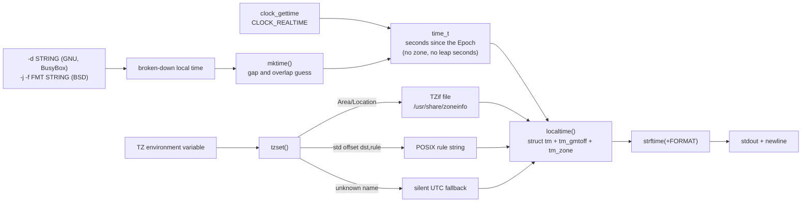

# date and Time Zones

> [!summary] Claim
> A Unix timestamp is a zone-free count of seconds, and every bug in `date` scripts comes from crossing the boundary into civil time, where `TZ` selects a rule set, `mktime()` must guess at gaps and overlaps, and each of the GNU, BSD, and BusyBox `date` utilities resolves those guesses, and parses input, differently.

Part of [Coreutils and the Userland](README.md) in [Shell and Unix Engineering](../README.md).

## TL;DR

- Mechanism: `date` reads `CLOCK_REALTIME` as seconds since the Epoch, then `localtime()` converts it with the rules `tzset()` loaded from `TZ` (a TZif file or a POSIX rule string), and `strftime()` renders the result.
- Rule: store, compare, and do arithmetic in UTC epoch seconds; convert to a named zone only at the edge, and always print an explicit offset (`%z`) next to a local time.
- Trap: civil time is not a function of the timestamp's inverse, so a local time can be skipped (spring forward) or repeated (fall back), and "plus one month" or "plus one day" have no single meaning; GNU rejects a skipped time, macOS moves it forward, and musl's `mktime()` (read from source) moves it back.
- Portability fact: POSIX `date` can print only the current time (`date [-u] [+format]`); printing a fixed instant (`-d @N` versus `-r N`) and parsing a string (`-d` versus `-j -f`) are both non-standard, and the three main implementations disagree on syntax and results.
- When not to use it: anything that needs calendar arithmetic, many conversions, or durations; use a language library with an explicit zone type (`zoneinfo`, `java.time`, C++20 `<chrono>`), and a monotonic clock for elapsed time.

## Mental model



Output flows left to right: the kernel hands `date` one integer, `tzset()` turns the `TZ` string into a table of offsets (or a rule, or nothing), and `localtime()` picks the offset in force at that instant and fills a `struct tm` that `strftime()` formats.
That direction is a function: every instant has exactly one local representation.
Input flows the other way through `mktime()`, which must invert that function, and the inverse does not exist at transitions: a skipped local time has no instant and a repeated one has two.
Every implementation difference in this note sits on the bottom path (parsing and `mktime()`) or in the unknown-name branch of `tzset()`.

## How it works

### What POSIX actually specifies

The POSIX `date` utility has two synopsis lines: `date [-u] [+format]` and, under the XSI option, `date [-u] mmddhhmm[[cc]yy]` to set the clock (POSIX.1-2024 XCU date).
There is no option to print any instant other than now: the `+format` operand is formatted "as if by `strftime()`" with "a timeptr argument that is the equivalent of `localtime(&now)` if `-u` is not specified or `gmtime(&now)` if `-u` is specified, where now is an object of type time_t containing the return value of `time(0)`" (POSIX.1-2024 XCU date, OPERANDS).
Issue 8 replaced the utility's own list of conversion specifications with that `strftime()` reference (Austin Group Defect 466), and `strftime()` gained `%s` in the same issue (Austin Group Defects 169, 1386, 1612), so `date +%s` is POSIX as of POSIX.1-2024 (XSH strftime, CHANGE HISTORY).
`-u` means "as if the TZ environment variable was set to the string `UTC0`, or its equivalent historical value of `GMT0`" (XCU date, OPTIONS).
With no format operand, the output in the POSIX locale is `date "+%a %b %e %H:%M:%S %Z %Y"`, and a newline is always appended (XCU date, STDOUT).
For the set operand, a two-digit year in [69,99] means 1969 to 1999 and one in [00,68] means 2000 to 2068, and the standard warns that this pivot will change (XCU date, OPERANDS, Note).

### The timestamp: seconds since the Epoch

POSIX defines "seconds since the Epoch" by a C expression over the UTC fields, and says "each and every day shall be accounted for by exactly 86400 seconds" (POSIX.1-2024 XBD 4.19):

```c
tm_sec + tm_min*60 + tm_hour*3600 + tm_yday*86400 +
    (tm_year-70)*31536000 + ((tm_year-69)/4)*86400 -
    ((tm_year-1)/100)*86400 + ((tm_year+299)/400)*86400
```

The relationship is undefined for years before 1970 or negative values, and the mapping to true UTC as kept by the IERS is unspecified (XBD 4.19).
So a leap second does not exist in `time_t`: the count simply repeats or smears, and the tz project notes that "in practice POSIX clocks more typically either progressed glacially during a leap second, or were slightly slowed while near a leap second" (tz theory.html).
The lab's `now-check` mode takes one `date -u '+%s %Y %j %H %M %S'` snapshot and evaluates that formula in shell arithmetic; the two numbers are equal on every implementation tested, which is the executable form of "no leap seconds in `%s`".

The clock itself comes from `clock_gettime(CLOCK_REALTIME)`: GNU `date` calls `gettime()`, which uses `clock_gettime(CLOCK_REALTIME, ...)` when available (coreutils-9.12 lib/gettime.c, `gettime`), and FreeBSD and macOS `date` call `clock_gettime(CLOCK_REALTIME, &ts)` directly (FreeBSD bin/date/date.c, `main`).
On Linux that call is normally served by the vDSO without entering the kernel; the vDSO exports `__vdso_clock_gettime` on x86-64 and `__kernel_clock_gettime` on aarch64 (vdso(7)).
`CLOCK_REALTIME` "is affected by discontinuous jumps in the system time" and by NTP frequency adjustments (clock_getres(2)), which is why it must never be used to measure a duration.

### The zone: what `TZ` can contain

POSIX defines three forms of `TZ` (POSIX.1-2024 XBD 8.3, TZ):

1. `:characters`, handled in an implementation-defined manner.
2. `stdoffset[dst[offset][,start[/time],end[/time]]]`, a self-contained rule.
3. A geographical or special timezone from an implementation-defined database, "typically" `Area/Location` as in the IANA database.

The rule form has three traps that the standard states outright:

- The offset is "the value added to the local time to arrive at Coordinated Universal Time", so it is positive west of Greenwich: `EST5` is UTC-5, and `-` means east (XBD 8.3).
- Names are three or more letters, or a `<...>` quoted form that may contain digits, `+`, and `-`, so `<+0530>-5:30` is legal and `UTC+3` means a zone three hours behind UTC that is misleadingly abbreviated `UTC` (XBD 8.3; tzdb `etcetera` warns against exactly this).
- Dates are `Jn` (1 to 365, February 29 never counted), `n` (0 to 365, counted), or `Mm.n.d` (day `d` of week `n` of month `m`, with week 5 meaning "the last"), the default transition time is 02:00:00, and the time field may range from 0 to 167 hours or be negative (XBD 8.3).

The geographical form must include historical and known future offsets back to at least the Epoch, and "if the database incorporates an external database such as the one maintained by IANA, the implementation shall provide an implementation-defined method to allow the database to be updated" (XBD 8.3).
The IANA names inherit the POSIX sign convention: `Etc/GMT+4` "uses the abbreviation `-04` and corresponds to 4 hours behind UT" (tzdb `etcetera`).

### Loading the rules: `tzset()` in three C libraries

`tzset()` "shall use the value of the environment variable TZ to set time conversion information used by `ctime()`, `localtime()`, `mktime()`, and `strftime()`" and sets `tzname[0]` and `tzname[1]` (XSH tzset); POSIX.1-2024 also added `tm_gmtoff` and `tm_zone` to `struct tm` (XSH strftime, Austin Group Defect 1533).

glibc (`time/tzset.c`, `tzset_internal`): an empty `TZ` becomes `"Universal"`; a leading `:` is skipped; an unset `TZ` means `TZDEFAULT` (`/etc/localtime`).
It always tries a file first (`__tzfile_read`), relative to `TZDIR` or the compiled-in directory, and only if that fails parses the rule syntax (`__tzset_parse_tz`).
For an unknown name such as `Nowhere/Bogus`, `parse_tzname` accepts the leading letters `Nowhere` as the standard-time name, `parse_offset` then fails at `/`, and the zone becomes UTC with abbreviation `Nowhere` (`time/tzset.c`, `__tzset_parse_tz`, `parse_tzname`, `parse_offset`).
In a setuid program (`__libc_enable_secure`), `__tzfile_read` refuses any absolute path outside `TZDIR` other than `TZDEFAULT`, and any name containing `../` (`time/tzfile.c`, `__tzfile_read`).

musl (`src/time/__tz.c`, `do_tzset`): an unset `TZ` means `/etc/localtime`, an empty one means UTC.
It treats the value as a rule string only if the name is followed by a sign or digit, or the name is `UTC` or `GMT`; otherwise it searches `/usr/share/zoneinfo/`, `/share/zoneinfo/`, and `/etc/zoneinfo/`, rejects names containing `.` unless they are absolute or start with `.`, and allows absolute paths in secure mode only for `/etc/localtime`.
If nothing maps, or the file is shorter than 44 bytes or lacks the `TZif` magic, it falls back to UTC named `UTC`.
macOS behaves like musl for an unknown name: the lab measures `00:00 +0000|UTC` there.

With `TZ` unset, the host zone is whatever `/etc/localtime` points at: a symlink to `/var/db/timezone/zoneinfo/America/New_York` on this macOS host and to `/usr/share/zoneinfo/Etc/UTC` in the Debian 13 matrix image (measured with `ls -l`), so a container without that link silently runs in UTC.

All three agree on the dangerous part: an unknown or misspelled zone is not an error.
`date` exits 0 and prints UTC, and only the abbreviation (`Nowhere` versus `UTC`) hints at the failure.

### The database: TZif files

A compiled zone is a TZif file (RFC 9636): a 44-byte header that starts with the magic `TZif` and a version byte (NUL, `2`, `3`, or `4`), then counts of transitions, local time types, abbreviation bytes, and leap seconds (tzfile(5)).
Version 1 data uses 32-bit transition times; version 2 and later repeat the data with 64-bit times and end with a newline-enclosed POSIX `TZ` string for instants after the last stored transition (tzfile(5), "Version 2 format").
Each local time type is a `struct ttinfo` of a 32-bit `tt_utoff` (seconds east of UT), a `tt_isdst` flag, and an abbreviation index; realistic offsets lie in [-89999, 93599] seconds (tzfile(5)).
On this macOS host the file for `America/New_York` is 3552 bytes, starts `TZif2`, and ends with the footer `EST5EDT,M3.2.0,M11.1.0` (measured with `od`; tzdata 2026f).
musl reads that footer for future instants (`do_tzset`: `if (zi[map_size-1] == '\n')`), which is why a TZif file truncated to 32-bit data still gives correct answers after 2037 in a v2-aware reader.

The database changes constantly because governments change clocks with little notice.
Release 2026b (2026-04-22) recorded that British Columbia moved to permanent -07 on 2026-03-09, 44 days after the fact; 2026c (2026-07-08) recorded Alberta's 2026-06-18 change, 20 days after; 2026d (2026-09-11) recorded the Northwest Territories' 2026-08-21 change, 21 days after; and 2026f (2026-10-27) recorded that Cuba would not fall back on 2026-11-01, five days before the change (tzdb NEWS).
The Canadian releases also carried a "temporary hack" that models each legal change as occurring at 2026-11-01 02:00 to work around limitations in Unicode CLDR and ICU (tzdb NEWS, 2026b through 2026e, where 2026e did the same for Manitoba's move to permanent -05 on 2026-10-31), so even a current tzdata does not give the legal offset for every past instant.
Release 2026a stopped installing the `right/` leap-second files by default, and 2026f declared "no more leap seconds" and limited `localtime.c` to 27 (tzdb NEWS).

### Formatting: `localtime()` then `strftime()`

GNU `date` computes `tz = tzalloc (tzstring)` from `-u` (`"UTC0"`) or `getenv ("TZ")` (coreutils-9.12 src/date.c, `main`), then `show_date` calls `localtime_rz (tz, &when.tv_sec, &tm)` and `fprintftime (stdout, format, &tm, tz, when.tv_nsec)`, failing with "time %s is out of range" if the conversion overflows (src/show-date.c, `show_date`).
`fprintftime` is gnulib's `nstrftime`, which adds `%N` (nanoseconds) and the `%:z`, `%::z`, `%:::z` offset forms; GNU's `-I` formats are fixed strings such as `%Y-%m-%dT%H:%M:%S%:z`, and `-R` is `%a, %d %b %Y %H:%M:%S %z` in the C locale (src/date.c, `iso_8601_format`, `rfc_email_format`).
FreeBSD `date` uses `localtime()` and a `strftime_ns` wrapper that implements `%N` before calling `strftime(3)`, defaults to the `%+` format, and switches `TZ` to the `-z output_zone` argument "just before printing the time", so input and output zones can differ (FreeBSD bin/date/date.c, `main`, `strftime_ns`; date(1)).
BusyBox `date` builds `-I` output by hand and inserts a colon into `%z` because "coreutils-8.30 prints +hh:mm" (coreutils/date.c, `date_main`).

POSIX leaves two `strftime()` results open that scripts hit in practice: `%Z` and `%z` are undefined on a `struct tm` built under one `TZ` after `TZ` has changed, and it is unspecified whether they refer to UTC or the current local zone on a `struct tm` from `gmtime()` (XSH strftime).
`%S` ranges over [00,60] to admit a leap second (XSH strftime, APPLICATION USAGE), and `%G`, `%V`, `%u` implement ISO 8601 week numbering, where 2027-01-01 is `2026-W53-5` (measured with GNU `date`).

### Parsing: three unrelated designs

GNU (`gnulib lib/parse-datetime.y`, `parse_datetime_body`) is a Bison grammar of items: calendar dates, times, zone abbreviations, numeric corrections, day names, and relative items (`1 month`, `next friday`, `3 days ago`).
A leading `TZ="rule"` in the string selects a zone for that one parse (`strncmp (p, "TZ=\"", 4)`, then `tzalloc`); the parser builds a `struct tm`, sets `tm_isdst = -1`, calls `mktime_z`, and then `mktime_ok` rejects the result if any of seconds, minutes, hours, day, month, or year changed during normalization.
That check is why GNU refuses a skipped local time with "invalid date", and why `TZ=America/Havana date -d 2026-03-08` fails: Cuba springs forward at midnight, so 00:00 on that day does not exist (measured; zdump shows 23:59:59 CST then 01:00:00 CDT).
Relative years, months, and days are added to the broken-down fields and renormalized with a second `mktime_z`; relative hours, minutes, and seconds are added to the final `time_t`, where the source comment says to "ignore the possibility of leap seconds" (`parse_datetime_body`).
So `1 day` keeps the wall clock and `24 hours` keeps elapsed time, and `--debug` warns "when adding relative months/years, it is recommended to specify the 15th of the months" and "when adding relative days, it is recommended to specify noon".
A signed number after a time of day is a zone correction, not a relative item: `12:00 +1 day` parses as 12:00 at UTC+01 followed by the bare unit `day` (the debug output says "parsed time part: 12:00:00 UTC+01"), a trap the lab asserts.

BSD (FreeBSD and macOS bin/date/date.c, `setthetime`) has no grammar.
`-j -f fmt string` calls `strptime(3)` on top of `localtime(now)` with `tm_isdst = -1`, so "any date or time components unspecified by the -f format string take their values from the current time" (date(1)); leftover input only earns a warning ("Ignoring N extraneous characters").
Arithmetic is `-v [+|-]val[ymwdHMS]` (bin/date/vary.c): month adjustment clamps the day to the end of the month ("-v-1m on March, 31 is the last day of February in common sense", `adjmon`), units of days and larger ignore DST while hours and smaller honor it, and a nonexistent result "will be silently adjusted forward in units of one hour until it reaches a valid time" (date(1), `domktime`).
`-r` takes seconds or a file, parsed with `strtoimax(optarg, &end, 0)` on FreeBSD and `strtoq(optarg, &tmp, 0)` on macOS, so a leading zero means octal (`date -r 010` is 8 seconds, measured and asserted in the lab).

BusyBox (libbb/time.c, `parse_datestr`) accepts a fixed list: `@seconds`, `hh:mm[:ss]`, `[YYYY.]MM.DD-hh:mm[:ss]`, `YYYY-MM-DD hh:mm[:ss]` (with an optional `%z` offset when `FEATURE_TIMEZONE` is on), and the digit-run set syntax; `-D fmt` adds a `strptime` format, which the source labels a "busybox invention, not compat" (coreutils/date.c).
It zeroes hour, minute, and second before parsing ("take her back to midnight!", coreutils/date.c, `date_main`), sets `tm_isdst = -1`, and calls `mktime()` through `validate_tm_time`, so gap handling is whatever the C library's `mktime()` does; there are no relative items at all.

uutils `date` (Rust, main branch as of 2026-11) parses with the `parse_datetime` crate and converts with `jiff`, and its source contains an explicit `is_nonexistent_local_time` check that detects a transition gap with `AmbiguousOffset::Gap`, mirroring GNU (src/uu/date/src/date.rs).

### `mktime()`: the inverse that does not exist

`mktime()` takes a `struct tm` in local time; if `tm_isdst` is negative it "shall attempt to determine whether DST is in effect", and for a time "skipped over or repeated when a transition to or from DST occurs, it is unspecified whether `mktime()` produces the same result as an equivalent call with a positive `tm_isdst` value or as an equivalent call with a `tm_isdst` value of zero" (XSH mktime, Austin Group Defect 1614).
The RATIONALE says it plainly: "there is not a one-to-one correspondence between broken-down times and time since the Epoch values", and it suggests detecting a skipped time by checking whether `tm_mday`, `tm_hour`, and `tm_min` come back unchanged (XSH mktime), which is exactly GNU's `mktime_ok`.
musl's `mktime()` (src/time/mktime.c) computes the naive seconds, asks `__secs_to_zone(t, 1, ...)` which side of the rule the local time is on, and subtracts that offset; for 02:30 in a US-style gap the local-time comparison says "DST", so it subtracts -4 hours, lands at 06:30 UTC, and that instant is 01:30 standard time.
The same input therefore gives three answers: GNU fails, macOS returns 03:30 DST, and BusyBox on musl returns 01:30 standard time (measured on the macOS host and in the shell matrix's Debian 13 and Alpine 3.22 images; the lab asserts all three).
For the repeated hour, BSD `-v` documents "the earlier of the two times", and both macOS and GNU `date` on macOS returned 01:30 EDT for `2026-11-01 01:30` in New York (measured), and under the `NYS5NYD,M3.2.0,M11.1.0` rule string GNU `date` on glibc (Debian 13) and BusyBox `date` on musl (Alpine 3.22) both returned `01:30 NYD -0400`, the earlier instant (measured in the shell matrix images); POSIX still leaves the choice unspecified.

### Shell-side time without forking `date`

bash 4.2 added `printf '%(fmt)T'` (bash NEWS, bash-4.2 item m) and bash 5.0 added `EPOCHSECONDS` and `EPOCHREALTIME` (bash NEWS, bash-5.0 items b and c).
In `printf`, the argument -1 means now and -2 means the shell's start time (bash-5.3 builtins/printf.def, `printf_builtin`), so the instant one second before the Epoch cannot be formatted, and if `localtime()` fails bash silently formats 0 instead.
bash calls `tzset()` again only when `TZ` is exported or unset (bash-5.3 variables.c, `sv_tz`), so an unexported `TZ=Asia/Tokyo` changes neither `printf '%(%z)T'` nor any child `date` (measured with bash 5.3: `-0500` until `export TZ`, then `+0900`).
ksh93 also has `%(fmt)T`, but its argument is a date string, and an epoch needs a `#` prefix (`printf '%(%F)T' '#0'`); a bare `0` prints a warning and the current time (measured on ksh93u+ 2012 and ksh93u+m 1.0.10).
zsh has neither: its `printf` rejects `%(`, and the equivalents are `zmodload zsh/datetime` for `strftime` and `EPOCHSECONDS` (measured with zsh 5.9).
dash, posh, yash, mksh, and BusyBox ash have no shell-native time formatting.

Shell arithmetic is a second source of date bugs.
POSIX requires only signed long arithmetic and the C decimal, octal, and hexadecimal constants (POSIX.1-2024 XCU 2.6.4), so `%j` or `%m` output such as `009` is an invalid octal constant in bash, dash, posh, and BusyBox ash, while zsh, ksh93, and mksh read it as decimal, and yash 2.58.1 reads a valid octal constant such as `067` as octal (55) but falls back to decimal for `009` unless run with `-o posix`, which rejects it (measured in the shell matrix images; the lab asserts each); strip leading zeros first.
mksh computes "using an exactly 32-bit wide, signed (two's complement) or unsigned, type with silent wraparound" (mksh(1)), so the XBD 4.19 formula for 2038-01-19 03:14:08 gives -2147483648 there and 2147483648 in every other shell (lab).

## Numbers and limits

| Quantity | Value | Source |
| --- | --- | --- |
| Signed 32-bit `time_t` end | 2038-01-19 03:14:07 UTC | tz theory.html; GNU parse-datetime.texi |
| XBD 4.19 value at 2038-01-19 03:14:08 | 2147483648 (-2147483648 in mksh) | lab |
| Seconds per day in `time_t` | exactly 86400 | POSIX.1-2024 XBD 4.19 |
| `%S` range | 00 to 60 | XSH strftime |
| POSIX `TZ` offset hours | 0 to 24 | XBD 8.3 |
| POSIX `TZ` rule time hours | 0 to 167, may be negative | XBD 8.3 |
| Default rule transition time | 02:00:00 | XBD 8.3 |
| Zone name length | 3 to `TZNAME_MAX` bytes | XBD 8.3 |
| Two-digit year pivot when setting | 69-99 -> 19xx, 00-68 -> 20xx | XCU date |
| TZif header | 44 bytes, magic `TZif`, version NUL, 2, 3, or 4 | tzfile(5) |
| Realistic `tt_utoff` range | -89999 to 93599 seconds | tzfile(5) |
| musl minimum TZif size | 44 bytes, else UTC | musl `__tz.c`, `do_tzset` |
| `America/New_York` TZif size | 3552 bytes, footer `EST5EDT,M3.2.0,M11.1.0` | measured, macOS 27.3, tzdata 2026f |
| Zones and links in tzdata 2026f | 345 `Z` lines, 253 `L` lines in `tzdata.zi` | measured, macOS 27.3 |
| tzdb releases in 2026 (to 2026-11) | 6 (2026a to 2026f) | tzdb NEWS |
| Lag from legal change to tzdb release, 2026 | 44, 20, and 21 days (BC, Alberta, NWT) | tzdb NEWS |
| Leap seconds `localtime.c` still supports | 27 | tzdb NEWS, 2026f |
| GNU maximum numeric zone correction | 24 hours | GNU parse-datetime.texi |
| mksh integer width | exactly 32 bits, silent wraparound | mksh(1) |
| Cost of `$(date +%s)` | about 2.7 ms per call (500 calls in 1.32 to 1.37 s) | measured by hand, Apple M3 Pro, macOS 27.3, bash 5.3, three runs (as of 2026-11) |
| Cost of `printf -v x '%(%s)T' -1` | about 10 us per call (2000 in 0.020 s, two runs) | same host |
| Cost of `x=$EPOCHSECONDS` | about 2 us per call (2000 in 0.004 s, two runs) | same host |
| Cloudflare DNS queries hit by the 2017 leap second | about 0.2 percent at peak | Cloudflare postmortem |

## Portability

Utilities (every cell is asserted by the lab unless it names another source; "lab, derived" means the lab asserts a value first taken from source code, since measured by hand in the shell matrix's Alpine 3.22 image):

| Behavior | POSIX | GNU coreutils 9.12 | BSD and macOS | BusyBox 1.37 | uutils (main, 2026-11) |
| --- | --- | --- | --- | --- | --- |
| Print a fixed instant | no option | `-d @N` (lab) | `-r N` (lab) | `-d @N` (lab) | `-d @N` (source) |
| `date -r 010` style leading zero | n/a | `@010` is 10 (lab) | octal, 8 (lab) | `@010` is 10 (lab) | not verified |
| Parse a string | no | free-form grammar `-d` (lab) | `-j -f fmt` via `strptime` (lab) | fixed list, `-D fmt` (source) | `-d`, `parse_datetime` crate (source) |
| Relative arithmetic | no | items like `1 month` (lab) | `-v +1m` (lab) | none, "invalid date" (lab) | not verified |
| January 31 plus one month | n/a | 2026-03-03 (lab) | 2026-02-28 (lab) | error (lab) | not verified |
| February 29 plus one year | n/a | 2025-03-01 (lab) | 2025-03-01 (lab) | error (lab) | not verified |
| `1 day` versus `24 hours` across DST | n/a | 12:00 versus 13:00 (lab) | same (lab) | error (lab) | not verified |
| Local time in a spring-forward gap | unspecified (XSH mktime) | rejected (lab) | moved forward to 03:30 (lab) | musl: moved back to 01:30 (lab, derived) | rejected (source) |
| `12:00 +1 day` | n/a | zone +01 (lab) | warns, ignores the rest (lab) | error (lab) | not verified |
| `-u` equals `TZ=UTC0` | required | yes (lab) | yes (lab) | yes (lab) | not verified |
| `+%s` | required (XSH strftime, Issue 8) | yes (lab) | yes (lab) | yes (lab) | not verified |
| `%N` nanoseconds | no | yes (source) | FreeBSD 14.1+, macOS (date(1), measured) | `FEATURE_DATE_NANO` (source); Alpine 3.22 prints nothing for `+%N` (measured) | not verified |
| `-I` ISO 8601 | no | `-I[spec]` (source) | `-I[spec]`, FreeBSD 12.0+ (date(1)) | `-I[spec]` with `FEATURE_DATE_ISOFMT` (source) | not verified |
| Separate output zone | no | `TZ="..."` prefix in `-d` (GNU manual) | `-z zone` (date(1), measured) | no | not verified |
| Unknown `TZ` name | implementation-defined | UTC, abbreviation from libc (lab) | UTC, `UTC` (lab) | UTC, `UTC` on musl (lab) | not verified |

C library, for the unknown-name abbreviation (lab): glibc prints the leading letters (`Nowhere`, derived from `tzset.c` and measured on Debian 13 in the shell matrix), musl and macOS print `UTC`.

Shells (every cell is asserted by the lab; bash 4.2 and 5.0 boundaries come from bash NEWS):

| Behavior | POSIX sh | macOS bash 3.2 | bash 5.x | zsh 5.9 | zsh `--emulate sh` | dash | ksh93 | mksh | yash | posh | BusyBox ash |
| --- | --- | --- | --- | --- | --- | --- | --- | --- | --- | --- | --- |
| `printf '%(%F)T'` | no | error | yes, epoch arg | error | error | error | yes, `#N` arg | error | error | error | error |
| `$((009 - 1))` | invalid octal | error | error | 8 | error | error | 8 | 8 | 8 (error under `-o posix`) | error | error |
| XBD 4.19 at 2038-01-19 03:14:08 | 2147483648 (signed long) | 2147483648 | 2147483648 | 2147483648 | 2147483648 | 2147483648 | 2147483648 | -2147483648 | 2147483648 | 2147483648 | 2147483648 |
| Unexported `TZ=...` reaches `date` | no | no | no | no | no | no | no | no | no | no | no |
| Inherited `TZ`, plain assignment reaches `date` | yes | yes | yes | yes | yes | yes | yes | yes | yes | yes | yes |

The yash, posh, and BusyBox ash cells in the `printf` and `009` rows were measured by hand in the shell matrix's Alpine 3.22 and Debian 13 images (yash 2.58.1, posh 0.14.1, BusyBox 1.37.0); yash is the one shell that departs from the specification's answer by default.

## Worked example

The [lab](../labs/08-date-and-time-zones/) has one script, `tzlab.sh`, and 20 tests in `tzlab.bats`.
Its modes wrap each implementation's syntax (`fmt`, `parse`, `add`), detect the implementation and C library (`impl`, `libc`), and implement the calendar in pure shell arithmetic (`posix`, `epoch`, `civil`, `strip`) so that no answer depends on `date` alone.

The XBD 4.19 formula and the snapshot check, verbatim from `tzlab.sh`:

```sh
posix_seconds() {
  tm_year=$(($1 - 1900))
  tm_yday=$2
  tm_hour=$3
  tm_min=$4
  tm_sec=$5
  clock=$((tm_sec + tm_min * 60 + tm_hour * 3600 + tm_yday * 86400))
  years=$(((tm_year - 70) * 31536000 + ((tm_year - 69) / 4) * 86400))
  leap=$((((tm_year + 299) / 400) * 86400 - ((tm_year - 1) / 100) * 86400))
  echo $((clock + years + leap))
}
```

```sh
now_check() {
  # One date(1) call, so %s and the broken-down fields describe the same second.
  snap=$(date -u '+%s %Y %j %H %M %S') || return 1
  read -r s y j h mi sec <<EOF
$snap
EOF
  y=$(strip0 "$y")
  j=$(strip0 "$j")
  h=$(strip0 "$h")
  mi=$(strip0 "$mi")
  sec=$(strip0 "$sec")
  formula=$(posix_seconds "$y" $((j - 1)) "$h" "$mi" "$sec")
  printf '%s %s\n' "$s" "$formula"
}
```

`strip0` matters: `%j` is `067` on March 8, which bash and dash would read as octal 55, and `009` would abort the script.
`civil` and `epoch` implement Howard Hinnant's `civil_from_days` and `days_from_civil`, including the floor-division correction for instants before 1970 that shell truncating division would otherwise get wrong.

Captured on the macOS host (BSD `date`), then with GNU `date` first in `PATH`; the zone is a POSIX rule under made-up names so no TZif file is involved:

```text
$ ./tzlab.sh posix 2038 18 3 14 8
2147483648
$ ./tzlab.sh civil 1772953200
2026-03-08 07:00:00
$ ./tzlab.sh epoch 2000 02 29 12 34 56
951827696
$ export TZ='NYS5NYD,M3.2.0,M11.1.0'
# impl=bsd
$ ./tzlab.sh fmt 1772953199 '%F %T %Z %z'
2026-03-08 01:59:59 NYS -0500
$ ./tzlab.sh fmt 1772953200 '%F %T %Z %z'
2026-03-08 03:00:00 NYD -0400
$ ./tzlab.sh parse '2026-03-08 02:30:00' '%H:%M %Z'
03:30 NYD
$ ./tzlab.sh add '2026-01-31 00:00:00' 1 month %F
2026-02-28
$ ./tzlab.sh add '2026-03-07 12:00:00' 1 day '%F %H:%M %Z'
2026-03-08 12:00 NYD
$ ./tzlab.sh add '2026-03-07 12:00:00' 24 hour '%F %H:%M %Z'
2026-03-08 13:00 NYD
# impl=gnu (LC_ALL=C for the diagnostic)
$ ./tzlab.sh parse '2026-03-08 02:30:00' '%H:%M %Z'
date: invalid date '2026-03-08 02:30:00'
$ ./tzlab.sh add '2026-01-31 00:00:00' 1 month %F
2026-03-03
```

The GNU run printed the same `fmt` and `add ... day`/`hour` lines as BSD.
The full suite passed (20 of 20) once with BSD `date` and once with GNU coreutils 9.12 under `LAB_SHELL=sh` (macOS bash 3.2); the BusyBox arms, the glibc and musl abbreviation arms, and the other shells' arms run in the integrator's matrix.

## Pitfalls

> [!warning] An unknown zone name is silently UTC
> Trigger: `TZ=America/New_york` (wrong case), `TZ=EST-5` meant as "five hours ahead", or a container image without tzdata.
> Symptom: `date` exits 0 and prints UTC; glibc labels it with the leading letters of the bad name, musl and macOS label it `UTC` (lab).
> Fix: validate at startup by checking that `"${TZDIR:-/usr/share/zoneinfo}/$TZ"` exists and starts with `TZif`, or that `date +%Z` is not `UTC` when a non-UTC zone was requested; install tzdata in images explicitly.

> [!warning] POSIX signs are backwards
> Trigger: `TZ=UTC+3` or `TZ=Etc/GMT+3` meant as three hours ahead of UTC.
> Symptom: the clock is three hours behind (`21:00 -0300` at the Epoch), and `UTC+3` even calls itself `UTC` (lab).
> Fix: use a location name, or the quoted form `TZ='<+03>-3'`, which names itself correctly (tzdb `etcetera`).

> [!warning] Local times that do not exist or exist twice
> Trigger: scheduling `02:30` on a spring-forward day, or midnight in a zone that springs forward at midnight (Cuba on 2026-03-08).
> Symptom: GNU `date` fails with "invalid date", macOS silently uses 03:30, musl silently uses 01:30 (lab); in the fall-back hour, the result depends on `mktime()` and is unspecified by POSIX.
> Fix: never store local times for future events without the zone and a rule for gaps and overlaps; for jobs, schedule in UTC, or check the chosen hour against every transition with `zdump -v -c YEAR,YEAR+1 ZONE`, because transitions happen at different local hours (02:00 in New York, 00:00 in Havana, measured with zdump).

> [!warning] Adding months and years (the Azure leap-day outage)
> Trigger: `date -d '2026-01-31 1 month'`, or computing "one year from today" on February 29.
> Symptom: GNU overflows to 2026-03-03 and BSD clamps to 2026-02-28 (lab); code that builds the date by incrementing the year field gets the invalid 2013-02-29.
> Microsoft's 2012-02-29 Azure outage began when a guest agent "calculated the valid-to date by simply taking the current date and adding one to its year", producing February 29, 2013, which made certificate creation fail; it "immediately triggered at 4:00PM PST, February 28th" because the code used UTC midnight (Bill Laing, Azure blog, 2012-03-09).
> Fix: anchor month arithmetic to the 15th and noon, as GNU's `--debug` recommends, then set the day you want; for "last day of month" on BSD use `-v1d -v+1m -v-1d` (measured: 2026-02-28 from 2026-02-10).

> [!warning] A signed number after a time is a zone
> Trigger: GNU `date -d "$day 12:00 +1 day"`.
> Symptom: `+1` is parsed as UTC+01, so the result is an hour off (`2026-03-08 11:00:00` in UTC, lab).
> Fix: drop the sign (`12:00 1 day`), put the relative item first, or check with `--debug`.

> [!warning] BSD `-j -f` fills unspecified fields from now
> Trigger: `date -j -f %Y-%m-%d 2026-01-31 +%s` on macOS.
> Symptom: the hours, minutes, and seconds of the current time leak in (01:13:44 in one measured run), so the same command returns a different epoch every second.
> Fix: always give a complete `-f` format such as `'%Y-%m-%d %H:%M:%S'` and a complete input (date(1), `-j`).

> [!warning] Unexported TZ
> Trigger: `TZ=Asia/Tokyo` on its own line in a script started without `TZ` in its environment.
> Symptom: `date` and bash's `printf '%(...)T'` ignore it until `export TZ` (lab and bash `sv_tz`), but the same line works if the script inherited `TZ`, so it passes on a laptop with `TZ` set and fails in cron.
> Fix: `TZ=Asia/Tokyo date ...` as a prefix assignment, or `export TZ=...`.

> [!warning] Leading zeros from `%m`, `%d`, `%j`, `%H`
> Trigger: `$(( $(date +%j) - 1 ))` on January 8 or 9, or any `%d` of `08` or `09`.
> Symptom: bash reports "value too great for base" and dash "Illegal number" (lab), and on other days the octal value is silently wrong (`067` is 55).
> Fix: use `%-j` (GNU and BSD) or strip zeros in shell; in bash, `10#$j` also forces base 10.

> [!warning] Wall clock used as a stopwatch
> Trigger: `start=$(date +%s); ...; echo $(( $(date +%s) - start ))`.
> Symptom: negative or wrong durations when NTP steps the clock or around a leap second; Cloudflare's 2017-01-01 RRDNS outage came from "a number went negative when it should always have been, at worst, zero" because Go's `time.Now()` "does not guarantee monotonicity", affecting about 0.2 percent of DNS queries at peak (Cloudflare blog, 2017-01-01).
> Fix: measure durations with a monotonic clock (`CLOCK_MONOTONIC` "is not affected by discontinuous jumps in the system time", clock_getres(2)) in a real language or a small C helper; bash `SECONDS` is no escape, because `get_seconds` computes it from `gettimeofday()` (bash-5.3 variables.c).

> [!warning] Year 2038 in the shell, not just the kernel
> Trigger: date arithmetic in mksh, or any 32-bit `time_t` userland.
> Symptom: mksh wraps the XBD 4.19 result for 2038-01-19 03:14:08 to -2147483648 and cannot represent 2100-01-01 (lab).
> Fix: do epoch arithmetic in a 64-bit shell or `awk` with care for its double precision, or in a real language.

## Security and robustness

- `TZ` is attacker-controlled input whenever an environment crosses a trust boundary: glibc and musl both refuse arbitrary TZif paths in setuid programs (glibc `__tzfile_read` with `__libc_enable_secure`, musl `libc.secure`), and POSIX permits implementations to ignore such variables via `secure_getenv()` semantics (XBD 8, introduction), but a non-setuid service that passes a client-chosen `TZ` to a child lets the client choose which file the C library parses.
- The TZif parser is a binary parser: CVE-2009-5029 was an integer overflow in glibc's `__tzfile_read` before 2.15 that let "a crafted timezone (TZ) file" crash or possibly execute code, demonstrated through vsftpd (NVD); tzdb 2026a, 2026b, 2026c, and 2026d all list integer overflow or security fixes in `zic` and `localtime.c` (tzdb NEWS).
- The GNU date parser is an attack surface too: CVE-2014-9471 let "a crafted date string" crash `parse_datetime` or possibly execute code, demonstrated by `--date=TZ="123"345" @1` to `touch` or `date` (NVD, published 2015-01-16); never pass untrusted strings to `date -d` or `touch -d` without validating them against a fixed pattern first.
- Treat `date -d "$input"` as code-adjacent: the GNU grammar accepts `TZ="..."` prefixes, relative items, and zone names, so `next year`, `1 week ago`, or a zone abbreviation change the meaning of a user-supplied string; validate with `case` or `grep -E '^[0-9]{4}-[0-9]{2}-[0-9]{2}$'` and then parse.
- Pin the formats you depend on: locale variables change `%a`, `%b`, `%c`, `%x`, and the default output (XCU date, APPLICATION USAGE, "Conversion specifiers are of unspecified format when not in the POSIX locale"); GNU's `-I`, `-R`, and `--rfc-3339` force the C locale (`format_in_c_locale = true` in src/date.c), so they are safe to parse, while `date` with no format is not.
- Setting the clock (`date -s` on GNU, the operand form on BSD and BusyBox) needs privilege: `clock_settime()` fails with `EPERM` otherwise (clock_getres(2)), and GNU still prints the requested date after "cannot set date" with exit status 1 (`main` in src/date.c), so check the status, not the output.
- Fail closed on a stale database: a host with tzdata older than 2026f still believes Cuba fell back on 2026-11-01 (tzdb NEWS), and nothing warns at run time; monitor `tzdata` package versions the way you monitor CA bundles.

## The principal's view

The decision is where civil time is allowed to exist in a system.
The robust answer is that only edges see it: storage, logs, queues, and comparisons use UTC instants (epoch seconds or RFC 3339 with `Z`), user-facing rendering converts with a named IANA zone, and future local events (a meeting at 09:00 Vancouver time) are stored as local time plus zone name plus a gap and overlap policy, because the offset for that future instant may change before it arrives, as British Columbia's did in 2026 with a 44-day database lag.
The trade-off is explicit: the UTC-everywhere rule makes humans read offsets in logs and requires every display path to know the viewer's zone, but it removes a whole class of ordering, deduplication, and DST bugs.

`date` itself belongs in scripts for exactly three jobs: printing now in a fixed format (`date -u +%Y-%m-%dT%H:%M:%SZ`, POSIX-portable), stamping file names, and quick interactive conversion.
The moment a script needs to parse input, add months, convert between zones, or run on both macOS and Linux, the portability matrix above shows three incompatible tools with different answers for the same question, so the staff-level move is to stop writing `date` wrappers and use a library with a zone type: Python `zoneinfo` with the `datetime.fold` attribute (PEP 495) for overlaps, `java.time.ZonedDateTime` with explicit `ZoneRules`, C++20 `std::chrono::zoned_time` with `choose::earliest` or `choose::latest`, or Rust `jiff` (which uutils now uses).
For fleets, own the tz database as a dependency: pin and roll out tzdata like a security update, check `+VERSION` (2026f here), and alert when hosts disagree, because the C library will not tell you that its rules are stale.
For durations, ban wall-clock subtraction in code review (including bash `SECONDS`, which is wall-clock based) and require a monotonic clock.

## Interview questions

> [!question] L5: Why does POSIX `date` have no option to print a given timestamp, and how do you do it portably?
>
> > [!success]- Answer
> > The POSIX utility formats only `localtime(&now)` or `gmtime(&now)` where now is `time(0)`, so fixed instants were never in scope (XCU date).
> > GNU and BusyBox use `-d @N`, BSD and macOS use `-r N`, and a portable script must detect the implementation or avoid `date`.
> > For UTC, a pure shell `civil_from_days` implementation in `$(( ))` needs no `date` at all, as the lab shows.
> >
> > Follow-up: What breaks in that shell implementation under mksh, and why?

> [!question] L5: Predict the output of `TZ=UTC+3 date -d @0 '+%H:%M %z %Z'` with GNU date.
>
> > [!success]- Answer
> > `21:00 -0300 UTC`.
> > POSIX offsets are added to local time to get UTC, so `+3` means three hours west, and `UTC` here is just the chosen abbreviation (XBD 8.3).
> > The lab asserts the same line on GNU and BSD `date`.
> >
> > Follow-up: How would you write a zone three hours east that also names itself correctly?

> [!question] L5: A script computes `$(( $(date +%j) - 1 ))` and fails only on two days of the year; which days and why?
>
> > [!success]- Answer
> > January 8 and 9, when `%j` is `008` and `009`, which are invalid octal constants in bash and dash ("value too great for base", "Illegal number").
> > On every other day with a leading zero the value is octal and silently wrong (`067` is 55), except in zsh, ksh93, and mksh, which read leading-zero constants as decimal; yash also reads `008` and `009` as decimal, but `067` as octal.
> > Strip the zeros or use `10#` in bash.
> >
> > Follow-up: Which POSIX section makes octal constants mandatory in arithmetic expansion?

> [!question] L6: Debug this script: it runs in cron and stamps files in UTC instead of Tokyo time, but works in an interactive shell.
>
> ```sh
> #!/bin/sh
> TZ=Asia/Tokyo
> stamp=$(date +%Y%m%d-%H%M)
> mv report.csv "report-$stamp.csv"
> ```
>
> > [!success]- Answer
> > An assignment to a variable that is not already exported does not enter the environment of `date`, and cron starts the script without `TZ`, so `date` uses the system default.
> > The interactive shell had `TZ` exported by a profile, so the same line modified an exported variable and worked.
> > Fix it with `stamp=$(TZ=Asia/Tokyo date +%Y%m%d-%H%M)` or `export TZ=Asia/Tokyo`, and use `-u` with a `Z` suffix if the files are machine-consumed.
> >
> > Follow-up: Why does bash's `printf '%(%H)T'` show the same behavior, according to `sv_tz`?

> [!question] L6: What happens when you ask GNU, macOS, and BusyBox `date` for 02:30 on a spring-forward day, and why do they differ?
>
> > [!success]- Answer
> > GNU fails with "invalid date" because `parse_datetime_body` calls `mktime_ok`, which rejects any normalization of the fields.
> > macOS returns 03:30 DST because its `mktime()` moves forward, as BSD `date(1)` documents for `-v`.
> > BusyBox hands the fields to the C library's `mktime()`; musl compares the local time to the rule, decides DST, and lands on 01:30 standard time.
> > POSIX leaves the choice unspecified (XSH mktime).
> >
> > Follow-up: How does the POSIX RATIONALE suggest detecting a skipped time from `mktime()`'s output?

> [!question] L6: Why does `date -d '2026-01-31 1 month'` print a date in March with GNU, and what does BSD do instead?
>
> > [!success]- Answer
> > GNU adds 1 to `tm_mon` and renormalizes with `mktime`, so February 31 becomes March 3; `--debug` warns about "shifted dates" and recommends the 15th.
> > BSD `-v+1m` clamps to the last day of the month in `adjmon`, giving February 28.
> > Neither is wrong; "one month later" is a business rule, so code must state it explicitly.
> >
> > Follow-up: Give a BSD `-v` chain that yields the last day of the current month.

> [!question] L6: Predict the output: `TZ=UTC0 date -d '2026-03-07 12:00 +1 day' '+%F %T'` with GNU date.
>
> > [!success]- Answer
> > `2026-03-08 11:00:00`.
> > A signed number after a time of day is a zone correction, so the time is 12:00 at UTC+01, which is 11:00 UTC, and the bare `day` that follows is a relative item of one day.
> > `--debug` prints "parsed time part: 12:00:00 UTC+01", which is the fastest way to catch it.
> >
> > Follow-up: How else could the input be written so that `+1` is read as a relative item?

> [!question] L7+: Design how a scheduling service should store "every Monday at 09:00 in Vancouver" so it survives 2026's British Columbia change.
>
> > [!success]- Answer
> > Store the rule as local wall time plus IANA zone name (`America/Vancouver`) plus a gap and overlap policy, not as a UTC instant or a fixed offset.
> > Expand occurrences lazily with the current tz database, because tzdb 2026b recorded the move to permanent -07 only on 2026-04-22, 44 days after it took effect, and even then modelled it with a temporary hack at 2026-11-01.
> > Ship tzdata as a versioned dependency, recompute future occurrences when it changes, and notify owners when an occurrence's UTC instant moves.
> >
> > Follow-up: What does the service do for an occurrence that lands in a gap, and who decides?

> [!question] L7+: A team wants to standardize on `date` in shell for all timestamp handling across macOS laptops, Alpine containers, and Debian hosts; argue for or against.
>
> > [!success]- Answer
> > Against, for anything beyond printing now: POSIX gives only `date [-u] [+format]`, and parsing, fixed instants, arithmetic, and zone conversion use three incompatible syntaxes with different results for gaps, month ends, and unknown zones.
> > Each call costs a fork and exec (about 2.7 ms measured here versus about 10 us for bash's `printf '%(...)T'`), Alpine's BusyBox has no relative arithmetic, and mksh's 32-bit arithmetic cannot even hold post-2038 epochs.
> > Allow `date -u +%Y-%m-%dT%H:%M:%SZ` and `date +%s`, and move everything else to one language with a zone type and a pinned tz database.
> >
> > Follow-up: Which checks would you add to CI to catch a script that silently depends on GNU `date`?

> [!question] L7+: Explain why `date +%s` and the XBD 4.19 formula agree even across a leap second, and what that implies for log ordering.
>
> > [!success]- Answer
> > POSIX defines seconds since the Epoch so that every day has exactly 86400 seconds, so a leap second has no `time_t` of its own and the kernel either repeats, stops, or smears the count.
> > Two events in the inserted second can therefore get the same or even decreasing timestamps, which is the failure mode behind Cloudflare's 2017 negative-duration bug.
> > Order logs by a per-host monotonic sequence or a hybrid logical clock, not by wall time alone; tzdb 2026f now records that there will be no more leap seconds, but NTP steps cause the same non-monotonicity.
> >
> > Follow-up: Which Linux clock would you use for durations, and which for cross-host ordering?

## Related

Prerequisites: [[env-and-Shebang-Tricks]], [[Environment-Variables-and-Inheritance]], [[Arithmetic-Expansion]]

Next: [[mktemp]]

See also: [[Four-Userlands-GNU-BSD-BusyBox-uutils]], [[Userland-Portability-Traps]], [[Locale-and-LC_ALL]], [[Simple-Commands-and-Assignment-Prefixes]], [[Bash-3-2-on-macOS]], [[timeout]], [[Command-Injection]]

## Further reading

- [POSIX.1-2024 XCU date](https://pubs.opengroup.org/onlinepubs/9799919799/utilities/date.html) - the whole portable contract, including what is not there.
- [POSIX.1-2024 XBD 8.3, TZ](https://pubs.opengroup.org/onlinepubs/9799919799/basedefs/V1_chap08.html) - the three `TZ` forms, the sign convention, and the rule syntax.
- [POSIX.1-2024 XBD 4.19](https://pubs.opengroup.org/onlinepubs/9799919799/basedefs/V1_chap04.html) - the formula that defines `time_t` and excludes leap seconds.
- [POSIX.1-2024 XSH mktime](https://pubs.opengroup.org/onlinepubs/9799919799/functions/mktime.html) - why the local-to-instant inverse is unspecified at transitions.
- [tz theory.html](https://data.iana.org/time-zones/theory.html) - naming rules, ambiguous abbreviations, and what the database cannot know.
- [tzdb NEWS](https://data.iana.org/time-zones/tzdb/NEWS) - the real churn rate of civil time, release by release.
- [tzfile(5)](https://data.iana.org/time-zones/tzdb/tzfile.5.txt) - the TZif binary format that every C library parses.
- [GNU coreutils 9.12 source](https://ftpmirror.gnu.org/coreutils/coreutils-9.12.tar.xz) - `src/date.c`, `src/show-date.c`, and `lib/parse-datetime.y` with its `--debug` warnings.
- [FreeBSD date.c and vary.c](https://raw.githubusercontent.com/freebsd/freebsd-src/main/bin/date/vary.c) - `-v` arithmetic and its clamping and DST rules.
- [BusyBox libbb/time.c](https://raw.githubusercontent.com/mirror/busybox/master/libbb/time.c) - the fixed input list that Alpine scripts actually get.
- [musl `__tz.c`](https://git.musl-libc.org/cgit/musl/plain/src/time/__tz.c) - a compact, readable `tzset()` and TZif reader.
- [Howard Hinnant, chrono-Compatible Low-Level Date Algorithms](http://howardhinnant.github.io/date_algorithms.html) - the civil calendar algorithms the lab ports to shell.
- [Azure leap-day postmortem](https://azure.microsoft.com/en-us/blog/summary-of-windows-azure-service-disruption-on-feb-29th-2012/) - year-field arithmetic on February 29 in production.
- [Cloudflare leap-second postmortem](https://blog.cloudflare.com/how-and-why-the-leap-second-affected-cloudflare-dns/) - why wall-clock time is not a stopwatch.
