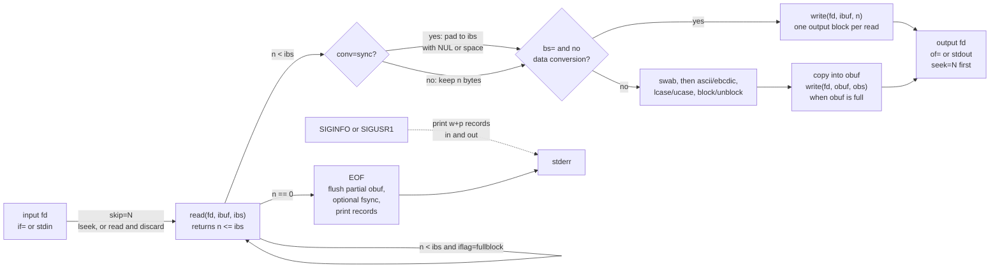

# dd and Block I/O

> [!summary] Claim
> `dd` is a thin loop around `read(2)` and `write(2)` whose block sizes, counts, and offsets are measured in system calls rather than bytes, so it is exact on regular files and block devices and silently lossy on pipes unless you ask for `iflag=fullblock`.

Part of [Coreutils and the Userland](README.md) in [Shell and Unix Engineering](../README.md).

## TL;DR

- Mechanism: `dd` issues one `read(2)` of `ibs` bytes per input block, optionally pads, converts, and re-blocks it, then issues `write(2)` calls of `obs` bytes; `count=` and `skip=` count those reads, not bytes.
- Rule: on any input that can return short reads (pipe, FIFO, socket, terminal, network filesystem), use `iflag=fullblock`, or use `head -c` instead, whenever `count=` or `skip=` must mean bytes.
- Trap: `bs=` is not shorthand for `ibs= obs=`: with `bs=` each short read becomes its own short output block, while `ibs=`/`obs=` aggregate short reads into full output blocks (POSIX.1-2024 XCU `dd`).
- Portability fact: number syntax differs: BSD and macOS read `count=010` as 8 and `bs=0x10` as 16, GNU reads them as 10 and an error, `B` means bytes in GNU but 512 in BSD, and BusyBox has no `x` products (measured on macOS 27.3 `dd` and GNU coreutils 9.12, BusyBox from source).
- When not to use it: do not use `dd` to copy files (use `cp`, which can reflink or `copy_file_range`), to take a byte prefix of a stream (use `head -c`), or to rescue a failing disk (use GNU `ddrescue`).

## Mental model



Reading left to right: `dd` positions the input with `skip=` (an `lseek(2)` when the file is seekable, otherwise reads that it throws away), then loops on `read(2)` with a request of `ibs` bytes.
A return of 0 is end of input; a short return is a partial record, which `iflag=fullblock` turns back into more reads until the block is full or input ends.
`conv=sync` pads a short record to `ibs`.
If `bs=` was given and no data-transforming conversion was requested, the record goes straight to `write(2)` as one output block of whatever size it is; otherwise it passes through the conversions and is re-blocked into `obs`-sized writes.
At the end, a partially filled output buffer is written short, `conv=fsync` or `conv=fdatasync` flush it (GNU, BSD), and the `w+p records in` and `records out` lines go to standard error, which an information signal can also request mid-copy.

## How it works

### The specification

POSIX.1-2024 specifies `dd` in XCU with a "curious JCL-like syntax" retained, in the words of its RATIONALE, "due to the large number of applications that depend on the historical implementation" (POSIX.1-2024 XCU `dd`, RATIONALE).
FreeBSD's manual traces the command to Version 5 AT&T UNIX (FreeBSD `dd.1`, HISTORY).
The specified processing order is: read an input block (with `iflag=fullblock` this "might entail multiple reads"), pad it with `conv=sync`, write it directly if `bs=` was given with no conversion other than `sync` or `noerror`, otherwise swap bytes for `swab`, apply `block`, `unblock`, `lcase`, `ucase`, and aggregate into output blocks of `obs` bytes, writing a short final block without padding (POSIX.1-2024 XCU `dd`, DESCRIPTION).
All operands are processed before any input is read, and the behavior is unspecified if any operand other than `conv=` is given twice (POSIX.1-2024 XCU `dd`, OPERANDS).
`ibs` and `obs` default to 512 bytes "because there are historical (largely portable) scripts that assume these values" (POSIX.1-2024 XCU `dd`, RATIONALE).
Size expressions are a positive decimal number, optionally followed by `k` (x 1024) or `b` (x 512), or two or more such numbers joined by `x` to form a product; the historical `w` multiplier is deliberately not supported because System V used it for 2 and 4.2BSD for 4 (POSIX.1-2024 XCU `dd`, OPERANDS and RATIONALE).
`count=0` is explicitly unspecified: "it is unspecified whether no blocks or all blocks are copied" (POSIX.1-2024 XCU `dd`, OPERANDS); every implementation measured or read here copies none.

### Partial records are a property of read(2), not of dd

`read(2)` may return fewer bytes than requested "if the number of bytes left in the file is less than nbyte, if the read() request was interrupted by a signal, or if the file is a pipe or FIFO or special file and has fewer than nbyte bytes immediately available for reading" (POSIX.1-2024 XSH `read`, DESCRIPTION).
`dd` reports each such return as a partial block: "A partial input block is one for which read() returned less than the input block size" (POSIX.1-2024 XCU `dd`, STDERR).
The completion report is fixed by the standard as `"%u+%u records in\n"` and `"%u+%u records out\n"`, whole blocks plus partial blocks, followed by `"%u truncated record(s)"` when `conv=block` truncated lines (POSIX.1-2024 XCU `dd`, STDERR); the third line with bytes and rate is an extension whose format differs per implementation (see Portability).
The APPLICATION USAGE section warns that `count=` with a pipe or FIFO "can lead to surprising results" because "dd will stop after the specified number of reads, rather than full input blocks".
On Linux a single `read(2)` also never transfers more than 0x7ffff000 (2,147,479,552) bytes, on 32-bit and 64-bit systems alike (Linux man-pages 6.19 `read.2`, NOTES), so `bs=4G count=1` on a regular file is a partial record too.

### iflag=fullblock and the spelling defect

GNU coreutils 7.0 (2008-10-05) added `iflag=fullblock`: "after a short read, dd repeatedly calls read, until it fills the incomplete block, reaches EOF, or encounters an error" (GNU coreutils NEWS).
Austin Group defect 406, filed by Eric Blake in 2011, asked POSIX to adopt it, and Issue 8 (POSIX.1-2024) applied it (POSIX.1-2024 XCU `dd`, CHANGE HISTORY).
The published text spells the operand `iflags=fullblock`, with an `s`, throughout.
Austin Group defect 1854 (Stephane Chazelas, 2024-09-05) reported that GNU coreutils, BusyBox, toybox, FreeBSD, NetBSD, and illumos all spell it `iflag`; the approved interpretation (2024-12-03) says conforming implementations must accept the printed spelling for now and instructs the editor to change every `iflags` to `iflag` (tagged `tc1-2024`); the defect's status is Applied as of 2025-06-24, so the fix waits only on the corrigendum being published (Austin Group defect 1854, as of 2026-11).
The lab confirms that both GNU dd 9.12 and macOS dd reject `iflags=fullblock` and accept `iflag=fullblock`.
POSIX leaves `iflag=fullblock` combined with `conv=sync`, `block`, or `unblock` unspecified; FreeBSD enforces it by making `fullblock` and `sync` mutually exclusive in its operand tables (FreeBSD `args.c`, `ilist[]` and `clist[]`).

### GNU coreutils: dd.c

`main()` installs signal handlers first, parses operands in `scanargs()`, reopens file descriptor 0 on `if=` and descriptor 1 on `of=` with `ifd_reopen()`, then runs `dd_copy()` (GNU coreutils `src/dd.c`).
`scanargs()` sets the private flag `C_TWOBUFS` whenever `bs=` is absent ("POSIX says dd aggregates partial reads into output_blocksize if bs= is not specified"), and every data conversion (`ascii`, `ebcdic`, `ibm`, `block`, `unblock`, `lcase`, `ucase`, `swab`) also carries `C_TWOBUFS` in the `conversions[]` table.
Without `C_TWOBUFS`, `alloc_obuf()` aliases the output buffer to the input buffer (`obuf = ibuf`), and `dd_copy()` writes exactly the bytes each read returned; with it, `copy_simple()` `memcpy`s into a separate `obs`-sized buffer and calls `write_output()` whenever it fills.
Both buffers come from `alignalloc(page_size, ...)`, which is what makes `iflag=direct` and `oflag=direct` usable without extra copies.
`iread()` retries on `EINTR` after calling `process_signals()`, and when `warn_partial_read` is set (no `C_TWOBUFS`, that is `bs=` given with no data conversion, no `fullblock`, and `skip=`, a finite `count=`, or `direct` in use) it prints `warning: partial read (N bytes); suggest iflag=fullblock` once.
`iread_fullblock()` simply loops `iread()` until the request is satisfied, EOF, or an error.
`iwrite()` loops on short writes, turns `write(2)` returning 0 into `ENOSPC`, implements `conv=sparse` as `lseek(fd, size, SEEK_CUR)` over all-NUL blocks, and, under `oflag=direct`, clears `O_DIRECT` with `fcntl(F_SETFL)` before a final short block and forces `conv=fsync` instead.
Block sizes are capped at `MIN(IDX_MAX - 1, MIN(SSIZE_MAX, OFF_T_MAX))` in `scanargs()`; `cbs=` has its own cap.
`parse_integer()` accepts the suffixes `bcEGkKMPQRTwYZ0`, multiplies `x`-separated factors with overflow checks, and warns when a factor is a literal `0x` ("is a zero multiplier; use 00x if that is intended", added in 8.26).
Since 9.1 (2022-04-15) a count ending in `B` counts bytes ("`dd count=100KiB` now copies 100 KiB of data, not 102,400 blocks"), making `iflag=count_bytes`, `skip_bytes`, and `oflag=seek_bytes` obsolescent, and `iseek=` and `oseek=` became aliases of `skip=` and `seek=` (GNU coreutils NEWS).
`skip()` tries `lseek(fd, records * blocksize + bytes, SEEK_CUR)` and falls back to reading and discarding `records` reads of `blocksize`, which is why a pipe skip counts reads, exactly like `count=`.
The output file is opened `O_CREAT | O_TRUNC` unless `seek=` or `conv=notrunc`; with `seek=` and no `notrunc`, `main()` calls `ftruncate()` to the seek offset, which implements the POSIX rule that "the blocks in the output file over which dd seeks" are preserved and nothing after them.
It opens the output `O_RDWR` first when seeking, because POSIX lets a seek on a non-seekable output be satisfied by reading existing blocks.

### Read errors and conv=noerror

When `read(2)` fails without `conv=noerror`, POSIX requires `dd` to write any partial output block, print a diagnostic, and stop; with `noerror` it prints the diagnostic and the current counts, then continues, substituting NUL bytes when `sync` is also given and otherwise omitting the block (POSIX.1-2024 XCU `dd`, OPERANDS and CONSEQUENCES OF ERRORS).
The RATIONALE adds the implementation duty: "a failed read on a regular file or a disk generally does not increment the file offset, and dd must then seek past the block on which the error occurred; otherwise, the input error occurs repetitively."
GNU zeroes the input buffer before every read when both `sync` and `noerror` are set, and `advance_input_after_read_error()` seeks past `ibs - partread` bytes, diagnosing "warning: invalid file offset after failed read" when the kernel moved the offset unexpectedly (GNU coreutils `src/dd.c`).
FreeBSD's `dd_in()` does `lseek(in.fd, in.dbsz, SEEK_CUR)` on a seekable input and `continue`s without writing when `sync` is absent (FreeBSD `dd.c`).
BusyBox does `xlseek(ifd, ibs, SEEK_CUR)` (fatal if the input is not seekable) and then treats the block as zero bytes read (BusyBox `coreutils/dd.c`, `dd_main`).
Because a whole `ibs` block is skipped per error, a large `bs=` with `noerror,sync` throws away up to `bs` good bytes around every bad sector; that is the design gap tools such as GNU `ddrescue` close, and GNU's manual sends failing media to them because they "come with a great variety of extra functionality to ease the saving of as much data as possible", offering `conv=noerror,sync iflag=fullblock` only as "a simple rescue method" (GNU coreutils manual, `dd` invocation).

### FreeBSD and macOS

FreeBSD's `jcl()` looks each operand up with `bsearch()` in a sorted table and rejects repeats of exclusive operands ("illegal argument combination or already set"); `bs=` is silently demoted to `ibs=`/`obs=` semantics when `block`, `lcase`, `swab`, `ucase`, or `unblock` is requested (FreeBSD `args.c`, `jcl`).
`get_num()` calls `strtoumax(val, &expr, 0)`, so a leading `0` is octal and `0x` is hexadecimal, as the manual says ("a decimal, octal, or hexadecimal number of bytes is expected"); `postfix_to_mult()` maps `b` and `B` to 512, `k`, `m`, `g`, `t`, `p` (either case) to powers of 1024, and `w` and `W` to `sizeof(int)`.
`setup()` allocates one buffer of `out.dbsz + in.dbsz - 1` bytes unless `block` or `unblock` is used, opens the output `O_RDWR | O_CREAT` (plus `O_TRUNC` without `seek=` or `notrunc`, `O_FSYNC` for `oflag=sync`, `O_DIRECT` for `oflag=direct`) and retries `O_WRONLY`, then enters Capsicum capability mode with `caph_enter()` before copying (FreeBSD `dd.c`).
`dd_in()` implements `fullblock` with a `goto fill` that re-reads into the same block, and writes immediately only when `(ddflags & ~(C_NOERROR | C_NOTRUNC | C_SYNC)) == C_BS`, the POSIX `bs=` rule (FreeBSD `dd.c`).
`pos_in()` skips on a pipe by counting bytes until whole blocks are consumed ("If a pipe, read until satisfy the number of bytes being skipped"), and reaching EOF while skipping is fatal: `errx(1, "skip reached end of input")` (FreeBSD and Apple `position.c`, `pos_in`).
FreeBSD adds `speed=`, `fillchar=`, `files=` (tapes), `status=progress` driven by `SIGALRM` every second, parity conversions, and `oldascii`/`oldebcdic` tables from 32V.
Apple's `file_cmds` copy of the code drops `prepare_io()` and Capsicum, omits `conv=fdatasync` (`#ifndef __APPLE__` around its table entry), lets `bs=` coexist with `ibs=` and `obs=` (it warns `bs supersedes ibs and obs` where FreeBSD's table rejects the combination), and accepts a leading `--` (Apple `args.c`).

### BusyBox

BusyBox `dd` is a NOEXEC applet with compile-time feature switches: `FEATURE_DD_IBS_OBS` enables `ibs`, `obs`, `conv`, `iflag`, and `oflag`, and `FEATURE_DD_SIGNAL_HANDLING` the `SIGUSR1` report (BusyBox `coreutils/dd.c`, config block).
It implements only `conv=notrunc,sync,noerror,fsync,swab`, `iflag=skip_bytes,count_bytes,fullblock,direct`, and `oflag=seek_bytes,append,direct`; its source lists `nocreat`, `excl`, `fdatasync`, `lcase`, `ucase`, `block`, `unblock`, `ascii`, `ebcdic`, and `ibm` as unimplemented.
It allocates a second output buffer only when `ibs != obs` (`FLAG_TWOBUFS`), so with the defaults or with `ibs=8 obs=8` it never aggregates short reads, unlike POSIX and GNU.
Numbers are parsed by `xatoull_sfx()` in base 10 with the `cwbkMG_suffixes` table (`c`, `w` = 2, `b` = 512, `kB` = 1000, `k` = 1024, `MB`, `M`, `GB`, `G`, and `KB`/`K` for coreutils compatibility); there is no `x` product, so the POSIX form `bs=2x512` is a usage error (BusyBox `libbb/xatonum.c`, `xatonum_template.c`).
Buffers of at least a page come from `mmap` so that `direct` I/O is aligned (`alloc_buf`), and an `EINVAL` under `direct` makes it clear `O_DIRECT` and retry (`clear_O_DIRECT`).

### uutils coreutils

uutils `dd` (Rust) mirrors GNU's operand set and its "buffered unless `bs=` without conversion" rule (`buffered = self.bs.is_none() || self.is_conv_specified` in `parseargs.rs`).
It converts `skip=` to bytes before positioning and, on a pipe, discards exactly that many bytes with `uucore::io::read_and_discard()`, so a pipe skip is byte-accurate like BSD rather than read-counting like GNU (`dd.rs`, `Source::skip`).
It parses numbers with `uucore` `parse_size`, whose `determine_number_system()` treats a leading `0` followed by more digits as octal; `count=010` therefore reads as 8 there (source reading, not run here).
The `SIGUSR1` handler is installed only under `#[cfg(target_os = "linux")]`, with `SA_RESTART`, and merely sets a flag that the copy loop polls after each block (`progress.rs`, `signals.rs` `install_signal_handler`; `dd.rs`).
Its third status line is `N bytes (SI, IEC) copied, T s, R/s`, with the same shape as GNU's (`en-US.ftl` and the unit tests in `progress.rs`).
Ubuntu shipped rust-coreutils as the default in Ubuntu 25.10, kept only `cp`, `mv`, and `rm` from GNU in 26.04 LTS, and targets 100% rust-coreutils for 26.10 (Ubuntu Discourse, "An update on rust-coreutils", 2026-04-22); on a default Ubuntu 25.10 or 26.04 install `dd` therefore comes from uutils (as of 2026-11).

### The kernel side: page cache, O_DIRECT, and sync

A plain `dd` to a file or block device on Linux writes into the page cache; `write(2)` returning says nothing about durability, which is why GNU and FreeBSD offer `conv=fdatasync` and `conv=fsync` (one call at the end) and `oflag=dsync` and `oflag=sync` (`O_DSYNC`, `O_SYNC` on every write).
`O_DIRECT` "may impose alignment restrictions on the length and address of user-space buffers and the file offset of I/Os"; since Linux 2.6.0 the requirement is the logical block size of the device, typically 512 bytes, queryable with `blockdev --getss`, and since Linux 6.1 with `statx(2)` and `STATX_DIOALIGN`; misaligned direct I/O either fails with `EINVAL` or falls back to buffered I/O, depending on the filesystem (Linux man-pages 6.19 `open.2`, NOTES).
`O_DIRECT` alone "does not give the guarantees of the O_SYNC flag", so `oflag=direct` without `conv=fsync` is not a durability promise (Linux man-pages 6.19 `open.2`).
GNU `iflag=nocache` and `oflag=nocache` call `posix_fadvise(fd, offset, len, POSIX_FADV_DONTNEED)` for the processed range, batched to multiples of `IO_BUFSIZE` by `cache_round()` (GNU coreutils `src/dd.c`, `invalidate_cache`); the kernel "attempts to free cached pages" and ignores partial pages and dirty data, so `conv=fdatasync` before the advice makes it effective (Linux man-pages `posix_fadvise.2`; GNU coreutils manual).
None of the four implementations calls `copy_file_range(2)`, `splice(2)`, or `sendfile(2)` (no occurrence in `dd.c`, FreeBSD `dd.c`, BusyBox `dd.c`, or uutils `dd.rs`), so every byte crosses user space twice; that is the main reason `cp` beats `dd` for file copies, covered in [[Reflinks-and-copy_file_range]].

### Statistics and signals

POSIX requires `SIGINT` to write status and then terminate as if by the default action, and allows "one or more implementation defined non-job-control signals other than SIGABRT, SIGHUP, and SIGTERM" to report and continue; Issue 8 (Austin Group defect 1159) adds that a future version may introduce `SIGINFO` and recommends it where available (POSIX.1-2024 XCU `dd`, ASYNCHRONOUS EVENTS and FUTURE DIRECTIONS).
GNU `dd.c` defines `SIGINFO` as `SIGUSR1` only `#ifndef SIGINFO`, so on macOS and the BSDs GNU dd reports on `SIGINFO` and `SIGUSR1` keeps its default action, which terminates the process; with `POSIXLY_CORRECT` set and no real `SIGINFO`, GNU does not catch `SIGUSR1` at all (`install_signal_handlers`).
GNU installs the information handler with `sa_flags = 0`, deliberately without `SA_RESTART` ("to avoid blocking on uncommitted read/write calls"), so a blocked `read(2)` returns `EINTR` and the report appears at once; the lab measures this as two reports (one on the signal, one at exit).
FreeBSD and macOS install the `SIGINFO` handler with `signal(3)`, which restarts system calls; the handler only sets `need_summary`, which `dd_in()` checks after a block completes, so a `dd` blocked on a quiet pipe does not report until the next block arrives (FreeBSD `misc.c`, `siginfo_handler`; the lab measures one report).
BusyBox installs its `SIGUSR1` handler with `signal_SA_RESTART_empty_mask()` and prints from inside the handler (`dd_output_status`).

## Numbers and limits

| Quantity | Value | Source |
| --- | --- | --- |
| Default `ibs` and `obs` | 512 bytes | POSIX.1-2024 XCU `dd`; `DEFAULT_BLOCKSIZE` in GNU `dd.c`; `in.dbsz = out.dbsz = 512` in FreeBSD `args.c` |
| Default `cbs` | 0 (block and unblock then unspecified) | POSIX.1-2024 XCU `dd` |
| Largest single `read(2)` on Linux | 0x7ffff000 = 2,147,479,552 bytes | Linux man-pages 6.19 `read.2` (as of 2026-11) |
| GNU maximum `bs` | `MIN(IDX_MAX - 1, SSIZE_MAX, OFF_T_MAX)` | GNU `dd.c` `scanargs` (as of 2026-11) |
| BusyBox maximum `bs` | `SIZE_MAX / 2` | BusyBox `dd.c` (`xatoul_range_sfx(val, 1, ((size_t)-1L)/2, ...)`) |
| `O_DIRECT` alignment, Linux 2.6+ | logical block size, typically 512 bytes | Linux man-pages 6.19 `open.2` |
| Linux pipe capacity | 16 pages (65,536 bytes with 4096-byte pages) | Linux man-pages `pipe.7` |
| Page size, Apple M3 Pro, macOS 27.3 | 16384 bytes (`getconf PAGESIZE`) | measured here, 2026-11-15 |
| GNU dd 9.12, `/dev/zero` -> `/dev/null`, 1 GiB, `bs=512` | 2.03 s, 530 MB/s (about 1 us per read plus write pair) | measured here, Apple M3 Pro, one run, 2026-11-15 |
| same, `bs=4k` | 0.27 s, 4.0 GB/s | measured here, one run |
| same, `bs=64k` | 0.031 s, 35.1 GB/s | measured here, one run |
| same, `bs=1M` | 0.019 s, 56.6 GB/s | measured here, one run |
| Records lines for two 4-byte pipe reads | `bs=8`: `0+2` in, `0+2` out; `ibs=8 obs=8`: `0+2` in, `1+0` out | lab `records` mode, GNU 9.12 and macOS dd |
| Bytes copied by `bs=8 count=1` from a pipe whose first read is 4 bytes | 4; 8 with `iflag=fullblock` | lab `shortread` mode |

The `/dev/zero` -> `/dev/null` figures measure only system call overhead with no storage behind them: they show why `bs=512` is a poor default for bulk copies, not what a disk sustains.
An independent rerun on the same machine the same day gave 2.36 s, 0.35 s, 0.033 s, and 0.020 s, so read each single-run figure as good to roughly 15 to 30%.
The cost per block is roughly constant, so throughput grows almost linearly with `bs` until memory bandwidth dominates, somewhere between 64 KiB and 1 MiB on this machine.

## Portability

| Behavior | GNU coreutils 9.12 | BSD and macOS `dd` | BusyBox (master) | uutils (main) | POSIX.1-2024 |
| --- | --- | --- | --- | --- | --- |
| `count=` on a pipe without `fullblock` | counts reads (lab) | counts reads (lab) | counts reads (source) | counts reads (source) | counts reads, APPLICATION USAGE |
| `iflag=fullblock` | yes since 7.0 (lab) | yes (lab, macOS) | yes (source) | yes (source) | printed as `iflags=`, defect 1854 renames it |
| `iflags=fullblock` (printed POSIX spelling) | rejected (lab) | rejected (lab) | rejected: usage error (source) | rejected: unrecognized operand (source) | required by the printed text until TC1 |
| `ibs=8 obs=8` aggregates two short reads | `1+0` out (lab) | `1+0` out (lab) | no: `0+2` out (source) | `1+0` out (source) | aggregate |
| `skip=1 bs=4` on a pipe whose first read is 2 bytes | discards one read (lab) | discards 4 bytes (lab) | discards one read (source) | discards 4 bytes (source) | "the blocks shall be read" |
| `skip=` past the end of a pipe | `cannot skip to specified offset`, exit 0 (lab) | `skip reached end of input`, exit 1 (lab) | silent, exit 0 (source) | same diagnostic as GNU, exit 0 (source) | not specified |
| `count=010` | 10 (lab) | 8, octal (lab) | 10 (source) | 8, octal (source) | decimal only |
| `bs=0x10` | error, zero multiplier (lab) | 16 (lab) | error (source) | error (source) | not a valid expr |
| `bs=2x4` | 8 (lab) | 8 (lab) | error, no `x` (source) | 8 (source) | required |
| `count=2B` | 2 bytes (lab) | 2 x 512 blocks (lab) | error (source) | 2 bytes (source) | not specified |
| `bs=1w` | 2 (lab) | 4, `sizeof(int)` (lab) | 2 (source) | 2 (source) | `w` excluded |
| `count=0` | copies nothing (lab) | copies nothing (lab) | copies nothing (source) | copies nothing (source) | unspecified |
| `conv=ucase`, `lcase`, `block`, `unblock`, `ascii` | yes (lab: `ucase`) | yes (lab: `ucase`) | no (source) | yes (source) | required |
| `conv=fdatasync` | yes (source) | FreeBSD yes (source), macOS `unknown conversion fdatasync` (measured) | no, only `fsync` (source) | yes (source) | not specified |
| `iseek=`, `oseek=` | yes since 9.1 (NEWS) | yes (source) | no (source) | yes (source) | not specified |
| `status=progress` | yes since 8.24 (NEWS) | yes (FreeBSD source; macOS measured) | no, `none` and `noxfer` only (source) | yes (source) | not specified |
| Report signal | `SIGUSR1` on Linux, `SIGINFO` where defined (lab) | `SIGINFO`, deferred to next block (lab) | `SIGUSR1` (source) | `SIGUSR1`, Linux only, deferred to next block (source) | `SIGINFO` recommended |
| Third status line | `N bytes (...) copied, T s, R/s` (lab) | `N bytes transferred in T secs (R bytes/sec)` (lab) | `N bytes (...) copied, T seconds, R/s` (source) | `N bytes (...) copied, T s, R/s` (source) | not specified |

The shell running `dd` does not change any of these cells: `dd` is always an external utility, and the lab runs every case through each shell in the matrix only to prove that.
The `(source)` cells come from reading the implementation listed under Further reading; they are predictions for the matrix's BusyBox and any uutils run, not measurements on this host.
On Alpine `dd` is BusyBox, on Debian it is GNU coreutils, on macOS it is Apple's `file_cmds` port of FreeBSD's, and on a default Ubuntu 25.10 or 26.04 install it is uutils (as of 2026-11).

## Worked example

The [lab](../labs/08-dd-and-block-io/) is one probe script, `ddprobe.sh MODE`, and `dd.bats`, which branches on the detected implementation.
`DD` selects the `dd` under test (`DD=gdd` for Homebrew's GNU dd on macOS, `DD='busybox dd'` on Debian).
Simplified excerpt of `ddprobe.sh` (the real file adds the other modes and the usage text):

```sh
# dd_ ARG...: run the dd under test with ARGs.
dd_() {
  eval "$DD"' "$@"'
}

# slow_writer FIRST SECOND: write FIRST, pause one second, write SECOND, so a
# reader that is already waiting gets FIRST as one short read.
slow_writer() {
  {
    printf '%s' "$1"
    /bin/sleep 1
    printf '%s' "$2"
  } 2>/dev/null
}

mode_shortread() {
  plain=$(slow_writer aaaa bbbb | dd_ bs=8 count=1 2>/dev/null | count_bytes)
  full=$(slow_writer aaaa bbbb | dd_ bs=8 count=1 iflag=fullblock 2>/dev/null | count_bytes)
  printf 'plain=%s fullblock=%s\n' "$plain" "$full"
}

recs() {
  label=$1
  shift
  slow_writer aaaa bbbb | dd_ "$@" 2>"$tmp/err" >/dev/null
  rin=$(sed -n 's/ records in$//p' "$tmp/err")
  rout=$(sed -n 's/ records out$//p' "$tmp/err")
  printf '%s: in=%s out=%s\n' "$label" "$rin" "$rout"
}

mode_records() {
  recs ibs-obs ibs=8 obs=8
  recs bs bs=8
  recs default
}
```

Output captured on macOS 27.3 (Apple M3 Pro), `/bin/sh` (bash 3.2.57), with `/bin/dd`:

```text
$ sh ddprobe.sh shortread
plain=4 fullblock=8
$ sh ddprobe.sh records
ibs-obs: in=0+2 out=1+0
bs: in=0+2 out=0+2
default: in=0+2 out=0+1
$ sh ddprobe.sh skip
plain=efgh fullblock=efgh
$ sh ddprobe.sh skipeof
status=1
$ sh ddprobe.sh seek
trunc=01AB notrunc=01AB456789 grow=8 nuls=4
$ sh ddprobe.sh numbers
octal=8 hex=16 product=8 B=1024 w=4 zero=0
$ sh ddprobe.sh conv
swab=bac ucase=ABC sync=8/5
$ sh ddprobe.sh spelling
iflags=rejected iflag=accepted
$ sh ddprobe.sh signal USR1
killed reports=0
$ sh ddprobe.sh signal INFO
survived reports=1
```

The same modes with `DD=gdd` (GNU coreutils 9.12) differ exactly where the Portability table says:

```text
$ DD=gdd sh ddprobe.sh skip
plain=cdefgh fullblock=efgh
$ DD=gdd sh ddprobe.sh skipeof
status=0
$ DD=gdd sh ddprobe.sh numbers
octal=10 hex=0 product=8 B=2 w=2 zero=0
$ DD=gdd sh ddprobe.sh signal USR1
killed reports=0
$ DD=gdd sh ddprobe.sh signal INFO
survived reports=2
```

Read `records` line by line: with `ibs=8 obs=8` (and with the defaults) two 4-byte reads are counted as `0+2` records in and re-blocked into one full output block, while `bs=8` writes each short read as its own short block, `0+2` out, exactly as POSIX requires.
`seek` shows the truncation rule: `seek=2` keeps the two skipped bytes, writes `AB`, and cuts the rest; `conv=notrunc` keeps the tail; an empty copy with `seek=8` grows a 4-byte file to 8 with 4 NUL bytes.
On Linux, where there is no `SIGINFO`, the tests expect `signal USR1` to print `survived reports=2` for GNU and BusyBox (one report from the signal, one at exit) and `survived reports=1` for uutils, whose `SA_RESTART` handler only sets a flag that is polled after the next block, which never arrives before EOF; they expect `signal INFO` to print `survived reports=1` for all three, because `kill -s INFO` fails and nothing is sent (predicted from the source; not yet run on Linux as of 2026-11).
A uutils `dd` on macOS catches neither signal: `USR1` kills it, while `SIGINFO`, whose default action on macOS is to discard the signal, leaves it running with only the final report (measured for the default action with a process that installs no handler, 2026-11-15; uutils itself not run here).

## Pitfalls

> [!warning] count= on a pipe counts reads
> Trigger: `producer | dd bs=1M count=1 of=header.bin`, or `ssh host cat disk | dd bs=4M count=256`.
> Symptom: the output is shorter than `bs x count`, varying from run to run, and the status shows `0+N records in`; GNU prints `warning: partial read (N bytes); suggest iflag=fullblock` only in some cases.
> Fix: add `iflag=fullblock` (GNU, BSD, macOS, BusyBox, uutils), or use `head -c N` when you only want a byte prefix; POSIX.1-2024 XCU `dd` APPLICATION USAGE documents the trap.

> [!warning] bs= is not ibs= plus obs=
> Trigger: a script switches from `ibs=64k obs=64k` to `bs=64k` "to shorten it", writing to a tape or to a device that needs full blocks.
> Symptom: short reads now become short writes; on a tape FreeBSD aborts with `short write on tape device`, and the status line shows partial records out.
> Fix: keep `ibs=`/`obs=` (or add `iflag=fullblock`) when the output needs full blocks; note BusyBox never aggregates when `ibs` equals `obs`, so give it `iflag=fullblock` too.

> [!warning] The POSIX.1-2024 spelling does not work
> Trigger: copying `iflags=fullblock` from the POSIX.1-2024 `dd` page.
> Symptom: `dd: unrecognized operand 'iflags=fullblock'` (GNU) or `dd: unknown operand iflags` (macOS), exit status 1 (lab `spelling` mode).
> Fix: write `iflag=fullblock`; Austin Group defect 1854 corrects the standard to match.

> [!warning] Leading zeros and 0x on BSD and macOS
> Trigger: a generated operand such as `skip=0$offset`, `count=010`, or `bs=0x1000`.
> Symptom: macOS and FreeBSD read `010` as 8 and `0x1000` as 4096 (`strtoumax` base 0 in `get_num`), GNU reads `010` as 10 and rejects `0x1000` as a zero multiplier, so the same script skips different offsets on different hosts (lab `numbers` mode).
> Fix: emit plain decimal with no leading zeros; compute products in the shell with `$((...))` rather than with `x` or hex.

> [!warning] B, w, and k mean different things
> Trigger: `count=4B` or `bs=1w` in a script tested on Linux.
> Symptom: GNU 9.1+ counts 4 bytes, macOS counts 4 x 512-byte blocks, BusyBox rejects it; `w` is 2 in GNU and BusyBox and `sizeof(int)` (4) in BSD; GNU `kB` is 1000 while BSD rejects `kB` (lab `numbers` mode).
> Fix: use only the POSIX forms (a decimal number, `k`, `b`, and `x` products) in portable scripts, and convert byte offsets to block counts yourself, or require GNU explicitly.

> [!warning] of= truncates, seek= truncates after the seek
> Trigger: patching bytes in an existing image with `printf ... | dd of=disk.img bs=1 seek=446`.
> Symptom: everything after the patched bytes is gone; the image is now 448 bytes long (lab `seek` mode shows `01AB` from `0123456789`).
> Fix: always add `conv=notrunc` when writing into an existing regular file; a block device cannot be truncated, which is why the same command "works" on `/dev/sdX` and destroys a file.

> [!warning] kill -USR1 kills dd on macOS and the BSDs
> Trigger: the Linux idiom `kill -USR1 $(pgrep ^dd)` to see progress, run on macOS, or under GNU dd with `POSIXLY_CORRECT` set.
> Symptom: the copy dies with no report, killed by signal 30, which is `SIGUSR1` on macOS (lab `signal USR1`: `killed reports=0`, both `/bin/dd` and GNU 9.12).
> Fix: send `SIGINFO` (`kill -s INFO`) where it exists, use GNU `status=progress`, and in scripts that send `USR1` to GNU dd follow the manual's advice to `trap '' USR1` first so a race cannot kill a child that has not installed its handler yet.

> [!warning] BSD reports on SIGINFO only after the next block
> Trigger: `kill -s INFO` sent to a BSD or macOS `dd` whose input pipe is momentarily quiet.
> Symptom: nothing is printed until more data arrives, because FreeBSD and macOS restart the blocked `read(2)` and print from the copy loop (lab `signal INFO`: one report for BSD, two for GNU).
> Fix: expect delayed reports on idle input; GNU's handler interrupts the read and reports at once.

> [!warning] conv=noerror without sync shifts every later byte
> Trigger: imaging a failing disk with `dd conv=noerror bs=1M`.
> Symptom: each unreadable block is dropped from the output, so every later filesystem structure sits at the wrong offset; with a large `bs`, each error also discards up to a whole block of good data.
> Fix: at minimum `conv=noerror,sync iflag=fullblock` with a small `bs` (the GNU manual's rescue example), and preferably `ddrescue`, which retries and maps bad areas.

> [!warning] BusyBox conv=fsync flushes before the last partial block
> Trigger: `busybox dd ibs=4k obs=1M conv=fsync of=/dev/mmcblk0` on an embedded system, input not a multiple of 1 MiB.
> Symptom: in `dd_main` the `fsync(ofd)` call runs before the final `write_and_stats(obuf, ocount, ...)` of the aggregated tail, so the last partial output block is not covered by the fsync (BusyBox `coreutils/dd.c`, master as of 2026-11; source reading, not reproduced).
> Fix: run `sync` (or `blockdev --flushbufs`) after BusyBox `dd`, or use `bs=` so there is no aggregated tail.

> [!warning] Failed truncation reported as success
> Trigger: uutils `dd` writing to a regular file on a full or read-only filesystem.
> Symptom: CVE-2026-35344 (CWE-252, CVSS 3.1 base 3.3): uutils `dd` called `Result::ok()` on truncation attempts, hiding failures on regular files and directories, so "the utility may report a successful operation even when the destination file contains old or garbage data" (CVE record, CNA Canonical, published 2026-04-22, upstream uutils/coreutils issue 9745; also on NVD).
> Fix: update uutils, verify copies with a checksum (see [[Checksums-and-Integrity]]), and check free space first; GNU had a related bug, fixed in 9.10, where `dd seek=N of=FILE` "continues copying, overwriting FILE if it exists, if ftruncate fails" (introduced in 9.1, GNU coreutils NEWS).

> [!warning] O_DIRECT and odd sizes
> Trigger: `dd if=img of=/dev/nvme0n1 bs=1M oflag=direct` where the image size is not a multiple of the logical block size.
> Symptom: the last `write(2)` fails with `EINVAL` on filesystems and devices that enforce alignment (Linux man-pages `open.2`); GNU avoids it by clearing `O_DIRECT` and forcing an fsync for the final short block, BusyBox by clearing it after `EINVAL`, others fail.
> Fix: pad images to the device's logical block size (`blockdev --getss`, or `statx` `STATX_DIOALIGN` on Linux 6.1+), and add `conv=fsync`, because `O_DIRECT` alone is not `O_SYNC`.

## Security and robustness

`dd` runs with whatever privilege it is given and writes raw devices without confirmation, so the dominant risk is the wrong `of=`: resolve the target through a stable name (`/dev/disk/by-id/...` on Linux, `diskutil list` on macOS), check that nothing on it is mounted, and keep the device path in one reviewed variable rather than retyping it.
Treat the exit status as necessary but not sufficient: GNU, BSD, and BusyBox return non-zero for a read or write error, but the bugs above (CVE-2026-35344, GNU 9.10's `ftruncate` fix, GNU 9.11's "now always diagnoses partial writes correctly upon write failure", present "in the beginning") show that a zero status has not always meant a correct copy; verify with a checksum of the source and the target range.
Durability needs an explicit flush: without `conv=fsync`, `conv=fdatasync`, or `oflag=sync`, data can still be in the page cache when `dd` exits and is lost on power failure, and ejecting removable media before the cache drains corrupts it.
`skip=` and `seek=` on a seekable file are computed as `records x blocksize`; GNU checks the multiplications with `ckd_mul` and `ckd_add`, refusing a `seek=` whose byte offset overflows `off_t` (`offset too large`) and falling back or failing for an oversized `skip=`, so a hostile or miscomputed count fails rather than wrapping, but a wrong block size multiplies an innocent count into a write far into a device.
`iflag=nonblock`, `oflag=append`, and similar flags applied to standard input or output change the open file description shared with the parent shell and other processes, "even after dd exits" (GNU coreutils manual).
GNU `oflag=nofollow`, `nolinks`, and `conv=excl` (O_EXCL) make `dd` safe to use on paths in a shared directory where an attacker could plant a symlink; without them, `of=/tmp/name` follows a symlink planted there (see [[mktemp]]).
FreeBSD's `dd` limits itself with Capsicum (`caph_enter`, `caph_rights_limit`) after opening its files, so a parsing bug cannot open new paths; GNU, BusyBox, and macOS have no equivalent sandbox.
`dd` reads `LC_CTYPE` for `lcase` and `ucase`; GNU converts only single bytes because "multibyte characters may cross block boundaries", so `conv=ucase` leaves multibyte UTF-8 letters unconverted (GNU coreutils manual).

## The principal's view

The decision is rarely "how do I use `dd`" and usually "should this be `dd` at all".
`dd` is the right tool when you need system-call-level control over block size and alignment: writing a disk image to a raw device, reading a fixed sector range (`skip=` with a sector-sized `ibs`), producing exactly-aligned direct I/O for a storage benchmark baseline, or converting fixed-length records and EBCDIC.
It is the wrong tool for file copies (`cp --reflink=auto` and `copy_file_range` avoid the user-space round trip; see [[Reflinks-and-copy_file_range]]), for taking bytes from a stream (`head -c` counts bytes, not reads), for fan-out (see [[tee-and-Fan-Out]]), for checksummed transfer (see [[rsync-Algorithm-and-Usage]]), and for failing media (`ddrescue`).
The trade-off is control versus correctness by default: `dd`'s defaults (512-byte blocks, read-counting, no fsync, truncate on `of=`) are the 1970s tape semantics POSIX had to preserve, so every production invocation needs at least `bs=` chosen for the device, `iflag=fullblock` if the input could be a pipe, `conv=fsync` if the result must survive power loss, and `conv=notrunc` if the output is an existing file.
Standardize the implementation before standardizing the command: a fleet that mixes macOS laptops, Alpine containers, Debian servers, and Ubuntu 26.04 hosts runs four different `dd`s whose number syntax, skip semantics, report signals, and conversion sets disagree, so a portable script uses only decimal numbers, `k`, `b`, `x`, and the POSIX conversions, or it checks `dd --version` and refuses to run on an unexpected one.
For a storage benchmark, `dd` measures one sequential stream at queue depth 1 with page-cache effects unless `oflag=direct`; anything that matters (latency percentiles, mixed reads and writes, queue depth) belongs in `fio`, and a `dd` number in a design review should be challenged for its flags.
For a pipeline in a language, `os.read` loops or `std::io::copy` give the same control with explicit short-read handling and checked errors, which is usually better than wrapping `dd` in a subprocess.

## Interview questions

> [!question] L5: What do the two numbers in `0+3 records in` mean, and when does the second one become non-zero?
>
> > [!success]- Answer
> > The first is the number of reads that returned exactly `ibs` bytes, the second the number that returned fewer.
> > A read is partial at end of input, when a signal interrupts it after some data, or when a pipe, FIFO, terminal, or socket has fewer bytes ready than requested.
> > POSIX.1-2024 fixes the format as `%u+%u records in` and defines a partial block as one for which `read()` returned less than the block size.
> >
> > Follow-up: why can `records out` show more partial blocks than `records in`?

> [!question] L5: Predict the output: `{ printf aaaa; sleep 1; printf bbbb; } | dd bs=8 count=1 2>/dev/null | wc -c`
>
> > [!success]- Answer
> > `4` (padded by `wc` on macOS).
> > The first `read(2)` returns the 4 bytes already in the pipe, which is one partial record, and `count=1` stops after one read.
> > With `iflag=fullblock` the answer is 8, because `dd` keeps reading until the block is full; the lab measures both on GNU and macOS `dd`.
> >
> > Follow-up: what does `head -c 8` print for the same input, and why?

> [!question] L5: Why does `printf AB | dd of=f bs=1 seek=2` shorten a 10-byte file, and how do you prevent it?
>
> > [!success]- Answer
> > With an explicit `of=` and no `conv=notrunc`, POSIX requires `dd` to preserve the blocks it seeks over and nothing else, so the file is truncated at the end of the copy.
> > GNU opens without `O_TRUNC` when seeking and calls `ftruncate` to the seek offset; BSD and BusyBox do the same.
> > `conv=notrunc` keeps the rest of the file.
> >
> > Follow-up: why does the same command not shorten `/dev/sdb`?

> [!question] L6: Explain the difference between `bs=64k` and `ibs=64k obs=64k`.
>
> > [!success]- Answer
> > With `bs=` and no data-transforming conversion, POSIX requires each input block to be written as its own output block, so a short read becomes a short write.
> > With `ibs=` and `obs=`, input is collected into full `obs`-sized output blocks, so short reads are aggregated.
> > GNU implements this with its `C_TWOBUFS` flag, FreeBSD by testing whether `C_BS` is the only flag set; BusyBox deviates and never aggregates when `ibs` equals `obs`.
> >
> > Follow-up: which conversions turn `bs=` back into aggregating mode, and why?

> [!question] L6: Debug this script: it works on Ubuntu but extracts the wrong data on a Mac. `off=$(printf '%08d' "$sector"); dd if=disk.img bs=512 skip="$off" count=1 > mbr.bin`
>
> > [!success]- Answer
> > The zero padding makes `skip=` start with `0`, and BSD and macOS `dd` parse numbers with `strtoumax` base 0, so `00000010` is octal 8, not 10.
> > A sector number containing 8 or 9 after the leading zero makes macOS reject the operand entirely.
> > GNU (and BusyBox) parse decimal, which is why it worked on Ubuntu with GNU coreutils; uutils, the default on newer Ubuntu, also treats a leading zero as octal per its `parse_size` source.
> > Fix: pass the decimal number without padding, `skip="$sector"`.
> >
> > Follow-up: how would you make the script fail loudly instead of silently on an unexpected `dd`?

> [!question] L6: A colleague runs `kill -USR1` on a long `dd` on macOS to see progress and the copy dies; explain why and give the portable alternative.
>
> > [!success]- Answer
> > macOS and the BSDs report on `SIGINFO`; `SIGUSR1`'s default action is to terminate, and BSD `dd` never catches it.
> > Even GNU dd built on macOS catches `SIGINFO` instead of `SIGUSR1`, because `dd.c` maps `SIGINFO` to `SIGUSR1` only when `SIGINFO` is undefined.
> > Use `kill -s INFO` on BSD-like systems, `status=progress` with GNU, or `pv` in the pipeline.
> >
> > Follow-up: why does BSD `dd` sometimes print nothing after `SIGINFO` while GNU prints at once?

> [!question] L6: Why is `dd if=a of=b bs=1M` slower than `cp a b` on a modern Linux filesystem, even with a good block size?
>
> > [!success]- Answer
> > `dd` always reads into a user-space buffer and writes it out again; none of GNU, BSD, BusyBox, or uutils `dd` calls `copy_file_range`, `splice`, or `sendfile`.
> > GNU `cp` can clone extents with `FICLONE` or let the kernel copy with `copy_file_range`, which avoids the two copies and can be instantaneous on Btrfs or XFS with reflinks.
> > `dd` also does not preserve holes unless `conv=sparse`, while `cp` detects them.
> >
> > Follow-up: when is the extra copy in `dd` a feature rather than a cost?

> [!question] L7: Design a procedure to write a 7.3 GiB image to a removable device in production tooling that runs on Linux and macOS, and justify each flag.
>
> > [!success]- Answer
> > Resolve the device from a stable identifier and refuse if any partition is mounted; keep it in one variable.
> > Choose `bs=4M` (or the device's preferred I/O size), because per-call overhead dominates below tens of KiB, and decimal numbers only.
> > Add `conv=fsync` (both GNU and macOS support it; macOS lacks `fdatasync`) so the exit status covers the flush, and use `iflag=fullblock` if the image comes through a decompressor pipe.
> > On Linux consider `oflag=direct` to avoid filling the page cache, with the image padded to the logical block size, and verify by reading back the written range and comparing checksums.
> > Treat exit status as necessary but not sufficient, citing CVE-2026-35344 and GNU's partial-write diagnostic fix in 9.11.
> >
> > Follow-up: how does the procedure change if the device is accessed through a USB bridge that lies about flushes?

> [!question] L7: POSIX.1-2024 adopted `iflags=fullblock`, so why does it not work anywhere, and what does the episode teach about adopting standards text into tooling?
>
> > [!success]- Answer
> > Austin Group defect 406 proposed the operand with the plural spelling, the standard printed it that way, and every implementation already spelled it `iflag`.
> > Defect 1854 (2024) got an interpretation that conforming implementations must accept the printed spelling for now, with an editorial change to `iflag` in the next technical corrigendum.
> > The lesson is to test standards text against real implementations, and to treat "it is in POSIX" as a claim to verify, especially for features added in the most recent issue.
> >
> > Follow-up: what other Issue 8 additions would you verify before relying on them in a portable script?

> [!question] L7: How should `conv=noerror` interact with `sync`, block size, and the file offset when imaging a disk with bad sectors, and why do the implementations differ?
>
> > [!success]- Answer
> > Without `sync`, POSIX says the failed block is omitted, which shifts every later byte; with `sync` it is replaced by NULs, preserving offsets.
> > The RATIONALE notes that a failed read on a disk usually does not advance the offset, so `dd` must seek past the bad block itself or loop on the error.
> > GNU zeroes the buffer before each read and seeks past `ibs - partread`, FreeBSD seeks `ibs` and continues, BusyBox calls `xlseek` and dies on unseekable input.
> > Each error costs a whole input block, so a small `ibs` loses less data but runs slower; `ddrescue` solves this by reading large blocks first and retrying bad areas in small ones.
> >
> > Follow-up: what happens with `noerror,sync` when the failing read returned some bytes before the error?

## Related

Prerequisites: [[Reflinks-and-copy_file_range]]

Next: [[tee-and-Fan-Out]]

See also: [[Four-Userlands-GNU-BSD-BusyBox-uutils]], [[Userland-Portability-Traps]], [[Checksums-and-Integrity]], [[stdio-Buffering-and-stdbuf]], [[cp-mv-and-Rename-Semantics]], [[mktemp]], [[Pipes-and-FIFOs]], [[PIPE_BUF-and-Write-Atomicity]], [[Signals-Dispositions-Masks-and-Delivery]]

## Further reading

- [POSIX.1-2024 XCU dd](https://pubs.opengroup.org/onlinepubs/9799919799/utilities/dd.html): the normative processing order, operand semantics, STDERR format, and the RATIONALE on error recovery and block sizes.
- [POSIX.1-2024 XSH read](https://pubs.opengroup.org/onlinepubs/9799919799/functions/read.html): the short-read conditions that make every `dd` count a count of reads.
- [Austin Group defect 406](https://austingroupbugs.net/view.php?id=406): the proposal and discussion that put `fullblock` into Issue 8.
- [Austin Group defect 1854](https://austingroupbugs.net/view.php?id=1854): the `iflags` versus `iflag` correction and the survey of implementations.
- [GNU coreutils src/dd.c](https://raw.githubusercontent.com/coreutils/coreutils/master/src/dd.c): `dd_copy`, `iread_fullblock`, `iwrite`, `skip`, and `invalidate_cache`, the reference implementation of the extensions.
- [GNU coreutils manual source](https://raw.githubusercontent.com/coreutils/coreutils/master/doc/coreutils.texi): the `dd invocation` node, with the rescue and `nocache` recipes.
- [GNU coreutils NEWS](https://raw.githubusercontent.com/coreutils/coreutils/master/NEWS): dated history of every `dd` feature and bug fix cited here.
- [FreeBSD bin/dd](https://raw.githubusercontent.com/freebsd/freebsd-src/main/bin/dd/dd.c): `dd_in`, `dd_out`, and with `args.c` and `position.c` the BSD number parsing and pipe-skip rules.
- [Apple file_cmds dd](https://raw.githubusercontent.com/apple-oss-distributions/file_cmds/main/dd/args.c): what macOS changes relative to FreeBSD.
- [BusyBox coreutils/dd.c](https://raw.githubusercontent.com/mirror/busybox/master/coreutils/dd.c): the minimal implementation shipped in Alpine and most embedded systems.
- [uutils dd.rs](https://raw.githubusercontent.com/uutils/coreutils/main/src/uu/dd/src/dd.rs): the Rust implementation that is now `dd` on Ubuntu.
- [Linux open(2)](https://man7.org/linux/man-pages/man2/open.2.html): `O_DIRECT` alignment rules, `STATX_DIOALIGN`, and why `O_DIRECT` is not `O_SYNC`.
- [NVD CVE-2026-35344](https://nvd.nist.gov/vuln/detail/CVE-2026-35344): a `dd` that reported success after failing to truncate.
