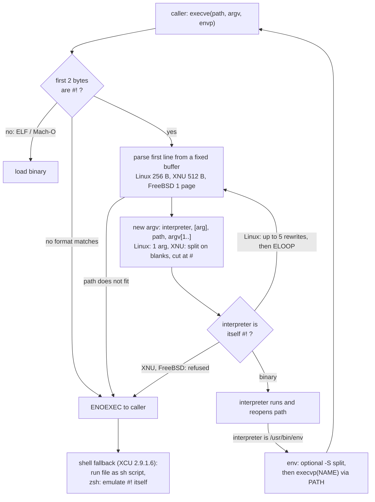

# env and Shebang Tricks

> [!summary] Claim
> `#!` is not shell syntax but a kernel image format that splices at most a few hundred bytes of the first line into a new argument vector, so every shebang trick (`/usr/bin/env`, `env -S`, re-exec trampolines, polyglot headers) is a workaround for one of four kernel rules: one optional argument on Linux, word splitting and a `#` terminator on macOS, a 256-byte (Linux) or 512-byte (XNU) buffer, and a cap on interpreter nesting.

Part of [Coreutils and the Userland](README.md) in [Shell and Unix Engineering](../README.md).

## TL;DR

Mechanism: `execve` reads the file head; if it starts with `#!`, the kernel (Linux `load_script()`, XNU `exec_shell_imgact()`) builds `interpreter [arg] script-path original-args...`, drops the caller's `argv[0]`, and execs the interpreter, which reopens the script by that path.
Rule: write `#!/usr/bin/env NAME` with exactly one word after `env`, or `#!/usr/bin/env -S NAME ARG...` when you need more, and keep the whole line ASCII, LF-terminated, and well under 128 bytes.
Trap: Linux passes everything after the interpreter as one argument and macOS splits it on blanks and stops at `#`, so `#!/usr/bin/env perl -w` works on a Mac and fails on Linux with status 127 (`env: 'perl -w': No such file or directory`).
Portability: POSIX leaves a `#!` first line unspecified (XCU 2.1) and standardizes only `env [-i] [name=value]... [utility [argument...]]`; `-S`, `-u`, `-C`, `-a`, `-0`, and the signal options are GNU, BSD, BusyBox, or uutils extensions, and BusyBox has no `-S` at all.
Do not use `env` when the interpreter path is fixed by policy (setuid, system services, containers with a known image): an absolute `#!/bin/sh` cannot be hijacked through `PATH`, costs one `execve` less, and fails loudly instead of running whatever `python3` is first on `PATH`.

## Mental model



A caller (a shell, `execvp`, or a supervisor) hands a path to `execve`, and the kernel tries each binary format handler on the first bytes.
The script handler recognizes `#!`, parses one line out of a fixed-size buffer, rewrites the argument vector, and restarts the lookup on the interpreter, which may itself be a script on Linux but not on macOS or FreeBSD.
When the interpreter is `/usr/bin/env`, the loop closes: `env` optionally re-splits its single argument with `-S` and calls `execvp`, which searches `PATH` and enters `execve` again.
Every failure that is a format problem (`ENOEXEC`) goes back to the caller, and if the caller is a shell, XCU 2.9.1.6 makes it run the file as a shell script itself, which is why a broken shebang often runs the wrong interpreter instead of failing.

## How it works

### What POSIX says, and does not say

POSIX.1-2024 never specifies `#!`.
XCU 2.1 says "If the first line of a file of shell commands starts with the characters `#!`, the results are unspecified" (POSIX.1-2024 XCU 2.1).
The XSH `exec` rationale records that "some historical implementations handle shell scripts by recognizing the first two bytes of the file as the character string `#!` and using the remainder of the first line of the file as the name of the command interpreter to execute" (POSIX.1-2024 XSH exec, RATIONALE).
What POSIX does specify is the fallback: when `execl()` fails with `ENOEXEC`, "the shell shall execute a command equivalent to having a shell invoked with the pathname ... as its first operand", optionally after a heuristic check that fails with status 126 for files that cannot be scripts (POSIX.1-2024 XCU 2.9.1.6).
POSIX also makes `execlp()` and `execvp()` invoke "a known command interpreter" on `ENOEXEC` and notes that this "is now required by POSIX.1-2024" (POSIX.1-2024 XSH exec, RATIONALE).
The `sh` APPLICATION USAGE goes further and recommends that installers rewrite the `#!` line at install time from `getconf PATH` with `sed`, because "the standard PATH to the shell cannot be assumed to be either `/bin/sh` or `/usr/bin/sh`" (POSIX.1-2024 XCU sh, APPLICATION USAGE).

### Linux: `load_script()` in `fs/binfmt_script.c`

`execve` fills `bprm->buf`, which is `BINPRM_BUF_SIZE` bytes: 256 since Linux 5.1 and 128 in Linux 5.0 and earlier (Linux `include/uapi/linux/binfmts.h` at v5.0, v5.1, and master).
`load_script()` returns `-ENOEXEC` unless `buf[0] == '#'` and `buf[1] == '!'` (Linux `fs/binfmt_script.c`, `load_script`).
It then searches the buffer for a newline with `strnchr()`.
If there is none, it accepts the line only if a space, tab, or NUL follows the interpreter path inside the buffer; otherwise it assumes the path is truncated and returns `-ENOEXEC`.
The source comment states the policy: "We do not want to exec a truncated interpreter path ... Truncating the arguments is fine: the interpreter can re-read the script to parse them on its own."
It trims trailing spaces and tabs (only those two: `spacetab()`), skips leading spaces and tabs after `#!`, takes the interpreter name up to the next space, tab, or NUL, and takes everything after the following blanks, internal blanks included, as one optional argument.
A carriage return is neither a space nor a tab, so a CRLF file names the interpreter `/bin/sh\r`.
It then calls `remove_arg_zero()` to delete the caller's `argv[0]`, and pushes the script name (`bprm->interp`, initially the path the caller passed), the optional argument, and the interpreter name, in reverse because the argument area grows downward.
Finally `open_exec(i_name)` opens the interpreter; because the name is used as written, a relative interpreter such as `#!showargv` is resolved against the caller's current directory, not against `PATH` (measured by the lab on macOS, and the same `open_exec()` call on Linux).

The loop that restarts the lookup is `exec_binprm()` in `fs/exec.c`: `for (depth = 0;; depth++) { if (depth > 5) return -ELOOP; ...}` with the comment "This allows 5 levels of binfmt rewrites before failing hard" (Linux `fs/exec.c`, `exec_binprm`).
So a script plus four interpreter scripts runs and a sixth level fails with `ELOOP`; the execve(2) man page describes the same limit as "up to a limit of four recursions", allowed "since Linux 2.6.28".
Linux 5.7 enforced the same bound recursively with `bprm->recursion_depth > 5` (Linux `fs/exec.c` at v5.7); Eric Biederman's 2020 series "exec: Remove recursion from search_binary_handler" turned it into the loop (kernel.org log of `fs/binfmt_script.c`).

Two more paths in `fs/exec.c` matter.
For `execveat()` or `fexecve()` with a descriptor, `bprm->filename` becomes `/dev/fd/N` or `/dev/fd/N/name`, and if that descriptor is close-on-exec the kernel sets `BINPRM_FLAGS_PATH_INACCESSIBLE`; `load_script()` then fails with `-ENOENT` "on the assumption that the interpreter will want to load this file" (Linux `fs/exec.c` and `fs/binfmt_script.c`).
Credentials are computed in `bprm_creds_from_file()` from `bprm->file`, which by then is the interpreter, so the setuid bit of a script is ignored (Linux `fs/exec.c`, `bprm_creds_from_file`); the man page states "Linux (like most other modern UNIX systems) ignores the set-user-ID and set-group-ID bits on scripts".

### macOS: `exec_shell_imgact()` in XNU `bsd/kern/kern_exec.c`

XNU reads the image head into a buffer of `IMG_SHSIZE`, 512 bytes, "largest shell interpreter, in bytes" (XNU `bsd/sys/imgact.h`).
`exec_shell_imgact()` defines `IS_WHITESPACE` as space or tab and `IS_EOL` as `#` or newline, so the line ends at the first `#` after `#!` as well as at a newline (XNU `kern_exec.c`, `exec_shell_imgact`).
If no end of line appears inside the 512 bytes it returns `ENOEXEC` ("A long line, like `#! blah blah blah` without end").
It refuses a second interpretation: if `IMGPF_INTERPRET` is already set, it returns -1 ("not an interpreter"), so an interpreter that is itself a script ends in `ENOEXEC`.
`exec_extract_strings()` then tokenizes the saved line on whitespace and adds each word as its own argument, replaces the caller's `argv[0]` with the path passed to `execve`, and appends the original arguments.
With the `kern.sugid_scripts` sysctl at its default 0, XNU clears the setuid and setgid bits of a script; if they are allowed, it passes `/dev/fd/N` instead of the path "so that the script does not get opened twice".
The macOS `env(1)` page warns about exactly this: "the `#!` (first line) of an interpreted script is parsed differently on Darwin than it is on many other common systems."

### FreeBSD: `exec_shell_imgact()` in `sys/kern/imgact_shell.c`

FreeBSD passes one optional argument like Linux, after a history the source records: "From 1993 to mid-2005, FreeBSD parsed out the tokens ... That extra processing was dropped in the 6.x branch on May 28, 2005 (matching `__FreeBSD_version` 600029)" (FreeBSD `imgact_shell.c`).
It reads up to `MAXSHELLCMDLEN` bytes, defined as `PAGE_SIZE` (FreeBSD `sys/sys/imgact.h`), returns `ENAMETOOLONG` if the interpreter name is at least `MAXINTERP` (`PATH_MAX`, FreeBSD `sys/sys/param.h`) long, and refuses nesting with "Don't allow a shell script to be the shell for a shell script" (`ENOEXEC`).

### What the shell does when `execve` fails

The shell sees only `errno`, and the shells disagree on what to do with it.

- bash (`shell_execve()` in `execute_cmd.c`, read in bash-5.3): on any error other than `ENOEXEC` for an executable file, it reads up to `HASH_BANG_BUFSIZ` (128) bytes, and if they start with `#!` it prints `NAME: INTERP: bad interpreter: <strerror>` and returns `EX_NOEXEC`, 126, even when `errno` is `ENOENT`; a trailing carriage return in `INTERP` is shown as `^M`.
  That `#!` diagnostic is compiled only under `HAVE_HASH_BANG_EXEC`; without it the same `ENOENT` gives `cannot execute: required file not found` and 127 (bash-5.3 `execute_cmd.c`, `shell_execve`).
  bash-5.2.37 orders the tests differently: its `shell_execve()` has an `else if (i == ENOENT)` branch ahead of the `#!` sample check, so every `ENOENT` prints `cannot execute: required file not found` and returns `EX_NOTFOUND`, 127, and the `bad interpreter` text is never reached for it; bash-5.3 moved that message after the `#!` check (bash-5.2.37 and bash-5.3 `execute_cmd.c`).
  The version of bash therefore decides, not the platform: the shell matrix measured bash 5.2.37 on Debian 13 and Alpine 3.22 at 127 for a CRLF or missing interpreter, while bash 3.2.57 and 5.3.20 on macOS print `bad interpreter` and exit 126.
  On `ENOEXEC` it runs `check_binary_file()` (an ELF magic or a NUL in the first line, or the first two lines after `#!`) and otherwise runs the file as a script in a bash subshell.
- zsh (`zexecve()` in `Src/exec.c`): on `ENOEXEC` or `ENOENT` it reads `POUNDBANGLIMIT` (128) bytes and, if they start with `#!` and contain a newline, performs the `#!` exec itself with one argument; on `ENOENT` with a relative interpreter name it first searches `PATH` with `pathprog()`.
  So zsh runs a nested interpreter on macOS that the kernel refused, and runs `#!showargv` from any directory.
  With no newline in the first 128 bytes, or with an absolute interpreter that does not exist, it reports `bad interpreter`; zsh 5.9 then returns the status derived from `errno` (126 for `ENOEXEC`, 127 for `ENOENT`), while zsh master adds `_exit(126)` to both paths (diff of `zexecve()` between the zsh-5.9 tag and master).
- dash and BusyBox ash (`shellexec()`) map `ELOOP`, `ENAMETOOLONG`, `ENOENT`, and `ENOTDIR` to 127 and everything else to 126 (dash `src/exec.c`, BusyBox `shell/ash.c`); mksh's `exec.c` maps `ENOENT`, `ELOOP`, and `ENAMETOOLONG` to 127 and the rest to 126, yet for an existing script whose interpreter is missing both matrix builds (R59 2020/10/31 on Alpine, R59 2025/04/26 on Debian) print `No such file or directory` and exit 126 (measured in the shell matrix; the warning call ahead of that mapping carries `KWF_ERR(126)`); yash uses 127 for `ENOENT` and 126 otherwise (yash `exec.c`, measured 2.58.1); posh 0.14.1 reports `No such file or directory` and exits 1 (measured in the shell matrix).
- On `ENOEXEC` almost every shell in the matrix runs a text file as a shell script, which is how a file with an over-long shebang line ends up executed by `sh` with its `#!` line read as a comment (see [[Command-Search-and-PATH]] for the binary heuristics).
  The exceptions, measured in the shell matrix for a 600-byte interpreter path: zsh says `bad interpreter` (126); Debian's mksh R59 2025 scans the shebang itself and says `not executable: shebang too long` (126, mksh `exec.c`, `scriptexec`); ksh93u+m 1.0.10 aborts with `realloc(): invalid pointer` (134), where macOS ksh93u+ 2012 runs the file.

### `env`: what it is and why it sits in shebang lines

`env` obtains the environment, modifies it, and invokes the utility; POSIX requires only `-i` and `name=value` operands, says the results are unspecified when the first argument is `-`, and fixes the exit statuses 126 ("found but could not be invoked") and 127 ("could not be found") (POSIX.1-2024 XCU env).
Its APPLICATION USAGE explains why `env` cannot run functions or builtins: historical implementations use `execvp()` or `execlp()`, so "shell functions, special built-ins, and built-ins that are only provided by the shell are not found".
`#!/usr/bin/env NAME` works because the kernel needs an absolute path and `env` provides a `PATH` search: the kernel execs `/usr/bin/env NAME script args...`, and `env` execs `NAME script args...` through `execvp`.
The macOS page names a second use: `#!/usr/bin/env /usr/local/bin/foo` "works even if `/usr/local/bin/foo` is itself an interpreted script", because `env` is a binary and the second `execve` starts a fresh interpretation.

### `env -S`: re-splitting the one argument

`-S` was added to FreeBSD `env` in 6.0, the same release that stopped the kernel from splitting (macOS `env(1)` HISTORY), and to GNU coreutils in 8.30 (2018-07-01) "to split a single argument string into multiple arguments", for use on shebang lines (coreutils NEWS).
GNU `build_argv()` splits on space, tab, newline, vertical tab, form feed, and carriage return outside quotes; recognizes single and double quotes; ends the string at a `#` that starts a new word; and supports `\_` (a space inside double quotes, a separator outside), `\c` (stop), `\n`, `\t`, `\#`, `\$`, and `${VAR}` expansion, with only `\\` and `\'` special inside single quotes (coreutils `src/env.c`, `build_argv`).
The BSD syntax is the same family (the GNU manual says `env` "supports FreeBSD's syntax"); FreeBSD's `envopts.c` uses `isspace()` as its separator test, and uutils lists the same six ASCII whitespace characters in `split_iterator.rs`.
Because every implementation treats a carriage return as a separator, `#!/usr/bin/env -S bash` survives a CRLF line ending, while `#!/usr/bin/env bash` does not (both measured by the lab on macOS).
`$VAR` without braces and the shell's special parameters are not expanded, and the values substituted are those `env` inherited, not those set by `name=value` operands in the same string (macOS `env(1)`, "Details of -S").
BusyBox `env` accepts only `-i`, `-0`, `-u`, and a lone `-` (`getopt32long(argv, "+i0u:*", ...)` in BusyBox `coreutils/env.c`), so a shebang with `-S` fails there: Alpine 3.22's `/usr/bin/env` is a link to BusyBox 1.37.0 and prints `unrecognized option: S` with status 1 (measured in the shell matrix).

### The other `env` options

| Option | GNU coreutils | BSD and macOS | BusyBox 1.37 | uutils |
|---|---|---|---|---|
| `-i`, `-` | yes | yes (`-` is a synonym) | yes | yes |
| `-u NAME` | yes | yes | yes (via `putenv("NAME")`) | yes |
| `-0` (NUL-separated output) | yes | yes | yes | yes |
| `-S STRING` | 8.30+ | FreeBSD 6.0+ | no | yes |
| `-C DIR` | 8.28+ | FreeBSD 14.2+, macOS 27.3 (measured) | no | yes |
| `-P PATH` (search path for the utility) | no | yes | no | no |
| `-a ARG` (`argv[0]`) | 9.5+ | no (measured: illegal option) | no | yes |
| `--default-signal`, `--ignore-signal`, `--block-signal`, `--list-signal-handling` | 8.31+ | no | no | yes |
| `-v` (debug trace to stderr) | yes (`--debug`) | yes (repeatable) | no | yes |
| `-L`, `-U` (login class) | no | FreeBSD only, not in the macOS usage line | no | no |
| `--env0-from=FILE` | 9.12+ | no | no | no |
| Usage error status | 125 | 1 | 1 | 125 |

Sources: coreutils NEWS and `doc/coreutils.texi`; FreeBSD `env.c` (`getopt` string `"-0C:iL:P:S:U:u:v"`) and the macOS 27.3 `env(1)` page; BusyBox `coreutils/env.c`; uutils `env.rs`; `-a` and `-C` on macOS measured by the lab; BusyBox 1.37.0 exits 1 for `-S`, `-C`, `-a`, and `--default-signal`, and GNU 9.7 on Debian 13 accepts all four (measured in the shell matrix).
`--default-signal` exists because a shell cannot undo an inherited ignored signal: POSIX makes `trap` a no-op for a signal that was ignored on entry, and the GNU manual's example `trap '' PIPE && sh -c 'env --default-signal=PIPE seq inf | head -n1'` is the fix (coreutils manual, `env` invocation; see [[Signals-Dispositions-Masks-and-Delivery]]).

### Trampolines and polyglot headers

When no single shebang line can express what you need (a search for one of several interpreters, a version check, an argument the kernel would truncate), the script starts under `/bin/sh` and re-executes itself.
The pattern is a guard variable plus `exec "$want" "$0" "$@"`: `exec` replaces the shell so the PID, open descriptors, and exit status carry over, and the guard stops a loop when the target is the same shell.
autoconf's `configure` does this with `CONFIG_SHELL`, "the shell with which to run `configure`", which "must be Bourne-compatible, and the absolute name of the shell should be passed" (autoconf manual, `CONFIG_SHELL`).
The old spelling `${1+"$@"}` worked around the V7 Bourne shell, which "mistakenly treated" an empty `"$@"` "as equivalent to `""`", but the autoconf manual now recommends plain `"$@"` because `${1+"$@"}` drops a trailing empty argument in ksh93 93t+ (2009) and word splits in zsh 4.2.6 and earlier (autoconf manual, Shell Substitutions).
Polyglot headers make one file valid in two languages so the second interpreter skips what the shell ran.
Tcl uses a comment that a trailing backslash continues: `#!/bin/sh`, then `# the next line restarts using tclsh \`, then `exec tclsh "$0" "$@"`; sh runs the third line, while Tcl treats it as part of the comment (`tclsh(1)`, macOS 27.3).
Perl uses `eval 'exec perl -x -wS $0 ${1+"$@"}' if 0;`, which the shell executes and Perl compiles but never runs, and `-x` tells Perl to skip leading text "until the first line that starts with `#!` and contains the string `perl`" (`perlrun`).
Perl also re-reads its own `#!` line and applies the switches it finds there, which is the "interpreter can re-read the script" escape hatch that the Linux truncation policy relies on (`perlrun`: "Parsing of the `#!` switches starts wherever `perl` is mentioned in the line").

### 2019: the truncation change that broke userspace

On 2019-01-03 Oleg Nesterov's commit 8099b047ecc4, "exec: load_script: don't blindly truncate shebang string", made `load_script()` return `ENOEXEC` when no newline fit in the buffer, because silent truncation could "execute the wrong binary if `buf[2:126]` happens to be the valid executable path".
On 2019-02-14 Linus Torvalds reverted it (cb5b020a8d38): "It turns out that people do actually depend on the shebang string being truncated, and on the fact that an interpreter (like perl) will often just re-interpret it entirely to get the full argument list."
On 2019-02-18 Kees Cook's b5372fe5dc84, "exec: load_script: Do not exec truncated interpreter path", restored the protection for the path only and "allows arguments to remain truncated"; that is the logic in `load_script()` today, and Linux 5.1 then doubled the buffer to 256 bytes.
The kernel.org log and the three patches are the primary record; Linux 4.19's `load_script()` simply wrote a NUL at `buf[BINPRM_BUF_SIZE - 1]` and parsed what was left (Linux `fs/binfmt_script.c` at v4.19).

## Numbers and limits

| Quantity | Value | Source (as of 2026-11 unless dated) |
|---|---|---|
| Linux shebang buffer `BINPRM_BUF_SIZE` | 256 bytes (Linux 5.1+), 128 bytes (5.0 and earlier) | `include/uapi/linux/binfmts.h` at master, v5.1, v5.0 |
| Linux usable shebang text | 255 characters after `#!` (127 before 5.1) per the man page; the argument keeps bytes up to offset 254, so its length is 252 minus the interpreter path length | execve(2); `load_script()`; measured in the shell matrix (Linux 7.2): 243 bytes kept for a 9-byte path, 205 for a 47-byte path |
| Linux interpreter nesting | 5 rewrites: a script plus 4 interpreter scripts; the 6th level fails `ELOOP` | `exec_binprm()` `depth > 5`; execve(2) "four recursions" since 2.6.28; measured in the shell matrix (Linux 7.2) |
| XNU shebang buffer `IMG_SHSIZE` | 512 bytes, line must end inside it | XNU `bsd/sys/imgact.h` |
| XNU nesting | 1 level; a script interpreter gives `ENOEXEC` | `exec_shell_imgact()`; measured by the lab on macOS 27.3 (l2, l5, l6 all `ENOEXEC`) |
| FreeBSD shebang buffer | `MAXSHELLCMDLEN` = `PAGE_SIZE`; interpreter name < `MAXINTERP` = `PATH_MAX` | `sys/sys/imgact.h`, `sys/sys/param.h` |
| FreeBSD splitting | 1 argument since 2005-05-28 (`__FreeBSD_version` 600029); split 1993 to 2005 | `imgact_shell.c` comment |
| bash diagnostic sample `HASH_BANG_BUFSIZ` | 128 bytes | bash-5.3 `execute_cmd.c` |
| zsh `#!` emulation buffer `POUNDBANGLIMIT` | 128 bytes | zsh `Src/exec.c` (5.9 and master) |
| A 300-byte shebang argument on macOS | passed whole | measured by the lab (macOS 27.3, xnu-13432.60.57) |
| A 600-byte interpreter path | `ENOEXEC` on Linux and macOS | measured by the lab on macOS; Linux from `load_script()` and measured in the shell matrix |
| `env` exit statuses | 125 own failure (GNU, uutils), 126 found but not invocable, 127 not found | POSIX.1-2024 XCU env; coreutils manual; lab asserts 126 and 127 |
| GNU `env -S` | 8.30 (2018-07-01) | coreutils NEWS |
| GNU `env -C` | 8.28 (2017-09-01) | coreutils NEWS |
| GNU `env` signal options | 8.31 (2019-03-10) | coreutils NEWS |
| GNU `env -a` | 9.5 (2024-03-28) | coreutils NEWS |
| GNU `env --env0-from` | 9.12 (2026-09-14) | coreutils NEWS |
| Single argument string limit on Linux | `MAX_ARG_STRLEN` = 32 pages | `include/uapi/linux/binfmts.h` |

## Portability

Kernel behavior (decided by `uname -s`, not by the shell; "measured" Linux cells come from the Debian 13 and Alpine 3.22 shell-matrix images on Linux 7.2, "lab" cells from the lab on macOS 27.3):

| Behavior | Linux | macOS (XNU) | FreeBSD |
|---|---|---|---|
| Words after the interpreter | one argument, blanks kept (measured) | one argument per blank-separated word (lab) | one argument (source) |
| `#` after the interpreter | ordinary byte (measured: `a#b c` stays whole) | ends the line (lab: `a#b` becomes `a`) | ordinary byte (source) |
| Trailing spaces and tabs | trimmed (measured) | trimmed (lab) | trimmed (source) |
| Trailing carriage return | kept, so `/bin/sh\r` is `ENOENT` (measured) | kept (lab) | kept: only space, tab, newline, NUL end a word (source) |
| Caller's `argv[0]` | discarded (measured) | discarded (lab) | discarded (source) |
| Script path passed | exactly as given to `execve`, `./s` stays `./s` (measured) | same (lab) | same, or `/dev/fd/N` for `fexecve` (source) |
| Relative interpreter name | resolved against the caller's cwd, never `PATH` (`open_exec`; measured: `ENOENT` with the name on `PATH`) | same (lab) | same (source: `do_execve()` in `kern_exec.c` passes the interpreter name to `namei()`, which resolves a relative name from the process's current directory) |
| Interpreter is a script | allowed to 5 levels, then `ELOOP` (measured) | `ENOEXEC` (lab) | `ENOEXEC` (source) |
| Interpreter path over the buffer | `ENOEXEC` (measured) | `ENOEXEC` past 512 bytes (lab) | `ENAMETOOLONG` at `PATH_MAX` (source) |
| Setuid script | bits ignored (source, man page) | bits cleared unless `kern.sugid_scripts` (source) | not covered here, see [[setuid-and-Interpreted-Scripts]] |

Shell behavior after `execve` fails (decided by the shell; "measured" is the macOS 27.3 host for bash, zsh, dash, and ksh93, and the Debian 13 and Alpine 3.22 shell-matrix images for mksh, yash, posh, and BusyBox ash; Linux results for the other shells are added where they differ):

| Case | POSIX sh | macOS bash 3.2 | bash 5.3 | zsh 5.9 | zsh `--emulate sh` | dash | ksh93 | mksh | yash | posh | BusyBox ash |
|---|---|---|---|---|---|---|---|---|---|---|---|
| CRLF `#!/bin/sh\r` (`ENOENT`) status | unspecified | 126, `bad interpreter` (measured) | 126 (measured); bash 5.2.37 on Linux: 127, `required file not found` (measured) | 127, `bad interpreter` (measured, macOS and Linux) | 127 (measured) | 127 (measured 0.5.13.5 and 0.5.12) | 127 (measured 93u+ 2012 and 93u+m 1.0.10) | 126 (measured R59 2020 and 2025) | 127 (measured 2.58.1) | 1 (measured 0.14.1) | 127 (measured 1.37.0) |
| Relative `#!showargv` from another directory | unspecified | 126 (measured) | 126 (measured); bash 5.2.37 on Linux: 127 (measured) | runs via `PATH` (measured, macOS and Linux) | runs via `PATH` (measured) | 127 (measured) | 127 (measured) | 126 (measured) | 127 (measured) | 1 (measured) | 127 (measured) |
| Kernel `ENOEXEC` for a nested interpreter (macOS) | run as sh script (XCU 2.9.1.6) | runs file as sh, empty output (measured) | same (measured) | emulates `#!`, chain runs (measured) | same (measured) | runs file as sh (measured) | runs file as sh (measured) | not tested (macOS-only case) | not tested | not tested | not tested |
| 600-byte interpreter path (`ENOEXEC`) | run as sh script | runs file (measured) | runs file (measured; 5.2.37 on Linux too) | `bad interpreter`, 126 (measured, macOS and Linux) | 126 (measured) | runs file (measured) | runs file (measured 93u+ 2012); 93u+m 1.0.10 aborts, 134 (measured) | runs file (R59 2020); `shebang too long`, 126 (Debian R59 2025) (measured) | runs file (measured) | runs file (measured) | runs file (measured) |
| `#!SHELL -` and a script named `-x` | `-` ends options (XCU sh OPERANDS) | runs the file (measured) | runs the file (measured) | runs the file (measured) | runs the file (native zsh, measured) | runs the file (measured) | runs the file (measured) | runs the file (measured) | runs the file (measured) | runs the file (measured) | runs the file (measured) |
| Same, without `-` | `-x` is an option | reads stdin with xtrace (measured) | same (measured) | same (measured) | same (measured) | same (measured) | same (measured) | parsed as an option (measured with `-y`: `unknown option`) | parsed as an option (measured with `-y`) | parsed as an option (measured with `-y`) | parsed as an option (measured with `-y`) |

`env` utility behavior (decided by the implementation behind `/usr/bin/env` or `LAB_ENV`):

| Behavior | GNU (9.12 measured on macOS; Debian 13 ships 9.7) | BSD and macOS (measured, macOS 27.3) | BusyBox 1.37 | uutils |
|---|---|---|---|---|
| `env -S 'showargv ${X} a\_b "c d"'` | `val`, `a`, `b`, `c d` (measured) | same (measured) | exit 1, `unrecognized option: S` (measured 1.37.0) | same as GNU (source) |
| `-S` with a trailing `\r` | separator (source, measured on macOS and with 9.7 on Debian) | separator, `isspace()` (measured) | no `-S` | separator (source) |
| `env f` for a shell function `f` | 127 (measured) | 127 (measured) | 127, `can't execute 'f'` (measured) | 127 (source) |
| Non-executable file / missing file | 126 / 127 (measured) | 126 / 127 (measured) | 126 / 127 (source) | 126 / 127 (source) |
| Output with no utility, to a pipe | `name=value` literal (measured on Homebrew 9.12_1 and Debian 9.7) | literal (measured) | literal (measured) | literal (source: `print_all_env_vars` in uucore `display.rs` writes `name=value` with no quoting) |

Per coreutils NEWS, GNU 9.12 made `env` and `printenv` "quote printed environment variables honoring the `QUOTING_STYLE` environment variable, defaulting to shell-escape style", and the next (unreleased) entry restricts that to terminal output; the Homebrew 9.12_1 build measured here printed `B=x y` literally to a pipe because its formula applies upstream commit 782a1e5bc209 ("env,printenv: only quote when outputting to terminals", Padraig Brady, 2026-09-15) as a backport, and coreutils master gates quoting on `isatty(STDOUT_FILENO)` (Homebrew `coreutils.rb`; coreutils `src/env.c`).
For the rest of the userland differences, see [[Four-Userlands-GNU-BSD-BusyBox-uutils]] and [[Userland-Portability-Traps]].

## Worked example

The [lab](../labs/08-env-and-shebang-tricks/) compiles two C probes, `showargv` (prints every `argv` element with non-printable bytes as octal escapes) and `execpath` (calls `execve` directly and prints the `errno` name), and drives them through the shell under test.
`shebang.bats` holds 13 kernel and shell tests and `env.bats` 12 `env` tests.
On the macOS host all 25 passed under `/bin/sh` (bash 3.2.57 in POSIX mode) with `/usr/bin/env`; `env.bats` also passed with `LAB_ENV=genv` (GNU 9.12), and the shell-dependent tests of `shebang.bats` also passed under bash 5.3, zsh 5.9, `zsh --emulate sh`, dash 0.5.13.5, and ksh93u+ 2012.
The lab's Linux arms, and its mksh, yash, posh, and BusyBox arms, have not been run as a suite; their cases were measured one by one in the Debian 13 and Alpine 3.22 shell-matrix images (Linux 7.2), which confirmed every Linux kernel arm and corrected three shell arms that had been predicted from source: mksh exits 126 and posh 1 (not 127) for a missing interpreter, and Linux bash 5.2.37 exits 127 with `required file not found` instead of 126 with `bad interpreter`.

The trampoline under test, `reexec.sh`, verbatim:

```sh
#!/bin/sh
# reexec.sh: a portable /bin/sh entry point that re-executes itself, once, under a
# preferred interpreter found at run time, keeping every argument byte for byte.
# This is the trampoline configure scripts use (CONFIG_SHELL) to escape a weak /bin/sh.
# Usage: reexec.sh [ARG...]
#   REEXEC_WANT  interpreter to switch to (default: bash), a name on PATH or a path.
#   REEXEC_DONE  set by the trampoline before it execs; when already set it never
#                re-executes again, which is what stops an infinite exec loop.
# When it does not switch, it prints "native reexec=VALUE: <arg>..." itself.
want=${REEXEC_WANT:-bash}
if [ -z "${REEXEC_DONE-}" ] && command -v "$want" >/dev/null 2>&1; then
  REEXEC_DONE=1
  export REEXEC_DONE
  # Plain "$@", not the V7-era ${1+"$@"}: the autoconf manual reports ksh93 93t+
  # dropping a trailing empty argument from ${1+"$@"}.
  exec "$want" "$0" "$@"
fi
printf 'native reexec=%s:' "${REEXEC_DONE-unset}"
if [ "$#" -gt 0 ]; then
  printf ' <%s>' "$@"
fi
printf '\n'
```

A simplified excerpt of the first kernel test, which writes a shebang with two words after the interpreter and asserts per kernel:

```sh
mkscript s '#!%s -a  -b\n' "$D/showargv"
run_lab_c '"$1" x' sh "$D/s"
case $KERNEL in
  Linux) expected=$(printf 'argc=4\n[0]<%s>\n[1]<-a  -b>\n[2]<%s>\n[3]<x>' "$D/showargv" "$D/s") ;;
  Darwin) expected=$(printf 'argc=5\n[0]<%s>\n[1]<-a>\n[2]<-b>\n[3]<%s>\n[4]<x>' "$D/showargv" "$D/s") ;;
  *) expected="unexpected kernel $KERNEL" ;;
esac
[ "$output" = "$expected" ]
```

Captured on macOS 27.3 (xnu-13432.60.57), run from the lab directory, with the long scratch path shortened to `$D`:

```text
$ ./s x
argc=5
[0]<$D/showargv>
[1]<-a>
[2]<-b>
[3]<./s>
[4]<x>
$ PATH=$D:$PATH ./e1 x            # e1 is "#!/usr/bin/env showargv one"
argc=4
[0]<showargv>
[1]<one>
[2]<./e1>
[3]<x>
$ REEXEC_WANT=$D/showargv sh reexec.sh a "b c" ""
argc=5
[0]<$D/showargv>
[1]<reexec.sh>
[2]<a>
[3]<b c>
[4]<>
$ REEXEC_WANT=/bin/sh sh reexec.sh a "b c"
native reexec=1: <a> <b c>
```

Read it as the kernel's contract.
The first block shows the macOS split (`-a` and `-b` are separate) and that the caller's `argv[0]` is gone: element 3 is the path as typed, `./s`.
On Linux the lab expects `[1]<-a  -b>` with both spaces, and for `e1` it expects `env` to fail with status 127 and a message naming `showargv one`.
The trampoline block shows the interpreter receiving the script path as `$1` and all three original arguments, including the empty one, and the guard stopping the second pass when the target is `/bin/sh` itself.

Other lab assertions worth reading in the source: `-x\015` survives in the argument of a CRLF line; a 600-byte interpreter path gives `execve: ENOEXEC` and the shell then runs the file (zsh: `bad interpreter`, 126; Debian's mksh: `shebang too long`, 126; ksh93u+m 1.0.10: aborts, 134); a `#!SHELL -` line makes a script named `-x` run instead of turning on xtrace; `env -S 'showargv a#b #c'` gives `a#b` on Linux and `a` on macOS, because XNU cut the line before `env` ever saw it.

## Pitfalls

> [!warning] More than one word after `env`
> Trigger: `#!/usr/bin/env python3 -u` or `#!/usr/bin/env bash -e`, written and tested on a Mac.
> Symptom: on Linux, `env: 'python3 -u': No such file or directory` and status 127, because the kernel passes `python3 -u` as one argument (coreutils manual shows the same failure for `perl -T -w`); GNU 9.7 adds the hint `env: use -[v]S to pass options in shebang lines`, and BusyBox says `env: can't execute 'python3 -u'` (measured in the shell matrix).
> Fix: `#!/usr/bin/env -S python3 -u` where every target has GNU, BSD, or uutils `env`; otherwise put the option inside the script (`set -e`, `PYTHONUNBUFFERED=1`) or use an absolute interpreter path with one argument.

> [!warning] CRLF line endings
> Trigger: a script saved on Windows or committed with `core.autocrlf` conversion.
> Symptom: bash 3.2 and 5.3 on macOS print `/bin/sh^M: bad interpreter: No such file or directory` and exit 126, while bash 5.2.37 on Debian and Alpine prints `cannot execute: required file not found` and exits 127; dash, ksh93, and BusyBox ash print only `not found` and exit 127, mksh exits 126 and posh 1 with `No such file or directory`, all of which look like the script itself is missing (measured in the shell matrix); with an argument, `#!/bin/sh -e\r` hands sh the option `-e\r` instead.
> Fix: store LF (`.gitattributes` with `*.sh text eol=lf`), and check the first line with `head -n 1 file | od -c`; `#!/usr/bin/env -S sh` tolerates the `\r` but only hides the problem for the first line.

> [!warning] `#` on the shebang line
> Trigger: `#!/usr/bin/env -S tool --color=#fff` or an inline comment after the interpreter.
> Symptom: macOS ends the line at the first `#` (XNU `IS_EOL`), so the tool gets `--color=`; on Linux the kernel keeps the `#` and `env -S` drops the rest only when `#` starts a word.
> Fix: never put `#` on a shebang line; escape it as `\#` inside `-S` if you must, and test on both kernels.

> [!warning] The silent wrong interpreter after `ENOEXEC`
> Trigger: an interpreter path longer than 255 bytes on Linux (deep Nix store or build-tree paths) or 512 on macOS, or a nested script interpreter on macOS.
> Symptom: the kernel returns `ENOEXEC`, the shell follows XCU 2.9.1.6 and runs the file as a shell script, so a Python or Perl file is parsed by `sh` and fails with syntax errors far from the cause; zsh instead reports `bad interpreter`.
> Fix: keep interpreter paths short, use `#!/usr/bin/env NAME` with `NAME` on `PATH`, or a trampoline; Linux before 5.0 silently truncated the path instead and could exec a different binary, which is why commit 8099b047ecc4 was written.

> [!warning] Depending on argument truncation
> Trigger: a long `#!/usr/bin/perl -w -T ...` line whose tail the kernel cuts, relying on the interpreter to re-read it.
> Symptom: none until the kernel changes; the 2019 attempt to refuse truncated lines broke such users and was reverted within six weeks (cb5b020a8d38).
> Fix: treat only the first 127 bytes as reliable across kernels (Linux before 5.1 kept 127), and let the interpreter, not the kernel, parse long option lists.

> [!warning] `env` cannot see your functions or builtins
> Trigger: `env VAR=1 myfunc` or `env cd /tmp` in a script.
> Symptom: `env: 'myfunc': No such file or directory`, status 127 (lab), because `env` uses `execvp`.
> Fix: use an assignment prefix (`VAR=1 myfunc`) for functions; POSIX's APPLICATION USAGE suggests `exec` in a subshell when you need to guarantee a non-builtin.

> [!warning] Relative interpreter paths
> Trigger: `#!venv/bin/python` or `#!./tool` in a script meant to be run from its own directory.
> Symptom: it works only when the caller's working directory is right, because `open_exec()` resolves the name against the cwd; bash on macOS says `bad interpreter` (126) and bash 5.2.37 on Linux `required file not found` (127), dash and ksh93 say `not found` (127), mksh exits 126, and zsh quietly searches `PATH` and may run a different `tool`.
> Fix: absolute paths or `env NAME`; never relative names.

> [!warning] The `-i` trapdoor and scripts named like options
> Trigger: a script reachable under a name that starts with `-`, executed with a relative path such as `execve("-i", ...)`.
> Symptom: the kernel passes `-i` as the script operand, the shell parses it as an option (the lab shows `-x` turning on xtrace and reading stdin instead of the file).
> Fix: `#!/bin/sh -`; POSIX allows "the single `<hyphen-minus>` to mark the end of the options" precisely because "a historical trapdoor has been to link a script to the name `-i`" (XCU sh, RATIONALE).

> [!warning] GNU `env` 9.12 output quoting
> Trigger: parsing `env` output (`env | grep`, `env > snapshot`) on coreutils 9.12.
> Symptom: per NEWS, 9.12 shell-escapes printed values by default, so `B=x y` can appear as `B='x y'`; the next release limits that to terminals.
> Fix: use `env -0`, `printenv NAME`, or `--quoting-style=literal` when the output is data.

## Security and robustness

`#!/usr/bin/env NAME` delegates the choice of interpreter to `PATH`, so anyone who controls an earlier `PATH` directory controls what runs; see [[PATH-Hijacking]].
For anything run by root, by a service manager, or with elevated rights, use an absolute interpreter path: such callers usually run with a `PATH` of their own (for example a sudoers `secure_path`, see [[sudo-and-sudoers]]), so a `#!/usr/bin/env` script can run a different interpreter there than in your shell (sudoers(5) documents `secure_path` as replacing the user's `PATH` when set and as disabled by default, and crontab(5) on macOS 27.3 lists only `SHELL`, `LOGNAME`, and `HOME` as set by the daemon, with any `PATH=` line coming from the crontab itself, so the effective `PATH` is policy- and installation-dependent).
The BSD `-P altpath` option and `env -i PATH=/usr/bin:/bin` exist for this case: they pin the search path for the one lookup.
POSIX's RATIONALE for `env` gives the paranoid sequence (reset `IFS`, `set -f`, `\unalias -a`, `unset -f env getconf`, then `env -i $(getconf V7_ENV) PATH="$(getconf PATH)" command`) for code that must not inherit anything.
Setuid on scripts is ignored by Linux and cleared by macOS by default, because a script executed by path is opened twice (once by the kernel, once by the interpreter), which is a classic race; macOS's `/dev/fd/N` substitution and Linux's refusal are the two answers ([[setuid-and-Interpreted-Scripts]]).
On Linux, `fexecve()` of a script through a close-on-exec descriptor fails with `ENOENT`, because the interpreter would receive `/dev/fd/N` after the descriptor is gone (`BINPRM_FLAGS_PATH_INACCESSIBLE`); open the script without `O_CLOEXEC` if you must do this ([[Close-on-Exec-and-Descriptor-Inheritance]]).
`env -S` is a small shell-like parser with its own quoting and `${VAR}` expansion; never build its string from untrusted input.
A trampoline must carry a guard variable and exec an absolute or `command -v`-resolved path, or a hostile `PATH` plus a missing guard turns it into an exec loop or a hijack.

## The principal's view

The decision is how much of interpreter selection you leave to run time.
An absolute shebang (`#!/bin/sh`, `#!/usr/bin/python3`) is deterministic, cheapest (one `execve`), immune to `PATH`, and the right default for system scripts, container entrypoints with a known image, and anything privileged; its cost is that it breaks on hosts that install the interpreter elsewhere (Homebrew, Nix, `/usr/local`).
`#!/usr/bin/env NAME` buys relocatability for developer tooling and multi-platform repositories at the price of one extra exec and a `PATH` trust dependency; keep it to exactly one word, because the moment you need options you have entered the Linux-versus-macOS split.
`env -S` fixes that split on GNU, BSD, and uutils, and fails on BusyBox, so it is a dependency you must state: fine in a repository whose CI and laptops are GNU or macOS, wrong for an Alpine base image.
When the selection logic is real (find a bash 4+, pick a Python with a module installed), move it out of the first line into a `/bin/sh` trampoline with a guard, or better, into the packaging layer: install-time rewriting of the `#!` line is what POSIX recommends (XCU sh, APPLICATION USAGE), and a build system that pins the interpreter once is easier to audit than a `PATH` lookup on every run ([[Portable-sh-for-configure]], [[Nix-Builders-and-stdenv-Phases]]).
Choose a compiled launcher or a language-level entry point (a Python console script, a Go binary) when the file must run identically on every kernel and the shebang rules become a support burden.

## Interview questions

> [!question] L5: What exactly does the kernel do with `#!/usr/bin/env python3` when you run `./tool --help`?
>
> > [!success]- Answer
> > `execve("./tool", ["./tool", "--help"], env)` finds `#!` in the first bytes and parses the interpreter `/usr/bin/env` and the argument `python3`.
> > It discards `argv[0]` and execs `/usr/bin/env` with `["/usr/bin/env", "python3", "./tool", "--help"]`.
> > `env` calls `execvp("python3", ["python3", "./tool", "--help"])`, which searches `PATH`, and Python opens `./tool` by that path.
> >
> > Follow-up: Why can Python not recover the original `argv[0]`?

> [!question] L5: A script works on your Mac but fails on Linux with `env: 'bash -e': No such file or directory`; why, and what are two fixes?
>
> > [!success]- Answer
> > XNU splits the shebang line on blanks, so `env` received `bash` and `-e` separately.
> > Linux passes everything after the interpreter as one argument, so `env` looked for a program named `bash -e` and exited 127.
> > Fix it with `#!/usr/bin/env -S bash -e` (GNU, BSD, uutils) or with `#!/usr/bin/env bash` plus `set -e` inside the script.
> >
> > Follow-up: Which common base image breaks the `-S` fix?

> [!question] L6: Predict the output of running `./s x`, where `s` is `#!/path/showargv a#b c` and `showargv` prints each argument, on Linux and on macOS.
>
> > [!success]- Answer
> > On Linux: `[0]</path/showargv>`, `[1]<a#b c>`, `[2]<./s>`, `[3]<x>`, because the whole tail is one argument and `#` is an ordinary byte.
> > On macOS: `[0]</path/showargv>`, `[1]<a>`, `[2]<./s>`, `[3]<x>`, because XNU's `IS_EOL` ends the line at `#` and then splits `a` off as a word.
> > Neither kernel keeps the caller's `argv[0]`.
> >
> > Follow-up: What does `#!/usr/bin/env -S showargv a#b #c` give on each?

> [!question] L6: Debug this: a deploy script with `#!/bin/bash` fails on a new laptop with `/bin/bash^M: bad interpreter`, but `bash deploy.sh` works.
>
> > [!success]- Answer
> > The file has CRLF line endings, so the kernel looked for an interpreter named `/bin/bash\r` and got `ENOENT`.
> > bash noticed the `#!` line and printed it with the `\r` shown as `^M`, exiting 126 (bash 5.2 prints `required file not found` instead and exits 127, as 5.2.37 on Debian 13 does).
> > `bash deploy.sh` never asks the kernel to parse the first line, so the `\r` problem only moves to the commands, where it may or may not break anything.
> > Fix the checkout (`.gitattributes` `eol=lf`), not the script.
> >
> > Follow-up: Why would dash have printed only `not found` with status 127?

> [!question] L6: Why does `#!/usr/bin/env ./helper` behave differently depending on the directory the user is in, and what does zsh do differently?
>
> > [!success]- Answer
> > `env` runs `execvp("./helper")`, and a name with a slash is resolved against the current directory, exactly as a relative `#!helper` interpreter is resolved by the kernel's `open_exec()`.
> > From any other directory the lookup fails with `ENOENT`.
> > zsh's `zexecve()` reacts to `ENOENT` on a `#!` file whose interpreter has no slash by searching `PATH` itself, so under zsh the same script may run a different program.
> >
> > Follow-up: Which exit statuses do bash and dash report for this case?

> [!question] L6: Your `#!/usr/bin/env` script runs one Python in your terminal and another under `sudo` or cron; explain and fix.
>
> > [!success]- Answer
> > `env` resolves the interpreter through the caller's `PATH`, and `sudo` with a `secure_path` policy or a cron daemon runs the script with a `PATH` of its own.
> > The script therefore depends on ambient state rather than on its own text.
> > For privileged or scheduled jobs use an absolute interpreter path, or pin the search with `env -i PATH=... NAME` or BSD `env -P`.
> >
> > Follow-up: What does POSIX recommend installers do instead?

> [!question] L7+: A long shebang line in a generated build tree runs fine on one CI image and is executed by `/bin/sh` on another, producing syntax errors; walk through the mechanism and history.
>
> > [!success]- Answer
> > Linux only parses `BINPRM_BUF_SIZE` bytes, 256 since 5.1 and 128 before.
> > Since Kees Cook's 2019 commit b5372fe5dc84, `load_script()` returns `ENOEXEC` if the interpreter path does not end inside the buffer, while still allowing the argument to be truncated.
> > On `ENOEXEC` the shell must run the file as a shell script (XCU 2.9.1.6), so the Python or Perl file is parsed by sh.
> > The older kernel silently truncated the path, which Oleg Nesterov's 8099b047ecc4 tried to forbid entirely; it was reverted because users relied on argument truncation.
> > Shorten the path, use `env`, or rewrite shebangs at install time.
> >
> > Follow-up: Why is truncating the argument considered safe but truncating the path not?

> [!question] L7+: Design the interpreter-selection policy for a monorepo whose scripts run on macOS laptops, Ubuntu CI, and Alpine production images.
>
> > [!success]- Answer
> > Classify scripts by trust: anything privileged or in production images gets an absolute interpreter path chosen at image build time.
> > Developer tooling may use `#!/usr/bin/env NAME` with one word, enforced by a lint that rejects extra words, `#`, CR bytes, and lines over 127 bytes.
> > Ban `env -S` in anything that ships to Alpine, because BusyBox `env` has no `-S`.
> > Put real selection logic in a guarded `/bin/sh` trampoline or in packaging, and test the scripts under both kernels.
> >
> > Follow-up: How would you prove the lint catches the macOS-only `#` truncation?

> [!question] L7+: Why does `#!/usr/bin/env /opt/tool/wrapper` work on macOS when `#!/opt/tool/wrapper` does not, if `wrapper` is itself a shell script?
>
> > [!success]- Answer
> > XNU allows one level of interpretation: `exec_shell_imgact()` returns "not an interpreter" when `IMGPF_INTERPRET` is already set, so a script interpreter ends in `ENOEXEC`.
> > With `env` in between, the kernel's interpretation ends at the `env` binary, and `env`'s own `execvp` starts a fresh `execve` of `wrapper`, which gets its own single level.
> > Linux would run both forms, up to five rewrites.
> >
> > Follow-up: What would bash, dash, and zsh do with the `ENOEXEC` in the first form?

## Related

Prerequisites: [[nice-ionice-and-Priorities]]

Next: [[date-and-Time-Zones]]

See also: [[Program-Startup-argv-envp-and-ARG_MAX]], [[Processes-fork-exec-and-wait]], [[Command-Search-and-PATH]], [[The-exec-Builtin]], [[Environment-Variables-and-Inheritance]], [[setuid-and-Interpreted-Scripts]], [[PATH-Hijacking]], [[Close-on-Exec-and-Descriptor-Inheritance]], [[Signals-Dispositions-Masks-and-Delivery]], [[Four-Userlands-GNU-BSD-BusyBox-uutils]], [[Userland-Portability-Traps]], [[Portable-sh-for-configure]], [[Nix-Builders-and-stdenv-Phases]], [[Dockerfile-Shell-and-Exec-Form]], [[timeout]], [[nohup-and-setsid]]

## Further reading

- [Linux `fs/binfmt_script.c`](https://raw.githubusercontent.com/torvalds/linux/master/fs/binfmt_script.c): the whole Linux shebang parser in 150 lines, with the truncation policy in its comments.
- [Linux `fs/exec.c`](https://raw.githubusercontent.com/torvalds/linux/master/fs/exec.c): `exec_binprm()` nesting limit, `/dev/fd` paths, and `bprm_creds_from_file()`.
- [The 2019 truncation patches](https://git.kernel.org/pub/scm/linux/kernel/git/torvalds/linux.git/log/fs/binfmt_script.c): 8099b047ecc4, its revert cb5b020a8d38, and b5372fe5dc84, a compact case study in kernel ABI compatibility.
- [execve(2)](https://man7.org/linux/man-pages/man2/execve.2.html): the "Interpreter scripts" section and its portability warning about optional arguments.
- [XNU `kern_exec.c`](https://raw.githubusercontent.com/apple-oss-distributions/xnu/main/bsd/kern/kern_exec.c): `exec_shell_imgact()` and `exec_extract_strings()`, the source of macOS's splitting and `#` behavior.
- [FreeBSD `imgact_shell.c`](https://raw.githubusercontent.com/freebsd/freebsd-src/main/sys/kern/imgact_shell.c): the 2005 decision to stop splitting, explained in the source.
- [POSIX.1-2024 `env`](https://pubs.opengroup.org/onlinepubs/9799919799/utilities/env.html): the portable surface, the 126 and 127 rationale, and the paranoid clean-environment recipe.
- [POSIX.1-2024 `sh`](https://pubs.opengroup.org/onlinepubs/9799919799/utilities/sh.html): the lone `-` operand, the `-i` trapdoor rationale, and install-time shebang rewriting.
- [POSIX.1-2024 XCU chapter 2](https://pubs.opengroup.org/onlinepubs/9799919799/utilities/V3_chap02.html): 2.1 on `#!` being unspecified and 2.9.1.6 on the `ENOEXEC` fallback.
- [GNU coreutils manual source](https://raw.githubusercontent.com/coreutils/coreutils/master/doc/coreutils.texi): the `env` invocation node, `-S` usage in scripts, and the signal options.
- [GNU `src/env.c`](https://raw.githubusercontent.com/coreutils/coreutils/master/src/env.c): `build_argv()`, the exact `-S` grammar.
- [FreeBSD `env.1`](https://raw.githubusercontent.com/freebsd/freebsd-src/main/usr.bin/env/env.1): the BSD `-S` and `-P` documentation that GNU followed.
- [BusyBox `coreutils/env.c`](https://raw.githubusercontent.com/mirror/busybox/master/coreutils/env.c): why Alpine's `env` has no `-S`.
- [zsh `Src/exec.c`](https://raw.githubusercontent.com/zsh-users/zsh/master/Src/exec.c): `zexecve()`, the user-space `#!` emulation and `PATH` search.
- [perlrun](https://raw.githubusercontent.com/Perl/perl5/blead/pod/perlrun.pod): `-x`, the `eval 'exec ...' if 0` trampoline, and Perl's re-parsing of its own `#!` line.
- [autoconf manual source](https://raw.githubusercontent.com/autotools-mirror/autoconf/master/doc/autoconf.texi): `CONFIG_SHELL` and why `${1+"$@"}` is now discouraged.
