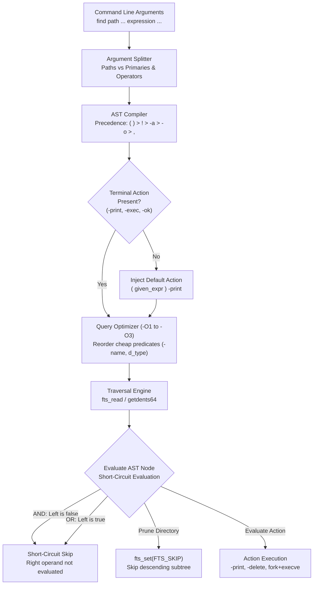

# find Expressions

> [!summary] Claim
> A `find` expression is not a collection of procedural flags but a declarative, short-circuiting Boolean abstract syntax tree evaluated per filesystem inode during directory traversal, whose precedence rules and implicit `-print` insertion turn minor structural omissions into silent data omissions or traversal pruning bugs.

Part of [Coreutils and the Userland](README.md) in [Shell and Unix Engineering](../README.md).

## TL;DR

- Mechanism: `find` walks the filesystem directory tree via `fts(3)` or `readdir(3)`, compiling command-line arguments into a Boolean expression tree evaluated with strict left-to-right short-circuit semantics.
- Rule: Always group logical alternations in escaped parentheses `\( ... \)` and explicitly specify an action such as `-print` or `-print0` to prevent the implicit default `-print` rule from hijacking evaluation.
- Trap: Omitting parentheses in `find . -name "*.txt" -o -name "*.md" -print` binds `-print` strictly to the right operand via higher `-a` precedence, silently discarding all `.txt` files from output.
- Portability fact: The core expression syntax is standardized in `(POSIX.1-2024 find, OPERANDS)`, but utility extensions like `-maxdepth`, `-delete`, `-empty`, and `-printf` vary across GNU, BSD, BusyBox, and uutils implementations.
- When not to use it: Do not use `find` expressions when complex transactional business logic, deep data structures, or atomic in-memory graph traversals are required; use modern language runtimes with `openat(2)`-based directory walking instead.

## Mental model



The `find` utility tokenizes its command-line arguments by separating initial directory path operands from the trailing search expression.
The expression tokens are parsed into a Boolean abstract syntax tree where grouping parentheses have highest precedence, followed by negation `!`, conjunction `-a`, alternation `-o`, and, in GNU and uutils find only, the comma list operator `,`.
If the compiled AST does not contain an explicit terminal action such as `-print`, `-print0`, `-exec`, or `-ok`, the parser automatically rewrites the tree by wrapping the entire expression inside parentheses and appending `-print`.
During filesystem traversal via `fts(3)` or `readdir(3)`, the query engine evaluates this tree against every visited directory entry using strict left-to-right short-circuit evaluation.
If an expression arm evaluates `-prune` on a directory node, the engine instructs the traversal cursor via `fts_set(sp, p, FTS_SKIP)` to bypass descending into that directory's children.

## How it works

The execution of a `find` command operates across three distinct architectural layers: directory hierarchy traversal, expression tree compilation, and per-inode Boolean evaluation.

### Traversal Engine and System Calls

Standard Unix utilities traverse directory trees using one of two fundamental models:
1. Classic recursive traversal: using `opendir(3)`, `readdir(3)`, and `closedir(3)` combined with `chdir(2)` or `fchdir(2)` to track depth.
2. File tree stream (`fts(3)`): implemented in 4.4BSD and adopted by GNU findutils (`ftsfind`), managing tree state through `fts_open(3)`, `fts_read(3)`, and `fts_set(3)`.

At the kernel boundary on Linux, directory contents are fetched via `getdents64(2)`, while FreeBSD libc `readdir` calls `_getdirentries`, which wraps the `getdirentries(2)` system call (FreeBSD `lib/libc/gen/readdir.c`), and macOS libc `readdir` calls `__getdirentries64`, the userland stub for XNU system call 344 `getdirentries64` (Apple Libc `gen/FreeBSD/readdir.c`; XNU `bsd/kern/syscalls.master`).
Both system calls populate a series of `struct dirent` records containing the filename `d_name` and the inode file type `d_type` (such as `DT_REG`, `DT_DIR`, `DT_LNK`, `DT_FIFO`, `DT_SOCK`, `DT_CHR`, `DT_BLK`).
If a `find` expression contains only predicates that inspect the name (such as `-name` or `-iname`) and the file type (`-type`), and the underlying filesystem reports valid `d_type` entries, GNU `find` can evaluate the expression without issuing a `stat(2)` or `fstatat(2)` call per entry, because `ftsfind.c` opens the walk with `FTS_NOSTAT` (findutils `ftsfind.c`, `ftsoptions`).
If the filesystem returns `DT_UNKNOWN` (common on legacy filesystems or certain network file shares), or if the expression queries inode metadata (such as `-size`, `-mtime`, `-perm`, `-links`, or `-user`), `find` executes `fstatat(dirfd, name, &statbuf, flags)`, relative to the directory descriptor that fts keeps open under `FTS_CWDFD` rather than to the process working directory.

### Specification Architecture: POSIX.1-2024

In `(POSIX.1-2024 find, OPERANDS)`, the command line is split into path operands and expression arguments.
The first operand and all subsequent arguments up to, but not including, the first argument starting with a hyphen `-`, or equal to `!` or `(`, are interpreted as directory starting points.
All remaining arguments constitute the expression, which is constructed from primaries (tests and actions) and operators:

- Tests: pure predicates that return true or false without modifying system or utility state (`-name`, `-iname`, `-path`, `-type`, `-size`, `-mtime`, `-atime`, `-ctime`, `-perm`, `-links`, `-user`, `-group`, `-newer`).
- Actions: predicates evaluated for side effects (`-print`, `-print0`, `-exec`, `-ok`, `-prune`).
- Positional and global options: modifiers that alter global search mechanics (`-depth`, `-mount`, `-xdev`).

POSIX.1-2024 (Issue 8) added three of these primaries: `-print0` (Austin Group Defect 243), `-iname` (Defect 1031), and `-mount` (Defect 1133) `(POSIX.1-2024 find, CHANGE HISTORY)`.

Operators govern evaluation order and enforce strict short-circuit logic:
1. `( expression )`: Grouping operator; evaluates to the truth value of the enclosed expression.
2. `! expression`: Unary NOT operator; inverts the Boolean result.
3. `expression [-a] expression`: Conjunction (AND); the second expression is never evaluated if the first expression evaluates to false.
   Juxtaposition of two expressions implies `-a`.
4. `expression -o expression`: Alternation (OR); the second expression is never evaluated if the first expression evaluates to true.
5. `expression , expression`: Comma list operator (GNU and uutils extension; BSD/macOS find rejects it with `,: unknown primary or operator`, measured on the macOS host); evaluates both expressions sequentially, discards the result of the first, and returns the truth value of the second (GNU findutils 4.10.0 printed only `./b.txt` for `-name a.txt , -name b.txt -print`, measured in the Debian matrix image).

### The Default Action Injection Algorithm

A frequent source of critical bugs in shell engineering is the implicit action rule defined in `(POSIX.1-2024 find, OPERANDS)`.
If no expression is present, `-print` is used as the expression.
Otherwise, if the given expression does not contain any of the primaries `-exec`, `-ok`, or `-print`, the given expression is effectively replaced by `( given_expression ) -print`.
The POSIX list was not extended when Issue 8 added `-print0`, so, read literally, an expression whose only action is `-print0` still receives the implicit `-print`; none of the implementations below behaves that way.

GNU find extends this definition to treat any output or mutation action (including `-print0`, `-delete`, `-fls`, `-fprint`, `-fprintf`, `-ls`) as suppressing the default `-print`.
BSD find has no `-fls`, `-fprint`, or `-fprintf`, but its `-ls` also suppresses the default: `find . -name a.txt -ls` printed one line, not two, on the macOS host (its `-print0` and `-delete` are not checked here).
BusyBox 1.37.0 suppresses it for `-print`, `-print0`, `-exec`, `-ok`, `-quit`, and, where built in, `-delete` (`busybox find --help`).
When a developer writes:
```sh
find . -name "*.txt" -o -name "*.md"
```
The expression contains no action primaries.
The parser transforms the AST into:
```sh
( -name "*.txt" -o -name "*.md" ) -print
```
However, if the developer attempts to make the action explicit by appending `-print`:
```sh
find . -name "*.txt" -o -name "*.md" -print
```
Because `-print` is now explicitly present, the default injection rule does not run.
Because binary conjunction `-a` has higher precedence than alternation `-o`, the parser evaluates the tokens as:
```sh
-name "*.txt" -o ( -name "*.md" -a -print )
```
When `find` evaluates a file ending in `.txt`, the left branch `-name "*.txt"` evaluates to true.
Because the operator is `-o`, the right branch `( -name "*.md" -a -print )` is short-circuited and skipped completely.
Consequently, `-print` never executes for `.txt` files, and they are silently dropped from stdout.

### `-prune` Mechanics and the Traversal Tree

The `-prune` primary is an action that modifies tree traversal.
By specification `(POSIX.1-2024 find, OPERANDS)`, `-prune` always evaluates to true.
Its operational side effect is setting an internal traversal flag that tells the directory walker not to descend into the current pathname if it is a directory.
Under `fts(3)`, this executes `fts_set(sp, current_entry, FTS_SKIP)`.

Two critical behaviors govern `-prune`:
1. The `-depth` conflict:
POSIX specifies that if `-depth` is specified, `-prune` has no effect.
Under `-depth` (post-order traversal, `FTS_DP`), `find` visits all entries inside a directory before visiting the directory itself.
By the time the directory entry is evaluated against the `-prune` predicate, its child hierarchy has already been read and processed.
2. The canonical filtering idiom:
Because `-prune` returns true, it must be paired with `-o` to avoid printing the pruned directory itself.
To skip a directory named `.git` and print all other files:
```sh
find . -name .git -prune -o -print
```
When `find` encounters `.git`, `-name .git` is true, so `-prune` executes, halts recursion into `.git`, and returns true.
Because the left operand of `-o` is true, the right operand `-print` is short-circuited, and `.git` is omitted from stdout.
For any file not named `.git`, the left branch is false, causing the engine to evaluate the right branch `-print`.
A `-path` pattern must equal the path exactly as `find` prints it: `find . -path ./.git -prune -o -type f -print` prunes the directory, while `-path './.git/'` matches nothing and so prunes nothing (measured on GNU findutils 4.10.0, which also warns `-path ./.git/ will not match anything because it ends with /`, and on the macOS host, which stays silent).
If a developer writes `find . -name .git -prune` without `-o -print`, the default action algorithm kicks in and rewrites the command as `( -name .git -a -prune ) -a -print`, printing only `.git` and completely suppressing every other file in the hierarchy.

### GNU Query Optimizer (-O0 to -O3)

GNU findutils incorporates a cost-based query optimizer implemented in `find/tree.c`; there is no `opt.c` in the findutils `find/` directory (source tree listing, as of 2026-11).
The optimizer categorizes predicates into distinct cost bands, which `find -D tree` prints as `cost=` labels (findutils 4.10.0, measured in the Debian matrix image):
- `cost=Nothing`: tests evaluated from the name alone without system calls (`-name`, `-regex` measured; `-iname` by the same rule, not measured).
- `cost=Type`: tests evaluated from `dirent.d_type` if supported by the filesystem (`-type`); `-xtype` is `cost=StatInfo`, because it must follow the link.
- `cost=StatInfo`: tests requiring an inode metadata fetch via `fstatat(2)` (`-size`, `-mtime`, `-empty`, `-xtype` measured; `-atime`, `-ctime`, `-perm`, `-user`, `-group`, `-links` by the same rule).
- `cost=AccessInfo`: tests that need an `access(2)`-style permission check (`-readable`); there is no `cost=Custom` band.
- Side-effect predicates: nodes that alter external state or print output, flagged `side effects` in the dump (`-print` at `cost=Nothing`, `-delete` at `cost=SyncDiskHit`, `-exec ... ;` at `cost=ImmediateExec`, `-exec ... {} +` at `cost=EventualExec`).

The optimizer operates under three active levels (as of findutils 4.11.0, 2026-11); `-O0` is documented as equivalent to `-O1` (GNU `find.1`, `-Olevel`):
- `-O1` (Default): expressions are reordered so that tests based only on filenames (`-name`, `-regex`) run before any tests requiring inode data.
- `-O2`: `-type` and `-xtype` tests are executed after filename tests but before any predicate requiring `stat(2)`, maximizing the chance of short-circuiting before invoking `fstatat(2)`.
  `find.1` promises only that, but findutils 4.10.0 at `-O2` also ran its arm-swap pass on `-readable -empty` (`-D opt` printed `Performing arm swap on:`) and put the cheaper `-empty` first, as `-O3` does; `-O1` left the order alone (measured in the Debian matrix image).
- `-O3`: full cost-based optimization where predicates within conjunction lists `-a` are ordered by ascending cost and descending probability of failure, and predicates within alternation lists `-o` are ordered by ascending cost and descending probability of success.
Side-effect predicates constrain the reordering: GNU `find.1` promises only that "predicates with side effects are not reordered relative to each other", so the overall effect of the expression is preserved.

### The Leaf Optimization (-noleaf)

On classic Unix filesystems (such as UFS and ext2/3/4), a directory's hard link count `st_nlink` adheres to a strict invariant:
- 1 link from its parent directory entry.
- 1 link from its own `.` entry.
- 1 link from each child subdirectory's `..` entry.

Under this invariant, the number of child subdirectories inside directory `D` is exactly `D.st_nlink - 2`.
In the classic scheme the GNU manual describes under `-noleaf`, when `find` scans `D`, after it has identified and statted `st_nlink - 2` subdirectories, it knows that all remaining entries in `D` are leaf files (regular files, symlinks, FIFOs, sockets).
It can therefore skip calling `stat(2)` on all remaining entries when searching for subdirectories.
However, some copy-on-write, network, and foreign filesystems violate this invariant.
Btrfs reports `st_nlink = 1` for every directory it creates: the VFS starts a new inode at `__i_nlink = 1` (Linux `fs/inode.c`, `inode_init_always_gfp`), and in `fs/btrfs/inode.c` the only `inc_nlink` call is the hard-link path `btrfs_link`, so `btrfs_mkdir` never raises it and creating a subdirectory does not bump the parent.
The GNU manual names CD-ROM, MS-DOS, and AFS volume mount points as filesystems that do not follow the Unix directory-link convention (GNU `find.1`, `-noleaf`).
Under the classic counting scheme, an under-reported `st_nlink` makes `find` treat real subdirectories as leaf files and skip them entirely, which is what `-noleaf` was added to prevent.
Current GNU find no longer counts: it traverses with gnulib `fts`, whose `fts_build()` treats a directory as lacking subdirectories only when `st_nlink == MIN_DIR_NLINK` (2) under `FTS_NOSTAT | FTS_PHYSICAL`, and whose `leaf_optimization()` returns `NO_LEAF_OPTIMIZATION` for an unknown filesystem type, AFS, CIFS, NFS, and `/proc` (gnulib `lib/fts.c`).
A Btrfs directory with `st_nlink = 1` therefore never triggers the shortcut, and the `no_leaf_check` flag that `-noleaf` sets (`util.c`) is not read by `ftsfind.c`, so in findutils 4.10 `-noleaf` is accepted for compatibility but the safety decision lives in gnulib.

## Numbers and limits

The limits, buffer sizes, and evaluation thresholds governing `find` expressions across operating systems and implementations are detailed below.

| Parameter / Constraint | Value / Limit | Implementation / Spec | Source / Measurement |
| :--- | :--- | :--- | :--- |
| Default query optimization | Level 1 (`-O1`); `-O0` equals `-O1` | GNU findutils | `(GNU find.1, -Olevel, 2026-11)` |
| Time integer division unit | 86,400 seconds (24 h) | POSIX.1-2024 | `(POSIX.1-2024 find, OPERANDS)` |
| Minute integer division unit | 60 seconds (1 m) | GNU / BSD / BusyBox | `(findutils parser.c, do_parse_xmin)`; BSD and BusyBox `find(1)` |
| Block size (`-size n` without unit) | 512 bytes | POSIX.1-2024 | `(POSIX.1-2024 find, OPERANDS)` |
| Byte size (`-size nc` unit) | 1 byte | POSIX.1-2024 | `(POSIX.1-2024 find, OPERANDS)` |
| File size unit `k` | 1,024 bytes (KiB) | GNU / BSD / BusyBox / uutils | GNU `find.1` and macOS `find(1)` `-size`; BusyBox `find_suffixes` in `findutils/find.c`; uutils `size.rs` |
| File size unit `M` | 1,048,576 bytes (MiB) | GNU / BSD / uutils (BusyBox 1.37.0 has no `M`) | GNU `find.1`, macOS `find(1)`, uutils `size.rs`, BusyBox `find_suffixes` |
| File size unit `G` | 1,073,741,824 bytes (GiB) | GNU / BSD / uutils (BusyBox 1.37.0 has no `G`) | GNU `find.1`, macOS `find(1)`, uutils `size.rs`, BusyBox `find_suffixes` |
| File size unit `w` | 2 bytes | GNU / BusyBox / uutils (not in macOS `find(1)`'s `ckMGTP`) | GNU `find.1`; BusyBox `find_suffixes` (accepted although its usage text lists `N[bck]`); uutils `size.rs` |
| `-size` rounding | GNU and uutils round the size up to whole units for every suffix; macOS rounds up only the unsuffixed 512-byte block count and compares a suffixed `n` exactly against `n` scaled; BusyBox compares exactly for every form | Measured on a 1025-byte file: `2k` matches only under GNU, `3` matches under GNU and macOS but not BusyBox, `-2k` matches under macOS and BusyBox but not GNU | GNU `pred_size` in `pred.c`; uutils `byte_size_to_unit_size`; macOS `find(1)`; BusyBox `ACTF(size)`; lab test `size on a 1025-byte file: GNU rounds up to whole units, BSD and BusyBox compare scaled units exactly` |
| Octal mode bitmask ceiling | `07777` | POSIX.1-2024 | `(POSIX.1-2024 find, OPERANDS)` |
| Linux stdout pipe buffer | 65,536 bytes (64 KiB) | Linux 6.x | Measured in shell matrix |
| macOS stdout pipe buffer | 16,384 bytes -> 65,536 bytes | macOS host, Darwin 27 | Measured in shell matrix |
| Directory link offset (leaf rule) | `st_nlink - 2` (gnulib fts acts only at `st_nlink == 2`) | Classic Unix filesystems | GNU `find.1` `-noleaf`; `(gnulib fts.c, MIN_DIR_NLINK, 2026-11)` |
| Command line batch limit | Bound by system `{ARG_MAX}` | POSIX.1-2024 (`-exec ... {} +`) | `(POSIX.1-2024 find, OPERANDS)` |

## Portability

The shell under test does not change which `find` binary executes, as `find` is an external utility across all Unix platforms rather than a shell builtin.
However, the calling shell directly controls word splitting, pathname expansion, argument sanitization, and signal propagation when invoking `find`.
Unquoted glob wildcards such as `find . -name *.txt` undergo immediate pathname expansion in POSIX sh, bash, dash, ksh93, mksh, yash, posh, and zsh, causing `find` to fail if more than one matching file exists in the working directory: GNU find reports `paths must precede expression:` followed by the stray name `b.txt`, and BSD find reports `b.txt: unknown primary or operator`, both with status 1 (measured in the Debian matrix image and on the macOS host).
Native zsh additionally aborts the command with `no matches found` when the pattern matches nothing (measured with zsh on the macOS host).
Unquoted variable expansions such as `find $DIR` undergo field splitting on `IFS` whitespace across all shells except native zsh, which preserves unquoted variables intact unless `SH_WORD_SPLIT` is active or running under `zsh --emulate sh`.
Passing an empty variable `find "$DIR"` causes all shells to pass an empty string `""` as an argument, which `find` rejects with a non-zero exit status (BSD find on the macOS host: `find: : No such file or directory`, status 1).
If `$DIR` expands to a string starting with a hyphen (such as `-v`), all shells pass the token directly as `argv[1]`, causing `find` to misinterpret the path operand as an expression primary unless safely prefixed as `./$DIR`.
When `find` is interrupted via `SIGINT` (Ctrl+C), signal exit status conventions differ across shell families: bash, dash, mksh, and BusyBox ash report 130 (`128 + 2`), ksh93 reports 258 (`256 + 2`), and yash reports 386 (`384 + 2`), following the `128 + N`, `256 + N`, and `384 + N` conventions measured in the shell matrix.

The table below contrasts expression primaries, operators, and options across the POSIX specification and the major Unix userlands.

| Feature / Predicate | POSIX.1-2024 | GNU findutils | BSD / macOS find | BusyBox find | uutils find |
| :--- | :--- | :--- | :--- | :--- | :--- |
| `-name` / `-path` | Yes | Yes | Yes | Yes | Yes |
| `-iname` | Yes (Issue 8, Defect 1031) | Yes | Yes | Yes | Yes |
| `-wholename` | No (use `-path`) | Yes (alias to `-path`) | Yes (alias to `-path`) | No | Yes |
| `-print0` | Yes (Issue 8, Defect 243) | Yes | Yes | Optional (`CONFIG_FEATURE_FIND_PRINT0`); present in the Alpine and Debian 1.37.0 builds | Yes |
| `-delete` | No | Yes (implies `-depth`) | Yes (implies `-depth`) | Optional (`CONFIG_FEATURE_FIND_DELETE`); present in Alpine 1.37.0, absent from the Debian 1.37.0 build | Yes (implies `-depth`) |
| `-maxdepth` / `-mindepth` | No (use `-prune`) | Yes | Yes | Yes | Yes |
| `-exec ... {} +` | Yes | Yes | Yes | Yes (1.37.0; `CONFIG_FEATURE_FIND_EXEC_PLUS`, default y) | Yes (`MultiExecMatcher` in `matchers/mod.rs`) |
| `-execdir` | No | Yes (substitutes `./name`) | Yes (substitutes bare `name`) | No | Yes |
| `-empty` | No | Yes | Yes | Optional (`CONFIG_FEATURE_FIND_EMPTY`); present in both 1.37.0 builds | Yes |
| `-printf` | No | Yes | No (use `-print0` or `stat`) | No (absent from the 1.37.0 builds) | Yes |
| `--` delimiter for paths | `--` ends options only (XBD 12.2 Guideline 10); a first operand starting with `-` is unspecified | `--` ends leading options; `find -- -v` still fails (`unknown predicate`) | `--` ends options (`getopt`); `find -- -v` still fails (usage error) | `--` accepted; `find -- -v` still fails (`unrecognized: -v`) | `--` ends leading options (`parse_args` in `src/find/mod.rs`); a hyphen-led operand after it still starts the expression (unit test `parse_double_dash_then_flag`) |
| `-f path` for `-*` paths | No | No | Yes | No | No |
| `-mount` vs `-xdev` | Both (Issue 8 added `-mount`, Defect 1133) | Both supported | Both supported (`-mount` is an alias) | Supports `-xdev` only | Both supported (aliases) |
| `-Olevel` optimizer | No | Yes (`-O0` to `-O3`) | No | No | `-O0` to `-O3` accepted and ignored (`parse_args`) |

Sources for the table: the POSIX.1-2024 `find` page; `find --help` and `-D tree` for GNU findutils 4.10.0 and `busybox find --help` for BusyBox 1.37.0 in the Debian and Alpine matrix images; `man find` and direct runs for BSD find on the macOS host; the uutils primary table in `src/find/matchers/mod.rs` (as of 2026-11).
The `--` row was measured with GNU, BSD, and BusyBox find (lab tests `double dash ends leading options and still accepts a path operand` and `double dash does not turn a hyphen-led operand into a path`) and read from source for uutils.
The `-f` cells were measured for GNU (`unknown predicate`) and BusyBox (`unrecognized: -f`), and uutils `parse_args` has no `-f` handling; the BusyBox `CONFIG_` symbol names come from the `config` comments in `findutils/find.c`.

## Worked example

The worked example script and test suite below demonstrate the operator precedence bug, the default `-print` injection rule, `-prune` semantics, `-depth` interactions, and safe path handling for filenames starting with a hyphen.
The complete suite is located in the [lab](../labs/08-find-expressions/).

The lab test script `labs/08-find-expressions/find_eval.sh`:

```sh
#!/bin/sh
set -eu

mode="${1:-}"
dir="${2:-.}"

case "$mode" in
  precedence_unparenthesized)
    # shellcheck disable=SC2146 # intentionally demonstrating the unparenthesized -o precedence pitfall
    find "$dir" -name "*.txt" -o -name "*.md" -print | sort
    ;;
  precedence_parenthesized)
    find "$dir" \( -name "*.txt" -o -name "*.md" \) -print | sort
    ;;
  default_print)
    find "$dir" -name "*.txt" -o -name "*.md" | sort
    ;;
  prune_bare)
    find "$dir" -name "skip" -prune | sort
    ;;
  prune_correct)
    find "$dir" -name "skip" -prune -o -name "*.txt" -print | sort
    ;;
  prune_depth)
    find "$dir" -depth -name "skip" -prune -o -name "*.txt" -print | sort
    ;;
  short_circuit)
    trace_file="${3:?missing trace file}"
    find "$dir" -name "*.txt" -exec sh -c 'printf "%s\n" "$1" >> "$2"' _ {} "$trace_file" \;
    ;;
  safe_path)
    target="$dir"
    case "$target" in
      -*) target="./$target" ;;
      *) ;;
    esac
    find "$target" -name "*.txt" | sort
    ;;
  double_dash)
    find -- "$dir" -name "*.txt" | LC_ALL=C sort
    ;;
  double_dash_hyphen)
    # `--` ends the leading options only, so a hyphen-led operand is still read as an expression.
    if find -- "$dir" >/dev/null 2>&1; then
      printf 'accepted\n'
    else
      printf 'rejected\n'
    fi
    ;;
  delete_prune)
    # -delete implies -depth, which makes -prune a no-op; GNU find refuses this combination outright.
    find "$dir" -name "skip" -prune -o -name "*.txt" -delete
    find "$dir" | LC_ALL=C sort
    ;;
  delete_prune_depth)
    find "$dir" -depth -name "skip" -prune -o -name "*.txt" -delete
    find "$dir" | LC_ALL=C sort
    ;;
  size_units)
    for spec in 1k 2k 1025c 3 -2k +1k; do
      hits=$(find "$dir" -name "sized.bin" -size "$spec")
      if [ -n "$hits" ]; then
        printf '%s yes\n' "$spec"
      else
        printf '%s no\n' "$spec"
      fi
    done
    ;;
  *)
    printf 'Unknown mode: %s\n' "$mode" >&2
    exit 1
    ;;
esac
```

When evaluated against a test fixture directory containing `a.txt`, `b.md`, `c.log`, a 1025-byte `sized.bin`, a pruned directory `skip/nested.txt`, and a directory named `-v/dash.txt`, the captured output matches the assertions in `find_eval.bats` (captured by running `find_eval.sh` once per mode on a fresh fixture under `/bin/sh` with BSD find on the macOS host, 2026-11-15; the `short_circuit` mode writes to a trace file and is omitted, and under GNU find `delete_prune` exits 1 with the refusal quoted in the pitfalls and `size_units` prints `2k yes`, `3 yes`, and `-2k no`):

```text
=== Mode: precedence_unparenthesized ===
tree/b.md

=== Mode: precedence_parenthesized ===
tree/-v/dash.txt
tree/a.txt
tree/b.md
tree/skip/nested.txt

=== Mode: default_print ===
tree/-v/dash.txt
tree/a.txt
tree/b.md
tree/skip/nested.txt

=== Mode: prune_bare ===
tree/skip

=== Mode: prune_correct ===
tree/-v/dash.txt
tree/a.txt

=== Mode: prune_depth ===
tree/-v/dash.txt
tree/a.txt
tree/skip/nested.txt

=== Mode: safe_path (target: -v) ===
./-v/dash.txt

=== Mode: double_dash ===
tree/-v/dash.txt
tree/a.txt
tree/skip/nested.txt

=== Mode: double_dash_hyphen (target: -v) ===
rejected

=== Mode: delete_prune ===
tree
tree/-v
tree/b.md
tree/c.log
tree/sized.bin
tree/skip

=== Mode: delete_prune_depth ===
tree
tree/-v
tree/b.md
tree/c.log
tree/sized.bin
tree/skip

=== Mode: size_units ===
1k no
2k no
1025c yes
3 yes
-2k yes
+1k yes
```

## Pitfalls

> [!warning] Unparenthesized alternation with `-print`
> Trigger: Running `find . -name "*.txt" -o -name "*.md" -print`.
> Symptom: Files matching the first pattern (`*.txt`) are evaluated as true, short-circuiting the right-hand branch containing `-print`, so only `*.md` files are printed.
> Fix: Group alternating predicates inside escaped parentheses: `find . \( -name "*.txt" -o -name "*.md" \) -print`.

> [!warning] Bare `-prune` without alternation and explicit print
> Trigger: Attempting to exclude a directory by writing `find . -name .git -prune`.
> Symptom: The command prints only `.git` and silently suppresses every other directory and file in the filesystem.
> Fix: Pair `-prune` with `-o -print`: `find . -name .git -prune -o -print`.

> [!warning] `-prune` negated by `-depth` or `-delete`
> Trigger: Running `find . -depth -name target_dir -prune -o -print` or `find . -name target_dir -prune -o -name '*.tmp' -delete`.
> Symptom: With `-depth` the directory is fully traversed and its children are printed or deleted despite `-prune`.
> With `-delete` and no explicit `-depth`, GNU findutils 4.10.0 refuses to run (`The -delete action automatically turns on -depth, but -prune does nothing when -depth is in effect`, exit status 1; `parser.c`, Savannah bug 20865), while macOS find and BusyBox find (Alpine build) run it and delete the matches inside the pruned directory (measured; lab test `delete implies depth: GNU refuses -prune with -delete, BSD and BusyBox let it delete inside the skipped directory`).
> Writing `-depth` explicitly silences the GNU refusal but not the effect (lab test `explicit depth with prune and delete removes matches inside the skipped directory on every find`).
> Fix: Never combine `-prune` with post-order traversal (`-depth`) or `-delete` (which implicitly forces `-depth`); run a separate pre-order pass to prune or collect targets.

> [!warning] Shell pathname expansion of unquoted patterns
> Trigger: Running `find . -name *.log` in an interactive shell or script where `*.log` matches files in the current working directory.
> Symptom: The shell expands `*.log` into multiple arguments before `find` executes, causing `find` to fail with `find: paths must precede expression` or syntax error diagnostics.
> Fix: Quote all wildcards and glob patterns: `find . -name '*.log'`.

> [!warning] Path arguments starting with a hyphen
> Trigger: Running `find "$dir"` when `$dir` contains a relative directory name such as `-backup` or `-v`.
> Symptom: `--` does not help: GNU, BSD, and BusyBox find accept it only as the end of the leading options (`-H`, `-L`, `-P`), so `find -- -backup` still parses `-backup` as an expression primary, failing with a usage, unknown predicate, or unrecognized error (measured in the matrix images and on the macOS host).
> Fix: Sanitize dynamic relative paths by prefixing them with `./`: `case "$dir" in -*) dir="./$dir" ;; esac`.

> [!warning] TOCTOU race conditions and directory mutation during `-delete`
> Trigger: Running automated cron cleanup jobs such as `find /tmp -type f -mtime +7 -delete` across shared or world-writable directories.
> Symptom: An unprivileged local attacker replaces a directory with a symlink between the check (`fstatat`) and the unlink (`unlinkat`), tricking root into deleting arbitrary system files (CWE-367, TOCTOU race condition).
> Fix: Avoid running recursive delete operations on shared multi-user directories; use directory descriptors, private namespaces, or tools that guarantee `O_NOFOLLOW` tree traversal.

## Security and robustness

Designing production-grade pipelines with `find` requires rigorous defense against command injection, path manipulation, and filesystem race conditions.

### Preventing Command Injection in `-exec`

A catastrophic security anti-pattern in shell scripts is interpolating `{}` directly into an embedded shell string:
```sh
# VULNERABLE: Malicious filenames execute arbitrary shell commands
find /var/spool/uploads -type f -exec sh -c "echo Processing file: {}" \;
```
If an attacker uploads a file named `file; rm -rf / ;.txt`, the shell executed by `sh -c` evaluates the filename as shell code.
The robust, secure pattern passes `{}` as a positional parameter outside the shell script body:
```sh
# SECURE: Filename is passed as an isolated positional parameter
find /var/spool/uploads -type f -exec sh -c 'printf "Processing: %s\n" "$1"' _ {} \;
```
In this pattern, the filename is passed directly via the `argv` array to `execve(2)`.
The shell receives it strictly in `$1`, completely eliminating the possibility of shell meta-character injection.

### Traversal Race Conditions and Descriptor Walking

Standard directory traversal is vulnerable to Time-Of-Check to Time-Of-Use (TOCTOU) races.
If an attacker can alter the directory tree while `find` is executing, they can swap a subdirectory for a symlink to `/etc` or `/var`.
Modern implementations of `find` mitigate this by utilizing POSIX descriptor-relative system calls:
- Opening directories with `O_DIRECTORY | O_NOFOLLOW | O_CLOEXEC`.
- Fetching metadata using `fstatat(dirfd, entry, &st, AT_SYMLINK_NOFOLLOW)`.
- Deleting entries using `unlinkat(dirfd, entry, is_dir ? AT_REMOVEDIR : 0)`.

GNU findutils uses gnulib `fts` with `openat(2)` support, opened with `FTS_CWDFD` and `FTS_TIGHT_CYCLE_CHECK` (findutils `ftsfind.c`), preventing directory replacement attacks during descent.
Furthermore, POSIX requires implementations to detect directory cycle loops (created by bind mounts or hard-linked directories).
When an infinite loop is detected, `find` outputs a diagnostic to `stderr` and either terminates or recovers its position, and in either case the final exit status is non-zero `(POSIX.1-2024 find, DESCRIPTION)`; the non-zero status after recovery was made explicit by Austin Group Defect 1606.

### Safe Execution with `-execdir`

GNU find and BSD find support `-execdir`:
Unlike `-exec`, which invokes the target command from the directory where `find` was launched, `-execdir` changes the working directory into the subdirectory containing the matched file before executing the command.
GNU find substitutes `./filename` for `{}` rather than the full relative or absolute path, while BSD find substitutes the bare `filename` (macOS `find(1)`: "The filename substituted for the string {} is not qualified"); both were measured with `-execdir echo {} \;` (`./dash.txt` in the Debian image, `dash.txt` on the macOS host).
This drastically reduces path length bloat and prevents path-spoofing attacks during execution.
However, `-execdir` introduces a security requirement: GNU find explicitly refuses to run `-execdir` if the current `PATH` environment variable contains an empty entry, a relative directory, or `.`, preventing local binary hijacking (CWE-426); findutils 4.10.0 exits 1 with `The current directory is included in the PATH environment variable, which is insecure in combination with the -execdir action of find` for `.` or an empty entry, and `The relative path 'bin' is included in the PATH environment variable` for a relative entry (measured in the Debian matrix image).

## The principal's view

At staff and principal engineering levels, `find` represents a dual-edged abstraction: it is universally present on every Unix server and container image, yet its domain-specific query language contains non-obvious Boolean algebra pitfalls that frequently cause production incidents.

When auditing or architecting production infrastructure, enforce these principles:
1. Static analysis gates: enable ShellCheck rules SC2146 (unparenthesized `-o` with `-print`), SC2156 (injecting `{}` into `sh -c`), and SC2061 (unquoted `-name` pattern the shell may expand) in all CI/CD linters (all three reported by ShellCheck 0.11.0 on the corresponding snippets).
2. The Boundary of Shell: for developer CLI tooling on engineering workstations, prefer modern tools like `fd`, which ignore patterns from `.gitignore` by default, use parallelized directory traversal, and take a regular expression (or a glob with `--glob`) instead of the `find` expression grammar (`fd` README).
3. The Boundary of Systems Programming: if a data pipeline requires complex filtering, transactional file processing, or atomic rollbacks across hundreds of thousands of files, abandon shell scripts entirely.
   Implement the traversal in Go using `filepath.WalkDir`, Rust using the `walkdir` crate, or Python using `os.scandir`.
   These interfaces avoid process spawning overhead, provide structured error recovery, and eliminate shell argument parsing ambiguities entirely.

## Interview questions

> [!question] L5: Predict the output of `find . -name "*.c" -o -name "*.h" -print` in a directory containing `main.c` and `header.h`.
>
> > [!success]- Answer
> > The output will display only `header.h`, omitting `main.c` completely.
> > Conjunction (`-a`) has higher precedence than alternation (`-o`), so the command is parsed as `-name "*.c" -o ( -name "*.h" -a -print )`.
> > For `main.c`, the left branch evaluates to true, short-circuiting the right branch where `-print` resides.
> >
> > Follow-up: How do you fix the expression so that both files are printed portably?

> [!question] L5: Why does `find . -name "*.txt" -o -name "*.md"` print both file types, while adding `-print` breaks it?
>
> > [!success]- Answer
> > When no action primary is present in the expression, `find` automatically applies the POSIX default action rule.
> > The rule wraps the entire expression inside parentheses and appends `-print`: `( -name "*.txt" -o -name "*.md" ) -print`.
> > Adding `-print` to the command without parentheses removes the default injection rule, exposing the higher precedence of `-a` over `-o`.
> >
> > Follow-up: Which specific primaries suppress the implicit `-print` injection rule in POSIX?

> [!question] L6: Debug this script: an engineer wrote `find /data -name cache -prune -o -name "*.tmp" -delete` to clean up temporary files, but reports that files inside `cache` are being deleted.
>
> > [!success]- Answer
> > The `-delete` action implicitly turns on the `-depth` option (post-order traversal) across the entire expression.
> > By specification, when `-depth` is active, the `-prune` primary has no effect because children are visited before the directory entry itself.
> > Consequently, `find` descends into the `cache` directory and deletes any matching `.tmp` files found inside it.
> > GNU findutils would have caught this: it exits 1 with `The -delete action automatically turns on -depth, but -prune does nothing when -depth is in effect` unless `-depth` is written explicitly, so the report points at macOS find, BusyBox find, or a script that added `-depth` to silence that error.
> > The fix requires separating the pruning pass from the deletion pass, or using `-exec rm -f {} +` without `-depth`.
> >
> > Follow-up: What system call sequence does `-delete` use under the hood, and why does it require post-order traversal?

> [!question] L6: How does `dirent.d_type` optimize `find` performance, and when does it fail?
>
> > [!success]- Answer
> > Modern kernel directory reads return the inode file type directly within `struct dirent`, avoiding separate `stat(2)` calls for `-type` and `-name`.
> > If a search expression checks only names and file types, `find` can traverse millions of files using only `getdents64(2)` or `getdirentries(2)`.
> > This optimization fails when the underlying filesystem does not populate `d_type` (returning `DT_UNKNOWN`), or when predicates inspect inode metadata like `-size` or `-mtime`.
> >
> > Follow-up: How does GNU find's query optimizer leverage `d_type` under optimization level `-O2`?

> [!question] L6: Explain why `find "$DIR"` fails when `$DIR` begins with a hyphen, and describe the POSIX-compliant remediation.
>
> > [!success]- Answer
> > The `--` delimiter does not help: `find` conforms to the Utility Syntax Guidelines, so `--` ends its options (`-H`, `-L`), but the operand rule still applies to whatever follows.
> > Any initial operand starting with a hyphen `-` is interpreted as the beginning of the search expression rather than a path operand (POSIX leaves a first operand starting with `-` unspecified).
> > If `$DIR` contains `-v`, `find` attempts to parse `-v` as an option or predicate, resulting in an unknown predicate or syntax error.
> > The portable remediation is prefixing dynamic relative paths with `./`, ensuring the first character is always a dot.
> >
> > Follow-up: Does BSD find provide an alternative mechanism for specifying paths starting with a dash?

> [!question] L7: Explain the leaf optimization (`st_nlink - 2`) in `find`, why it fails on Btrfs, and how GNU find handles it.
>
> > [!success]- Answer
> > On traditional Unix filesystems, a directory's `st_nlink` count equals 2 plus the number of child subdirectories.
> > Once `find` has statted `st_nlink - 2` subdirectories in a directory, it treats all remaining entries as leaf non-directories without calling `stat(2)`.
> > Btrfs reports `st_nlink = 1` for the directories it creates, breaking this invariant (Linux `fs/inode.c` initializes `__i_nlink = 1`, and `fs/btrfs/inode.c` calls `inc_nlink` only in `btrfs_link`).
> > A naive counting implementation would then assume zero subdirectories and fail to descend, which is why `-noleaf` exists; current GNU find avoids this without the flag, because gnulib `fts` takes the shortcut only when `st_nlink == 2` and `leaf_optimization()` disables it for unknown, AFS, CIFS, NFS, and `/proc` filesystems, so a link count of 1 never triggers it (gnulib `lib/fts.c`).
> >
> > Follow-up: What is the computational complexity difference between leaf-optimized traversal and raw stat traversal in a flat directory of 100,000 files?

> [!question] L7: Describe the cost-based query optimization algorithm in GNU findutils (`-O3`), and explain how it can alter observable script behavior.
>
> > [!success]- Answer
> > GNU find compiles expressions into an AST and categorizes predicates into cost bands that `find -D tree` prints, from `cost=Nothing` (`-name`) through `cost=Type` and `cost=StatInfo` to `cost=AccessInfo` (`-readable`), with actions at `cost=SyncDiskHit` (`-delete`) and `cost=ImmediateExec` (`-exec ... ;`).
> > At `-O3`, the engine reorders pure predicates in conjunction chains by ascending cost and descending failure probability to maximize short-circuiting speed.
> > This reordering can alter user-visible behavior when predicates have observable error side effects, such as running `-empty -readable` versus `-readable -empty`.
> > Measured with findutils 4.10.0 as a non-root user on a tree with one mode-000 directory: `-readable -empty` printed one `Permission denied` diagnostic at `-O0` and `-O1` (from the traversal itself), while `-empty -readable` printed two, because `-empty` emits its own diagnostic for that directory.
> > At `-O2` and `-O3` the optimizer moves the cheaper `-empty` (`cost=StatInfo`) ahead of `-readable` (`cost=AccessInfo`), so `-readable -empty` printed two diagnostics too, and the user's written order no longer protects `-empty` from the unreadable directory.
> >
> > Follow-up: Why does GNU find promise that predicates with side effects, such as `-print` and `-exec`, are never reordered relative to each other?

> [!question] L7: Analyze the TOCTOU vulnerability in `find /tmp -type f -delete`, and detail how modern userlands harden directory walking.
>
> > [!success]- Answer
> > Between the time `find` checks a file's metadata (`stat`) and the time it deletes it (`unlink`), an attacker can replace the file or directory with a symlink.
> > If `find` operates on absolute pathnames, an attacker can redirect the deletion to an arbitrary system target like `/etc/passwd`.
> > Modern implementations mitigate this by traversing using directory file descriptors via `openat(2)` with `O_DIRECTORY | O_NOFOLLOW`.
> > All file operations are performed relative to the open directory descriptor using `fstatat(2)` with `AT_SYMLINK_NOFOLLOW` and `unlinkat(2)`, which never follows a symlink in the final component and accepts only `AT_REMOVEDIR` as a flag.
> >
> > Follow-up: How does POSIX require `find` to handle directory loop detection when symbolic links or bind mounts introduce circular hierarchies?

## Related

Prerequisites: [[Userland-Portability-Traps]]

Next: [[find-print0-and-exec-Plus]]

See also: [[File-Discovery-and-Batch-Execution-Find-Fd-Xargs-Parallel]]

## Further reading

- POSIX.1-2024 `find` Specification (`https://pubs.opengroup.org/onlinepubs/9799919799/utilities/find.html`): The definitive standard for `find` operand parsing, primary evaluation, precedence, and default action injection.
- GNU findutils Manual (`https://www.gnu.org/software/findutils/manual/html_node/find_html/`): Authoritative documentation on GNU extensions, `-printf` formatting, leaf optimization, and query optimization levels `-O1` through `-O3`.
- FreeBSD `find(1)` Manual Page: Details BSD-specific traversal flags (`-f`, `-x`, `-s`, `-d`), regular expression dialect controls (`-E`), and safe xargs interaction (`-X`).
- Austin Group Defect 243: The formal defect report that standardized the `-print0` primary in POSIX.1-2024 Issue 8 (listed in the `find` page's CHANGE HISTORY).
- GNU findutils Source Code (`tree.c`, `parser.c`, `pred.c`): Source implementation of the predicate parser, the cost-based optimizer and arm-swap pass, and the predicate evaluators.
