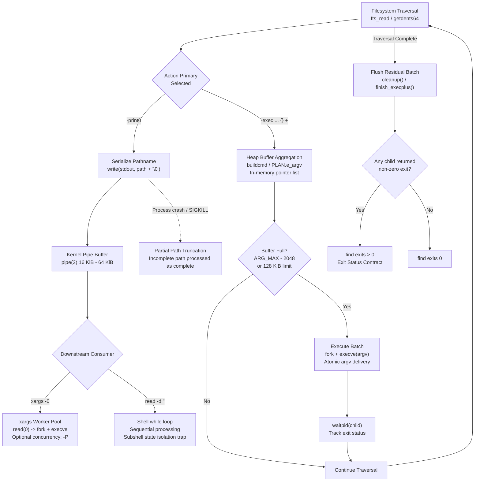

# find -print0 and -exec +

> [!summary] Claim
> Batch file processing in Unix operates under two fundamentally different architectural paradigms: stream-based pipeline decoupling via NUL-delimited serialization (`-print0` piped to `xargs -0` or `read -d ''`), which scales concurrently across processes but introduces partial-write truncation hazards and pipeline exit status masking, versus in-process argument aggregation (`-exec ... {} +`), which guarantees atomic `argv` delivery and strict non-zero exit aggregation bounded by system `{ARG_MAX}` at the cost of serial execution and rigid syntax constraints.

Part of [Coreutils and the Userland](README.md) in [Shell and Unix Engineering](../README.md).

## TL;DR

- Mechanism: `find -print0` serializes pathnames separated by `\0` bytes into a standard output pipe, whereas `find -exec ... {} +` aggregates matched pathnames in memory to invoke commands with batched `argv` arrays up to system `{ARG_MAX}` limits.
- Rule: Default to `find -exec ... {} +` for synchronous atomic batch execution; use `find -print0 | xargs -0 -P <n>` only when process-level concurrency or fine-grained worker batching is required.
- Trap: The terminator `+` is recognized only when it immediately follows an argument containing exclusively `{}`; placing extra tokens after `{}` turns `+` into a literal argument, and GNU, BSD, and uutils `find` then abort with a syntax error, while BusyBox `find` accepts any standalone `+` and runs the command with the extra tokens after the file list (measured in the shell matrix).
- Portability fact: Austin Group Defect 243 added `find -print0`, `xargs -0`, `xargs -r`, and `read -d ""` in POSIX.1-2024 (the CHANGE HISTORY of the [find](https://pubs.opengroup.org/onlinepubs/9799919799/utilities/find.html), [xargs](https://pubs.opengroup.org/onlinepubs/9799919799/utilities/xargs.html), and [read](https://pubs.opengroup.org/onlinepubs/9799919799/utilities/read.html) pages), but `dash` 0.5.12, `posh` 0.14.1, and `yash` 2.58.1 still reject `read -d` (measured in the shell matrix).
- When not to use it: Do not use shell batching when file processing requires multi-step rollback transactions, structured schema validation, or millions of tiny operations where process spawning latency dominates runtime; use systems languages like Go or Rust with native directory stream APIs.

## Mental model



During filesystem traversal, `find` visits inodes and evaluates predicates against directory entries.
When configured with `-print0`, `find` executes an unbuffered or block-buffered write of each matching pathname followed by a literal NUL byte `\0` directly into standard output.
A downstream utility such as `xargs -0` or a shell loop reading via `read -r -d ''` consumes this byte stream across an anonymous kernel pipe buffer, decoupling discovery from execution and permitting concurrent parallel processing across multiple CPU cores via `xargs -P`.
However, because this model relies on an asynchronous byte stream, an abnormal termination of `find` can leave a truncated pathname in the pipe, which the downstream reader interprets as a valid, complete entry.
Furthermore, standard shell pipelines mask the exit status of `find` unless the `pipefail` shell option is active; POSIX.1-2024 standardized `set -o pipefail` through Austin Group Defect 789 ([Shell Command Language, 2.9.2 Pipelines](https://pubs.opengroup.org/onlinepubs/9799919799/utilities/V3_chap02.html)), but not every shell in use implements it yet.
In contrast, `-exec ... {} +` retains pathnames entirely within `find`'s internal memory buffers, bypassing intermediate byte serialization and kernel pipes.
Pathnames are collected into an `argv` pointer vector until the accumulated byte length approaches the system's `{ARG_MAX}` threshold or findutils' 128 KiB headroom limit.
When the buffer fills, or when traversal terminates via `cleanup()` (GNU) or `finish_execplus()` (BSD), `find` calls `fork(2)` and then an `exec` function (`execvp(3)` in GNU findutils 4.10.0 `launch()`, which reaches `execve(2)`) directly, passing the filenames as distinct arguments.
This in-process model guarantees atomic argument delivery, prevents partial-path execution hazards, and enforces POSIX exit status aggregation: if any batched child command fails, `find` is guaranteed to return a non-zero exit code upon completion.

## How it works

The execution mechanics of `-print0` and `-exec ... {} +` diverge across the kernel system call interface, argument vector construction, and process lifecycle management.

### The Problem of Whitespace and Delimiters in Unix Pathnames

In the POSIX filesystem architecture, a pathname is an arbitrary sequence of bytes terminated by a NUL character `\0`.
The only two byte values that cannot appear within a pathname component are:
1. `\0` (ASCII NUL, byte value 0x00): used by the kernel and C runtime to terminate strings.
2. `/` (ASCII slash, byte value 0x2F): used by the Virtual Filesystem Switch (VFS) to separate directory hierarchy components.

Every other byte value, including newline `\n` (0x0A), carriage return `\r` (0x0D), space (0x20), tab `\t` (0x09), single quote `'` (0x27), double quote `"` (0x22), and backslash `\` (0x5C), represents a completely legal filename character.
Traditional Unix utilities like `xargs` and shell field splitting via `$IFS` treat whitespace (spaces, tabs, and newlines) as word delimiters by default.
When a script executes `find . -print | xargs rm`, a file named `important data.txt` is split into two independent arguments: `important` and `data.txt`.
Worse, if a malicious filename contains a newline followed by an arbitrary command, an unquoted pipeline can induce argument injection or data destruction.
Because the NUL byte is strictly forbidden inside pathnames, it serves as the only mathematically robust delimiter for serializing Unix filenames across byte streams.

### Stream-Based Serialization: `-print0`

The `-print0` primary instructs `find` to write the full pathname of the current file to standard output, followed immediately by an ASCII NUL character:
```c
/* GNU findutils 4.10.0 find/pred.c */
bool
pred_fprint0 (const char *pathname, struct stat *stat_buf,
              struct predicate *pred_ptr)
{
  FILE *fp = pred_ptr->args.printf_vec.stream;
  (void) &stat_buf;
  fputs (pathname, fp);
  putc (0, fp);
  return true;
}
```
In FreeBSD and macOS `find`, the implementation in `usr.bin/find/function.c` mirrors this logic:
```c
int
f_print0(PLAN *plan __unused, FTSENT *entry)
{
  fputs(entry->fts_path, stdout);
  fputc('\0', stdout);
  return 1;
}
```
BusyBox `find` implements the same behavior under `CONFIG_FEATURE_FIND_PRINT0` in `findutils/find.c`:
```c
ACTF(print0)
{
  printf("%s%c", fileName, '\0');
  return TRUE;
}
```

The primary `-print0` was historically a GNU findutils extension.
Austin Group Defect 243 formally incorporated `-print0` into `(POSIX.1-2024 find, OPERANDS)`, standardizing its behavior alongside `xargs -0`, `xargs -r`, and `read -d ""` (each page's CHANGE HISTORY, Issue 8, records "Austin Group Defect 243 is applied").
Because `-print0` writes directly to standard output, it acts as a generator in a Unix pipeline:
`find . -type f -print0 | xargs -0 rm --`

This pipeline establishes an asynchronous producer-consumer architecture connected by an anonymous pipe `pipe(2)`.
On Linux, the default pipe buffer capacity is 65,536 bytes (64 KiB), while on macOS it dynamically scales from 16,384 bytes (16 KiB) to 65,536 bytes (64 KiB).
If `xargs` is slower than `find`, the kernel suspends `find` in the `write(2)` system call once the pipe buffer fills.
Conversely, if `find` is slower, `xargs` blocks on `read(2)`.

### Internal Argument Aggregation: `-exec ... {} +`

The `-exec ... {} +` primary eliminates byte serialization, pipes, and external splitting utilities altogether.
Instead of writing bytes to standard output, `find` accumulates pathname pointers directly inside an internal heap buffer.

The mechanism was originally introduced in System V Release 4 (SVR4) `find` and standardized in POSIX following IEEE PASC Interpretation 1003.2 #210 `(POSIX.1-2024 find, RATIONALE)`.
In `(POSIX.1-2024 find, OPERANDS)`, the standard defines strict grammatical and behavioral constraints for `-exec ... {} +`:
1. The expression must be punctuated by a plus sign `+`.
2. Only a `+` that immediately follows an argument containing exclusively the two characters `{}` punctuates the end of the primary expression; "Other uses of the <plus-sign> shall not be treated as special".
3. The primary always evaluates as true; it cannot be used to short-circuit adjacent predicates in the expression AST.
4. Pathnames for which the primary evaluates are aggregated into sets such that execution of the utility does not exceed the system's `{ARG_MAX}` limit.
5. An argument containing exclusively `{}` is replaced by the set of aggregated pathnames, passed as separate `argv` entries in the exact order they were visited.
6. If more than one argument containing `{}` is present, behavior is unspecified.

BusyBox `find` departs from rule 2: its parser in `findutils/find.c` ends the `-exec` argument list at any standalone `+`, so `-exec echo {} extra +` runs `echo` with the file list followed by `extra` and exits 0 (measured in the shell matrix with BusyBox 1.37.0).

In GNU findutils, argument aggregation is managed by the shared `buildcmd` library module (`lib/buildcmd.c` and `find/exec.c`).
During command-line parsing in `find/parser.c`, `insert_exec_ok()` treats `+` as the terminator only when the previous argument contains `{}` (it tests with `mbsstr`), sets `exec_vec.multiple = 1`, and then rejects a batch whose `{}` argument is not exactly `{}` or that has more than one (findutils 4.10.0 source).
Findutils 4.11.0 (2026-07-11) tightened this to match POSIX: `+` is a terminator only after an argument that is exactly `{}`, so `-exec foo Z{} +` is no longer a complete predicate (NEWS, Savannah bug #66365); `gfind . -type f -exec echo Z{} +` (4.11.0) exits 1 with ``missing argument to `-exec'`` (measured on the macOS host).
It initializes a `struct buildcmd_control` structure with 2,048 bytes of POSIX headroom:
```c
bcstatus = bc_init_controlinfo (&execp->ctl, 2048u);
bc_use_sensible_arg_max (&execp->ctl);
```
In `lib/buildcmd.c`, `bc_init_controlinfo()` first subtracts the environment size and the headroom from the system limit (`posix_arg_size_max`), and `bc_use_sensible_arg_max()` then clamps the batch size (simplified excerpt of findutils 4.10.0; the real code wraps the constant in `#ifdef DEFAULT_ARG_SIZE`):
```c
bc_use_sensible_arg_max (struct buildcmd_control *ctl)
{
  enum { arg_size = (128u * 1024u) }; /* 128 KiB default batch size */
  if (arg_size > ctl->posix_arg_size_max)
    ctl->arg_max = ctl->posix_arg_size_max;
  else if (arg_size < ctl->posix_arg_size_min)
    ctl->arg_max = ctl->posix_arg_size_min;
  else
    ctl->arg_max = arg_size;
}
```
Even if the operating system reports an `{ARG_MAX}` of 1 MiB or more (macOS reports 1 MiB; Debian 13 with an 8 MiB stack reports 2 MiB), GNU findutils caps individual command invocations to 128 KiB by default.
On Debian 13 with an 8 MiB stack, `getconf ARG_MAX` reports 2,097,152 bytes and `xargs --show-limits` reports "Size of command buffer we are actually using: 131072", and `find -exec sh -c 'echo $#' _ {} +` over 6,000 files of about 42 bytes each ran two batches of 3,146 and 2,854 files, about 128 KiB each (measured in the shell matrix image).
The same cap applies in findutils 4.11.0 (`gfind -exec sh -c 'echo $#' _ {} +` over 6,000 files of about 43 bytes ran three batches of 2,740, 2,741, and 519 files on the macOS host, where `gxargs --show-limits` reports a 131072-byte command buffer against a 1,041,859-byte POSIX upper limit).
The findutils NEWS records the 128 KiB default for `xargs` since release 4.2.4 (2004-11-08, "less if the system doesn't support that much") and a configure-time override, `DEFAULT_ARG_SIZE` (Savannah bug #20594, ChangeLog); neither gives a design rationale, so treat any reason for the number as unstated.

During traversal, each matching file causes `impl_pred_exec()` in `find/exec.c` to call:
`bc_push_arg (&execp->ctl, &execp->state, target, strlen (target) + 1, prefix, pfxlen, 0);`

If adding the pathname causes the accumulated argument length to exceed `ctl->arg_max`, `bc_push_arg()` immediately triggers an execution cycle:
1. `find` invokes `fork(2)` (in `launch()` in `find/exec.c`; findutils 4.10.0 does not use `posix_spawn`).
2. The child process calls `execvp(3)`, and so `execve(2)`, with the accumulated `argv` array.
3. The parent `find` process calls `waitpid(2)` to reap the child and inspect its exit status.
4. The argument buffer is cleared, and accumulation restarts.

When directory traversal completes, `cleanup()` in `find/util.c` calls `complete_pending_execs()` (through `traverse_tree()`) and `complete_pending_execdirs()` to flush the final residual batch (simplified excerpt of `main()`; the real code has a comment between the lines):
```c
/* GNU findutils 4.10.0 find/ftsfind.c */
if (process_all_startpoints (argc - end_of_leading_options, argv + end_of_leading_options))
  {
    show_success_rates (eval_tree);
    cleanup ();
  }
return state.exit_status;
```

In FreeBSD `usr.bin/find/function.c`, `c_exec()` allocates parallel pointer arrays and calculates available argument capacity by subtracting 1,024 bytes and the total environment size (each string plus its NUL and pointer) from `sysconf(_SC_ARG_MAX)`.
When traversal finishes, `find_execute()` in `usr.bin/find/find.c` calls `finish_execplus()`, which iterates over `lastexecplus` to execute any pending child processes.

### The POSIX Exit Status Contract: Semicolon vs Plus

A vital architectural difference between `-exec ... ;` and `-exec ... {} +` lies in exit status handling.
In `(POSIX.1-2024 find, OPERANDS)`:
- With `-exec ... ;`, the utility is invoked once per matching file.
The child utility's exit status is used strictly as the Boolean truth value of the `-exec` predicate: 0 is true, non-zero is false.
A non-zero exit from the child does not cause `find` itself to exit with a non-zero status.
Unless an error occurs during directory traversal itself (such as an unreadable folder), `find` terminates with exit status 0.
- With `-exec ... {} +`, the primary always evaluates as true, meaning it cannot short-circuit other AST expressions.
However, POSIX mandates:
"If any invocation returns a non-zero value as exit status, the find utility shall return a non-zero exit status."

In GNU findutils `find/exec.c`, this contract is enforced explicitly in `launch()` (excerpt from 4.10.0; a similar block handles a child killed by a signal):
```c
if (0 == ex)
  {
    return 1; /* OK */
  }
else
  {
    if (execp->multiple)
      {
        /* -exec   \; just returns false if the invoked command fails.
         * -exec {} + returns true if the invoked command fails, but
         *            sets the program exit status.
         */
        state.exit_status = EXIT_FAILURE;
      }
    return 1; /* FAIL (but don't try again) */
  }
```
In FreeBSD `function.c`:
```c
pid = waitpid(pid, &status, 0);
if (pid != -1 && WIFEXITED(status) && !WEXITSTATUS(status))
  return (1);
if (plan->flags & F_EXECPLUS) {
  exitstatus = 1;
  return (1);
}
return (0);
```
Consequently, scripts using `-exec ... {} +` reliably propagate failure to the outer shell without requiring pipeline checking options or error-capturing wrappers.
In the shell matrix, `find d -type f -exec false {} +` exited 1 and `find d -type f -exec false {} \;` exited 0 with GNU findutils 4.10.0, BusyBox 1.37.0, and macOS `find` alike.

### Directory-Relative Batching: `-execdir ... {} +`

GNU findutils and BSD find support `-execdir ... {} +`.
Rather than invoking the command from `find`'s initial launch directory and passing long relative paths, `-execdir` changes the current working directory to the directory containing the matched file before executing `execve(2)`.
GNU `find` passes `./filename` in `argv` instead of the full path, and findutils 4.11.0 refuses `{}` inside the command name of `-execdir` and `-okdir` (NEWS; `gfind -execdir {} \;` exits 1 with "You may not use {} within the utility name for -execdir and -okdir", measured on the macOS host); FreeBSD and macOS `find` pass the bare filename with no `./` prefix (measured on the macOS host, where a file named `-rf` arrived as the bare argument `-rf`).

Because `-execdir ... {} +` must run inside the directory of the target files, it cannot aggregate files from different directories into the same command invocation.
In GNU findutils, `state.execdirs_outstanding` tracks pending arguments.
When the traversal loop in `find/ftsfind.c` sees `fts_level` change, it calls `complete_pending_execdirs()` (defined in `find/util.c`) to flush all arguments accumulated for that directory before switching working directories; on Debian 13, two files in one directory arrived as one invocation `./b ./-rf` (measured in the shell matrix image).
In FreeBSD `find`, `c_exec()` sets `new->e_pnummax = new->flags & F_EXECDIR ? 1 : argmax / 16;`, effectively disabling multi-file batching for `-execdir` and executing one command per file (macOS `find` ran one invocation per file, measured on the host).

## Numbers and limits

The execution thresholds, buffer limits, and performance figures governing `find -print0` and `-exec +` are detailed below.

| Parameter / Metric | Value / Limit | Implementation / Environment | Source / Measurement |
| :--- | :--- | :--- | :--- |
| Minimum POSIX `{_POSIX_ARG_MAX}` | 4,096 bytes | POSIX.1-2024 standard | `(POSIX.1-2024 limits.h)` |
| macOS Darwin `ARG_MAX` (`NCARGS`) | 1,048,576 bytes (1 MiB) | macOS 27.3 host | Measured via `getconf ARG_MAX` (as of 2026-11) |
| Debian `ARG_MAX` with 8 MiB stack | 2,097,152 bytes (`RLIMIT_STACK / 4`) | Debian 13 image, glibc | Measured via `getconf ARG_MAX` in shell matrix image (as of 2026-11) |
| Linux kernel `MAX_ARG_STRLEN` | 131,072 bytes (128 KiB) with 4 KiB pages | Linux 2.6.23+ (`PAGE_SIZE * 32`) | [binfmts.h](https://github.com/torvalds/linux/blob/master/include/uapi/linux/binfmts.h), [execve(2)](https://man7.org/linux/man-pages/man2/execve.2.html) |
| Linux kernel argument plus environment limit | `max(min(RLIMIT_STACK / 4, _STK_LIM / 4 * 3), 32 pages)`, so at most 6 MiB | Linux 2.6.23+ (32-page floor since 2.6.25) | [fs/exec.c](https://github.com/torvalds/linux/blob/master/fs/exec.c), [execve(2)](https://man7.org/linux/man-pages/man2/execve.2.html) |
| Linux default anonymous pipe buffer | 65,536 bytes (64 KiB) | Linux 6.x | Measured in shell matrix |
| macOS default anonymous pipe buffer | 16,384 bytes -> 65,536 bytes | macOS host | Measured in shell matrix |
| GNU findutils default batch ceiling | 131,072 bytes (128 KiB) | GNU findutils 4.10.0 and 4.11.0 (released 2026-07-11, the stable release in Homebrew as of 2026-11); 4.2.4 introduced the 128 KiB `xargs` default | `(findutils lib/buildcmd.c:bc_use_sensible_arg_max)`; `xargs --show-limits` on Debian 13 |
| GNU findutils POSIX headroom reserve | 2,048 bytes | GNU findutils 4.10.0 (as of 2026-11) | `(findutils find/parser.c:insert_exec_ok, bc_init_controlinfo (&execp->ctl, 2048u))` |
| BusyBox find batch ceiling | `bb_arg_max() - 2048` bytes | BusyBox 1.37.0 | [findutils/find.c](https://raw.githubusercontent.com/mirror/busybox/master/findutils/find.c) |
| FreeBSD find headroom reserve | 1,024 bytes + `environ` size | FreeBSD `main` (as of 2026-11) | `(FreeBSD function.c:c_exec)` |
| Process count for 1,000 files (`-exec ;`) | 1,000 child processes | macOS `find` | Measured by hand on the macOS host; the lab proves the same one-per-file shape with 5 files (`semi_proc_count`) |
| Process count for 1,000 files (`-exec +`) | 1 child process | macOS `find` | Measured by hand on the macOS host; the lab proves one batch for 5 files (`plus_proc_count`) |
| Execution time for 1,000 files (`-exec /usr/bin/true {} ;`) | 1.747 seconds (median of 3 runs, 1.692 to 1.760) | macOS 27.3 host (as of 2026-11) | Measured by hand, not part of the lab |
| Execution time for 1,000 files (`-exec /usr/bin/true {} +`) | 0.013 seconds (~140x faster) | macOS 27.3 host (as of 2026-11) | Measured by hand, not part of the lab |
| Execution time for 1,000 files (`-print0 \| xargs -0 /usr/bin/true`) | 0.014 seconds (~120x faster) | macOS 27.3 host (as of 2026-11) | Measured by hand, not part of the lab |

## Portability

The table below contrasts argument batching, null-delimited streaming, and pipeline error mechanics across standard shells and utility userlands.

| Feature / Behavior | POSIX.1-2024 | GNU findutils / coreutils | BSD / macOS | BusyBox | uutils | POSIX sh / dash / posh | bash 3.2 / current bash | zsh (native / emulate sh) | ksh93 (u+ / u+m) | mksh / yash |
| :--- | :--- | :--- | :--- | :--- | :--- | :--- | :--- | :--- | :--- | :--- |
| `find -print0` | Yes (Issue 8) | Yes | Yes | Optional (`CONFIG_FEATURE_FIND_PRINT0`) | Yes | External utility | External utility | External utility | External utility | External utility |
| `find -exec ... {} +` | Yes | Yes | Yes | Optional (`CONFIG_FEATURE_FIND_EXEC_PLUS`) | Yes | External utility | External utility | External utility | External utility | External utility |
| `-exec ... {} +` non-zero exit | Non-zero exit | Exits `EXIT_FAILURE` | Exits 1 | Exits 1 | Exits 1 | Shell receives status | Shell receives status | Shell receives status | Shell receives status | Shell receives status |
| `-exec ... {} ;` non-zero exit | Exits 0 | Exits 0 | Exits 0 | Exits 0 | Exits 0 | Shell receives 0 | Shell receives 0 | Shell receives 0 | Shell receives 0 | Shell receives 0 |
| `find -execdir` | No | Yes (`./name`, batched per directory) | Yes (bare name, one file per call) | No (`unrecognized: -execdir`) | Yes (`./name`, batched per directory) | External utility | External utility | External utility | External utility | External utility |
| `-exec echo {} extra +` | `+` not special | Error (`missing argument to -exec`) | Error (`no terminating ";" or "+"`) | Accepted: runs with `extra` after the list | Error | External utility | External utility | External utility | External utility | External utility |
| Multiple `{}` with `+` | Unspecified | Fatal error (exits 1) | Expands only last `{}` | Fatal error (exits 1) | Fatal error | External utility | External utility | External utility | External utility | External utility |
| `xargs -0` | Yes (Issue 8) | Yes | Yes | Optional (`CONFIG_FEATURE_XARGS_SUPPORT_ZERO_TERM`) | Yes | External utility | External utility | External utility | External utility | External utility |
| `xargs` runs on empty input | Yes (runs once without `-r`) | Yes (runs once without `-r`) | No (skips by default) | Yes (runs once without `-r`; `-r` always built) | Yes (runs once without `-r`) | External utility | External utility | External utility | External utility | External utility |
| `read -d ""` (NUL delimiter) | Yes (Issue 8) | N/A (shell builtin) | N/A (shell builtin) | N/A (shell builtin) | N/A (shell builtin) | No (dash `Illegal option -d`, posh `invalid option -- 'd'`); BusyBox ash yes | Yes (3.2 and current) | Yes | Yes (u+m) / reads nothing (u+ 2012) | Yes (mksh) / No (yash 2.58.1) |
| `set -o pipefail` | Yes (Issue 8) | N/A (shell option) | N/A (shell option) | N/A (shell option) | N/A (shell option) | No in upstream `dash` 0.5.12 (Alpine) or `posh`; Debian's `dash` 0.5.12-12 accepts it; BusyBox ash yes | Yes | Yes | Yes | Yes |

Cells for GNU, BSD (macOS host), and BusyBox `find` and `xargs`, and for every shell, were measured in the shell matrix.
uutils cells were read from its source at `main` (`src/find/matchers/mod.rs`, `exec.rs`, and `src/xargs/mod.rs`, as of 2026-11) and not run: `Predicate::Exec` scans for a `+` that follows an argument equal to `{}` and otherwise reports ``missing argument to `-exec'``; `MultiExecMatcher` sets exit code 1 when a batch fails while `SingleExecMatcher` does not; `-execdir` passes `./name` and flushes per directory in `finished_dir`; xargs runs once on empty input unless `-r` is given.

## Worked example

The worked example script and test suite demonstrate process count reduction, exit status aggregation, whitespace and quote preservation, and pipeline masking risks.
The complete suite is located in the [lab](../labs/08-find-print0-and-exec-plus/).

The test probe script `labs/08-find-print0-and-exec-plus/batch_eval.sh`:

```sh
#!/bin/sh
set -eu

mode="${1:-}"
dir="${2:-.}"
probe="${3:-}"

case "$mode" in
  semi_proc_count)
    # Each matching file triggers one execution of the target utility
    find "$dir" -type f -name 'test_*.txt' -exec "${probe:-true}" {} \;
    ;;
  plus_proc_count)
    # Matching files are aggregated into one batch execution
    find "$dir" -type f -name 'test_*.txt' -exec "${probe:-true}" {} +
    ;;
  exit_status_semi)
    # In semicolon mode, a non-zero utility exit status does NOT cause find to fail
    set +e
    find "$dir" -type f -name 'test_*.txt' -exec false {} \;
    st=$?
    set -e
    printf '%d\n' "$st"
    ;;
  exit_status_plus)
    # In plus mode, any non-zero utility exit status forces find to exit non-zero
    set +e
    find "$dir" -type f -name 'test_*.txt' -exec false {} +
    st=$?
    set -e
    printf '%d\n' "$st"
    ;;
  special_names_plus)
    # Batch execution with -exec ... {} + safely preserves spaces, newlines, quotes, and wildcards
    find "$dir" -type f -name 'spec_*' -exec "${probe:?missing probe}" {} +
    ;;
  special_names_print0)
    # Piping -print0 into xargs -0 safely preserves spaces, newlines, quotes, and wildcards
    find "$dir" -type f -name 'spec_*' -print0 | xargs -0 "${probe:?missing probe}"
    ;;
  zero_matches_plus)
    # When zero files match, -exec ... {} + never invokes the command
    find "$dir" -type f -name 'nonexistent_*' -exec "${probe:?missing probe}" {} +
    ;;
  syntax_trailing_plus)
    # POSIX requires + to immediately follow {}
    # Intervening arguments make + ordinary and trigger syntax errors
    set +e
    find "$dir" -type f -name 'test_*.txt' -exec echo {} extra + 2>/dev/null
    st=$?
    set -e
    printf '%d\n' "$st"
    ;;
  pipe_masking)
    # A standard pipeline masks find failure unless pipefail is enabled
    set +e
    find "$dir/nonexistent_subdir" -type f -print0 2>/dev/null | xargs -0 "${probe:-true}" >/dev/null 2>&1
    st=$?
    set -e
    printf '%d\n' "$st"
    ;;
  read_null_stream)
    # Reads null-delimited stream into shell variables
    # bash and zsh support read -d ''; dash and posh do not
    if (printf 'x\0' | eval 'read -r -d "" _' 2>/dev/null); then
      find "$dir" -type f -name 'spec_*' -print0 | {
        n=0
        # shellcheck disable=SC3045 # read -d is an Issue 8 / extension feature tested conditionally
        while IFS= read -r -d '' _; do
          n=$((n + 1))
        done
        printf '%d entries\n' "$n"
      }
    else
      printf 'unsupported\n'
    fi
    ;;
  *)
    printf 'Unknown mode: %s\n' "$mode" >&2
    exit 1
    ;;
esac
```

When evaluated against a directory containing five numbered test files and four files with a space, single and double quotes, glob characters, and an embedded hyphen, the real output captured by running each mode once under macOS `/bin/sh` (bash 3.2 in POSIX mode) with the lab's `showargs.sh` probe, each run followed by `echo "exit: $?"`, is below; the file order is the directory order `find` saw, not sorted:

```text
=== Mode: semi_proc_count ===
1 args: <tree/test_2.txt>
1 args: <tree/test_3.txt>
1 args: <tree/test_1.txt>
1 args: <tree/test_4.txt>
1 args: <tree/test_5.txt>
exit: 0

=== Mode: plus_proc_count ===
5 args: <tree/test_2.txt> <tree/test_3.txt> <tree/test_1.txt> <tree/test_4.txt> <tree/test_5.txt>
exit: 0

=== Mode: exit_status_semi ===
0
exit: 0

=== Mode: exit_status_plus ===
1
exit: 0

=== Mode: special_names_plus ===
4 args: <tree/spec_space file.txt> <tree/spec_glob*file?.txt> <tree/spec_quote"file'.txt> <tree/spec_-dash.txt>
exit: 0

=== Mode: special_names_print0 ===
4 args: <tree/spec_space file.txt> <tree/spec_glob*file?.txt> <tree/spec_quote"file'.txt> <tree/spec_-dash.txt>
exit: 0

=== Mode: zero_matches_plus ===
exit: 0

=== Mode: syntax_trailing_plus ===
1
exit: 0

=== Mode: pipe_masking ===
0
exit: 0

=== Mode: read_null_stream ===
4 entries
exit: 0
```

Under BusyBox `find` (the Alpine image), `syntax_trailing_plus` prints `0` instead of `1`, because BusyBox accepts the trailing `+`; the lab's test branches on that.

## Pitfalls

> [!warning] Placing tokens after `{}` in `-exec ... {} +`
> Trigger: Writing `find . -type f -exec cp {} /backup/dir/ +` or `find . -type f -exec tar -rf archive.tar {} +`.
> Symptom: `find` emits a syntax error, ``find: missing argument to `-exec'`` from GNU findutils 4.10.0 or `find: -exec: no terminating ";" or "+"` from macOS `find`, and exits with status 1 without executing the command; BusyBox `find` instead accepts the `+` and runs the command with the trailing tokens after the file list, so the same script behaves differently on Alpine (measured in the shell matrix).
> Fix: By POSIX specification, the terminator `+` must immediately follow `{}`.
> Pass destination targets before `{}` via utility flags (such as `cp -t /backup/dir/ {} +` in GNU coreutils), or use an inline shell wrapper: `find . -type f -exec sh -c 'cp -- "$@" /backup/dir/' _ {} +`.

> [!warning] Pipeline exit status masking with `find -print0 | xargs -0`
> Trigger: Running `find /var/log/audit -type f -mtime +30 -print0 | xargs -0 rm -f` in a standard POSIX shell script without `pipefail`.
> Symptom: If `/var/log/audit` becomes unreadable or does not exist, `find` fails with an error diagnostic and exits non-zero, but `xargs` reads an empty stream, succeeds, and exits 0; the script continues executing, masking the critical traversal failure.
> Fix: Enable `set -o pipefail` in supporting shells, or eliminate the pipeline entirely by switching to `find /var/log/audit -type f -mtime +30 -exec rm -f {} +`, which directly returns non-zero if traversal fails.

> [!warning] Partial pathname execution hazard on producer termination
> Trigger: Running a long-running `find ... -print0 | xargs -0 rm -rf` pipeline that is abruptly killed by the Linux OOM killer or `SIGTERM`.
> Symptom: `find` is terminated midway through writing a directory path such as `/data/users/alice/backups\0`.
> The pipe closes after `/data/users/alice/` has been buffered.
> Downstream `xargs` reads the truncated bytes up to EOF and executes `rm -rf /data/users/alice/`, destroying the entire user directory instead of the backup subfolder `(POSIX.1-2024 find, EXAMPLES)`.
> POSIX says `xargs -0` "should ignore the trailing non-null bytes" of an input that does not end in a NUL "but may use them as the last argument"; GNU findutils 4.10.0, BusyBox 1.37.0, and macOS `xargs` all used them (`printf 'a\0b' | xargs -0 echo` printed `a b`, measured in the shell matrix).
> Fix: Never use stream-based pipelines for destructive recursive deletions; use `find ... -exec rm -rf -- {} +`, which guarantees pathnames are never executed from incomplete in-flight buffers.

> [!warning] Unexpected utility execution on empty search results
> Trigger: Running `find /tmp/staging -name "*.csv" -print0 | xargs -0 ls -l` on GNU systems or POSIX-compliant environments when no `.csv` files exist.
> Symptom: GNU and BusyBox `xargs` without `-r` run the target utility once with no arguments, as POSIX.1-2024 requires ("exactly once if the -r option is not specified"), causing `ls -l` to list the current working directory instead of doing nothing; macOS `xargs` skips the run (measured in the shell matrix).
> Fix: Always pass `-r` (`--no-run-if-empty`) when piping to `xargs`: `find /tmp/staging -name "*.csv" -print0 | xargs -r0 ls -l`, or use `-exec ... {} +`, which natively skips execution when zero files match.

> [!warning] Multiple `{}` arguments breaking cross-platform portability
> Trigger: Attempting to copy or move files to a mirror name using `find . -name "*.log" -exec cp {} {}.bak +`.
> Symptom: GNU findutils immediately aborts with `find: Only one instance of {} is supported with -exec ... +` and BusyBox with `find: only one '{}' allowed for -exec +`, whereas macOS `find` does not see `{}.bak +` as a terminator at all and fails with `find: -exec: no terminating ";" or "+"`; given `-exec echo {} {} +`, macOS `find` replaces only the final `{}` and leaves the first as a literal `{}` string (all measured in the shell matrix).
> Fix: Use `-exec ... {} \;` if multiple replacements are required, or pass the batch to an inline shell loop: `find . -name "*.log" -exec sh -c 'for f; do cp -- "$f" "$f.bak"; done' _ {} +`.

> [!warning] Subshell state loss in `while IFS= read -r -d ''`
> Trigger: Accumulating data or counters in a loop fed by a pipeline: `total=0; find . -print0 | while IFS= read -r -d '' file; do total=$((total + 1)); done; echo "$total"`.
> Symptom: The variable `$total` prints `0` after the loop completes because pipeline stages execute inside isolated subshells in bash, dash, and mksh (POSIX allows either choice for the last stage; zsh and ksh93 run it in the current shell and print the count, measured on the macOS host and in the Debian image).
> Fix: Feed the loop using process substitution or command redirection: `while IFS= read -r -d '' file; do total=$((total + 1)); done < <(find . -print0)`, or enable `shopt -s lastpipe` in non-interactive bash.

> [!warning] Option injection from filenames beginning with a hyphen
> Trigger: Running `find * -type f -exec rm {} +`, or `find . -type f -execdir rm {} +` with BSD or macOS `find`, in a directory containing a file named `-rf` or `--checkpoint-action=exec=sh`; a start point of `.` alone is safe for `-exec` because every pathname then begins with `./`, but macOS `-execdir` passes the bare name `-rf` (measured on the host).
> Symptom: The target utility parses the filename as a command-line flag rather than a path operand (CWE-88), potentially altering execution behavior.
> Fix: Always insert the end-of-options delimiter `--` before `{}`: `find . -type f -exec rm -- {} +`, or ensure path arguments are prefixed with `./`.

## Security and robustness

Hardening file processing pipelines against malicious path injection and filesystem race conditions requires adhering to strict defensive patterns.

### Preventing Command Injection in Embedded Shell Invocations

When batching files with `-exec ... {} +` into an inline shell script, never interpolate `{}` directly inside the shell command string:
```sh
# VULNERABLE: Filenames containing shell metacharacters induce arbitrary code execution (CWE-78)
find /var/uploads -type f -exec sh -c "process_file {}" +
```
If an attacker creates a file named `$(reboot).txt` or `file;id;.png`, the interpolated string is evaluated as code by `sh`.
The secure, standardized pattern passes `{}` as arguments to the shell wrapper:
```sh
# SECURE: Filenames are passed strictly via the argv array to $1, $2, ...
find /var/uploads -type f -exec sh -c 'for f; do process_file -- "$f"; done' _ {} +
```
In this pattern, `_` binds to `$0` (the script name), and all aggregated pathnames bind to `$@` (`$1`, `$2`, etc.).
The shell parser never processes the pathnames as syntax tokens, completely neutralizing command injection.

### Mitigating TOCTOU Races and Directory Replacement Attacks

Recursive file traversal is inherently susceptible to Time-Of-Check to Time-Of-Use (TOCTOU, CWE-367) race conditions.
In shared or world-writable directories (such as `/tmp` or multi-tenant scratch volumes), an unprivileged attacker can replace a legitimate directory with a symbolic link to `/etc` or `/var/run` between the moment `find` stats the directory and the moment a batched utility acts on it.
To defend against TOCTOU vulnerabilities:
1. Avoid recursive root cleanup jobs targeting world-writable directories.
2. Use `-execdir ... {} +` where supported:
`-execdir` changes the working directory into the target file's immediate directory before invocation, resolving paths relative to `./filename` (GNU) or the bare filename (BSD and macOS, so put `--` before `{}`).
This prevents symlink traversal hijacking across parent directory boundaries.
3. GNU findutils enforces a strict security restriction on `-execdir`: it refuses to execute if the current `PATH` environment variable contains an empty component, a relative directory, or `.`, preventing binary hijacking (CWE-426); with `PATH=.:$PATH`, findutils 4.10.0 exits 1 with "The current directory is included in the PATH environment variable, which is insecure in combination with the -execdir action of find" (measured in the Debian image).

## The principal's view

At staff and principal engineering levels, choosing between `-exec ... {} +`, `-print0 | xargs -0`, and systems programming runtimes is an architectural trade-off balancing atomicity, concurrency, and operational safety.

```
+---------------------------------------------------------------------------------------------------+
|                                      DECISION CRITERIA MATRIX                                     |
+--------------------------+-----------------------+------------------------+-----------------------+
| Requirement / Trait      | find -exec ... {} +   | find -print0 | xargs   | Go / Rust / Python    |
+--------------------------+-----------------------+------------------------+-----------------------+
| Concurrency              | Serial (1 core)       | Parallel (-P <n>)      | Thread pool / async   |
| Partial-write safety     | Immune                | Vulnerable on SIGKILL  | Immune                |
| Exit status contract     | Guaranteed failure    | Masked without pipefail| Explicit error return |
| Memory overhead          | Bounded (128 KiB heap)| Kernel pipe buffer     | Explicit buffer pool  |
| External dependencies    | None (POSIX standard) | Requires xargs binary  | Compiled binary       |
| Complex business logic   | Poor (shell escapes)  | Poor (shell pipelines) | Excellent             |
+--------------------------+-----------------------+------------------------+-----------------------+
```

When reviewing production automation and data pipelines, enforce these engineering standards:
1. Default to `-exec ... {} +` for maintenance and cleanup:
Whenever a script executes batch mutations (e.g., `chmod`, `chown`, `rm`, `gzip`), require `-exec ... {} +`.
Its in-process buffer eliminates pipe failure modes, prevents partial-path truncation hazards, and natively halts CI/CD pipelines if a command exits non-zero.
2. Reserve `find -print0 | xargs -0` for CPU-intensive parallel worker pools:
Use `-print0 | xargs -0` only when execution time is dominated by expensive processing per file (e.g., image conversion, video transcoding, static analysis) that justifies fanning out across CPU cores using `xargs -P "$(nproc)"`.
When doing so, enforce `set -o pipefail` and `xargs -r0`.
3. The Boundary of Shell:
If a task requires transactional rollbacks, database recording of processed files, handling millions of entries where process fork overhead dominates, or complex conditional logic based on file headers, ban shell scripts entirely.
Implement the service in Go using `filepath.WalkDir` or Rust using the `walkdir` and `rayon` crates.
These runtimes inspect inodes using direct `getdents64` system calls without spawning child processes, consume negligible memory, and provide compile-time safety against argument injection and pathname corruption.

## Interview questions

> [!question] L5: Explain why `find . -name "*.txt" -exec rm {} +` executes significantly faster than `find . -name "*.txt" -exec rm {} \;`.
>
> > [!success]- Answer
> > The semicolon syntax `-exec ... {} \;` invokes the target command once per matched file, requiring a separate `fork`, `execve`, and `waitpid` cycle for every inode.
> > For 10,000 files, this spawns 10,000 child processes, causing massive kernel scheduling and context-switching overhead.
> > The plus syntax `-exec ... {} +` aggregates matched pathnames into memory and passes hundreds or thousands of files as an `argv` array in a single `execve` invocation.
> > This reduces process creation overhead by multiple orders of magnitude, completing thousands of operations in milliseconds.
> >
> > Follow-up: What system constraint limits the maximum number of files that can be passed in a single `-exec ... {} +` invocation?

> [!question] L5: Predict the output of `find . -name "test_*.txt" -exec echo {} extra +` and explain why it behaves that way.
>
> > [!success]- Answer
> > With GNU, BSD, macOS, or uutils `find`, the command will fail with a fatal syntax error, ``find: missing argument to `-exec'`` (GNU) or `find: -exec: no terminating ";" or "+"` (macOS), and exit 1.
> > By POSIX specification, a plus sign punctuates the `-exec` expression only if it immediately follows an argument containing exclusively `{}`.
> > Because `extra` intervenes between `{}` and `+`, `find` treats `+` as a regular argument to `echo` and continues scanning for a valid terminator.
> > When it reaches the end of the argument list without encountering a terminating `;` or `{} +`, it aborts execution.
> > BusyBox `find` is the exception: it ends `-exec` at any standalone `+`, so it prints every matching name followed by `extra` and exits 0 (measured in the shell matrix with BusyBox 1.37.0).
> >
> > Follow-up: How do you portably pass arguments that must appear after the matched filenames?

> [!question] L6: Predict the exit status of these two commands when `cleanup.sh` fails on the first file: `find . -exec ./cleanup.sh {} \;` versus `find . -exec ./cleanup.sh {} +`.
>
> > [!success]- Answer
> > The semicolon command `find . -exec ./cleanup.sh {} \;` will exit with status 0 (success).
> > In semicolon mode, the return code of the child process is consumed strictly as the Boolean truth value of the predicate to control short-circuit evaluation.
> > The plus command `find . -exec ./cleanup.sh {} +` will exit with a non-zero status (>0).
> > POSIX mandates that if any command invocation executed via `-exec ... {} +` returns a non-zero exit status, `find` itself must exit with a non-zero status.
> >
> > Follow-up: How does GNU findutils internally track child exit codes to enforce this behavior?

> [!question] L6: Debug this script: an engineer wrote `find /staging -name "*.dat" -print0 | xargs -0 gzip` to compress files, but reports that when `/staging` is missing, CI/CD pipelines report success.
>
> > [!success]- Answer
> > In standard shell pipelines without `pipefail`, the pipeline exit status is determined solely by the last command in the pipeline (`xargs`).
> > When `/staging` is missing, `find` emits an error diagnostic to `stderr` and exits non-zero, but writes zero bytes to standard output.
> > The downstream `xargs` utility reads an empty stream from the pipe, exits with status 0, and masks `find`'s failure.
> > The fix is enabling `set -o pipefail` in supporting shells, or replacing the pipeline with `find /staging -name "*.dat" -exec gzip {} +`, which directly returns non-zero on traversal failure.
> >
> > Follow-up: What flag should be added to `xargs` if the pipeline architecture must be retained, and why?

> [!question] L6: Describe the partial pathname execution hazard in `find ... -print0 | xargs -0 ...` pipelines and explain how `-exec ... {} +` prevents it.
>
> > [!success]- Answer
> > A pipeline operates over an asynchronous kernel pipe buffer where `find` writes raw bytes and `xargs` reads them concurrently.
> > If `find` is abruptly terminated (e.g., killed by SIGKILL or OOM) midway through writing a pathname, a partial byte fragment remains in the pipe buffer.
> > The downstream `xargs` process reads up to EOF and treats the truncated byte fragment as a valid complete pathname, potentially deleting or modifying an unintended directory prefix.
> > The `-exec ... {} +` primary is immune to this hazard because pathnames are buffered in internal process memory and never written across a pipe.
> > If `find` crashes or is killed during traversal, the accumulated in-memory batch is discarded and `execve` is never called on a truncated string.
> >
> > Follow-up: What warning does POSIX.1-2024 give regarding this scenario in the `find` EXAMPLES section?

> [!question] L7: Explain how GNU findutils bounds argument batching in `lib/buildcmd.c` even when the host operating system provides an enormous `ARG_MAX`.
>
> > [!success]- Answer
> > While modern Linux kernels compute `ARG_MAX` dynamically up to several megabytes based on `RLIMIT_STACK / 4` (capped at 6 MiB by `fs/exec.c`), GNU findutils does not allocate the entire headroom.
> > In `lib/buildcmd.c`, `bc_use_sensible_arg_max()` clamps the default argument batch ceiling to 128 KiB (`131072` bytes).
> > Before that, `bc_init_controlinfo()` subtracts the size of the current process environment and the 2,048 bytes of headroom that `find/parser.c` passes in from the system limit, and the 128 KiB figure is clamped to stay within that result and above `_POSIX_ARG_MAX`.
> > The findutils NEWS and ChangeLog document the 128 KiB default and its `DEFAULT_ARG_SIZE` configure-time override but give no rationale for the number; on Debian 13 `xargs --show-limits` reports "Size of command buffer we are actually using: 131072" against a 2,094,987-byte POSIX upper limit (measured in the shell matrix image).
> >
> > Follow-up: How does FreeBSD `find` calculate its argument batch limits in `c_exec()`, and how does its `-execdir` batching differ?

> [!question] L7: Analyze the behavioral divergence between GNU find and BSD find when multiple `{}` placeholders are passed to `-exec ... {} +`.
>
> > [!success]- Answer
> > POSIX declares that if more than one argument containing `{}` is present with `+`, the behavior is unspecified.
> > In GNU findutils `parser.c`, the parser explicitly validates `brace_count`; if `brace_count > 1`, it aborts with a fatal error: `Only one instance of {} is supported with -exec ... +`.
> > In FreeBSD and macOS `find` `function.c`, the parser does not error; it replaces only the final `{}` immediately preceding `+` with the aggregated file list and leaves earlier `{}` tokens as literal `{}` strings (`-exec echo {} {} +` printed `{} d/a d/sub/-rf d/sub/b` on the macOS host).
> > BusyBox `find` rejects it like GNU (`only one '{}' allowed for -exec +`, measured in the Alpine image), and uutils `find` rejects it with `Only one instance of {} is supported with -execdir ... +` (read from its `mod.rs` source, not run).
> > Portable scripts must never supply multiple `{}` arguments to `-exec ... {} +`.
> >
> > Follow-up: How does GNU find handle `{}` when it appears as a substring of an argument like `prefix_{}_suffix` in `-exec +` versus `-exec ;`?

> [!question] L7: Explain why `xargs -0` without `-r` can cause silent data corruption or spurious command failures on GNU systems, whereas BSD systems behave differently.
>
> > [!success]- Answer
> > POSIX.1-2024 specifies that, without `-r`, `xargs` runs the target utility "exactly once" when standard input supplies no arguments.
> > With GNU findutils `xargs` (and BusyBox), if `find` finds zero matching files, `find . -name "*.tmp" -print0 | xargs -0 rm` invokes `rm` with zero file operands, failing with a usage error or operating on unintended targets.
> > BSD and macOS `xargs` diverge from POSIX by checking for empty input by default and skipping execution when zero items are read (measured on the macOS host).
> > GNU findutils added `-r` (`--no-run-if-empty`) to inhibit execution on empty input, which was standardized in POSIX.1-2024 Issue 8 via Austin Group Defect 243 (xargs CHANGE HISTORY: "adding the -r and -0 options").
> >
> > Follow-up: Does `find -exec ... {} +` ever invoke the utility if zero matching files are found during traversal?

## Related

Prerequisites: [[find-Expressions]]

Next: [[xargs-and-Argument-Batching]]

See also: [[File-Discovery-and-Batch-Execution-Find-Fd-Xargs-Parallel]]

## Further reading

- POSIX.1-2024 `find` Specification (`https://pubs.opengroup.org/onlinepubs/9799919799/utilities/find.html`): Authoritative standard defining `-print0`, `-exec ... {} +` aggregation, exit status rules, and the Austin Group Defect 243 resolution.
- POSIX.1-2024 `xargs` Specification (`https://pubs.opengroup.org/onlinepubs/9799919799/utilities/xargs.html`): Standard reference for null-delimited processing via `-0` and empty input suppression via `-r`.
- POSIX.1-2024 `read` Specification (`https://pubs.opengroup.org/onlinepubs/9799919799/utilities/read.html`): Details `-d ""` delimiter processing and warns against consuming partial lines on abnormal termination.
- GNU findutils Source Code (`find/exec.c`, `find/parser.c`, `lib/buildcmd.c`): Primary source implementation of `bc_push_arg`, `bc_use_sensible_arg_max`, and exit status failure propagation.
- FreeBSD `find(1)` Source Code (`usr.bin/find/function.c`): Source implementation of `c_exec`, `f_exec`, `f_print0`, and `finish_execplus`.
- Austin Group Defect 243: The formal standard defect report that synchronized null-delimited stream handling across `find -print0`, `xargs -0`, and `read -d ""`.
- Linux Kernel Executive Architecture (`fs/exec.c`, `include/uapi/linux/binfmts.h`): Primary source definitions for `MAX_ARG_STRLEN` and stack-derived `ARG_MAX` calculations.
