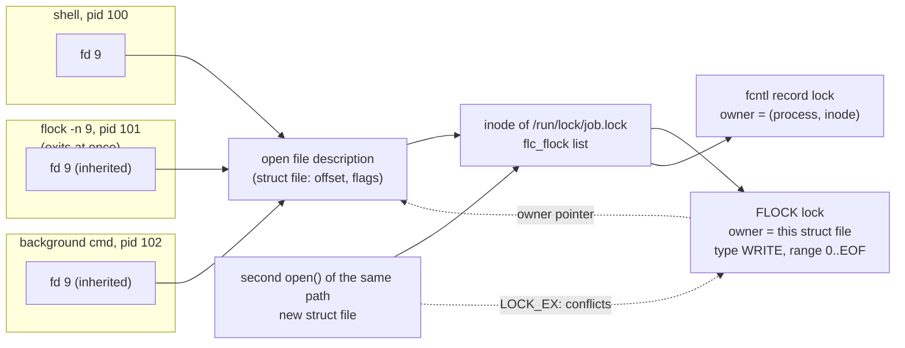

# flock

> [!summary] Claim
> `flock(1)` does not lock a file name or a process: it asks the kernel to attach a whole-file advisory lock to an open file description, so the lock lives exactly as long as some descriptor anywhere still refers to that description, and every correct and every broken use of the tool follows from that one fact.

Part of [Coreutils and the Userland](README.md) in [Shell and Unix Engineering](../README.md).

## TL;DR

- Mechanism: `flock FILE CMD` opens `FILE` (creating it), calls `flock(2)` on the descriptor, forks `CMD` with the descriptor inherited, waits, and exits with `CMD`'s status; the kernel records the lock against the `struct file` (the open file description), not against a process.
- Rule: hold the lock through a descriptor whose lifetime you control, `( flock -n 9 || exit 1; work ) 9>>/run/lock/job.lock`, and never delete the lock file while anyone may be waiting on it.
- Trap: every child that inherits the descriptor (a daemon, a `cmd &`, a forgotten `sleep`) keeps holding the lock after your critical section ends; close it with `9>&-` in the child (`exec cmd 9>&- &` in yash 2.58.1, whose plain `cmd 9>&- &` keeps a copy) or use util-linux `flock -o`.
- Portability fact: POSIX.1-2024 specifies no lock utility at all; `flock(1)` is util-linux (full option set) or BusyBox (`-s -x -u -n` and `-c` only), macOS and FreeBSD ship `lockf(1)` instead, and `exec 9>file; flock -n 9` fails in ksh93 and mksh because they close descriptors above 2 opened by `exec` before running a utility.
- When not to use it: across hosts (NFS emulation, lost locks), for byte ranges or threads (use OFD locks), or when a supervisor can own singleton-ness for you (a systemd timer never starts a second instance of an active unit; a Kubernetes CronJob with `concurrencyPolicy: Forbid` skips overlapping runs).

## Mental model



The shell opens the lock file once (`9>>file`), which creates one open file description; `fork` copies only the pointer, so the short-lived `flock` process and any background job all point at the same description.
`flock -n 9` attaches a FLOCK lock to the inode's lock list whose owner is that description, then exits; the lock survives because the description survives in the shell and in every child.
A fresh `open()` of the same path, even by the same process, creates a different description, so its `LOCK_EX` conflicts.
A POSIX `fcntl` record lock on the same inode is owned by the pair (process, inode) instead, which is why it is dropped by any `close()` in that process and never inherited by `fork`.
The lock disappears only when the last descriptor referring to the description is closed, or when someone sharing it calls `LOCK_UN`.

## How it works

### Three kernel lock families, one inode

POSIX.1-2024 defines record locks through `fcntl()` and calls them "process-owned"; it now also defines "OFD-owned" locks through `F_OFD_SETLK`, `F_OFD_SETLKW`, and `F_OFD_GETLK` (POSIX.1-2024 XSH `fcntl()`).
`flock(2)` itself is not POSIX; the Linux man page lists its standard as "BSD" and says it first appeared in 4.2BSD (flock(2) STANDARDS and HISTORY).

| Property | `flock(2)` (BSD) | `fcntl` `F_SETLK` (POSIX process-owned) | `fcntl` `F_OFD_SETLK` (OFD-owned) | `lockf(3)` |
|---|---|---|---|---|
| Owner | open file description | process | open file description | process (on Linux an interface to `fcntl` locks, lockf(3)) |
| Range | whole file only | byte range | byte range | from current offset, `size` bytes |
| Modes | `LOCK_SH`, `LOCK_EX` | `F_RDLCK`, `F_WRLCK` | `F_RDLCK`, `F_WRLCK` | exclusive only |
| Open mode needed | any (Linux: needs read or write access, so not `O_PATH`) | read for `F_RDLCK`, write for `F_WRLCK` | same as `F_SETLK` | write (`O_WRONLY` or `O_RDWR`) |
| After `fork` | child shares the lock | child does not own it | child shares the lock | child does not own it |
| After `execve` | kept | kept | kept (unless the descriptor is close-on-exec) | kept |
| Released by | `LOCK_UN` on any sharing descriptor, or last close of the description | any `close()` of any descriptor for the file by that process, or exit | last close of the description | same as `fcntl` |
| Deadlock detection | none | yes, `EDEADLK` | none on Linux | as `fcntl` |
| Lab | probe modes `two-opens`, `dup`, `inherit` | `posix-close`, `inherit`, `deadlock` | `ofd` | not exercised |

Sources: flock(2), fcntl_locking(2), lockf(3), POSIX.1-2024 XSH `fcntl()` and `lockf()`; for the first three columns the lab's C probe also asserts the Owner, After `fork`, Released by, and (for `flock(2)` and `F_SETLK`) Deadlock detection rows, while the Range, Modes, Open mode, and After `execve` rows rest on the cited pages and kernel source alone.

### The system call, in Linux `fs/locks.c`

`SYSCALL_DEFINE2(flock, ...)` translates `LOCK_SH`, `LOCK_EX`, `LOCK_UN` into `F_RDLCK`, `F_WRLCK`, `F_UNLCK` (`flock_translate_cmd`), rejects a descriptor with neither `FMODE_READ` nor `FMODE_WRITE` with `EBADF`, and silently ignores the long-dead `LOCK_MAND` with a one-time warning (linux fs/locks.c, `SYSCALL_DEFINE2(flock)`).
`flock_make_lock` fills a `struct file_lock` with `flc_owner = filp`, `flc_flags = FL_FLOCK`, `flc_pid = current->tgid`, and `fl_end = OFFSET_MAX`: the owner is the `struct file`, and the range is always the whole file.
`flock_lock_inode` takes the inode's `flc_lock` spinlock and walks `ctx->flc_flock`.
If this `struct file` already holds a lock of the requested type, it returns at once; if it holds the other type, it deletes the old lock first and only then looks for conflicts.
That delete-then-reacquire order is why a shared-to-exclusive conversion is not atomic: between the two steps a waiting process may be granted the lock (flock(2) NOTES).
`flock_locks_conflict` returns false whenever both locks reference the same `struct file`, which is the whole reason duplicated descriptors never block each other while a second `open()` of the same path does.
On conflict without `LOCK_NB` the request is queued with `locks_insert_block` and the caller sleeps in `flock_lock_inode_wait` via `wait_event_interruptible`, so a caught signal ends the wait with `EINTR`; with `LOCK_NB` the call returns `EWOULDBLOCK` (`EAGAIN` on Linux).
Release is driven by the file's reference count: `__fput` in `fs/file_table.c` calls `locks_remove_file` on the last close of a `struct file`, which removes OFD locks, FLOCK locks, and leases.
POSIX process-owned locks are removed much earlier, by `filp_flush` in `fs/open.c`, which calls `locks_remove_posix(filp, id)` on every `close()` of every descriptor; that single call is the "any close drops all your locks" rule.
POSIX deadlock detection lives in `posix_locks_deadlock`, which follows the chain of "owner waits for lock held by owner" and gives up (no `EDEADLK`) once `i++ > MAX_DEADLK_ITERATIONS`, with the constant set to 10, so a cycle longer than about 11 owners goes undetected; it explicitly returns false for `FL_OFDLCK` requests, and nothing comparable exists for FLOCK locks.

On Linux, FLOCK and POSIX locks live on separate lists (`flc_flock`, `flc_posix`) and do not see each other; Andy Walker's 1997 kernel release notes explain the choice: sendmail locked `aliases.dir` with `fcntl()` while GDBM locked it with `flock()`, and with pre-1.3.96 kernels the mix could deadlock until, under heavy mail load, the kernel locked solid with deadlocked processes, so the two lock styles were made "oblivious to each other" (linux Documentation/filesystems/locks.rst, section 1.2).
FreeBSD made the opposite choice: its flock(2) page says `flock()`, `fcntl(2)`, and `lockf(3)` locks are compatible, and that a file locked through `flock()` looks locked to `fcntl()` users in other processes (FreeBSD flock(2) NOTES).
The lab measured macOS (Darwin 27.3) behaving like FreeBSD, and more: a process holding an `fcntl` lock on one descriptor is refused `flock(LOCK_EX | LOCK_NB)` on a second descriptor of the same file, so a blocking `flock()` there deadlocks against its own process.

### The utility, util-linux `sys-utils/flock.c`

util-linux `flock` is H. Peter Anvin's code (copyright 2003 to 2005); util-linux 2.13-pre2 replaced its earlier `flock` with Anvin's flock-2.0.2 (util-linux NEWS).
It has three shapes: `flock [opts] FILE CMD [ARG...]` (or `FILE -c STRING`), `flock [opts] FD`, and, on the development branch after 2.42, `flock [opts] --fd FD CMD` (commit "flock: add --fd command line option", merged 2026-08-18, not in a release as of 2026-11).

`open_file` opens the path with `O_RDONLY | O_NOCTTY | O_CREAT` and mode `0666` (minus the umask), so the lock file is created on first use and only read permission is needed afterwards; if that fails with `EISDIR` it reopens a directory read-only, which is why `flock /tmp cmd` works (util-linux flock.c, `open_file`).
The one exception is `--fcntl` (or `--start`/`--length`) with an exclusive lock: `main` then opens the file `O_WRONLY`, because an OFD write lock needs a writable descriptor, so write permission is required (util-linux flock.c, "an exclusive lock requires that the file is open for write").
Open errors map to sysexits: `ENOMEM`, `EMFILE`, `ENFILE` give `EX_OSERR` (71), `EROFS` and `ENOSPC` give `EX_CANTCREAT` (73), anything else `EX_NOINPUT` (66).
The core is one loop around `do_lock`, which calls `flock(fd, op | block)` or, with `--fcntl`, `fcntl(fd, F_OFD_SETLK or F_OFD_SETLKW, ...)`:
- `EWOULDBLOCK` or `EACCES` means "held by someone else" and exits with the conflict status, 1 unless `-E N` (0 to 255) says otherwise.
- `EINTR` exits with the conflict status only if the timeout flag is set; any other signal just retries.
- `EIO` or `EBADF` on an exclusive request by path triggers one reopen with `O_RDWR`, because NFS emulates `flock()` with a byte-range write lock that needs a writable descriptor (util-linux 2.21 "make flock(1) work on NFSv4", 2.25 "use nfs4 fallback on EBADF too").
- Anything else prints the error and exits `EX_DATAERR` (65), or `EX_OSERR` for `ENOLCK` and `ENOMEM`.

`-w SECONDS` (fractions allowed) is implemented without `alarm()`.
`setup_timer` in `lib/timer.c` installs a `SIGALRM` handler with `SA_SIGINFO` and no `SA_RESTART`, then arms a `timer_create(CLOCK_MONOTONIC)` timer, so a blocked `flock()` returns `EINTR` when it fires and wall-clock jumps cannot stretch the wait.
The timer is periodic: after the first expiry it re-fires every `sec / 100` seconds plus `(sec % 100) * 10` ms, which is 1% of the whole-second part, or 10 ms for sub-second timeouts.
The repeat closes a race: if the first `SIGALRM` lands after the flag check but before the kernel puts the caller to sleep, the next tick interrupts the sleep and the loop sees the flag.
The handler sets the flag only when `si_code == SI_TIMER`, so a stray `kill -ALRM` only makes the loop retry.
`-w 0` is special-cased to mean `-n`, because a zero `itimerval` would disarm the timer (util-linux 2.26 "zero timeout is valid").

With a command, `flock` resets `SIGCHLD` to the default, flushes stdio (the `fflush(NULL)` arrived on the development branch on 2026-10-10 and is in no release as of 2026-11; v2.42.4 lacks it), forks, and in the child closes the lock descriptor only if `-o` was given, then `execvp`s; the parent loops on `waitpid` and returns the child's exit status, or `128 + N` if the child died from signal N.
`-F` (util-linux 2.29) skips the fork and `exec`s the command in place, so the command itself holds the lock and there is no parent left to reap it; `-F` with `-o` is rejected because nothing would hold the lock.
`-c STRING` runs `$SHELL -c STRING`, falling back to `/bin/sh` only when `SHELL` is unset or empty; the 2.41 source uses `getenv("SHELL")` directly and the current one calls `ul_default_shell(UL_SHELL_NOPWD, NULL)`, which still skips the passwd shell.
The exception is util-linux 2.42.0 alone, which called `ul_default_shell(0, NULL)` and so fell back to the user's passwd shell before `/bin/sh`; 2.42.1 restored the old order (commit "flock: re-enable the initial shell selection logic", 2026-04-16 on master and 2026-04-29 on `stable/v2.42`).
In the `FD` form no command runs: `flock` locks the inherited descriptor and exits 0, and the lock stays because the shell still holds the description.

Version landmarks, all from the util-linux release notes: `-E` in 2.22, `--verbose` in 2.27, `-F` in 2.29, `--fcntl` (OFD locks, kernel 3.15 or later) in 2.41, `--start` and `--length` byte ranges (they imply `--fcntl`) in 2.42, and `--fd` only on the development branch as of 2026-11.

### The other implementations

BusyBox `flock` (Timo Teras, 2010) accepts `-s`, `-x`, `-u`, `-n` and their long forms `--shared`, `--exclusive`, `--unlock`, `--nonblock`, plus `-c` after the file name (busybox util-linux/flock.c).
It has no `-w`, `-E`, `-o`, `-F`, or `--fcntl`, opens the file `O_RDONLY | O_NOCTTY | O_CREAT` with no NFS fallback, returns 1 on `EWOULDBLOCK`, and for `-c` runs the shell from `get_shell_name()`: `$SHELL`, then the passwd shell, then `/bin/sh` (busybox libbb/get_shell_name.c).
FreeBSD and macOS ship `lockf(1)`, first in FreeBSD 2.2, which takes an exclusive `flock(2)`-style lock by opening the file with `O_EXLOCK` (FreeBSD lockf.c, `acquire_lock`).
Its defaults differ from `flock(1)` on every axis the lab checks: it deletes the lock file on exit unless `-k`, it closes the lock descriptor in the child before `execvp` (like `flock -o`, always), its conflict status is `EX_TEMPFAIL` (75), `-t 0` is the non-blocking form, and the `lockf [-s] [-t seconds] fd` form locks an inherited descriptor (FreeBSD lockf(1); macOS lockf(1) on Darwin 27.3 documents the same, without FreeBSD's `-p` and `-T`).
Without `-k`, FreeBSD `lockf` avoids its own unlink race by never sleeping inside the lock call: it waits with a separate blocking `open(..., O_EXLOCK)` in `wait_for_lock`, closes that, and retries non-blockingly, at the cost of fairness and a thundering herd on release, which the source comment spells out.
macOS also has `shlock(1)`, a `link(2)` dot-lock with a PID check by `kill(pid, 0)`, which its own man page marks deprecated in favour of `lockf(1)`.
uutils ships no `flock`: neither `uutils/coreutils` nor `uutils/util-linux` has a `flock` utility (as of 2026-11; the latter has `lslocks`).
POSIX.1-2024 has no lock utility in its XCU index; the portable shell primitives are `set -C` (noclobber), whose `>` must create the file "atomically as is done by the `open()` function ... when the `O_CREAT` and `O_EXCL` flags are set" (POSIX.1-2024 XCU 2.7.2), and `mkdir`, both of which leave a stale lock behind after a crash.

### The shell side

A shell hands a lock descriptor to `flock` with a redirection, and three POSIX rules decide whether that works.
Portable scripts can rely only on descriptors 0 to 9 in redirections (POSIX.1-2024 XCU 2.7).
A redirection after a compound command applies to every command inside it (POSIX.1-2024 XCU 2.9.4), so `( ... ) 9>>file` opens the file once for the whole block and closes it at the end.
After `exec 9>file` with no command, "it is unspecified whether those file descriptors remain open when the shell invokes another utility" (POSIX.1-2024 XCU 2.15, `exec`), and ksh93 and mksh do close them, so the man page's `exec 4<>/var/lock/mylockfile; flock -n 4` fails there with `EBADF` (measured in the shell matrix: util-linux 2.41.5 then exits 65 under ksh93u+m 1.0.10 and mksh R59 on Debian, and BusyBox `flock` exits 1 under mksh on Alpine, the same status as a conflict).
Both shells keep the descriptor once `set -o posix` is on (measured in the same images), and ksh93u+ 2012 has no such option.
The open mode matters only for creation and permissions: `>` truncates (destroying any PID you wrote), `>>` and `<>` create without truncating, and `<` needs an existing file but only read permission (flock(1) EXAMPLES; POSIX.1-2024 XCU 2.7.1 to 2.7.7).

### Observing locks

On Linux, `/proc/locks` prints one line per lock: ordinal, `FLOCK`, `POSIX`, or `OFDLCK`, `ADVISORY`, `READ` or `WRITE`, the PID that took it, `major:minor:inode`, and the range, which for FLOCK locks is always `0 EOF` (proc_locks(5)).
The PID column is the process that called `flock()`, which for `flock FILE CMD` is the `flock` process, not `CMD`; OFD locks show `-1` (before Linux 4.14 a bug showed the first locker).
`lslocks(8)` formats the same data and its `HOLDERS` column lists `PID,COMMAND,FD` for every process sharing an OFD lock; its `BLOCKER` column shows who blocks a waiter.
macOS has no `/proc/locks` (lab).

## Numbers and limits

| Quantity | Value | Source |
|---|---|---|
| Default conflict exit status of util-linux and BusyBox `flock` | 1 | util-linux flock.c `conflict_exit_code = 1`; BusyBox `EXIT_FAILURE`; lab |
| Range of `-E` | 0 to 255 | flock(1); `str2unum_or_err(..., 255)` |
| util-linux exit for a bad descriptor (`EBADF`) in the FD form | 65 (`EX_DATAERR`) | flock.c error path; sysexits.h |
| `lockf(1)` "already locked" status | 75 (`EX_TEMPFAIL`) | FreeBSD lockf(1); lab on macOS |
| `lockf(1)` unknown option | 64 (`EX_USAGE`) | lab on macOS |
| util-linux `-w` re-fire interval | 1% of the whole seconds, 10 ms below 1 s | lib/timer.c `setup_timer` |
| Lock file creation mode | `0666` minus umask | flock.c `open_file`; BusyBox flock.c |
| POSIX deadlock search depth | `MAX_DEADLK_ITERATIONS` = 10; the `i++ >` test lets the walk take 11 steps | linux fs/locks.c `posix_locks_deadlock` |
| Portable redirection descriptors | 0 to 9 | POSIX.1-2024 XCU 2.7 |
| OFD locks in Linux | since 3.15 | fcntl_locking(2) |
| `F_OFD_SETLK` value | 37 on Linux (util-linux fallback define), 90 on macOS | flock.c; macOS SDK `sys/fcntl.h` |
| NFS client emulates `flock()` with whole-file `fcntl` locks | since Linux 2.6.12 | flock(2) NFS details |
| `local_lock=` NFS mount option | since Linux 2.6.37 | nfs(5) |
| SMB emulates `flock()` with mandatory byte-range locks | since Linux 5.5 | flock(2) CIFS details |
| Mandatory locking no longer supported | Linux 5.15 and later | fcntl_locking(2) |
| Uncontended `flock(LOCK_EX)` + `flock(LOCK_UN)` pair | about 600 ns (594 to 611) | lab `bench`, 100000 pairs, Apple M3 Pro, Darwin 27.3, three runs, 2026-11-15 |
| Uncontended `F_SETLK` lock + unlock pair | about 760 ns (754 to 781) | same runs |
| BusyBox `flock` applet size estimate | 6.5 kb | BusyBox Kconfig text in flock.c |

The bench numbers are three runs on one laptop (an earlier single run read 900 and 850 ns, so expect tens of percent of noise): they say a lock round trip is a pair of system calls and costs well under a microsecond, not that either API is faster.

## Portability

Shell rows: the idiom is run by the shell under test; the lock utility is `flock(1)` where present, else `lockf(1)`.
"Measured here" means the lab ran on the macOS host on 2026-11-15; "matrix images" means the idiom was run by hand with the image's `flock` in the shell matrix's Debian 13 (util-linux 2.41.5) and Alpine 3.22 (BusyBox) images on 2026-11-15, and the `exec` column for ksh93 and mksh also agrees with the vault's close-on-exec matrix.

| Shell | `exec 9>>f` then external lock on fd 9 | `( lock 9; ... ) 9>>f` | `cmd &` inside keeps the lock | `cmd 9>&- &` releases it | Evidence |
|---|---|---|---|---|---|
| POSIX sh | unspecified (XCU 2.15 `exec`) | required to work (XCU 2.9.4) | yes, children inherit open files | yes | spec |
| macOS `/bin/sh` (bash 3.2.57) | locked | works | yes | yes | measured here |
| bash 5.3 | locked | works | yes | yes | measured here; matrix images |
| zsh 5.9 native | locked | works | yes | yes | measured here; matrix images |
| `zsh --emulate sh` | locked | works | yes | yes | measured here |
| dash 0.5.12 | locked | works | yes | yes | measured here; matrix images |
| ksh93u+ 2012 (macOS `/bin/ksh`) | not locked (fd 9 closed on exec) | works | yes | yes | measured here |
| ksh93u+m 1.0.10 | not locked (locked under `set -o posix`) | works | yes | yes | matrix images (Debian); close-on-exec matrix |
| mksh R59 | not locked (locked under `set -o posix`) | works | yes | yes | matrix images (Debian, Alpine); close-on-exec matrix |
| yash 2.58.1 | locked | works | yes | no: use `exec cmd 9>&- &` | matrix images (Alpine); lab test 12 encodes it |
| posh 0.14.1 | locked | works | yes | yes | matrix images (Debian) |
| BusyBox ash 1.37.0 | locked | works | yes | yes | matrix images (Debian, Alpine) |

yash 2.58.1 is the exception in the last column: it runs `cmd 9>&- &` as a yash child that moves the original fd 9 to fd 100 before closing 9 and then forks `cmd` instead of exec'ing it, so that waiting yash process keeps the open file description, and the lock, until `cmd` exits; `exec cmd 9>&- &`, or an `exec 9>&-` in the subshell before starting `cmd &`, releases it (measured in the shell matrix's Alpine image: `/proc/PID/fd` of the background job shows `100 -> lockfile`, and a probe prints `busy` without `exec` and `free` with it).

| Utility | Where | Options | Conflict status | Deletes lock file | Child keeps lock | `-c` shell |
|---|---|---|---|---|---|---|
| util-linux `flock` | Debian, Ubuntu, most glibc distributions | `-s -x -u -n -w -E -o -F -c --fcntl --verbose`; `--start --length` (2.42) | 1, or `-E` | never | yes, unless `-o` | `$SHELL`, else `/bin/sh` |
| BusyBox `flock` | Alpine and embedded | `-s -x -u -n -c` | 1 | never | yes | `$SHELL`, passwd shell, `/bin/sh` |
| FreeBSD `lockf` | base system | `-k -n -p -s -T -t -w`, fd form | 75 | yes, unless `-k` | no, closed before exec | none |
| macOS `lockf` | base system (Darwin 27.3) | `-k -n -s -t -w`, fd form | 75 | yes, unless `-k` | no (measured) | none |
| macOS `shlock` | base system, deprecated | `-d -u -p -f` | nonzero | caller removes it | n/a (dot-lock, no kernel lock) | none |
| uutils | coreutils and util-linux ports | no `flock` | n/a | n/a | n/a | n/a |
| POSIX.1-2024 | XCU | no lock utility | n/a | n/a | n/a | n/a |

Kernel behavior, from the lab's C probe: on Linux `flock` and `fcntl` locks are independent (lab asserts; flock(2) VERSIONS), on macOS they conflict, even inside one process (measured here), on FreeBSD they conflict (FreeBSD flock(2)); OFD locks conflict between two opens of one process on Linux and macOS (macOS measured here).

## Worked example

The [lab](../labs/08-flock/) has three parts: `lockprobe.c` shows the kernel ownership rules, `flock_demo.sh` runs the shell idioms under every shell in the matrix, and `flock.bats` checks the utilities per implementation.

The heart of `flock_demo.sh` (simplified excerpt; the lab file also falls back to `lockf -s -t 0` where there is no `flock`):

```sh
try_lock() {
  flock -n "$1"
}

probe_lock() {
  (
    if try_lock 9; then echo free; else echo busy; fi
  ) 9>>"$1"
}

case $mode in
  singleton)
    (
      if ! try_lock 9; then
        echo busy
        exit 75
      fi
      echo acquired
      /bin/sleep 3
      echo released
    ) 9>>"$lock"
    ;;
  inherit | inherit-closed | inherit-closed-exec)
    pidfile=$lock.pid
    (
      try_lock 9 || exit 1
      case $mode in
        inherit) /bin/sleep 5 & ;;
        inherit-closed) /bin/sleep 5 9>&- & ;;
        *) exec /bin/sleep 5 9>&- & ;;
      esac
      echo "$!" >"$pidfile"
    ) 9>>"$lock"
    probe_lock "$lock"
    read -r pid <"$pidfile"
    kill "$pid"
    ;;
esac
```

The `inherit-closed-exec` mode is the same with `exec /bin/sleep 5 9>&- &`, which the lab asserts prints `free` in every shell, while plain `inherit-closed` prints `busy` under yash 2.58.1 (test 12 branches on the shell family).
The `rm-race` mode reproduces the classic lock file deletion bug: holder A locks, waiter B opens the same path and blocks, A runs `rm -f "$lock"` and exits, B is granted the lock on the now nameless inode, and C opens the path, creates a new inode, and is granted a lock too.
The `keep-file` mode runs the same sequence without the `rm`, and C is refused.

The C probe's output on the macOS host (captured 2026-11-15):

```text
$ lockprobe two-opens f
first-open LOCK_EX: granted
second-open LOCK_EX: blocked
$ lockprobe dup f
original LOCK_EX: granted
dup LOCK_EX: granted
other open while held: blocked
other open after LOCK_UN via dup: granted
$ lockprobe posix-close f
fcntl lock after closing another fd: gone
flock lock after closing another fd: held
$ lockprobe inherit f
flock after parent close, child alive: blocked
flock after child exit: granted
fcntl F_SETLK by child on inherited fd: blocked
$ lockprobe mix f
fcntl F_SETLK while another process holds flock LOCK_EX: blocked
flock LOCK_NB by the process that holds the fcntl lock: blocked
$ lockprobe ofd f
F_SETLK via second open, same process: granted
F_OFD_SETLK via second open, same process: blocked
$ lockprobe deadlock f
fcntl F_SETLKW closing the cycle: EDEADLK
flock LOCK_EX closing the cycle: EINTR after 2s alarm
$ lockprobe bench f 100000
flock pair ns: 596
fcntl pair ns: 754
```

On Linux the lab asserts the same lines except `mix`, which prints `granted` twice because the two lock families are independent there.

The shell modes, captured on the macOS host with `lockf(1)` as the lock utility:

```text
$ sh flock_demo.sh exec-form L        # bash, dash, zsh print the same
locked
$ ksh flock_demo.sh exec-form L       # ksh93u+ 2012
not locked
$ sh flock_demo.sh inherit L
busy
$ sh flock_demo.sh inherit-closed L
free
$ sh flock_demo.sh inherit-closed-exec L
free
$ sh flock_demo.sh rm-race L
B acquired
C acquired
$ sh flock_demo.sh keep-file L
B acquired
C blocked
```

The full suite on the macOS host, `bats flock.bats`, printed `1..22` and `ok` for all 22 tests, among them:

```text
ok 9 the ( ... ) 9>>lock form admits one holder at a time
ok 10 exec 9>>lock then an external lock on fd 9 fails in ksh93 and mksh, which close fd 9 on exec
ok 11 a background child started inside the critical section keeps holding the lock
ok 12 closing fd 9 in the background child with 9>&- releases the lock with the section; yash needs exec
ok 17 flock(1) lets a command's background child keep the lock unless -o; lockf(1) always closes it
ok 18 removing the lock file while a waiter is queued lets two processes hold the lock
ok 21 flock -c runs its string through $SHELL, not /bin/sh
```

## Pitfalls

> [!warning] The daemon that inherited the lock
> Trigger: a job started under `flock` (or inside `( ... ) 9>>lock`) launches a background process, a service restart, or `nohup cmd &`.
> Symptom: every later run reports "busy" until that long-lived child dies, although the job that took the lock finished hours ago.
> Mechanism: the child inherited the descriptor, and a FLOCK lock is released only when the last descriptor of the open file description closes (flock(2)); the lab's `inherit` mode prints `busy`.
> Fix: close the descriptor in the child (`cmd 9>&- &`; under yash 2.58.1 write `exec cmd 9>&- &`, because its background job is a yash process that keeps a saved copy of fd 9, as measured in the shell matrix), use util-linux `flock -o FILE cmd`, or `flock -u 9` before forking if no one else should keep it; the util-linux man page documents `-o` and `-u` for exactly this case.

> [!warning] Deleting the lock file
> Trigger: a "cleanup" step such as `trap 'rm -f "$lock"' EXIT`, or `lockf` without `-k`, while another process may be waiting.
> Symptom: two instances run concurrently, each convinced it holds the lock.
> Mechanism: the waiter blocked on the old inode is granted the lock when the holder exits, while the next opener creates a new inode with the same name and locks that one; the lab's `rm-race` mode prints `B acquired` and `C acquired`.
> Fix: never delete a lock file that coordinates waiters; keep it in `/run/lock` or a private directory and let it live; with BSD `lockf` pass `-k`, which the FreeBSD man page recommends for ordering and performance and whose source comment describes the race.

> [!warning] `exec 9>lock` under ksh93 and mksh
> Trigger: a script written for bash uses `exec 9>>"$lock"; flock -n 9 || exit 1` and is then run by `ksh` or `mksh`.
> Symptom: `flock: 9: Bad file descriptor` and exit status 65 every time with util-linux (BusyBox `flock` exits 1, which looks exactly like "busy"), so the job never runs (or, with `|| true` style error handling, runs unlocked).
> Mechanism: POSIX leaves it unspecified whether descriptors above 2 opened by `exec` survive into utilities (XCU 2.15 `exec`), and ksh93 and mksh close them outside their POSIX modes (ksh93u+m 1.0.10 and mksh R59 keep them under `set -o posix`, measured in the shell matrix); the lab's `exec-form` prints `not locked` under ksh93u+ 2012.
> Fix: use the compound-command form `( flock -n 9 || exit 1; ... ) 9>>"$lock"`, or pass the descriptor explicitly with `flock -n 9 9<&9`.

> [!warning] Killing `flock` does not release the lock
> Trigger: a watchdog kills the PID of `flock FILE cmd` (for example a monitoring script, or `kill $!` after `flock FILE cmd &`).
> Symptom: `flock` is gone, `cmd` keeps running, and the lock stays held.
> Mechanism: `cmd` inherited the descriptor, exactly as in the daemon case; util-linux `flock` installs no signal forwarding, and FreeBSD `lockf` orphans the command on `SIGTERM` unless `-T` (FreeBSD lockf(1)).
> Fix: signal the process group, as GNU `timeout` does by default (coreutils timeout.c `cleanup` sends the signal to the child and then to group 0 unless `--foreground`), or run `flock -F` so the command is the lock holder; see [[timeout]].

> [!warning] `flock -c` runs `$SHELL`, not `/bin/sh`
> Trigger: `flock /run/lock/x -c 'cmd1 && cmd2'` from a cron job or CI step whose environment has `SHELL=/usr/bin/fish` or another non-POSIX shell.
> Symptom: syntax errors or different semantics only on some hosts.
> Mechanism: util-linux uses `$SHELL` and falls back to `/bin/sh` only when it is unset or empty; BusyBox also consults the passwd shell; the lab's fake `$SHELL` receives the string.
> Fix: pass an explicit argv, `flock FILE /bin/sh -c 'cmd1 && cmd2'`.

> [!warning] One `close()` drops every POSIX lock
> Trigger: a program (or a library it calls) opens and closes a file that the program has locked with `fcntl()` or `lockf()`.
> Symptom: silent loss of mutual exclusion; SQLite lists "Posix advisory locks canceled by a separate thread doing close()" as a way to corrupt a database (sqlite.org howtocorrupt.html, section 2.2).
> Mechanism: `filp_flush` calls `locks_remove_posix` on every close; the lab's `posix-close` prints `gone` for the `fcntl` lock and `held` for the `flock` lock.
> Fix: use `flock(2)` or OFD locks (`flock --fcntl`) for anything that may share a process with unknown code; Jeff Layton's LWN article introducing OFD locks gives this as the motivation (LWN, "File-private POSIX locks", 2014-02-19).

> [!warning] Mixing lock families
> Trigger: one tool locks with `flock(1)`, another with `fcntl()` (a database library, Python's `fcntl.lockf`, a Perl `flock` built on `fcntl`).
> Symptom: on Linux local filesystems they never exclude each other; on NFS, SMB, FreeBSD, and macOS they do; on macOS a process that mixes them can deadlock against itself.
> Mechanism: separate kernel lists on Linux (locks.rst 1.2.2); emulation through byte-range locks on NFS and SMB (flock(2)); one lock manager on BSD (FreeBSD flock(2)); the lab's `mix` mode.
> Fix: pick one family per lock file and document it next to the path.

> [!warning] NFS and network filesystems
> Trigger: the lock file lives on an NFS or SMB mount shared by several hosts.
> Symptom: exclusive locks fail with `EBADF` on read-only opens, locks interact with `fcntl` users, or a lock is silently lost after a network partition and the next I/O fails with `EIO`.
> Mechanism: the NFS client emulates `flock()` with a whole-file `fcntl` lock that needs write access (flock(2)); util-linux reopens `O_RDWR` only in the FILE form, BusyBox never does; NFSv4 marks a lost lock with `EIO` (fcntl_locking(2) "Lost locks"); `local_lock=flock` makes the lock host-local (nfs(5)).
> Fix: keep lock files on local storage (`/run/lock`), or use a coordination service with leases for cross-host exclusion.

> [!warning] Self-locking scripts and atomic deploys
> Trigger: the man page boilerplate `[ "${FLOCKER}" != "$0" ] && exec env FLOCKER="$0" flock -en "$0" "$0" "$@" || :` in a script that is deployed by writing a new file and renaming it into place.
> Symptom: the old and the new version run concurrently during a deploy.
> Mechanism: the lock is on the inode; an atomic rename gives the path a new inode, so the new invocation locks a different file (a consequence of flock(2) semantics, not measured by the lab; see [[install-and-Atomic-Deployment]]).
> Fix: lock a dedicated, stable path, not the script.

## Security and robustness

- Advisory means advisory: any process that ignores the lock can read and write the file (flock(2) NOTES), so a lock protects only against cooperating code.
- Read permission is enough to take an exclusive `flock()` lock ("regardless of the mode in which the file was opened", flock(2)), so any user who can read a world-readable lock file can hold it forever and starve your job; create lock files `0600` in a directory only the job's user can write, and note that `flock` creates them `0666` minus the umask.
- A predictable lock path in a world-writable directory such as `/tmp` invites symlink attacks: `flock` opens with `O_CREAT` and no `O_NOFOLLOW`, so a planted symlink can make a privileged job create or open a file of the attacker's choosing; Linux's `fs.protected_symlinks=1` refuses to follow such links in sticky world-writable directories unless the link's owner matches the follower or the directory owner (linux sysctl/fs.rst), but a private lock directory is the real fix.
- `flock` passes no `O_CLOEXEC`, by design: the descriptor must reach the command, which also means it reaches every grandchild; treat lock descriptors like any other inherited capability ([[Close-on-Exec-and-Descriptor-Inheritance]]).
- Status codes overlap: with the defaults, "lock busy" (1) is indistinguishable from "command failed with 1"; use `-E 75` (or another unused code) when the caller must tell them apart, and remember that a child killed by signal N reports `128 + N`.
- Locks are not leases: a holder that hangs holds the lock forever; bound the critical section with [[timeout]] inside the lock (`flock FILE timeout 600 job`) so the lock is released when the job is killed.
- After a lock is released, observable effects of `close()` may still be in flight: the flock(2) man page warns that a waiter can see `ETXTBSY` on `execve` or `EBUSY` on `umount` as if the file were still open.

## The principal's view

`flock(1)` is the right tool for one narrow, very common job: at most one instance of a host-local task, with automatic release when the holder dies, at a cost of two system calls.
Its whole safety story is the kernel's reference count on an open file description, which is also its whole failure story: anything that copies the descriptor, deletes the name, or kills the wrong process changes who holds the lock without telling you.
So the decisions a staff engineer makes are about ownership, not syntax.
First, who owns singleton-ness: if a supervisor exists, let it (a systemd timer leaves an already active unit running instead of starting another, systemd.timer(5); Kubernetes `concurrencyPolicy: Forbid` skips a run while the previous Job is running), and use `flock` only where there is no supervisor, such as cron, CI runners, and deploy hooks.
Second, scope: `flock` is host-local by design; across hosts it degrades into NFS byte-range emulation with lost-lock semantics, and the honest answer is a lease-based lock in a consensus store, with the protected resource checking a monotonically increasing token, not a shared file.
Third, the lock family: whole-file `flock(2)` for shell, OFD locks (`flock --fcntl`, `F_OFD_SETLK`) for byte ranges and threads, and process-owned `fcntl` locks only when interoperating with existing POSIX-lock users, never mixed on one file.
Fourth, portability: a script that must also run on macOS or FreeBSD should either detect `flock` versus `lockf` (with `-k`) like the lab does, or move the locking into a small program in a language with a `flock` binding, because the two utilities disagree on deletion, child inheritance, and exit codes.
The trade-off is honest: `flock` gives crash safety (the kernel releases the lock when the process dies) at the price of no timeout on the holder, no cross-host guarantee, and an invisible dependency on descriptor hygiene in every child.

## Interview questions

> [!question] L5: Walk through `( flock -n 9 || exit 1; backup ) 9>>/run/lock/backup.lock` system call by system call.
>
> > [!success]- Answer
> > For the subshell, the shell `open()`s the path with `O_WRONLY | O_CREAT | O_APPEND` on descriptor 9, creating one open file description.
> > It forks and execs `flock -n 9`, which inherits descriptor 9 and calls `flock(9, LOCK_EX | LOCK_NB)`.
> > The kernel attaches a FLOCK lock owned by that description and `flock` exits 0; the lock survives because the subshell still holds the description.
> > If another instance holds it, `flock()` fails with `EWOULDBLOCK`, `flock` exits 1, and `exit 1` leaves the subshell.
> > When the subshell ends, descriptor 9 is closed, the last reference goes away, and `locks_remove_file` drops the lock.
> >
> > Follow-up: Why `>>` rather than `>`, and what changes with `<`?

> [!question] L5: Why does the lock outlive the `flock` process in the descriptor form, but not a lock taken by `flock FILE cmd` after `cmd` exits?
>
> > [!success]- Answer
> > A FLOCK lock is owned by an open file description, not by a process.
> > In the descriptor form the shell opened the description, so it stays alive after `flock` exits.
> > In the FILE form `flock` itself opened it, so it dies when `flock` and `cmd` (and any child of `cmd` that inherited it) have all exited.
> >
> > Follow-up: What does `-F` change about who holds the lock in the FILE form?

> [!question] L6: Predict the output of this script under bash, dash, and ksh93.
>
> ```sh
> lock=./l
> ( flock -n 9 || exit 1; /bin/sleep 30 & ) 9>>"$lock"
> ( if flock -n 9; then echo free; else echo busy; fi ) 9>>"$lock"
> ```
>
> > [!success]- Answer
> > `busy` in all three.
> > The background `sleep` inherited descriptor 9 from the compound redirection, so the lock's open file description is still referenced after the first subshell ends.
> > The second subshell opens a new description, and its `LOCK_EX | LOCK_NB` conflicts.
> > The lab's `inherit` mode asserts exactly this for every shell in the matrix.
> >
> > Follow-up: Which one-token change makes it print `free`?

> [!question] L6: Debug this: a cron job works on Ubuntu with bash but never runs after the host's `/bin/sh` scripts were switched to run under `mksh`; the log says `flock: 9: Bad file descriptor`.
>
> ```sh
> exec 9>>/run/lock/report.lock
> flock -n 9 || exit 0
> generate_report
> ```
>
> > [!success]- Answer
> > mksh, like ksh93, closes descriptors above 2 opened by `exec` before running an external utility, which POSIX permits (XCU 2.15, `exec`).
> > `flock` therefore receives no descriptor 9, gets `EBADF`, and exits 65, which is nonzero, so `|| exit 0` silently skips the job.
> > Fix it with the compound form `( flock -n 9 || exit 0; generate_report ) 9>>/run/lock/report.lock`, or pass the descriptor explicitly with `flock -n 9 9<&9`.
> > Also stop mapping every `flock` failure to success: compare against the conflict status (`-E 75`) so a real error is logged.
> >
> > Follow-up: How would you make the script detect that it is not holding the lock at all?

> [!question] L6: What can break when a colleague replaces `flock` with Python `fcntl.lockf` in a daemon that also calls a config-parsing library on the lock file?
>
> > [!success]- Answer
> > `lockf` locks are process-owned POSIX record locks.
> > When the library opens and closes the same file, `close()` releases every POSIX lock the process holds on that file, silently.
> > Locks are also not inherited by `fork`, and threads in one process never exclude each other.
> > Use `flock()` or OFD locks, which are owned by the open file description and are released only on its last close.
> >
> > Follow-up: On which systems would the old `flock(1)` users and the new `lockf` user exclude each other?

> [!question] L6: Why is `trap 'rm -f "$lock"' EXIT` dangerous in a script that uses `flock`?
>
> > [!success]- Answer
> > A waiter may already have the old inode open and be blocked in `flock()`.
> > When the holder exits, that waiter gets the lock on the unlinked inode, while the next starter creates a new file with the same name and locks it too.
> > Two instances then run concurrently; the lab's `rm-race` mode reproduces it.
> > Keep the file, or for BSD `lockf` pass `-k`.
> >
> > Follow-up: How does FreeBSD `lockf` stay correct without `-k`, and what does that cost?

> [!question] L7: How does util-linux `flock -w 2.5` time out, and why is its timer periodic?
>
> > [!success]- Answer
> > It arms a `timer_create(CLOCK_MONOTONIC)` timer that delivers `SIGALRM` to a handler installed with `SA_SIGINFO` and without `SA_RESTART`.
> > The blocked `flock()` returns `EINTR`; the loop exits with the conflict status only if the handler saw `si_code == SI_TIMER`, otherwise it retries.
> > The timer repeats every 1% of the whole seconds (10 ms for sub-second values), because a signal that arrives just before the call goes to sleep would otherwise be lost and the wait would be unbounded.
> > `CLOCK_MONOTONIC` keeps wall-clock steps from stretching or cutting the wait.
> >
> > Follow-up: Why is `-w 0` special-cased instead of arming a zero timer?

> [!question] L7: Design exclusion for a nightly job that may run on any of 40 hosts sharing an NFS home directory.
>
> > [!success]- Answer
> > `flock` on NFS is emulated with whole-file byte-range locks through the lock manager, needs write access for exclusive locks, can be configured host-local with `local_lock`, and can be lost after a partition with only `EIO` on later I/O as a signal.
> > None of that gives a reliable fleet-wide singleton, and a frozen holder is never evicted.
> > Use a scheduler that owns concurrency (a Kubernetes CronJob with `concurrencyPolicy: Forbid`) or a lease in a consensus store, and make the protected resource reject stale holders by checking a token that increases with every grant.
> > Keep `flock` only as a host-local guard against a second copy on the same machine.
> >
> > Follow-up: What happens to a lease-based lock when the holder's process is paused for longer than the lease?

> [!question] L7: A macOS developer reports that a tool hangs forever in `flock(LOCK_EX)` on a file nobody else has open; on Linux the same code works.
>
> > [!success]- Answer
> > On BSD-derived kernels, including macOS, `flock()` and `fcntl()` locks share one lock manager and conflict, unlike Linux where they live on separate lists.
> > If the same process already holds an `fcntl` lock on the file through another descriptor (for example via a library), its own `flock()` on a second descriptor conflicts with it; the lab measured `blocked` for `LOCK_NB` in exactly this setup.
> > A blocking call therefore deadlocks against its own process, and `flock()` has no deadlock detection to break it.
> > Use one lock family per file, and test locking code on both kernels.
> >
> > Follow-up: Would OFD locks avoid the hang on macOS?

## Related

Prerequisites: [[timeout]], [[File-Descriptors-and-Open-File-Descriptions]]

Next: [[nohup-and-setsid]]

See also: [[Close-on-Exec-and-Descriptor-Inheritance]], [[The-exec-Builtin]], [[Redirection-Order-and-Semantics]], [[Subshells-and-the-Execution-Environment]], [[Processes-fork-exec-and-wait]], [[Daemonization]], [[mktemp]], [[install-and-Atomic-Deployment]], [[Four-Userlands-GNU-BSD-BusyBox-uutils]], [[Userland-Portability-Traps]], [[The-proc-Filesystem]], [[Exit-Status-and-Wait-Status]]

## Further reading

- [flock(1) source](https://github.com/util-linux/util-linux/blob/master/sys-utils/flock.c): the whole utility in about 500 lines, including the NFS reopen and the timeout loop.
- [flock(1) manual](https://github.com/util-linux/util-linux/blob/master/sys-utils/flock.1.adoc): the documented idioms, `-o`, `-u`, and the exit status contract.
- [flock(2)](https://man7.org/linux/man-pages/man2/flock.2.html): ownership by open file description, non-atomic conversion, NFS and SMB emulation.
- [fcntl_locking(2)](https://man7.org/linux/man-pages/man2/fcntl_locking.2.html): process-owned versus OFD locks, deadlock detection, lost locks.
- [POSIX.1-2024 fcntl()](https://pubs.opengroup.org/onlinepubs/9799919799/functions/fcntl.html): the normative definition of process-owned and OFD-owned locks.
- [Linux fs/locks.c](https://github.com/torvalds/linux/blob/master/fs/locks.c): `flock_lock_inode`, `posix_locks_deadlock`, and `locks_remove_file`.
- [Linux locks.rst](https://github.com/torvalds/linux/blob/master/Documentation/filesystems/locks.rst): why Linux keeps `flock` and `fcntl` locks independent.
- [FreeBSD lockf.c](https://github.com/freebsd/freebsd-src/blob/main/usr.bin/lockf/lockf.c): the unlink race and the fairness trade-off, explained in a source comment.
- [LWN: File-private POSIX locks](https://lwn.net/Articles/586904/): the design rationale for OFD locks by their author.
- [SQLite: How To Corrupt An SQLite Database File](https://www.sqlite.org/howtocorrupt.html): a production database's account of POSIX lock hazards.
- [systemd: Locking Block Device Access](https://systemd.io/BLOCK_DEVICE_LOCKING/): a real protocol built on `flock(2)` `LOCK_SH` and `LOCK_EX`, and why it is not `fcntl`.
