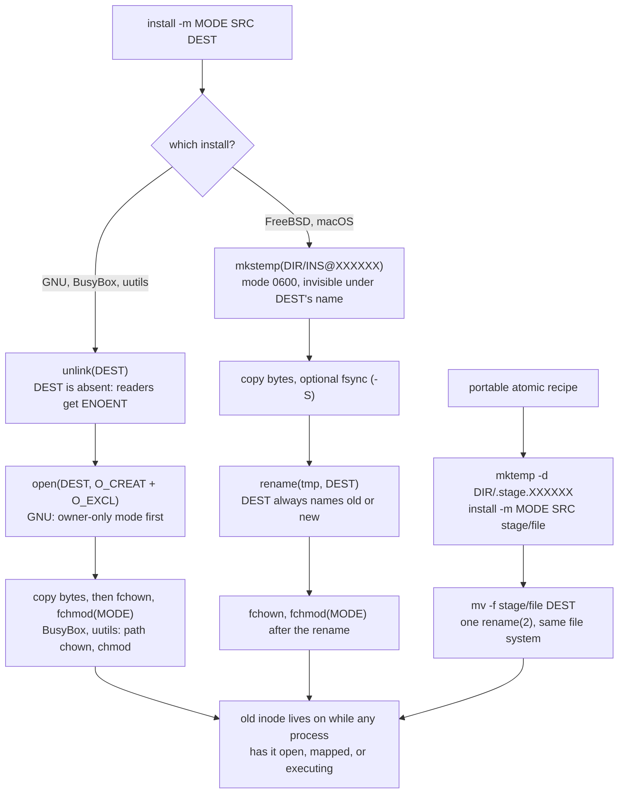

# install and Atomic Deployment

> [!summary] Claim
> `install` never rewrites a destination in place: GNU, BusyBox, and uutils unlink it and create a new inode, while FreeBSD and macOS build a temporary `INS@XXXXXX` file and `rename(2)` it into place, so running programs and open readers keep the old bytes, but only the rename path is atomic for new readers, and a deployment that must be atomic everywhere stages with `install` and finishes with `mv` (one file) or a symlink rename (a whole release).

Part of [Coreutils and the Userland](README.md) in [Shell and Unix Engineering](../README.md).

## TL;DR

- Mechanism: `install SRC DEST` copies SRC to a new inode (GNU `copy.c` unlinks DEST, then `openat(O_CREAT|O_EXCL)`; FreeBSD and macOS `mkstemp("INS@XXXXXX")` then `rename`), sets owner then mode with no umask, and so never truncates a file another process has open, mapped, or is executing (lab tests 1, 8, 10).
- Rule: to replace a file atomically on every userland, `install -m MODE SRC "$stage/file"` into a private directory next to DEST, then `mv -f "$stage/file" DEST`; to switch a whole release, build a new symlink in a staging directory and move it INTO the base directory so `rename(2)` replaces `current` (lab tests 13-16).
- Trap: GNU, BusyBox, and uutils `install` leave a window in which DEST does not exist (unlink, then create), so a reader can get `ENOENT`; `mv new current` and `ln -sf new current` both follow a `current` symlink into the old release and nest the link there (lab tests 11-12).
- Portability fact: `install` is not in POSIX.1-2024 (absent from the XCU utility index), and its options diverge: `-D` creates parents on GNU, BusyBox, and uutils but takes a DESTDIR argument on BSD (lab test 5, exit 64), `-b` writes `dst~` on GNU, `dst.old` on BSD, and nothing on BusyBox (lab test 6), and BusyBox has no `-C` (lab test 4).
- When not to use it: `install` gives no durability (GNU never calls `fsync`; BSD `-S` syncs the file but not the directory), cannot replace several files as one transaction, and cannot swap a directory; use a staged release directory plus symlink swap, a package manager, an image or snapshot deployment, or `renameat2(RENAME_EXCHANGE)` from a real language when those matter.

## Mental model



Every path through the diagram ends with a new inode under the name DEST and the old inode still alive for whoever already holds it, which is why `install` is safe for running binaries where `cp` is not.
The two implementation branches differ in what a process that opens DEST by name during the operation can see: on the GNU branch there is an instant with no DEST at all, on the BSD branch DEST always resolves, but for a moment after the rename it carries the temporary file's 0600 mode and the installer's ownership.
The recipe at the bottom removes both differences by letting `install` do the copying and metadata in a private staging directory, so the only step that touches the public name is a single `rename(2)` with the POSIX guarantee that the name "shall remain visible ... and refer either to the file referred to by new or old" (POSIX.1-2024 XSH `rename()`, DESCRIPTION).

## How it works

### What install is, and is not

`install` copies files "while setting their file mode bits and, if possible, their owner and group" and "is typically used in Makefiles to copy programs into their destination directories" (`coreutils.texi`, node `install invocation`).
It appeared in 4.2BSD (FreeBSD `install.1`, HISTORY), and historically moved files by default; FreeBSD changed the default to copy in FreeBSD 4.4 (`install.1`, COMPATIBILITY), which is why `-c` survives as a no-op in every implementation ("Ignored; for compatibility with old Unix versions", `coreutils.texi`).
It is not a POSIX utility: the POSIX.1-2024 XCU utility index lists `ln`, `mv`, `readlink`, and `realpath`, but no `install` (and no `mktemp`), so every behavior below is implementation-defined and the lab branches on the implementation.
Four synopses are shared by GNU and uutils (`install.c`, `usage`): `install [-T] SOURCE DEST`, `install SOURCE... DIRECTORY`, `install -t DIRECTORY SOURCE...`, and `install -d DIRECTORY...`; BSD has the forms without `-T` and `-t`, and BusyBox adds `-t` but not `-T`.
BSD does accept `-T`, but as `-T tags`, an argument-taking option that sets the `mtree` tags written to the `-M` metalog (`install.1`; the `getopt` string in `xinstall.c` is `"B:bCcD:df:g:h:l:M:m:N:o:pSsT:Uv"`), so a GNU-style `install -T src dst` on BSD consumes `src` as the tags.

### GNU coreutils: unlink, create exclusively, set metadata through the descriptor

GNU `install` is a thin front end over the same `copy()` engine as `cp` and `mv`; `cp_option_init` in `install.c` sets the policy:
- `x->unlink_dest_before_opening = true`, `x->install_mode = true`, `x->dereference = DEREF_ALWAYS` (a symlink source is copied as the file it names), `x->copy_as_regular = true`, `x->reflink_mode = REFLINK_AUTO`, `x->sparse_mode = SPARSE_AUTO`, and every `preserve_*` flag false, so ownership, mode, timestamps, and xattrs are not copied from SRC ("install never preserves extended attributes", `coreutils.texi`).
- `x->set_mode = true` with a default mode `DEFAULT_MODE` of `S_IRWXU | S_IRGRP | S_IXGRP | S_IROTH | S_IXOTH` (0755), and `main` calls `umask (0)` immediately (saving the old value in `initial_umask`), which is why "The umask has no effect" (comment on `mode` in `install.c`; lab test 2).

In `copy_internal` (`copy.c`), when the destination exists, is not a directory, and `x->unlink_dest_before_opening` is set, GNU calls `unlinkat (dst_dirfd, dst_relname, 0)` and marks the destination new.
`copy_reg` then opens it with `openat (dst_dirfd, dst_relname, O_WRONLY | O_CREAT | O_BINARY | O_EXCL, open_mode)`.
`open_mode` omits the group and other bits whenever `x->set_mode` is on (`omitted_permissions` covers `S_IRWXG | S_IRWXO`), so the new file is owner-only until its final owner is in place; `set_owner` documents why: "Naively changing the ownership of an already-existing file before changing its permissions would create a window of vulnerability".
After the data copy (reflink, `copy_file_range`, or read and write; since 9.5 "a minimum of 256KiB at a time", NEWS 9.5), the `x->set_mode` branch runs `fchown_or_lchown` with the requested owner and group, then `xset_acl (dst_name, dest_desc, x->mode)` on the open descriptor; the comment in `install.c`'s `change_attributes` explains the order: "chown must precede chmod because on some systems, chown clears the set[ug]id bits".
With `-s`, the copy is created 0600 instead (`x->mode = S_IRUSR | S_IWUSR`, "so we can run strip on them"; `main` installs the requested mode into `x.mode` only when `! strip_files`), `strip` is started with `posix_spawnp` after restoring `initial_umask` (on master as of 2026-11; the unreleased NEWS section records that earlier releases, 9.12 included, ran `strip` with a umask of zero), and only then does `change_attributes` apply owner and mode by name with `lchownat` and `lchmodat`; if `strip` fails, `install_file_in_file` unlinks the half-made target (NEWS 8.22).
`-C` (`--compare`, NEWS 7.1) calls `need_copy`, which returns "copy needed" if the mode has bits beyond permissions, either file is not regular, sizes differ, the destination mode differs from the requested one, the owner or group differ from the requested (or the caller's real) IDs, or the contents differ in a `memeq` scan of 4096-byte blocks (`have_same_content`, `CMP_BLOCK_SIZE = 4096`); otherwise the destination is not touched at all, inode and timestamps included (lab test 4).
`-D` runs `mkancesdirs` to create missing parents of DEST with `DEFAULT_MODE` (755 "regardless of the -m option or the current umask", `coreutils.texi`), and `-d` creates directories, applying `-m` to the last component only (lab test 7).
`-b` backs up through `backup_file_rename`, a `rename` of DEST to `DEST~` (or a numbered name), so between that rename and the new `openat` there is again no file named DEST (lab test 6).

The consequence is that GNU `install` is safe for whoever already holds the old file, but not atomic for whoever opens DEST by name during the call: between `unlinkat` and `openat(O_EXCL)` the name is absent, and between `openat` and the last `write` it names a short file.
The lab does not race a reader against `install` (that window is microseconds wide and would make a flaky test); the claim rests on the `copy.c` code path above.

### FreeBSD and macOS: temporary file, rename, then metadata

FreeBSD's `install()` in `usr.bin/xinstall/xinstall.c` never opens the destination for writing:
1. `lstat` the target; refuse anything that is neither a regular file nor a symlink (`EFTYPE`).
2. With `-C` and no `-s`, open the target read-only and `compare()` it with the source; if they match, skip the copy.
3. Otherwise `create_tempfile()` builds `DIR/INS@XXXXXX` next to the target and calls `mkstemp`, so the temporary file is created `O_EXCL` with mode 0600 (`install.1`, FILES).
4. Copy, or strip, into the temporary file, and `fsync` it when `safecopy` (`-S`) is set.
5. With `-b`, `link(to_name, backup)` makes `file.old` a second name for the old inode, so the target never disappears.
6. `rename(tempfile, to_name)`, then reopen the new name read-only ("Re-open to_fd so we aren't hosed by the rename(2)").
7. `fchown`, then `fchmod` to the requested mode (default `S_IRWXU | S_IRGRP | S_IXGRP | S_IROTH | S_IXOTH`), then file flags; any failure here calls `unlink(to_name)`.

The current man page (dated July 19, 2026, as of 2026-11) says the temporary file is no longer optional: "Historically, -S also enabled the use of temporary files to ensure atomicity when replacing an existing target. Temporary files are no longer optional", and `-S` now only means "Flush each file to disk after copying".
Apple's `file_cmds` copy (`install.1` dated April 16, 2024) carries the same text and the same flow, with two macOS additions in `xinstall.c`: it copies extended attributes with `fcopyfile(..., COPYFILE_XATTR)` after the rename (GNU never copies xattrs), and when `mkstemp` fails with `EPERM` because Xcode runs it in a sandbox (`rdar://138344946`) it prints "sandbox detected, falling back to direct copy" and does an unlink plus `open(O_CREAT|O_EXCL)` like GNU, losing the atomic rename.
The BSD order has its own windows: the renamed file is public for a moment with `mkstemp`'s 0600 mode and the installer's owner and group, so a reader running as another user can get `EACCES` until `fchmod` lands, and if `fchown` or `fchmod` then fails, `install` removes the name it just published, leaving no file at all.
`-D` on BSD means "Specify the DESTDIR (top of the file hierarchy) that the items are installed in to" and only affects the `-M` metalog, so `install -D src a/b/c` consumes `src` as the argument and fails with a usage error (`EX_USAGE`, 64, lab test 5).
BSD also has options with no GNU equivalent: `-M metalog` and `-h hash` for unprivileged image builds, `-f flags` for `chflags`, `-U` for unprivileged installs, `-l linkflags` to install a hard, symbolic, or relative link instead of a copy, `-N dbdir` to resolve names from a staged `master.passwd`, and the `STRIPBIN` and `DONTSTRIP` environment variables (`install.1`).

### BusyBox: copy_file with the safer non-POSIX policy, then chmod by name

BusyBox `install_main` (`coreutils/install.c`) parses `-cvb` as no-ops ("-v, -b, -c are ignored"), so `-b` makes no backup (lab test 6), and it has no `-C`, `-T`, or `-S` at all (lab test 4).
Each file goes through `copy_file(arg, dest, FILEUTILS_DEREFERENCE | FILEUTILS_FORCE)`.
With `FEATURE_NON_POSIX_CP`, which `libbb/Config.src` enables by default as "Non-POSIX, but safer, copying to special nodes", `copy_file` opens the destination `O_WRONLY|O_CREAT|O_EXCL`; when that fails because the file exists, `ask_and_unlink` removes it and the open is retried `O_EXCL`, the same unlink-then-create shape as GNU (lab test 1).
A build with that option disabled opens `O_WRONLY|O_CREAT|O_TRUNC` instead, which rewrites the inode in place, so a custom BusyBox can lose every guarantee in this note; the lab asserts the default build.
Mode and owner are applied afterwards by path: `lchown(dest, uid, gid)` only when `-o` or `-g` was given, then `chmod(dest, mode)` always, with mode 0755 by default ("GNU coreutils 6.10 compat").
Until that `chmod`, the new file has the source's mode filtered by the umask, the race GNU removed in 8.21 ("install -m M SOURCE DEST no longer has a race condition where DEST's permissions are temporarily derived from SOURCE instead of from M", NEWS 8.21).
`-D` calls `bb_make_directory` on the parent and does not check the result, letting the copy fail instead.

### uutils: remove, create_new, chmod by name

uutils `install` (`src/uu/install/src/install.rs`, as of 2026-11) follows GNU's interface, including `-C`, `-D`, `-T`, `-t`, and `-b` with GNU backup naming (`perform_backup` renames DEST to the backup path).
`copy_file` calls `fs::remove_file(to)`, then `OpenOptions::new().write(true).create_new(true).mode(0o600).open(to)` ("create_new provides TOCTOU protection"), tries `ioctl_ficlone` on Linux, and otherwise copies; `set_ownership_and_permissions` then does chown, then `mode::chmod` by path.
The `create_new` (`O_EXCL`) is a fix: CVE-2026-35355 (published 2026-04-22) records that the implementation "unlinks an existing destination file and then recreates it using a path-based operation without the O_EXCL flag", letting a local attacker swap in a symlink and redirect a privileged write.

### Why a new inode protects running programs

Replacing the inode rather than its contents matters because the kernel and every open descriptor refer to inodes, not names.
`unlink()` "shall remove the directory entry", but if any process still has "a reference to the file via an open file descriptor or a memory mapping", "the removal of the file contents shall be postponed until there are no such references" (POSIX.1-2024 XSH `unlink()`, DESCRIPTION), and a rename that replaces a name drops the old inode's link in the same way.
So a process that opened the old file keeps reading the old bytes (lab test 1), a program executing the old binary keeps running it and exits with its own status (lab test 8), and a mapping of the old file keeps its pages (lab test 10).
`cp` onto the same name does the opposite: POSIX `cp` obtains the destination descriptor with "the bitwise-inclusive OR of O_WRONLY and O_TRUNC as the oflag argument" (POSIX.1-2024 XCU `cp`, DESCRIPTION), so the same inode shrinks under every user.
On Linux, `execve` marks the running image with `exe_file_deny_write_access()` in `do_open_execat()` (`fs/exec.c`), which decrements `i_writecount` (`deny_write_access()` in `include/linux/fs.h`); a later open for writing then fails with `ETXTBSY`, "path refers to an executable image which is currently being executed and write access was requested" (`open(2)`), and POSIX lists the same optional error for `open()`.
GNU `cp newapp app` on a running `app` therefore fails with "Text file busy" on Linux, while macOS `cp` rewrites the running binary in place and succeeds (lab test 9; XNU's behavior is measured, not taken from a source).
For a mapped file the failure is worse: after `cp` truncates a 64 KiB file to 1 byte, the mapping shows the new first byte (`B`, the same inode changed under the reader) and touching the last byte raises `SIGBUS`, documented as "Attempted access to a page of the buffer that lies beyond the end of the mapped file" (`mmap(2)`); after `install`, the mapping still shows `A` at both ends (lab test 10).
Shared libraries are mapped files, so this is how an in-place `cp` of a `.so` crashes processes that already loaded it.

### Atomic replacement of one file: install into a stage, then mv

`rename()` is the only primitive with an old-or-new guarantee: if the target exists "it shall be removed and old renamed to new. In this case, a directory entry named new shall remain visible to other threads throughout the renaming operation and refer either to the file referred to by new or old before the operation began" (POSIX.1-2024 XSH `rename()`).
`mv` within one file system performs "actions equivalent to the rename() function" (POSIX.1-2024 XCU `mv`, DESCRIPTION), and degrades to copy-and-unlink only on `EXDEV`, which is why the staging area must be in the destination's directory ([[cp-mv-and-Rename-Semantics]]).
The lab's `atomic-install.sh` combines the two: `mktemp -d "$dir/.stage.XXXXXX"` makes a private 0700 directory next to DEST, `install -m MODE` builds the file inside it with the final mode already set (so the BSD 0600 window and the BusyBox source-mode window both happen where nobody can look), and `mv -f` publishes it with one rename (lab tests 13-14).
Using a staging directory rather than a `mktemp` file means `install` never has to replace an existing temporary name, and the `EXIT` trap removes only a directory the script created.

### Atomic replacement of a release: the symlink swap

A whole release cannot be renamed over a non-empty directory (`rename()` fails if "new names a directory that is not empty"), so deployments switch a symlink instead: `releases/<id>/` holds immutable trees and `current` points at one of them.
Capistrano's layout is the canonical example: "current is a symlink pointing to the latest release. This symlink is updated at the end of a successful deployment. If the deployment fails in any step the current symlink still points to the old release" (Capistrano docs, Structure).
The swap has to be a rename, because the obvious commands are not:
- `ln -sfn new current` removes the old link and then creates the new one: FreeBSD and macOS `ln.c` call `unlink(target)` and then `symlink(source, target)`, and BusyBox `ln.c` calls `unlink(src)` then `symlink`, so there is an instant with no `current`.
  POSIX specifies `-f` as "Actions shall be performed equivalent to the unlink() function" before the link (POSIX.1-2024 XCU `ln`, DESCRIPTION).
  GNU `ln` is the exception: `do_link` in `ln.c` calls `force_symlinkat` from coreutils `src/force-link.c`, which first tries `symlinkat` and, on `EEXIST` with `-f`, "links A to a randomly-named temporary T in B's directory, and then renames T to B" with `renameat`, so GNU `ln -sfn` replaces `current` atomically and leaves only a window with a randomly named temporary link (`force-link.c`, header comment and `force_symlinkat`).
  uutils `ln` does the same: `replace_link` in `uucore` `fs.rs` tries the create, and on `AlreadyExists` builds the link under a random `Cu` name in the same directory and calls `renameat` (`ln.rs`, `link`).
- `ln -sf new current` without `-n` is worse: `current` names an existing directory through the symlink, so `ln` takes the second synopsis form ("assumed when the final operand names an existing directory", POSIX.1-2024 XCU `ln`) and creates `releases/old/new`, leaving `current` unchanged (lab test 12).
- `mv -f next current` has the same problem: the first synopsis form applies only when the final operand "is not a symbolic link referring to an existing directory" (POSIX.1-2024 XCU `mv`), so `next` moves INTO the old release (lab test 11).

Three correct forms exist.
GNU and BusyBox `mv -T next current` treat the target as a file (BusyBox `mv.c` allows `-T` when the source resolves to a directory, as a symlink to a release does); FreeBSD and macOS `mv -h next current` "do not follow" a target that "is a symbolic link to a directory" (`mv.1`).
The portable form, which Capistrano's `deploy:symlink:release` task uses, is to name the new link `current` in another directory of the same file system and move it into the base directory: `ln -s release_path releases/current` then `mv releases/current deploy_to` (`deploy.rake`).
In that second synopsis form the destination path is `base/current`, and `mv` calls `rename(stage/current, base/current)`; `rename()` does not resolve the last component ("If the new argument points to a pathname of a symbolic link, the symbolic link shall be removed"), so the old link is replaced in one step, measured with macOS `mv` and GNU `mv` 9.12 and asserted by lab test 15.
The lab's `swap-release.sh` does exactly that from a `mktemp -d` staging directory under the base directory, and writes a relative target (`releases/r2`) so the tree can move.

### What atomicity does not give you

Rename atomicity is about visibility, not durability: after a crash the directory entry may still name the old inode, or name a new inode whose data blocks were never written.
POSIX puts the burden on the application: "An application that modifies a directory, for example, by creating a file in the directory, can invoke fsync() on the directory to ensure that the directory's entries and file attributes are synchronized" (POSIX.1-2024 XSH `fsync()`, APPLICATION USAGE).
GNU `install` never calls `fsync` (no `fsync` or `fdatasync` call appears in `copy.c` or `install.c`), BSD `install -S` calls `fsync(to_fd)` on the file but not on the directory, BusyBox and uutils do neither, and the shell has no portable way to sync one file (the sibling note on [[cp-mv-and-Rename-Semantics]] covers `sync FILE`).
The full durable recipe is: write the temporary file, `fsync` it, `rename`, then `fsync` the directory; anything less is "old or new after a crash, unless the file system reorders", which depends on the file system's mount options.
Atomicity is also per name: the moment `current` flips, a long-running process whose working directory is inside the old release, or that already opened files from it, keeps using the old tree, because those references are to directories and inodes, not to the path `current`.

## Numbers and limits

| Quantity | Value | Source |
|---|---|---|
| Default mode of an installed file | 0755 (`rwxr-xr-x`), umask ignored | GNU `DEFAULT_MODE`, FreeBSD `mode`, BusyBox `mode = 0755`; lab test 2 |
| GNU mode at `openat` before `fchmod` | requested mode minus all group and other bits | `copy.c`, `omitted_permissions` |
| GNU mode during `-s` strip | 0600 | `install.c`, `cp_option_init` |
| BSD temporary file | `INS@XXXXXX`, 6 random characters, mode 0600 | `install.1` FILES, `mkstemp` |
| GNU `-C` comparison block | 4096 bytes | `install.c`, `have_same_content` |
| GNU copy buffer floor | 256 KiB (since 9.5, 2024-03-28) | NEWS 9.5 |
| BSD `install -D src a/b/c` exit status | 64 (`EX_USAGE`) | lab test 5, macOS host 2026-11-15 |
| Parent directories made by GNU `-D` or `-d` | mode 755 regardless of `-m` and umask | `coreutils.texi` |
| Mapping test payload | 65536-byte file replaced by a 1-byte file; last byte at offset 65535 | lab test 10 (beyond the first page for 4 KiB and 16 KiB pages) |
| Time window with no DEST name (GNU, BusyBox, uutils) | one `unlinkat` to one `openat`; its duration is not measured, because no reader is raced against `install` in the lab | `copy.c`, `install.rs` |
| GNU coreutils release examined | 9.12 (2026-09-14), plus the unreleased NEWS section (as of 2026-11) | NEWS |

## Portability

The behaviors belong to the `install`, `cp`, `mv`, and `ln` binaries, not to the shell: the lab runs one POSIX `sh` probe under the shell under test and branches only on which utility is on `PATH`.
So each row below holds for POSIX sh, macOS bash 3.2, current bash, zsh (native and `--emulate sh`), dash, ksh93, mksh, yash, posh, and BusyBox ash alike, because no row depends on the shell.
Measured on 2026-11-15: the bats suite under macOS `/bin/sh` (bash 3.2.57 in POSIX mode) with the BSD tools, a by-hand run of the probe modes with GNU coreutils 9.12 first on `PATH`, and one run of every probe mode under `sh` in the shell matrix's Alpine image (BusyBox 1.37.0 ash and utilities) and Debian image (dash with GNU coreutils 9.7), whose outputs match the `busybox` and Linux `gnu` arms of the tests.

| Behavior | POSIX.1-2024 | GNU coreutils 9.12 | FreeBSD and macOS | BusyBox 1.37 | uutils (main) |
|---|---|---|---|---|---|
| `install` specified | no (not in XCU index) | yes | yes | yes | yes |
| Replaces DEST by | n/a | unlink, `O_EXCL` create (lab 1) | `mkstemp`, `rename` (lab 1, source) | unlink, `O_EXCL` create (lab 1, source) | `remove_file`, `create_new` (source) |
| DEST name always present | n/a | no (source) | yes, unless metadata fails (source) | no (source) | no (source) |
| Open reader and hard link keep old bytes | n/a | yes (lab 1) | yes (lab 1) | yes (lab 1, source) | yes (source) |
| Mode ignores umask | n/a | yes (lab 2) | yes (lab 2) | yes (lab 2, source) | yes (source) |
| Symlink DEST replaced, target untouched | n/a | yes (lab 3) | yes (lab 3) | yes (lab 3, source) | yes (source) |
| `-C` skips identical DEST | n/a | yes, same inode (lab 4) | yes, same inode (lab 4) | no `-C`, exit 1 (lab 4, source) | yes (source) |
| `-D` | n/a | create parents (lab 5) | DESTDIR argument (lab 5) | create parents (source) | create parents (source) |
| `-b` backup name | n/a | `dst~` (lab 6) | `dst.old` (lab 6) | ignored (lab 6, source) | `dst~` (`uucore` `backup_control.rs`, `DEFAULT_BACKUP_SUFFIX`) |
| `-S` | n/a | backup suffix | fsync the file (`install.1`) | not accepted (source) | backup suffix (`backup_control.rs`, `suffix()` with `.short('S')`) |
| `-T` | n/a | treat DEST as a file | `-T tags` argument (`install.1`) | not accepted (source) | treat DEST as a file (source) |
| `-t DIR` | n/a | yes | no (source) | yes (source) | yes (source) |
| Copies xattrs | n/a | never (`coreutils.texi`) | macOS yes, `COPYFILE_XATTR` (source) | no (source) | no (no xattr code in `install.rs`) |
| `cp` over running binary | `ETXTBSY` optional | fails on Linux (lab 9) | succeeds on macOS (lab 9) | succeeds, new inode (lab 9, source) | fails on Linux with `ETXTBSY`, as GNU does (source: `safe_copy.rs` opens the existing inode with `O_TRUNC`; not run) |
| `cp` over mapped file | truncates (`cp` DESCRIPTION) | `SIGBUS` (lab 10) | `SIGBUS` (lab 10) | mapping intact (lab 10, source) | `SIGBUS`, as GNU (source: the same in-place `O_TRUNC` open; not run) |
| `mv -T` / `mv -h` | neither | `-T` | `-h` (`mv.1`) | `-T` (source) | `-T` (`mv.rs`) |
| `mv tmp current` with `current` a link to a dir | moves into it (XCU `mv`) | nests (lab 11) | nests (lab 11) | nests (lab 11, matrix) | nests (`mv.rs`: a target symlink that resolves to a directory is a directory target; not run) |
| `ln -sf` vs `ln -sfn` on a link to a dir | `-sf` moves into it, `-n` not specified | nests, then replaces (lab 12) | nests, then replaces (lab 12) | nests, then replaces (lab 12, matrix) | nests, then replaces (source: `ln.rs` `link_files_in_dir`; the replace is atomic via `replace_link`; not run) |

"source" marks a cell taken from the implementation file named in How it works; the BusyBox arms run only in the Alpine matrix image, and no matrix image ships uutils, so its cells rest on the uutils sources named in them (`install.rs`, `safe_copy.rs`, `mv.rs`, `ln.rs`, `uucore` `fs.rs`, read as of 2026-11), not on a run.

## Worked example

The [lab](../labs/08-install-and-atomic-deployment/) has a probe script (`installsem.sh`) with one mode per behavior, two C probes (`exitprog.c`, a program that sleeps and exits with a compiled-in code, and `mapprobe.c`, which maps a file, runs a command, and reports what the mapping shows), and two deployment helpers.
This is `atomic-install.sh`, verbatim:

```sh
#!/bin/sh
# atomic-install.sh MODE SRC DEST: replace DEST with a copy of SRC that has mode MODE,
# so that every reader sees either the old DEST or the complete new one, never a missing
# or partial file. install(1) builds the file under a private staging directory next to
# DEST (same file system, so the final mv is one rename(2)), with its mode set before
# the file has a public name; mv then renames it over DEST.
# Durability is not covered: nothing here calls fsync (see the note).
set -eu

if [ "$#" -ne 3 ]; then
  echo "usage: atomic-install.sh MODE SRC DEST" >&2
  exit 2
fi
mode=$1 src=$2 dest=$3

case $dest in
  */)
    echo "atomic-install.sh: $dest: names a directory" >&2
    exit 1
    ;;
  */*) dir=${dest%/*} ;;
  *) dir=. ;;
esac
dir=${dir:-/} # "/name" has an empty directory part
if [ -d "$dest" ]; then
  # mv would move the new file INTO the directory instead of replacing it
  echo "atomic-install.sh: $dest: is a directory" >&2
  exit 1
fi

stage=$(mktemp -d "$dir/.stage.XXXXXX")
trap 'rm -rf -- "$stage"' EXIT
trap 'exit 1' HUP INT TERM

install -m "$mode" -- "$src" "$stage/file"
mv -f -- "$stage/file" "$dest"
```

And the release swap, `swap-release.sh`, from its argument checks on (simplified excerpt; the lab file also rejects names containing `/`, `.`, and `..`, a missing release, and a real directory at `current`):

```sh
stage=$(mktemp -d "$base/.swap.XXXXXX")
trap 'rm -rf -- "$stage"' EXIT
trap 'exit 1' HUP INT TERM

# A relative target keeps the tree relocatable; it resolves against BASE once moved.
ln -s "releases/$release" "$stage/current"
mv -f -- "$stage/current" "$base/"
```

The probe modes print `key=value` lines that the tests compare exactly.
Captured on the macOS host (2026-11-15) with `/usr/bin/install`, `cp`, `mv`, and `ln` from macOS, then with GNU coreutils 9.12 first on `PATH`:

```text
$ sh installsem.sh replace        # macOS and GNU alike
rc=0 fd=old link=old name=new same_inode=no mode=-rwxr-xr-x
$ sh installsem.sh umask
default=-rwxr-xr-x m600=-rw-------
$ sh installsem.sh compare
rc=0 identical_kept=yes changed_replaced=yes content=changed
$ sh installsem.sh mkparents      # macOS
rc=64 created=no
$ sh installsem.sh mkparents      # GNU
rc=0 created=yes
$ sh installsem.sh backup         # macOS
rc=0 dst=new backup=dst.old content=old
$ sh installsem.sh backup         # GNU
rc=0 dst=new backup=dst~ content=old
$ sh installsem.sh mmap ./mapprobe install
first=A last=A
$ sh installsem.sh mmap ./mapprobe cp
first=B last=SIGBUS
$ sh installsem.sh mv-into
rc=0 current=releases/r1 nested=next
$ sh installsem.sh ln-nest
current=releases/r1 nested=r2 then_n=releases/r2
```

The bats file asserts each line per implementation (`gnu`, `bsd`, `busybox`, `uutils`), plus `tool_rc=0 old=7 now=9` for `install` over a running program everywhere, and for `cp` over it `tool_rc=1 old=7 now=7` on Linux with GNU `cp` (`ETXTBSY`) but `tool_rc=0 old=7 now=9` on macOS and with BusyBox `cp`.
All 16 tests passed under `LAB_SHELL=sh` on the macOS host (2026-11-15), and a run of the probe modes in the Alpine and Debian matrix images printed exactly the `busybox` and Linux `gnu` lines above.

## Pitfalls

> [!warning] cp onto a live binary or library
> Trigger: a deploy script does `cp build/app /usr/local/bin/app` or copies a `.so` while services run.
> Symptom: on Linux the copy fails with "Text file busy" for an executing binary (lab test 9); for a mapped file or library, processes see the bytes change under them and die with `SIGBUS` when they touch a page past the new end of file (lab test 10, `mmap(2)` SIGBUS); on macOS the rewrite of a running binary succeeds silently.
> Fix: use `install`, which creates a new inode (lab tests 8 and 10), or the stage-then-`mv` recipe; never write into a file other processes have open.

> [!warning] GNU install is not atomic for new readers
> Trigger: a service re-reads `/etc/app.conf` while `install -m 644 new.conf /etc/app.conf` runs on Linux.
> Symptom: rare `ENOENT` or a truncated read, because GNU, BusyBox, and uutils unlink the name before creating the replacement (`copy.c`, `copy_internal`; `install.rs`, `copy_file`).
> Fix: `install` into a staging directory in the same directory and `mv` over the target (`atomic-install.sh`); BSD `install` is atomic for the name but publishes 0600 for a moment, which the same recipe also hides.

> [!warning] -D means something else on BSD
> Trigger: a Makefile written on Linux runs `install -D -m 644 doc.txt $(PREFIX)/share/doc/app/doc.txt` on macOS or FreeBSD.
> Symptom: `usage: install ...` and exit 64 (lab test 5), because BSD `-D destdir` swallowed the next word as its argument; BSD `-T` likewise takes a tags argument, so GNU's `install -T src dst` breaks the same way.
> Fix: create parents explicitly with `install -d -m 755 "$dir"` (all four implementations) and then install the file; never use `-D`, `-T`, `-t`, or `-S` in portable makefiles.

> [!warning] Backups that are not there
> Trigger: a rollback plan relies on `install -b` leaving the previous file.
> Symptom: GNU and uutils leave `file~`, BSD `file.old`, BusyBox nothing at all, with exit status 0 (lab test 6); GNU's backup is a rename, so DEST is absent until the new file is created, while BSD's is a hard link.
> Fix: keep previous versions explicitly (versioned release directories, or `cp -p` before the install) and do not depend on `-b`.

> [!warning] install -C deciding wrong
> Trigger: idempotent configuration runs `install -C src dst` without `-o`, `-g`, `-m`.
> Symptom: GNU compares against the caller's real IDs and the default 0755, and its manual warns this can cause "redundant copies or attributes that are not reset to the correct defaults" because it "doesn't consider setgid directories and POSIX default ACLs"; BusyBox rejects `-C` entirely (lab test 4).
> Fix: always pass `-o`, `-g`, and `-m` with `-C`, and gate on the implementation where BusyBox may run.

> [!warning] Swapping current with mv or ln -sf
> Trigger: `ln -s releases/r2 next && mv -f next current`, or `ln -sf releases/r2 current`.
> Symptom: `current` still points at the old release and a stray link appears inside it (`releases/r1/next` or `releases/r1/r2`, lab tests 11-12); repeated deploys pile links into old releases while reporting success.
> Fix: move a link named `current` into the base directory (`swap-release.sh`, Capistrano's `deploy.rake`), or use `mv -T` (GNU, BusyBox) or `mv -h` (BSD); `ln -sfn` gives the right target but unlinks first on BSD and BusyBox (`ln.c`), so it is atomic only with GNU `ln` and uutils `ln`, which rename a temporary link over the target (`force-link.c`; `uucore` `fs.rs`, `replace_link`).

> [!warning] Staging in /tmp
> Trigger: `tmp=$(mktemp)` with the default `TMPDIR`, then `mv "$tmp" /srv/app/config`.
> Symptom: `/tmp` is often another file system (tmpfs), so `mv` falls back to copy-and-unlink and the replacement is neither atomic nor mode-preserving in the way the script assumed ([[cp-mv-and-Rename-Semantics]]).
> Fix: create the stage in the destination's own directory (`mktemp -d "$dir/.stage.XXXXXX"`), as both lab helpers do.

> [!warning] Atomic, then lost on power failure
> Trigger: a deploy writes a new config with the rename recipe and the host loses power seconds later.
> Symptom: after reboot the file is empty or old, because neither GNU `install`, BusyBox, uutils, nor `mv` called `fsync`, and BSD `-S` syncs the file but not its directory.
> Fix: when durability matters, write the file from a language that can `fsync` the file and then the directory after `rename` (POSIX `fsync()` APPLICATION USAGE), or rely on a deployment system that does.

> [!warning] Deployed but still running the old code
> Trigger: `install` or the symlink swap succeeds, and the team assumes the new version is live.
> Symptom: running processes keep executing the old inode (lab test 8) and keep their working directory in the old release; disk space of replaced files is not freed while they are open (POSIX `unlink()`), so `df` and `du` disagree.
> Fix: make the restart or reload an explicit, verified step of the deploy, and prune old releases only after their processes exit.

## Security and robustness

- Create, never open existing: every current implementation creates the replacement with `O_EXCL` (GNU `copy_reg`, BSD `mkstemp`, BusyBox `copy_file` with `FEATURE_NON_POSIX_CP`, uutils `create_new`), so a symlink planted at DEST is replaced, not written through (lab test 3); uutils lacked this until the CVE-2026-35355 fix, and a BusyBox built without `FEATURE_NON_POSIX_CP` truncates through the open.
- Path resolution races: CVE-2026-35356 (published 2026-04-22) is a uutils `install -D` race, in which parent creation and target creation each resolve the path again "neither of which is anchored to a directory file descriptor", so a concurrent writer can redirect the privileged write; in the target-directory form GNU anchors the writes to a directory descriptor (`install_file_in_dir` opens `to_dir` with `O_PATHSEARCH | O_DIRECTORY` and passes `to_dirfd`), and the unreleased GNU NEWS (as of 2026-11) adds that `install` "no longer follows symbolic links in the last component of destination files when setting their permissions", a bug "present in the beginning".
- Order of chown and chmod: every implementation chowns before chmod because chown can clear set-user-ID and set-group-ID bits; uutils before 0.10.0 applied setuid or setgid modes before finalizing ownership, so a failed ownership change could leave "setuid executables owned by the privileged invoker" (CVE-2026-93658, published 2026-09-18).
- Mode windows: GNU creates owner-only and sets the final mode on the descriptor; BusyBox's new file carries the source mode until a path-based `chmod`, and BSD's renamed file is 0600 until `fchmod`; never install secrets with `-m 600` into a directory other users can traverse unless the stage recipe is used.
- Strip runs a program: GNU `-s` spawns `strip` (or `--strip-program`) through `PATH`; the unreleased GNU NEWS fixes `install -D --strip`, which ran the strip program from the destination's parent directory and "could execute the incorrect program if `$PATH` allowed the current directory"; BSD honors `STRIPBIN` from the environment, so sanitize `PATH` and the environment for privileged installs.
- Shared staging directories are hostile: if the destination directory is writable by others, an attacker can race any name-based step; deploy into directories writable only by the deploying user, and treat `install -o root` from a user-writable source as a privilege boundary.
- Cleanup: the lab helpers create their stage with `mktemp -d` and remove only that directory in an `EXIT` trap; BSD `install` documents that "Temporary files may be left in the target directory if install exits abnormally", so a cleanup job for `INS@*` and `.stage.*` names belongs in the deployment tool.

## The principal's view

The decision is not "which `install` flag" but "what is the unit of atomic change, and what makes it durable and reversible".
For one file, a reviewed helper that stages next to the target and renames (with `install -m -o -g` doing the metadata) is enough, and it erases the GNU versus BSD difference; it is the right default for config files, single binaries, and certificates.
For a set of files that must change together, no per-file tool is atomic: build an immutable release directory, verify it (checksums, a smoke test against the staged path), and switch one symlink with a rename, keeping the previous release for an instant rollback that is the same rename in reverse.
For anything beyond that, such as schema changes, multiple hosts, or a need for crash consistency, the shell is the wrong layer: use a package manager with transactional install, an image or snapshot based deployment (container images, A/B partitions, file system snapshots), or a program that calls `fsync`, `renameat2(RENAME_EXCHANGE)`, or `renamex_np(RENAME_SWAP)` directly.
The trade-off of the symlink design is that the switch is atomic but adoption is not: processes see the new release only after they restart and re-resolve `current`, so the restart, health check, and pruning policy are part of the design, not an afterthought.
Pin the userland in deployment images, or detect it the way the lab does, because `-D`, `-b`, `-C`, and `-S` mean different things on the machines a team actually runs ([[Four-Userlands-GNU-BSD-BusyBox-uutils]], [[Userland-Portability-Traps]]).

## Interview questions

> [!question] L5: Why do Makefiles use install instead of cp to put a binary into /usr/local/bin?
>
> > [!success]- Answer
> > `install` sets the final mode (0755 by default, umask ignored) and, with privileges, the owner and group in one step.
> > It also replaces the destination with a new inode instead of truncating the existing one, so a running copy of the program keeps executing the old inode.
> > `cp` would open the existing file for writing, which fails with `ETXTBSY` on Linux for a running binary and corrupts mapped files elsewhere.
> >
> > Follow-up: What does `install` do with the source's timestamps and extended attributes by default?

> [!question] L5: Predict the output.
>
> ```sh
> printf 'old\n' >dst; ln dst alias; printf 'new\n' >src
> exec 3<dst
> install src dst
> cat <&3; cat alias; cat dst
> ```
>
> > [!success]- Answer
> > It prints `old`, `old`, `new` with GNU, BSD and macOS, BusyBox, and uutils `install` (lab test 1).
> > Descriptor 3 and the hard link `alias` both refer to the old inode, which survives until its last reference goes away.
> > The name `dst` now refers to a new inode with mode 0755.
> > With `cp src dst` instead, GNU and BSD would print `new` three times, because `cp` rewrites the same inode.
> >
> > Follow-up: Which output changes if BusyBox was built without `FEATURE_NON_POSIX_CP`?

> [!question] L6: Is `install new.conf /etc/app.conf` atomic? Answer per implementation.
>
> > [!success]- Answer
> > For processes that already have the file open, yes everywhere: they keep the old inode.
> > For processes opening the name during the call, it depends.
> > GNU, BusyBox, and uutils unlink the name and then create a new file, so there is a window with no file and then a partially written one.
> > FreeBSD and macOS write `INS@XXXXXX` and `rename` it into place, so the name always resolves, but the new file is 0600 and owned by the installer until `fchown` and `fchmod` run after the rename.
> > The portable fix is to `install` into a staging directory in the same directory and `mv` the result over the target.
> >
> > Follow-up: Why must the staging directory be on the same file system as the target?

> [!question] L6: Debug this deploy script; after the second deploy the site still serves release r1.
>
> ```sh
> ln -s "releases/$id" /srv/app/next
> mv -f /srv/app/next /srv/app/current
> ```
>
> > [!success]- Answer
> > After the first deploy, `/srv/app/current` is a symlink to a directory.
> > POSIX `mv` uses the move-into-directory form when the last operand is a symlink to an existing directory, so `next` is moved to `releases/r1/next` and `current` is unchanged (lab test 11).
> > Fix it by naming the new link `current` in a staging directory and moving it into `/srv/app/`, or by `mv -T` (GNU, BusyBox) or `mv -h` (BSD).
> > Also clean up the stray links already nested in old releases.
> >
> > Follow-up: Why is `ln -sfn "releases/$id" /srv/app/current` not a complete fix either?

> [!question] L6: A Makefile recipe `install -D app.1 "$DESTDIR/share/man/man1/app.1"` works on Linux but fails on macOS with a usage message; why?
>
> > [!success]- Answer
> > On GNU, BusyBox, and uutils, `-D` means "create the missing parents of DEST, then copy".
> > BSD `install` defines `-D destdir` as an option that takes an argument, recorded for the `-M` metalog, so `app.1` becomes its argument and only one operand is left.
> > With one operand BSD prints its usage and exits 64 (`EX_USAGE`), and nothing is created (lab test 5).
> > Portable makefiles run `install -d -m 755 "$DESTDIR/share/man/man1"` and then install the file.
> >
> > Follow-up: Which other `install` options change meaning between GNU and BSD?

> [!question] L6: A service crashed with SIGBUS during a deploy that copied a new shared library over the old one with cp; explain the mechanism and the fix.
>
> > [!success]- Answer
> > The library was mapped into the running process, and `cp` opened the same inode with truncation and wrote the new bytes into it.
> > Pages the process later touched now held new code, or lay beyond the new end of file, which `mmap(2)` defines as `SIGBUS`.
> > The lab reproduces it: after `cp` of a 1-byte file over a mapped 64 KiB file, the first byte reads `B` and the last raises `SIGBUS`, while after `install` both still read `A`.
> > Fix by replacing the inode (`install`, or stage and `mv`) and restarting the service to pick up the new library.
> >
> > Follow-up: Why does Linux refuse the same `cp` for an executable but not for a shared library?

> [!question] L7: Design a release mechanism for a fleet of web servers that gives an atomic switch, instant rollback, and crash safety, and say where the shell stops being enough.
>
> > [!success]- Answer
> > Build each release into an immutable `releases/<id>/` directory, verify it in place, and switch a `current` symlink with one `rename(2)` by moving a staged link into the base directory.
> > Rollback is the same rename pointing at the previous release, kept on disk until no process uses it.
> > Crash safety needs `fsync` of the new files, the new link's directory, and the base directory after the rename, which the shell cannot do portably, so a small program or the deployment agent should do the final switch.
> > Fleet-wide atomicity does not exist; you get per-host atomicity plus an orchestrated rollout with health checks, and you must restart or reload processes, which keep the old tree until they re-resolve `current`.
> >
> > Follow-up: When would you choose `renameat2(RENAME_EXCHANGE)` on two directories over a symlink swap?

> [!question] L7: Review the security of `sudo install -m 4755 -o root ./tool /usr/local/bin/tool` on GNU, BusyBox, and uutils.
>
> > [!success]- Answer
> > GNU creates the new file with `O_EXCL` and owner-only bits, chowns, then sets the final mode on the open descriptor, so there is no moment where a world-accessible setuid file exists with the wrong owner.
> > BusyBox chowns and chmods by path after the copy, and its new file carries the source's mode until then; uutils before 0.10.0 could leave a setuid file owned by the invoker if ownership failed (CVE-2026-93658), and older uutils recreated the file without `O_EXCL` (CVE-2026-35355).
> > Whatever the implementation, the source and every directory on the path must be writable only by root, or an attacker can swap the source or a path component between steps.
> > Prefer a package manager or a reviewed install script running against root-owned staging.
> >
> > Follow-up: Why does every implementation call chown before chmod?

> [!question] L7: Your monitoring shows `df` reporting the disk full while `du` shows plenty of space after a week of deploys; what happened?
>
> > [!success]- Answer
> > Each deploy replaced files by creating new inodes; long-running processes still hold the old ones open or mapped, so POSIX `unlink()` postpones freeing their blocks until the last reference goes.
> > `du` walks names and does not see unlinked inodes, while `df` counts allocated blocks.
> > Find the holders with `lsof +L1` or the `(deleted)` entries under `/proc/PID/fd` and `/proc/PID/maps`, and restart them as part of the deploy.
> >
> > Follow-up: How would a symlink-swap deployment show the same effect differently?

## Related

Prerequisites: [[tee-and-Fan-Out]]

Next: [[stdio-Buffering-and-stdbuf]]

See also: [[cp-mv-and-Rename-Semantics]], [[mktemp]], [[Reflinks-and-copy_file_range]], [[rsync-Algorithm-and-Usage]], [[Checksums-and-Integrity]], [[tar-and-Archives]], [[flock]], [[Four-Userlands-GNU-BSD-BusyBox-uutils]], [[Userland-Portability-Traps]], [[Atomic-Rename-and-fsync]], [[Path-Resolution-and-Symlink-Races]], [[Temporary-File-Attacks]], [[Permissions-umask-and-Special-Bits]], [[Traps-and-EXIT]]

## Further reading

- POSIX.1-2024 XSH `rename()`: the old-or-new visibility guarantee every atomic deployment rests on, and the rule that a symlink at `new` is replaced, not followed.
- POSIX.1-2024 XCU `mv` and `ln`: when the final operand switches the utilities into the move-into-directory form, the root of the nested-symlink deploy bug.
- POSIX.1-2024 XSH `unlink()` and `fsync()`: why replaced files live on while referenced, and why a directory `fsync` is the application's job.
- GNU coreutils `src/install.c` and `src/copy.c`: the unlink-then-`O_EXCL` path, owner-only creation, descriptor-based chown and chmod, and the `-C` comparison.
- GNU coreutils manual, node `install invocation`: the documented semantics of `-C`, `-D`, `-d`, `-m`, and the xattr rule.
- FreeBSD `usr.bin/xinstall/xinstall.c` and `install.1`: the temporary-file-and-rename design, `-S` as fsync, and the BSD-only options.
- Apple `file_cmds` `install/xinstall.c`: the macOS xattr copy and the sandbox fallback that drops the rename.
- BusyBox `coreutils/install.c` and `libbb/copy_file.c`: ignored options and the `FEATURE_NON_POSIX_CP` policy that decides whether the inode is replaced.
- uutils `src/uu/install/src/install.rs` with CVE-2026-35355, CVE-2026-35356, and CVE-2026-93658: a modern reimplementation and the races it had to fix.
- Linux `fs/exec.c` (`do_open_execat`) and `open(2)` `ETXTBSY`: why writing into a running executable fails on Linux.
- Linux `mmap(2)`, section SIGBUS: what a process sees when a mapped file is truncated under it.
- Capistrano `lib/capistrano/tasks/deploy.rake` and the Structure page: the releases-and-current layout and the move-into-directory symlink swap in production use.
