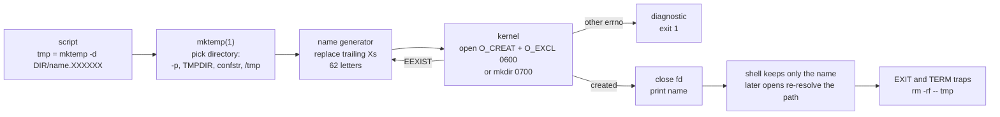

# mktemp

> [!summary] Claim
> `mktemp` is safe for exactly one reason, that the C library creates the chosen name with `open(O_RDWR|O_CREAT|O_EXCL, 0600)` or `mkdir(0700)` and retries on `EEXIST`, while everything a script author actually types (the template grammar, the default directory, `-t`, `-u`, and how many Xs become random) differs between GNU, BSD and macOS, BusyBox, and uutils, because POSIX.1-2024 standardizes `mkstemp()` and `mkdtemp()` but no `mktemp` utility.

Part of [Coreutils and the Userland](README.md) in [Shell and Unix Engineering](../README.md).

## TL;DR

- Mechanism: `mktemp` replaces the trailing `X` characters with random letters (from a 62-character alphabet where gnulib draws from `getrandom` and BSD and macOS from `arc4random_uniform`; from 32 letters where musl derives them from the clock and thread id), creates the name exclusively with `O_CREAT|O_EXCL` mode 0600 or `mkdir` mode 0700, retries on `EEXIST`, closes the descriptor, and prints the name.
- Rule: `tmp=$(mktemp -d "${TMPDIR:-/tmp}/name.XXXXXX") || exit 1`, then `trap 'rm -rf -- "$tmp"' EXIT` and `trap 'exit 143' HUP INT TERM`, and keep every scratch file inside that private 0700 directory.
- Trap: an `EXIT` trap alone leaks the directory on `SIGTERM` in dash, zsh, yash, posh, and BusyBox ash, and `mktemp -u` prints a name without keeping it, which reopens exactly the race `mktemp` exists to close.
- Portability: the only template that every implementation treats identically is an absolute path whose last component ends in exactly six `X`s with no suffix; `-t` takes a prefix on BSD and macOS but marks a template relative to `TMPDIR` on GNU, and macOS `mktemp -t` ignores `TMPDIR` in favor of the per-user `confstr` directory.
- When not to use it: not for data that must outlive the process (systemd ages `/tmp` after 10 days), not as a lock (use [[flock]]), and not inside a program whose language can create an unnamed file by descriptor (`O_TMPFILE`, `memfd_create`, a `tempfile` library).

## Mental model



The script hands `mktemp` a template, and the utility first decides which directory the template lives in, from `-p`, `TMPDIR`, a platform default, or the template itself.
The name generator overwrites the trailing `X`s, and the kernel is then asked to create that exact name exclusively, which is the only step that provides any security.
If the name already exists the kernel says `EEXIST` and the generator tries another name; any other error (a missing directory, `EACCES`, `EROFS`) ends the run with status 1.
On success `mktemp` closes the descriptor and prints the name, so the shell receives a string, not an open file, and every later `>` or `cat` re-resolves that path through the directory.
That is why the directory's permissions, not `mktemp`, protect the file after creation, and why the cleanup arrow at the end belongs to the shell's traps, which differ by shell.

## How it works

### There is no POSIX mktemp utility

POSIX.1-2024 has no `mktemp` utility: the XCU utilities index lists `mkdir` and `mkfifo` and nothing named `mktemp` (POSIX.1-2024 XCU utilities index).
The specification offers three ways to get a unique file at the utility level, none of them `mktemp`:
- the `m4` `mkstemp` macro, whose defining text "shall be as if it were the resulting pathname after a successful call to the `mkstemp()` function", with the file closed afterwards (POSIX.1-2024 XCU m4);
- the `noclobber` option, under which `>` "shall fail if ... the file ... exists and is either a regular file or a symbolic link that resolves to a regular file", performed "atomically as is done by the `open()` function ... when the `O_CREAT` and `O_EXCL` flags are set" (POSIX.1-2024 XCU 2.7.2);
- `mkdir`, which fails if the directory exists, so `mkdir "$name"` with a name you generated yourself is an exclusive create of a directory.
`TMPDIR` is standardized only as "a pathname of a directory made available for programs that need a place to create temporary files" (POSIX.1-2024 XBD 8.3); no standard utility is required to read it.
The interface began in OpenBSD (the FreeBSD source credits "the OpenBSD version - which was first to publish the interface", FreeBSD `usr.bin/mktemp/mktemp.c` header comment), and GNU, BusyBox, and uutils each reimplemented it, so the userlands have drifted apart ever since.

### The kernel primitive: exclusive creation

The C interfaces are standard: `mkstemp()` creates the file "as if by a call to `open(pathname, O_RDWR|O_CREAT|O_EXCL, S_IRUSR|S_IWUSR)`" and `mkdtemp()` creates the directory "as if by a call to `mkdir(pathname, S_IRWXU)`" (POSIX.1-2024 XSH mkdtemp).
"By behaving as if the `O_EXCL` flag for `open()` is set, the function prevents any possible race condition between testing whether the file exists and opening it for use" (same page).
On Linux, `O_CREAT|O_EXCL` also refuses symbolic links: "if path is a symbolic link, then `open()` fails regardless of where the symbolic link points" (`open(2)`), so a planted symlink to `/etc/passwd` yields `EEXIST`, not a write through the link.
`mkdir` never follows a final symlink either, because it fails with `EEXIST` whenever the name exists.
The mode argument is filtered by the umask: "in the absence of a default ACL, the mode of the created file is (mode & ~umask)" (`open(2)`), which the lab proves for both kinds of object: with umask 022 the file is `-rw-------` and the directory `drwx------`, and with umask 0277 they are `-r--------` and `dr-x------` (lab test 1, under BSD `mktemp` and GNU `gmktemp`).
GNU documents the same rule in its help text: "Files are created u+rw, and directories u+rwx, minus umask restrictions" (coreutils `src/mktemp.c`, `usage`).
Issue 8 added `mkostemp()` so that `O_CLOEXEC` and `O_CLOFORK` can be set atomically, because otherwise "a file descriptor is leaked into a child process created by one thread in the window between another thread creating a temporary file descriptor with `mkstemp()` and then using `fcntl()`" (POSIX.1-2024 XSH mkdtemp, RATIONALE); this matters to C programs, not to `mktemp(1)`, which closes its descriptor before it exits.

### Name generation, implementation by implementation

GNU coreutils `mktemp` calls gnulib's `gen_tempname_len()` with the number of `X`s it counted (`mkstemp_len()` and `mkdtemp_len()` in coreutils `src/mktemp.c`), and `try_tempname_len()` in gnulib `lib/tempname.c` does the work:
- the alphabet is `letters[]`, the 62 characters `a-z`, `A-Z`, `0-9`;
- `random_bits()` calls `getrandom(r, 8, GRND_NONBLOCK)` ("Without `GRND_NONBLOCK` it can be blocked for minutes on some systems"), and only if that fails mixes the `CLOCK_REALTIME` seconds and nanoseconds into a 64-bit linear congruential value, deliberately not ASLR addresses, which "would leak ASLR info into the resulting file name";
- each 64-bit draw yields `BASE_62_DIGITS` = 10 base-62 digits, and a draw at or above `biased_min` is rejected so every character is uniform, but only when the bits came from `getrandom`;
- after a collision it draws a fresh random name rather than incrementing, up to `attempts` = the larger of `ATTEMPTS_MIN` (62 x 62 x 62 = 238,328) and `TMP_MAX`, then fails with `EEXIST`; any error other than `EEXIST` returns immediately;
- `try_file()` opens with `(flags & ~O_ACCMODE) | O_RDWR | O_CREAT | O_EXCL` and mode `S_IRUSR | S_IWUSR`, `try_dir()` calls `mkdir(tmpl, S_IRUSR | S_IWUSR | S_IXUSR)`, and `try_nocreate()` (the `-u` path) only `lstat()`s the name.
glibc's own `mkstemp()` runs the same file (`sysdeps/posix/tempname.c`), but `__gen_tempname()` passes a fixed `x_suffix_len` of 6, so only the last six `X`s are replaced and extra `X`s stay literal, exactly as the POSIX APPLICATION USAGE warns: "implementations may treat any additional trailing 'X's as either a fixed or replaceable part of the template" (POSIX.1-2024 XSH mkdtemp).

FreeBSD and macOS generate names in libc, and `mktemp(1)` just calls `mkstemp()` or `mkdtemp()`:
- `_gettemp()` (FreeBSD `lib/libc/stdio/mktemp.c`) and `find_temp_path()` (Apple Libc `stdio/FreeBSD/mktemp.c`) walk backwards over every trailing `X`, however many, replacing each with `padchar[arc4random_uniform(sizeof(padchar) - 1)]` from the same 62 characters;
- there is no minimum: with zero trailing `X`s the loop does nothing and the exact name is created if it is free (lab test 3 creates `plain`, then fails on the second try);
- on `EEXIST` they do not draw again but count through the name space deterministically, incrementing the first random character and carrying into the next, until they return to the saved first combination and fail with `EEXIST`;
- Apple's version first `fstatat()`s the parent directory, so a missing or non-directory parent fails with `ENOENT` or `ENOTDIR` before any name is tried (measured: `mktemp -t 'a/b'` reports "No such file or directory").

musl, which Alpine's BusyBox uses, is the weakest generator:
- `__randname()` seeds `r = ts.tv_sec + ts.tv_nsec + tid * 65537` from `CLOCK_REALTIME` and emits six characters as `'A' + (r & 15) + (r & 16) * 2`, which spells only `A`-`P` and `a`-`p`, five bits each (musl `src/temp/__randname.c`);
- `__mkostemps()` and `mkdtemp()` require the six characters before any suffix to be exactly `XXXXXX`, retry at most 100 times on `EEXIST`, and then restore the `X`s and fail (musl `src/temp/mkostemps.c`, `src/temp/mkdtemp.c`).
The names are guessable from the clock, but the file is still created with `O_EXCL`, so a guessing attacker can only pre-create names and make creation fail, never hijack the file.

uutils `mktemp` delegates creation to the Rust `tempfile` crate's `Builder` with `rand_bytes(n)` and, for directories, `permissions(0o700)` (`make_temp_dir()` and `make_temp_file()` in `src/uu/mktemp/src/mktemp.rs`); the dry-run path builds its name with `rand::rng()` from the same 62 characters (`dry_exec()`).

### Template grammar

The lab runs one probe, `try DIR TEMPLATE CMD`, against every installed implementation, and the results are the portability story in miniature:

| Template | GNU coreutils 9.12 | uutils | BSD and macOS | BusyBox 1.37 |
| :--- | :--- | :--- | :--- | :--- |
| `aXXXXXXXXXX` (10 Xs) | all 10 random (lab test 2) | all 10 random (lab asserts; source) | all 10 random (lab test 2) | only the last 6 random, `aXXXX` stays (lab asserts; glibc and musl source) |
| `plain` (no X) | refused: "too few X's" (lab test 3) | refused, `TooFewXs` (lab asserts; source) | creates `plain` exactly, once (lab test 3) | refused, `EINVAL` from libc (lab asserts; source) |
| `aXX` | refused (lab test 4) | refused (lab asserts; source) | 2 random characters (lab test 4) | refused (lab asserts; source) |
| `bXXX` | 3 random (lab test 4) | 3 random (lab asserts; source) | 3 random (lab test 4) | refused (lab asserts; source) |
| `a.XXXXXX.txt` | `.txt` is a suffix, Xs random (lab test 5) | same as GNU (lab asserts; source) | literal `a.XXXXXX.txt`, nothing random (lab test 5) | refused, the name does not end in `XXXXXX` (lab asserts; source) |

GNU's grammar lives in `main()` of coreutils `src/mktemp.c`: the suffix is everything after the last `X` (`strrchr(template, 'X')`), it must not contain a slash, the run of `X`s before it is counted by `count_consecutive_X_s()`, and fewer than 3 is fatal ("too few X's in template"); `--suffix=SUFF` appends a suffix and requires the template to end in `X`.
uutils mirrors this with `find_last_contiguous_block_of_xs()`, which needs at least 3 and treats what follows as the suffix (`mktemp.rs`).
OpenBSD requires six: it scans the last component for a suffix after the final `X` and calls `fatalx("insufficient number of Xs in template")` unless the six characters before the suffix are `XXXXXX`, then uses `mkstemps()` or `mkdtemps()` with that suffix length (OpenBSD `usr.bin/mktemp/mktemp.c`).
BusyBox does no parsing at all: it calls the C library's `mkstemp()`, `mkdtemp()`, or `mktemp()` on the string (BusyBox `coreutils/mktemp.c`, `mktemp_main()`), so the template rules are glibc's or musl's, both of which demand that the last six characters be `XXXXXX` and replace exactly those six.

### Directory selection: -p, -t, TMPDIR, and confstr

A template with a slash is used as given everywhere, which is why the portable form spells the directory out: `mktemp -d "${TMPDIR:-/tmp}/name.XXXXXX"` (lab test 8 runs exactly that under every implementation and gets `drwx------` under `TMPDIR`).
Without a slash, each implementation picks a directory differently:
- GNU: with no template, the default `tmp.XXXXXXXXXX` and `--tmpdir` are implied; `-p DIR` or `--tmpdir=DIR` uses `DIR`, else a non-empty `TMPDIR`, else `/tmp`, and then the template may not be absolute; the deprecated `-t` reverses the order (non-empty `TMPDIR`, then `-p`, then `/tmp`) and forbids a slash in the template (coreutils `src/mktemp.c`, `main()`).
- FreeBSD: `-t PREFIX` is not a flag on the template but a prefix, producing `DIR/PREFIX.XXXXXXXXXX`; the man page says `DIR` comes from `TMPDIR`, then `-p`, then `/tmp`, but the code's `case 'p'` sets `prefer_tmpdir = false` whenever `-p` is given, so an explicit `-p` wins over `TMPDIR` and the effective order is `-p`, then `TMPDIR`, then `_PATH_TMP`; with no operand at all it behaves as `-t tmp`; several template operands may be given and each is created (FreeBSD `usr.bin/mktemp/mktemp.c` and `mktemp.1`; measured on the macOS build of the same code, where `TMPDIR=A mktemp -t x -p B` created `B/x.CzTqK1vKm4`, as of 2026-11).
- macOS: the same code with an `__APPLE__` block that, in `-t` mode and in the no-operand mode when no `-p` is given, asks `confstr(_CS_DARWIN_USER_TEMP_DIR)` before reading `TMPDIR` (Apple shell_cmds-329 `mktemp/mktemp.c`); on macOS 27.3 (shell_cmds-336.40.1) `TMPDIR=/nonexistent mktemp -t x` still created `/var/folders/.../T/x.gy4uISjSBp` (measured here, as of 2026-11).
- OpenBSD: `-p DIR` sets the prefix directory and implies `-t`, and in `-t` mode a non-empty `TMPDIR` overrides even an explicit `-p` (OpenBSD `usr.bin/mktemp/mktemp.c`).
- BusyBox: the base directory is `-p DIR`, else a non-empty `TMPDIR`, else `/tmp`, prepended only when `-t`, `-p`, or `--tmpdir` is given or the template is omitted, in which case the template is `tmp.XXXXXX` with six `X`s (BusyBox `coreutils/mktemp.c`; lab test 6 measures `tmp.` plus 10 characters for GNU and BSD and asserts 6 for BusyBox).
- uutils: GNU's precedence, including the `-t` rule that a non-empty `TMPDIR` wins over `-p` (`Options::from()` in `mktemp.rs`).
An empty `-p ''` is a sharp edge: GNU, BSD, and uutils fall back to `TMPDIR` (lab test 7); with `TMPDIR` unset, FreeBSD keeps a `NULL` directory and creates the operand relative to the current directory, and macOS asks `confstr` instead (FreeBSD and Apple `mktemp.c`, `case 'p'`; measured on macOS: `/var/folders/.../T//y.5D8GIn`), but BusyBox keeps the empty string and `concat_path_file("", "x.XXXXXX")` returns `/x.XXXXXX`, a name in the root directory (BusyBox `libbb/concat_path_file.c`; lab test 7 asserts `root`).
macOS has a variant of the same edge: with `TMPDIR` set to the empty string, `-p ''` takes `getenv("TMPDIR")`, which is non-NULL, so the name lands in `/` (measured here: "mkstemp failed on /x.Rq38: Read-only file system"), where GNU falls back to `/tmp`.

### -u: a name without a file

`-u` exists for the original `mktemp(3)` use case and is unsafe everywhere, but it is unsafe in two different ways:
- GNU and uutils create nothing: GNU passes `GT_NOCREATE`, so gnulib only `lstat()`s candidate names and prints the first that does not exist (gnulib `try_nocreate()`); BusyBox calls libc `mktemp()`, which does the same `stat()` loop (musl `src/temp/mktemp.c`).
- BSD, macOS, and OpenBSD create the file or directory exclusively and then `unlink()` or `rmdir()` it before printing (FreeBSD and OpenBSD `usr.bin/mktemp/mktemp.c`), which proves the name was free a moment ago and nothing more.
Either way the caller receives a name that someone else may create before the caller does, which Todd C. Miller, author of OpenBSD's `mktemp` (copyright header of OpenBSD `usr.bin/mktemp/mktemp.c`), summarized in 2008: the option "still introduces a race condition" and "should only be used when the directory in which you are making the temporary file is not writable by other users" ([oss-security, 2008-08-18](https://www.openwall.com/lists/oss-security/2008/08/18/5)).

### After mktemp exits: what protects the name

`mktemp` prints a name and closes its descriptor, so the guarantees that survive are those of the directory.
In `/tmp` they come from the sticky bit, which POSIX calls the "restricted deletion flag" for directories (`S_ISVTX`, 01000, POSIX.1-2024 XBD `<sys/stat.h>`, XSI): other users can create entries but cannot remove or rename yours, so your 0600 file keeps its name until you delete it.
systemd ships `/tmp` and `/var/tmp` as mode 1777 owned by root (`q /tmp 1777 root root 10d` in systemd `tmpfiles.d/tmp.conf`).
In a world-writable directory without the sticky bit, anyone can unlink your file and plant a symlink under the same name between `mktemp` and your next `>`, so `mktemp` alone protects nothing there; `mktemp -d` and working only inside the new 0700 directory protects everything, because nobody else can create, remove, or rename entries in it.
Linux adds two sysctl-controlled kernel defenses for sticky world-writable directories: `fs.protected_symlinks` addresses "the symlink-based time-of-check-time-of-use race, most commonly seen in world-writable directories like `/tmp`", and `fs.protected_regular` = 1 refuses an `O_CREAT` open of a regular file "that we don't own in world writable sticky directories, unless they are owned by the owner of the directory" (Linux `Documentation/admin-guide/sysctl/fs.rst`).

### The shell-only alternative: set -C

When `mktemp` may be absent (it is not POSIX), `set -C` turns `>` into the same exclusive create, as XCU 2.7.2 requires; the lab shows `printf first >"$f"` creating the file, a second `>` being refused with the content still `first`, and `>|` overriding (lab test 9: `created refused first third`).
The rationale explains why this guarantee is new: "Historical shells just called `stat()` to check if a regular file existed and then called `creat()`", a race, and the standard now asks for an `O_CREAT|O_EXCL` step, while noting that a shell may still open an existing non-regular file such as a FIFO or `/dev/null` (POSIX.1-2024 XRAT C.2.7.2).
On the macOS host, bash 3.2, bash 5.3, dash, zsh, and ksh93u+ 2012 also refused `>` onto a dangling symlink under `set -C` and did not create its target (measured here, as of 2026-11); POSIX only says the redirection "may also fail" in that case.
`set -C` gives you exclusivity but not randomness: the name still has to be unpredictable, so it is a fallback for creating a lock or a known name, not a replacement for `mktemp -d`.

### Cleanup is the shell's job

`mktemp` never deletes anything, so the script must, and the shells disagree about when an `EXIT` trap runs.
With only `trap 'rm -rf -- "$tmp"' EXIT`, a `SIGTERM` from outside makes bash and ksh93 run the trap (status 143) and mksh run it but report status 0, while dash, zsh, yash, posh, and BusyBox ash die without running it and leave the directory behind (lab test 11, consistent with the shell matrix's measurement in [[Traps-and-EXIT]]).
Adding `trap 'exit 143' HUP INT TERM` converts each signal into an ordinary `exit`, which every shell follows with the `EXIT` trap, so the directory is removed in all of them (lab test 12; status 143 everywhere except mksh, which reports 0).
Re-raising the original signal instead of exiting with 143, so a parent sees a real signal death, is covered in [[Cleanup-Traps-and-Re-Raising-Signals]].
GNU `mktemp` itself cleans up one case: if printing the name fails (for example a full disk behind stdout), it removes the file or directory it just created before exiting 1 (`close_stream (stdout)` followed by `unlink` or `rmdir` in coreutils `src/mktemp.c`).

## Numbers and limits

| Quantity | Value | Source |
| :--- | :--- | :--- |
| Random names for 6 Xs over 62 letters | 62^6 = 56,800,235,584 (35.7 bits) | Computed from `letters[]` (gnulib) and `padchar[]` (FreeBSD, Apple) |
| Random names for 10 Xs over 62 letters | 62^10 = 839,299,365,868,340,224 (59.5 bits) | Computed; 10 is GNU, uutils, and BSD's default `tmp.XXXXXXXXXX` (lab test 6) |
| musl name space | 6 characters from 32 letters, seeded by clock and thread id | musl `src/temp/__randname.c` |
| gnulib attempts before `EEXIST` | 238,328 (62^3, `ATTEMPTS_MIN` and the default `TMP_MAX`) | gnulib `lib/tempname.c` |
| musl attempts before `EEXIST` | 100 | musl `mkostemps.c`, `mkdtemp.c`, `mktemp.c` |
| BSD and macOS attempts | the whole name space, enumerated deterministically after the first random draw | FreeBSD `_gettemp()`, Apple `find_temp_path()` |
| Minimum Xs | POSIX `mkstemp` 6; OpenBSD `mktemp` 6; GNU and uutils 3; BSD and macOS libc 0; BusyBox 6 (from libc) | POSIX.1-2024 XSH mkdtemp; sources; lab tests 3 and 4 |
| BusyBox default template | `tmp.XXXXXX` (6 random characters) | BusyBox `coreutils/mktemp.c`; lab test 6 asserts it |
| File and directory mode | 0600 and 0700, then `& ~umask` | POSIX.1-2024 XSH mkdtemp; lab test 1 (umask 022 and 0277) |
| glibc "2.06 and earlier" `mkstemp` mode | 0666 | Linux `mkstemp(3)` HISTORY |
| systemd ageing | `/tmp` 10 days, `/var/tmp` 30 days without change or read | systemd `tmpfiles.d/tmp.conf`, `TEMPORARY_DIRECTORIES.md` (as of 2026-11) |
| `O_TMPFILE` available | Linux 3.11 and later | Linux `open(2)` |
| Cost of one `mktemp` call | 2.21 ms (macOS `mktemp`), 3.10 ms (GNU `gmktemp` 9.12) | Measured here: 500 sequential calls from `/bin/sh` on macOS 27.3, Apple silicon, 2026-11 |

The per-call cost is process creation, not name generation: a script that needs many scratch files should call `mktemp -d` once and name files inside the directory itself.

## Portability

The utility, compared (cells cite the lab test that proves them, or the source that states them):

| Implementation | No operand | Template rules | `-t` | `-u` | Empty `-p ''` | Operands |
| :--- | :--- | :--- | :--- | :--- | :--- | :--- |
| POSIX.1-2024 | no `mktemp` utility (XCU index) | `mkstemp()` needs 6 trailing Xs (XSH mkdtemp) | n/a | n/a | n/a | n/a |
| GNU coreutils 9.12 | `TMPDIR` or `/tmp`, `tmp.` + 10 (lab 6) | at least 3 Xs before an optional suffix (lab 3 to 5) | template relative to `TMPDIR`, deprecated (source) | creates nothing (source) | falls back to `TMPDIR` (lab 7) | one (source) |
| macOS shell_cmds | `confstr` user temp dir before `TMPDIR`, `tmp.` + 10 (source; measured) | trailing Xs only, any number, even 0 (lab 2 to 5) | prefix, `-p` if given, else `confstr` dir before `TMPDIR` (source; measured) | creates, then removes (source) | `TMPDIR`; root if `TMPDIR` is empty; `confstr` dir if unset (lab 7; measured) | several (source) |
| FreeBSD | `-p`, `TMPDIR`, `/tmp` (source) | same libc rules as macOS (source) | prefix, `-p` before `TMPDIR` in the code; the man page states the reverse (source; measured on macOS) | creates, then removes (source) | `TMPDIR`; root if `TMPDIR` is empty; current directory if unset (source) | several (source) |
| OpenBSD | `TMPDIR` or `/tmp`, `tmp.` + 10 (source) | at least 6 Xs before an optional suffix, all randomized (source; libc `__mktemp4.c` `MIN_X`) | template relative to `TMPDIR`, which overrides `-p` (source) | creates, then removes (source) | `TMPDIR` if non-empty, else the root directory (source) | one (source) |
| BusyBox 1.37 | `TMPDIR` or `/tmp`, `tmp.` + 6 (lab 6 asserts) | libc: last 6 must be Xs, no suffix (lab 2 to 5 assert) | prepend the base directory (source) | libc `mktemp()`, nothing created (source) | root directory (lab 7 asserts) | one (source) |
| uutils | `TMPDIR` or `/tmp`, `tmp.` + 10 (source) | at least 3 Xs before an optional suffix (source) | `TMPDIR` before `-p` (source) | creates nothing (source) | `TMPDIR` (source); empty `TMPDIR` meant CWD before 0.6.0 (CVE-2026-35342) | one (source) |

The shells, compared on the two behaviors a temporary-file idiom depends on:

| Shell | `set -C` makes `>` exclusive and `>\|` overrides | `EXIT` trap alone, then `SIGTERM` | `EXIT` trap plus `trap 'exit 143' TERM` |
| :--- | :--- | :--- | :--- |
| POSIX sh | required (XCU 2.7.2) | the trap "may" run on a signal ([[Traps-and-EXIT]]) | directory removed, status 143 |
| macOS bash 3.2 (`/bin/sh`) | yes (lab 9, run here) | trap runs, status 143 (lab 11, run here) | removed, 143 (lab 12, run here) |
| bash 5.3 | yes (lab 9, run here) | trap runs, 143 (lab 11, run here) | removed, 143 (lab 12, run here) |
| zsh native (5.9.2 here) | yes (lab 9, run here) | directory leaks, 143 (lab 11, run here) | removed, 143 (lab 12, run here) |
| zsh `--emulate sh` | yes (lab 9, run here) | leaks, 143 (lab 11, run here) | removed, 143 (lab 12, run here) |
| dash (0.5.13.5 here, 0.5.12 in the matrix) | yes (lab 9, run here) | leaks, 143 (lab 11, run here) | removed, 143 (lab 12, run here) |
| ksh93 | yes (lab 9, run here on ksh93u+ 2012) | trap runs, 143 (lab 11, run here; matrix) | removed, 143 (lab 12, run here; matrix) |
| mksh R59 | yes (lab 9 asserts) | trap runs, status 0 (lab 11 asserts; matrix) | removed, status 0 (lab 12 asserts; matrix) |
| yash 2.58 | yes (lab 9 asserts) | leaks, 143 (lab 11 asserts; matrix) | removed, 143 (lab 12 asserts; matrix) |
| posh 0.14 | yes (lab 9 asserts) | leaks, 143 (lab 11 asserts; matrix) | removed, 143 (lab 12 asserts; matrix) |
| BusyBox ash 1.37 | yes (lab 9 asserts) | leaks, 143 (lab 11 asserts; matrix) | removed, 143 (lab 12 asserts; matrix) |

"Matrix" means the signal behavior was measured for that shell by the shell matrix in the [[Traps-and-EXIT]] lab; "asserts" means this lab encodes the expectation and the integrator's matrix run decides it.

## Worked example

The [lab](../labs/08-mktemp/) is one POSIX `sh` probe, `mktemp-probe.sh`, and a bats suite, `mktemp.bats`, that runs each probe mode under the shell under test (`run_lab`) and, for utility behavior, once per installed `mktemp` implementation (`mktemp`, `gmktemp`, and `busybox mktemp` when present), asserting per implementation with a `mktemp_flavor` helper rather than per shell.
The probe, verbatim:

```sh
#!/bin/sh
# mktemp-probe: measure how a mktemp implementation and the shell under test
# create, protect, and clean up temporary files and directories.
# Every path it creates is under DIR; CMD is the mktemp command to test,
# for example "mktemp", "gmktemp", or "busybox mktemp" passed as two words.
#
# Usage: mktemp-probe.sh MODE DIR [ARG...]
#   modes DIR CMD...          mode bits of a new file and directory under umask 022 and 0277
#   try DIR TEMPLATE CMD...   run CMD DIR/TEMPLATE; print "ok NAME" or "fail"
#   default DIR CMD...        run CMD -p DIR with no template; print the name it chose
#   emptyp DIR CMD...         TMPDIR=DIR CMD -u -p '' x.XXXXXX; where does the name land?
#   scratch DIR CMD...        the portable idiom: an absolute template under TMPDIR, -d, 6 Xs
#   noclobber DIR             atomic exclusive create with set -C, no mktemp at all
#   cleanup DIR CMD...        an EXIT trap removes the scratch directory; exit 3 survives
#   leak DIR CMD...           only an EXIT trap, then SIGTERM: does the directory survive?
#   forward DIR CMD...        an EXIT trap plus a TERM trap that calls exit 143
set -u

mode=${1:?mode}
dir=${2:?dir}
shift 2

# perm_of PATH: print the ls -l mode string, without a trailing ACL or xattr marker.
perm_of() {
  p=$(ls -ld "$1") || return 1
  p=${p%% *}
  p=${p%[@+.]}
  printf '%s\n' "$p"
}

case $mode in
  modes)
    for mask in 022 0277; do
      f=$(
        umask "$mask"
        "$@" "$dir/f$mask.XXXXXX"
      ) || exit 1
      d=$(
        umask "$mask"
        "$@" -d "$dir/d$mask.XXXXXX"
      ) || exit 1
      fp=$(perm_of "$f") || exit 1
      dp=$(perm_of "$d") || exit 1
      printf '%s %s %s\n' "$mask" "$fp" "$dp"
    done
    ;;

  try)
    tmpl=${1:?template}
    shift
    if out=$("$@" "$dir/$tmpl" 2>/dev/null); then
      printf 'ok %s\n' "${out##*/}"
    else
      printf 'fail\n'
    fi
    ;;

  default)
    out=$("$@" -p "$dir") || exit 1
    case $out in
      "$dir"/*) printf '%s\n' "${out##*/}" ;;
      *) printf 'elsewhere %s\n' "$out" ;;
    esac
    ;;

  emptyp)
    out=$(TMPDIR=$dir "$@" -u -p '' x.XXXXXX) || exit 1
    case $out in
      "$dir"/x.*) printf 'in-TMPDIR\n' ;;
      /x.*) printf 'root\n' ;;
      *) printf 'other %s\n' "$out" ;;
    esac
    ;;

  scratch)
    TMPDIR=$dir
    export TMPDIR
    tmp=$("$@" -d "${TMPDIR:-/tmp}/probe.XXXXXX") || exit 1
    p=$(perm_of "$tmp") || exit 1
    case $tmp in
      "$dir"/probe.??????) where=under-TMPDIR ;;
      *) where=elsewhere ;;
    esac
    printf '%s %s\n' "$where" "$p"
    ;;

  noclobber)
    f=$dir/lock
    set -C
    if printf 'first\n' >"$f"; then r1=created; else r1=refused; fi
    if { printf 'second\n' >"$f"; } 2>/dev/null; then r2=overwrote; else r2=refused; fi
    c1=$(cat "$f")
    printf 'third\n' >|"$f"
    c2=$(cat "$f")
    set +C
    printf '%s %s %s %s\n' "$r1" "$r2" "$c1" "$c2"
    ;;

  cleanup)
    tmp=$("$@" -d "$dir/probe.XXXXXX") || exit 1
    trap 'rm -rf -- "$tmp"' EXIT
    printf 'data\n' >"$tmp/payload"
    printf '%s\n' "$tmp"
    exit 3
    ;;

  leak | forward)
    tmp=$("$@" -d "$dir/probe.XXXXXX") || exit 1
    printf '%s\n' "$tmp"
    trap 'rm -rf -- "$tmp"' EXIT
    if [ "$mode" = forward ]; then
      trap 'exit 143' HUP INT TERM
    fi
    (
      sleep 1
      kill -TERM "$$"
    ) &
    sleep 2
    ;;

  *)
    printf 'unknown mode: %s\n' "$mode" >&2
    exit 2
    ;;
esac
```

The `scratch` mode is the idiom to copy: an absolute template under `${TMPDIR:-/tmp}`, six `X`s, `-d`, and a failure check, which every implementation in the table above accepts and turns into a 0700 directory.
The `forward` mode is the cleanup to copy: an `EXIT` trap that removes the directory, plus a `TERM` trap that calls `exit` so the `EXIT` trap runs in every shell.

Running the probe by hand on the macOS 27.3 host (BSD `mktemp` from shell_cmds-336.40.1, then GNU `gmktemp` 9.12; `$d` is an empty directory) printed:

```text
## mktemp
022 -rw------- drwx------
0277 -r-------- dr-x------
ok aE5XAoodQ7t
ok plain
ok a.XXXXXX.txt
tmp.rF04ZDkyrG
in-TMPDIR
under-TMPDIR drwx------
## gmktemp
022 -rw------- drwx------
0277 -r-------- dr-x------
ok a7R3ed0h37Q
fail
ok a.jvdaJJ.txt
tmp.1GSvb6TVaO
in-TMPDIR
under-TMPDIR drwx------
```

The lines are, in order, `modes`, `try aXXXXXXXXXX`, `try plain`, `try a.XXXXXX.txt`, `default`, `emptyp`, and `scratch`; the random characters differ on every run, and the bats tests assert their shape, not their value.
`noclobber` printed `created refused first third`, and `leak` removed the directory under `/bin/sh` (bash 3.2) but left `probe.ddHJAf` under dash and `probe.I5Ae6D` under zsh, each exiting 143.
The suite under `sh`, bash 5.3, dash, zsh, `zsh --emulate sh`, and ksh93u+ 2012 on that host passed all 13 tests in each shell (78 of 78), the first run printing:

```text
1..13
ok 1 new files are 0600 and new directories 0700, minus the umask, in every implementation
ok 2 ten Xs: GNU, uutils, and BSD randomize all ten; BusyBox randomizes only the last six
ok 3 a template with no X: BSD creates that exact name once; GNU, uutils, and BusyBox refuse
ok 4 two Xs: BSD accepts them; GNU and uutils need 3, BusyBox needs 6
ok 5 Xs before a suffix: GNU and uutils randomize them, BSD keeps them literal, BusyBox fails
ok 6 no template: GNU, uutils, and BSD use tmp. plus 10 characters; BusyBox uses 6
ok 7 an empty -p falls back to TMPDIR, except BusyBox, which puts the name in the root directory
ok 8 the portable idiom makes a 0700 directory under TMPDIR with every implementation
ok 9 set -C makes > an exclusive create in every shell, and >| overrides it
ok 10 an EXIT trap removes the scratch directory and keeps the exit status
ok 11 an EXIT trap alone: SIGTERM leaks the directory in dash, zsh, yash, posh, and BusyBox ash
ok 12 a TERM trap that calls exit runs the EXIT trap in every shell
ok 13 an unknown mode fails with status 2
```

The BusyBox and uutils arms were not exercised on this host (neither is installed); they encode the behavior the sources above state, for the integrator's Alpine and Debian matrix to confirm.

## Pitfalls

> [!warning] Predictable names built from `$$` or a fixed path
> Trigger: `tmp=/tmp/myapp.$$` or a constant such as `/tmp/myapp`, reused on every run.
> Symptom: another local user pre-creates the name or a symlink under it, so your script writes through the link or executes their file; bash-git-prompt 2.6.1 through 2.7.1 "insecurely uses the `/tmp/git-index-private$$` file, which has a predictable name" ([CVE-2025-61659](https://nvd.nist.gov/vuln/detail/CVE-2025-61659)), and Timeshift before 20.03 "unsafely reuses a preexisting temporary directory in the predictable location /tmp/timeshift", letting an attacker race in scripts that then run as root ([CVE-2020-10174](https://nvd.nist.gov/vuln/detail/CVE-2020-10174)).
> Fix: `mktemp -d` with an absolute template, and never reuse a directory you did not just create.

> [!warning] `mktemp -u` hands out a name, not a file
> Trigger: `f=$(mktemp -u); some_tool -o "$f"`, usually because the tool refuses an existing output file.
> Symptom: the name is free only at the instant `mktemp` checked it; GNU, uutils, and BusyBox never create it, and BSD creates and immediately removes it, so another process can win the gap.
> Fix: create a private directory with `mktemp -d` and let the tool create `"$dir/out"`, a name nobody else can reach; as Todd C. Miller put it, `-u` "should only be used when the directory in which you are making the temporary file is not writable by other users" ([oss-security, 2008](https://www.openwall.com/lists/oss-security/2008/08/18/5)).

> [!warning] BSD treats non-trailing Xs as literal text
> Trigger: `mktemp report.XXXXXX.txt` or `mktemp "$dir/lock"` on macOS or FreeBSD.
> Symptom: the first run creates `report.XXXXXX.txt` (or `lock`) literally and the second fails with "File exists"; on GNU the same command randomizes the Xs, and on BusyBox it fails (lab tests 3 and 5).
> Fix: end the last component in `XXXXXX`, and on GNU only use `--suffix=.txt` when an extension is needed, or rename the file afterwards.

> [!warning] BusyBox randomizes only six Xs
> Trigger: a GNU-style `mktemp "$d/build.XXXXXXXXXX"` on Alpine or a BusyBox initramfs.
> Symptom: the name keeps four literal `X`s and has 6 random characters, from a clock-seeded 32-letter alphabet on musl, instead of 10 from `getrandom` (lab test 2; musl `__randname.c`).
> Fix: write exactly six `X`s everywhere (POSIX's own advice for `mkstemp()`), and never rely on the name being unguessable; rely on the 0700 directory instead.

> [!warning] `-t` means two different things
> Trigger: `mktemp -t myapp` copied from a macOS script to Linux, or `mktemp -t myapp.XXXXXX` copied the other way.
> Symptom: GNU rejects `mktemp -t myapp` ("too few X's in template", measured with `gmktemp`); BSD and macOS take the argument as a prefix and append `.XXXXXXXXXX` themselves, so `mktemp -t myapp.XXXXXX` there yields `myapp.XXXXXX.` plus ten random characters, with the first six Xs literal (FreeBSD and Apple `mktemp.c`).
> Fix: never use `-t`; pass an absolute template.

> [!warning] macOS ignores `TMPDIR` for `-t` and the default
> Trigger: a test harness sets `TMPDIR` to a sandbox and calls `mktemp` or `mktemp -t x` on macOS.
> Symptom: the file lands in the per-user `confstr(_CS_DARWIN_USER_TEMP_DIR)` directory under `/var/folders`, outside the sandbox; `TMPDIR=/nonexistent mktemp` succeeds there (measured on macOS 27.3; Apple shell_cmds `mktemp.c` `__APPLE__` block).
> Fix: spell the directory in the template: `mktemp -d "${TMPDIR:-/tmp}/x.XXXXXX"` honors `TMPDIR` on every implementation (lab test 8).

> [!warning] An empty directory string sends files to `/` or the CWD
> Trigger: `TMPDIR=` (set but empty) or `mktemp -p "$UNSET_VAR"`.
> Symptom: BusyBox `-p ''` builds `/x.XXXXXX` in the root directory (lab test 7); macOS and FreeBSD `-p ''` with an empty `TMPDIR` do the same (measured: "mkstemp failed on /x.Rq38"), and FreeBSD `-p ''` with `TMPDIR` unset creates the operand in the current directory (FreeBSD `mktemp.c`, `case 'p'`); uutils put files in the current directory, which NVD records as [CVE-2026-35342](https://nvd.nist.gov/vuln/detail/CVE-2026-35342) and links to the fix in release 0.6.0; GNU falls back to `/tmp`.
> Fix: `${TMPDIR:-/tmp}` (the `:-` form also replaces an empty value) in an explicit template, and fail closed when a configured directory is empty.

> [!warning] An `EXIT` trap alone leaks on SIGTERM
> Trigger: `trap 'rm -rf -- "$tmp"' EXIT` and nothing else, in a script that systemd, `timeout`, or a CI runner stops with `SIGTERM`.
> Symptom: dash, zsh, yash, posh, and BusyBox ash die without running the trap, so scratch directories pile up until ageing removes them (lab test 11).
> Fix: add `trap 'exit 143' HUP INT TERM` (lab test 12), or re-raise as in [[Cleanup-Traps-and-Re-Raising-Signals]].

> [!warning] An unchecked failure turns cleanup into `rm -rf /*`
> Trigger: `tmp=$(mktemp -d)` without `|| exit`, then `rm -rf "$tmp"/*` or `cd "$tmp" && rm -rf ./*` in cleanup.
> Symptom: when `mktemp` fails (full disk, read-only `/tmp`, bad `TMPDIR`), `tmp` is empty and the glob expands under `/`; the same empty-variable shape, `rm -rf "$STEAMROOT/"*`, deleted a user's files when Steam for Linux ran with `STEAMROOT` empty ([ValveSoftware/steam-for-linux#3671](https://github.com/valvesoftware/steam-for-linux/issues/3671)).
> Fix: `tmp=$(mktemp -d ...) || exit 1`, remove the directory itself with `rm -rf -- "$tmp"`, never its expanded contents, and single-quote the trap so it reads `tmp` when it runs.

> [!warning] Long jobs lose files to ageing
> Trigger: a job that keeps a directory in `/tmp` or `/var/tmp` longer than the ageing period, or extracts an archive whose files carry old timestamps.
> Symptom: `systemd-tmpfiles` deletes files "that have neither been changed nor read" for 10 days in `/tmp` and 30 days in `/var/tmp` (systemd `TEMPORARY_DIRECTORIES.md`).
> Fix: hold a BSD lock on the directory with [[flock]], which the ageing algorithm skips, or keep state under `/run`, `$XDG_RUNTIME_DIR`, or `/var/lib` and clean it yourself (same document).

## Security and robustness

- Exclusivity is the only guarantee: `O_CREAT|O_EXCL` and `mkdir` make creation atomic and refuse an existing name or symlink, so the attacker's best move against a known name is denial of service by pre-creating it, which musl's 100 retries over clock-derived names make cheaper than glibc's 238,328 retries over `getrandom` names.
- The directory protects the file afterwards: in a sticky `/tmp` nobody else can remove or rename your entry; elsewhere only your own 0700 directory does, so put every file inside one `mktemp -d` and treat a bare `mktemp` file in a shared directory as safe only if that directory is sticky.
- The mode is not the whole access story: `open(2)` applies `mode & ~umask` only "in the absence of a default ACL", so a parent directory with a default ACL can grant group or other access to a file created 0600; check `getfacl` on unusual `TMPDIR` locations before writing secrets there.
- `O_EXCL` depends on the filesystem: Linux `open(2)` warns that "On NFS, `O_EXCL` is supported only when using NFSv3 or later on kernel 2.6 or later", and without it exclusive creation is a race; keep `TMPDIR` on a local filesystem for anything security-relevant.
- The kernel can harden `/tmp` further: `fs.protected_symlinks` and `fs.protected_regular` stop the classic cross-user symlink and pre-created-file attacks in sticky world-writable directories (Linux `sysctl/fs.rst`), and systemd's `PrivateTmp=` gives a service its own `/tmp` and `/var/tmp` (systemd `TEMPORARY_DIRECTORIES.md`); scripts should still not depend on either being enabled.
- Secrets prefer descriptors over names: a name in `/tmp` is visible to `ls` by every user even when the content is not; when the consumer accepts a descriptor, a here-document, a pipe, or a descriptor-based unnamed file (`O_TMPFILE` since Linux 3.11, which "can never be reached via any pathname" and is "not subject to symlink attacks", `open(2)`) leaks less.
- Fail closed: check every `mktemp` with `|| exit 1`, quote every expansion of the result, and pass `--` to `rm`, because a template with a leading `-` or an empty result changes the meaning of the cleanup command.
- Attacks against temporary files in general (symlink planting, file-descriptor races, `/proc/self/fd` tricks) are the subject of [[Temporary-File-Attacks]] and [[Path-Resolution-and-Symlink-Races]].

## The principal's view

The decision is not "which `mktemp` flags" but where a process's transient state lives and who cleans it up.
For shell, standardize one helper across the fleet: one `mktemp -d "${TMPDIR:-/tmp}/<tool>.XXXXXX"` per process, a single-quoted `EXIT` trap plus `HUP INT TERM` traps that exit, and every file named inside that directory; it works on every userland measured here, costs one process creation, and makes cleanup a single `rm -rf -- "$tmp"`.
The trade-off is that a shell script can only hold names, so it inherits every property of the directory (stickiness, ACLs, NFS, ageing) and every shell's trap semantics; review those once in the helper instead of in each script.
For services, prefer platform isolation over cleverness: systemd's `PrivateTmp=`, `RuntimeDirectory=`, or a container's private `/tmp` removes the shared-namespace problem entirely, and ageing or a lock decides lifetime instead of hope.
When the temporary file is a step toward publishing a result, create it in the destination's directory and `rename` it into place, so the temporary and final names share a filesystem; that pattern belongs to [[install-and-Atomic-Deployment]] and [[Atomic-Writes]], not to `/tmp`.
Switch languages when the job needs a temporary file that is never named (`O_TMPFILE`, `memfd_create`), needs to pass descriptors rather than paths, or needs cleanup that survives every failure path: Python's `tempfile`, Go's `os.CreateTemp`, and Rust's `tempfile` keep the descriptor and delete through scope or `defer`, which a shell cannot express.

## Interview questions

> [!question] L5: Why is `tmp=/tmp/report.$$` unsafe, and what exactly does `mktemp` change?
>
> > [!success]- Answer
> > `$$` is the process id, so another local user can guess the name and create it, or a symlink under it, before the script does.
> > The script's `>` then truncates the attacker's file or writes through the link with the script's privileges, which is the bug in CVE-2025-61659 (bash-git-prompt and `/tmp/git-index-private$$`).
> > `mktemp` replaces the Xs with random characters and, more importantly, creates the name itself with `open(O_RDWR|O_CREAT|O_EXCL, 0600)` or `mkdir(0700)`, which fails with `EEXIST` instead of following a planted name.
> > Randomness only makes collisions rare; exclusivity is what makes them harmless.
> >
> > Follow-up: What is the worst an attacker can still do against a name `mktemp` is about to choose?

> [!question] L5 (Predict the output): On macOS, what do these two lines print, and what would GNU coreutils print?
> ```sh
> cd "$(mktemp -d)" || exit 1
> mktemp report.XXXXXX.txt; mktemp report.XXXXXX.txt
> ```
>
> > [!success]- Answer
> > On macOS the first command prints `report.XXXXXX.txt` and creates that file literally, because BSD libc replaces only `X`s at the very end of the template and there are none.
> > The second prints `mktemp: mkstemp failed on report.XXXXXX.txt: File exists` on stderr and exits 1, because the only candidate name is taken and the zero-length random part leaves nothing to vary.
> > GNU treats `.txt` as a suffix and prints two different names such as `report.jvdaJJ.txt`, and BusyBox fails both times because libc requires the name to end in `XXXXXX`.
> >
> > Follow-up: How would you get a `.txt` extension portably?

> [!question] L6 (Debug this script): A cron job on a Debian host leaves directories in `/tmp` after systemd stops it and once deleted the service user's home directory: find both bugs.
> ```sh
> #!/bin/sh
> tmp=$(mktemp -d)
> trap "rm -rf $tmp/*; rmdir $tmp" EXIT
> cd "$HOME" && long_job > "$tmp/out"
> ```
>
> > [!success]- Answer
> > The leak: Debian's `/bin/sh` is dash, which does not run an `EXIT` trap when an untrapped `SIGTERM` kills it, so `systemctl stop` leaves the directory behind; add `trap 'exit 143' HUP INT TERM`.
> > The deletion: `mktemp` can fail (full or read-only `/tmp`), leaving `tmp` empty, and the double-quoted trap was expanded at registration into `rm -rf /*; rmdir`, which as the service user removes everything it owns.
> > Fix: `tmp=$(mktemp -d "${TMPDIR:-/tmp}/job.XXXXXX") || exit 1`, then `trap 'rm -rf -- "$tmp"' EXIT`, so the trap reads `tmp` when it runs and removes only the directory itself.
> >
> > Follow-up: Why does the same script not leak under bash?

> [!question] L6: What does `mktemp -u` do in GNU coreutils, BusyBox, and FreeBSD, and why is it unsafe in all three?
>
> > [!success]- Answer
> > GNU passes `GT_NOCREATE` to gnulib, which only `lstat()`s random candidates and prints the first that does not exist.
> > BusyBox calls libc `mktemp()`, which does the same `stat()` loop with no creation.
> > FreeBSD and macOS create the file or directory exclusively and then `unlink()` or `rmdir()` it before printing.
> > In every case the caller receives a name that is free only at the moment of the check, so another process can create it first; the safe pattern is to create a private directory and let the consumer create a file inside it.
> >
> > Follow-up: In which directory is `-u` acceptable, according to the author of OpenBSD's `mktemp`?

> [!question] L6: A test harness exports `TMPDIR=$sandbox`, yet on macOS `mktemp -t build` creates files under `/var/folders`; why, and how do you write it portably?
>
> > [!success]- Answer
> > Apple's `mktemp` has an `__APPLE__` block that, in `-t` mode and when no template is given, asks `confstr(_CS_DARWIN_USER_TEMP_DIR)` for the per-user temporary directory before it reads `TMPDIR`.
> > The confstr directory is usually what `TMPDIR` points at in a login session, so the difference only shows when something overrides `TMPDIR`, such as a sandbox.
> > `-t` is unportable anyway: BSD takes a prefix and appends ten Xs, while GNU expects a template and calls `-t` deprecated.
> > Write `mktemp -d "${TMPDIR:-/tmp}/build.XXXXXX"`, an absolute template every implementation resolves the same way.
> >
> > Follow-up: What does FreeBSD's `mktemp` do with `-t` and both `TMPDIR` and `-p` set?

> [!question] L7: Why does `mktemp` stay safe after it exits, given that it closes the descriptor and the script reopens the file by name?
>
> > [!success]- Answer
> > The name stays bound to your file only because nobody else can remove or rename it: in `/tmp` the sticky bit (POSIX's restricted deletion flag, `S_ISVTX`) allows only the owner of an entry, the directory owner, or root to unlink or rename it.
> > In a world-writable directory without the sticky bit, an attacker can unlink your 0600 file and plant a symlink under the same name before your next `>`, so `mktemp` alone protects nothing there.
> > Creating a 0700 directory with `mktemp -d` and working only inside it removes the dependency: no other user can create, remove, or rename entries in it.
> > Linux's `fs.protected_symlinks` and `fs.protected_regular` add kernel checks for the sticky case but are configuration, not guarantees.
> >
> > Follow-up: What else, besides the directory mode, can widen access to a file `mktemp` created with mode 0600?

> [!question] L7: Compare the name generators of glibc and gnulib, BSD libc, and musl, and say which property actually matters for security.
>
> > [!success]- Answer
> > gnulib, which GNU `mktemp` and glibc share, draws 64 bits from `getrandom` with `GRND_NONBLOCK`, rejects biased draws, extracts 10 base-62 digits per draw, and retries with fresh random names up to 238,328 times.
> > BSD and macOS fill every trailing `X` with `arc4random_uniform(62)` and, on collision, enumerate the rest of the name space deterministically.
> > musl derives six characters from a 32-letter alphabet using the realtime clock and thread id, and gives up after 100 collisions.
> > What matters for confidentiality and integrity is the same in all three: creation with `O_EXCL` and mode 0600 or 0700, so a guessed name can only be pre-created, causing denial of service; unpredictability matters for that denial-of-service resistance, which is weakest on musl.
> >
> > Follow-up: Why does gnulib refuse to mix ASLR addresses into its fallback entropy?

> [!question] L7+: You own the job platform for thousands of shell-based batch jobs on systemd hosts, some running for weeks: design their temporary-file policy.
>
> > [!success]- Answer
> > Give every job a private namespace instead of the shared `/tmp`: `PrivateTmp=` or `RuntimeDirectory=` for services, or a per-job directory the runner creates with `mktemp -d` and passes in as `TMPDIR`.
> > Ship one shell helper that creates the scratch directory with an absolute six-X template, checks the result, and installs a single-quoted `EXIT` trap plus `HUP INT TERM` traps, so dash-based and BusyBox-based images clean up on `SIGTERM` too.
> > For jobs longer than the 10-day `/tmp` ageing window, either hold an `flock` on the scratch directory for the job's lifetime, which `systemd-tmpfiles` skips, or keep state under `/var/lib` with explicit retention.
> > Ban `mktemp -u`, `-t`, and `$$`-based names in lint, keep `TMPDIR` on local disks because `O_EXCL` is unreliable on old NFS, and move jobs that pass secrets or need unnamed files to a language with descriptor-based temporary files.
> >
> > Follow-up: How would you detect leaked scratch directories fleet-wide, and what would you alert on?

## Related

Prerequisites: [[date-and-Time-Zones]]

Next: [[tar-and-Archives]]

See also: [[Four-Userlands-GNU-BSD-BusyBox-uutils]], [[Userland-Portability-Traps]], [[Traps-and-EXIT]], [[Cleanup-Traps-and-Re-Raising-Signals]], [[Temporary-File-Attacks]], [[Path-Resolution-and-Symlink-Races]], [[Permissions-umask-and-Special-Bits]], [[Atomic-Writes]], [[install-and-Atomic-Deployment]], [[flock]], [[Here-Documents]], [[Close-on-Exec-and-Descriptor-Inheritance]]

## Further reading

- [POSIX.1-2024 XSH mkdtemp, mkostemp, mkstemp](https://pubs.opengroup.org/onlinepubs/9799919799/functions/mkdtemp.html) - the normative `O_EXCL` and mode requirements, the six-X rule, and the Issue 8 rationale for `mkostemp()`.
- [POSIX.1-2024 XCU 2.7.2 Redirecting Output](https://pubs.opengroup.org/onlinepubs/9799919799/utilities/V3_chap02.html) - `set -C` as an atomic exclusive create, the shell's only standard equivalent of `mktemp`.
- [POSIX.1-2024 XRAT C.2.7.2](https://pubs.opengroup.org/onlinepubs/9799919799/xrat/V4_xcu_chap01.html) - why historical `noclobber` raced and which implementation methods remain allowed.
- [GNU coreutils src/mktemp.c](https://raw.githubusercontent.com/coreutils/coreutils/master/src/mktemp.c) - the template, suffix, `-p`, `-t`, and `-u` rules of the most common implementation.
- [gnulib lib/tempname.c](https://raw.githubusercontent.com/coreutils/gnulib/master/lib/tempname.c) - the name generator, its entropy source, bias rejection, and retry bound.
- [FreeBSD usr.bin/mktemp/mktemp.c](https://raw.githubusercontent.com/freebsd/freebsd-src/main/usr.bin/mktemp/mktemp.c) and [lib/libc/stdio/mktemp.c](https://raw.githubusercontent.com/freebsd/freebsd-src/main/lib/libc/stdio/mktemp.c) - BSD's prefix-style `-t`, multiple operands, any-number-of-X templates, and deterministic collision walk.
- [Apple shell_cmds mktemp.c](https://raw.githubusercontent.com/apple-oss-distributions/shell_cmds/shell_cmds-329/mktemp/mktemp.c) - the `confstr(_CS_DARWIN_USER_TEMP_DIR)` preference that makes macOS ignore `TMPDIR`.
- [OpenBSD usr.bin/mktemp/mktemp.c](https://raw.githubusercontent.com/openbsd/src/master/usr.bin/mktemp/mktemp.c) - the original interface, its six-X minimum, and its `pledge` sandbox.
- [BusyBox coreutils/mktemp.c](https://raw.githubusercontent.com/mirror/busybox/refs/heads/master/coreutils/mktemp.c) - a thin wrapper that inherits every rule from the C library.
- [musl src/temp](https://git.musl-libc.org/cgit/musl/plain/src/temp/__randname.c) - the clock-seeded generator and 100-retry bound behind Alpine's `mktemp`.
- [systemd: Using /tmp/ and /var/tmp/ Safely](https://raw.githubusercontent.com/systemd/systemd/main/docs/TEMPORARY_DIRECTORIES.md) - ageing, `PrivateTmp=`, and the ways to keep a long-lived temporary file alive.
- [Linux open(2)](https://man7.org/linux/man-pages/man2/open.2.html) - `O_EXCL` and symlinks, NFS caveats, umask and default ACLs, and `O_TMPFILE`.
- [Linux sysctl fs.rst](https://raw.githubusercontent.com/torvalds/linux/master/Documentation/admin-guide/sysctl/fs.rst) - `protected_symlinks` and `protected_regular`, the kernel's defenses for sticky directories.
- [oss-security, 2008-08-18, Todd C. Miller on mktemp -u](https://www.openwall.com/lists/oss-security/2008/08/18/5) - the maintainer's own statement of when `-u` is acceptable.
