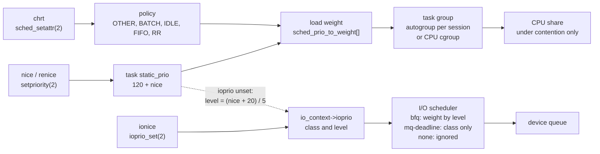

# nice, ionice, and Priorities

> [!summary] Claim
> A nice value is a weight hint that every child inherits, that an unprivileged process can only make worse, that competes only against peers in the same scheduler group, and that says nothing about disk I/O, which is a separate, Linux-only attribute that `ionice` sets and that most modern block devices ignore.

Part of [Coreutils and the Userland](README.md) in [Shell and Unix Engineering](../README.md).

## TL;DR

- Mechanism: `nice` and `renice` end in `setpriority(2)`; on Linux the value picks one of 40 load weights (1024 at nice 0, 15 at nice 19, about 1.25x per step), and `ionice` calls `ioprio_set(2)` to store a separate class-and-level word that only the BFQ and mq-deadline I/O schedulers read.
- Rule: an unprivileged process can only raise its niceness (lower its priority), on Linux unless its `RLIMIT_NICE` soft limit allows more; every `fork` and `exec` inherits the value, so set it once at the top of a job and never expect to undo it.
- Trap: util-linux `renice -n 5 PID` sets the nice value to 5 instead of adding 5 unless `POSIXLY_CORRECT` is set (util-linux 2.39 and later), and on a Linux desktop with autogroup a niced job competes only with processes in its own session.
- Portability fact: POSIX defines only `nice [-n increment]` and `renice [-g|-p|-u] -n increment`; Linux clamps at 19 and macOS at 20; BusyBox `nice` refuses to run the command when it cannot set the value, while GNU, uutils, and BSD `nice` warn and run it; `ionice` and `chrt` exist only on Linux.
- When not to use it: when you need isolation or a guaranteed share (cgroup v2 `cpu.weight`, `cpu.max`, `io.weight`, `io.max`), when the CPUs are not saturated (nice changes nothing then), or when the I/O is buffered writes on a device using the `none` scheduler (ionice changes nothing then).

## Mental model



`nice` and `renice` write one number per task, which the kernel turns into a static priority and then into a load weight for the fair scheduling class.
That weight matters only inside the task group the task belongs to: on a kernel with autogroup the group is the session, so a niced job competes with its own terminal and not with yours, and a CPU cgroup replaces the autogroup entirely.
`chrt` changes the policy instead, and a policy can make the nice value irrelevant (`SCHED_IDLE` uses a fixed weight, `SCHED_FIFO` and `SCHED_RR` ignore it).
`ionice` writes a second, independent attribute into the task's I/O context; when nothing set it, the block layer derives a best-effort level from the nice value (the dotted arrow), and the device's I/O scheduler then decides whether any of it matters.

## How it works

### What POSIX specifies

POSIX.1-2024 defines the nice value as "a number used as advice to the system to alter process scheduling" in which numerically smaller values give more preference (POSIX.1-2024 XBD 3.225).
The `{NZERO}` symbol is the default nice value, with a minimum acceptable value of 20 (POSIX.1-2024 XBD `<limits.h>`).
`nice()` adds its argument to the nice value, clamps the result into `[0, 2*{NZERO}-1]`, returns the new value minus `{NZERO}`, and fails with `EPERM` when a negative increment lacks privilege (POSIX.1-2024 XSH `nice()`).
`getpriority()` and `setpriority()` use the offset form, `[-{NZERO}, {NZERO}-1]`, and an implementation "may enforce more restrictive limits" (POSIX.1-2024 XSH `getpriority()`).
Both are XSI interfaces, and both say that `SCHED_FIFO` and `SCHED_RR` threads are unaffected; because `-1` is a legal return value, a caller must zero `errno` before the call and inspect it after.

The `nice` utility runs a utility "with a different nice value"; `-n increment` behaves as if the utility had called `nice()` with that increment, and with no options the utility runs with "a nice value that is some implementation-defined quantity greater than or equal to the nice value of the current process", so the default increase is zero or more (POSIX.1-2024 XCU `nice`).
The key robustness rule is in the same page: when the user lacks privilege, `nice` "shall not affect the nice value", may warn on standard error, and that "shall not prevent the invocation of utility or affect the exit status".
Its exit status is the utility's, 126 if the utility was found but could not be invoked, and 127 if it was not found, the same convention as `command`, `env`, `nohup`, `time`, `timeout`, and `xargs`.
The rationale is explicit that a utility is an executable, not a shell compound command, pipeline, or function, and that a special built-in as the operand gives undefined results; it also records that historical systems raised the value by 10 by default and that the obsolete `-increment` form is no longer specified.

`renice -n increment` changes running processes chosen with `-p` (the default), `-g` (process group), or `-u` (user), clamps to the implementation's limits, and must return an error status when the caller lacks privilege (POSIX.1-2024 XCU `renice`).
Note that POSIX `renice -n` is an increment; the absolute `renice priority pid` form came from BSD and is "no longer specified ... but may be present in some implementations".
POSIX `ulimit` lists only `-a`, `-c`, `-d`, `-f`, `-n`, `-s`, `-t`, and `-v` (POSIX.1-2024 XCU `ulimit`), so the `-e` option that reports `RLIMIT_NICE` is an extension.

### Linux: from a system call to a load weight

The nice range is `MIN_NICE` -20 to `MAX_NICE` 19, mapped onto static priorities 100 to 139 above the 100 real-time levels, with `DEFAULT_PRIO` 120 for nice 0 (Linux 7.4-rc2 `include/linux/sched/prio.h`, as of 2026-11).
`setpriority()` clamps the requested value into that range before doing anything else, which is why `nice -n 100` silently means 19 (Linux 7.4-rc2 `kernel/sys.c`, `SYSCALL_DEFINE3(setpriority)`).
For each target task `set_one_prio()` applies two checks in order:

- `set_one_prio_perm()`: the target's real or effective UID must equal the caller's effective UID, or the caller must have `CAP_SYS_NICE` in the target's user namespace (`ns_capable`), or the call fails with `EPERM`.
- If the new value is lower than the current one, `can_nice()` must pass, or the call fails with `EACCES`: either `nice_to_rlimit(nice) <= RLIMIT_NICE` or `capable(CAP_SYS_NICE)` (Linux 7.4-rc2 `kernel/sched/syscalls.c`, `can_nice`, `is_nice_reduction`).

`capable()` checks the initial user namespace, so a container's root, which holds `CAP_SYS_NICE` only in its own namespace, can renice other users' processes in that namespace but still cannot lower a nice value unless `RLIMIT_NICE` allows it.
`RLIMIT_NICE` is encoded backwards because limits cannot be negative: the ceiling is `20 - rlim_cur`, so the useful range is 1 (nice 19) to 40 (nice -20) and the default of 0 forbids any decrease (getrlimit(2)).
`getpriority()` returns `nice_to_rlimit()` of the value, the range 40 to 1, so that a success is never negative; glibc's wrapper converts it back with `20 - knice` (setpriority(2), "C library/kernel differences").
For a group or user target, `getpriority()` reports the highest priority (lowest nice value) among the matches and `setpriority()` sets all of them.

The targets are tasks, which on Linux are threads.
`PRIO_PROCESS` with a nonzero `who` calls `find_task_by_vpid(who)` and changes that one task, so `renice -p PID` changes only the thread-group leader of a multithreaded process, while `PRIO_PGRP` and `PRIO_USER` iterate over every thread (`do_each_pid_thread`, `for_each_process_thread`).
setpriority(2) documents this as a bug against POSIX, which calls the nice value per-process; a thread created later inherits from the thread that creates it, not from the leader.
The lab proves both halves: after `setpriority(PRIO_PROCESS, getpid(), base + 1)` a thread that already existed keeps the old value on Linux and sees the new one on macOS.

The legacy `nice(2)` system call exists (`SYSCALL_DEFINE1(nice)` clamps the increment to plus or minus 40 and returns 0 on success), but glibc's `nice()` does not use it: `sysdeps/posix/nice.c` calls `getpriority()`, then `setpriority(prio + incr)`, converts `EACCES` to `EPERM` as POSIX requires, and returns a second `getpriority()` (glibc `sysdeps/posix/nice.c`, `nice`).
That is two system calls, so a concurrent `renice` between them is lost; nice(2) notes that glibc 2.2.3 and earlier returned 0 instead of the new value.

`set_user_nice()` (Linux 7.4-rc2 `kernel/sched/syscalls.c`) stores the new static priority and, for a fair-class task, calls `set_load_weight()`, which looks up `sched_prio_to_weight[static_prio - MAX_RT_PRIO]`, that is `static_prio - 100` (Linux 7.4-rc2 `kernel/sched/core.c`).
For a `SCHED_FIFO`, `SCHED_RR`, or `SCHED_DEADLINE` task it stores the value and changes nothing else, so the nice value takes effect only if the task later returns to a fair policy.
The table is multiplicative: the comment in `core.c` describes "a gentle 10% change for every nice level", implemented with a multiplier of 1.25, and sched(7) states the same factor.

| nice | -20 | -10 | -5 | 0 | 1 | 5 | 10 | 15 | 19 |
| --- | --- | --- | --- | --- | --- | --- | --- | --- | --- |
| weight | 88761 | 9548 | 3121 | 1024 | 820 | 335 | 110 | 36 | 15 |

Two CPU-bound tasks sharing one CPU split it in proportion to their weights, so nice 0 against nice 19 is 1024 / 1039, about 98.6% against 1.4%; nice 0 against nice 10 is about 90.3% against 9.7%; and nice 0 against nice 1 is about 55.5% against 44.5% (computed from the table, not measured).
`SCHED_IDLE` bypasses the table with `WEIGHT_IDLEPRIO` of 3 (`kernel/sched/sched.h`), about 0.3% against one nice-0 task, which is why sched(7) calls it "lower even than a +19 nice value".
`SCHED_BATCH` keeps the nice weight but is treated as CPU-bound, giving it a small wakeup penalty (sched(7)).
Linux 6.6 replaced CFS with EEVDF (kernelnewbies Linux 6.6); the weight still sets each task's share, and the new parts are lag and a virtual deadline, with a per-task slice request through `sched_setattr()` (`Documentation/scheduler/sched-eevdf.rst`), which util-linux `chrt -T` exposes for `SCHED_OTHER` and `SCHED_BATCH` since Linux 6.12 (chrt(1)).

A weight is a share of contention, not a speed: on a machine with an idle CPU a nice 19 task runs exactly as fast as a nice 0 task.
`/proc/PID/stat` reports both views: field 18 is the kernel's 0 to 39 encoding for fair tasks (or the negated real-time priority minus one), field 19 is the user-visible nice value (proc_pid_stat(5)).

Inheritance is complete: `fork` copies the nice value and `execve` preserves it (setpriority(2) NOTES).
The one exception is the reset-on-fork flag: when a task sets `SCHED_RESET_ON_FORK` (or `SCHED_FLAG_RESET_ON_FORK` through `sched_setattr()`), its children get `SCHED_NORMAL` instead of a real-time policy and nice 0 instead of a negative value (`sched_fork()` in `kernel/sched/core.c`; sched(7)), and systemd exposes it as `CPUSchedulingResetOnFork=`.

### Group scheduling and autogroup

With `CONFIG_FAIR_GROUP_SCHED`, the fair class schedules task groups, and "a thread's nice value has an effect for scheduling decisions only relative to other threads in the same task group" (sched(7), "The nice value and group scheduling").
Every CPU cgroup is a task group, and with `CONFIG_SCHED_AUTOGROUP` every session is one too: `setsid(2)` creates a new autogroup, children inherit it, and the groups share the CPU equally before nice is consulted (sched(7), "The autogroup feature"; added in Linux 2.6.38, kernelnewbies Linux 2.6.38).
sched(7)'s example is ten `make -j10` compilers in one session against a video player in another: with autogroup the player gets 50% of the CPU instead of about 9%.
The cost is the nice value's traditional meaning: `nice -n 19 make` started in its own terminal still gets half the CPU against your editor's session, and a job started with `setsid` (see [[nohup-and-setsid]]) leaves its parent's autogroup and competes as a peer of the whole session.
The knobs are `/proc/sys/kernel/sched_autogroup_enabled` (default 1 unless booted with `noautogroup`) and `/proc/PID/autogroup`, which shows a line such as `/autogroup-1 nice 0` and accepts a nice value for the whole group (sched(7)).
Putting a process into a CPU cgroup other than the root overrides autogrouping (sched(7); `task_wants_autogroup()` in `kernel/sched/autogroup.c` returns false for any task group but the root), so a unit that enables the CPU controller, for example with `CPUWeight=`, is scheduled by its cgroup and not by its session.
cgroup v2 offers the same idea with explicit numbers: `cpu.weight` (1 to 10000, default 100), `cpu.weight.nice` (the same weight written as a nice value), and `cpu.idle`, the group analogue of `SCHED_IDLE` (`Documentation/admin-guide/cgroup-v2.rst`); see [[cgroups-v2-from-the-Shell]].

### I/O priority: ioprio_set and the block layer

An I/O priority is a 16-bit word: the class in bits 13 to 15, an optional 10-bit hint in bits 3 to 12 (used for device command duration limits), and the level in bits 0 to 2 (Linux 7.4-rc2 `include/uapi/linux/ioprio.h`).
The classes are `IOPRIO_CLASS_NONE` 0, `RT` 1, `BE` 2, and `IDLE` 3, and `RT` and `BE` have 8 levels, 0 being the highest.
`ioprio_check_cap()` accepts `BE` and `IDLE` from anyone, rejects `NONE` with a nonzero level and any other class with `EINVAL`, and requires `CAP_SYS_ADMIN` or `CAP_SYS_NICE` for `RT` (`block/ioprio.c`); ioprio_set(2) still says only `CAP_SYS_ADMIN`, and it records that `IDLE` needed `CAP_SYS_ADMIN` too until Linux 2.6.25.
Ownership is checked separately in `set_task_ioprio()`: the target's real UID must equal the caller's real or effective UID, or the caller needs `CAP_SYS_NICE`, or the call fails with `EPERM` (`block/blk-ioc.c`).

Like the nice value, the I/O priority is per thread: `IOPRIO_WHO_PROCESS` finds one task, threads do not share an I/O context unless created with `CLONE_IO`, and `__copy_io()` copies the priority to a new task only if it has a valid class (`block/blk-ioc.c`; ioprio_set(2) NOTES).
`ioprio_get()` deliberately returns the raw value, `NONE` level 0 when nothing was set, "so that userspace can distinguish unset IO priority ... from IO priority set to some value" (`get_task_raw_ioprio()` in `block/ioprio.c`).
The effective priority of an unset task comes from its CPU attributes (`__get_task_ioprio()` in `include/linux/ioprio.h`): the class is `IDLE` for `SCHED_IDLE`, `RT` for real-time and deadline tasks, otherwise `BE`, and the level is `(nice + 20) / 5`, so nice 0 is level 4, nice 10 is level 6, nice 19 is level 7, and nice -20 is level 0.
This is the only link between `nice` and disk I/O, and it is weak: a nice 19 job gets the lowest best-effort level, not the idle class.

Whether any of this matters is the I/O scheduler's decision, chosen per device in `/sys/block/DEV/queue/scheduler`:

- CFQ, the scheduler the man pages still describe, is gone: Linux 5.0 removed all the non-multiqueue block code (kernelnewbies Linux 5.0), and `block/cfq-iosched.c` exists at tag v4.20 and not at v5.0.
- BFQ converts a level into a weight, `(8 - level) * 10`, so levels 0 to 7 give weights 80 to 10 (`bfq_ioprio_to_weight()` in `block/bfq-wf2q.c`).
- mq-deadline keeps three queues, `RT`, `BE`, and `IDLE`, maps `NONE` to `BE`, ignores the level entirely, and serves a starving lower class after `prio_aging_expire`, 10 seconds (`block/mq-deadline.c`).
- `none` does no scheduling; the kernel picks mq-deadline by default only for devices with one hardware queue (or shared tags) and leaves devices with several hardware queues on `none` (`elevator.c`), so on such a device `ionice` changes nothing unless the device itself honors priority hints (the `uapi` comment mentions NCQ priority on ATA).

The second limit is writeback: "I/O priorities are not supported for asynchronous writes because they are issued outside the context of the program dirtying the memory" (ioprio_set(2)).
A `cp` or `tar` that writes through the page cache is throttled only by dirty-page limits, not by its I/O class; the cgroup policy `io.prio.class` (`no-change`, `promote-to-rt`, `restrict-to-be`, `idle`, and `none-to-rt`, a deprecated alias for `promote-to-rt`) does reach writeback on filesystems that attribute it to a cgroup (`block/blk-ioprio.c`; `cgroup-v2.rst`).

### macOS and the BSDs

FreeBSD and Darwin define `PRIO_MIN` -20 and `PRIO_MAX` 20 (FreeBSD `sys/sys/resource.h`; xnu `bsd/sys/resource.h`), so their range has 41 values and `nice -n 100` gives 20, as the lab shows on macOS 27.3.
In both kernels `donice()` stores the value in the process structure (`p_nice`), so it is per process: the lab's thread probe sees every thread move together on macOS.
Both clamp first and then return `EACCES` when an unprivileged caller asks for a lower value (FreeBSD `priv_check(td, PRIV_SCHED_SETPRIORITY)`, xnu `suser()`), and neither has `RLIMIT_NICE`, so only the superuser can lower a nice value there.
Darwin adds `PRIO_DARWIN_THREAD` and `PRIO_DARWIN_PROCESS` with the value `PRIO_DARWIN_BG`, a background state that lowers CPU, disk I/O, and networking priority (xnu `sys/resource.h`), and `taskpolicy(8)` (`-b` calls `setpriority()` with `PRIO_DARWIN_BG`; `-d` and `-c` set the disk I/O policy and the QoS clamp) is the command that sets it; there is no `ionice`.

### The utilities

GNU coreutils `nice` (`src/nice.c`, `main`) defaults to an adjustment of 10, accepts the obsolete `-N` and `--N` forms besides `-n N`, clamps the adjustment to `[1 - 2*NZERO, 2*NZERO - 1]` before calling `nice()`, prints the current niceness when given no command, and on a permission error prints `cannot set niceness` and runs the command anyway; its own errors exit 125 (`EXIT_CANCELED`) and exec failures 126 or 127.
uutils `nice` (`nice.rs`) follows the same rules: default 10, a warning on `setpriority` failure, 125 for its own errors, 126 and 127 for exec failures.
FreeBSD `nice` (`usr.bin/nice/nice.c`; macOS behaves the same in the lab) rewrites `-N` and `--N` into `-n`, rejects non-numeric values (`invalid nice value`, status 1), adds the increment to `getpriority()`, warns `setpriority: Permission denied` on failure, and still calls `execvp()`.
BusyBox `nice` (`coreutils/nice.c`, `nice_main`) also defaults to 10 and prints the niceness without arguments, but on a failed `setpriority()` it calls `bb_perror_msg_and_die()`: the command never runs and the status is 1, contrary to the POSIX rule quoted above; the lab asserts this branch for every BusyBox build, and the shell matrix measured it on Alpine 3.22 (BusyBox 1.37.0: `nice: setpriority(-5): Permission denied`, status 1).

`renice` differs more.
util-linux `renice` treats both a bare number and `-n N` as an absolute value; since util-linux 2.39 `-n` becomes an increment when `POSIXLY_CORRECT` is set, and the unambiguous `--relative` and `--priority` options exist (`sys-utils/renice.c`; v2.39 release notes).
The source comment is candid: the absolute meaning "has been used (incorrectly) since 2009".
It prints `PID (process ID) old priority X, new priority Y` on standard output.
BusyBox `renice` (`util-linux/renice.c`) and FreeBSD `renice` (`usr.bin/renice/renice.c`) treat `-n` as an increment and a bare number as absolute; FreeBSD prints the old and new values on standard error, and macOS `renice` printed nothing on success in the lab run.

util-linux `ionice` (`schedutils/ionice.c`) defaults to class `BE` level 4, forces level 7 for `-c 3` and level 0 for `-c 0`, treats `-n N` alone as `BE` level N, prints the current priority as `none: prio 0` when called with no arguments, and with `-t` runs the command even if `ioprio_set()` failed.
BusyBox `ionice` (`util-linux/ionice.c`) starts from class 0 and level 0, so `-c 2` means best-effort level 0 (the highest), `-c 3` leaves level 0, and `-n 7` alone builds class `NONE` with level 7, which the kernel rejects with `EINVAL`; Alpine enables the BusyBox `nice`, `renice`, and `ionice` applets and disables `chrt` and `taskset` (Alpine `busyboxconfig`).

### The shells

No shell in the vault's matrix has a `nice` builtin (the C shell's built-in `nice` is the exception POSIX's rationale mentions), so `nice` always execs an external utility, and a shell function, alias, or compound command cannot be its operand: the lab gets status 127 for `nice f` where `f` is a function.
Wrap shell code as `nice -n 10 sh -c '...'`, or lower the whole script at once with `renice -n 10 -p "$$"`, which every later child inherits.
Native zsh sets `BG_NICE` by default (`<C> <Z>` in `Doc/Zsh/options.yo`; `OPT_EMULATE|OPT_NONBOURNE` in `Src/options.c`), and `execcmd_fork()` in `Src/exec.c` calls `nice(5)` in every asynchronous child, so a zsh script's `cmd &` runs 5 levels nicer even without job control; `zsh --emulate sh` does not set it, and `setopt no_bg_nice` turns it off.
The lab measures this on the host: the background child of native zsh is `+5`, and every other shell family is asserted at `+0`; the shell matrix measured the same split on Debian 13 and Alpine 3.22 (zsh `+5`; bash, dash, ksh93u+m, mksh, posh, yash, and BusyBox ash `+0`).
`ulimit -e` reports `RLIMIT_NICE` in bash (`builtins/ulimit.def`, `'e'`), zsh (`Src/Builtins/rlimits.c`), ksh93 (`data/limits.c`), mksh (`rlimits.opt`), yash (`builtins/ulimit.c`), and BusyBox ash (`shell/shell_common.c`), but only where the platform defines `RLIMIT_NICE`; dash's table has `-r` (`RLIMIT_RTPRIO`) and no `-e`, and on macOS every shell refuses it.

## Numbers and limits

| Quantity | Value | Source |
| --- | --- | --- |
| POSIX nice range | `[0, 2*{NZERO}-1]`, offset form `[-{NZERO}, {NZERO}-1]` | POSIX.1-2024 XSH `nice()`, `getpriority()` |
| `{NZERO}` minimum | 20 | POSIX.1-2024 XBD `<limits.h>` |
| `getconf NZERO` on macOS 27.3 | 20 | measured on the host, 2026-11-15 |
| Linux nice range | -20 to 19 | `include/linux/sched/prio.h` (Linux 7.4-rc2, as of 2026-11); lab clamp test |
| macOS and FreeBSD nice range | -20 to 20 | `sys/resource.h` `PRIO_MIN`, `PRIO_MAX`; lab clamp test (macOS) |
| Linux static priority of fair tasks | 100 to 139, default 120 | `prio.h` `MAX_RT_PRIO`, `DEFAULT_PRIO` |
| Raw `getpriority` return | 40 (nice -20) to 1 (nice 19) | `kernel/sys.c`, `nice_to_rlimit()` |
| Default `nice` increment | 10 in GNU, uutils, BusyBox, FreeBSD, macOS | each `nice.c` / `nice.rs`; lab default test |
| Load weight nice -20 / 0 / 19 | 88761 / 1024 / 15 | `kernel/sched/core.c` `sched_prio_to_weight[]` |
| Ratio between adjacent levels | about 1.25 (about 10% CPU) | `core.c` comment; sched(7) |
| `SCHED_IDLE` weight | 3 | `kernel/sched/sched.h` `WEIGHT_IDLEPRIO` |
| Share, nice 0 vs nice 19 on one CPU | about 98.6% / 1.4% | computed from the weight table |
| Share, nice 0 vs nice 10 on one CPU | about 90.3% / 9.7% | computed from the weight table |
| `RLIMIT_NICE` ceiling | `20 - rlim_cur`, useful 1 to 40 | getrlimit(2) |
| Real-time throttling default | 950000 of every 1000000 microseconds | sched(7) |
| Autogroup | since Linux 2.6.38 | sched(7); kernelnewbies Linux 2.6.38 |
| EEVDF replaces CFS | Linux 6.6 (2023-10-29) | kernelnewbies Linux 6.6 |
| cgroup v2 `cpu.weight` | 1 to 10000, default 100 | `cgroup-v2.rst` |
| ioprio layout | class bits 13-15, hint bits 3-12, level bits 0-2 | `include/uapi/linux/ioprio.h` |
| Best-effort level from nice | `(nice + 20) / 5`: 0 -> 4, 10 -> 6, 19 -> 7 | `include/linux/ioprio.h` |
| BFQ weight per level | `(8 - level) * 10`: 80 to 10 | `block/bfq-wf2q.c` |
| mq-deadline starvation bound | `prio_aging_expire` = 10 s | `block/mq-deadline.c` |
| CFQ removed | Linux 5.0 | kernelnewbies Linux 5.0; `cfq-iosched.c` in v4.20, absent in v5.0 |
| zsh `BG_NICE` increment | +5 | `Src/exec.c`; lab inherit test |
| GNU `nice` own-error status | 125 | `src/nice.c` `EXIT_CANCELED`; `invalid adjustment` measured on the host |

## Portability

Shells (the shell decides only background-job priority and `ulimit -e`; `nice` itself is external everywhere):

| Shell | `nice` builtin | Background child | `ulimit -e` on Linux | `ulimit -e` on macOS |
| --- | --- | --- | --- | --- |
| POSIX sh | not specified | not specified | not specified (XCU `ulimit`) | not specified |
| macOS bash 3.2 (`/bin/sh`) | no | +0 (lab) | n/a | invalid option, status 2 (lab) |
| bash 5.3 | no | +0 (lab) | soft limit (`ulimit.def`; shell matrix) | invalid option, status 2 (lab, bash 5.3.20) |
| zsh native | no | +5, `BG_NICE` (lab; `exec.c`; shell matrix) | soft limit (`rlimits.c`; shell matrix) | `bad option`, status 1 (lab) |
| `zsh --emulate sh` | no | +0 (lab) | soft limit (`rlimits.c`) | `bad option`, status 1 (lab) |
| dash | no | +0 (lab; shell matrix) | `Illegal option -e`, status 2 (shell matrix, dash 0.5.12; `miscbltin.c` has no entry) | `Illegal option -e`, status 2 (lab) |
| ksh93 | no | +0 (lab, ksh93u+ 2012; shell matrix, ksh93u+m 1.0.10) | soft limit (`limits.c`; shell matrix, ksh93u+m 1.0.10) | prints `not supported`, status 0 (lab, ksh93u+ 2012) |
| mksh | no | +0 (shell matrix) | soft limit (`rlimits.opt`; shell matrix) | not in the host matrix |
| yash | no | +0 (shell matrix, Alpine) | soft limit (`ulimit.c`; shell matrix, Alpine) | not in the host matrix |
| posh | no | +0 (shell matrix, Debian) | no `ulimit` at all, status 127 (shell matrix; [[Resource-Limits-and-ulimit]]) | not in the host matrix |
| BusyBox ash | no | +0 (shell matrix, Alpine `sh`) | soft limit (`shell_common.c`; shell matrix) | not in the host matrix |

Utilities:

| Implementation | Default `nice` | Unprivileged `nice -n -1 cmd` | `renice -n N` | `ionice -c 3` | `ionice -c 2` | `ionice -n 7` |
| --- | --- | --- | --- | --- | --- | --- |
| POSIX | implementation-defined, >= 0 | must still run `cmd`, status unaffected | increment | not specified | not specified | not specified |
| GNU coreutils | +10 (lab; shell matrix, 9.7) | warns, runs `cmd` (lab; shell matrix, 9.7) | n/a (no renice) | n/a | n/a | n/a |
| uutils | +10 (`nice.rs`) | warns, runs `cmd` (`nice.rs`; not in the matrix images) | n/a | n/a | n/a | n/a |
| FreeBSD, macOS | +10 (lab, macOS) | warns, runs `cmd` (lab, macOS) | increment (lab, macOS) | no ionice (lab, macOS) | no ionice | no ionice |
| BusyBox 1.37 | +10 (`nice.c`; shell matrix) | dies with status 1, `cmd` not run (`nice.c`; shell matrix) | increment (`renice.c`; shell matrix) | idle, level 0 (shell matrix) | best-effort level 0 (shell matrix) | `EINVAL`, fails (shell matrix) |
| util-linux 2.39+ | n/a | n/a | absolute, increment with `POSIXLY_CORRECT` (shell matrix, 2.41.5) | idle, level 7 (shell matrix, 2.41.5) | best-effort level 4 (shell matrix) | best-effort level 7 (shell matrix) |
| util-linux before 2.39 | n/a | n/a | absolute always (v2.39 release notes) | idle, level 7 | best-effort level 4 | best-effort level 7 |

Kernels: Linux clamps at 19 and keeps the value per thread; macOS clamps at 20 and keeps it per process (both proved by the lab); only Linux has `RLIMIT_NICE`, `ioprio_set()`, `SCHED_IDLE`, and autogroup.

## Worked example

The [lab](../labs/08-nice-ionice-and-priorities/) compiles `prio.c`, a probe that prints the calling process's nice value (`prio self`), tests whether it may lower it (`prio can-lower`), compares thread scope (`prio threads`), reads `RLIMIT_NICE`, and decodes `ioprio_get()`.
`probe.sh` runs each utility from the shell under test; this simplified excerpt shows the three modes that carry the main lessons:

```sh
# simplified excerpt from probe.sh
  negative)
    base=$("$prio" self)
    inner=$(nice -n 1 nice -n -1 "$prio" self 2>/dev/null)
    st=$?
    ...
  inherit)
    fg=$("$prio" self)
    sub=$( ("$prio" self) )
    bg=$(
      "$prio" self &
      wait
    )
    echo "subshell=+$((sub - fg)) background=+$((bg - fg))"
    ;;
  renice)
    base=$("$prio" self)
    renice -n 1 -p "$$" >/dev/null 2>&1
    renice -n 1 -p "$$" >/dev/null 2>&1
    plain=$("$prio" self)
    POSIXLY_CORRECT=1 renice -n 1 -p "$$" >/dev/null 2>&1
    POSIXLY_CORRECT=1 renice -n 1 -p "$$" >/dev/null 2>&1
    posix=$("$prio" self)
```

The thread probe, also a simplified excerpt of `prio.c`, renices the process by PID while one thread already exists and then starts a second:

```c
/* simplified excerpt from prio.c, mode_threads() */
pthread_create(&t_old, NULL, report_after_signal, &old_thread);
setpriority(PRIO_PROCESS, (id_t)getpid(), base + 1);
pthread_create(&t_new, NULL, report_after_signal, &new_thread);
write(fds[1], "x", 1);  /* now let the old thread report getpriority(PRIO_PROCESS, 0) */
```

Captured on the macOS 27.3 host on 2026-11-15 (the session already ran at nice 5, so every test asserts values relative to `base`; `sh` is bash 3.2 and the utilities are BSD `nice` and `renice`):

```text
sh default: base=5 new=15
sh clamp: base=5 new=20
sh negative: base=5 inner=6 status=0 warned=yes
sh inherit: subshell=+0 background=+0
zsh inherit: subshell=+0 background=+5
sh exit: function=127 nonexec=126
sh renice: base=5 plain=7 posix=9
sh ulimit-e: out=message status=2 rlimit=none
zsh ulimit-e: out=message status=1 rlimit=none
threads: main=+1 old_thread=+1 new_thread=+1
can-lower: lower=denied errno=EACCES
negative stderr: nice: setpriority: Permission denied
```

What the lab asserts on Linux, and what the shell matrix measured once on 2026-11-15 in its Debian 13 (GNU coreutils 9.7, util-linux 2.41.5) and Alpine 3.22 (BusyBox 1.37.0) images, for an unprivileged user (uid 1000) starting at nice 0 with `RLIMIT_NICE` 0; uutils is not in the images, so its line rests on `nice.rs`:

```text
clamp: base=0 new=19
negative (GNU coreutils; uutils by source): base=0 inner=1 status=0 warned=yes
negative (BusyBox): base=0 inner=none status=1 warned=yes
renice (util-linux): base=0 plain=1 posix=3
renice (BusyBox): base=0 plain=2 posix=4
threads: main=+1 old_thread=+0 new_thread=+1
util-linux none=[class=0 level=0] c3=[class=3 level=7] c2=[class=2 level=4] n7=[class=2 level=7] child=[class=2 level=6]
busybox none=[class=0 level=0] c3=[class=3 level=0] c2=[class=2 level=0] n7=[fail] child=[class=2 level=6]
```

The suite passed 9 of 9 tests under `LAB_SHELL=bash` (Homebrew bash) on the macOS 27.3 host (as of 2026-11); the Linux lines above come from running each probe mode in the Debian and Alpine matrix images.

## Pitfalls

> [!warning] util-linux renice -n is absolute
> Trigger: `renice -n 5 -p "$pid"` on a Linux distribution, written by someone who read POSIX or a BSD manual.
> Symptom: the process ends at nice 5 whatever it was before; a second call changes nothing, and an attempt to "add" to a process at nice 10 fails with `failed to set priority ... Permission denied`, because 5 is a decrease.
> Fix: write `renice --relative 5` (util-linux 2.39+) or `renice --priority 5` and say what you mean; in portable scripts compute the absolute target yourself from `ps -o nice= -p "$pid"`; never rely on `POSIXLY_CORRECT` leaking in from the environment.

> [!warning] Autogroup makes nice local to a session
> Trigger: `nice -n 19 make -j` in one terminal while you work in another, on a kernel with `CONFIG_SCHED_AUTOGROUP` and `sched_autogroup_enabled` 1.
> Symptom: the build still takes half the machine; Ubuntu bug 1219548, "sched_autogroup_enabled breaks niceness", reports exactly this.
> Fix: renice the autogroup (`echo 19 > /proc/self/autogroup` in that session), or put the job in a cgroup with a low `cpu.weight` (for example through `systemd-run --user -p CPUWeight=...`); Gentoo's Portage made the same change in 2021, commit a4d8829 "PORTAGE_NICENESS: Consider autogroup scheduling", because setting only the process nice value "has no effect in presence of autogroup scheduling".

> [!warning] nice cannot run a shell function
> Trigger: `nice -n 19 backup` where `backup` is a function defined earlier in the script.
> Symptom: `nice: backup: No such file or directory` and status 127; the job never ran, which a cron wrapper may log as a mere failure.
> Fix: `nice -n 19 sh -c 'backup_body_here'`, or `renice -n 19 -p "$$"` at the start of a script dedicated to the job.

> [!warning] ionice does nothing for buffered writes or on the none scheduler
> Trigger: `ionice -c 3 cp big.img /data/` to protect a database on the same NVMe drive.
> Symptom: database latency spikes anyway; the writes leave the page cache from writeback threads, outside `cp`'s I/O context, and a drive with several hardware queues defaults to the `none` scheduler.
> Fix: check `/sys/block/DEV/queue/scheduler`; use cgroup v2 `io.max` or `io.weight` (or systemd `IOWriteBandwidthMax=`, `IOWeight=`), `io.prio.class` for writeback-aware class changes, or direct I/O for the copy.

> [!warning] renice by PID misses the other threads
> Trigger: `renice -n 10 -p "$(pgrep -o java)"` on Linux.
> Symptom: only the main thread is niced; the worker threads that burn the CPU keep their old value.
> Fix: renice every thread (`for t in /proc/PID/task/*; do renice ... -p "${t##*/}"; done`), use `-g` for the process group, or start the program under `nice` so every thread inherits the value at creation.

> [!warning] BusyBox nice aborts instead of running
> Trigger: a container entrypoint `nice -n -5 server` on Alpine, without `CAP_SYS_NICE`.
> Symptom: `nice: setpriority(-5): Permission denied` and exit status 1; the server never starts, while the same line on Debian or macOS warns and starts it.
> Fix: never use a negative increment without checking privilege first; if the priority is optional, run `nice -n -5 server || exec server`, knowing that this also restarts the server after a genuine failure, or drop the decrease.

> [!warning] zsh scripts nice their background jobs
> Trigger: a `#!/bin/zsh` script launching workers with `worker &`.
> Symptom: the workers run at nice +5 relative to the script, which surprises benchmarks and makes them unable to return to the original value without privilege.
> Fix: `setopt no_bg_nice` at the top, or run the script with `emulate sh`.

> [!warning] Priority inversion
> Trigger: a low-priority job (high nice, `SCHED_IDLE`, or idle I/O class) holds a lock, a file lock, or a database row that a high-priority job needs.
> Symptom: the important job waits behind the starved one; on Mars Pathfinder in 1997 the low-priority meteorological task held the information-bus mutex, the medium-priority communications task kept it from running, the high-priority bus task blocked, and a watchdog reset the spacecraft; the fix was to turn on the VxWorks mutex's priority-inheritance option (Mike Jones, "What really happened on Mars Rover Pathfinder", 1997).
> Fix: do not lower the priority of anything that holds shared locks; bound lock hold times; on Linux use priority-inheriting futexes (`PTHREAD_PRIO_INHERIT`) for real-time code.

## Security and robustness

- Lowering a nice value is a privilege: `CAP_SYS_NICE` in the initial user namespace or a sufficient `RLIMIT_NICE`, so an unprivileged user cannot claim more than a fair share by renicing; the same capability also allows real-time policies, affinity changes, `ioprio_set()` on any process, and `migrate_pages()` (capabilities(7)), so granting it with file capabilities to one tool grants all of that.
- Raising a nice value is irreversible for an unprivileged process and inherited by every descendant, so a library or wrapper that calls `nice()` silently degrades everything the caller starts afterwards.
- `renice -u "$USER"` and `PRIO_USER` reach every process of that UID in every session, including the ones that are not yours to slow down on a shared account.
- A PID is a name that can be reused: `renice -n 10 -p "$pid"` after the target has exited can hit an unrelated process of the same user; util-linux `chrt` now accepts `PID:inode` to pin the identity through pidfs (chrt(1)), and in scripts the safer pattern is to start the job under `nice` rather than to find it later.
- `IOPRIO_CLASS_RT` and `SCHED_FIFO` can starve the whole machine; that is why `RT` I/O needs `CAP_SYS_ADMIN` or `CAP_SYS_NICE`, and why real-time CPU time is capped at 950000 of every 1000000 microseconds by default (sched(7)).
- CVE-2016-7911: `get_task_ioprio()` read `task->io_context` without the task lock and raced with `exit_io_context()`, a use-after-free reachable by any local user through `ioprio_get()` before Linux 4.6.6 (NVD); the fix, commit 8ba8682107ee "block: fix use-after-free in sys_ioprio_get()", added the `task_lock()` that `get_task_ioprio()` still takes.
- Treat an increment from configuration as untrusted input: GNU `nice` rejects non-numbers with status 125 and clamps the rest, FreeBSD and macOS reject non-numbers with status 1, and BusyBox accepts `INT_MIN/2` to `INT_MAX/2`; validate it as a small integer before passing it on.

## The principal's view

The decision is whether a priority is a hint or a contract.
`nice` is a hint: it is cheap, inherited, needs no privilege, and works on every Unix, but it only changes how contended CPU is split among peers in the same group, it does not cap anything, and it does not touch writeback I/O.
For one-off batch work in a script, `nice -n 19` plus `ionice -c 3` (when the device runs BFQ or mq-deadline) is the right amount of machinery, and `chrt -i 0` (`SCHED_IDLE`) is the stronger hint when the work is truly scavenger.
For anything that shares a host with a latency target, make it a contract: give the batch work its own cgroup with `cpu.weight` or `cpu.idle`, a `cpu.max` quota, and `io.weight` or `io.max`, usually through systemd unit settings (`CPUWeight=`, `IOWeight=`, `Nice=`, `IOSchedulingClass=`), because cgroups bound the whole subtree, survive `setsid`, and are visible to monitoring.
The trade-off is operational weight: cgroups need a controller hierarchy and delegation, and a misconfigured `cpu.max` throttles hard where a nice value would only have yielded.
When the requirement is a deadline rather than a share, neither tool is enough: use `SCHED_DEADLINE` or dedicated CPUs, or move the prioritization into the application (one process with a priority queue), where it is explicit, testable, and portable across kernels.
Finally, write priorities in absolute terms and verify them (`ps -o pid,ni,comm`, `/proc/PID/stat` field 19, `ionice -p PID` on Linux), because the utilities disagree on increments, defaults, and failure behavior.

## Interview questions

> [!question] L5: Why does an ordinary user's `nice -n -5 make` print a warning and still build, and why can that user not undo `nice -n 10` later?
>
> > [!success]- Answer
> > POSIX requires `nice` to run the utility even when it lacks the privilege to change the value, and GNU, uutils, and BSD `nice` follow that rule by warning and calling `execvp()`.
> > Lowering a nice value needs `CAP_SYS_NICE` on Linux (or an `RLIMIT_NICE` soft limit that allows it) and root on the BSDs and macOS.
> > Raising it needs nothing, so after `nice -n 10` the process and all its descendants are stuck at the higher value.
> >
> > Follow-up: which common `nice` breaks the first rule? (BusyBox, which exits 1 without running the command.)

> [!question] L5: What is the difference between `nice`, `renice`, and `ionice`?
>
> > [!success]- Answer
> > `nice` starts a new command with an adjusted nice value; `renice` changes running processes, groups, or users.
> > Both end in `setpriority()` and affect only CPU scheduling of fair-class tasks.
> > `ionice` is Linux-only and sets the separate I/O class and level through `ioprio_set()`, which only some I/O schedulers honor.
> >
> > Follow-up: what I/O priority does a process get if nobody ran `ionice`? (Best-effort, level `(nice + 20) / 5`, or idle for `SCHED_IDLE`.)

> [!question] L6: Predict the output of this bash script on Linux with util-linux 2.39 or later `renice` and GNU `nice`, run by an unprivileged user at nice 0 with `RLIMIT_NICE` 0.
>
> ```sh
> renice -n 4 -p $$ >/dev/null
> renice -n 4 -p $$ >/dev/null
> nice -n 3 nice
> ```
>
> > [!success]- Answer
> > It prints `7`.
> > util-linux treats `-n 4` as the absolute value 4, so the second call is a no-op; `nice -n 3` raises that to 7, and GNU `nice` with no command prints the current niceness.
> > With `POSIXLY_CORRECT=1` exported, or on Alpine with BusyBox `renice`, the increments add up and it prints `11`.
> >
> > Follow-up: what does it print if the script starts at nice 5? (`renice -n 4` is then a decrease and fails, so `8`.)

> [!question] L6: Why does a CPU-bound job started with `nice -n 19` in one terminal still get about half the CPU while you compile in another terminal, and what do you change?
>
> > [!success]- Answer
> > Autogroup puts each session in its own task group, and the fair scheduler splits CPU between groups first.
> > The nice value only competes against tasks in the same group, so the niced job's session still gets an equal share.
> > Lower the group instead: write 19 to `/proc/self/autogroup` in that session, or run the job in a cgroup with a low `cpu.weight` (`systemd-run --user -p CPUWeight=...`).
> >
> > Follow-up: how does `setsid` interact with this? (It creates a new session and therefore a new autogroup, so the job competes as a peer of your whole session.)

> [!question] L6: Why does `top` still show a JVM's worker threads at nice 0 after `renice -n 10 -p "$(pgrep -o java)"` lowered its priority?
>
> > [!success]- Answer
> > On Linux the nice value is per thread, and `setpriority(PRIO_PROCESS, pid)` names a single task, the thread-group leader.
> > The workers already existed, so they kept their values; only threads created later inherit from their creator.
> > Renice each entry of `/proc/PID/task`, use the process group, or start the JVM under `nice`.
> >
> > Follow-up: does the same happen on macOS? (No; Darwin stores the nice value per process.)

> [!question] L6: Debug this script: the nightly backup still saturates the disk and the web tier's latency spikes.
>
> ```sh
> #!/bin/sh
> backup() { tar -cf - /srv/data | zstd -T0 > /mnt/backup/data.tar.zst; }
> nice -n 19 ionice -c 3 backup || nice -n 19 ionice -c 3 sh -c 'tar -cf - /srv/data | zstd -T0 > /mnt/backup/data.tar.zst'
> ```
>
> > [!success]- Answer
> > The first command fails with status 127 because `ionice` cannot exec a shell function, so only the fallback ever runs.
> > The fallback's reads are idle class, but its writes go through the page cache and are flushed by writeback threads that do not carry its I/O priority.
> > If the device uses the `none` scheduler, the kernel default for devices with several hardware queues, the class is ignored even for the reads.
> > `zstd -T0` also starts one thread per core, and on an idle core nice 19 runs at full speed, so the CPU side is not throttled either.
> > Fix it with a cgroup: `systemd-run -p IOWeight=10 -p IOWriteBandwidthMax=... -p CPUWeight=10`, or an `io.max` limit, and delete the function call.
> >
> > Follow-up: how would you prove which I/O scheduler the backup target uses? (`cat /sys/block/DEV/queue/scheduler`, where the bracketed name is active.)

> [!question] L7: Why does a rootless container's root user get `Permission denied` from `nice -n -5 server` although `capsh --print` shows `cap_sys_nice`?
>
> > [!success]- Answer
> > The ownership check in `set_one_prio_perm()` uses `ns_capable()` on the target's user namespace, which the container's root passes.
> > The decrease check `can_nice()` uses `capable(CAP_SYS_NICE)`, which tests the initial user namespace, where the container has no capabilities.
> > The only unprivileged path is `RLIMIT_NICE`: a supervisor outside the namespace can raise the soft limit so that `20 - rlim_cur` reaches -5 (a limit of 25).
> >
> > Follow-up: which other priority operation has the same split? (`ioprio_set()` with the real-time class, whose `ioprio_check_cap()` also uses `capable()`.)

> [!question] L7: Design how a batch analytics job and a latency-sensitive API should share one Linux host, and say where nice fits.
>
> > [!success]- Answer
> > Put each in its own systemd unit, so each is a cgroup: the API at a high `CPUWeight=` and the batch job at a low weight or `cpu.idle`, with a `cpu.max` quota if the batch must never take more than a fixed slice.
> > Give the batch job `io.weight` or `io.max` limits, because writeback ignores per-process I/O classes, and check that the devices run a scheduler that honors weights.
> > Inside the batch unit, `Nice=` and `SCHED_BATCH` or `SCHED_IDLE` still order the batch job's own processes against each other.
> > Watch for priority inversion: the batch job must not hold locks, leases, or rows that the API waits on, or the API inherits the batch job's starvation.
> > Measure the result (API tail latency under batch load, `cpu.stat` throttling counters) instead of trusting the weights.
> >
> > Follow-up: when would you refuse to co-locate them at all? (When the API has a hard tail-latency objective that shared caches, memory bandwidth, or one device queue can break; weights do not partition those resources.)

> [!question] L7: Why does POSIX define the nice value in `[0, 2*{NZERO}-1]` while `getpriority()` returns `[-{NZERO}, {NZERO}-1]`, and how does Linux return a negative value without confusing errors?
>
> > [!success]- Answer
> > The two interfaces have different ancestors: `nice()` is "derived from Issue 1 of the SVID" (its POSIX CHANGE HISTORY) and `getpriority()` comes from 4.2BSD (setpriority(2) HISTORY), and POSIX kept both, defining the nice value as non-negative and the BSD interface as its offset by `{NZERO}`.
> > Even `nice()` returns the offset form, the new value minus `{NZERO}`.
> > Because `-1` is a legal offset, callers must zero `errno` first.
> > The Linux system call avoids the ambiguity by returning `20 - nice`, the range 40 to 1, and glibc converts it back, so only the library interface has the `errno` dance.
> >
> > Follow-up: what does `nice()` return on Linux through the raw system call? (0 on success, not the new value; glibc's wrapper calls `getpriority()` to conform.)

## Related

Prerequisites: [[nohup-and-setsid]]

Next: [[env-and-Shebang-Tricks]]

See also: [[Four-Userlands-GNU-BSD-BusyBox-uutils]], [[Userland-Portability-Traps]], [[timeout]], [[Resource-Limits-and-ulimit]], [[Sessions-Process-Groups-and-Controlling-Terminals]], [[cgroups-v2-from-the-Shell]], [[Linux-Capabilities]], [[systemd-Units-for-Scripts]], [[Background-Jobs-and-wait]], [[IO-Bound-versus-CPU-Bound-Stages]]

## Further reading

- [POSIX.1-2024 XCU nice](https://pubs.opengroup.org/onlinepubs/9799919799/utilities/nice.html): the run-anyway rule, the 126 and 127 statuses, and the rationale on historical defaults.
- [POSIX.1-2024 XCU renice](https://pubs.opengroup.org/onlinepubs/9799919799/utilities/renice.html): `-n` as an increment and the saved set-user-ID check.
- [POSIX.1-2024 XSH getpriority](https://pubs.opengroup.org/onlinepubs/9799919799/functions/getpriority.html): the `{NZERO}` offset and the `errno` protocol.
- [sched(7)](https://man7.org/linux/man-pages/man7/sched.7.html): policies, the 1.25 factor, reset-on-fork, autogroup, and group scheduling in one page.
- [setpriority(2)](https://man7.org/linux/man-pages/man2/setpriority.2.html): the 40-to-1 return encoding, the `EPERM` history, and the per-thread bug.
- [ioprio_set(2)](https://man7.org/linux/man-pages/man2/ioprio_set.2.html): classes, permissions, and why asynchronous writes are not covered.
- [Linux kernel/sys.c](https://raw.githubusercontent.com/torvalds/linux/master/kernel/sys.c): `setpriority()`, `getpriority()`, and `set_one_prio()` as they run.
- [Linux kernel/sched/core.c](https://raw.githubusercontent.com/torvalds/linux/master/kernel/sched/core.c): `sched_prio_to_weight[]` and `sched_fork()`.
- [Linux block/ioprio.c](https://raw.githubusercontent.com/torvalds/linux/master/block/ioprio.c) and [include/linux/ioprio.h](https://raw.githubusercontent.com/torvalds/linux/master/include/linux/ioprio.h): the permission checks and the nice-derived default.
- [cgroup v2 documentation](https://raw.githubusercontent.com/torvalds/linux/master/Documentation/admin-guide/cgroup-v2.rst): `cpu.weight`, `cpu.weight.nice`, `cpu.idle`, and `io.prio.class`, the contract-level replacements.
- [util-linux renice.c](https://raw.githubusercontent.com/util-linux/util-linux/master/sys-utils/renice.c): the absolute `-n` and the `POSIXLY_CORRECT` switch.
- [BusyBox nice.c](https://raw.githubusercontent.com/mirror/busybox/master/coreutils/nice.c) and [ionice.c](https://raw.githubusercontent.com/mirror/busybox/master/util-linux/ionice.c): the die-on-failure and zero-default behavior.
- [Portage commit a4d8829](https://github.com/gentoo/portage/commit/a4d8829.patch): a real tool discovering that autogroup made its nice setting ineffective.
- [What really happened on Mars?](https://www.cs.cornell.edu/courses/cs614/1999sp/papers/pathfinder.html): the canonical priority-inversion incident.
