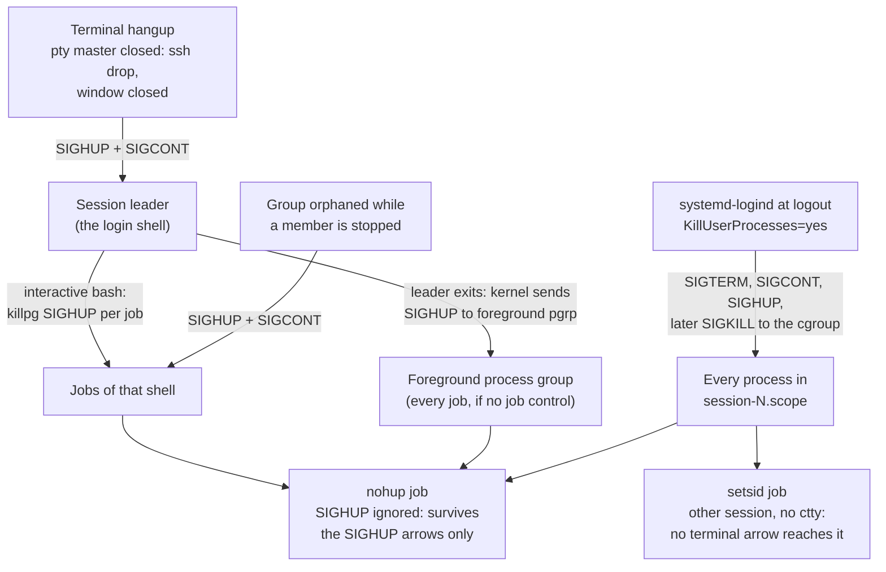

# nohup and setsid

> [!summary] Claim
> `nohup` changes one signal disposition and up to three descriptors and then execs, so it protects a job from `SIGHUP` and nothing else, while `setsid` moves the job into a new session with no controlling terminal, which takes it out of reach of every terminal-generated signal; neither survives a service manager that stops a login session by killing its whole cgroup.

Part of [Coreutils and the Userland](README.md) in [Shell and Unix Engineering](../README.md).

## TL;DR

- Mechanism: `nohup` sets `SIGHUP` to `SIG_IGN`, redirects any of fds 0, 1, 2 that are terminals, and calls `execvp`, relying on the rule that an ignored signal stays ignored across `exec` (POSIX.1-2024 XSH exec); `setsid` calls `setsid(2)`, forking first only if it already leads a process group, then execs.
- Rule: for an ad hoc job that must outlive the terminal, write `setsid -f cmd </dev/null >log 2>&1` on Linux (or `nohup cmd </dev/null >log 2>&1 &` anywhere), and for anything that must outlive a login reliably, use a service manager instead.
- Trap: `setsid cmd` returns at once in an interactive shell but blocks in a script, because only job control makes `cmd` a process group leader, and only a leader makes util-linux `setsid` fork (lab tests 7 and 8).
- Portability fact: `nohup` is POSIX and present everywhere, but what it does to a terminal on stdin differs (GNU and uutils: unreadable `/dev/null`; BusyBox: readable `/dev/null`; BSD and macOS: left alone), and `setsid(1)` is not POSIX at all and does not exist on macOS or in FreeBSD base (lab tests 4 and 7).
- When not to use it: on a systemd host with `KillUserProcesses=yes`, logout sends `SIGTERM` to every process in the session scope, and neither tool helps; use `systemd-run --user`, lingering, or a real unit.

## Mental model



Four different senders deliver a hangup-shaped signal, and the two tools block different subsets of them.
The kernel signals only the session leader when the terminal hangs up; the leader then forwards the signal (an interactive bash), and its exit makes the kernel signal the terminal's foreground process group, which, in a shell without job control, contains every background job too.
A job under `nohup` is still in that session and that group, so the forwarding and leader-exit arrows reach it, and it survives only because the signal they carry is `SIGHUP` and its disposition is `SIG_IGN`.
A job under `setsid` is in a different session with no controlling terminal, so no terminal arrow reaches it at all, whatever its disposition.
The logind arrow does not care about sessions or dispositions: it targets the cgroup, leads with `SIGTERM`, and ends with `SIGKILL`, so it reaches both kinds of job.

## How it works

### 1. Who sends SIGHUP, and when

`SIGHUP` is signal 1 on every XSI system (POSIX.1-2024 XCU 2.15, `trap`, which lists the XSI numeric signal numbers).
Its default action is to terminate the process.
Five paths deliver it to an ordinary command started from a terminal.

**Path A: the terminal hangs up.**
On Linux, closing the master side of a pseudo-terminal calls `tty_vhangup()` on the slave (`drivers/tty/pty.c`, `pty_close`), which reaches `__tty_hangup(tty, 0)` and then `tty_signal_session_leader()` (`drivers/tty/tty_jobctrl.c`).
That function walks every process in the terminal's session, clears each one's controlling terminal, and sends `SIGHUP` followed by `SIGCONT` only to processes whose `signal->leader` is set, that is, to the session leader.
It also records the terminal's foreground process group in the leader's `tty_old_pgrp` for later.
On macOS, `ptcclose()` calls the line discipline's modem routine with carrier off (`bsd/kern/tty_dev.c`), and `ttymodem()` sends `SIGHUP` to `tp->t_session->s_leader` unless `CLOCAL` is set (`bsd/kern/tty.c`).
The Linux man page states the rule in one line: if a session has a controlling terminal without `CLOCAL` and a hangup occurs, the session leader is sent `SIGHUP` (Linux man-pages `setsid(2)` NOTES).

**Path B: the session leader exits.**
POSIX requires that when a controlling process exits, `SIGHUP` is sent to each process in the foreground process group of its controlling terminal (POSIX.1-2024 XSH `_exit`, Consequences of Process Termination).
On Linux, `disassociate_ctty(1)` does this at exit; when the hangup of path A has already cleared the terminal pointer, it uses the saved `tty_old_pgrp` and sends `SIGHUP` and then `SIGCONT` to that group (`tty_jobctrl.c`, `disassociate_ctty`).
For a real terminal that is still attached it calls `tty_vhangup_session()` instead; for a pseudo-terminal that is still attached it sends the foreground group `SIGHUP` alone, without the `SIGCONT` (`disassociate_ctty`, the `if (!on_exit)` guard).
On macOS, `proc_exit()` signals the terminal's process group with `pgsignal(tpgrp, SIGHUP, 1)` when the exiting process is a session leader with a terminal vnode (`bsd/kern/kern_exit.c`).
This is the path that kills background jobs started from a script: a shell without job control puts every child in its own process group, which is the terminal's foreground group, so all of them receive this `SIGHUP` (lab test 5, where the plain `/bin/sleep` died although the shell was non-interactive and forwarded nothing).

**Path C: the shell forwards it.**
bash, on receiving a terminating `SIGHUP`, calls `hangup_all_jobs()` only if the shell is interactive or is a command or process substitution subshell (bash-5.3 `sig.c`, `termsig_handler`).
`hangup_all_jobs()` sends `killpg(pgrp, SIGHUP)` to every job not flagged `J_NOHUP`, plus `SIGCONT` to stopped ones (bash-5.3 `jobs.c`, `hangup_all_jobs`).
`disown -h` sets `J_NOHUP`; plain `disown` removes the job from the table, so it is never visited (Bash Reference Manual, Signals and `disown`).
With `shopt -s huponexit`, bash also calls `hangup_all_jobs()` when an interactive login shell exits normally (bash-5.3 `shell.c`, `exit_shell`); the option is off by default (`builtins/shopt.def`, `reset_shopt_options` sets `hup_on_exit = 0`).
zsh sends `SIGHUP` to running jobs at exit when its `HUP` option is set, and `HUP` is on by default only in zsh emulation (zsh manual, Options, `HUP <Z>`; Jobs and Signals).
A job started with `&!` or `&|` is disowned immediately and never enters the job table (zsh manual, Jobs and Signals).

**Path D: a stopped group is orphaned.**
If an exit orphans a process group and any member is stopped, every member receives `SIGHUP` then `SIGCONT` (POSIX.1-2024 XSH `_exit`).
The rationale is that a stopped job with no job-control shell left would otherwise sit stopped forever.
[[Sessions-Process-Groups-and-Controlling-Terminals]] has the orphan definition and the lab that triggers it.

**Path E: the login manager stops the session.**
systemd 230 changed the default of logind's `KillUserProcesses=` from `no` to `yes`, so that the session scope `session-N.scope` and all processes in it are terminated at logout (systemd `NEWS`, CHANGES WITH 230; `logind.conf(5)`).
The same NEWS entry says the old default can be restored at build time (the entry names the `--without-kill-user-processes` configure option), so the effective setting depends on the distribution (as of 2026-11).
logind creates that scope with `SendSIGHUP=yes` (`src/login/logind-dbus.c`, `manager_start_scope`), and a stop sends `KillSignal=` (default `SIGTERM`), then `SIGCONT`, then `SIGHUP`, and `SIGKILL` after the stop timeout (`systemd.kill(5)`).
`nohup` ignores only the `SIGHUP` in that sequence, and `setsid` leaves the process in the same cgroup, so both lose.
`logind.conf(5)` itself warns that `KillUserProcesses=yes` breaks `screen` and `tmux` unless they are moved out of the session scope.

After a Linux hangup, the terminal's file operations are replaced: `read()` returns 0 and `write()` returns `-EIO` (`drivers/tty/tty_io.c`, `hung_up_tty_read`, `hung_up_tty_write`).
So a process that survives a hangup but still has the terminal as fd 1 gets `EIO` on its next write, which is why both tools are only half the answer without redirection.

### 2. nohup: the specification

POSIX.1-2024 XCU `nohup` specifies the whole utility in a few sentences.
- At the time the named utility is invoked, `SIGHUP` shall be set to be ignored.
- If standard input is a terminal, `nohup` may redirect it from an unspecified file.
- If standard output is a terminal, the utility's standard output is appended to `nohup.out` in the current directory, else to `$HOME/nohup.out`; if neither can be created or opened for appending, the utility shall not be invoked; a created file gets mode `S_IRUSR | S_IWUSR` (0600).
- If standard error is a terminal and standard output is open but not a terminal, standard error goes to the same open file description as standard output; if standard output is a terminal or is closed, standard error is appended to `nohup.out` as above.
- If standard output is a terminal, a message on standard error names the file.
- Exit status 126 if the utility was found but could not be invoked, 127 if `nohup` itself failed or the utility was not found, and otherwise the utility's status.

The mechanism that makes this work is in `exec`, not in `nohup`: signals set to `SIG_IGN` in the calling image stay ignored in the new image, and caught signals revert to `SIG_DFL` (POSIX.1-2024 XSH exec, which names `nohup` as the reason).
So `nohup` is a few dozen lines of descriptor plumbing followed by `signal(SIGHUP, SIG_IGN)` and `execvp`; it never forks, never backgrounds, never changes the process group or session, and never touches `SIGINT`, `SIGQUIT`, or `SIGTERM`.
The rationale records that 4.3BSD's `nohup` also ignored `SIGTERM` and that reviewers rejected ignoring `SIGQUIT`, so POSIX `nohup` modifies only `SIGHUP`.
The utility operand must be a utility, not a pipeline, list, compound command, or special built-in, so the standard's own example for a complex command is `nohup sh -c -- 'complex-command-line' </dev/null` (the `--` was added by Austin Group Defect 1530).
The rationale also explains the stdin clause: historically, `nohup make &` followed by logout could keep the login session alive until `make` exited because standard input stayed open on the terminal, so implementations may redirect it, and portable scripts should write `nohup make </dev/null &` themselves.

### 3. nohup: five implementations

**GNU coreutils** (`src/nohup.c`, `main`) samples `isatty()` on fds 0, 1, and 2 before changing anything.
A terminal on stdin is replaced by `/dev/null` opened `O_WRONLY`, deliberately, so that any read fails instead of returning EOF (the comment says "to ensure any read evokes an error"); the manual calls this a GNU extension and suggests `nohup command 0>/dev/null` as the portable equivalent.
A terminal on stdout is replaced by `nohup.out` opened `O_CREAT | O_WRONLY | O_APPEND` with mode 0600 after `umask(0)`, so the file is 0600 regardless of the umask, falling back to `$HOME/nohup.out`.
A terminal on stderr is pointed at the same descriptor as stdout, after a `F_DUPFD_CLOEXEC` copy of the old stderr is saved so that a failed `execvp` can still report on the original terminal.
Internal failure exits 125 (`EXIT_CANCELED`) unless `POSIXLY_CORRECT` is set, in which case it exits the POSIX 127; the source comment notes that POSIX requires 127 here but a status in the range 1 to 125 for the internal failures of `env`, `exec`, `nice`, `time`, and `xargs`, and picks 125 for consistency with those tools.
Its messages are `nohup: ignoring input and appending output to 'nohup.out'`, `nohup: appending output to 'nohup.out'`, `nohup: ignoring input`, and `nohup: ignoring input and redirecting standard error to standard output`, chosen by which descriptors were terminals.

**FreeBSD** (`usr.bin/nohup/nohup.c`, `main` and `dofile`) touches only stdout and stderr: stdin is left on the terminal.
It opens `nohup.out` with `O_RDWR | O_CREAT | O_APPEND`, 0600, prints `appending output to nohup.out` without a program-name prefix, and exits 127 (`EXIT_MISC`) on any internal failure.

**macOS** ships the same Berkeley code in `shell_cmds` (this host's `/usr/bin/nohup` identifies itself as `shell_cmds-336.40.1`) with two Apple additions: an `lseek(fd, 0, SEEK_END)` after the open, and a call to the private `_vprocmgr_detach_from_console(0)` just before `execvp`, which aborts with `nohup: can't detach from console` and status 127 if it fails (`nohup/nohup.c`, `main`).
That failure is real: on the GCC Compile Farm Mac mini `gcc304` in March 2021, `nohup ./darwin64-fpctrunkup.sh &` logged `nohup: can't detach from console: Undefined error: 0` and the job ended with exit 127, while Homebrew's GNU `gnohup`, which lacks the call, worked (cfarm-users, 2021-03, messages 000701 and 000707).
The root cause was not identified in that thread.

**BusyBox** (`coreutils/nohup.c`, `nohup_main`) closes a terminal stdin and reopens `/dev/null` `O_RDONLY`, so reads return EOF rather than an error.
If `nohup.out` cannot be opened and `HOME` is unset, it opens `/dev/null` `O_RDONLY` as fd 1, so the utility runs with an unwritable stdout instead of not running as POSIX requires.
It sets `xfunc_error_retval = 127` first, so usage errors exit 127, and `BB_EXECVP_or_die()` maps `ENOENT` to 127 and other exec errors to 126 (`libbb/executable.c`).
Its message is `nohup: appending output to nohup.out`.

**uutils coreutils** (`src/uu/nohup/src/platform/unix.rs`, `replace_fds` and `prepare`) follows GNU: write-only `/dev/null` for a terminal stdin, `nohup.out` at 0600 for a terminal stdout, stderr joined to stdout, then `SIGHUP` ignored and `Command::exec`.
It also calls `_vprocmgr_detach_from_console` on Apple targets.
Its open helper prints `ignoring input and appending output to 'nohup.out'` whenever it opens the file, even when stdin was not a terminal, where GNU would say only `appending output to` (`nohup.rs`, `try_open_nohup_file`, and `locales/en-US.ftl`).
Internal failure is 125, or 127 under `POSIXLY_CORRECT`, but a failure to replace a descriptor exits 2 (`PlatformError::code`).

### 4. setsid: the system call

`setsid()` creates a new session if the caller is not a process group leader; on return the caller leads the new session and a new process group, has no controlling terminal, and is the only process in both (POSIX.1-2024 XSH `setsid`).
It fails with `EPERM` if the caller already leads a process group, or if any other process has a process group ID equal to the caller's PID.
The rationale gives the standard idiom: `fork()` and call `setsid()` in the child, because `fork()` guarantees the child's PID matches no existing process group ID.
Linux man-pages `setsid(2)` explains why leaders are refused: a leader moving into a new session while the rest of its group stayed behind would break the two-level hierarchy of sessions and process groups.
The session ID survives `fork` and `execve`, so everything the new leader starts stays in the new session.

What the new session buys:
- No controlling terminal, so opening `/dev/tty` fails with `ENXIO` on Linux and macOS (lab test 6, `newsession: leader=1 ctty=no`).
- Not a member of the old terminal's session or foreground group, so paths A, B, and C cannot reach it, and neither can keyboard `SIGINT`, `SIGQUIT`, or `SIGTSTP` (lab test 5, `newsession=alive`).
- Its stdio is untouched: if fd 1 is still the old terminal, the first write after a hangup returns `EIO`.
- It is itself a session leader, so on Linux an `open()` of a terminal without `O_NOCTTY` makes that terminal its controlling terminal; [[Daemonization]] explains why daemons fork a second time to rule this out.

### 5. setsid: the utilities

POSIX specifies the `setsid()` function but no `setsid` utility (the POSIX.1-2024 XCU utility index lists `nohup` and no `setsid`).
The utility comes from util-linux on GNU/Linux and from BusyBox elsewhere; macOS has none (lab test 7, `command -v setsid` fails on a macOS 27.3 host), and FreeBSD base offers `daemon(8)` instead, which detaches, can redirect output to a file or syslog with mode 0600 by default, and can supervise and restart its child (FreeBSD `daemon(8)`).

**util-linux** `sys-utils/setsid.c`, `main`:

```c
	if (forcefork || getpgrp() == getpid()) {
		pid = fork();
		switch (pid) {
		case -1:
			err(EXIT_FAILURE, _("fork"));
		case 0:
			/* child */
			break;
		default:
			/* parent */
			if (!status)
				return EXIT_SUCCESS;
			if (wait(&status) != pid)
				err(EXIT_FAILURE, "wait");
			if (WIFEXITED(status))
				return WEXITSTATUS(status);
			err(status, _("child %d did not exit normally"), pid);
		}
	}
	if (setsid() < 0)
		/* cannot happen */
		err(EXIT_FAILURE, _("setsid failed"));
```

Three consequences follow directly from this code.
- It forks only if it leads a process group (or `-f`/`--fork` is given), and then, without `-w`/`--wait`, the parent returns 0 at once, so whether `setsid cmd` behaves like a foreground or a background command depends on the caller's job control (lab tests 7 and 8).
- With `-w`, a child that exits normally passes its status through, but a child killed by a signal makes `setsid` call `err(status, ...)` with the raw wait status, so `SIGTERM` becomes exit status 15, not the shell's 143 (lab test 9, `exit=7 killed=15`; measured in the shell matrix on Debian 13 with util-linux 2.41.5, where `setsid -f -w sh -c 'kill -TERM $$'` printed `setsid: child 7 did not exit normally: Success` and exited 15).
  `-w` acts only when `setsid` forks: from a script without `-f`, `setsid -w sh -c 'kill -TERM $$'` execs in place, so the killed process is `setsid` itself and the calling shell reports 143 (measured in the same image).
- The leader check is `getpgrp() == getpid()`, which misses the second `EPERM` case of POSIX (another process still has a process group ID equal to this PID after this process left that group); then `setsid()` fails and the program dies with `setsid failed`, despite the "cannot happen" comment.
`-c`/`--ctty` calls `ioctl(STDIN_FILENO, TIOCSCTTY, 1)` after `setsid()`.
On Linux, `tiocsctty()` refuses with `EPERM` if the terminal is already the controlling terminal of another session, unless the argument is 1 and the caller has `CAP_SYS_ADMIN`, in which case it steals the terminal (`tty_jobctrl.c`, `tiocsctty`); it also refuses a descriptor not opened for reading without that capability.
The file header dates the fork-if-leader behavior to 2001 and the wait-and-return-status behavior to 2008.

**BusyBox** `util-linux/setsid.c`, `setsid_main`, accepts only `-c`.
It calls `setsid()` first and forks only if that fails, so it handles both `EPERM` cases, and its parent always returns 0 (a source comment notes that waiting and passing the status through was left as a TODO).
Its comment spells out the interactive trap: `setsid PROG` alone in an interactive shell needs the fork, while `true | setsid PROG` or a backquoted `setsid` does not.

**macOS and other systems without the utility** can use the same algorithm from any language with `setsid(2)`: the lab's `hup_probe newsession` mode is a short C version (`mode_newsession`), and Perl's `POSIX::setsid()` returned the child's own PID, the new session ID, in a forked child (measured on macOS 27.3, 2026-11-15).

### 6. Composing them

| Construct | Path A/B: hangup, leader exit | Path C: bash forwards on SIGHUP | Keyboard signals | Path E: logind stop | stdio |
|---|---|---|---|---|---|
| `cmd &` (script, no job control) | killed (lab test 5) | not forwarded (non-interactive) | `SIGINT`, `SIGQUIT` ignored (XCU 2.12) | killed | inherited |
| `nohup cmd &` | survives (lab test 5) | survives (ignored) | as above | killed by `SIGTERM` | terminals replaced (section 3) |
| `cmd & disown` (bash, interactive) | not reached while it is a background job (own process group) | skipped | not reached while in the background | killed | inherited, `EIO` after hangup |
| `setsid -f cmd` | survives (lab test 5) | not reached | not reached | killed | inherited, `EIO` after hangup |
| `nohup setsid -f cmd </dev/null >log 2>&1` | survives | not reached | not reached | killed | safe |
| `systemd-run --user cmd` | survives | not reached | not reached | survives while `user@.service` runs or lingering is on (`logind.conf(5)`) | journal |

In an interactive shell with job control, each job is its own process group and is not the foreground group after it is backgrounded, so path B misses it and only path C (or path D for a stopped job) remains; that is why `disown` is enough interactively and not enough for a job in the foreground group.

## Numbers and limits

| Quantity | Value | Source |
|---|---|---|
| `SIGHUP` number | 1 | POSIX.1-2024 XCU 2.15 `trap` (XSI numeric list) |
| `nohup.out` mode when created | 0600 (`-rw-------`) | POSIX.1-2024 XCU `nohup`; measured by lab test 4 on macOS 27.3, 2026-11-15 |
| GNU `nohup` umask during create | 0 (mode exact regardless of umask) | coreutils `src/nohup.c` (as of 2026-11) |
| Exit status, utility found but not executable | 126 | POSIX; lab test 2 (`noexec=126`) |
| Exit status, utility not found | 127 | POSIX; lab test 2 (`missing=127`) |
| Exit status, `nohup` internal failure | 127 POSIX, BSD, macOS, BusyBox; 125 GNU and uutils unless `POSIXLY_CORRECT` | sources in section 3; lab test 3 measured `no-operand=127` for macOS |
| uutils status when a descriptor cannot be replaced | 2 | uutils `platform/unix.rs` (as of 2026-11) |
| util-linux `setsid -w` status for a child killed by signal N, when it forked | N (for `SIGTERM`, 15) | util-linux `sys-utils/setsid.c`; lab test 9 (util-linux arm); measured in the shell matrix on Debian 13, util-linux 2.41.5, 2026-11-15 |
| Signals the Linux kernel sends on a pty hangup | `SIGHUP` + `SIGCONT` to the session leader; at its exit `SIGHUP` + `SIGCONT` to the saved foreground group | `tty_jobctrl.c` (as of 2026-11) |
| Stop sequence for a logind session scope | `SIGTERM`, `SIGCONT`, `SIGHUP`, then `SIGKILL` after the stop timeout | `systemd.kill(5)`, `logind-dbus.c` (as of 2026-11) |
| systemd release that made `KillUserProcesses=yes` the default | 230 | systemd `NEWS` |
| Time for `setsid` to return when it forks | under 1 s (it returned before the child's `sleep 1` finished) | lab test 8, macOS host with the probe's `newsession`, 2026-11-15 |
| BusyBox applet size estimates | `nohup` 2.2 kb, `setsid` 3.8 kb | BusyBox Kconfig text in each source file (as of 2026-11) |

## Portability

Shell behavior (the shell matters only for traps, job tables, and what the shell itself forwards):

| Shell | `nohup sh -c 'trap ... HUP'` can trap the ignored `SIGHUP` | `disown` | Sends `SIGHUP` to jobs when it exits |
|---|---|---|---|
| POSIX sh | no: signals ignored on entry to a non-interactive shell cannot be trapped or reset (XCU 2.15 `trap`) | not specified | not specified |
| macOS bash 3.2 (`/bin/sh`) | no (lab test 10, measured) | yes (measured in the shell matrix) | not checked for 3.2 |
| bash 5.3 | no (measured here with bash 5.3.15; `trap.c` `SIG_HARD_IGNORE`) | yes, plus `-h` | interactive: on `SIGHUP`; with `huponexit`: when a login shell exits (bash-5.3 `sig.c`, `shell.c`) |
| zsh native | yes, the trap runs (measured here with zsh 5.9.2; `settrap()` in `Src/signals.c` has no ignored-on-entry check) | yes, plus `&!` and `&|` | running jobs, if `HUP` is set (default in zsh emulation) |
| `zsh --emulate sh` | yes (measured here) | yes (measured in the shell matrix) | `HUP` is not a default in sh emulation (options.yo marks it `<Z>` only) |
| dash | no (measured here; `trap.c` `S_HARD_IGN`) | no (measured in the shell matrix) | not checked |
| ksh93 | no (measured here with ksh93u+ 2012, and in the shell matrix with ksh93u+m 1.0.10) | yes (measured in the shell matrix) | bash's `shell.c` comment says ksh sends it on login-shell exit unconditionally; not checked in ksh93 source |
| mksh | no, as POSIX requires (measured in the shell matrix, Debian mksh R59; lab test 10 asserts it) | no (measured in the shell matrix) | not checked |
| yash | no, as POSIX requires (measured in the shell matrix, Alpine yash; lab test 10 asserts it) | yes (measured in the shell matrix) | not checked |
| posh | no, as POSIX requires (measured in the shell matrix, posh 0.14.1; lab test 10 asserts it) | no (measured in the shell matrix) | not checked |
| BusyBox ash | no, as POSIX requires (measured in the shell matrix, BusyBox 1.37.0 on Alpine and Debian; lab test 10 asserts it) | no (measured in the shell matrix) | not checked |

Utility behavior (branches on the implementation, never on the shell):

| Implementation | stdin when a terminal | Message when stdout is a terminal | Internal failure | `setsid(1)` |
|---|---|---|---|---|
| POSIX | may be redirected from an unspecified file | names `nohup.out` or `$HOME/nohup.out` | 127 | not specified |
| GNU coreutils / util-linux | `/dev/null` write-only, reads fail (a `read` returned 1 under coreutils 9.7 on Debian 13, measured in the shell matrix) | `nohup: ignoring input and appending output to 'nohup.out'` (same measurement) | 125, or 127 with `POSIXLY_CORRECT` | forks if leader or `-f`; `-w`, `-c` |
| FreeBSD | untouched | `appending output to nohup.out` | 127 | absent; `daemon(8)` |
| macOS | untouched (lab test 4: `fd0=tty`) | `appending output to nohup.out` (lab test 4) | 127 (lab test 3); also `can't detach from console` | absent (lab tests 7 to 9) |
| BusyBox 1.37 | `/dev/null` read-only, reads see EOF | `nohup: appending output to nohup.out` | 127 | `setsid()` first, fork on failure, `-c` only (`-w` is rejected with `unrecognized option: w` and status 1, measured on Alpine), parent returns 0 |
| uutils | `/dev/null` write-only | `nohup: ignoring input and appending output to 'nohup.out'` | 125, or 127 with `POSIXLY_CORRECT`; 2 on descriptor errors | not in uutils coreutils |

Every implementation creates `nohup.out` at 0600 and points a terminal stderr at the stdout file (lab test 4 asserts `fd2=same-as-fd1` for each).
The Linux shell and util-linux cells were measured in the shell matrix images on 2026-11-15; the BusyBox `nohup` stdin cell is taken from its source, which closes a terminal stdin and does `xopen(bb_dev_null, O_RDONLY)` (`coreutils/nohup.c`, `nohup_main`, re-read 2026-11-15), and the lab asserts the per-family value for each.

## Worked example

The [lab](../labs/08-nohup-and-setsid/) compiles `hup_probe.c`, whose `pty-hangup` mode starts a command as the session leader of a fresh pseudo-terminal, copies its output, and closes the master side as soon as a marker line appears, which is exactly what a dropped `ssh` connection does to a login shell.
The session leader is the shell under test running this mode of `nohup_lab.sh` (excerpt, byte-identical to the lab file):

```sh
  hangup-child)
    # Session leader on the pty: three background sleeps, then wait for the hangup.
    /bin/sleep 30 >/dev/null 2>&1 &
    echo "$!" >plain.pid
    nohup /bin/sleep 30 >/dev/null 2>&1 &
    echo "$!" >nohup.pid
    "$probe" newsession /bin/sleep 30 >/dev/null 2>&1 &
    echo "$!" >newsession.pid
    for name in plain nohup newsession; do
      pid=$(/bin/cat "$name.pid")
      wait_sleep "$pid" || exit 1
    done
    echo READY
    wait
    exit 0
    ;;
```

The outer mode runs it on the pty, then checks which of the three sleeps survived (excerpt, byte-identical):

```sh
    # shellcheck disable=SC2086,SC2248 # LAB_SHELL is a command plus arguments
    "$probe" pty-hangup READY 15 $shell "$0" hangup-child "$probe" "$dir"
    for name in plain nohup newsession; do
      pid=$(/bin/cat "$name.pid")
      if wait_gone "$pid"; then
        echo "$name=dead"
      else
        echo "$name=alive"
        kill -KILL "$pid" 2>/dev/null
      fi
    done
```

Waiting until each PID has exec'd `sleep` matters: before `nohup` reaches `execvp`, its `signal(SIGHUP, SIG_IGN)` may not have run yet, and a hangup in that window would kill it.
Lab test 5 asserts this output, and it passed on a macOS 27.3 host under `/bin/sh` (bash 3.2) on 2026-11-15:

```text
READY
hangup-sent
leader=gone
plain=dead
nohup=alive
newsession=alive
```

The plain sleep died by path B (the leader's exit signalled the foreground group it shared), not by path C, because a non-interactive shell forwards nothing.
The `nohup` sleep received the same `SIGHUP` and ignored it.
The `newsession` sleep was never in the terminal's session, so nothing was sent to it.

Lab test 4 runs `nohup hup_probe stdio` with all three descriptors on the pty; on macOS the transcript and the resulting file were:

```text
appending output to nohup.out
exit=0
mode=-rw-------
nohup.out: fd0=tty fd1=regular fd2=same-as-fd1
```

`fd0=tty` is the BSD behavior: the job still holds the terminal on stdin, which is exactly the `nohup make &` logout problem the POSIX rationale describes; GNU would report `fd0=unreadable` and BusyBox `fd0=readable`.
Lab test 6 shows that `nohup` does not detach: under the pty, plain and `nohup` both print `leader=0 ctty=yes`, and only the new session prints `leader=1 ctty=no`.
The whole suite (10 tests) passed on that host, and each test asserts the per-implementation or per-family value for the systems it has not run on yet.

## Pitfalls

> [!warning] nohup does not survive a systemd logout
> Trigger: `nohup ./long-job &` from an `ssh` session on a host where logind's `KillUserProcesses=yes` (the upstream default since systemd 230).
> Symptom: the job dies at logout with `SIGTERM`, although `nohup` "worked" in testing on a host with the old default.
> Fix: run it outside the session scope (`systemd-run --user`, with `loginctl enable-linger` if it must outlive all sessions) or as a real unit; see [[systemd-Units-for-Scripts]].

> [!warning] ssh hangs on exit after starting a background job
> Trigger: `sleep 20 & exit`, or `nohup cmd &` on a BSD or macOS `nohup`, where the job still holds the terminal on stdin, or any job whose stdout or stderr is not a terminal but is the session's pipe.
> Symptom: the `ssh` client does not return until the job exits; the OpenSSH FAQ documents this on Linux and HP-UX and gives the fix (OpenSSH FAQ 3.10, archived 2016).
> Fix: `cmd </dev/null >log 2>&1 &`, which is what the FAQ recommends; `nohup` redirects only descriptors that are terminals, so it is not a substitute.

> [!warning] setsid blocks in a script and returns at once interactively
> Trigger: `setsid ./server` in a script, tested first at an interactive prompt.
> Symptom: at the prompt it returns immediately (job control made it a process group leader, so it forked and the parent exited 0); in the script it runs in the foreground until `server` exits.
> Fix: say what you mean: `setsid -f` to always fork, `setsid -w` to always wait, or `setsid ./server &`; BusyBox has neither option, so use `&` there (lab tests 7 and 8).

> [!warning] The program re-arms SIGHUP
> Trigger: `nohup` around a program that installs its own `SIGHUP` handler (many daemons reload configuration on `SIGHUP`), or around a zsh script with `trap ... HUP`.
> Symptom: on hangup the handler runs (a reload, or the trap's commands) instead of nothing; `exec` only preserves `SIG_IGN` until the new image changes it, and zsh lets a non-interactive script trap a signal ignored on entry, unlike bash, dash, and ksh93 (lab test 10).
> Fix: use `setsid` so that no hangup is sent at all, or run the program under a supervisor.

> [!warning] nohup applies to one utility
> Trigger: `nohup make && make install &` or `nohup a | b &`.
> Symptom: only `make` or `a` ignores `SIGHUP`; `make install` and `b` are ordinary children of the shell and die on hangup.
> Fix: `nohup sh -c -- 'make && make install' </dev/null >build.log 2>&1 &`, the form POSIX itself gives (XCU `nohup`, EXAMPLES).

> [!warning] GNU nohup makes stdin unreadable, BusyBox makes it empty
> Trigger: a job that reads stdin when started from a terminal, for example a script with `read -r answer`.
> Symptom: under GNU or uutils `nohup` the read fails (`Bad file descriptor`, because fd 0 is `/dev/null` opened write-only); under BusyBox it sees EOF; under BSD or macOS it competes with the shell for the terminal and, once backgrounded, is stopped by `SIGTTIN`.
> Fix: give the job an explicit stdin (`</dev/null` or a file) so that all four behave the same.

> [!warning] A detached job still writing to the terminal
> Trigger: `setsid -f cmd` without redirection, then the terminal closes.
> Symptom: the job keeps running, but its next write to the old terminal returns `EIO` on Linux (`hung_up_tty_write`), and a program that treats a write error as fatal exits; output written before the hangup went to a terminal nobody will read.
> Fix: redirect all three descriptors when detaching; `nohup` does this for terminal descriptors, `setsid` never does.

> [!warning] macOS nohup refuses to detach from the console
> Trigger: `/usr/bin/nohup` inside certain remote or multiplexed sessions on macOS.
> Symptom: `nohup: can't detach from console: Undefined error: 0` in `nohup.out` and exit status 127, as on the GCC Compile Farm Mac mini in March 2021 (cfarm-users 000701).
> Fix: Homebrew's GNU `gnohup` has no console-detach call and worked in that report (cfarm-users 000707); inside `tmux` the pane already survives a disconnect, so `nohup` is usually unnecessary there.

> [!warning] Exit statuses that lie
> Trigger: scripts that test `$?` after `nohup` or `setsid`.
> Symptom: 127 from POSIX `nohup` can mean "not found" or "nohup itself failed", 125 appears only on GNU and uutils, util-linux `setsid` without `-w` returns 0 whenever it forked, and with `-w` a signal death becomes the bare signal number (15, not 143) when it forked, but stays 143 when it exec'd in place.
> Fix: do not infer job health from these statuses; record the PID and check the job, or let a supervisor report the exit.

## Security and robustness

- `nohup.out` is created 0600 because a job's output can contain secrets and the file lands in whatever directory the user happened to be in; POSIX calls these permissions "an added security precaution", and only GNU forces them with `umask(0)`.
- The 0600 applies only when the file is created; an existing `nohup.out` keeps its permissions (the uutils source says so explicitly), and none of the implementations here opens it with `O_NOFOLLOW`, so in a directory other users can write to, a pre-planted `nohup.out` or symlink decides where your output goes; run `nohup` with an explicit redirection into a directory you own.
- The fallback to `$HOME/nohup.out` is chosen by an environment variable, and BusyBox with `HOME` unset silently runs the job with an unwritable stdout; explicit redirection removes both behaviors.
- Neither tool closes inherited descriptors: a detached job keeps every non-close-on-exec descriptor of its parent, including lock descriptors, so a job started under `flock` keeps the lock for its whole life (see [[flock]] and [[Close-on-Exec-and-Descriptor-Inheritance]]).
- `setsid -c` can steal a terminal from another session on Linux only with `CAP_SYS_ADMIN`; without it, `TIOCSCTTY` fails with `EPERM` (`tty_jobctrl.c`, `tiocsctty`), so it is not a privilege-escalation primitive, but as root it can take a terminal away from a logged-in user.
- A detached process is invisible to the job table, outlives the person who started it, and has no restart policy, no log rotation, and no resource limits beyond what it inherited; on shared hosts that is how orphaned jobs fill disks with `nohup.out` and hold ports nobody remembers.

## The principal's view

The decision is not "nohup or setsid" but "ad hoc survival or supervised service".
`nohup` and `setsid` are interactive conveniences: they make one command survive one terminal, and their value is that they need no configuration.
Anything that must survive a logout reliably, restart on failure, have its logs collected, or be stopped by someone else belongs under a supervisor (systemd units or `systemd-run`, launchd, a container runtime), and [[Daemonization]] explains why the old self-detaching pattern is now an anti-pattern under those supervisors.
Within the ad hoc case, prefer `setsid` on Linux, because removing the job from the session blocks every terminal signal path rather than one signal, and combine it with explicit redirection, because neither tool makes stdio safe on its own.
Prefer `nohup` when the script must run on macOS or BSD unchanged, and always write the redirections yourself, because the four `nohup` families disagree on stdin.
When a human wants to come back to the job, use `tmux` or `screen` instead ([[Terminal-Multiplexers-tmux-and-screen]]), and on a systemd host move the multiplexer out of the session scope as `logind.conf(5)` warns.
The trade-off of supervision is ceremony: a unit file and an operator who knows it exists; the trade-off of `nohup` is that nobody does.
When the job is a pipeline with retries, timeouts, and cleanup, stop writing shell and use a language with a real process API, or a workflow system, because nested `nohup sh -c` strings with three layers of quoting are where these jobs go wrong.

## Interview questions

> [!question] L5: What exactly does nohup change in the process it runs?
>
> > [!success]- Answer
> > It sets `SIGHUP` to `SIG_IGN` and then execs the utility, so the ignored disposition carries over because `exec` preserves ignored signals.
> > If stdout is a terminal it appends to `nohup.out` (0600), falling back to `$HOME/nohup.out`, and if stderr is a terminal it joins stdout.
> > GNU and uutils also replace a terminal stdin with write-only `/dev/null`, BusyBox with read-only `/dev/null`, and BSD and macOS leave it alone.
> > It does not fork, background, or change the process group or session.
> >
> > Follow-up: Why does `nohup` need no code in the child to keep ignoring `SIGHUP`?

> [!question] L5: Why does a background job started from a script die when the ssh connection drops, even though the script's shell is not interactive?
>
> > [!success]- Answer
> > Closing the pty master sends `SIGHUP` to the session leader, the login shell, which dies.
> > When a controlling process exits, the kernel sends `SIGHUP` to the terminal's foreground process group.
> > A shell without job control keeps every child in its own process group, so the background job is in that foreground group and is killed by the kernel, not by any shell forwarding.
> >
> > Follow-up: Why does an interactive shell with job control not expose its background jobs to that same signal?

> [!question] L5: Predict the output of `nohup bash -c 'trap "echo caught" HUP; kill -HUP $$; echo survived' </dev/null`, and of the same command with zsh.
>
> > [!success]- Answer
> > bash prints only `survived`: a non-interactive shell cannot trap or reset a signal that was ignored on entry, and bash says nothing about the refused trap.
> > zsh prints `caught` and then `survived`, because its `settrap()` installs the handler regardless, which the lab measured in native zsh and in `zsh --emulate sh`.
> > dash and ksh93 behave like bash.
> >
> > Follow-up: What does this mean for a zsh script that relies on `nohup` to protect it?

> [!question] L6: Debug this script: it is meant to start a server in the background and continue, but on a Linux build host it hangs at the second line. `cd /srv/app` then `setsid ./server --port 8080` then `curl -fsS localhost:8080/health`.
>
> > [!success]- Answer
> > util-linux `setsid` forks only if it is a process group leader, and in a non-interactive script it is not, because there is no job control to put it in its own group.
> > So it calls `setsid()` and execs `./server` in the foreground, and the script waits for the server to exit.
> > At an interactive prompt the same line returns at once because job control made `setsid` a group leader, so it forked and exited 0.
> > Fix with `setsid -f ./server --port 8080 </dev/null >server.log 2>&1` and then poll the health endpoint with a timeout; on BusyBox, which has no `-f`, append `&`.
> >
> > Follow-up: What would `setsid -w` return if the server were killed by `SIGTERM`?

> [!question] L6: A colleague says "use nohup so the job survives logout" on a modern Fedora or Debian host. When is that wrong?
>
> > [!success]- Answer
> > When logind's `KillUserProcesses=yes` is in effect, the default upstream since systemd 230, though distributions can change it at build time.
> > At logout logind stops the session scope, which sends `SIGTERM`, `SIGCONT`, `SIGHUP`, and finally `SIGKILL` to every process in the cgroup.
> > `nohup` only ignores `SIGHUP`, and `setsid` changes the session but not the cgroup, so both lose.
> > The fix is to start the job outside the session scope, with `systemd-run --user` plus lingering, or as a unit.
> >
> > Follow-up: How would you check which setting a given host uses?

> [!question] L6: Why does setsid(2) refuse a process group leader, and how do the util-linux and BusyBox utilities each deal with that?
>
> > [!success]- Answer
> > If a leader moved into a new session, the rest of its process group would stay in the old session with a group ID equal to a process in another session, breaking the session-contains-groups hierarchy; POSIX makes it `EPERM`.
> > util-linux checks `getpgrp() == getpid()` and forks first if so.
> > BusyBox simply calls `setsid()` and forks on failure, which also covers the second `EPERM` case, where another process still has a group ID equal to the caller's PID.
> > Both exec the program in the child; util-linux can wait with `-w`, BusyBox always returns 0 from the parent.
> >
> > Follow-up: Which of the two can fail with "setsid failed", and in what situation?

> [!question] L7: Design the safest way to start a long-running batch job from an interactive ssh session on a shared Linux host, and say which failure modes each element removes.
>
> > [!success]- Answer
> > Prefer `systemd-run --user --unit=batch-NAME ./job` (with lingering if it must outlive every session), because it removes the logind kill, gives a restart policy, a journal, resource limits, and a name others can find.
> > If no supervisor is available, use `setsid -f ./job </dev/null >>"$HOME/logs/job.log" 2>&1`.
> > `setsid -f` removes paths A to D (terminal hangup, leader exit, shell forwarding, orphaned-group hangup) and keyboard signals; the redirections remove the `EIO` after hangup, the ssh hang on exit, and the stdin differences between `nohup` implementations, and writing to a file you own avoids a planted `nohup.out`.
> > Close or mark close-on-exec any descriptors that must not leak, such as lock files.
> > What remains unsolved without a supervisor: restarts, log rotation, and visibility to other operators.
> >
> > Follow-up: What changes if the host is macOS?

> [!question] L7: Walk through every signal a nohup'd job and a setsid'd job receive, and from whom, when the user's terminal window is closed on Linux.
>
> > [!success]- Answer
> > The pty master closes, `pty_close` calls `tty_vhangup` on the slave, and `tty_signal_session_leader` sends `SIGHUP` and `SIGCONT` to the session leader and saves the foreground group.
> > If the leader is an interactive bash, its `termsig_handler` calls `hangup_all_jobs`, which sends `SIGHUP` to every job not marked by `disown -h`, and `SIGCONT` to stopped ones.
> > When the leader exits, `disassociate_ctty(1)` sends `SIGHUP` and `SIGCONT` to the saved foreground group.
> > The `nohup` job, if in the foreground group or the job table, receives those `SIGHUP`s and ignores them, plus `SIGCONT`; its terminal stdout and stderr were already replaced (and stdin too, on GNU), so its writes do not see `EIO`.
> > The `setsid` job is in no group of that session and receives nothing, but any descriptor still on the terminal now returns 0 on read and `EIO` on write.
> >
> > Follow-up: Which of these steps differs on macOS, and where is it in XNU?

> [!question] L7: Your team's runbook uses `nohup cmd &` in scripts that run on GNU/Linux, Alpine, and macOS CI runners. What do you standardize, and why?
>
> > [!success]- Answer
> > Standardize on explicit redirection of all three descriptors, `nohup cmd </dev/null >log 2>&1 &`, because then every `nohup` implementation takes the same path: no `nohup.out`, no message, no stdin difference.
> > Do not depend on `nohup`'s exit status, because 125 and 127 mean different things across GNU, BusyBox, and BSD.
> > Do not use `setsid` in the common script, because macOS has no `setsid(1)` and BusyBox's lacks `-f` and `-w`; if a new session is needed, provide a tiny helper or use the supervisor of each platform.
> > Add a test that runs the job under a pty and closes it, as the lab does, because nothing else exercises the hangup path in CI.
> >
> > Follow-up: How would you detect which `nohup` implementation a runner has without relying on the OS name?

## Related

Prerequisites: [[flock]]

Next: [[nice-ionice-and-Priorities]]

See also: [[Daemonization]], [[Sessions-Process-Groups-and-Controlling-Terminals]], [[Job-Control-Signals]], [[fg-bg-jobs-and-the-Foreground-Process-Group]], [[Pseudo-Terminals]], [[Signals-Dispositions-Masks-and-Delivery]], [[Close-on-Exec-and-Descriptor-Inheritance]], [[Zombies-and-Orphans]], [[Terminal-Multiplexers-tmux-and-screen]], [[systemd-Units-for-Scripts]], [[timeout]], [[Userland-Portability-Traps]]

## Further reading

- POSIX.1-2024 XCU `nohup` (https://pubs.opengroup.org/onlinepubs/9799919799/utilities/nohup.html): the normative behavior and a rationale that explains the stdin clause, the 0600 mode, and why only `SIGHUP` is touched.
- POSIX.1-2024 XSH `setsid` and `_exit` (https://pubs.opengroup.org/onlinepubs/9799919799/functions/setsid.html, https://pubs.opengroup.org/onlinepubs/9799919799/functions/_exit.html): the `EPERM` rule and the `SIGHUP` sent at a controlling process's exit and to orphaned stopped groups.
- POSIX.1-2024 XSH exec (https://pubs.opengroup.org/onlinepubs/9799919799/functions/exec.html): the rule that ignored signals stay ignored, which is all `nohup` relies on.
- GNU coreutils `src/nohup.c` and the `nohup invocation` node of the manual (https://raw.githubusercontent.com/coreutils/coreutils/master/src/nohup.c): the most complete implementation, with the write-only stdin and the 125 versus 127 choice explained in comments.
- util-linux `sys-utils/setsid.c` (https://raw.githubusercontent.com/util-linux/util-linux/master/sys-utils/setsid.c): about 120 lines that contain the fork-if-leader rule and the `-w` status mapping.
- BusyBox `util-linux/setsid.c` (https://raw.githubusercontent.com/mirror/busybox/master/util-linux/setsid.c): its comment is the clearest statement of why interactive and scripted `setsid` differ.
- Linux `drivers/tty/tty_jobctrl.c` (https://raw.githubusercontent.com/torvalds/linux/master/drivers/tty/tty_jobctrl.c): `tty_signal_session_leader`, `disassociate_ctty`, and `tiocsctty`, the kernel side of every hangup path.
- bash 5.3 `sig.c`, `jobs.c`, and `shell.c` (https://mirrors.kernel.org/gnu/bash/bash-5.3.tar.gz): `termsig_handler`, `hangup_all_jobs`, and `huponexit`, the shell side.
- systemd `logind.conf(5)` and `systemd.kill(5)` (https://man7.org/linux/man-pages/man5/logind.conf.5.html): why `nohup` does not survive logout on a systemd host and what does.
- OpenSSH FAQ 3.10 (https://web.archive.org/web/20160204201527/http://www.openssh.com/faq.html): the original description of the ssh hang-on-exit problem and its redirection fix.
