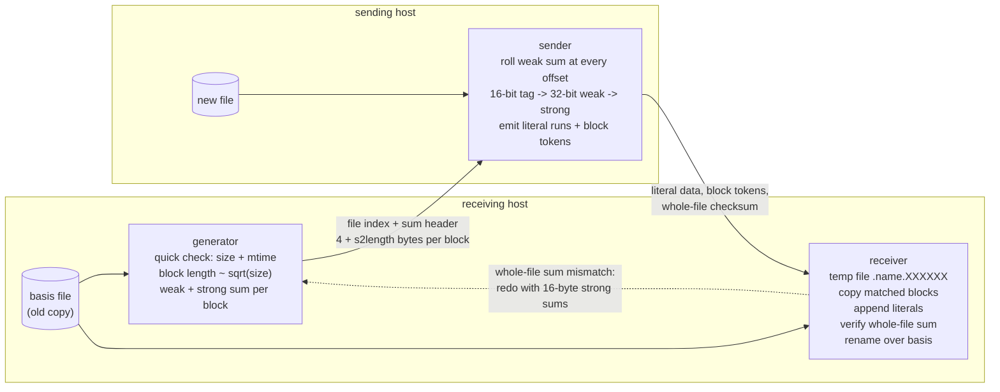

# rsync: Algorithm and Usage

> [!summary] Claim
> rsync makes a remote file identical to a local one in a single round trip by having the receiver describe its old copy as fixed-size block checksums and the sender roll a cheap 32-bit checksum across every byte offset of the new file, so only unmatched bytes cross the wire, but almost every production surprise comes not from that algorithm but from the layers around it: the size-and-mtime quick check that decides whether the algorithm runs at all, path and trailing-slash semantics, temp-file-and-rename replacement without `fsync`, and a wire protocol that trusts its peer far less than it used to.

Part of [Coreutils and the Userland](README.md) in [Shell and Unix Engineering](../README.md).

## TL;DR

- Mechanism: the receiver's generator splits the basis file into blocks of about the square root of its size and sends a 4-byte rolling checksum plus a truncated strong checksum per block; the sender slides a window over the new file one byte at a time, looks each rolling value up in a 65536-entry tag table, confirms with the strong checksum, and emits a stream of literal bytes and block references that the receiver replays into a temp file which it then renames over the original.
- Rule: rsync transfers only files the quick check flags (size or modification time differ, compared to whole seconds by default), so a same-size, same-mtime change is silently skipped unless you pass `-c`, and between two local paths it disables the delta algorithm entirely (`--whole-file` is the local default).
- Trap: a trailing slash on the source (`src/` versus `src`) decides whether rsync copies the directory or its contents, and so which destination directory `--delete` mirrors; `src/ dst/` deletes everything in `dst/` that `src` lacks.
- Portability fact: rsync is not a POSIX utility, GNU coreutils, BusyBox and uutils do not ship one, and the macOS `/usr/bin/rsync` is Apple's openrsync, which speaks protocol 29 (rsync 2.6.4 era) and lacks `-A`, `-X` and `-s`, while samba.org rsync speaks protocol 33 from 3.5.1 (3.5.0 and the 3.4 series speak 32, per the protocol history in [NEWS](https://github.com/RsyncProject/rsync/blob/master/NEWS.md)).
- When not to use it: do not use the delta algorithm for local copies, on already-compressed or encrypted files that change throughout, or for crash-consistent deployment of a directory tree; use `cp` or reflinks locally, ship whole artifacts, and publish trees with an atomic symlink or directory rename.

## Mental model



The generator on the receiving host walks the file list, skips every file whose size and mtime already match, and for each remaining file reads the old copy (the basis) and sends one weak and one strong checksum per block to the sender.
The sender, which alone has the new file, rolls the weak checksum across every byte offset of the new file, so a match can start anywhere, not only on a block boundary; when a weak value hits the tag table and the strong checksum agrees, it sends any pending literal bytes and then a reference to that basis block.
The receiver replays the stream, copying referenced blocks out of the basis and literal bytes off the wire into a temporary file in the destination directory, computes a whole-file checksum as it writes, and renames the temp file over the basis only if the checksum matches the sender's.
When it does not match, the dotted arrow fires: the file is queued for a second phase in which the generator resends its block checksums at the full 16-byte strong length.
The three roles run as separate processes, so checksums for file N+1 flow while the sender is still matching file N, which is the pipelining that lets rsync amortize its single round trip over a whole tree.

## How it works

### The problem rsync solves

Andrew Tridgell and Paul Mackerras posed it in their 1996 technical report: update file B on one machine to equal file A on another, over a link that is slow and high-latency, when neither machine has both files ([tech report, "The problem"](https://rsync.samba.org/tech_report/node1.html)).
Ordinary `diff` needs both files on one machine, and compression alone gains "a factor of 2 to 4", so the report's contribution is a way to compute differences with one copy on each side.
Its algorithm takes five steps: the machine holding B splits it into non-overlapping fixed-size blocks, computes a weak rolling 32-bit checksum and a strong 128-bit MD4 checksum per block, and sends them; the machine holding A searches A for blocks at any offset with both checksums equal, and sends back a sequence of block references and literal data ([tech report, "The rsync algorithm"](https://rsync.samba.org/tech_report/node2.html)).
The report stresses that it "only requires one round trip, which minimises the impact of the link latency."

Modern rsync keeps that core and wraps a lot around it; the rest of this section follows a transfer in the order the code runs.

### Roles, processes, and the pipeline

The client is the process you started; the server is the peer it starts or connects to; once connected, the roles that matter are sender, generator, and receiver ([How Rsync Works](https://rsync.samba.org/how-rsync-works.html)).
Over a remote shell, the client forks `ssh` (or whatever `-e` names), which starts `rsync --server` on the far side, and the two communicate over pipes through that shell; "as far as the rsync processes are concerned there is no network."
A daemon connection (`host::module` or `rsync://host/module`, TCP port 873, `RSYNC_PORT` in `rsync.h`) is the only network-aware mode; the daemon forks a child per connection, which rereads `rsyncd.conf`, may `chroot` to the module path, and drops privileges.
A local transfer is done "exactly like a push": the client becomes the sender and forks a server that plays receiver.

On the receiving side, after the file list arrives, the process forks once more (`do_recv()` in `main.c` calls `do_fork()`), and the child becomes the receiver while the parent continues as the generator, giving the pipeline `generator -> sender -> receiver`.
Each side first sends the highest protocol version it supports and both use the lower; the current samba.org release defines `PROTOCOL_VERSION 33`, accepts peers from `MIN_PROTOCOL_VERSION 20`, and refuses anything above `MAX_PROTOCOL_VERSION 40` so that a non-rsync server is detected (`rsync.h`).
After negotiation the server picks a checksum seed, `time(NULL) ^ (getpid() << 6)` unless `--checksum-seed` fixes one, and sends it to the client (`compat.c`); the seed is mixed into every strong checksum so that collisions found for one session do not carry to the next.
Since rsync 3.2.0 (June 2020) the two sides also negotiate the strong checksum and compression algorithms from preference lists (`valid_checksums_items` in `checksum.c`: xxh128, xxh3, xxh64, md5, md4, and so on; `valid_compressions_items` in `compat.c`: zstd, lz4, zlibx, zlib) ([NEWS 3.2.0](https://github.com/RsyncProject/rsync/blob/master/NEWS.md)).
All traffic on the one connection is multiplexed: each message carries a 4-byte header whose top byte is `MPLEX_BASE (7)` plus a message code (`io.c`), which is how error text and log lines share the pipe with file data.
The protocol, in the words of its own overview, has "none of these good characteristics" of a framed protocol: "the meaning of each byte is dependent on its context as defined by the protocol level," which is why every malformed-input CVE below is a parsing bug in context-dependent state.

### Deciding what to transfer: the file list and the quick check

The sender scans its tree and streams the file list (names, mode, size, mtime, and with options owners, links, devices, ACLs, xattrs); both sides sort it and thereafter refer to files by index ([How Rsync Works](https://rsync.samba.org/how-rsync-works.html)).
Since rsync 3.0.0 (March 2008, protocol 30), recursion is incremental by default: the file list is sent in chunks as directories are scanned, so transfers start before the scan ends and memory stays bounded ([NEWS 3.0.0](https://github.com/RsyncProject/rsync/blob/master/NEWS.md)).
Options that need the whole list up front, such as `--delay-updates`, imply `--no-inc-recursive` ([rsync(1)](https://github.com/RsyncProject/rsync/blob/master/rsync.1.md)).

For each entry the generator applies the quick check: "files that have changed in size or in last-modified time" are transferred, everything else gets only its attributes fixed ([rsync(1) DESCRIPTION](https://github.com/RsyncProject/rsync/blob/master/rsync.1.md)).
Timestamps compare at whole-second granularity by default: `--modify-window` "default is 0, which matches just integer seconds"; a negative value adds nanoseconds (receiver 3.1.3 or later), and 1 is the documented setting for FAT's 2-second clock.
`-c` (`--checksum`) replaces the quick check with a whole-file checksum of every same-size file on both sides, which costs a full read of both trees before any transfer starts; this checksum is unrelated to the per-transfer verification described later.
`-I` (`--ignore-times`) transfers everything, and `--size-only` ignores mtime.

The quick check is also why `-t` (part of `-a`) matters: without preserved mtimes, every destination file carries the time it was written, the next run sees every mtime differ, and every file goes through the delta algorithm again.

### Whole-file versus delta

The delta algorithm is skipped for new files (an empty checksum set is sent) and whenever `--whole-file` (`-W`) is in effect, and `-W` "is the default when both the source and destination are specified as local paths" ([rsync(1)](https://github.com/RsyncProject/rsync/blob/master/rsync.1.md)).
In `main.c` this is two lines: when the transfer is local and `whole_file` is still unset (`-1`, from `options.c`), it becomes 1 unless a batch file is being written.
The reasoning is bandwidth: locally, reading the basis, checksumming it, and reading the new file to match costs more disk I/O than copying, so the algorithm only pays when the link is the bottleneck.
`--no-whole-file` forces deltas locally, which is useful with `--inplace` to minimize writes into a copy-on-write snapshot.

### The signature: block length and strong-sum length

The generator sizes the signature per file in `sum_sizes_sqroot()` (`generator.c`).
The block length is `BLOCK_SIZE` (700 bytes, `rsync.h`) for files up to 700 x 700 = 490000 bytes; above that it is the integer square root of the file length, built bit by bit from the top and rounded down to a multiple of 8, never below 700 and never above `MAX_BLOCK_SIZE` (`1 << 17` = 131072 bytes for protocol 30 and later, `OLD_MAX_BLOCK_SIZE` = `1 << 29` before that).
`-B` (`--block-size`) overrides it.

The strong checksum is truncated per block to `s2length` bytes, computed from a bound credited in the source to Donovan Baarda: `blocksum_bits = BLOCKSUM_BIAS + 2*log2(file_len) - log2(block_len)` with `BLOCKSUM_BIAS 10`; the code then adds a bit, subtracts the 32 bits the weak checksum already provides, rounds up to bytes, and clamps the result between the current `csum_length` and `MIN(SUM_LENGTH, xfer_sum_len)`.
`csum_length` starts at `SHORT_SUM_LENGTH` (2; defined in `rsync.h`, assigned as the initial value in `io.c`), and `SUM_LENGTH` is 16.
The lab transcribes that function and prints, for a 1 MiB file, `blength=1024` and `s2length=2`; for 1 GiB, 32768 and 3; for 100 GiB, 131072 (the cap) and 5.
On the wire each block costs 4 bytes of weak checksum plus `s2length` bytes of strong checksum, so the 1 GiB signature is 32768 x 7 = 229376 bytes, and a 100 GiB file's is 819200 x 9 = 7372800 bytes, all printed by the lab.
The square-root rule balances two costs: more, smaller blocks find finer matches but enlarge the signature linearly, while fewer, larger blocks shrink the signature but make each changed byte cost a whole block of literal data.

The short strong sum is a bet: a wrong match corrupts the reconstructed file, but that corruption is caught by the whole-file checksum, and the file is then redone.
`receiver.c` flips `csum_length` to `SUM_LENGTH` for a file it has already sent once (`FLAG_FILE_SENT`), and `generator.c` resends the block sums at the full 16 bytes for each redo index, so the second phase cannot fail the same way.
The tech report's original wire format used all 20 bytes (4 + 16 MD4) per block ([tech report, "Results"](https://rsync.samba.org/tech_report/node6.html)); adaptive `s2length` arrived with protocol 27 (the `protocol_version < 27` branch of `sum_sizes_sqroot()`).

### The weak rolling checksum

The report defines it, for bytes `X_k .. X_l`, as `a(k,l) = sum of X_i mod M`, `b(k,l) = sum of (l - i + 1) X_i mod M`, and `s(k,l) = a + 2^16 b`, with `M = 2^16`, "inspired by Mark Adler's adler-32 checksum" ([tech report, "Rolling checksum"](https://rsync.samba.org/tech_report/node3.html)).
Its point is the recurrence: sliding the window one byte needs only the outgoing and incoming bytes, `a' = a - X_k + X_(l+1)` and `b' = b - (l - k + 1) X_k + a'`, so checksums at every offset cost O(1) each.

`get_checksum1()` in `checksum.c` implements it with two quirks worth knowing.
First, it reads bytes through `schar *buf`, a signed char, so a byte 0x80 to 0xff contributes a negative value; the lab shows that the single byte 0xff checksums to 4294967295 (s1 = s2 = -1), where an unsigned reading would give 16711935.
Every compatible implementation must copy this, which is one reason `rsync.h` keeps `CHAR_OFFSET 0` with the comment that a non-zero offset "makes the rolling sum stronger, but is incompatible with older versions".
Second, the main loop is unrolled four bytes at a time (`s2 += 4*(s1 + buf[i]) + 3*buf[i+1] + 2*buf[i+2] + buf[i+3]`), and on x86-64 a SIMD build replaces it (`#ifndef USE_ROLL_SIMD`); the lab checks that the unrolled function and the one-byte rolling update agree at all 64837 offsets of a 65536-byte pseudo-random file.
The result packs `(s1 & 0xffff) + (s2 << 16)`, and `hash_search()` in `match.c` rolls exactly as the paper says: `s1 -= map[0]; s2 -= k * map[0]`, then `s1 += map[k]; s2 += s1` if another byte exists, else the window shrinks (`--k`) so that the shorter final block can still match at the end of the file.

The checksum is weak by design and by arithmetic.
Swapping bytes preserves `a`; changing three bytes by +1, -2, +1 at consecutive positions preserves both `a` and `b` (the weights 3, 2, 1 sum the changes to zero), so `aaa` and `b_b` collide; the lab prints the shared value 38142243.
The report found in practice that weak matches without strong matches ("false alarms") were "less than 1/1000 of the number of true matches" on Linux kernel tarballs, which is fine for random data and useless against an adversary who chooses the blocks.

### The search: tag table, chain, strong check

The report describes "a simple 3 level searching scheme": a 16-bit hash of the 32-bit rolling checksum indexes a 2^16-entry table; a hit scans candidates for an equal 32-bit value; an equal value triggers the strong checksum ([tech report, "Checksum searching"](https://rsync.samba.org/tech_report/node4.html)).
Current `match.c` keeps the shape with refinements:

- `build_hash_table()` sizes the table at `TRADITIONAL_TABLESIZE` (`1 << 16`) or, for files with more blocks, `count/8 * 10 + 11` entries (odd, for about 80% load), indexed by `SUM2HASH2(s1, s2) = (s1 + s2) & 0xFFFF` in the small case and `sum % tablesize` in the large one; collisions chain through `sums[i].chain`.
- At each offset, a table miss costs one array load and the loop rolls on; a hit walks the chain comparing the full 32-bit weak value and the block length, and computes the strong checksum at most once per offset (`done_csum2`), comparing only the negotiated `s2length` bytes.
- After a match, the next search starts at the end of the matched block, so identical regions cost one table probe per block, not per byte.
- `want_i` prefers the block right after the previous match when several blocks share checksums, so consecutive matches form runs that the compressed token encoding sends as one `TOKENRUN_REL` record (`token.c`).
- After four consecutive offsets where a strong checksum was computed and nothing matched, the search skips ahead `k - 1` bytes, so a file full of weak collisions does not force a strong checksum at every byte.
- `MAX_CHAIN_LEN` (1024) caps the candidates examined per offset; the comment cites issue #217, where a 40000-block basis whose blocks all share one weak checksum took about 18.4 s to sync a 60 KB source before the cap and 0.7 s after, "on a modern x86_64 box" (a maintainer measurement in the `match.c` comment, not reproduced here).

That last fix closes a real incident.
In [issue #217](https://github.com/RsyncProject/rsync/issues/217), opened 2021-09-01, rsync spent hours at "100% of one of the available CPU cores" on 25 to 400 GiB QEMU/KVM disk images: images contain long runs of identical (often zero) blocks, every such block has the same weak checksum, and the chain walk became O(file size x chain length).
It shipped in rsync 3.5.0 (13 Aug 2026) as CVE-2026-70453, because a malicious peer can supply such a chain on purpose ([NEWS 3.5.0](https://github.com/RsyncProject/rsync/blob/master/NEWS.md), [NVD](https://nvd.nist.gov/vuln/detail/CVE-2026-70453)), and 3.5.2 (4 Nov 2026) further "bounded strong-checksum work when a malicious receiver supplies weak checksums that collide with consecutive rolling windows".
NVD's description of CVE-2026-70453 says a sender exhausts receiver CPU, but `hash_search()` runs on the sender and the `match.c` comment calls the cap "purely a sender-side search limit", so the attacker is the peer that supplies the block checksums.

The sender is the CPU-heavy role: "Of all the rsync processes it is the sender that is the most CPU intensive" ([How Rsync Works](https://rsync.samba.org/how-rsync-works.html)).
For an unchanged region it does one probe per block; for a changed region it does one roll and one table probe per byte, plus a strong checksum for each tag hit whose full weak value also matches.
The lab's overwrite scenario shows the expected rate: in the 1024 offsets of the one changed block, 16 extra tag hits occurred (`hash_hits=1040` versus 1024 true matches), which is 1024 offsets x 1024 blocks / 65536 table entries, and the 32-bit weak compare rejected all 16 before any strong checksum.

### The token stream and reconstruction

`matched()` in `match.c` sends the bytes since the last match as literal data, then the block index; it also flushes literal data on its own once `CHUNK_SIZE` (32 KiB) beyond a block is pending, so the receiver can write while the sender is still searching.
Without compression, `simple_send_token()` in `token.c` writes literal data as 32-bit length plus bytes in chunks of at most 32 KiB and a match as the 32-bit integer `-(index + 1)`, with 0 ending the file, so each matched block costs 4 bytes on the wire.
With `-z`, `send_deflated_token()` deflates the literals and run-length encodes consecutive block indexes, and both ends also feed matched block data into the compressor's history (`see_deflate_token()` on the receiver), so literal data that resembles nearby matched data still compresses.
The sender also computes a whole-file checksum as it reads, and sends it at the end.

The receiver opens the basis, creates a temp file named after the target with a leading dot and a `.XXXXXX` suffix in the same directory (`get_tmpname()` in `receiver.c`, filled by `mkstemp()`), and builds the new file front to back: literal bytes are written, block references are copied from the basis by offset.
It hashes what it writes; on a mismatch with the sender's whole-file checksum, it discards the temp file and the file is redone in phase two with 16-byte sums, and "if it fails twice an error is reported" ([How Rsync Works](https://rsync.samba.org/how-rsync-works.html)).
On success it sets ownership, permissions, and mtime on the temp file and renames it over the target.
POSIX makes that `rename()` atomic for observers: "a directory entry named new shall remain visible to other threads throughout the renaming operation and refer either to the file referred to by new or old before the operation began" ([POSIX.1-2024 XSH rename()](https://pubs.opengroup.org/onlinepubs/9799919799/functions/rename.html)).
Atomic visibility is not durability: the receiver does not `fsync()` the temp file unless `--fsync` is given (added in 3.2.4, April 2022), so a power loss after the rename can leave a renamed file whose data blocks never reached disk on a filesystem that does not order data before metadata.
Because each file is renamed separately, a tree is never updated atomically; `--delay-updates` moves all temp files into `.~tmp~` directories and renames them "in rapid succession" at the end, which narrows the window but is "a little closer to atomic", not atomic.

The temp-file design also explains rsync's disk behavior: the receiver reads the basis at whatever offsets the tokens name while writing a second copy, so it needs free space for the largest file and can cause "a seek storm" when the working set exceeds cache ([How Rsync Works](https://rsync.samba.org/how-rsync-works.html)).

### In-place, append, partial

`--inplace` writes into the destination file itself instead of a temp file, which keeps hard links and copy-on-write snapshots sharing unchanged blocks, but the file is "in an inconsistent state during the transfer" and stays that way if interrupted, in-use binaries cannot be updated safely, and the delta gets worse because data overwritten early can no longer be copied to a later position ([rsync(1)](https://github.com/RsyncProject/rsync/blob/master/rsync.1.md)).
`match.c` adapts for it: with `updating_basis_file` set, it drops candidate blocks whose basis offset is already behind the write position and prefers a match at the same offset (`SUMFLG_SAME_OFFSET`), which then needs no write at all.
`--append` assumes the destination is a byte-exact prefix of the source and sends only the tail without verifying the existing data, and skips files that are not shorter on the receiver; `--append-verify` includes the existing data in the whole-file checksum; the manual warns that both "can be dangerous".
`--partial` keeps an interrupted temp file as the new basis so that the next run resumes; `--partial-dir` keeps it out of the destination's namespace.

### Paths, trailing slashes, and deletion

"A trailing slash on the source changes this behavior to avoid creating an additional directory level at the destination," so `rsync -av /src/foo /dest` and `rsync -av /src/foo/ /dest/foo` are equivalent ([rsync(1)](https://github.com/RsyncProject/rsync/blob/master/rsync.1.md)); a trailing slash on the destination only matters for the single-file-copy rule (copying one item to a path that does not exist as a directory names the file after the destination, so `rsync -ai src/*.c save/dir` creates a file `save/dir` when the glob matches one file).
`-a` is `-rlptgoD`; it does not include ACLs (`-A`), xattrs (`-X`), atimes (`-U`), creation times (`-N`), or hard links (`-H`).
`--delete` removes receiver files that the sender lacks, only in directories being synchronized, so `rsync -a --delete src/* dst/` deletes nothing at the top level of `dst` (the shell expanded the glob into individual names) while `rsync -a --delete src/ dst/` mirrors.
Excluded files are protected from deletion unless `--delete-excluded`; if the sender hits any I/O error, deletion is disabled unless `--ignore-errors`; `--max-delete=NUM` stops after NUM deletions with exit code 25; the default timing is `--delete-during` with a 3.0.0 or newer peer.
`--link-dest=DIR` hard-links each unchanged file from a previous snapshot (up to 20 such directories), the basis of rotating-snapshot backups; files link only if every preserved attribute matches.

### How arguments reach the remote side

In a remote-shell transfer, the remote file names are part of a command line that the remote user's login shell parses.
Since rsync 3.2.4 (April 2022) the client backslash-escapes "shell-active" characters, including spaces, so `rsync -aiv host:'a simple file.pdf' .` works without double quoting; wildcards stay unescaped in file names so that the remote side can expand them ([NEWS 3.2.4](https://github.com/RsyncProject/rsync/blob/master/NEWS.md)).
`--old-args` (or `RSYNC_OLD_ARGS=1`) restores the old splitting for scripts that already quote for the remote shell, and `-s` (`--secluded-args`, named `--protect-args` before 3.2.6) sends names over the protocol instead, so the remote shell never sees them, with the documented drawback "of being refused by restricted shells that want to be able to inspect all the option values for safety" ([rsync(1)](https://github.com/RsyncProject/rsync/blob/master/rsync.1.md)).

## Numbers and limits

| Quantity | Value | Source |
| --- | --- | --- |
| Minimum and small-file block length | 700 bytes, up to 490000-byte files | `BLOCK_SIZE`, `rsync.h`; `sum_sizes_sqroot()` (master, as of 2026-11) |
| Maximum block length | 131072 bytes (protocol >= 30), 512 MiB before | `MAX_BLOCK_SIZE`, `OLD_MAX_BLOCK_SIZE`, `rsync.h` |
| Block length at 1 MiB / 1 GiB / 100 GiB | 1024 / 32768 / 131072 bytes | lab (`sizes`), transcribed `sum_sizes_sqroot()` |
| Strong-sum bytes per block, first pass | 2 at 1 MiB and 4 MB, 3 at 1 GiB, 5 at 100 GiB; range 2 to 16 | lab; `SHORT_SUM_LENGTH`, `SUM_LENGTH`, `rsync.h` |
| Signature on the wire | 6144 B (1 MiB), 229376 B (1 GiB), 7372800 B (100 GiB) | lab (`sig_wire_bytes`) |
| Signature in the 1996 design | 20 bytes per block (4 weak + 16 MD4) | [tech report, Results](https://rsync.samba.org/tech_report/node6.html) |
| Tag table | 65536 entries, or `count/8*10+11` above about 52000 blocks | `build_hash_table()`, `match.c` |
| Candidates checked per offset | at most 1024 (`MAX_CHAIN_LEN`), since 3.5.0 | `match.c`, [NEWS 3.5.0](https://github.com/RsyncProject/rsync/blob/master/NEWS.md) (2026-08-13) |
| Chain cap effect | 18.4 s -> 0.7 s for a 60 KB source against 40000 equal-weak blocks | maintainer comment in `match.c`, not reproduced here |
| Matched-block cost, uncompressed | 4 bytes per block token | `simple_send_token()`, `token.c` |
| Literal chunk and I/O buffer | 32 KiB (`CHUNK_SIZE`, `IO_BUFFER_SIZE`); map window up to 256 KiB | `rsync.h` |
| 1996 result, 24 MB kernel tars, 500-byte blocks | 1091900 literal bytes, 64 false alarms, 46989 matches | [tech report, Results](https://rsync.samba.org/tech_report/node6.html) |
| openrsync, 4000001-byte file, 1 byte prepended, `--no-whole-file` | matched 4000000 B, unmatched 1 B, sent 8130 B (varies a few bytes with the path names), received 12042 B | measured here, macOS 27.3 `/usr/bin/rsync` (openrsync, protocol 29), 2026-11-15 |
| Same, default local run | matched 0 B, unmatched 4000001 B (whole-file) | measured here, same host |
| Lab, 1 MiB, 1 byte prepended | 1024 of 1024 blocks matched, 1 literal byte, 5130-byte delta | lab (`insert`) |
| Lab, 1 MiB, 1 byte overwritten | 1023 matched, 1024 literal bytes, 16 spurious tag hits, 0 false alarms | lab (`overwrite`) |
| Daemon port | 873 | `RSYNC_PORT`, `rsync.h` |
| Protocol versions | 27 (2.6.0, 2004), 29 (2.6.4, 2005), 30 (3.0.0, 2008, MD5 strong sums), 31 (3.1.0, 2013), 32 (3.4.0, 2025), 33 (3.5.1, 2026) | [NEWS](https://github.com/RsyncProject/rsync/blob/master/NEWS.md) |
| `--link-dest` directories | at most 20 | `MAX_BASIS_DIRS`, `rsync.h`; enforced in `options.c` |
| Exit codes scripts must handle | 23 partial (error), 24 partial (vanished source files), 25 `--max-delete`, 30 timeout | [rsync(1) EXIT VALUES](https://github.com/RsyncProject/rsync/blob/master/rsync.1.md) |

The openrsync figure ties the model to a real implementation: 12042 received bytes is the 2000-block signature at 6 bytes per block (the lab's `sizes 4000000` prints `sig_wire_bytes=12000`) plus 42 bytes of framing and file list.

## Portability

rsync is an external program, so the shell under test changes nothing about the algorithm; what varies is which rsync is installed and which protocol it speaks.

| Environment | rsync available | Behavior that matters | Evidence |
| --- | --- | --- | --- |
| POSIX.1-2024 | not specified | no portable `rsync` exists; `cp`, `pax` and `mv` are the specified tools | [XCU utilities index](https://pubs.opengroup.org/onlinepubs/9799919799/idx/utilities.html) |
| POSIX `sh`, dash, bash (3.2 and current), zsh (native and `--emulate sh`), ksh93, mksh, yash, posh, BusyBox ash | n/a (the shell only orchestrates) | the lab's results come from its C model, so they cannot depend on the shell; only the remote login shell's parsing of rsync's remote command line can differ | lab tests assert exact values with no per-shell branches (run here under macOS `/bin/sh`, bash 3.2, only); [NEWS 3.2.4](https://github.com/RsyncProject/rsync/blob/master/NEWS.md) |
| samba.org rsync 3.5.x (Linux distributions, Homebrew) | yes | protocol 33 from 3.5.1 (3.5.0 speaks 32); negotiated xxh128/xxh3/MD5 strong sums; zstd/lz4/zlib; `-A`, `-X`, `-s`, `--fsync`, `--mkpath`, `--trust-sender`; exit codes 0 to 35 | `rsync.h`, `checksum.c`, `compat.c`, [rsync(1)](https://github.com/RsyncProject/rsync/blob/master/rsync.1.md) |
| samba.org rsync before 3.4.0 | yes | vulnerable to the six January 2025 CVEs; protocol 31 or older | [VU#952657](https://kb.cert.org/vuls/id/952657) |
| macOS `/usr/bin/rsync` (macOS 27.3) | yes, openrsync | reports `openrsync: protocol version 29` and `rsync version 2.6.9 compatible`; man page: protocols 27 to 29, no `-A`, `-X`, or `-s`, Apple-specific `-E` for xattrs and resource forks; whole-file by default for local copies | measured here; `openrsync(1)` on macOS 27.3 |
| OpenBSD openrsync | yes, upstream | "accepts only a subset of rsync's command-line arguments"; generator and receiver merged into one event-loop process; confined by `pledge(2)` and `unveil(2)` | [openrsync README](https://github.com/kristapsdz/openrsync) |
| GNU coreutils | no | use `cp -a`, `cp --reflink`; see [[cp-mv-and-Rename-Semantics]] | GNU coreutils has no rsync program |
| BusyBox | no applet | install a separate rsync package | [BusyBox command list](https://busybox.net/downloads/BusyBox.html) (no `rsync` entry) |
| uutils | no | not part of the coreutils rewrite | [uutils Cargo.toml](https://github.com/uutils/coreutils/blob/main/Cargo.toml) (no `rsync` member) |

Exit status is a portability trap in itself: macOS `openrsync(1)` documents only 0, 1, and 2, yet the run measured here exited 23 for a missing source, the samba.org code for a partial transfer, so test for zero and treat every non-zero value as failure rather than matching specific codes across implementations.

## Worked example

The [lab](../labs/08-rsync-algorithm-and-usage/) builds `rsync_delta.c`, a small model of the algorithm whose weak checksum, rolling update, tag hash, and `sum_sizes_sqroot()` are transcribed from rsync, and whose strong checksum is a 64-bit FNV-1a stand-in for the negotiated MD5 or xxh128 digest.
It plays both hosts: `sig` is the generator, `delta` is the sender, `patch` is the receiver, and the receiver never sees the new file, only the basis and the token stream.
The `naive` mode compares blocks only at equal offsets, which is what a block-aligned scheme (and the `--inplace` same-offset preference at its best) can find.

Simplified excerpt of `rsync_lab.sh` (the scenario driver):

```sh
sync_pair() {
  basis=$1
  new=$2
  blen=$3
  "$probe" sig "$basis" "$blen" "$work/basis.sig" >/dev/null
  "$probe" delta "$work/basis.sig" "$new" "$work/new.delta"
  "$probe" patch "$basis" "$work/new.delta" "$work/rebuilt"
  if cmp -s "$new" "$work/rebuilt"; then
    echo "rebuilt=identical"
  else
    echo "rebuilt=DIFFERENT"
  fi
  "$probe" naive "$basis" "$new" "$blen"
}

case $mode in
  insert)
    build
    "$probe" gen 42 1048576 "$work/basis"
    { printf 'Z'; cat "$work/basis"; } >"$work/new"
    sync_pair "$work/basis" "$work/new" 1024
    ;;
  collide)
    build
    printf 'aaa' >"$work/basis"
    printf 'b_b' >"$work/new"
    sync_pair "$work/basis" "$work/new" 3
    ;;
esac
```

Simplified excerpt of the sender loop in `rsync_delta.c`:

```c
sum = (s1 & 0xffff) | (s2 << 16);
i = table[SUM2HASH2(s1, s2)];
for (; i >= 0; i = chain[i]) {
  if (sum != sum1[i] || l != blk_len[i])
    continue;                       /* tag hit, weak or length differs */
  if (!have_strong) {
    strong = strong_sum(x + off, l); /* at most once per offset */
    have_strong = 1;
  }
  if (strong != sum2[i]) {
    false_alarms++;                 /* weak matched, strong did not */
    continue;
  }
  emit_literal(&d, x + last_match, off - last_match);
  emit_copy(&d, i);
  ...
}
/* no match: roll one byte, exactly as rsync's hash_search() does */
s1 -= (uint32_t)(int32_t)(schar)x[off];
s2 -= (uint32_t)k * (uint32_t)(int32_t)(schar)x[off];
if (off + k < n) {
  s1 += (uint32_t)(int32_t)(schar)x[off + k];
  s2 += s1;
} else
  k--;
off++;
```

Output captured from the lab on macOS 27.3 (Apple clang 21, `/bin/sh` = bash 3.2) on 2026-11-15:

```text
$ ./rsync_lab.sh "$W" insert
blocks=1024
matched_blocks=1024
literal_bytes=1
hash_hits=1024
false_alarms=0
delta_bytes=5130
rebuilt=identical
aligned_matches=0
new_blocks=1025
$ ./rsync_lab.sh "$W" overwrite
blocks=1024
matched_blocks=1023
literal_bytes=1024
hash_hits=1040
false_alarms=0
delta_bytes=6148
rebuilt=identical
aligned_matches=1023
new_blocks=1024
$ ./rsync_lab.sh "$W" swap
blocks=1024
matched_blocks=1024
literal_bytes=0
hash_hits=1024
false_alarms=0
delta_bytes=5124
rebuilt=identical
aligned_matches=0
new_blocks=1024
$ ./rsync_lab.sh "$W" collide
blocks=1
matched_blocks=0
literal_bytes=3
hash_hits=1
false_alarms=1
delta_bytes=12
rebuilt=identical
aligned_matches=0
new_blocks=1
$ ./rsync_lab.sh "$W" sizes 1073741824
blength=32768
s2length=3
count=32768
sig_wire_bytes=229376
```

Read the four scenarios as the algorithm's argument.
`insert` shifts every byte by one: a block-aligned comparison finds 0 of 1025 blocks, the rolling search finds all 1024 and sends 1 literal byte, and the 5130-byte delta (4-byte header, one 6-byte literal record, 1024 five-byte copy records; real rsync spends 4 bytes per copy) replaces a 1 MiB copy.
`overwrite` costs exactly one block of literal data, the price of a block granularity of 1024 bytes.
`swap` matches every block although none is at its original offset, because the table is keyed by content, not position.
`collide` shows why the strong checksum exists: `aaa` and `b_b` share weak checksum 38142243, the tag table hits, the strong checksum rejects it (`false_alarms=1`), and the file is rebuilt from 3 literal bytes instead of a wrong block.
The tests also pin the two checksum facts above: the weak checksum of `abc` is 38404390 (a = 294, b = 586) and of the byte 0xff is 4294967295, because rsync reads bytes as signed char.

For real transfers, the commands that show the same mechanism are `rsync -av --no-whole-file --stats src/file dst/` (look at "Matched data" and "Literal data" or openrsync's "Unmatched data") and `rsync -ain --delete src/ dst/`, which itemizes every change and deletion without making any.

## Pitfalls

> [!warning] The quick check skips a real change
> Trigger: a file changes content but keeps its size and its whole-second mtime, for example a tool that restores timestamps, a `touch -r`, a fixed-width record rewritten within the same second, or a destination filesystem with coarser timestamps.
> Symptom: rsync reports success and the destination keeps the old bytes; measured here with openrsync, `rsync -a q1/ q2/` left `HELLO` in place of `hello` when both had the same size and mtime, and `rsync -ac q1/ q2/` fixed it.
> Fix: use `-c` for verification passes (it reads both trees in full), a negative `--modify-window` for nanosecond comparison where both ends support it, or `--ignore-times` for a forced refresh; never rely on rsync to detect same-size in-place edits by default.

> [!warning] Trailing slash plus `--delete`
> Trigger: `rsync -a --delete src/ dst/` when `dst/` is a shared directory and `src` (copy the directory by name) was meant, or the reverse.
> Symptom: with the trailing slash, `dst/` itself is the synchronized directory, so everything in it that is not in `src` is deleted; without it, only `dst/src/` is synchronized, nothing else in `dst/` is touched, and a mirror you expected at `dst/` silently keeps stale files (measured here with openrsync: `src dst/` kept `dst/old` and created `dst/src/`; `src/ dst/` deleted `dst/old`, and on a second run also the `dst/src/` left by the first).
> Fix: decide which directory is the mirror, write the source with a trailing slash and the destination as exactly that directory (`rsync -a --delete src/ mirror/`), run with `-n -i` first, and add `--max-delete` as a circuit breaker in automation.

> [!warning] An empty or unmounted source mirrors as "delete everything"
> Trigger: `--delete` from a source path whose filesystem failed to mount, or a variable that expanded to an empty directory.
> Symptom: rsync sees an empty but readable tree, finds no I/O error, and deletes the entire destination; the automatic deletion lockout applies only when the sender detects an I/O error ([rsync(1)](https://github.com/RsyncProject/rsync/blob/master/rsync.1.md) `--delete`).
> Fix: assert a sentinel file or a `mountpoint -q` check before running, set `--max-delete`, and treat exit code 25 as an alarm.

> [!warning] Durable is not the same as renamed
> Trigger: a power loss shortly after rsync finished updating files, without `--fsync`.
> Symptom: files that rsync replaced by rename may contain zeros or old data on filesystems that do not order data writes before the rename's metadata.
> Fix: pass `--fsync` (3.2.4 or later) for critical data, or `sync` the destination filesystem before declaring a backup complete; see [[install-and-Atomic-Deployment]] for the full write, `fsync`, rename, `fsync`-directory sequence.

> [!warning] `--inplace` and `--append` on live or non-growing files
> Trigger: `--inplace` on a running binary or a file other processes read, or `--append` on a file that was modified rather than appended to.
> Symptom: readers see a half-written file and an interrupted run leaves it that way; `--append` produces a file that is the old prefix plus the new tail, silently corrupt, because it never verifies the existing data.
> Fix: use the default temp-file-and-rename path for anything that is read while it updates, restrict `--append` with filter rules to files known to grow (logs), and prefer `--append-verify` when in doubt.

> [!warning] `-a` is not a full-fidelity copy
> Trigger: backing up or migrating a system with `rsync -a`.
> Symptom: hard links become separate files (no `-H`), ACLs and xattrs disappear (no `-A`, `-X`), and with a non-root receiver ownership falls back to the receiving user; with names mapped by user and group names, IDs change across hosts with different password files.
> Fix: use `-aHAX --numeric-ids` (as root on the receiver) for system copies; on macOS's openrsync, `-A` and `-X` do not exist and `-E` is the Apple-specific substitute.

> [!warning] Delta transfer that costs more than a copy
> Trigger: syncing compressed archives, encrypted containers, or databases rewritten throughout, or forcing `--no-whole-file` on a local or fast LAN copy.
> Symptom: high sender CPU and receiver disk I/O for nearly 100% literal data, and on huge sparse or zero-filled images, rsync versions before 3.5.0 could spin for hours on weak-checksum chains ([issue #217](https://github.com/RsyncProject/rsync/issues/217)).
> Fix: `-W` for high-bandwidth links, an rsync-friendly compressor mode such as `zstd --rsyncable` when producing archives that will be rsynced (present in the zstd installed here; Apple's `gzip` 487.60.2 has no such option), and rsync 3.5.0 or later for VM images.

> [!warning] Matching exit codes across implementations
> Trigger: a script that treats 24 ("vanished source files") as success or matches specific codes, run against openrsync or an old rsync.
> Symptom: macOS `openrsync(1)` documents only 0, 1, and 2 (it exited 23 in the run measured here), so code-specific logic either misses errors or misfires.
> Fix: branch on zero versus non-zero, and if a code must be tolerated, check `rsync --version` for the samba.org implementation first.

## Security and robustness

The threat model is a two-way trust problem: the client trusts the server not to write outside the destination, and the daemon trusts clients not to read outside the module, and both sides parse a protocol whose fields are context-dependent integers.
The January 2025 disclosure ([VU#952657](https://kb.cert.org/vuls/id/952657), fixed in 3.4.0, credited in NEWS to Simon Scannell, Pedro Gallegos, and Jasiel Spelman of Google Cloud Vulnerability Research and Aleksei Gorban) hit the algorithm itself:

- [CVE-2024-12084](https://nvd.nist.gov/vuln/detail/CVE-2024-12084) (CVSS 9.8): a heap overflow from "improper handling of attacker-controlled checksum lengths (s2length)", the same per-block strong-sum length this note derives above: when the negotiated digest length (`MAX_DIGEST_LEN`) exceeds the fixed 16-byte `SUM_LENGTH`, an attacker can write out of bounds in the `sum2` buffer ([CVE record](https://www.cve.org/CVERecord?id=CVE-2024-12084)).
- [CVE-2024-12085](https://nvd.nist.gov/vuln/detail/CVE-2024-12085) (7.5): a crafted `s2length` makes the daemon compare a checksum with uninitialized stack memory and "leak one byte of uninitialized stack data at a time"; CERT states that combined with CVE-2024-12084 it allows a client to execute arbitrary code on the server, needing only anonymous read access, such as a public mirror.
- [CVE-2024-12086](https://nvd.nist.gov/vuln/detail/CVE-2024-12086): a malicious server sends "specially constructed checksum values" to reconstruct arbitrary client files "byte-by-byte based on the responses from the client", turning the match oracle into a read primitive.
- [CVE-2024-12087](https://nvd.nist.gov/vuln/detail/CVE-2024-12087) and [CVE-2024-12088](https://nvd.nist.gov/vuln/detail/CVE-2024-12088): symlink path traversal through `--inc-recursive` and through `--safe-links`, letting a server write outside the destination; [CVE-2024-12747](https://nvd.nist.gov/vuln/detail/CVE-2024-12747) is a symlink race during transfer.

Earlier, [CVE-2022-29154](https://nvd.nist.gov/vuln/detail/CVE-2022-29154) (fixed in 3.2.5) let a malicious server overwrite arbitrary files in the client's target directory, "for example, overwrite the .ssh/authorized_keys file"; the fix added client-side validation of the file list and of the requested arguments; `--trust-sender` turns off both checks, and `--old-args` turns off the argument check ([rsync(1) `--trust-sender`](https://github.com/RsyncProject/rsync/blob/master/rsync.1.md)).
2026 brought the largest batch yet: 3.4.3 (May) fixed six CVEs including CVE-2026-43618, a compressed-token integer overflow that leaks receiver memory to an authenticated daemon peer ([NVD](https://nvd.nist.gov/vuln/detail/CVE-2026-43618), workaround `refuse options = compress`), and 3.5.0 (August) fixed 33 found in an audit of path handling and the daemon protocol, many of them symlink (link-following) races, with paths now resolved component by component with `openat2(RESOLVE_BENEATH)` on Linux 5.6+, `O_RESOLVE_BENEATH` on FreeBSD 13+ and macOS 15+, or an `O_NOFOLLOW` walk elsewhere ([NEWS 3.4.3, 3.4.4, 3.5.0](https://github.com/RsyncProject/rsync/blob/master/NEWS.md)); several of those CVE IDs were assigned by VulnCheck and are cited here from the release notes.

Rules that follow:

- Run 3.4.0 or later at minimum, 3.5.x on any daemon or on any client that pulls from hosts you do not control, and check `rsync --version` on both ends, because the older end sets the protocol and the fixes are per side.
- Pull untrusted content into a dedicated directory, never into a home directory, as the manual recommends: "it is safest to copy untrusted remote files into a dedicated destination directory".
- The daemon protocol "authenticates but does **not** encrypt the data stream" ([rsyncd.conf(5)](https://github.com/RsyncProject/rsync/blob/master/rsyncd.conf.5.md)); tunnel it over ssh or `rsync-ssl` with certificate and hostname verification, and keep `--password-file` at mode 600.
- In `rsyncd.conf`, keep the defaults that fail safe (`read only = yes`, `use chroot` on), use `refuse options` for features a module does not need (`compress`, `delete*`, `acls`), and remember that `max connections` defaults to 0, unlimited.
- For ssh-based restricted access, use the `rrsync` wrapper on the server's `authorized_keys` command and update it with rsync, since it had its own TOCTOU escape (CVE-2026-53783, NEWS 3.5.0).
- Treat filenames as hostile in logs and terminals: 3.5.0 started escaping control characters in logged names because a name could carry terminal escape sequences.
- `--remove-source-files` and `--delete` are destructive on the far side of a trust boundary; on daemons, refuse them unless the module exists to accept them.

## The principal's view

The decision is rarely "rsync or not"; it is which of rsync's three jobs you are buying: change detection (the quick check), bandwidth reduction (the delta algorithm), and tree synchronization (deletion, metadata, links).
On a LAN or locally, bandwidth reduction is worth little and rsync already turns it off, so you are buying change detection and metadata handling, and the question becomes whether size-plus-mtime is a strong enough change signal for this data.
For backups it usually is not on its own: pair rsync with periodic `-c` verification runs or checksummed manifests (see [[Checksums-and-Integrity]]), and prefer snapshotting filesystems (ZFS, Btrfs, APFS) or content-addressed tools (restic, borg) once you need history, deduplication, or end-to-end integrity, since `--link-dest` snapshots deduplicate only whole unchanged files and verify nothing after the fact.
For deployments, rsync's per-file atomicity is the wrong granularity: rsync a new release into a fresh directory and switch a symlink, or ship one immutable artifact (container image, tarball with a checksum), so that a half-finished sync is never live.
For moving bulk data between clouds or object stores, the delta algorithm does not apply (object stores have no random-access basis), so use the provider's parallel copy tools.
The trade-off you are accepting with rsync is a protocol designed for trusted peers in 1996 and hardened retroactively: its CVE history clusters exactly in the parts this note describes (checksum lengths, token decoding, path resolution), so exposing a daemon to the internet is a commitment to patching it promptly, and the safer architecture runs rsync over ssh with a restricted key and no daemon at all.
If you need the algorithm without the tool, librsync (rdiff's signature, delta, and patch, the same split as the lab) embeds it in a program, and content-defined chunking (as in the `--rsyncable` compressors and deduplicating backup tools) is the better design when insertions are common and many versions must share storage.

## Interview questions

> [!question] L5: Why does rsync need two checksums per block instead of one?
>
> > [!success]- Answer
> > The sender must test a candidate block at every byte offset of the new file, so the first check has to be updatable in O(1) as the window slides one byte, which only a weak rolling checksum allows.
> > A rolling checksum of that kind is easy to collide (for example `aaa` and `b_b` share rsync's weak value), so a strong checksum confirms each weak hit before the sender commits to a block reference.
> > The strong checksum is computed only on weak hits, at most once per offset, which keeps the scan cheap.
> >
> > Follow-up: Why can rsync truncate the strong checksum to 2 or 3 bytes per block, and what catches the resulting wrong matches?

> [!question] L5: A nightly `rsync -a src/ dst/` reports success, yet a changed configuration file was not copied; what happened, and how do you prove it?
>
> > [!success]- Answer
> > rsync's default quick check transfers a file only if its size or its whole-second mtime differs, so an edit that kept both (a tool that preserves mtime, an edit within the same second with equal length) is skipped.
> > Prove it by comparing `stat` size and mtime on both sides and rerunning with `-c -n -i`, which compares content and itemizes what would change.
> > Fix with periodic `-c` verification runs or by making the producer update mtime.
> >
> > Follow-up: What does `-c` cost on a 10 TB tree, and when is a negative `--modify-window` the better fix?

> [!question] L5 (Predict the output): with `src` holding `a` and `b` and `dst` holding `old`, what does `dst` contain after each command?
> ```sh
> rsync -a --delete src dst/
> rsync -a --delete src/ dst/
> ```
>
> > [!success]- Answer
> > After the first command, `dst` contains `old`, `src/a`, and `src/b`: without a trailing slash rsync copies the directory `src` by name, so the only synchronized directory is `dst/src`, and `--delete` never looks at `dst/old`.
> > After the second command, `dst` contains only `a` and `b`: the trailing slash makes `dst/` itself the synchronized directory, so `old` and the `src` subdirectory left by the first command are both extraneous and deleted.
> > This was measured with macOS openrsync and follows the manual's rule that deletion happens "only for the directories that are being synchronized", which is why a dry run with `-n -i` belongs before any new `--delete` command.
> >
> > Follow-up: What changes if the source is written `src/*` instead?

> [!question] L6: Derive rsync's rolling-checksum update and explain why a match can start at any byte offset.
>
> > [!success]- Answer
> > With window `X_k .. X_l`, define `a = sum of X_i` and `b = sum of (l - i + 1) X_i`, both mod 2^16, and the checksum `a + 2^16 b`.
> > Sliding by one byte removes `X_k` and adds `X_(l+1)`: `a' = a - X_k + X_(l+1)`, and every remaining byte's weight drops by one, which subtracts `a - X_k` from `b`, while the new byte enters with weight 1, so `b' = b - (l - k + 1) X_k + a'`.
> > rsync's `hash_search()` does exactly `s1 -= x; s2 -= k * x; s1 += y; s2 += s1`, so it has a checksum for every offset at O(1) cost and can look each one up in the tag table, which is why inserted bytes shift but do not destroy matches.
> > The implementation reads bytes as signed char, so any compatible reimplementation must too.
> >
> > Follow-up: What does the window do at the end of the file, and why does that let the short last block match?

> [!question] L6 (Debug this script): why does this backup job sometimes empty the backup volume?
> ```sh
> #!/bin/sh
> SRC=/mnt/data
> rsync -a --delete "$SRC/" backup:/srv/backup/data/
> ```
>
> > [!success]- Answer
> > If `/mnt/data` fails to mount, `$SRC/` is an empty but readable directory on the root filesystem, rsync sees no I/O error, and `--delete` faithfully mirrors an empty tree, deleting the whole backup.
> > The automatic deletion lockout triggers only on sender I/O errors, not on an empty source.
> > Fix it by checking a sentinel file or `mountpoint -q "$SRC"` before running, adding `--max-delete=N` so a mass deletion stops with exit code 25, and adding `set -eu` so a later step does not run after a failure.
> >
> > Follow-up: How would `--link-dest` snapshots change the blast radius of this bug?

> [!question] L6: How does rsync size blocks and strong checksums for a 1 GiB file, and what does the signature cost?
>
> > [!success]- Answer
> > `sum_sizes_sqroot()` takes the integer square root of the length rounded down to a multiple of 8, clamped to 700 .. 131072, which gives 32768-byte blocks and 32768 blocks for 1 GiB.
> > The strong-sum length comes from `10 + 2*log2(len) - log2(blen)` bits minus the 32 weak bits, rounded up to bytes: 3 bytes for 1 GiB on the first pass.
> > Each block costs 4 + 3 = 7 bytes, so the signature is 229376 bytes, under 0.03% of the file.
> > Larger blocks would shrink the signature but turn each changed byte into up to 32 KiB of literal data.
> >
> > Follow-up: Why does the second pass use 16-byte strong sums, and how does the receiver know it needs one?

> [!question] L7: Why does a 400 GiB VM image sync peg one core for hours with no disk or network activity, and what fixes it?
>
> > [!success]- Answer
> > Disk images contain long runs of identical blocks, so many basis blocks share one weak checksum and land in one hash chain.
> > Before rsync 3.5.0, `hash_search()` walked the whole chain at every offset where the weak value hit, comparing strong checksums, which is O(file size x chain length), exactly issue #217.
> > 3.5.0 caps candidates per offset at `MAX_CHAIN_LEN` 1024 and skips ahead after repeated false offsets; the skipped data is sent as literals, so correctness is unaffected, and the same bound defends against a peer that sends colliding checksums on purpose (CVE-2026-70453).
> > Operationally, upgrade, consider `-W` on fast links, and consider `--inplace` with sparse-aware tooling or block-level replication for images.
> >
> > Follow-up: Why is this a security issue and not only a performance bug?

> [!question] L7: How did CVE-2024-12084 and CVE-2024-12086 turn the delta algorithm itself into an attack surface?
>
> > [!success]- Answer
> > The per-block strong-checksum length `s2length` travels on the wire, and the daemon trusted it: an attacker-chosen length larger than the 16-byte buffer overflowed the heap (12084), and a crafted length made comparisons read uninitialized stack, leaking it byte by byte (12085).
> > In 12086 a malicious server used the match oracle the other way: it sent chosen block checksums for files on the client and observed which ones matched, reconstructing client data.
> > The lesson is that every field the algorithm needs (block count, block length, checksum length, token values) is attacker-controlled input, and current rsync bounds each one (3.5.0 also rejects a zero block length, [CVE-2026-53792](https://www.cve.org/CVERecord?id=CVE-2026-53792)).
> >
> > Follow-up: Which deployment choices limit exposure even before patches arrive?

> [!question] L7+: For a fleet-wide sync of 50 TB of mostly append-only data across regions, when do you pick rsync, and what do you use instead?
>
> > [!success]- Answer
> > rsync fits when the destination is a POSIX filesystem, changes are localized within files, and the link, not the disks, is the bottleneck, ideally over ssh with a restricted key and no daemon.
> > For append-only files, `--append-verify` or simple tail shipping beats block matching; for many versions of the same data, a content-defined-chunking store deduplicates insertions that fixed-size blocks miss.
> > For object stores there is no random-access basis, so the delta algorithm does not apply and parallel copy tools win; for crash-consistent replication, snapshot and send (ZFS or Btrfs send) or block-level replication give atomicity that per-file rename cannot.
> > Whatever you pick, verify end to end with checksummed manifests rather than trusting size and mtime.
> >
> > Follow-up: How do you prove after the fact that the replica is complete and identical?

## Related

Prerequisites: [[Checksums-and-Integrity]]

Next: [[install-and-Atomic-Deployment]]

See also: [[cp-mv-and-Rename-Semantics]], [[Reflinks-and-copy_file_range]], [[tar-and-Archives]], [[Compression-gzip-zstd-xz]], [[find-print0-and-exec-Plus]], [[flock]], [[Userland-Portability-Traps]], [[Four-Userlands-GNU-BSD-BusyBox-uutils]]

## Further reading

- [Tridgell and Mackerras, "The rsync algorithm" (TR-CS-96-05)](https://rsync.samba.org/tech_report/tech_report.html) - The original definition of the rolling checksum, the three-level search, pipelining, and the 1996 measurements.
- [How Rsync Works](https://rsync.samba.org/how-rsync-works.html) - The maintainers' overview of the client, server, sender, generator, and receiver roles and the stream protocol.
- [rsync `match.c`](https://github.com/RsyncProject/rsync/blob/master/match.c) - The sender's hash table, rolling search, `want_i` run preference, in-place alignment, and `MAX_CHAIN_LEN`.
- [rsync `generator.c`](https://github.com/RsyncProject/rsync/blob/master/generator.c) - `sum_sizes_sqroot()` for block and strong-sum sizing and the second-phase redo logic.
- [rsync `checksum.c`](https://github.com/RsyncProject/rsync/blob/master/checksum.c) - `get_checksum1()` and the negotiated strong-checksum list.
- [rsync `token.c`](https://github.com/RsyncProject/rsync/blob/master/token.c) - The plain and compressed token encodings for literals and block references.
- [rsync(1)](https://github.com/RsyncProject/rsync/blob/master/rsync.1.md) - Option semantics for the quick check, whole-file, in-place, append, delete, link-dest, argument protection, security guidance, and exit values.
- [rsyncd.conf(5)](https://github.com/RsyncProject/rsync/blob/master/rsyncd.conf.5.md) - Daemon modules, chroot, symlink munging, refuse options, and the warning that the daemon protocol is unencrypted.
- [rsync NEWS](https://github.com/RsyncProject/rsync/blob/master/NEWS.md) - Protocol-number history and the 2022 to 2026 security fixes, each with its mechanism.
- [CERT/CC VU#952657](https://kb.cert.org/vuls/id/952657) - The coordinated disclosure of the six January 2025 vulnerabilities and their combined impact.
- [rsync issue #217](https://github.com/RsyncProject/rsync/issues/217) - The multi-hour CPU spin on VM images that became the hash-chain cap.
- [openrsync](https://github.com/kristapsdz/openrsync) - An independent BSD-licensed implementation, and the code base behind macOS's `/usr/bin/rsync`.
- [POSIX.1-2024 XSH rename()](https://pubs.opengroup.org/onlinepubs/9799919799/functions/rename.html) - The atomic-replacement guarantee that rsync's temp-file strategy relies on, and its limits.
