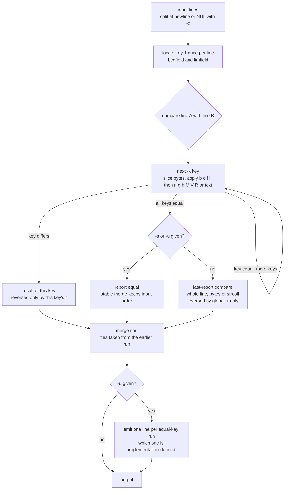

# sort: Keys and Stability

> [!summary] Claim
> `sort` compares two lines key by key in command-line order and, when every key ties, falls back to a whole-line comparison that silently reorders equal-key lines unless `-s` or `-u` switches it off, so a sort is only as correct as its closed keys, its locale, and its tie rule.

Part of [Coreutils and the Userland](README.md) in [Shell and Unix Engineering](../README.md).

## TL;DR

- Mechanism: each `-k` key is a byte range located by field and character counts, compared with its own ordering options; the first nonzero key wins, and a full tie goes to a last-resort whole-line compare (bytes, or `strcoll(3)` in a non-C locale) that obeys only the global `-r`.
- Rule: close every key (`-k2,2`, not `-k2`), pin `LC_ALL=C` unless human collation is the point, and add `-s` whenever lines with equal keys must keep their input order.
- Trap: any modifier on a key (`-k2,2r`) cancels every global option for that key, so `sort -n -k2,2r` sorts text in reverse, not numbers, and GNU `--debug` says `option '-n' is ignored`.
- Portability fact: POSIX has no `-s`, leaves the order of fully equal lines unspecified, and does not say which duplicate `-u` keeps; GNU, BSD, BusyBox, and uutils all accept `-s`, but BusyBox `-u` keeps the byte-smallest duplicate where GNU and BSD keep the first one read.
- When not to use it: quoted CSV, JSON, or typed records whose keys need real parsing; sort those with a parser, `jq`, or SQL `ORDER BY`, and keep `sort` for line records with a single-byte separator.

## Mental model



Lines arrive split at the line terminator, and GNU sort locates the first key of each line once, while it fills its buffer, so the hot comparison loop starts with precomputed key pointers.
Every comparison walks the keys in command-line order: each key slices a byte range out of both lines, applies its blank skipping, dictionary, fold, and ignore tables, and compares the result as text, as a number, as a month, or as a version, and the first key that differs decides, with only that key's own `r` reversing it.
When every key is equal, the comparison either reports equality (`-s` or `-u`), which a stable merge sort turns into "keep input order", or falls through to the last-resort compare of the entire line, which is what makes default `sort` output deterministic and also what destroys any order a previous pass established.
The merge sort then takes ties from the earlier run, and `-u` finally collapses each run of key-equal lines to a single line, but which member of the run survives depends on whether the implementation sorted with or without the tie-break.

## How it works

### What POSIX specifies

POSIX defines three functions: sort, merge already sorted files (`-m`), and check that one file is sorted (`-c`, `-C`) (POSIX.1-2024 XCU sort, DESCRIPTION).
Comparisons use "one or more sort keys extracted from each line of input (or, if no sort keys are specified, the entire line up to, but not including, the terminating newline)" and the collating sequence of the current locale.
Issue 8 added Austin Group Defect 1070: if the locale's collating sequence does not totally order all characters, lines that collate equally "shall be further compared byte-by-byte using the collating sequence for the POSIX locale" (POSIX.1-2024 XCU sort, DESCRIPTION and CHANGE HISTORY; XBD 7.3.2 LC_COLLATE).

A key is `-k field_start[type][,field_end[type]]`, where `field_start` is `field_number[.first_character]` and `field_end` is `field_number[.last_character]`, both counted from 1 (POSIX.1-2024 XCU sort, EXTENDED DESCRIPTION).
A missing `field_end` means "the last character of the line", which is why `-k2` is a key from field 2 to the end of the line and not "field 2".
A `last_character` of 0, or an omitted one, means the last character of the field.
The key is empty if `field_start` falls beyond the end of the line or after `field_end`.
"A field comprises a maximal sequence of non-separating characters and, in the absence of option -t, any preceding field separator": without `-t`, the blanks before a field belong to it.
With `-t char`, every occurrence of `char` is significant, so two adjacent separators delimit an empty field, and the separator is not part of either field.
With `-b` or a `b` modifier, characters in a field are counted from the first non-blank, separately for `first_character` and `last_character`.

The ordering options are `-d` (only blanks and alphanumerics), `-f` (fold lowercase to uppercase), `-i` (ignore non-printable), `-n` (numeric), and `-r` (reverse); `-b` and `-t` change how fields are found (POSIX.1-2024 XCU sort, OPTIONS).
The inheritance rule is one sentence: "If any modifier is attached to a field_start or to a field_end, no option shall apply to either."
Global options apply to all keys only when they come before the first `-k`; the results are unspecified if they come after (POSIX.1-2024 XCU sort, APPLICATION USAGE).
Implementations must support at least nine `-k` options, "significant in command line order", and "later keys shall be compared only after all earlier keys compare equal".

The tie rule is the heart of this note: "Except when the -u option is specified, lines that otherwise compare equal shall be ordered as if none of the options -d, -f, -i, -n, or -k were present (but with -r still in effect, if it was specified) and with all bytes in the lines significant to the comparison" (POSIX.1-2024 XCU sort, OPTIONS).
The next sentence of the standard is "The order in which lines that still compare equal are written is unspecified."
So the standard mandates the last-resort comparison, and the only lines whose relative order is free are byte-identical ones; a stable sort is therefore an extension that deliberately departs from this rule, which the RATIONALE acknowledges: "if the implementation provides a stable sort option as an extension (usually -s), the additional comparison should not be performed when this option has been specified."

`-n` restricts the key to "an initial numeric string, consisting of optional blank characters, optional hyphen-minus character, and zero or more digits with an optional radix character and thousands separators (as defined in the current locale)"; an empty digit string is zero, and "leading zeros and signs on zeros shall not affect ordering".
There is no plus sign and no exponent in that grammar, so `+5` and `1e3` are not the numbers 5 and 1000 under a conforming `-n`.
The RATIONALE records that historical documentation said "-n implies -b"; on the recommendation of the original author of `sort` the implication was dropped, so a character offset in a numeric key counts from the field start, blanks included, unless `-b` is given.

`-u` suppresses "all but one in each set of lines having equal keys", and the RATIONALE refuses to say which one: historical documentation claimed `-um` keeps the first, but "this behavior was deemed to be an implementation artifact and was not standardized."
Because `-u` compares keys only, POSIX warns that in a locale without a total order it "suppresses lines that collate equally but are not identical" (POSIX.1-2024 XCU sort, APPLICATION USAGE).
`-c` exits 1 on disorder (or, with `-u`, on a duplicate key) and writes a message naming the line; `-C` is the same without the message; any other error exits greater than 1 (POSIX.1-2024 XCU sort, EXIT STATUS).
`-o output` may name one of the input files, and `sort` must add a newline to an incomplete last line.
The obsolescent `+pos1 -pos2` keys, which counted from zero, are no longer specified, but "'+' may be recognized as an option delimiter as well as '-'" (POSIX.1-2024 XCU sort, OPTIONS and RATIONALE).

### GNU coreutils 9.12: parsing a key

Each key is a `struct keyfield` holding zero-origin `sword`, `schar`, `eword`, and `echar`, plus `ignore` and `translate` tables and one flag per ordering mode (coreutils-9.12 sort.c, `struct keyfield`).
`main` parses `-k` by reading a count with `parse_field_count`, decrementing it, and rejecting zero: `sort -k0` dies with "field number is zero" and `sort -k1.0` with "character offset is zero", both exit status 2 (coreutils-9.12 sort.c, `main`; the lab's `k-zero` case).
A count too large for `size_t` is silently replaced by `SIZE_MAX` (coreutils-9.12 sort.c, `parse_field_count`).
An end position may be `.0`, which `limfield` treats as "skip all of end field" (`if (echar == 0) eword++`).
Modifier letters go through `set_ordering`, which maps `b` to `skipsblanks` on a start position and `skipeblanks` on an end position, `d` to the `nondictionary` table, `i` to `nonprinting` (but never over `d`, "-d implies -i, but -i does not imply -d"), and `f` to `fold_toupper` (coreutils-9.12 sort.c, `set_ordering`).

Inheritance happens after all options are read: a key gets every global option only if `default_key_compare (key) && !key->reverse`, that is, only if it has no ordering modifier and no `r` (coreutils-9.12 sort.c, `main`, "Inheritance of global options to individual keys").
So `sort -n -k2,2r` gives key 2 reverse text order, which the lab's `override` case proves on GNU, BSD, and BusyBox (`b 9|c 100|a 10`), and `--debug` prints `gsort: option '-n' is ignored` (captured on the host, GNU 9.12).
`check_ordering_compatibility` rejects contradictory modes on one key, such as `-k1,1nM`, with "options '-...' are incompatible".

### GNU coreutils 9.12: finding the bytes of a key

`fillbuf` reads with `fread`, splits lines with `memchr (ptr, eol, ...)`, and stores each `struct line` with its text, length, and precomputed `keybeg` and `keylim` for the first key only (coreutils-9.12 sort.c, `fillbuf`, `struct line`); later keys are located on every comparison.
`begfield` walks `sword` fields: with `-t` it hops with `memchr (ptr, tab, lim - ptr)` past each separator; without `-t` it skips a run of blanks and then a run of non-blanks, so the pointer stops on the blank that starts the next field and "the leading field separator itself is included in a field when -t is absent" (coreutils-9.12 sort.c, `begfield`).
It then skips blanks if `skipsblanks` is set, and advances `schar` bytes, clamped to the end of the line.
`limfield` walks `eword` fields the same way and then advances `echar` bytes, clamped to the end of the line, not the end of the field.
A block guarded by `#ifdef POSIX_UNSPECIFIED`, quoting a 1996 report by Karl Heuer, would clamp the end to the field; it is compiled out, so GNU matches historical Unix sort: on `a b c 2 d` and `pq rs 1 t`, `-k1.7,1.7` compares column 7 of the line (`2` and `1`) and prints `pq rs 1 t` first, on both GNU 9.12 and macOS sort (measured on the host).
"Treat field ends before field starts as empty fields": `keycompare` clamps `lima = MAX (texta, lima)` (coreutils-9.12 sort.c, `keycompare`).
A `b` on the end position matters only with an end character offset, because `limfield` skips blanks only when `echar != 0`; that is why the manual calls `-k 5b,5b` and `-k 5b,5` equivalent (coreutils-9.12 doc/coreutils.texi, sort examples).

### GNU coreutils 9.12: comparing keys and lines

`keycompare` has three paths (coreutils-9.12 sort.c, `keycompare`).
If the collation locale is "hard" (`hard_LC_COLLATE = hard_locale (LC_COLLATE)` in `main`; the C locale is not hard) or the key is numeric, month, random, or version, it NUL-terminates both keys in place, or copies them into a 4000-byte stack buffer (`char stackbuf[4000]`, `xmalloc` beyond that) when an `ignore` or `translate` table must be applied, and then calls `numcompare`, `general_numcompare`, `human_numcompare`, `getmonth`, `compare_random`, `filenvercmp`, or `xmemcoll0`.
If only an `ignore` table applies, the `CMP_WITH_IGNORE` macro walks both keys skipping ignored bytes.
Otherwise it compares with `memcmp` over the shorter length and then by length, or byte by byte through `translate` for `-f`.
A nonzero result leaves the loop and is returned through `diff_reversed (diff, key->reverse)`, so each key's own `r` applies only to that key.

`numcompare` skips leading blanks and calls `strnumcmp` with the locale's decimal point and thousands separator, comparing digit strings without converting them ("Comparatively slow for short strings, but asymptotically hideously fast") (coreutils-9.12 sort.c, `numcompare`).
That parser follows the POSIX grammar, so `1e3` is 1 and `+5` is 0 in GNU and BSD `-n`, which the lab's `n-exp` and `n-plus` cases show (`1e3|2`, `+5|3`).
`general_numcompare` (`-g`) uses `strtold`, sorts conversion errors first, then NaNs, then numbers, and treats `-0` equal to `+0` (coreutils-9.12 sort.c, `general_numcompare`).
`main` takes the decimal point and thousands separator from `localeconv()` and falls back to `.` and no separator when either is multibyte ("FIXME: add support for multibyte thousands separators").

`compare` calls `keycompare` and returns at once `if (diff || unique || stable)`; otherwise it runs the last-resort comparison of whole lines, `xmemcoll0` under a hard locale or `memcmp` plus length in C, reversed by the global `reverse` flag (coreutils-9.12 sort.c, `compare`).
`xmemcoll0` returns 0 for byte-identical lines and otherwise calls `strcoll(3)` piece by piece across embedded NUL bytes (gnulib memcoll.c, `memcoll0`, `strcoll_loop`).
GNU 9.12 does not add a byte comparison when `strcoll` returns 0 for two different lines, which Defect 1070 now requires.
The manual states the rule plainly: "as a last resort when all keys compare equal, sort compares entire lines as if no ordering options other than --reverse (-r) were specified", and "the --unique (-u) option also disables the last-resort comparison" (coreutils-9.12 doc/coreutils.texi, sort invocation).

### GNU coreutils 9.12: why the sort is stable

`sequential_sort` is a recursive merge sort "in the style suggested by Knuth volume 3 (2nd edition), exercise 5.2.4-23", with the exercise 5.2.4-10 trick that needs room for only 1.5 N line descriptors, credited to D. A. Bell (1958) (coreutils-9.12 sort.c, `sequential_sort`).
`mergelines` takes from the low (earlier) half when `compare (lo - 1, hi - 1) <= 0`, and the multithreaded merge tree uses the same `<= 0` test in `mergelines_node`, so equal lines never pass each other in memory (coreutils-9.12 sort.c, `mergelines`, `mergelines_node`).
When the input does not fit in memory, sorted runs go to temporary files and `mergefps` merges up to `nmerge` of them, keeping an order array in which a tie goes to the lower file index (`cmp < 0 || (cmp == 0 && ord0 < ord[probe])`), so stability also survives external merge passes (coreutils-9.12 sort.c, `mergefps`); the run and merge mechanics belong to [[External-Merge-Sort]].
Stability is therefore free in GNU sort: the algorithm is always stable, and `-s` only removes the last-resort comparison that would otherwise break ties by content.

### GNU coreutils 9.12: -u

With `-u`, `write_unique` suppresses a line when `! compare (line, &saved_line)` and otherwise saves it, so the first line of each equal run is printed; `mergefps` does the same with `savedline` ("output only the first of an identical series of lines") (coreutils-9.12 sort.c, `write_unique`, `mergefps`).
Because `compare` skips the last resort under `unique`, "equal" means equal keys, and because the merge is stable, the first line of a run is the first one read: the lab's `u-key` case keeps `b 1` from `b 1`, `a 2`, `b 0`.
The comment above `static bool unique` in sort.c still says "Only the last of a sequence of equal lines will be output"; the code and the manual ("output only the first of a sequence of lines that compare equal") disagree with it, and the lab sides with the code.
`sort -n -u` dedups on numeric value, so `1`, `01`, and `1.0` collapse to `1`, while `sort -n | uniq` compares whole lines and keeps all three; the manual makes the same point ("sort -n -u inspects only the value of the initial numeric string").

### GNU coreutils 9.12: obsolete +POS keys

`+POS1 [-POS2]` is accepted when `traditional_usage` holds, which is `! (200112 <= posix_ver && posix_ver < 200809)` from `posix2_version()`, or when a `-POS2` operand follows and `POSIXLY_CORRECT` is unset (coreutils-9.12 sort.c, `main`).
Coreutils 8.26 NEWS (2016-11-30) says the 2008 edition dropped the requirement to treat `+2` as a file name, so traditional usage works again on POSIX 2008 systems.
On the macOS host, Homebrew `gsort` 9.12 read `+1` as a file name ("cannot read: +1") until `_POSIX2_VERSION=200809` was exported, while macOS `/usr/bin/sort` accepted `+1` as a key (measured, 2026-11).
The cause: gnulib's `posix2_version` falls back to the compile-time `_POSIX2_VERSION`, which the macOS SDK's `sys/unistd.h` defines as `200112L` (`getconf _POSIX2_VERSION` prints `200112` on the host), so `traditional_usage` is false (gnulib posixver.c, `DEFAULT_POSIX2_VERSION`).

### BSD sort (FreeBSD 2.3-FreeBSD, macOS 2.3-Apple)

FreeBSD and macOS share Gabor Kovesdan and Oleg Moskalenko's implementation; Apple's `sort.h` defines `VERSION` as `"2.3-Apple (" SORT_VERSION ")"`, and the host reports `2.3-Apple (201)` (Apple text_cmds sort.h; FreeBSD sort.h says `2.3-FreeBSD`).
Any `-k` or ordering modifier sets `sort_opts_vals.complex_sort`, and the last resort `top_level_str_coll` runs only when `!(sort_opts_vals.sflag) && sort_opts_vals.complex_sort`; it swaps its arguments when the default `-r` is set (FreeBSD coll.c, `list_coll_offset`, `top_level_str_coll`).
`-u` sets `sflag` too, with the comment "stable sort for the correct unique val", and the dump keeps the first of each run (`last_printed_item`) (FreeBSD sort.c, `main`; file.c, `sort_list_dump`).
The default algorithm is `mergesort(3)` (`DEFAULT_SORT_ALGORITHM SORT_MERGESORT` in file.h, identical in Apple's file.h); when the first key has no `-n`, `-g`, `-h`, `-M`, `-R`, or `-V` and the locale compares bytes (`byte_sort`), the default becomes radix sort, and with `-s` or `-u` a requested `--heapsort` or `--qsort` is refused: "The chosen sort method cannot be used with stable and/or unique sort" (FreeBSD file.c, `sort_list_to_file`; sort.c message 10).
The man page calls `-s` "a non-standard feature, but it is widely accepted and used", lists `-ghRMSsTVz` as extensions, and keeps the obsolete `+pos1 -pos2` keys "highly discouraged" (FreeBSD sort.1.in, OPTIONS and STANDARDS).
When the `-t` separator equals the locale's decimal point, thousands separator, or a sign character, BSD stops treating that character as such in numeric keys, unless its GNU numeric compatibility mode is on (FreeBSD sort.c, `main`, case `'t'`).

### BusyBox 1.37.0

BusyBox reads every line into one array and calls `qsort(3)` with `compare_keys`; `-m`, `-S`, and `-T` are accepted and ignored (the flag comments say "ignored"), so there is no external merge and the whole input must fit in memory (BusyBox coreutils/sort.c, `sort_main`).
The `coreutils/sort.c` in the 1.37.0 release tarball is byte-identical to the GitHub mirror's master copy, whose last change is dated 2023-07-10 (busybox-1.37.0.tar.bz2; GitHub mirror commit listing).
Unless the key is the whole line, `get_key` copies each key with `xstrndup` on every comparison; global `-b` also sets `FLAG_bb`, which strips trailing blanks, and a `b` after the comma in a key means "strip trailing" (BusyBox sort.c, `get_key`, `sort_main`).
`get_key` honors an end character offset as `end = key->range[3]`, an offset from the start of the line rather than from the start of the end field, so `-t : -k2.2,2.2` on `p:zb` yields an empty key; the lab's `char` case asserts `p:zb|q:za` for BusyBox against `q:za|p:zb` for GNU and BSD.
With `-s`, BusyBox appends each line's original index as a `uint32_t` after its terminating NUL and breaks ties on it, and the comment notes "Here, -r has no effect!" for ties, which matches GNU's behavior of keeping input order under `-s -r` (BusyBox sort.c, `compare_keys`).
Without `-s`, a tie falls back to `strcmp`, bytes even when the keys used `strcoll`, and that fallback is reversed by a global `-r`.
`-n` is `atof()` ("Full floating point version of -n"), so it parses exponents and a leading `+`, and the lab's `n-exp` and `n-plus` cases assert `2|1e3` and `3|+5` for BusyBox.
`-u` runs after the sort: it clears `FLAG_s`, sets `FLAG_no_tie_break`, and keeps the first of each key-equal run of the already tie-broken array, so without `-s` the byte-smallest duplicate survives (`u-key` keeps `b 0`, `u-num` keeps `01`); a 2022-07-29 commit "sort: fix sort -s -u, closes 14871" reworked `-s -u`, and in the 1.37.0 code `-s -u` keeps the first line read (lab `u-key-s`).
`-c` prints "Check line N" and exits 1; there is no `-C`, so `getopt32` rejects it and `bb_show_usage` exits with `xfunc_error_retval`, which `sort_main` sets to 2 (BusyBox sort.c; libbb/appletlib.c, `bb_show_usage`).
Without `CONFIG_FEATURE_SORT_BIG` the applet supports only `-nrusz` with an integer `atoi` `-n`.

### uutils coreutils (main branch, as of 2026-11)

uutils sorts with rayon's stable `par_sort_by` when `-s` or `-u` is set and with `par_sort_unstable_by` otherwise (uutils sort.rs, `sort_by`).
Its last resort is `a.line.cmp(b.line)`, a byte comparison even in a UTF-8 locale, skipped for `-s`, `-u`, and `-R`, and reversed by the global `-r` (uutils sort.rs, `compare_by`).
With the `i18n-collator` feature, its fast path for whole-line comparisons compares ICU collation keys and breaks a tie between equal collation keys by reversed byte order, with the comment "Reversing the order to match sort's sorting behaviour".
In merges, `-u` drops a line equal to the previous one printed, so the first of a run survives (uutils merge.rs, `PreviousLine`).
The latest release when this note was drafted was 0.12.0 (2026-09-17, GitHub releases API); uutils is not installed on the host and not in the lab matrix, so nothing here about uutils is measured.

### Down to the system calls

GNU sort reads with stdio (`fread`), creates temporary files with `mkostemp (file, O_CLOEXEC)` in each `-T` directory or `TMPDIR` (default `/tmp`), and starts a `--compress-program` with `posix_spawnp` (coreutils-9.12 sort.c, `fillbuf`, `create_temp_file`, `pipe_child`).
It ignores `SIGPIPE` so write failures arrive as `EPIPE`, and for standard output it re-raises `SIGPIPE` if the signal had the default disposition at startup (coreutils-9.12 sort.c, `main`, `default_SIGPIPE`).
Normally it reads all input before opening `-o`, so `sort -o F F` is safe, but `-m` can open the output first, so `cat F | sort -m -o F - G` is not (coreutils-9.12 doc/coreutils.texi, `-o`); BusyBox also opens `-o` "after we read all input ones".
`sort F > F` is never safe in any implementation, because the shell truncates `F` before `sort` starts.

## Numbers and limits

| Quantity | Value | Source |
|---|---|---|
| Minimum number of `-k` options an implementation must support | 9 | POSIX.1-2024 XCU sort, OPTIONS |
| Exit status for disorder under `-c` or `-C` | 1; errors are greater than 1 | POSIX.1-2024 XCU sort, EXIT STATUS |
| GNU inputs merged at once (`--batch-size` default, minimum 2) | 16 | coreutils-9.12 sort.c `NMERGE_DEFAULT`; coreutils.texi |
| GNU merge buffer per input | 256 KiB | coreutils-9.12 sort.c `merge_buffer_size` |
| GNU initial size guess for a pipe or other non-regular input | 128 KiB | coreutils-9.12 sort.c `INPUT_FILE_SIZE_GUESS` |
| GNU default thread cap | 8 (since 8.8, 2010-12-22) | coreutils-9.12 sort.c `DEFAULT_MAX_THREADS`; NEWS |
| GNU lines before a sort spawns threads | 131072 (128 x 1024) | coreutils-9.12 sort.c `SUBTHREAD_LINES_HEURISTIC` |
| GNU default memory | min(available or total/8, 75% of total, half of `RLIMIT_DATA` and `RLIMIT_AS`) | coreutils-9.12 sort.c `default_sort_size`; NEWS 8.18 (75%) |
| GNU stack buffer for translated keys before `malloc` | 4000 bytes | coreutils-9.12 sort.c `keycompare` |
| GNU memory for in-RAM merge descriptors | 1.5 N line structs | coreutils-9.12 sort.c `sequential_sort` |
| BSD default memory | half of physical memory (`_SC_PHYS_PAGES` x `_SC_PAGESIZE` / 2) | FreeBSD sort.c |
| BSD default files merged at once | 16 (`max_open_files`) | FreeBSD file.c |
| BSD thread cap when built with `SORT_THREADS` | 32 | FreeBSD sort.c |
| BusyBox stable-sort index | `uint32_t` per line; whole input in RAM, no temp files | BusyBox 1.37.0 sort.c |
| CVE-2025-5278 affected GNU versions | 7.2 up to, not including, 9.8; CVSS 3.1 4.4 (Red Hat) | coreutils NEWS 9.8 (2025-09-22) for the range ("bug introduced in coreutils-7.2"); NVD for the score, which lists no affected configuration (status Deferred, as of 2026-11) |
| 1e6 lines (18.4 MB, 1000 distinct keys), GNU 9.12 `LC_ALL=C sort -k1,1` | 0.135 to 0.178 s | measured ad hoc, 3 runs, Apple M3 Pro, 12 cores, 36 GiB, 2026-11 |
| Same with `-s` (no last resort) | 0.116 to 0.155 s | measured ad hoc, same host |
| Same with `--parallel=1`, without and with `-s` | 0.287 s; 0.268 to 0.325 s | measured ad hoc, same host |
| Same in `LC_ALL=en_US.UTF-8` | 0.792 to 0.888 s (about 5x C) | measured ad hoc, same host |
| macOS `/usr/bin/sort -k1,1`, without and with `-s` | 0.355 to 0.447 s; 0.323 to 0.421 s | measured ad hoc, same host |

The ad hoc timings are wall-clock seconds from one 18.4 MB file of `kNNNN i word` lines generated with `awk`, three runs each, output to `/dev/null`; they show that the last resort costs little in C, that collation dominates in a UTF-8 locale, and nothing more.

## Portability

The shell never changes which `sort` runs or how it orders lines; the lab runs its probe under every shell in the matrix and asserts one result per sort implementation, with no shell-family branch.
What the shell does change is how a script builds the command line.

| Shell | `sort` itself | Options kept in one variable, expanded unquoted (`sort $keys`) | A literal TAB for `-t` |
|---|---|---|---|
| POSIX sh | external utility; result depends only on the implementation (lab) | field split by `IFS` (POSIX.1-2024 XCU 2.6.5) | `$'\t'` is in POSIX.1-2024 (XCU 2.2.4); `-t "$(printf '\t')"` also works in older shells |
| macOS bash 3.2 (`/bin/sh`) | as POSIX sh (lab, host) | field split | `$'\t'` works (shell matrix) |
| current bash | as POSIX sh (lab) | field split | `$'\t'` works (shell matrix) |
| zsh native | as POSIX sh (lab) | not split (shell matrix): one argument `-k1,1 -k2,2n`, which GNU sort rejects as "stray character in field spec", status 2 (measured) | `$'\t'` works (shell matrix) |
| zsh `--emulate sh` | as POSIX sh (lab) | field split (shell matrix) | `$'\t'` works (shell matrix) |
| dash 0.5.12 | as POSIX sh (lab) | field split | no `$'...'` (shell matrix); use `printf` |
| ksh93 | as POSIX sh (lab) | field split | `$'\t'` works (shell matrix) |
| mksh | as POSIX sh (lab) | field split | `$'\t'` works (shell matrix) |
| yash | as POSIX sh (lab) | field split | `$'\t'` works (shell matrix) |
| posh 0.14.1 | as POSIX sh (lab) | field split, but `IFS` may be inherited from the environment (shell matrix) | no `$'...'` (shell matrix); use `printf` |
| BusyBox ash | as POSIX sh (lab) | field split | `$'\t'` works (shell matrix) |

Cells marked "shell matrix" are the vault's shell matrix measurements and "field split" is the POSIX rule the other shells follow; the lab itself avoids both by passing options through `eval` and building input with `printf '%b'`.

| Behavior | POSIX.1-2024 | GNU coreutils 9.12 | BSD (FreeBSD, macOS 2.3) | BusyBox 1.37.0 | uutils (main) |
|---|---|---|---|---|---|
| Last-resort whole-line compare on a key tie | required | yes (lab `tie`) | yes, only with keys or modifiers (lab `tie`) | yes, `strcmp` (lab `tie`) | yes, bytes (source) |
| `-s` stable option | not specified | yes (lab `stable`) | yes (lab `stable`) | yes, by stored index (lab `stable`) | yes (source) |
| `-s -r` keeps input order of ties | not specified | yes (lab) | yes (lab) | yes (lab) | yes, the tie stays `Equal` under `-r` (source, `compare_by`) |
| `-u` implies no last resort | yes ("Except when the -u option") | yes (manual) | yes, sets `sflag` (source) | yes, `FLAG_no_tie_break` (source) | yes (source) |
| Duplicate kept by `-u -k1,1` on `b 1`, `a 2`, `b 0` | unspecified | `b 1`, first read (lab) | `b 1`, first read (lab) | `b 0`, byte-smallest (lab) | first of run (source) |
| `-n` parses `1e3` and `+5` | no (grammar) | no (lab `n-exp`, `n-plus`) | no (lab) | yes, `atof` (lab) | no, `NumInfo::parse` takes only a leading `-` as a sign (source, uucore numeric_str_cmp.rs) |
| `-g`, `-h`, `-M`, `-V`, `-R` | none | all (manual) | all (man page) | `-g`, `-h`, `-M`; `-V` if `strverscmp` | all (source) |
| End character `-k2.2,2.2` counted within field 2 | yes | yes (lab `char`) | yes (lab `char`) | no, from line start (lab `char`) | yes, offset from the field start (source, `get_range`) |
| `-C` | yes | yes (lab) | yes (lab) | no, exit 2 (lab) | yes (source) |
| `-k0` rejected with status 2 | not a valid key | yes (lab) | yes (lab) | yes (lab) | rejected as `sort-field-number-is-zero`, status 2 via `USimpleError::new(2, ...)` (source, `parse_position` and `From<KeyError>`) |
| Obsolete `+1` key | not specified | depends on `_POSIX2_VERSION` (measured) | accepted (measured) | no, an operand is a file (source; Alpine prints "+1: No such file or directory", status 2, measured) | rewritten to `-k` unless the POSIX version is in the 2001 to 2008 range, like GNU (source, `allows_traditional_usage`) |
| External merge, `-S`, `-T`, `--batch-size` | `TMPDIR` only | yes (source) | yes (source) | ignored, all in RAM (source) | yes (source) |
| `-z` NUL-terminated lines | no (omitted, RATIONALE) | yes; newline then acts as a field separator (NEWS 8.25) | yes (source) | yes (source) | yes (source) |
| `--debug` key highlighting | no | yes (captured) | `--debug` prints internal traces (source) | no (source) | yes (source) |

Rows marked "lab" are asserted by `test.bats` for every implementation installed where it runs: macOS sort and GNU `gsort` on the host, GNU on Debian, and BusyBox wherever `busybox sort` exists, which includes Alpine (whose plain `sort` is also BusyBox unless GNU coreutils is installed) and the Debian image, whose `busybox` also has the `sort` applet.
The BusyBox cells were derived from the 1.37.0 source, and the probe run once under `busybox sort` 1.37.0 in the Alpine image printed exactly the lines the lab asserts (measured, 2026-11).

## Worked example

The [lab](../labs/08-sort-keys-and-stability/) has one probe script and one test file.
`sort-probe.sh MODE SORTCMD` runs a set of experiments in the C locale with the given sort command and prints one `label: line|line|...|status=N` result per experiment; `test.bats` runs it once per installed sort and branches on the implementation.

```sh
#!/bin/sh
# sort-probe.sh MODE SORTCMD: run the sort(1) experiments of MODE with SORTCMD, one string
# such as "sort", "gsort", or "busybox sort", and print one result line per experiment.
# Modes: ties, bounds, options, numeric, unique, check, twopass.
# Every experiment runs in the C locale, so text keys compare as bytes.

LC_ALL=C
export LC_ALL

mode=$1
sort_cmd=$2

# run_sort [OPTION...]: run SORTCMD with the options; eval splits SORTCMD in every shell,
# including native zsh, which does not field split an unquoted expansion.
run_sort() {
  eval "$sort_cmd \"\$@\""
}

# report LABEL TEXT: print "LABEL: " and the lines of TEXT joined by "|".
report() {
  joined=$(printf '%s\n' "$2" | tr '\n' '|')
  printf '%s: %s\n' "$1" "${joined%|}"
}

# try LABEL INPUT [OPTION...]: sort INPUT (a printf %b string) and print
# "LABEL: LINE|LINE|...|status=N".
try() {
  label=$1
  input=$2
  shift 2
  result=$(
    printf '%b' "$input" | run_sort "$@" 2>/dev/null
    printf 'status=%s\n' "$?"
  )
  report "$label" "$result"
}

# check LABEL INPUT [OPTION...]: run a sort that is expected to print nothing on stdout
# (-c, -C, or a bad key) and print "LABEL: status=N stderr=yes|no".
check() {
  label=$1
  input=$2
  shift 2
  err=$(printf '%b' "$input" | run_sort "$@" 2>&1 >/dev/null)
  status=$?
  if [ -n "$err" ]; then said=yes; else said=no; fi
  printf '%s: status=%s stderr=%s\n' "$label" "$status" "$said"
}

case $mode in
  ties)
    try tie 'b 2\na 1\nb 1\na 2\n' -k1,1
    try stable 'b 2\na 1\nb 1\na 2\n' -s -k1,1
    try reverse 'b 2\na 1\nb 1\na 2\n' -r -k1,1
    try stable-reverse 'b 2\na 1\nb 1\na 2\n' -s -r -k1,1
    try fold 'a\nA\nb\nB\n' -f
    try fold-stable 'a\nA\nb\nB\n' -f -s
    ;;
  bounds)
    try open 'x 1 z\ny 1 a\n' -s -k2
    try closed 'x 1 z\ny 1 a\n' -s -k2,2
    try blanks 'a  9\nb 1\n' -k2,2
    try blanks-b 'a  9\nb 1\n' -b -k2,2
    try blanks-kb 'a  9\nb 1\n' -k2b,2
    try sep-default 'a  c\na b\n' -s -k3,3
    try sep-space 'a  c\na b\n' -s -t ' ' -k3,3
    try char 'p:zb\nq:za\n' -s -t : -k2.2,2.2
    ;;
  options)
    try inherit 'a 10\nb 9\nc 100\n' -n -k2,2
    try override 'a 10\nb 9\nc 100\n' -n -k2,2r
    ;;
  numeric)
    try n-exp '1e3\n2\n' -n
    try n-plus '+5\n3\n' -n
    try n-zero '-0\nb\n0\na\n' -n -s
    try g-exp '1e3\n2\n' -g
    ;;
  unique)
    try u-key 'b 1\na 2\nb 0\n' -u -k1,1
    try u-key-s 'b 1\na 2\nb 0\n' -s -u -k1,1
    try u-num '1\n01\n1.0\n' -n -u
    ;;
  check)
    check c-disorder 'b\na\n' -c
    check c-sorted 'a\nb\n' -c
    check C-disorder 'b\na\n' -C
    check cu-dup 'a\na\n' -c -u
    check k-zero 'a\n' -k0
    ;;
  twopass)
    input='a 10\nb 2\na 9\nb 10\n'
    try one-pass "$input" -k1,1 -k2,2n
    result=$(printf '%b' "$input" | run_sort -k2,2n | run_sort -s -k1,1)
    report two-pass-s "$result"
    result=$(printf '%b' "$input" | run_sort -k2,2n | run_sort -k1,1)
    report two-pass "$result"
    ;;
  *)
    printf 'usage: %s ties|bounds|options|numeric|unique|check|twopass SORTCMD\n' "$0" >&2
    exit 2
    ;;
esac
```

A simplified excerpt of `test.bats` shows the shape of every test: discover the sort commands, detect each one's flavor from `--version`, run the probe under the shell under test, and compare every line exactly.

```bash
sort_flavor() {
  local out
  out=$($1 --version 2>&1 </dev/null) || true
  case $out in
    *"GNU coreutils"*) echo gnu ;;
    *BusyBox*) echo busybox ;;
    *-Apple* | *-FreeBSD*) echo bsd ;;
    *) echo unknown ;;
  esac
}

@test "unique: -u compares keys only; which duplicate survives is implementation-defined" {
  impls=$(sort_impls)
  while IFS= read -r impl; do
    flavor=$(sort_flavor "$impl")
    probe unique
    case $flavor in
      gnu | bsd) expect "u-key: a 2|b 1|status=0" "u-key-s: a 2|b 1|status=0" "u-num: 1|status=0" ;;
      busybox) expect "u-key: a 2|b 0|status=0" "u-key-s: a 2|b 1|status=0" "u-num: 01|status=0" ;;
      *) false ;;
    esac
  done <<<"$impls"
}
```

Captured output on the macOS host, identical for `/usr/bin/sort` (2.3-Apple) and `gsort` (GNU coreutils 9.12), running every mode in order:

```text
tie: a 1|a 2|b 1|b 2|status=0
stable: a 1|a 2|b 2|b 1|status=0
reverse: b 2|b 1|a 2|a 1|status=0
stable-reverse: b 2|b 1|a 1|a 2|status=0
fold: A|a|B|b|status=0
fold-stable: a|A|b|B|status=0
open: y 1 a|x 1 z|status=0
closed: x 1 z|y 1 a|status=0
blanks: a  9|b 1|status=0
blanks-b: b 1|a  9|status=0
blanks-kb: b 1|a  9|status=0
sep-default: a  c|a b|status=0
sep-space: a b|a  c|status=0
char: q:za|p:zb|status=0
inherit: b 9|a 10|c 100|status=0
override: b 9|c 100|a 10|status=0
n-exp: 1e3|2|status=0
n-plus: +5|3|status=0
n-zero: -0|b|0|a|status=0
g-exp: 2|1e3|status=0
u-key: a 2|b 1|status=0
u-key-s: a 2|b 1|status=0
u-num: 1|status=0
c-disorder: status=1 stderr=yes
c-sorted: status=0 stderr=no
C-disorder: status=1 stderr=no
cu-dup: status=1 stderr=yes
k-zero: status=2 stderr=yes
one-pass: a 9|a 10|b 2|b 10|status=0
two-pass-s: a 9|a 10|b 2|b 10
two-pass: a 10|a 9|b 10|b 2
```

For BusyBox the lab asserts the same lines except `char: p:zb|q:za|status=0`, `n-exp: 2|1e3|status=0`, `n-plus: 3|+5|status=0`, `u-key: a 2|b 0|status=0`, `u-num: 01|status=0`, and `C-disorder: status=2 stderr=yes`, and BusyBox 1.37.0 on Alpine printed exactly that (measured, 2026-11).

How to read it:
- `tie` versus `stable`: the key `-k1,1` ties `b 2` with `b 1`; the last resort orders them by whole line, `-s` keeps input order.
- `reverse` versus `stable-reverse`: a global `-r` reverses the last resort too, so `a 2` comes before `a 1`; with `-s` the ties keep input order while the keys are still reversed.
- `fold`: `-f` makes `a` and `A` equal keys, and the last resort, which ignores `-f`, puts the uppercase byte 0x41 first; `-s` keeps `a` first.
- `open` versus `closed`: `-k2` runs to the end of the line, so the third field breaks the tie; `-k2,2` does not.
- `blanks`: without `-b` the key of `a  9` is two spaces then `9`, which sorts before one space then `1`.
- `sep-default` versus `sep-space`: with default separators both lines have no field 3; with `-t ' '` the double space makes an empty field 2, so `c` becomes field 3.
- `inherit` versus `override`: `-n` applies to an unmodified key but not to `-k2,2r`.
- `two-pass`: a stable second pass (`sort -k2,2n | sort -s -k1,1`) reproduces the single two-key sort; without `-s` the last resort reorders `a 10` before `a 9` by bytes and throws the first pass away.

`gsort --debug` shows the key extents the probe relies on (captured, GNU 9.12, `LC_ALL=C`, `printf 'a  9\nb 1\n' | gsort --debug -k2,2 -k2,2n`):

```text
gsort: text ordering performed using simple byte comparison
gsort: leading blanks are significant in key 1; consider also specifying 'b'
gsort: numbers use '.' as a decimal point in this locale
a  9
 ___
   _
____
b 1
 __
  _
___
```

The first underline is key 1 (the text key with its two leading blanks), the second is key 2 (`-n` skips the blanks and underlines only the number), and the last is the last-resort comparison of the whole line.

## Pitfalls

> [!warning] Open key: `-k2` means "field 2 to end of line"
> Trigger: `sort -k2` or `sort -t, -k3` to sort "by field 2".
> Symptom: later fields silently break ties, and a numeric key that spans fields earns the GNU `--debug` warning "key 1 is numeric and spans multiple fields".
> Fix: always close the key, `-k2,2`, and add further keys explicitly.

> [!warning] Leading blanks belong to the field
> Trigger: whitespace-aligned columns sorted with `-k2,2` and no `-t` or `-b`.
> Symptom: in the C locale `a  9` sorts before `b 1` because the key starts with two spaces; in a UTF-8 locale the blanks may be ignored by collation, so the same command sorts differently on another machine.
> Fix: `-k2b,2`, a global `-b` before the first `-k`, or an explicit `-t`; GNU `--debug` prints "leading blanks are significant in key 1; consider also specifying 'b'".

> [!warning] A key modifier cancels every global option
> Trigger: `sort -n -k2,2r`, `sort -b -k2,2n`, or `sort -f -k1,1d`.
> Symptom: the key with a modifier is compared without the global `-n`, `-b`, or `-f`; `-n -k2,2r` prints `b 9|c 100|a 10` (reverse text) instead of `c 100|a 10|b 9`.
> Fix: put every modifier on the key that needs it, `-k2,2nr`, and keep global options for keys that have none.

> [!warning] Default sort is not stable
> Trigger: a pipeline that sorts by one key and expects equal-key lines in input order, or a two-pass sort (`sort -k2,2n | sort -k1,1`) meant to produce a secondary order.
> Symptom: the last-resort compare reorders ties by whole-line bytes or collation; the lab's `two-pass` case loses the numeric order (`a 10|a 9`).
> Fix: `-s` on every pass after the first, or one invocation with all keys; POSIX has no `-s`, but GNU, BSD, BusyBox, and uutils all accept it.

> [!warning] `sort -u` is not `sort | uniq`, and its survivor is not portable
> Trigger: `sort -u -k1,1` to keep "the first record per key", or `sort -n -u` as a dedup.
> Symptom: `-u` compares keys only, so `sort -n -u` keeps one of `1`, `01`, `1.0`; GNU and BSD keep the first line read, BusyBox keeps the byte-smallest (`b 0`, `01`), and POSIX leaves the choice open; in a locale that is not totally ordered, `-u` also merges lines that only collate equally (POSIX APPLICATION USAGE).
> Fix: write `sort -s -u -k1,1` when the first record per key matters (GNU, BSD, and BusyBox since the 2022 fix for bug 14871 agree), or dedup explicitly with `awk '!seen[$1]++'` before sorting.

> [!warning] Locale changes the order, and persisted order breaks
> Trigger: running `sort` under `LANG=en_US.UTF-8` in one place and `C` in another, or feeding `join` and `comm` files sorted under a different locale or with different keys.
> Symptom: different output for the same input; `join` reports "file 1 is not in sorted order"; GNU sort takes about 5x longer in `en_US.UTF-8` than in C on the host (measured above).
> Real incident: glibc 2.28 (2018-08-01) shipped a major collation update, and PostgreSQL B-tree indexes on text built under the old order became inconsistent after OS upgrades (Debian 10, Ubuntu 18.10, RHEL 8), so indexes had to be rebuilt; the PostgreSQL wiki suggests `( echo "1-1"; echo "11" ) | LC_COLLATE=en_US.UTF-8 sort` as a test because those two lines sort differently across the change, and it records a similar change on macOS 11 (PostgreSQL wiki, Locale data changes).
> Fix: export `LC_ALL=C` for every machine-consumed sort and for every `join`, `comm`, `uniq`, and `look` that reads its output; the GNU manual's advice is the same, and it notes that setting only `LC_COLLATE` is ineffective when `LC_ALL` is set; for `join`, the manual recommends `sort -k 1b,1`.
> Collation itself belongs to [[Locale-Collation-and-Unicode-in-CLI-Tools]].

> [!warning] `-n` is not a number parser
> Trigger: sorting floats in exponent form, values with a leading `+`, or `1,000` in the C locale.
> Symptom: GNU and BSD `-n` read `1e3` as 1, `+5` as 0 (lab), and `1,000` as 1 (measured on the host); BusyBox `-n` uses `atof`, so the same command gives a different order on Alpine.
> Fix: `-g` for floating point (slower; the FreeBSD man page says `-n` gives "much better performance than -g"), normalize numbers before sorting, or use a typed tool.

> [!warning] Character offsets and `-b`
> Trigger: `-k2.3,2.5` on blank-separated columns, or the same key on BusyBox.
> Symptom: without `b` the offset counts the leading blank as character 1; GNU and BSD let a character offset run past the end of its field into the next one (measured); BusyBox counts the end offset from the start of the line, so its keys differ outright (lab `char`).
> Fix: use `-t` so fields have no leading separator, add `b` to both positions, and avoid end offsets in scripts that must run on BusyBox.

> [!warning] Obsolete `+POS` keys
> Trigger: old scripts with `sort +1 -2`.
> Symptom: GNU accepts or rejects `+1` depending on `_POSIX2_VERSION` and whether a `-POS2` follows; on the macOS host `gsort +1` tried to read a file named `+1`, while macOS `sort` used it as a key.
> Fix: rewrite as `-k2,2`; the GNU manual gives the mapping `+a.x -b.y` to `-k a+1.x+1,b` when `y` is 0 or absent.

> [!warning] Truncating the input with a redirection
> Trigger: `sort -k1,1 data > data`.
> Symptom: an empty file, because the shell truncates `data` before `sort` runs.
> Fix: `sort -o data data`, which GNU (manual) and BusyBox (source) read fully before opening the output (GNU not with `-m`), or write to a temporary file and rename it ([[install-and-Atomic-Deployment]]).

## Security and robustness

- CVE-2025-5278: GNU sort's `begfield()` read one byte before a heap buffer when a traditional key carried a character offset of `SIZE_MAX`, for example `sort +0.18446744073709551615R input` on 64-bit systems; affected 7.2 through 9.7, fixed in 9.8 (2025-09-22), CVSS 3.1 4.4 from Red Hat (coreutils NEWS 9.8 for the example and range; NVD for the description and score).
  The 9.12 `begfield` now advances with `if (schar < remaining_bytes) ptr += schar; else ptr = lim;`, a comparison that cannot overflow.
  The lesson: key positions are attacker input whenever a service lets users choose sort columns.
- CVE-2015-4041 and CVE-2015-4042: a heap overflow and an integer overflow in `keycompare_mb`, which NVD scopes to "GNU Coreutils through 8.23" and links to a SUSE bug and a fix commit in the pixelb/coreutils fork.
  Upstream sort.c 9.12 has no `keycompare_mb`; it comes from the coreutils i18n patch that SUSE, RHEL, Fedora, and others apply, as Padraig Brady wrote when disclosing the bug (oss-security, 2015-05-15).
  Distribution builds of sort can differ from upstream in exactly the code that compares keys.
- Option injection through file names: a file named `-oPWNED` in the working directory turned `gsort *` into `gsort -oPWNED ...`, and GNU sort 9.12 created `PWNED` (measured by hand in a scratch directory).
  Write `sort -- *` or `sort ./*`, and never let untrusted names reach the option position.
- Temporary files hold the data being sorted, unencrypted, in `TMPDIR` or `-T`; GNU creates them with `mkostemp` and `O_CLOEXEC` and unlinks them at exit and from its signal handler (`cleanup`, `sighandler`), but a `SIGKILL` leaves them behind.
  Point `-T` at a private directory for sensitive data ([[mktemp]]), and size it: an external sort needs free space on the order of the input.
- Resource exhaustion: GNU caps its buffer at 75% of RAM and spills to disk; BusyBox holds the whole input in memory and allocates and frees a copy of each key on every comparison, so a large input is an out-of-memory risk on small systems; bound inputs or use GNU sort with `-S` and `-T`.
- Determinism: a sort's output is part of a build's or a report's contract only if the locale, the keys, and the tie rule are pinned; `LC_ALL=C sort -s -k...` is the reproducible form, and `-R` is a keyed hash shuffle, not a security primitive.
- Robust input: POSIX requires `sort` to add a newline to an incomplete last line, GNU documents that it "silently supplies one" and has no line length limit, and the FreeBSD page also claims no line length limit; for records that can contain newlines, use `-z` with NUL-terminated input ([[find-print0-and-exec-Plus]]).

## The principal's view

The decision is whether `sort` is the right place to define an order, and if it is, to make the order a written contract: `LC_ALL=C sort -s -t "$tab" -k1,1 -k3,3n` names the bytes, the keys, the number grammar, and the tie rule, and it gives the same answer on GNU, BSD, and BusyBox except where this note lists a divergence.
The trade-off is that the contract is in flags that most readers misread; the defaults (open keys, blanks in fields, locale collation, the last-resort tie-break, implementation-chosen `-u` survivors) are each defensible and together they produce silent, locale-dependent, machine-dependent output.
Use `sort` when records are lines with a single-byte separator and keys are text or plain decimals, and when the data may exceed memory, because GNU sort's external merge is stable, parallel, and hard to beat for terabyte-scale line data ([[External-Merge-Sort]]).
Use a different tool when keys need parsing (quoted CSV, JSON, timestamps with zones, Unicode-aware collation that must be stable across OS upgrades) or when the order must be stored: a database with an explicit `COLLATE "C"` or ICU collation version, `jq` for JSON ([[Structured-Data-Wrangling-Jq-Yq-and-Coreutils]]), or a short program in a typed language whose sort is documented as stable.
In review, ask three questions of every `sort` in a pipeline: is every key closed, is the locale pinned, and does anything downstream depend on the order of ties?

## Interview questions

> [!question] L5: What does `sort -k2` sort by, and how is it different from `sort -k2,2`?
>
> > [!success]- Answer
> > `-k2` is a key from the start of field 2 to the end of the line, because POSIX says a missing field_end means the last character of the line.
> > `-k2,2` is field 2 only.
> > With `-k2`, fields 3 and later break ties inside the key, which is rarely intended.
> > Without `-t`, field 2 also includes the blanks before it.
> >
> > Follow-up: How would you sort by field 2 numerically and then by field 4 as text?

> [!question] L5: Predict the output of `printf 'b 2\na 1\nb 1\na 2\n' | LC_ALL=C sort -k1,1`, and then with `-s`.
>
> > [!success]- Answer
> > Without `-s`: `a 1`, `a 2`, `b 1`, `b 2`, because the key ties are broken by the last-resort whole-line comparison.
> > With `-s`: `a 1`, `a 2`, `b 2`, `b 1`, because equal-key lines keep input order.
> > GNU, macOS, and BusyBox all print this (lab `ties`).
> >
> > Follow-up: What changes if you add `-r` to each command?

> [!question] L5: Why does `sort -n -k2,2r` not sort numerically?
>
> > [!success]- Answer
> > A key with any modifier inherits no global option; POSIX says "If any modifier is attached to a field_start or to a field_end, no option shall apply to either."
> > The `r` on the key drops the global `-n`, so the key is compared as reversed text.
> > The fix is `-k2,2nr`.
> > GNU `--debug` reports `option '-n' is ignored`.
> >
> > Follow-up: Does a global `-r` still affect anything in that command?

> [!question] L6: Is GNU sort's algorithm stable, and if so what does `-s` actually do?
>
> > [!success]- Answer
> > The algorithm is a stable merge sort: `mergelines` takes from the earlier half when `compare` returns 0 or less, the threaded merge uses the same rule, and `mergefps` breaks ties by input file index.
> > `-s` does not change the algorithm; it makes `compare` return 0 for equal keys instead of running the last-resort whole-line comparison.
> > Without `-s`, only byte-identical lines (or lines that collate equal) are ties, so stability is invisible.
> >
> > Follow-up: Why does POSIX mandate the last-resort comparison at all?

> [!question] L6: A script runs `sort -u -k1,1 users.txt` to keep the first record for each user id, and it keeps different records on Debian and on Alpine; why, and how do you fix it?
>
> > [!success]- Answer
> > `-u` compares keys only, and POSIX does not say which line of an equal run survives.
> > GNU (Debian) sorts stably and keeps the first line read.
> > BusyBox (Alpine) sorts with the whole-line tie-break and then keeps the first of each run, which is the byte-smallest line.
> > Use `sort -s -u -k1,1`, which GNU, BSD, and BusyBox (since the 2022 fix) all resolve to the first line read, or dedup explicitly with `awk '!seen[$1]++'` before sorting.
> >
> > Follow-up: How would you write a lab test that fails if the implementation keeps the wrong line?

> [!question] L6: Debug this script, which should print the three hosts with the most errors from `host<TAB>errors<TAB>last_seen` lines but prints the three with the fewest: `LC_ALL=C sort -t "$(printf '\t')" -r -k2n errors.tsv | head -3`
>
> > [!success]- Answer
> > The key `-k2n` carries a modifier, so it inherits no global option, and the global `-r` is left to reverse only the last-resort comparison.
> > The key therefore sorts ascending, and `head -3` takes the smallest counts; GNU 9.12 and macOS sort both print `h4 1`, `h1 5`, `h3 7` on a four-line sample (measured).
> > GNU `--debug` names both problems: "option '-r' only applies to last-resort comparison" and "key 1 is numeric and spans multiple fields".
> > The fix is `-k2,2nr`: a closed key with both modifiers on it, which prints `h2 50` first.
> >
> > Follow-up: Would `sort -rn -k2,2` also work, and why?

> [!question] L6: Why can `sort` output differ between a developer laptop and CI with identical input?
>
> > [!success]- Answer
> > The comparison uses the `LC_COLLATE` collation of the current locale, and the last resort uses it too.
> > A UTF-8 locale can ignore punctuation and blanks at the first level and fold case, while C compares bytes.
> > The implementation can differ (BSD on macOS, GNU on Debian, BusyBox on Alpine) in `-n` parsing, `-u` survivors, and end offsets.
> > Collation tables change across libc versions, as glibc 2.28 did.
> > Pin `LC_ALL=C` and the keys, and assert the order in a test.
> >
> > Follow-up: Why is setting only `LC_COLLATE=C` not enough?

> [!question] L7+: You are designing a 2 TB daily log merge where equal timestamps must keep their per-source order and the output feeds a `join`; what do you specify?
>
> > [!success]- Answer
> > `LC_ALL=C` for every step, so the order is bytes and `join` agrees with it.
> > A fixed-width or ISO 8601 UTC timestamp as a closed key, `-t "$tab" -k1,1`, with a source sequence number as a second key if per-source order must survive re-sorting.
> > `-s`, so that equal keys keep input order; GNU's merge passes preserve it because ties go to the lower run index.
> > `-S`, `-T` on a fast private volume, `--parallel`, and possibly `--compress-program`, with free space sized to the input.
> > Presorted inputs merged with `sort -m -s`, and `sort -C` as a cheap gate before `join`.
> >
> > Follow-up: What breaks if one host in the fleet runs BusyBox sort?

> [!question] L7+: What does the byte-by-byte tie-break that POSIX.1-2024 added for lines that collate equally (Austin Group Defect 1070) change for implementers and for users of `-s` and `-u`?
>
> > [!success]- Answer
> > It makes default output a function of the bytes even in locales whose collation is not a total order, so two different lines never tie in the default mode.
> > The RATIONALE allows skipping the extra compare when the locale is known to be totally ordered, and says it should not be done under a stable-sort extension.
> > `-u` still compares keys only, so it can merge distinct lines that collate equal; that is documented behavior, not a bug.
> > GNU 9.12's last resort calls `strcoll` and does not add a byte comparison after a 0 result, so conformance depends on the locale data.
> >
> > Follow-up: How would you detect a locale that returns 0 from `strcoll` for distinct strings?

## Related

Prerequisites: [[xargs-and-Argument-Batching]]

Next: [[External-Merge-Sort]]

See also: [[Structured-Data-Wrangling-Jq-Yq-and-Coreutils]], [[Locale-Collation-and-Unicode-in-CLI-Tools]], [[uniq-and-Counting]], [[Userland-Portability-Traps]], [[Four-Userlands-GNU-BSD-BusyBox-uutils]]

## Further reading

- [POSIX.1-2024 sort](https://pubs.opengroup.org/onlinepubs/9799919799/utilities/sort.html): the key grammar, the tie rule, and a RATIONALE that explains `-n` without `-b` and why `-s` is an extension.
- [GNU coreutils 9.12 release tarball](https://ftpmirror.gnu.org/coreutils/coreutils-9.12.tar.xz): `src/sort.c` for `begfield`, `limfield`, `keycompare`, and `compare`, and `doc/coreutils.texi` for the manual's worked key examples.
- [gnulib memcoll.c](https://raw.githubusercontent.com/coreutils/gnulib/master/lib/memcoll.c): how GNU sort calls `strcoll` across embedded NUL bytes.
- [FreeBSD sort source](https://raw.githubusercontent.com/freebsd/freebsd-src/main/usr.bin/sort/coll.c): the BSD last-resort rule and the mergesort default that macOS also ships.
- [FreeBSD sort(1)](https://raw.githubusercontent.com/freebsd/freebsd-src/main/usr.bin/sort/sort.1.in): which flags are extensions and the performance notes.
- [BusyBox sort.c](https://raw.githubusercontent.com/mirror/busybox/master/coreutils/sort.c): a compact implementation whose stable index, `atof` `-n`, and post-sort `-u` explain every BusyBox divergence above.
- [uutils sort.rs](https://raw.githubusercontent.com/uutils/coreutils/main/src/uu/sort/src/sort.rs): the Rust reimplementation's stable and unstable paths and its byte-order last resort.
- [Linux man-pages sort(1)](https://man7.org/linux/man-pages/man1/sort.1.html): the GNU option summary as installed (coreutils 9.11).
- [NVD CVE-2025-5278](https://nvd.nist.gov/vuln/detail/CVE-2025-5278): the key-offset under-read and its Red Hat CVSS score.
- [PostgreSQL wiki, Locale data changes](https://wiki.postgresql.org/wiki/Locale_data_changes): what happens when a collation that persisted data depends on changes underneath it.
