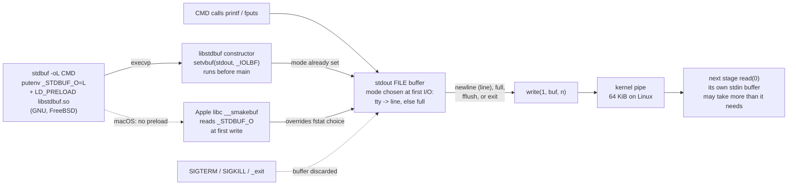

# stdio Buffering and stdbuf

> [!summary] Claim
> A filter in a pipeline holds its output in a user-space stdio buffer that only that process can flush, and `stdbuf` can change that buffer only for programs that use C `FILE` streams, set no buffering of their own, and load a libc that reads `_STDBUF_*` or accepts the preloaded `libstdbuf`.

Part of [Coreutils and the Userland](README.md) in [Shell and Unix Engineering](../README.md).

## TL;DR

- Mechanism: C stdio decides each standard stream's mode lazily, at its first I/O, from `fstat` and `isatty`; on a pipe or file stdout becomes fully buffered (4096 bytes on glibc with a 4 KiB-page kernel, 16384 on macOS, 1024 on musl), so nothing reaches the next stage until the buffer fills, the program flushes, or it calls `exit`.
- Rule: fix lag at the stage that buffers, with that tool's own flag first (`grep --line-buffered`, `sed -u`, awk `fflush()`, `mawk -W interactive`), and reach for `stdbuf -oL` only for a dynamically linked C program that has no flag.
- Trap: `stdbuf` sets environment variables and a preload; it silently does nothing to programs that call `setvbuf` themselves (the lab's `chatter own` does), that never use stdio (`cat`, `dd`, GNU `head` input), that are static, setuid, or not C, and its settings leak into every descendant.
- Portability fact: GNU `stdbuf` preloads `libstdbuf.so`; FreeBSD's preloads `/usr/lib/libstdbuf.so`; macOS `/usr/bin/stdbuf` preloads nothing because Apple's libc reads `_STDBUF_I`, `_STDBUF_O`, and `_STDBUF_E` itself; uutils forks instead of exec; BusyBox has no `stdbuf` at all; exit statuses differ (GNU 125, 126, 127; macOS 2).
- When not to use it: when a process is killed (its buffer is lost, `stdbuf` or not), for throughput (unbuffered output cost 5x the time in the lab's measurement), when the reader needs record atomicity (that is `PIPE_BUF`, not stdio), and when you own the code (call `setvbuf` or `fflush`).

## Mental model



A program writes into its `FILE` buffer, and the buffer, not the program's logic, decides when bytes become a `write(2)` system call.
The decision is made at the stream's first I/O: a terminal gets line buffering, anything else gets full buffering sized from `st_blksize`.
`stdbuf` changes that decision from outside in one of two ways: GNU and FreeBSD preload a library whose constructor calls `setvbuf` before `main`, while on macOS libc itself reads the same environment variables when it first allocates the buffer.
Once the bytes are written they sit in the kernel pipe, where the reader's own stdin buffer may pull in more than the reader will use.
A process that dies by a signal or `_exit` never writes what is left in its buffer, which is why the dashed arrow from `KILL` ends at the buffer and not at the pipe.

## How it works

### The contract: three modes, one rule for the standard streams

POSIX inherits the modes from ISO C and states them in XSH 2.5 Standard I/O Streams `(POSIX.1-2024 XSH 2.5)`.
An unbuffered stream sends bytes "as soon as possible"; a fully buffered stream sends them "as a block when a buffer is filled"; a line-buffered stream sends them when a newline byte is written, and also when the buffer fills or when input is requested on an unbuffered stream or on a line-buffered stream that needs input from the host.
The same section adds the rule every shell user meets: "When opened, stderr shall not be fully buffered; stdin and stdout shall be fully buffered if and only if the file descriptor associated with the stream is determined not to be associated with an interactive device" `(POSIX.1-2024 XSH 2.5, also the stdin page)`.
So block buffering on a pipe is not a bug or a quirk of one libc: it is required.
What is left to the implementation is the size, how "interactive" is detected, and whether stderr is unbuffered or line buffered; XSH 2.5 says outright that "support for these characteristics is implementation-defined".

`setvbuf` is the only standard way to choose a mode, and it is valid only "after the stream ... is associated with an open file but before any other operation" `(POSIX.1-2024 setvbuf)`.
Its size argument is a hint: with a null buffer pointer "size may determine the size of a buffer", which is why implementations disagree about what `setvbuf(stdout, NULL, _IOFBF, 65536)` does (see the `stdbuf` implementations below).

Termination decides whether a held buffer is ever written.
"If the main() function returns to its original caller, or if the exit() function is called, all open files are closed (hence all output streams are flushed) before program termination.
Other paths to program termination, such as calling abort(), need not close all files properly" `(POSIX.1-2024 XSH 2.5)`.
A default-action signal is one of those other paths, and the kernel cannot flush memory it does not know is a buffer, so the bytes vanish; lab test 10 shows a filter that copied `hello` and died of `SIGTERM` delivering 0 bytes.

### When and how each libc chooses

All three libcs decide lazily, on the first read or write, which is what makes an external override possible at all.

glibc: `_IO_file_doallocate` in `libio/filedoalloc.c` starts from `BUFSIZ` (8192), calls `fstat` on the descriptor, sets `_IO_LINE_BUF` only if the descriptor is a character device that `__isatty_nostatus` accepts, and replaces the size with `st_blksize` only when `st_blksize` is positive and smaller than `BUFSIZ`.
A Linux pipe reports the page size as `st_blksize`, because pipefs is set up through `init_pseudo`, which sets `s_blocksize = PAGE_SIZE` (`fs/pipe.c`, `fs/libfs.c`); that is 4096 on a 4 KiB-page kernel ([[Pipe-Buffering-and-Stdbuf]] measured `__fbufsize` 4096 on glibc), so a glibc program on a pipe holds up to 4096 bytes there.
On a 16 KiB- or 64 KiB-page arm64 kernel the `st_blksize < BUFSIZ` test fails and glibc keeps `BUFSIZ`, 8192 bytes.

Apple Libc (`stdio/FreeBSD/makebuf.c`): `__smakebuf` calls `__swhatbuf`, which takes `st_blksize` capped at `MAXBUFSIZE` (`1 << 24`, 16 MiB, unless built with `FEATURE_SMALL_STDIOBUF`), then calls `__senvbuf`, which reads environment overrides, and only then applies the terminal check, capping a terminal's buffer at `TTYBUFSIZE` 4096 because "st_blksize for ttys is 128K".
A macOS pipe reports `st_blksize` 16384, and the lab's `bufsize` probe measured exactly that: `mode=full size=16384` on macOS 27.3.

musl: `stdout` is a static `FILE` with a `BUFSIZ + UNGET` array (`BUFSIZ` is 1024 in musl's `stdio.h`, `UNGET` is 8) and starts line buffered (`.lbf = '\n'` in `src/stdio/stdout.c`).
On the first write `__stdout_write` asks `ioctl(fd, TIOCGWINSZ)`, and if that fails and the program has not called `setvbuf` (`F_SVB`), it sets `lbf = -1`, which is full buffering.
musl's terminal test is therefore "does this descriptor have a window size", not `isatty`, and its pipe buffer is 1024 bytes.
`stderr` has `buf_size = 0` and `lbf = -1` in `src/stdio/stderr.c`: unbuffered.

Line buffering has a second trigger that surprises people reading a prompt: glibc flushes line-buffered output when input is read "from any stream attached to a terminal device" (Linux man-pages `setbuf(3)`), which is the XSH 2.5 rule about requesting input.
That rule does nothing for a pipeline, where no stream is a terminal.

### What `stdbuf` does, implementation by implementation

GNU coreutils (`src/stdbuf.c`, `stdbuf` since coreutils 7.5, 2009-08-20, per `NEWS`):
1. `main` parses `-i`, `-o`, `-e` with `getopt_long` and the `+` prefix, so option parsing stops at the command name; `-iL` is rejected with "line buffering standard input is meaningless", and no mode at all with "you must specify a buffering mode option" (required since coreutils 8.22).
2. `set_libstdbuf_options` exports `_STDBUF_I`, `_STDBUF_O`, `_STDBUF_E`: `L` stays `L`, every size is normalized to a decimal byte count (`-o 1K` exports `_STDBUF_O=1024`, `-o 1KB` exports `1000`, measured with coreutils 9.12), and `0` stays `0`.
3. `set_LD_PRELOAD` looks for `libstdbuf.so` next to the `stdbuf` binary, then in `PKGLIBEXECDIR`, and exports `LD_PRELOAD=<old>:<path>`, or `DYLD_INSERT_LIBRARIES` plus `DYLD_FORCE_FLAT_NAMESPACE=y` under `__APPLE__`, or `LDR_PRELOAD` / `LDR_PRELOAD64` on AIX (AIX support works since coreutils 9.8).
4. It calls `execvp`, so the command replaces `stdbuf` and keeps its PID; failure exits 127 if the command is not found and 126 otherwise, and `stdbuf`'s own errors exit 125.

The preloaded `libstdbuf.c` has one `__attribute ((constructor))` function, `stdbuf`, which calls `apply_mode` for stderr first ("so can write errors to stderr"), then stdin, then stdout.
`apply_mode` maps a leading `0` to `_IONBF`, a leading `L` to `_IOLBF`, and anything else to `strtoul`; for a size it `malloc`s the buffer itself, because, as the source comment says, "glibc currently ignores the combination of null buffer with non zero size" (Linux man-pages `setbuf(3)` agrees: with a null `buf` "only the mode is affected").
A bad value prints "invalid buffering mode" to stderr and returns, and the command still runs with default buffering.
The constructor runs before `main` in the dynamic loader's initialization, which is what satisfies the "before any other operation" rule of `setvbuf`.

The coreutils manual still says `stdbuf` "is installed only on platforms that use the Executable and Linkable Format (ELF) and support the constructor attribute", but Homebrew's coreutils 9.12 on macOS ships `gstdbuf` and `libexec/coreutils/libstdbuf.so`, and `gstdbuf -oL` exported `DYLD_INSERT_LIBRARIES=/opt/homebrew/Cellar/coreutils/9.12_1/libexec/coreutils/libstdbuf.so` (measured on macOS 27.3).

FreeBSD (`usr.bin/stdbuf/stdbuf.c` and `lib/libstdbuf/stdbuf.c`, first in FreeBSD 8.4 per its manual):
the front end `setenv`s `_STDBUF_I`, `_STDBUF_O`, `_STDBUF_E` verbatim, appends `/usr/lib/libstdbuf.so` to `LD_PRELOAD` and `/usr/lib32/libstdbuf.so` to `LD_32_PRELOAD`, and calls `execvp`, exiting 2 through `err(2, ...)` if that fails.
Its library accepts `0`, `L`, `B` (full buffering at the default size), or a number parsed by `strtol` with base 0 and a `k`, `M`, or `G` suffix, and calls `setvbuf(s, NULL, mode, size)`, relying on FreeBSD libc to allocate the requested size.
FreeBSD `stdbuf` with no command exits 0 without doing anything, where GNU exits 125.

macOS (`/usr/bin/stdbuf`, `shell_cmds-336.40.1` on macOS 27.3): the binary is the FreeBSD front end, but under it `/opt/homebrew/bin/bash -c 'printf "%s" "${LD_PRELOAD-unset}"'` printed `unset` while `_STDBUF_O` was `L` (measured), so nothing is preloaded.
The work happens in Apple Libc: `__evpinit` loads `STDBUF`, `STDBUF0`, `STDBUF1`, `STDBUF2` ("NetBSD style") and then `_STDBUF_I`, `_STDBUF_O`, `_STDBUF_E` ("GNU / FreeBSD style") once per process through `os_once`, and `__senvbuf` parses a synthesis of all three grammars: an optional `0`, `U`, `u`, `L`, `l`, `F`, `f`, or `B`, then digits, then `K`, `k`, or `M`, then an optional `B`.
An unparsable value is ignored, a size is capped at `MAXBUFSIZE`, a mode of `L` with no size falls back to `BUFSIZ` (1024 on macOS), and setting any value clears the terminal check (`*couldbetty = 0`), so `_STDBUF_O=64K` makes even a terminal fully buffered.
Two consequences follow from that code.
First, plain `_STDBUF_O=L cmd` works on macOS with no `stdbuf` at all (lab test 3), and so does GNU `gstdbuf` on SIP-protected binaries, whose `DYLD_*` variables the system strips: `/bin/sh` under `gstdbuf -oL` saw `DYLD_INSERT_LIBRARIES` unset and `_STDBUF_O=L` set (measured).
Second, the lookup is by descriptor number, not by stream, so a `FILE` that a program `fopen`s on descriptor 1 after closing stdout is also affected, and the fallback `STDBUF` applies to streams on every descriptor.

uutils coreutils (`src/uu/stdbuf/src/stdbuf.rs`, main branch as of 2026-11): in the default build (without the `feat_external_libstdbuf` feature, which instead searches next to the binary and in `LIBSTDBUF_DIR`) the Rust front end embeds the library in its own binary, writes it into a fresh 0700 temporary directory, sets `LD_PRELOAD` to that one path (replacing, not appending to, any existing value), refuses a path containing `:` because the loader would split it, and then spawns the command as a child and waits for it, so it can delete the library afterwards.
That design changes process semantics: the command does not inherit the `stdbuf` PID, a signal sent to `$!` reaches the wrapper, and a child killed by signal N is reported as status 128 + N by the wrapper.
Its `libstdbuf.rs` calls `setvbuf(stream, NULL, mode, size)` with a null buffer, so on glibc and musl a requested size changes only the mode.
On Apple targets `preload_strings` returns `DYLD_LIBRARY_PATH`, a search path, not an insertion list.
`dyld(1)` documents `DYLD_LIBRARY_PATH` as a colon-separated list of directories searched for libraries a program already links, so pointing it at the extracted `libstdbuf.dylib` file injects nothing; uutils `stdbuf` on macOS works only because it also exports `_STDBUF_I`, `_STDBUF_O`, and `_STDBUF_E`, which Apple libc reads itself (from the uutils source and `dyld(1)`; the lab does not run uutils).

BusyBox: no `stdbuf` applet exists (it is absent from the applet list at busybox.net and from the source tree), so a BusyBox-only system has no `stdbuf` command.
On musl, a size set through GNU `libstdbuf` becomes `size - UNGET` bytes, because musl's `setvbuf` keeps 8 bytes of pushback space in a caller's buffer (`f->buf_size = size - UNGET`); musl never allocates in `setvbuf` ("No allocation of buffers is performed").

### Who `stdbuf` cannot reach

The GNU `--help` text states two limits: "If COMMAND adjusts the buffering of its standard streams ('tee' does for example) then that will override corresponding changes by 'stdbuf'. Also some filters (like 'dd' and 'cat' etc.) don't use streams for I/O, and are thus unaffected by 'stdbuf' settings."
Each limit has a mechanism:
- A program that calls `setvbuf` in `main` runs after the constructor and wins; lab test 4 runs `stdbuf -oL chatter own` and still sees `early=0`.
- A program that uses `read` and `write` on descriptors never had a buffer to change; current GNU `tee` (`tee_files` in `src/tee.c`) copies with `read` into a `BUFSIZ` array and writes each chunk to every descriptor, so it forwards immediately on its own, and the manual's "tee adjusts its streams' buffering" describes the older implementation.
- GNU `head` does not read its input through stdio (measured: `ghead` 9.12 ignores `-i0`), so `stdbuf -i0 head -n 1` still swallows a pipe's whole first chunk, while BSD `head`, which reads through stdio, stops at the line it needs (lab test 15).
- A statically linked program has no dynamic loader to honor `LD_PRELOAD`, and a program in secure-execution mode (`AT_SECURE`, typically set-user-ID) gets preload "pathnames containing slashes ... ignored" (Linux man-pages `ld.so(8)`); the `_STDBUF_*` variables still arrive, but nothing reads them on Linux.
- Runtimes that bypass C `FILE` (Go, Rust, Python's `io` module) ignore `stdbuf` everywhere; [[Pipe-Buffering-and-Stdbuf]] measures each of them.

### The input side: buffered readers take more than they use

Input buffering is invisible until two processes share one input.
POSIX handles the seekable case: "When a standard utility reads a seekable input file and terminates without an error before it reaches end-of-file, the utility shall ensure that the file offset in the open file description is properly positioned just past the last byte processed by the utility.
For files that are not seekable, the state of the file offset ... is unspecified" `(POSIX.1-2024 XCU 1.4, INPUT FILES)`.
The same paragraph warns that `(sed -n 1q; cat) < file` equals `tail -n +2 file` only when the file is seekable, and that `cat file | (sed -n 1q; cat)` leaves the offset unspecified.
Lab test 14 shows both sides: from a file `cat` prints `2` and `3`; from a pipe it prints nothing, because `sed` read the whole 6-byte input into its stdin buffer and exited.

Implementations meet the seekable rule in libc or in the tool.
musl does it for every program: `__stdio_exit` calls `close_file`, which seeks each stream back by its unread bytes (`f->seek(f, f->rpos-f->rend, SEEK_CUR)`).
bash does it in the `read` builtin: on a pipe `read_builtin` sets `unbuffered_read = 1` and reads one byte per `read(2)` call (it cannot push bytes back into a pipe), and for other input it reads buffered and then calls `zsyncfd` to seek back (`bash-5.3 builtins/read.def`, `read_builtin`).
That is why `cat file | { read -r x; cat; }` leaves `2` and `3` for `cat` in every shell in the Portability table.

On a pipe the only remedy is to read less, and `stdbuf -i0` does exactly that for a stdio reader: an unbuffered input stream issues one-byte reads, so `stdbuf -i0 sed -n 1q` consumes only its line (lab test 15).
The GNU manual is careful about what `-i0` does not promise: "Disabling buffering for input does not necessarily influence the responsiveness or blocking behavior of the stream input functions.
For example, fread will still block until EOF or error or the amount requested is read".
GNU `sed -u` builds the same thing in: `open_next_file` in `sed/execute.c` calls `setvbuf(input->fp, NULL, _IONBF, 0)` when `unbuffered` is set, and `flush_output` calls `ck_fflush` after each output.
Brady's original 2006 write-up shows the starvation with `printf "one\ntwo\nthree\n" | ( sed 1q ; sed 1q ; sed 1q )`, which prints only `one`, and the `ssh` variant, where the local client reads stdin on behalf of a remote command that never wanted it, fixed with `ssh -n`.

mawk is a special case on the input side: in block mode `FINgets` calls `fillbuff`, which loops on `read` until the requested size is filled or `read` returns 0 (`fin.c`, `fillbuff`), and the initial size is `JUMPSZ`, `BUFFSZ * 64` = 4096 x 64 = 262144 bytes with the default `SPRINTF_LIMIT` (`sizes.h`).
mawk therefore does not even parse a record from a pipe until 256 KiB arrive or the writer closes, so `fflush()` in the action cannot help; `-W interactive` "bypasses both checks in deciding to use buffered I/O" and "changes stdout to unbuffered" (mawk manual).
Lab test 9 asserts this per awk implementation.

### Shell builtins flush per command

Shells format builtin output in their own buffers and flush at the end of every builtin.
bash's `printf` returns through `PRETURN`, which calls `fflush (stdout)`, and `echo` returns through `sh_chkwrite`, which also calls `fflush (stdout)` (`bash-5.3 builtins/printf.def`, `builtins/common.c`, `sh_chkwrite`).
dash's `evalbltin` calls `flushall()` after every builtin, and its output buffer is `OUTBUFSIZ`, defined as `BUFSIZ` (`dash src/eval.c`, `evalbltin`; `src/output.c`).
So a `while read; do printf; done` loop forwards each line at once in every shell in the Portability table (lab test 6), and costs one `write(2)` per `printf`; see [[while-read-Loops-versus-Single-Pass-Tools]] for what that costs at scale.

### Tools that flush on request

Every long-lived filter worth using in a live pipeline has its own switch, and the switch is more reliable than `stdbuf` because the program itself chooses when to flush:
- GNU `grep --line-buffered`: "Use line buffering on output.
This can cause a performance penalty" (Linux man-pages `grep(1)`); FreeBSD and macOS `grep` call `setlinebuf(stdout)` when `lbflag` is set (`usr.bin/grep/grep.c`).
- GNU `sed -u`: "load minimal amounts of data from the input files and flush the output buffers more often" (`sed(1)`); FreeBSD and macOS `sed -l` calls `setvbuf(stdout, NULL, _IOLBF, 0)` and `sed -u` calls it with `_IONBF` (`usr.bin/sed/main.c`).
- awk `fflush()`: with no argument POSIX flushes "all such open files and piped streams, and standard output" `(POSIX.1-2024 awk)`; mawk needs `-W interactive` as above.
- `tail -f` flushes each batch itself; coreutils 7.6 (2009-09-11) fixed a bug, introduced in 7.5, where inotify-enabled `stdbuf -o 4K tail -f /etc/passwd` printed nothing before blocking (coreutils `NEWS`).
- BusyBox `grep` and `sed` have no such option: BusyBox `sed` parses only `i::rEne:*f:*` (`editors/sed.c`, `sed_main`), and BusyBox `grep` has no `--line-buffered` (`findutils/grep.c`); BusyBox `tee` makes every output unbuffered with `setbuf(*fp, NULL)` and, without `FEATURE_TEE_USE_BLOCK_IO`, `setvbuf(stdout, NULL, _IONBF, 0)` (`coreutils/tee.c`).

## Numbers and limits

| Quantity | Value | Source |
| :--- | :--- | :--- |
| glibc stdout buffer on a Linux pipe | 4096 bytes on a 4 KiB-page kernel (`min(BUFSIZ 8192, st_blksize 4096)`); 8192 with 16 KiB or 64 KiB pages | glibc `libio/filedoalloc.c`, Linux `fs/libfs.c`; lab test 12 asserts 4096 on Linux |
| Apple Libc stdout buffer on a pipe | 16384 bytes (`st_blksize`) | measured by lab `bufsize`, macOS 27.3 (as of 2026-11) |
| Apple Libc maximum stdio buffer | 16 MiB (`MAXBUFSIZE`, `1 << 24`) | Apple Libc `stdio/FreeBSD/makebuf.c` |
| Apple Libc terminal buffer cap | 4096 bytes (`TTYBUFSIZE`) | Apple Libc `makebuf.c` |
| Apple Libc line buffer from `_STDBUF_O=L` | 1024 bytes (`BUFSIZ` fallback) | measured by lab `bufsize`, macOS 27.3 |
| musl stdout and stdin buffer | 1024 bytes (`BUFSIZ`), plus 8 bytes `UNGET` | musl `include/stdio.h`, `src/stdio/stdout.c` |
| musl buffer from `stdbuf -o 1000` | 992 bytes (`size - UNGET`) | musl `src/stdio/setvbuf.c`; lab test 12 asserts it on Alpine |
| `stdbuf -o 1000` on glibc and macOS | 1000 bytes | measured on macOS 27.3; glibc by lab test 12 |
| mawk initial pipe read | 262144 bytes before the first record is parsed | mawk `fin.c` 1.62 and `sizes.h`, default `SPRINTF_LIMIT` 8192 |
| dash output buffer | `BUFSIZ` (`OUTBUFSIZ`) | dash `src/output.c` |
| GNU size suffixes | `K` = 1024, `KB` = 1000 (`-o 1K` -> `_STDBUF_O=1024`) | measured, coreutils 9.12 |
| GNU `stdbuf` exit statuses | 125 own failure, 126 cannot invoke, 127 not found | coreutils manual; 125, 126, 127 measured with `gstdbuf` 9.12 |
| macOS `/usr/bin/stdbuf` exit statuses | 2 if exec fails (missing or not executable); 0 for `-iL`, no mode, or no command | measured, `shell_cmds-336.40.1`; FreeBSD `stdbuf.c` |
| 1,000,000 awk lines (6,888,890 bytes) into a pipe | 0.23 s full, 0.66-0.69 s line (`_STDBUF_O=L`), 1.16-1.24 s unbuffered (`_STDBUF_O=0`) | measured, `/usr/bin/awk`, 3 runs each, Apple M3 Pro, macOS 27.3 (as of 2026-11) |
| Linux pipe capacity downstream of the buffer | 64 KiB default | see [[Pipes-and-FIFOs]] and [[PIPE_BUF-and-Write-Atomicity]] |

## Portability

Shell behavior (the shell matters only for its own builtins; every utility row below is independent of the shell running it).

| Shell | `read`/`printf` loop forwards each line | `read` leaves the rest of a pipe | Evidence |
| :--- | :--- | :--- | :--- |
| POSIX sh | not specified | unspecified: the XCU 1.4 rule for every standard utility, `read` included, leaves a non-seekable file's offset unspecified (the `read` page itself says nothing about pipes) | XCU 1.4 INPUT FILES |
| macOS bash 3.2 (`/bin/sh`) | yes | yes | lab tests 6 and 14, measured on macOS 27.3 |
| bash 5.3 | yes (`PRETURN` flushes) | yes (`unbuffered_read` on pipes) | bash-5.3 `printf.def`, `read.def`; measured with Homebrew bash on macOS 27.3 |
| zsh native and `--emulate sh` | yes | yes | measured with macOS zsh (loop native, `read` both modes); lab tests 6 and 14 assert both modes |
| dash | yes (`evalbltin` -> `flushall`) | yes | dash `eval.c`; measured with macOS `/bin/dash` |
| ksh93 | yes | yes | measured with macOS ksh93u+ 2012 |

Utility behavior.

| Behavior | GNU | BSD and macOS | BusyBox | uutils |
| :--- | :--- | :--- | :--- | :--- |
| `stdbuf` exists | yes (coreutils >= 7.5; `gstdbuf` on Homebrew) | yes (FreeBSD >= 8.4; macOS `/usr/bin/stdbuf`) | no | yes |
| How it applies modes | `LD_PRELOAD` / `DYLD_INSERT_LIBRARIES` + constructor | FreeBSD: `LD_PRELOAD` + constructor; macOS: libc reads `_STDBUF_*` | n/a | `LD_PRELOAD` of an extracted copy; Apple: `DYLD_LIBRARY_PATH`, a search path, so nothing is injected and Apple libc's own `_STDBUF_*` reading does the work (source, `dyld(1)`) |
| Process model | `execvp`, same PID | `execvp`, same PID | n/a | spawn child and wait |
| Existing `LD_PRELOAD` | kept, library appended | kept, library appended (FreeBSD) | n/a | replaced |
| `-iL` | rejected, 125 | accepted | n/a | rejected, 125 |
| `B` mode | rejected (`invalid -o argument 'B'`) | accepted | n/a | rejected as an invalid mode (uucore `parse_size_u64`: a bare `B` has no number and the default parser does not treat `B` as bytes) |
| Missing command | 127 | 2 | n/a | 127 |
| `grep --line-buffered` | yes | yes (`setlinebuf`) | no | n/a |
| `sed` unbuffered | `-u` (input and output) | `-u` (output `_IONBF`), `-l` (line) | none | n/a |
| `tee` | `read`/`write`, forwards at once (`src/tee.c`) | not checked | unbuffered outputs (`setbuf NULL`) | not checked |
| `head` honors `stdbuf -i0` | no (measured, `ghead` 9.12) | yes (measured) | yes (`getc` on stdio, lab asserts) | not checked |
| awk forwards with `fflush()` | gawk yes | onetrue awk yes | yes (lab asserts) | n/a; mawk needs `-W interactive` |

## Worked example

The [lab](../labs/08-stdio-buffering-and-stdbuf/) builds three C probes and drives them through the shell under test.
`pipeprobe` sits at both ends of a pipeline and uses a FIFO as a side channel, so the stage in the middle sees one line but no end of file; the watcher reports how many bytes arrived within 2 seconds and how many arrived in total.
`chatter` is a minimal `fgets`/`fputs` filter, and `bufsize` puts a pipe on its own stdout and counts bytes with `ioctl(FIONREAD)` after every `fputc` to read off the buffer mode and size.

`lagcheck.sh` (verbatim):

```sh
#!/bin/sh
# lagcheck: does a pipeline stage forward a line while its input is still open?
# Usage: lagcheck.sh PIPEPROBE builtin
#        lagcheck.sh PIPEPROBE cmd COMMAND [ARG...]
# Runs   pipeprobe feed CTL | STAGE | pipeprobe watch CTL 2000
# where STAGE is a read/printf loop in the shell running this script (builtin)
# or COMMAND (cmd), and prints the watcher's "early=N total=M" line.
# early=6 means the stage forwarded "hello\n" at once; early=0 means it held
# the line until its input closed. The FIFO lives in a mktemp -d directory
# under TMPDIR (the tests point TMPDIR at their own scratch directory).
set -u
probe=$1
mode=$2
shift 2

dir=$(mktemp -d "${TMPDIR:-/tmp}/lagcheck.XXXXXX") || exit 1
ctl=$dir/ctl
if ! mkfifo "$ctl"; then
  rm -rf "$dir"
  exit 1
fi

relay() {
  while IFS= read -r line; do
    printf '%s\n' "$line"
  done
}

case $mode in
  builtin)
    "$probe" feed "$ctl" | relay | "$probe" watch "$ctl" 2000
    ;;
  cmd)
    "$probe" feed "$ctl" | ${1+"$@"} | "$probe" watch "$ctl" 2000
    ;;
  *)
    echo "lagcheck: unknown mode $mode" >&2
    rm -rf "$dir"
    exit 2
    ;;
esac
status=$?
rm -rf "$dir"
exit "$status"
```

Simplified excerpt of `stdio_buffering.bats` (the real tests also branch on the libc and utility implementation):

```sh
run_lab "$LAG" "$PROBE" cmd "$CHATTER" plain              # early=0 total=6
run_lab "$LAG" "$PROBE" cmd stdbuf -oL "$CHATTER" plain   # early=6 total=6
run_lab "$LAG" "$PROBE" cmd stdbuf -oL "$CHATTER" own     # early=0 total=6
run_lab "$LAG" "$PROBE" cmd /bin/cat                      # early=6 total=6
run_lab "$LAG" "$PROBE" builtin                           # early=6 total=6
run_lab_c '"$1" stdout 3>&1' sh "$BUFSIZE"                # mode=full size=16384 (macOS)
run_lab_c 'stdbuf -oL "$1" stdout 3>&1' sh "$BUFSIZE"     # mode=line size=1024 (macOS)
```

Output captured from one run on macOS 27.3 (`LAB_SHELL=sh`, which is bash 3.2.57 in POSIX mode), `bats --timing`:

```text
1..16
ok 1 a stdio filter holds a line it already copied while stdout is a pipe, and exit flushes it in 2194ms
ok 2 stdbuf -oL and -o0 make the same filter forward each line, including in grandchildren in 225ms
ok 3 _STDBUF_O=L without stdbuf works only where libc itself reads it in 178ms
ok 4 a program that calls setvbuf itself overrides stdbuf in 2172ms
ok 5 cat uses read and write directly, so it forwards at once with no stdbuf in 128ms
ok 6 a shell read and printf loop forwards each line in every shell in 130ms
ok 7 grep holds matches on a pipe; --line-buffered forwards them where it exists in 2176ms
ok 8 sed holds output on a pipe; sed -u forwards it where it exists in 2265ms
ok 9 awk needs fflush() to forward a record, and mawk also needs -W interactive in 4408ms
ok 10 a process killed by a signal loses its stdio buffer; exit at EOF does not in 115ms
ok 11 stderr overtakes stdout when both go into one pipe in 96ms
ok 12 libc picks the stdout buffer size on a pipe, and stdbuf replaces it in 177ms
ok 13 stderr starts unbuffered in 108ms
ok 14 a buffered reader on a pipe takes more input than it uses; on a file it seeks back in 83ms
ok 15 stdbuf -i0 stops a stdio reader at the line it needs, but not a read(2) reader in 60ms
ok 16 stdbuf exports _STDBUF_O and reports failures with implementation-specific statuses in 67ms
```

The timings are the readout: every test that waits about 2 seconds is a stage holding its line until the watcher released the feeder, and every test under 250 ms is a stage that forwarded at once.
The `bufsize` probe printed these lines on the same host:

```text
mode=full size=16384
mode=full size=1000
mode=line size=1024
mode=unbuffered
```

for `bufsize stdout`, `stdbuf -o 1000 bufsize stdout`, `stdbuf -oL bufsize stdout`, and `bufsize stderr`.

## Pitfalls

> [!warning] `stdbuf` on the wrong stage
> Trigger: `tail -f app.log | grep ERROR | stdbuf -oL cut -d' ' -f1`.
> Symptom: still no output, because `grep` is the stage holding 4096 bytes and `stdbuf` reaches only the command it starts.
> Fix: unbuffer every stage except the last one that writes to a terminal: `tail -f app.log | grep --line-buffered ERROR | cut -d' ' -f1`; the last stage is line buffered already when its stdout is a terminal.

> [!warning] A program that sets its own buffering
> Trigger: `stdbuf -oL some-daemon` where `some-daemon` calls `setvbuf` in `main`, as the lab's `chatter own` does.
> Symptom: `stdbuf` exits 0, the environment is set, and the output is still held (lab test 4: `early=0`).
> Fix: use the program's own flag or configuration; check with the lab's `lagcheck.sh` instead of trusting a clean exit status.

> [!warning] A filter that never parses until EOF
> Trigger: `tail -f log | mawk '{ print $1; fflush() }'`.
> Symptom: nothing appears until 256 KiB arrive, although the action flushes, because mawk's `fillbuff` waits to fill its input buffer.
> Fix: `mawk -W interactive`, or use gawk or the one true awk, which hand over each record as `read` returns it.

> [!warning] Killed processes lose their tail
> Trigger: `timeout 60 ./collector > out.txt`, or a CI step cancelled with `SIGTERM`, where `collector` writes with `printf`.
> Symptom: the last up to 4096 bytes (16384 on macOS) of output are missing, so a log ends mid-record and the final summary line never appears.
> Fix: flush after each record, or `setvbuf(stdout, NULL, _IOLBF, 0)`, or catch `SIGTERM` and `exit` (which flushes) rather than dying by default action; `stdbuf -oL` helps only for line-oriented C output.
> See [[timeout]] for which signal it sends and when.

> [!warning] Interleaved stdout and stderr in CI logs
> Trigger: `make 2>&1 | tee build.log`, where the tools print progress to stdout and errors to stderr.
> Symptom: errors appear in the log before the stdout lines that preceded them, because stderr is unbuffered and stdout is held (lab test 11 prints `err` before `out`).
> Fix: `stdbuf -oL -eL` for C tools, line-buffering flags for the rest, or log to two files with timestamps; never infer causality from the order of a merged stream.

> [!warning] The stdin thief
> Trigger: `generate | { head -n 1 >header; sort >body; }` or a `while read` loop whose body runs `ssh host cmd`.
> Symptom: the second consumer gets nothing or a truncated stream, because the first buffered reader (GNU `head`, or an `ssh` client reading stdin for a remote command) read a whole block from the pipe.
> Fix: read the header with the shell's `read` (one byte at a time on a pipe), give the inner command `</dev/null` or `ssh -n`, or write the input to a file first, where POSIX requires utilities to seek back (`(POSIX.1-2024 XCU 1.4)`).

> [!warning] `_STDBUF_O` left in an environment
> Trigger: `export _STDBUF_O=0` in a profile or a CI job on macOS, or `stdbuf -o0 make` anywhere.
> Symptom: every descendant libc program (compilers, `sort`, `awk`) runs unbuffered and the build slows; in the lab's measurement unbuffered awk output took about 5x as long as block buffered.
> Fix: scope `stdbuf` to the one stage that needs it, and look for `_STDBUF_` and `LD_PRELOAD` in `env` when a machine is mysteriously slow.

> [!warning] The FreeBSD manual's example uses a variable nobody reads
> Trigger: copying the `libstdbuf(3)` EXAMPLE, `LD_PRELOAD=/usr/lib/libstdbuf.so STDBUF_1=L awk ...`.
> Symptom: no effect: FreeBSD's `libstdbuf` reads only `_STDBUF_I`, `_STDBUF_O`, and `_STDBUF_E`, and Apple libc's NetBSD-style names are `STDBUF1` without an underscore.
> Fix: use `stdbuf -o L`, or `_STDBUF_O=L` with the preload.

## Security and robustness

`stdbuf` works by injecting a shared library through the environment, so it inherits every property of `LD_PRELOAD`.
The variables propagate to every descendant (lab test 2 shows a grandchild through `sh -c` line buffered), which makes buffering an ambient, invisible setting; scope it to one command, never `export` it.
GNU `stdbuf` appends `libstdbuf.so` to an existing `LD_PRELOAD`, so whatever was already preloaded stays preloaded; uutils replaces the variable, which silently drops a deliberate preload such as a memory allocator or a sanitizer runtime.
For set-user-ID and other secure-execution programs glibc's loader ignores preload paths that contain a slash and loads only set-user-ID objects from the standard directories (Linux man-pages `ld.so(8)`), so `stdbuf` cannot affect them on Linux, by design.
Apple's `__senvbuf` has no `issetugid` check in the source fetched (`makebuf.c`), so on macOS an unprivileged caller can change the stdio buffering of a set-user-ID program through `_STDBUF_*`; buffering is not an escalation primitive by itself, but it changes when and how a privileged program's output interleaves with others.
uutils writes the embedded library to a temporary directory created with mode 0700 and refuses a path containing `:`, because a crafted `TMPDIR` could otherwise make the loader preload an attacker-chosen first component (comment in `stdbuf.rs`).

Robust scripts do not depend on buffering for correctness.
A pipeline that only works when every stage is line buffered is a pipeline with a hidden timing contract; when the order or completeness of records matters, write records with one `write` each below `PIPE_BUF` ([[PIPE_BUF-and-Write-Atomicity]]), or have the producer write to a file and rename it into place ([[install-and-Atomic-Deployment]]).
Check exit statuses of the whole pipeline: a held buffer that fails to flush at exit (for example `EPIPE` after the reader left, [[SIGPIPE-and-EPIPE]]) is reported only by a program that checks `fclose(stdout)`, as GNU tools do through `close_stdout`.

## The principal's view

The decision is where to put the flush policy: in the producer, in the pipeline wiring, or in an external override.
Put it in the producer whenever you own the code: a long-running program that emits records should flush per record when stdout is not a terminal (or offer a flag), because only the program knows its record boundaries and its signal handling.
Put it in the pipeline wiring with each tool's documented flag (`--line-buffered`, `-u`, `fflush()`, `-W interactive`) when you do not own the code, because those flags survive static linking, language runtimes, and libc changes.
Use `stdbuf` as the last resort for a dynamically linked C program with no flag, and verify it with a probe like the lab's `lagcheck.sh`, because its failure mode is silence.
The trade-off is throughput against latency: line buffering cost about 3x and unbuffered about 5x the time of block buffering for a million short lines in the lab's measurement, so the default of full buffering on pipes is right for batch work and wrong only for live monitoring.
When a pipeline needs both live visibility and throughput, split it: let the batch path stay buffered and tap a sampled or line-buffered copy for humans ([[tee-and-Fan-Out]]).
When the requirement is real streaming with backpressure, timeouts, and reconnection, stop using a shell pipeline and use a language with explicit I/O control or a log shipper; [[Pipe-Buffering-and-Stdbuf]] covers the runtime-by-runtime behavior, and PTY wrappers (`unbuffer`, `script`) belong to [[Pseudo-Terminals]] because they change far more than buffering.

## Interview questions

> [!question] L5: Why does `tail -f access.log | grep 500` print immediately, but `tail -f access.log | grep 500 | cut -f1` print nothing for minutes?
>
> > [!success]- Answer
> > In the first pipeline grep's stdout is a terminal, so stdio line-buffers it.
> > In the second grep's stdout is a pipe, and POSIX requires stdout to be fully buffered when it is not interactive, so glibc holds up to 4096 bytes in grep's memory.
> > `cut` writes to the terminal and is fine; the fix is `grep --line-buffered`.
> >
> > Follow-up: Which stage would you fix if `cut` were followed by `sort`, and why does it not matter?

> [!question] L5: What does `stdbuf -oL cmd` actually change in the process?
>
> > [!success]- Answer
> > GNU `stdbuf` exports `_STDBUF_O=L`, adds `libstdbuf.so` to `LD_PRELOAD`, and execs `cmd`.
> > The loader runs the library's constructor before `main`, and it calls `setvbuf(stdout, NULL, _IOLBF, 0)`.
> > On macOS the system `stdbuf` preloads nothing; Apple libc reads `_STDBUF_O` when it first allocates the stdout buffer.
> >
> > Follow-up: Why does a `setvbuf` call in `cmd`'s `main` undo it?

> [!question] L5: Predict the output of `printf '1\n2\n3\n' > f; cat f | (sed -n 1q; cat); echo ---; (sed -n 1q; cat) < f`.
>
> > [!success]- Answer
> > `---`, then `2` and `3`.
> > From the pipe, `sed` read all six bytes into its stdin buffer and exited, so `cat` sees end of file; POSIX leaves a pipe's state unspecified.
> > From the file, POSIX XCU 1.4 requires `sed` to leave the offset just past the line it used, so `cat` prints the rest.
> >
> > Follow-up: What would `stdbuf -i0 sed -n 1q` change, and why would `stdbuf -i0 head -n 1` not help with GNU head?

> [!question] L6: Debug this: a CI step runs `timeout 300 ./bench > results.txt`, and on timeouts `results.txt` is empty even though `bench` prints a line per iteration with `printf`.
>
> > [!success]- Answer
> > `results.txt` is a regular file, so `bench`'s stdout is fully buffered and its last up to 4096 bytes live only in its memory.
> > `timeout` sends `SIGTERM`, the default action kills the process, and no `exit` runs, so the buffer is never written.
> > Fix it in `bench` (flush per iteration or handle `SIGTERM` by calling `exit`), or run it under `stdbuf -oL` if it is a dynamically linked C program.
> >
> > Follow-up: Why is `timeout -s KILL` strictly worse here, and what does `timeout --kill-after` buy you?

> [!question] L6: Why does `stdbuf -oL` have no effect on `cat`, `dd`, a Go binary, and `sudo cmd`?
>
> > [!success]- Answer
> > `cat` and `dd` call `read` and `write` on descriptors and have no stdio buffer to change.
> > A Go binary does not use C stdio, and if it is static there is no dynamic loader to honor `LD_PRELOAD`.
> > `sudo` is set-user-ID, so glibc runs it in secure-execution mode and ignores preload paths with slashes, and whether the variables then reach `cmd` is up to sudo's environment policy.
> >
> > Follow-up: Which of these would `_STDBUF_O=L` affect on macOS, and why?

> [!question] L6: A teammate's `tail -f log | mawk '{print $3; fflush()}'` still shows nothing: what is going on?
>
> > [!success]- Answer
> > The problem is mawk's input, not its output.
> > In block mode mawk's `fillbuff` keeps calling `read` until its 256 KiB input buffer is full or the writer closes, so no record is parsed and there is nothing to flush.
> > `mawk -W interactive` switches stdin to line reads and stdout to unbuffered; gawk would work as written.
> >
> > Follow-up: How would you write a test that tells "output buffered" apart from "input not yet parsed"?

> [!question] L7+: You maintain a fleet-wide log pipeline built from shell filters, and someone proposes exporting `_STDBUF_O=L` globally to fix lag: what do you decide?
>
> > [!success]- Answer
> > Reject the global setting.
> > It reaches every descendant, costs about 3x the time of block buffering on short lines, does nothing on Linux without the preload, and changes behavior of setuid programs on macOS.
> > Fix the stages that buffer with their own flags, verify each with a lag probe in CI, and move the hot path to a log shipper with explicit flush and backpressure if latency is a requirement.
> >
> > Follow-up: Which metric would tell you a stage regressed to block buffering after an upgrade?

> [!question] L7+: Compare GNU, macOS, and uutils `stdbuf` as process wrappers, and say which differences break scripts.
>
> > [!success]- Answer
> > GNU and macOS exec the command, so it keeps the wrapper's PID and `kill $!` reaches it; uutils spawns and waits, so `$!` is the wrapper.
> > GNU exits 125, 126, or 127 on its own failures and accepts no `-iL`; macOS exits 2 when exec fails and accepts `-iL` and `B`.
> > GNU appends to `LD_PRELOAD`, uutils replaces it, and macOS sets no preload at all and relies on libc reading the environment.
> >
> > Follow-up: How would you make a supervisor script robust to all three?

> [!question] L6: Why does `2>&1 | less` show error messages before the output lines that caused them?
>
> > [!success]- Answer
> > POSIX forbids full buffering on stderr, and glibc, musl, and Apple libc make it unbuffered, so each error is written at once.
> > stdout to a pipe is fully buffered, so earlier lines are still in memory when the error is written.
> > The merged order is the order of `write` calls, not of `printf` calls.
> >
> > Follow-up: Would `stdbuf -oL` fully restore the order, and what about a message without a trailing newline?

## Related

Prerequisites: [[install-and-Atomic-Deployment]]

Next: [[timeout]]

See also: [[Pipe-Buffering-and-Stdbuf]], [[Drill-Command-Line-Catastrophic-Backtracking-and-Stream-Bottleneck]], [[Pipes-and-FIFOs]], [[PIPE_BUF-and-Write-Atomicity]], [[SIGPIPE-and-EPIPE]], [[tee-and-Fan-Out]], [[Pseudo-Terminals]], [[while-read-Loops-versus-Single-Pass-Tools]], [[awk-Implementations]]

## Further reading

- POSIX.1-2024 XSH 2.5 Standard I/O Streams, https://pubs.opengroup.org/onlinepubs/9799919799/functions/V2_chap02.html - the normative buffering modes, the stdin/stdout/stderr rule, and what `exit` flushes.
- POSIX.1-2024 XCU 1.4 Utility Description Defaults, https://pubs.opengroup.org/onlinepubs/9799919799/utilities/V3_chap01.html - the seek-back rule for seekable input and the `(sed -n 1q; cat)` example.
- GNU coreutils `src/stdbuf.c` and `src/libstdbuf.c`, https://github.com/coreutils/coreutils/tree/master/src - the whole mechanism in about 500 lines, with the glibc caveats in comments.
- Apple Libc `stdio/FreeBSD/makebuf.c`, https://github.com/apple-oss-distributions/Libc/blob/main/stdio/FreeBSD/makebuf.c - why `_STDBUF_O` works on macOS without any preload.
- FreeBSD `usr.bin/stdbuf` and `lib/libstdbuf`, https://github.com/freebsd/freebsd-src/tree/main/lib/libstdbuf - the BSD front end and its `B` mode.
- uutils `src/uu/stdbuf`, https://github.com/uutils/coreutils/tree/main/src/uu/stdbuf - a reimplementation that changes the process model.
- musl `src/stdio`, https://git.musl-libc.org/cgit/musl/tree/src/stdio - 1024-byte buffers, `TIOCGWINSZ` as the terminal test, and seek-back at exit.
- Padraig Brady, buffering in standard streams, http://www.pixelbeat.org/programming/stdio_buffering/ - the 2006 analysis by `stdbuf`'s author, including input starvation and `ssh -n`.
- Linux man-pages `ld.so(8)`, https://man7.org/linux/man-pages/man8/ld.so.8.html - `LD_PRELOAD` rules and secure-execution mode.
- mawk manual, `-W interactive`, https://github.com/ThomasDickey/mawk-snapshots/blob/master/man/mawk.1 - the one awk that needs more than `fflush()`.
