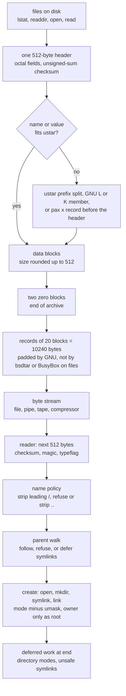

# tar and Archives

> [!summary] Claim
> A tar archive is a headerless, indexless stream of 512-byte blocks whose format has three incompatible answers to "the name is too long", and whose extractor is a privileged file-creation engine driven by untrusted bytes, so safe use means choosing the format on purpose and extracting each untrusted archive into its own fresh, empty directory.

Part of [Coreutils and the Userland](README.md) in [Shell and Unix Engineering](../README.md).

## TL;DR

- Mechanism: each member is one 512-byte header of NUL-padded ASCII octal fields plus its data rounded up to 512 bytes, the archive ends with two zero blocks, and there is no index, so every read is a sequential scan.
- Rule: extract an untrusted archive only into a new empty directory made for that one archive (`mktemp -d`), never into a tree that already holds files or symlinks.
- Trap: a planted symlink from one archive redirects a later archive's writes outside the target (CVE-2025-45582 in GNU tar through 1.35), and a file named `--checkpoint-action=exec=sh shell.sh` turns `tar cf x.tar *` into code execution.
- Portability fact: `tar` is not a POSIX utility at all (POSIX.1-2024 standardizes `pax` and the ustar and pax formats), GNU tar writes its own `gnu` format by default, bsdtar writes "restricted pax", and BusyBox writes GNU-style headers without padding.
- When not to use it: when you need random access, an index, atomic updates, or a signed manifest, use zip, SquashFS, a content-addressed store, or a package format; tar is a transport stream, not a database.

## Mental model



Creation walks the file tree and turns each file's `stat` result into one header block, adding a pseudo-member first when the name or a number does not fit the fixed fields, then streams the data, rounded up to the 512-byte block.
Two zero blocks mark the end, and the writer groups blocks into records for the device, which is why a GNU archive of a 3-byte file is 10240 bytes while bsdtar's is 2048.
The reader has no index to consult: it reads the next 512 bytes, checks the checksum and magic, and decides what to create.
Every arrow after the reader is a policy decision (what to do with `/`, `..`, symlinks, modes, owners) that differs between GNU tar, bsdtar, and BusyBox, and those differences are where the CVEs live.

## How it works

### The standard is pax, not tar

POSIX.1-2024 has no `tar` utility: the XCU utilities index lists `pax` and `cpio` is a format only, and `utilities/tar.html` returns 404 (fetched 2026-11-15).
The `pax` page defines three interchange formats in its EXTENDED DESCRIPTION: `cpio`, `ustar`, and `pax` (POSIX.1-2024 XCU pax, "ustar Interchange Format" and "pax Interchange Format").
Its rationale calls `pax` "a peaceful compromise between advocates of the historical tar and cpio utilities", and its change history says "All references to tar are actually to ustar" (POSIX.1-2024 XCU pax, RATIONALE and CHANGE HISTORY).
So `tar -cf` is portable by convention, and the portable command-line contract is `pax -w -x ustar`; the portable on-disk contract is the ustar header.

### The ustar header block

Every member starts with one 512-octet header; all offsets and lengths are decimal (POSIX.1-2024 XCU pax, "ustar Header Block" table).

| Field | Offset | Length | Encoding |
| --- | --- | --- | --- |
| `name` | 0 | 100 | NUL-terminated unless all 100 bytes are used |
| `mode` | 100 | 8 | octal, 12 bits: set-user-ID, set-group-ID, 01000 (reserved in POSIX.1-2024), and nine permission bits; the file type lives in `typeflag` |
| `uid`, `gid` | 108, 116 | 8, 8 | octal |
| `size` | 124 | 12 | octal, bytes of data that follow |
| `mtime` | 136 | 12 | octal seconds since the Epoch |
| `chksum` | 148 | 8 | octal sum of all 512 header bytes |
| `typeflag` | 156 | 1 | `0` file, `1` hard link, `2` symlink, `3`/`4` devices, `5` directory, `6` FIFO, `7` reserved, `A`-`Z` vendor |
| `linkname` | 157 | 100 | target of a link, never uses `prefix` |
| `magic` | 257 | 6 | `ustar` plus NUL |
| `version` | 263 | 2 | `00` |
| `uname`, `gname` | 265, 297 | 32, 32 | NUL-terminated names |
| `devmajor`, `devminor` | 329, 337 | 8, 8 | octal |
| `prefix` | 345 | 155 | joined to `name` with a `/` |

Numeric fields are "leading zero-filled octal numbers" terminated by one or more space or NUL characters, which is why readers must tolerate both (POSIX.1-2024 XCU pax, "ustar Interchange Format").
The checksum is "the simple sum of all octets in the header", each treated as unsigned, accumulated in at least 17 bits, with the `chksum` field itself read as eight spaces (same section).
The 17 bits are exact arithmetic: the largest possible sum is 512 x 255 = 130560, just under 2^17 = 131072.
"Unsigned" is a real constraint: BusyBox's writer comments that "Sun and HP-UX gets it wrong" (BusyBox `archival/chksum_and_xwrite_tar_header.c`, `chksum_and_xwrite_tar_header`).
Both BusyBox and the lab's `mktar.c` write it as six octal digits, a NUL, and a space, the layout BusyBox describes in the same function.
The data that follows occupies `(size+511)/512` blocks; hard links (type 1) and symlinks (type 2) must have `size` zero, and "No data logical records are stored for types 1, 2, or 5" (POSIX.1-2024 XCU pax, "ustar Interchange Format").
A typeflag of NUL should be read as a regular file, for compatibility with pre-POSIX archives (same section).

The lab decodes the first header of a fresh archive with `od` and `awk` and recomputes the checksum independently; bsdtar on macOS prints `type=0 name=hello.txt prefix_len=0 magic=ustar\00000 size=3 chksum=ok bytes=2048` (lab, `header` mode).

### Three magics on the wire

- POSIX ustar: `magic` is `ustar` NUL and `version` is `00`, which the lab decodes as `ustar\00000`.
- GNU and old GNU: one 8-byte string `"ustar  "` (two spaces and a NUL) spanning both fields (GNU tar 1.35 `src/tar.h`, `OLDGNU_MAGIC`), decoded as `ustar\040\040\000`.
- BusyBox: `strcpy(hp->magic, "ustar  ")` before every header it writes (BusyBox `chksum_and_xwrite_tar_header`), so BusyBox archives carry the GNU magic too.

A reader uses the magic to decide how to interpret the bytes after offset 257.
The GNU manual states the consequence directly: GNU extensions "use portions of the tar header record which were specified in that POSIX draft as unused", so the `gnu` format "is incompatible with the current POSIX specification" (GNU tar 1.35 manual, node "gnu").
GNU tar's default format is chosen at build time: `configure.ac` sets `DEFAULT_ARCHIVE_FORMAT="GNU"` when the builder does not override it (GNU tar 1.35 `configure.ac`).

### Long names: three encodings for one problem

The ustar `name` field holds 100 bytes; with `prefix` a path can reach 256 bytes, but only if it splits at a `/` so that the tail fits in 100 bytes and the head in 155 (POSIX.1-2024 XCU pax, "ustar Interchange Format").
A single 120-byte component cannot split at all, and `linkname` never uses `prefix`, so a symlink target is capped at 100 bytes in plain ustar (same section).
Implementations answer differently:

- ustar prefix split: bsdtar uses it when it suffices; the lab's 121-byte path `ddd...d/fff...f` (60 + 1 + 60) comes back as `type=0 name=fffffffffffff prefix_len=60` (lab, `prefix` mode, bsdtar).
  GNU tar uses the split only in `--format=ustar`, via `write_ustar_long_name`, and otherwise errors with "file name is too long (cannot be split); not dumped" (GNU tar 1.35 `src/create.c`, `write_ustar_long_name`).
- GNU long-name pseudo-member: a header named `././@LongLink` with typeflag `L` (long name) or `K` (long link target) whose data is the full name plus a NUL, followed by the real header holding a truncated name (GNU tar 1.35 `src/create.c`, `write_gnu_long_link`; BusyBox `archival/tar.c`, `writeLongname`, whose comment says "GNU tar uses strlen+1").
  GNU and BusyBox use it for any name over 100 bytes, splittable or not, so the 121-byte path becomes a 122-byte `L` member (the lab measured `type=L name=././@LongLink ... size=122` for both, 2026-11-15).
- pax extended header: a header with typeflag `x` whose data is records of the form `"%d %s=%s\n"`, where the decimal length counts the whole record "including the trailing newline" (POSIX.1-2024 XCU pax, "pax Extended Header").
  The length counts its own digits, so a writer solves a small fixed point: `path=` plus 120 bytes plus space and newline is 127 bytes, three more digits make 130, and 130 has three digits.
  bsdtar wrote exactly that, plus a sub-second `mtime` record: `130 path=<120 bytes>` and `30 mtime=1794725056.821989074`, 160 bytes of records (measured here with `dd` on the archive, 2026-11-15).

Each `x` header needs a name of its own, which a pax-unaware reader will extract as a regular file; POSIX deliberately made unknown typeflags extract as regular files so that "an older tar or pax utility" behaves reasonably (POSIX.1-2024 XCU pax, RATIONALE).
libarchive names it `PaxHeader/<name>`, and its source explains why: SUSv3 asks for `dirname/PaxHeader.pid/filename`, but the pid would make archives differ run to run (libarchive `archive_write_set_format_pax.c`, comment above the pax-name builder).
GNU tar's default `exthdr.name` is `%d/PaxHeaders/%f`, "selected to ensure the reproducibility of the archive", and it switches to the POSIX-recommended `%d/PaxHeaders.%p/%f` when `POSIXLY_CORRECT` is set (GNU tar 1.35 manual, node "PAX keywords").
A GNU-unaware reader extracts the `L` member as a file literally named `././@LongLink`.

pax records also override numeric fields: `size` above 8589934591, `uid` or `gid` above 2097151, and `mtime` whenever the time "cannot be represented exactly", including any non-integer time (POSIX.1-2024 XCU pax, "pax Extended Header" and "pax Extended Header File Times").
The `gnu` format stores out-of-range numbers instead in "two's-complement base-256 notation" (GNU tar 1.35 manual, node "Large or Negative Values"); BusyBox writes the same encoding for a regular file bigger than `0777777777777` bytes, with the high bit as marker (BusyBox `archival/tar.c`, `writeTarHeader`).
libarchive's `tar.5` documents the pax `size` keyword as having "no length limit", against "the historic 8GB limit" (libarchive `tar.5`, "Pax Interchange Format").

### Blocks, records, and the end of the archive

Blocks are grouped into records for physical I/O; POSIX sets 10240 bytes as the default ustar blocksize for character special files and explains it was "the standard block-size value for BSD tar", with 32256 bytes as the largest portable multiple of 512 (POSIX.1-2024 XCU pax, OPTIONS `-x ustar` and RATIONALE).
The end of the archive is "two 512-octet logical records filled with binary zeros" (POSIX.1-2024 XCU pax, "ustar Interchange Format").
What happens after that differs by writer:

- GNU tar defaults to a blocking factor of 20 (`DEFAULT_BLOCKING=${DEFAULT_BLOCKING-20}` in GNU tar 1.35 `configure.ac`) and writes whole records, so the lab expects a one-file GNU archive of exactly 10240 bytes.
- libarchive pads the last block only when writing to a character device, block device, or FIFO; for anything else "Don't pad last block otherwise" (libarchive `archive_write_open_filename.c`), which is why the measured bsdtar archive is 2048 bytes: header, one data block, two zero blocks.
- BusyBox writes two zero blocks and stops; its comment calls padding to 20 blocks "a waste of space" (BusyBox `archival/tar.c`).

The reader side has its own asymmetry.
GNU tar treats the first zero block as the end unless `--ignore-zeros` is given, and warns "A lone zero block at N" if the next block is not also zero (GNU tar 1.35 `src/list.c`, `read_and`).
BusyBox ends at the second consecutive empty header and then drains the input "to empty the pipe from gz or bz2" (BusyBox `get_header_tar.c`, `get_header_tar`).
So `cat a.tar b.tar > c.tar` makes an archive whose second half is invisible to every default reader, and only GNU and bsdtar offer `-i` to see it; BusyBox has no `--ignore-zeros` option at all (lab, `concat` mode).
`tar -A` (GNU `--concatenate`) exists precisely to remove the first archive's end blocks before appending the second.

### Creating: what tar asks the kernel

For each operand tar calls `lstat` (or `stat` with `-h`, `--dereference`), reads directories with `readdir` in whatever order the filesystem returns, and opens and reads each regular file.
GNU tar's `--sort=none` is the documented default, and `--sort=name` exists because "the operating system may deliver directory entries in a more or less random order, and sorting them makes archive creation reproducible" (GNU tar 1.35 manual, option `--sort`).
Hard links are detected by device and inode number and archived as typeflag `1` pointing at the first name (POSIX.1-2024 XCU pax, typeflag `1`).
If a file changes while tar reads it, GNU tar prints "file changed as we read it" and exits 1, which its manual defines as "the resulting archive does not contain the exact copy of the file set" (GNU tar 1.35 `src/create.c` and manual, "exit status").
GNU tar exits 2 on a fatal error, and with a compression option it passes through the compressor's nonzero status (GNU tar 1.35 manual, "exit status").
On macOS, bsdtar also archives extended attributes and, by default, an AppleDouble `._name` member per file that has metadata: measured here, `tar -cf` of a file with one `user.lab` attribute produced a raw `._f` member that `tar -tf` on macOS hides, and `COPYFILE_DISABLE=1` replaced it with `LIBARCHIVE.xattr.*` and `SCHILY.xattr.*` pax records, including a `com.apple.provenance` attribute the OS had attached (2026-11-15, bsdtar 3.5.3 with libarchive 3.7.4).

### Extracting: the policies that matter

**Names.**
GNU tar's `safer_name_suffix` strips a leading `/` and warns "Removing leading `/' from member names" (GNU tar 1.35 `lib/paxnames.c`).
`extract_archive` then refuses any member whose name has a `..` component ("Member name contains '..'"), skips its data, and records a failure, so tar exits 2 after extracting the rest (GNU tar 1.35 `src/extract.c`, `extract_archive`, and `src/names.c`, `contains_dot_dot`).
bsdtar removes a leading `/` "both when creating archives and extracting from them" (libarchive `bsdtar.1`, `-P`) and asks libarchive for `ARCHIVE_EXTRACT_SECURE_SYMLINKS | ARCHIVE_EXTRACT_SECURE_NODOTDOT` by default (libarchive `tar/bsdtar.c`, macro `SECURITY`); `cleanup_pathname_fsobj` then fails the entry with "Path contains '..'" (libarchive `archive_write_disk_posix.c`).
BusyBox does neither: `strip_unsafe_prefix` removes leading slashes and everything up to the last `/../`, warns once, and extracts the remainder, so `../escape` becomes `escape` inside the target and tar exits 0 (BusyBox `archival/libarchive/unsafe_prefix.c`).
The lab confirms the three outcomes for a `../escape` member: GNU `rc=2` and nothing written for it, bsdtar `rc=1` and nothing written, BusyBox `rc=0` with `out/escape` created; nothing escapes in any of them (lab, `dotdot` mode, measured with bsdtar 3.5.3 on macOS, GNU tar 1.35 on Debian 13, and BusyBox 1.37.0 on Alpine, 2026-11-15).

**Symlinks inside one archive.**
The classic attack is two members: `esc -> ../outside`, then `esc/pwned`.
GNU tar refuses to create a symlink whose target is absolute or contains `..` until the end: `extract_symlink` writes an empty placeholder file and records a delayed link (GNU tar 1.35 `src/extract.c`, `extract_symlink` and `create_placeholder_file`).
The later `esc/pwned` then fails because `esc` is a regular file, and the real symlink replaces the placeholder at the end of the run.
libarchive walks every parent of every path and fails with "Cannot extract through symlink" if one is a symlink (libarchive `archive_write_disk_posix.c`, `check_symlinks_fsobj`).
BusyBox defers every hard link, and any symlink whose target starts with `/` or contains `..`, to a list created at the end (BusyBox `unsafe_symlink_target.c`, `create_or_remember_link`), the fix for CVE-2011-5325, "BusyBox implementation of tar before 1.22.0 v5" (NVD).
In the lab BusyBox therefore creates `esc` as a directory for `esc/pwned`, and the deferred `symlink()` then fails, which `create_links_from_list` treats as fatal (`bb_error_msg_and_die`): `rc=1 esc=dir` (lab, measured on Alpine with BusyBox 1.37.0, 2026-11-15).

**Symlinks across archives.**
None of those defences hold when the symlink is already on disk.
CVE-2025-45582: "GNU Tar through 1.35 allows file overwrite via directory traversal in crafted TAR archives, with a certain two-step process", for example a first archive with `x -> ../../../../../home/victim/.ssh` and a second with `x/authorized_keys` (MITRE CVE record, published 2025-07-11).
The record notes that "the official GNU Tar manual has an otherwise-empty directory for each "tar xf" in its Security Rules of Thumb", and the manual's "Integrity" node says the same for several archives: "When extracting from two or more untrusted archives, each one should be extracted independently, into different empty directories" (MITRE CVE record; GNU tar 1.35 manual, nodes "Security rules of thumb" and "Integrity").
The lab reproduces it: after `a.tar` plants `esc -> ../outside`, extracting `b.tar` with `esc/pwned` into the same directory writes `outside/pwned` with GNU tar and BusyBox (both exit 0), while bsdtar exits 1 with "Cannot extract through symlink" and writes nothing (lab, `symlink-two`, measured on all three, 2026-11-15); Debian 13's GNU tar 1.35 package is still affected (as of 2026-11).

**Modes and owners.**
POSIX says that when setting a mode bit requires appropriate privileges the restoring user lacks, "the mode bits for which the user does not have appropriate privileges shall be ignored" (POSIX.1-2024 XCU pax, "ustar Interchange Format", mode field).
GNU tar turns `same_permissions_option` and `same_owner_option` on when `geteuid()` is 0 (GNU tar 1.35 `src/extract.c`, `extr_init`); otherwise a file gets `mode & MODE_RWX & ~umask`, and `MODE_RWX` excludes set-user-ID, set-group-ID, and sticky (GNU tar 1.35 `lib/system.h` and `src/extract.c`, `extract_file`).
bsdtar behaves the same way, documenting `-p` (`--insecure`, `--preserve-permissions`) as "the default if bsdtar is being run as root" (libarchive `bsdtar.1`).
BusyBox calls `chmod(dst_name, file_header->mode)` after writing each file unless `ARCHIVE_DONT_RESTORE_PERM` is set (BusyBox `data_extract_all.c`), and `tar_main` sets that flag whenever `getuid() != 0`, with the comment "Apparently only root's tar preserves perms (see bug 3844)" (BusyBox `archival/tar.c`); a non-root user therefore gets the archived mode minus the umask from `open`, and then loses set-user-ID when its unprivileged `write` of the data lands (measured in the Alpine container: 4755 after `open`, 755 after one `write`), while as root BusyBox restores 4755 and 0777 exactly.
The lab measured `suid=-rwxr-xr-x open=-rwxr-xr-x` for all three as a non-root user with umask 022 (uid 501 on macOS, uid 1000 in the Debian and Alpine containers; lab, `perms` mode, 2026-11-15).

**Replacement.**
On `EEXIST` GNU tar's default is to unlink the old file and create a new one (`maybe_recoverable` calls `remove_any_file`), so a reader holding the old file open keeps the old inode, and a concurrent opener can briefly see no file (GNU tar 1.35 `src/extract.c`).
bsdtar does the same by default and offers `--safe-writes`, which writes a temporary file and `rename(2)`s it into place so readers see "either the old contents or the new contents at all times" (libarchive `bsdtar.1`); see [[Atomic-Rename-and-fsync]].

## Numbers and limits

| Quantity | Value | Source |
| --- | --- | --- |
| Header and data block | 512 bytes | POSIX.1-2024 XCU pax, "ustar Interchange Format" |
| End-of-archive marker | two zero blocks, 1024 bytes | same |
| `name` / `prefix` / full path | 100 / 155 / 256 bytes | same ("pathnames of at most 256 characters") |
| `linkname` (symlink target) in ustar | 100 bytes, no prefix | same |
| Largest ustar file size (11 octal digits) | 8589934591 bytes (8 GiB - 1) | POSIX `size` keyword threshold; GNU manual table "ustar ... 8GB" |
| Largest ustar uid or gid (7 octal digits) | 2097151 | POSIX `uid` and `gid` keyword thresholds |
| Last ustar `mtime` (11 octal digits) | 8589934591 s = 2242-03-16T12:56:31Z | computed here with `date -u -r` (2026-11-15) |
| Largest checksum sum | 512 x 255 = 130560 < 2^17 | computed from POSIX's 17-bit rule |
| Default ustar blocksize; largest portable | 10240; 32256 bytes | POSIX.1-2024 XCU pax, OPTIONS and RATIONALE |
| GNU tar default blocking factor | 20 blocks = 10240 bytes | GNU tar 1.35 `configure.ac` |
| GNU format limits (uid, size, name) | 1.8e19, unlimited, unlimited | GNU tar 1.35 manual, node "Formats" table |
| One 3-byte file, bsdtar to a regular file | 2048 bytes | lab, measured (bsdtar 3.5.3 - libarchive 3.7.4, 2026-11-15) |
| Same, GNU tar 1.35 | 10240 bytes | lab, measured on Debian 13 (2026-11-15); `DEFAULT_BLOCKING` in `configure.ac` |
| Same, BusyBox tar | 2048 bytes | lab, measured with BusyBox 1.37.0 on Alpine (2026-11-15); `archival/tar.c` |
| pax record for a 120-byte name | 130 bytes (`path`), plus 30 for `mtime` | measured with `dd` here |
| GNU `L` member for a 120-byte name | `size` 121 (name plus NUL) | GNU `write_gnu_long_link`; lab, measured on GNU and BusyBox |
| GNU tar exit statuses | 0 success, 1 files differ or changed, 2 fatal | GNU tar 1.35 manual, "exit status" |

## Portability

The shell does not change any result here: the probe runs under every shell in the matrix (POSIX `sh`, bash 3.2 and 5.x, zsh native and `--emulate sh`, dash, ksh93, mksh, yash, posh, BusyBox ash), and every test branches on the `tar` found on `PATH`.
The cells marked (lab) were measured with bsdtar 3.5.3 on macOS, and the GNU and BusyBox cells for the same rows were measured once with GNU tar 1.35 in the Debian 13 matrix image and BusyBox 1.37.0 in the Alpine image (2026-11-15); the rest cite their source.
uutils is absent because `tar` is a separate GNU package, not part of coreutils, so uutils coreutils has no `tar`.

| Behavior | POSIX (`pax`, ustar) | GNU tar 1.35 | bsdtar (libarchive) | BusyBox tar |
| --- | --- | --- | --- | --- |
| Utility in POSIX.1-2024 | `pax` only, no `tar` | extension | extension | extension |
| Default write format | implementation-defined; `-x ustar` or `-x pax` | `gnu` (build default) | restricted pax | GNU-style headers |
| `magic` in a plain header | `ustar` NUL, `00` | `ustar` space space NUL | `ustar` NUL, `00` (lab) | `ustar` space space NUL |
| 120-byte single component | not storable in ustar | `L` pseudo-member | pax `x` header (lab) | `L` pseudo-member |
| 121-byte path with a slash | prefix split | `L` pseudo-member | prefix split (lab) | `L` pseudo-member |
| Final record padding to a file | "last physical block ... full size" | padded to 10240 | not padded (lab, 2048) | not padded |
| Member `../escape` | not specified (the pax page has no `..` rule) | skipped, exit 2 | refused, exit 1 (lab) | stripped to `escape`, exit 0 |
| Absolute member name | not specified | leading `/` stripped | leading `/` stripped (lab) | leading `/` stripped |
| Symlink then file beneath it, one archive | not specified | placeholder, file fails, exit 2 | refused, exit 1 (lab) | deferred link fails, exit 1 |
| Planted symlink, second archive | not specified | followed (CVE-2025-45582) | refused, exit 1 (lab) | followed |
| `cat a.tar b.tar` listing | ends at zero blocks | first only; `-i` shows both | first only; `-i` shows both (lab) | first only; no `-i` |
| Non-root, modes 4755 and 0777, umask 022 | privileged bits ignored | 0755 and 0755 | 0755 and 0755 (lab) | 0755 and 0755 |
| `--no-recursion` with `-T` list | `pax -d` analogue | yes | `-n` (lab) | yes |
| `--` ends options before a glob | XBD 12.2 Guideline 10 | yes | yes (lab) | yes |

## Worked example

The [lab](../labs/08-tar-and-archives/) builds hostile archives with a 144-line C program, `mktar.c`, because no well-behaved tar will write a member named `../escape`.
`tarlab.sh MODE` runs one probe in a fresh `mktemp -d` directory and prints `key=value` pairs; `tarlab.bats` asserts the exact line for each tar implementation.
Two modes of `tarlab.sh`, verbatim:

```sh
  dotdot)
    # A member named ../escape, extracted inside out/, would land in the scratch root.
    mktar f 0644 ../escape evil f 0644 ok fine >a.tar || exit 2
    rc=$(extract_into out ../a.tar)
    echo "rc=$rc escaped=$(exists escape) stripped=$(exists out/escape) ok=$(exists out/ok)"
    ;;
```

```sh
  symlink-two)
    # Two archives into one directory: the first plants the symlink, the second writes
    # through it (the GNU tar case is CVE-2025-45582).
    mktar l 0777 esc ../outside >a.tar || exit 2
    mktar f 0644 esc/pwned evil >b.tar || exit 2
    rca=$(extract_into out ../a.tar)
    rcb=$(extract_into out ../b.tar)
    echo "rc_a=$rca rc_b=$rcb escaped=$(exists outside/pwned) esc=$(kind out/esc)"
    ;;
```

The matching test, verbatim from `tarlab.bats`:

```sh
@test "two archives into one directory: GNU and BusyBox write through the planted symlink, bsdtar refuses" {
  impl=$(flavor)
  run_lab "$PROBE" symlink-two
  [ "$status" -eq 0 ]
  case $impl in
    gnu | busybox) [ "$output" = "rc_a=0 rc_b=0 escaped=yes esc=symlink" ] ;;
    bsd) [ "$output" = "rc_a=0 rc_b=1 escaped=no esc=symlink" ] ;;
    *) false ;;
  esac
}
```

Captured on macOS (bsdtar 3.5.3 - libarchive 3.7.4), 2026-11-15, one run of every mode:

```text
flavor: bsd
header: type=0 name=hello.txt prefix_len=0 magic=ustar\00000 size=3 chksum=ok bytes=2048
longname: type=x name=PaxHeader/aaa prefix_len=0 magic=ustar\00000 size=160 chksum=ok roundtrip=yes
prefix: type=0 name=fffffffffffff prefix_len=60 magic=ustar\00000 size=0 chksum=ok roundtrip=yes
dotdot: rc=1 escaped=no stripped=no ok=yes
absolute: rc=0 written=no stripped=yes
symlink-one: rc=1 escaped=no esc=symlink
symlink-two: rc_a=0 rc_b=1 escaped=no esc=symlink
glob: star=b dashdash=--exclude=a a b dotslash=./--exclude=a ./a ./b
concat: plain=one ignore_zeros=one two
perms: rc=0 suid=-rwxr-xr-x open=-rwxr-xr-x
repro: naive=differ pinned=same members=./a ./d/ ./d/b
```

Captured once in the matrix images, 2026-11-15, as uid 1000 (GNU tar 1.35 on Debian 13, BusyBox 1.37.0 on Alpine):

```text
GNU tar 1.35
flavor: gnu
header: type=0 name=hello.txt prefix_len=0 magic=ustar\040\040\000 size=3 chksum=ok bytes=10240
longname: type=L name=././@LongLink prefix_len=0 magic=ustar\040\040\000 size=121 chksum=ok roundtrip=yes
prefix: type=L name=././@LongLink prefix_len=0 magic=ustar\040\040\000 size=122 chksum=ok roundtrip=yes
dotdot: rc=2 escaped=no stripped=no ok=yes
absolute: rc=0 written=no stripped=yes
symlink-one: rc=2 escaped=no esc=symlink
symlink-two: rc_a=0 rc_b=0 escaped=yes esc=symlink
glob: star=b dashdash=--exclude=a a b dotslash=./--exclude=a ./a ./b
concat: plain=one ignore_zeros=one two
perms: rc=0 suid=-rwxr-xr-x open=-rwxr-xr-x
repro: naive=differ pinned=same members=./a ./d/ ./d/b
BusyBox tar
flavor: busybox
header: type=0 name=hello.txt prefix_len=0 magic=ustar\040\040\000 size=3 chksum=ok bytes=2048
longname: type=L name=././@LongLink prefix_len=0 magic=ustar\040\040\000 size=121 chksum=ok roundtrip=yes
prefix: type=L name=././@LongLink prefix_len=0 magic=ustar\040\040\000 size=122 chksum=ok roundtrip=yes
dotdot: rc=0 escaped=no stripped=yes ok=yes
absolute: rc=0 written=no stripped=yes
symlink-one: rc=1 escaped=no esc=dir
symlink-two: rc_a=0 rc_b=0 escaped=yes esc=symlink
glob: star=b dashdash=--exclude=a a b dotslash=./--exclude=a ./a ./b
concat: plain=one ignore_zeros=error
perms: rc=0 suid=-rwxr-xr-x open=-rwxr-xr-x
repro: naive=differ pinned=same members=./a ./d/ ./d/b
```

The probe prints its report lines with `printf '%s\n'`, not `echo`, because dash's `echo` turns the escaped magic `\040` back into a space; the first matrix run showed exactly that.

Read the `glob` line as the injection demo: in a directory holding `a`, `b`, and a file named `--exclude=a`, `tar -cf x.tar *` archives only `b`, because the shell expanded `*` into an option; `-- *` and `./*` both archive all three (see [[Argument-Injection-and-Double-Dash]]).
Read the `repro` line as the reproducibility demo: the same two files created in a different order with different mtimes give different archives, and pinning every mtime, feeding a byte-sorted list with no recursion, and pinning owners makes them byte-identical.

## Pitfalls

> [!warning] Extracting a second archive into a populated directory
> Trigger: a deploy or plugin installer runs `tar -xf` for several untrusted archives into one directory, or into a directory an attacker could have written.
> Symptom: a member such as `x/authorized_keys` lands wherever an earlier symlink `x` points; GNU tar through 1.35 follows it (CVE-2025-45582), and so does BusyBox (lab, `symlink-two`).
> Fix: one `mktemp -d` per archive, mode 0700, then inspect and move the result; the GNU manual's own rule is "different empty directories" (node "Integrity"), and bsdtar's default parent-symlink check is a second line of defence, not a substitute.

> [!warning] `..` and absolute names
> Trigger: an archive with `../../etc/cron.d/x` or `/etc/passwd`.
> Symptom: historically a write outside the target: GNU tar 1.13.19 and earlier (CVE-2001-1267), the `//..` bypass of `contains_dot_dot` (CVE-2007-4131), the `safer_name_suffix` bypass in GNU tar 1.14 through 1.29, nicknamed POINTYFEATHER (CVE-2016-6321), and absolute paths in bsdcpio from libarchive 3.1.2 and earlier (CVE-2015-2304), all from NVD.
> Fix: never pass `-P` (`--absolute-names`) to an untrusted archive; treat exit status 2 (GNU) or 1 (bsdtar) as "this archive tried something" and reject the whole archive rather than using the partial tree.

> [!warning] Archive libraries are not the `tar` binary
> Trigger: extracting with a language library and assuming it behaves like GNU tar or bsdtar.
> Symptom: Python's `tarfile` `extract` and `extractall` followed `..` names (CVE-2007-4559, published 2007 and answered only by PEP 706's filters in 2023); node-tar had "insufficient symlink protection" (CVE-2021-32803); the Rust `tar` crate before 0.4.16 allowed overwrite "via a symlink or hardlink" (CVE-2018-20990); and Python's newer `filter="data"` itself had a bypass (CVE-2025-4517), all from NVD.
> Fix: pass an explicit safe policy (Python's `filter="data"`, which PEP 706 made the default in Python 3.14), keep the library patched, and still extract into a fresh directory.

> [!warning] Wildcards become options
> Trigger: `tar cf backup.tar *` run by root or cron in a directory other users can write.
> Symptom: files named `--checkpoint=1` and `--checkpoint-action=exec=sh shell.sh` make GNU tar run `shell.sh`, as Leon Juranic showed in "Back To The Future: Unix Wildcards Gone Wild" (DefenseCode, 2014, exploit-db paper 33930); the lab shows the milder `--exclude=a` variant silently dropping a file.
> Fix: `tar -cf backup.tar -- *` or `./*`, or better `find . -print0 | tar --null -T - -cf backup.tar` with GNU tar; see [[Hostile-Filenames]] and [[find-print0-and-exec-Plus]].

> [!warning] Concatenated archives look truncated
> Trigger: `cat part1.tar part2.tar > all.tar`, or appending with `>>`.
> Symptom: `tar -tf all.tar` lists only `part1`'s members and exits 0; GNU may warn "A lone zero block"; BusyBox drains the rest silently (lab, `concat`).
> Fix: use GNU `tar -A` to concatenate, or read with `-i` (`--ignore-zeros`) on GNU tar or bsdtar; BusyBox has no equivalent.

> [!warning] Root extraction keeps set-user-ID bits
> Trigger: an image build, `Dockerfile` `RUN` step, or initramfs script extracts an untrusted archive as root, with any of the three tars.
> Symptom: modes such as 4755 and 0777 survive as archived, ignoring the umask, because GNU tar (`extr_init`), bsdtar (`-p` is the root default), and BusyBox (`chmod` only when `getuid()` is 0) all restore modes for root; as a non-root user all three gave 0755 (lab, `perms`).
> Fix: extract as an unprivileged user (GNU `--no-same-permissions` also works as root), or run `find DIR -perm -4000 -o -perm -2000` and `chmod -R u-s,g-s,o-w` before anything else touches the tree; see [[Permissions-umask-and-Special-Bits]].

> [!warning] macOS archives carry hidden metadata
> Trigger: `tar -czf src.tgz dir` on macOS, shipped to Linux.
> Symptom: Linux users find `._name` files next to every file with extended attributes, and the archive differs from run to run as `com.apple.provenance` and other attributes change; macOS's own `tar -tf` hides the `._` members (measured here).
> Fix: `COPYFILE_DISABLE=1 tar --no-xattrs -cf ...` on macOS, as the lab's `plain_c` helper does.

> [!warning] The tarball is not the repository
> Trigger: verifying a release by reading its Git history, then building from the release tarball.
> Symptom: in xz 5.6.0 and 5.6.1, "one portion of the backdoor is *solely in the distributed tarballs*", a modified `build-to-host.m4` absent from Git (Andres Freund, oss-security, 2024-03-29).
> Fix: build from a tag, or diff the tarball against a tag and fail on unexplained files; see [[xz-Utils-Backdoor]] and [[Supply-Chain-Pinning-and-Verification]].

> [!warning] "file changed as we read it" is a failure, not noise
> Trigger: backing up a live directory with GNU tar under `set -e`.
> Symptom: exit status 1 aborts the script, or, when the status is ignored, the archive holds a torn copy of a file being written.
> Fix: snapshot first (LVM, ZFS, APFS) or quiesce the writer; decide explicitly which of GNU tar's statuses 0, 1, and 2 the job accepts (see [[Exit-Code-Contracts]]).

## Security and robustness

Treat extraction as running an untrusted program with your privileges: every header is an instruction to `open`, `mkdir`, `symlink`, `link`, `chmod`, and, as root, `chown`.
The baseline, in order of value:

1. Extract as an unprivileged user, so owners and special bits are not restored by default (GNU `extr_init`, bsdtar `-p` documentation, BusyBox `tar_main`'s `getuid()` check) and the damage is bounded by that user's write access; see [[Dropping-Privileges]] and [[Sandboxing-Scripts]].
2. Extract each archive into its own `mktemp -d` directory whose parent only trusted users can modify, which is GNU's "Security Rules of Thumb" verbatim (`chmod go-rwx .`, `mkdir -m go-rwx dir`) and the fix the CVE-2025-45582 record points to; see [[mktemp]] and [[Temporary-File-Attacks]].
3. Prefer bsdtar's defaults for hostile input: it refuses `..` and any write through a symlinked parent; GNU tar refuses `..` names and defers unsafe symlinks within one run, and BusyBox strips rather than refuses.
4. Check the exit status and reject the whole archive on any error, because GNU tar continues past a refused member and exits 2 at the end, leaving a partial tree.
5. List before you extract (`tar -tvf`) and reject names with `..`, a leading `/`, control characters, or a type you do not expect (devices, FIFOs, hard links to outside names).
6. Bound resources: a small compressed archive can expand by orders of magnitude in bytes or inodes, and GNU's manual warns that archiving a live tree is exposed to "denial-of-service attacks" such as an "indefinitely-deep directory hierarchy" (node "Live untrusted data"); run under a disk quota, a filesystem of fixed size, or a timeout.
7. Keep the extractor patched: parser bugs exist independent of policy, such as a one-byte out-of-bounds read in GNU tar's `from_header` through 1.34 (CVE-2022-48303), a pax extended attribute crash in `xheader.c` before 1.35 (CVE-2023-39804), and a "Windows libarchive Remote Code Execution Vulnerability" (CVE-2024-20696), all from NVD.

Creation has its own hazards: a root backup of `/home/eve/Documents` can be redirected if Eve swaps a directory for a symlink mid-run, and the GNU manual's remedy is that untrusted users must not be able to modify any ancestor of a top-level argument (node "Live untrusted data"); see [[Path-Resolution-and-Symlink-Races]].

## The principal's view

The decision is not "which tar flags" but which contract the archive carries.
For interchange, pick the format explicitly: `--format=posix` on GNU tar or bsdtar's default restricted pax gives unlimited names, sizes, and sub-second times in a form every POSIX reader can at least list, while GNU's default `gnu` format is a historical draft dialect the GNU manual itself calls incompatible with POSIX.
For reproducibility, the archive is a hash input, so every byte must be a function of the source: names in a fixed order, pinned mtimes (`--mtime=@$SOURCE_DATE_EPOCH --clamp-mtime` with GNU tar), numeric owners pinned to 0, no atime or ctime pax records (`--pax-option=delete=atime,delete=ctime`), no pid in pax header names, no host xattrs, and a compressor that does not embed a timestamp (see [[Compression-gzip-zstd-xz]]).
For untrusted input, the decision is where extraction runs: a fresh directory per archive and an unprivileged user are cheap and close whole CVE classes; relying on one implementation's checks is not, because GNU, bsdtar, and BusyBox disagree on exactly those checks.
The trade-off is that tar's sequential, indexless design is what makes it streamable over pipes, `ssh`, and tape, and the same design makes listing a 100 GB archive a 100 GB read and makes "update one file" a rewrite.
Use something else when the access pattern is random: zip has a central directory, SquashFS and EROFS images mount read-only with an index, OCI layers add content addressing on top of tar, and `rsync` beats re-archiving for incremental sync (see [[rsync-Algorithm-and-Usage]]).
Use a real language and a vetted library rather than shell when you must enforce a policy per member (allowed types, size caps, name rules), but pass the library's safe filter explicitly, since its default may be the unsafe historical one.

## Interview questions

> [!question] L5: What is in a ustar header, and how do you verify one by hand?
>
> > [!success]- Answer
> > It is 512 bytes of fixed fields: name 100, mode, uid, gid, size, mtime as ASCII octal, an 8-byte checksum, a typeflag, linkname 100, magic, version, uname, gname, device numbers, and a 155-byte prefix.
> > The checksum is the unsigned sum of all 512 bytes with the checksum field counted as eight spaces, stored in octal.
> > With `od -An -tu1 -N512` and `awk` you can sum the bytes, substitute 32 for offsets 148 through 155, and compare with the octal value at offset 148.
> >
> > Follow-up: Why must the accumulator be at least 17 bits wide?

> [!question] L5: Why does `tar -xf evil.tar` exit 2 with GNU tar but still create files?
>
> > [!success]- Answer
> > GNU tar skips each member whose name contains a `..` component, prints "Member name contains '..'", and keeps going.
> > The skipped member sets the delayed failure status, so tar exits 2 only after extracting everything else.
> > A caller that ignores the status uses a partial tree, so the safe response is to discard the directory.
> >
> > Follow-up: What do bsdtar and BusyBox do with the same member?

> [!question] L5: Predict the output.
>
> ```sh
> mkdir d && cd d && : > a && : > b && : > --exclude=a
> tar -cf ../x.tar *
> tar -tf ../x.tar
> ```
>
> > [!success]- Answer
> > It prints only `b`.
> > The shell expands `*` to `--exclude=a a b` in sorted order, tar parses `--exclude=a` as an option, and that option excludes `a`.
> > Writing `tar -cf ../x.tar -- *` or `./*` archives all three names; the lab measured exactly this on bsdtar, GNU tar, and BusyBox tar.
> >
> > Follow-up: Which GNU tar options turn this from a lost file into code execution?

> [!question] L6: How do GNU tar, bsdtar, and a pax-unaware reader handle a 120-byte file name with no slash?
>
> > [!success]- Answer
> > ustar cannot store it, because only a name that splits at a slash can use the 155-byte prefix.
> > GNU tar and BusyBox write a `././@LongLink` header of type `L` whose data is the name plus a NUL, then the real header.
> > bsdtar writes a pax `x` header named `PaxHeader/...` whose data is the record `130 path=...`, where 130 counts the record's own digits.
> > A reader that knows neither convention extracts the pseudo-member as a regular file named `././@LongLink` or `PaxHeader/...`, which POSIX intended as graceful degradation.
> >
> > Follow-up: Why does libarchive not put the process ID in the pax header name, as SUSv3 suggested?

> [!question] L6: Predict the output of `cat a.tar b.tar > c.tar; tar -tf c.tar`, then with `-i`.
>
> > [!success]- Answer
> > The first command lists only the members of `a.tar`, because `a.tar` ends with two zero blocks and the reader stops there.
> > With `-i` (`--ignore-zeros`) GNU tar and bsdtar skip zero blocks and list both archives.
> > BusyBox tar has no `-i`, so the second half stays invisible; GNU's `tar -A` is the tool that concatenates properly.
> >
> > Follow-up: Why is `--ignore-zeros` not the default?

> [!question] L6: Debug this script.
>
> ```sh
> #!/bin/sh
> set -eu
> cd /srv/app/plugins
> for url in "$@"; do
>   curl -fsSL "$url" | tar -xzf -
> done
> ```
>
> > [!success]- Answer
> > Every plugin is extracted into the same directory, so the first archive can plant a symlink such as `x -> ../../../root/.ssh` and the second can write `x/authorized_keys` through it: CVE-2025-45582 on GNU tar through 1.35, and the same on BusyBox.
> > `set -e` does not catch a failed `curl` here, because without `pipefail` the pipeline's status is `tar`'s.
> > The fix is a fresh `mktemp -d` per archive, owned by an unprivileged user, a status check on both stages, a listing check for `..`, absolute names, and links, then a move of the validated tree into place.
> >
> > Follow-up: Would switching to bsdtar alone make this script safe?

> [!question] L6: What mode does a 4755 binary archived by root get when a non-root user extracts it with GNU tar, bsdtar, and BusyBox?
>
> > [!success]- Answer
> > GNU tar applies `mode & MODE_RWX & ~umask` for a non-root user, so with umask 022 it is 0755 and the set-user-ID bit is gone.
> > bsdtar behaves the same unless `-p` is given.
> > BusyBox skips its `chmod` when `getuid()` is not 0, so the file keeps the `open` mode minus the umask, and Linux clears set-user-ID when the unprivileged process writes the data: 0755 as well, as the lab measured on Alpine.
> > As root, all three restore the bits, which is why untrusted archives must not be extracted as root.
> >
> > Follow-up: Which POSIX rule allows dropping the bits silently?

> [!question] L7: Design an upload service that accepts user tarballs and serves their contents.
>
> > [!success]- Answer
> > Extract in a sandboxed worker running as an unprivileged user, with a disk quota, an inode limit, and a wall-clock timeout.
> > Give each upload a fresh empty directory and never extract two uploads into one tree.
> > Parse with a library that enforces a per-member policy: regular files and directories only, no links, no `..` or absolute names, size and count caps, and a name-character allowlist.
> > Reject the whole upload on any violation or nonzero status, then publish by atomic rename.
> > Log the archive digest and the rejection reason, and keep the parser patched, since parser CVEs exist independently of path policy.
> >
> > Follow-up: How would you handle archives that legitimately need symlinks?

> [!question] L7: Make a release tarball byte-for-byte reproducible on any machine.
>
> > [!success]- Answer
> > Remove every input that is not the source: directory order (sort names or pass a sorted list), mtimes (set them from `SOURCE_DATE_EPOCH` and clamp them), owners and names (numeric 0), pax atime and ctime records, process IDs in pax header names, and host xattrs and AppleDouble members.
> > Fix the format explicitly, because GNU's default depends on how it was built.
> > Then make the compressor deterministic as well, since a gzip header has `MTIME` and optional `FNAME` fields (RFC 1952).
> > Verify by building on two machines and comparing digests, as the lab does in miniature with `cmp`.
> >
> > Follow-up: Why is a reproducible tarball still not proof that it matches the Git tag?

> [!question] L7+: When is tar the wrong container format?
>
> > [!success]- Answer
> > When readers need random access or a listing without reading everything, because tar has no index; zip's central directory or a SquashFS or EROFS image fits better.
> > When updates must be atomic or incremental, because tar can only append or rewrite; content-addressed stores and OCI layers handle that.
> > When integrity and provenance matter, because tar has a per-header checksum only, with no digest of the data and no signature, so it needs an external manifest and signature.
> > It remains the right choice for streaming a tree through a pipe, `ssh`, or tape with the full POSIX metadata.
> >
> > Follow-up: What does an OCI image add on top of tar layers, and what does it not fix?

## Related

Prerequisites: [[mktemp]]

Next: [[Compression-gzip-zstd-xz]]

See also: [[Checksums-and-Integrity]], [[rsync-Algorithm-and-Usage]], [[cp-mv-and-Rename-Semantics]], [[install-and-Atomic-Deployment]], [[find-print0-and-exec-Plus]], [[xargs-and-Argument-Batching]], [[dd-and-Block-IO]], [[Four-Userlands-GNU-BSD-BusyBox-uutils]], [[Userland-Portability-Traps]], [[Pathname-Expansion]], [[Argument-Injection-and-Double-Dash]], [[Hostile-Filenames]], [[Path-Resolution-and-Symlink-Races]], [[Permissions-umask-and-Special-Bits]], [[Atomic-Rename-and-fsync]], [[Temporary-File-Attacks]], [[Dropping-Privileges]], [[Sandboxing-Scripts]], [[Supply-Chain-Pinning-and-Verification]], [[xz-Utils-Backdoor]], [[Exit-Code-Contracts]]

## Further reading

- [POSIX.1-2024 XCU pax](https://pubs.opengroup.org/onlinepubs/9799919799/utilities/pax.html): the normative ustar and pax formats, the header table, the checksum rule, and the rationale for the 10240-byte block.
- [GNU tar 1.35 source and manual](https://ftp.gnu.org/gnu/tar/tar-1.35.tar.xz): `src/extract.c`, `src/create.c`, `lib/paxnames.c`, and `doc/tar.texi` define GNU's formats, limits, and extraction policy.
- [GNU tar manual, Integrity](https://www.gnu.org/software/tar/manual/html_node/Integrity.html): the "different empty directories" rule that CVE-2025-45582 turns on.
- [GNU tar manual, Security rules of thumb](https://www.gnu.org/software/tar/manual/html_node/Security-rules-of-thumb.html): the maintainers' short list for untrusted archives.
- [libarchive tar.5](https://raw.githubusercontent.com/libarchive/libarchive/master/libarchive/tar.5): the most complete description of every tar dialect in the wild, including GNU, star, Solaris, and AIX variants.
- [libarchive archive_write_disk_posix.c](https://raw.githubusercontent.com/libarchive/libarchive/master/libarchive/archive_write_disk_posix.c): `check_symlinks_fsobj` and `cleanup_pathname_fsobj`, a reference implementation of safe extraction.
- [BusyBox archival/tar.c](https://raw.githubusercontent.com/mirror/busybox/master/archival/tar.c): a small tar whose deliberate shortcuts (no padding, stripping `..`, restoring modes only as root) explain what the lab sees on Alpine.
- [CVE-2025-45582 record](https://cveawg.mitre.org/api/cve/CVE-2025-45582): the two-archive symlink traversal in GNU tar through 1.35.
- [PEP 706](https://peps.python.org/pep-0706/): how Python moved `tarfile` from "trust the archive" to an explicit extraction filter, defaulting to `data` in 3.14.
- [Juranic, Unix Wildcards Gone Wild](https://www.exploit-db.com/papers/33930): the 2014 paper that turned `tar cf x.tar *` into command execution.
- [Freund, backdoor in upstream xz/liblzma](https://www.openwall.com/lists/oss-security/2024/03/29/4): the incident that made "the tarball differs from the tag" a supply-chain question.
