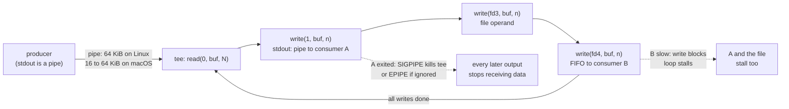

# tee and Fan-Out

> [!summary] Claim
> `tee` is a synchronous, unbuffered broadcaster: one `read` loop that writes every chunk to every output in turn, so all consumers move in lockstep at the speed of the slowest one and share its fate unless SIGPIPE and write-error policy are chosen explicitly.

Part of [Coreutils and the Userland](README.md) in [Shell and Unix Engineering](../README.md).

## TL;DR

- Mechanism: `tee` loops `read(0, buf, N)` then `write()` of the same bytes to stdout and to each file operand, one after another, with no buffering between them (N is 8 KiB for GNU on glibc and for FreeBSD and macOS `tee`, 64 KiB for OpenBSD).
- Rule: in `cmd | tee log`, the pipeline status is `tee`'s, so `cmd` failures vanish unless `set -o pipefail` (POSIX.1-2024 XCU 2.9.2) or `PIPESTATUS` is used.
- Trap: a consumer that exits early (`| head`) makes `tee` die of SIGPIPE on its next write, which also truncates every file it was saving (lab test 6).
- Portability fact: POSIX `tee` has only `-a` and `-i` and treats `-` as a file named `-`; GNU and uutils add `-p` and `--output-error`, and BusyBox treats `-` as stdout (lab tests 3 and 8).
- When not to use it: when consumers have different speeds or failure domains; then write a file and let each consumer follow it, or use a buffered fan-out (a log shipper, a queue, or per-consumer bounded queues in a real language).

## Mental model



The producer fills a pipe, and `tee` drains it one chunk at a time.
For each chunk it makes one `write` per output, in a fixed order (GNU: stdout first, then operands left to right; the BSDs: the reverse), and it does not read the next chunk until every write has returned.
A full pipe or FIFO on any output therefore blocks the loop, which stops reading, which fills the producer's pipe, which blocks the producer: backpressure from the slowest consumer reaches everyone.
A closed reader on any output makes the next write to it raise SIGPIPE, which under the default disposition terminates `tee` and with it every other output's stream; the dashed arrows are the two failure modes this note is about.

## How it works

### The POSIX contract

The specification is short and every word matters `(POSIX.1-2024 XCU tee)`.
`tee` "shall copy standard input to standard output, making a copy in zero or more files", and "shall not buffer output".
The rationale explains that the buffering rule forbids ISO C fully buffered or line-buffered writes, but "does not mean that tee has to do 1-byte reads followed by 1-byte writes"; a chunk read is written out at once.
`-a` appends, and the rationale requires "functionality equivalent to using O_APPEND", not an `lseek` to the end after opening, which historical implementations did.
`-i` ignores SIGINT; otherwise the default action applies to every signal, including SIGPIPE.
A file operand of `-` "shall refer to a file named -; implementations shall not treat it as meaning standard output".
An implementation must handle at least 13 file operands.
Files are created as described in XCU 1.1.1.4, which sets the mode to `S_IRUSR | S_IWUSR | S_IRGRP | S_IWGRP | S_IROTH | S_IWOTH` (0666) minus the umask `(POSIX.1-2024 XCU 1.1.1.4)`.
On errors: "If a write to any successfully opened file operand fails, writes to other successfully opened file operands and standard output shall continue, but the exit status shall be non-zero."
The rationale adds that "Historical implementations ignore write errors. This is explicitly not permitted".
With no operand, `tee` is `cat` for one input; the APPLICATION USAGE section says so.

### The copy loop in each userland

GNU coreutils `tee` (9.12, as of 2026-11) opens every operand with `O_WRONLY | O_CREAT | O_BINARY` plus `O_APPEND` or `O_TRUNC`, before reading a byte `(coreutils src/tee.c, tee_files)`.
Its descriptor array puts stdout at index 0 and the operands after it, and the loop is `read(STDIN_FILENO, buffer, sizeof buffer)` into `char buffer[BUFSIZ]` followed by `write_wait()` to each live descriptor in index order.
`BUFSIZ` is 8192 in glibc `(glibc libio/stdio.h)`, 1024 in musl `(musl include/stdio.h)`, and 1024 in the macOS SDK `_stdio.h`, so the same GNU source makes 1 KiB writes when built against musl or macOS.
`write_wait()` loops until the whole chunk is written, treats a zero-byte return for a non-zero request as `ENOSPC`, and on `EAGAIN` polls the descriptor for `POLLOUT` and retries, which is how GNU `tee` survives a non-blocking output `(coreutils src/iopoll.c, write_wait, wait_for_nonblocking_write)`.
A failed output is removed from the array (`fail_output()` sets its descriptor to -1), so GNU diagnoses each failing output once and stops writing to it; when no output remains the loop ends.
GNU also calls `fadvise(stdin, FADVISE_SEQUENTIAL)`, closes each operand and reports `close()` errors, closes stdin and fails on error, and registers `close_stdout` with `atexit`.

FreeBSD, macOS, and NetBSD `tee` descend from 4.4BSD `tee.c` (`@(#)tee.c 8.1 (Berkeley) 6/6/93` in the macOS and NetBSD files).
They `read` 8 KiB (`BSIZE (8 * 1024)`) and write it to a linked list of outputs that `add()` builds by prepending, so the last operand is written first and stdout last `(FreeBSD usr.bin/tee/tee.c, add, STAILQ_INSERT_HEAD; macOS shell_cmds tee/tee.c, add)`.
On a write error they `warn()` and `break` out of that output's retry loop but keep the output in the list, so the next chunk tries it again: with SIGPIPE ignored and a dead reader, macOS `tee` printed 156 `tee: stdout: Broken pipe` lines for a 1288895-byte stream (measured on the macOS host, 2026-11-15).
FreeBSD and macOS never close the operands before `exit()`, so an error that only `close()` reports (for example a deferred NFS write error) is not seen; OpenBSD and NetBSD close every output and report failures.
FreeBSD restricts each descriptor with Capsicum rights and calls `caph_enter()` after opening the operands, and its man page (dated December 25, 2024) says it may "also write to unix(4) sockets" `(FreeBSD tee(1))`: when `open()` fails with `EOPNOTSUPP`, `tee_open()` retries the path as an `AF_UNIX` stream socket and `connect()`s to it.
OpenBSD reads 64 KiB (`BSIZE (64 * 1024)`), calls `pledge("stdio wpath cpath")` before opening and `pledge("stdio")` after, and also builds its list with `SLIST_INSERT_HEAD` `(OpenBSD usr.bin/tee/tee.c, main)`.

BusyBox `tee` (master, as of 2026-11) uses stdio: it `fopen()`s each operand, calls `setbuf(fp, NULL)` because "tee must not buffer output", and in the default block-I/O build `fwrite()`s each `safe_read()` chunk of `COMMON_BUFSIZE` bytes to every stream, stdout first `(busybox coreutils/tee.c, tee_main)`.
`COMMON_BUFSIZE` is generated at build time: 1024 bytes, or more when the unused tail of the last bss page allows it `(busybox scripts/generate_BUFSIZ.sh, round_down_COMMON_BUFSIZE)`.
It checks no individual write; errors surface only through `die_if_ferror()` on the operands after EOF, and through `fflush_stdout_and_exit()`, whose `fflush(stdout)` on an unbuffered stream has nothing left to flush `(busybox libbb/fflush_stdout_and_exit.c)`.
An operand of exactly `-` is replaced by stdout (`NOT_LONE_DASH`), which contradicts POSIX; the source comments list `-p` and `--output-error` as TODO.

uutils `tee` (main, as of 2026-11) writes stdout first and then the operands, with a 32 KiB `read` buffer on the generic path `(uutils src/uu/tee/src/tee.rs, copy_unbuffered)`.
On Linux and Android it first tries a zero-copy path: `splice()` stdin into an internal pipe of up to `MAX_ROOTLESS_PIPE_SIZE` (1 MiB), `tee()` that pipe into a second pipe for every output but the last, `splice()` the copy out, and finally `splice()` the original to the last output, which consumes it.
The Rust runtime ignores SIGPIPE at startup, so uutils' `#[uucore::main]` macro restores the default disposition unless the parent had it ignored, which keeps `tee` dying on SIGPIPE like the C implementations `(uutils src/uucore_procs/src/lib.rs, main)`.

### Lockstep, backpressure, and memory

Because the loop does not read chunk k+1 until every output has accepted chunk k, `tee` needs only one buffer and never grows; the cost is that throughput is the minimum over consumers.
The pipe or FIFO in front of each consumer is the only slack: 65536 bytes by default on Linux since 2.6.11 `(man7 pipe(7))`, and 16 KiB growing to 64 KiB on macOS (measured in the shell matrix).
Once the slow consumer's pipe is full, `write()` to it blocks, the fast consumers starve, and the producer blocks on its own full pipe.
The lab makes this observable without a clock: a reader that opens a FIFO and sleeps 2 seconds before reading holds up `wc -l` on `tee`'s stdout, so the pipeline cannot finish before the slow reader has started (lab test 9).
moreutils `pee`, which feeds stdin to several commands, blocks the same way; its TODO says "pee should support non-blocking i/o to write to the pipes to allow concurrent processing of the data by the programs" `(moreutils home page)`.
Removing lockstep means adding per-consumer buffering, and then you must decide what happens when a buffer fills: block (lockstep again), drop (lossy), or spill to disk (a log file plus followers).

### Failure semantics: SIGPIPE, EPIPE, and --output-error

A write to a pipe that is "not open for reading by any process" fails with `EPIPE`, and "A SIGPIPE signal shall also be sent to the thread" `(POSIX.1-2024 XSH write)`; with the default disposition `tee` dies before it can write the chunk to the remaining outputs (see [[SIGPIPE-and-EPIPE]]).
In `producer | tee out.log | head -n 1`, `out.log` therefore ends wherever `tee` happened to be: 5136 lines with macOS `tee` and 3498 with GNU 9.12 in one run each of the lab's 200000-line stream (measured on the macOS host, 2026-11-15; the number varies by run, the truncation does not, lab test 6).
Ignoring SIGPIPE turns the signal into an `EPIPE` return, and each implementation then follows its own write-error policy: GNU, uutils, and BusyBox finish the file silently and exit 0; BSD `tee` warns on every remaining chunk and exits 1 (lab test 7).
GNU's silence is deliberate: with no `--output-error`, `fail_output()` reports an error only if `errno != EPIPE`, because the default mode assumes SIGPIPE would have killed it `(coreutils src/tee.c, fail_output)`.
GNU coreutils 8.24 (2015-07-03) added `--output-error[=MODE]` `(coreutils NEWS)`, and `-p` means `--output-error=warn-nopipe` `(coreutils src/tee.c, main, case 'p')`:

| Mode | SIGPIPE | EPIPE on an output | Other write error |
|---|---|---|---|
| (none) | default: tee dies | (only if SIGPIPE was inherited ignored) drop that output silently | diagnose, drop that output, exit 1 at the end |
| `warn` | ignored | diagnose, drop that output, exit 1 at the end | same |
| `warn-nopipe` (`-p`) | ignored | drop that output silently | diagnose, drop, exit 1 at the end |
| `exit` | ignored | diagnose and exit 1 at once | diagnose and exit 1 at once |
| `exit-nopipe` | ignored | drop that output silently | diagnose and exit 1 at once |

Every row comes from `fail_output()` and the `signal(SIGPIPE, SIG_IGN)` call that `main()` makes whenever a mode is set `(coreutils src/tee.c)`; the `warn`, `exit`, and `-p` rows were measured with GNU 9.12 on the macOS host (2026-11-15).
Coreutils 9.2 (2023-03-20) made the `nopipe` modes notice a broken pipe without waiting for input: before each `read`, `iopoll()` polls stdin for `POLLIN` and the first live output for `POLLERR | POLLHUP | POLLNVAL` (asking for `POLLRDBAND`, "needed for illumos, macOS"), so `tee -p` exits as soon as all outputs are broken pipes `(coreutils src/iopoll.c, iopoll_internal)`.
The poll is skipped when stdin is a regular file or block device, which is always readable (`iopoll_input_ok()`).
The same release fixed `tee` on non-blocking outputs, "seen for example with telnet or mpirun piping through tee to a terminal", where it "could truncate data written to such an output and fail"; 9.11 (2026-04-20) then introduced two regressions, an infinite loop after writing all output when a write set `errno` to `EAGAIN`, and short writes treated as errors, both fixed in 9.12 (2026-09-14) `(coreutils NEWS)`.
Historically GNU `tee` ignored SIGPIPE; coreutils 5.3.0 (2005-01-08) made it "exit when it gets a SIGPIPE signal, as POSIX requires", and the same release made `tee -` mean stdout, which 8.24 reverted ten years later "for better conformance to POSIX" `(coreutils NEWS)`.

### Zero-copy fan-out with tee(2) and splice(2)

Linux 2.6.17 added a system call also named `tee()`: `ssize_t tee(int fd_in, int fd_out, size_t size, unsigned int flags)` duplicates up to `size` bytes from one pipe to another, and "It does not consume the data that is duplicated from fd_in", so a following `splice()` can move the original elsewhere `(man7 tee(2))`.
Both descriptors must be pipes, and they must be different pipes (`EINVAL` otherwise).
In the kernel, `do_tee()` calls `link_pipe()`, which for each input `pipe_buffer` takes a page reference with `pipe_buf_get()`, copies the buffer descriptor into the output pipe, and clears `PIPE_BUF_FLAG_CAN_MERGE` because "The page is shared with ipipe: don't append to it" `(linux fs/splice.c, link_pipe)`.
It locks the two pipes in address order to avoid an ABBA deadlock between `tee(A, B)` and `tee(B, A)`, sends SIGPIPE and returns `EPIPE` when the output pipe has no readers, and returns 0 when the input is empty and has no writers.
This is what uutils uses on Linux; it removes the copy into user space, not the lockstep, since every output still has to accept the data before the input is consumed.

### Shell-level fan-out

Process substitution turns a command into a file name, so `tee >(cmd1) >(cmd2) | cmd3` fans one stream to three consumers.
In bash "the process list is run asynchronously, and its input or output appears as a filename", using `/dev/fd` or FIFOs `(bash-5.3 doc/bashref.texi, Process Substitution; bash-5.3 subst.c, process_substitute)`.
The shell does not wait for those processes by default, which is the main hazard (Pitfalls).
bash 4.4 lets a script wait for the most recent process substitution "since it appears as `$!`", in bash 5.0 the `wait` builtin "can now wait for the last process substitution created", and bash 5.1 allows process substitution in POSIX mode `(bash-5.3 CHANGES, bash-4.4-alpha u, bash-5.0-alpha a, bash-5.1-alpha u)`.
In bash 5.3 a bare `wait` covers "the last-executed process substitution, if its process id is the same as `$!`" `(bash-5.3 doc/bashref.texi, wait)`.
`$!` names a substitution only when the current shell made it: in `printf x | tee >(cmd)` bash runs `tee` in a pipeline subshell, so the script's `$!` is left unchanged (measured with Debian bash in the shell matrix and bash 5.3 on the macOS host, 2026-11-15).
zsh 5.9 waits for a `>(...)` itself before running the next command and leaves `$!` unset, while ksh93 (93u+ 2012 and 93u+m 1.0.10) sets `$!` to the substitution's pid, and `wait "$!"` returns 0 (measured, 2026-11-15).
bash 3.2 (macOS `/bin/bash`) rejects `>(...)` in POSIX mode, which is how macOS `/bin/sh` runs, and its `wait $!` after one reports "not a child of this shell" (status 127, measured on the macOS host, 2026-11-15).
zsh and ksh93 support `>(...)`; dash, mksh, posh, and BusyBox ash do not; yash's `>(cmd)` is process redirection, which redirects the command's output instead of expanding to a file name (lab test 12; known divergence measured in the shell matrix).

zsh has a second mechanism, MULTIOS: when a descriptor is redirected for output more than once, "the shell opens the file descriptor as a pipe to a process that copies its input to all the specified outputs, similar to tee", and the option is on by default in native zsh `(zsh manual, Redirection, Multios; Options, MULTIOS <Z>)`.
So `{ echo hi; } >a >b` writes `hi` to both files in native zsh, while every POSIX shell, and zsh in sh emulation, evaluates the redirections "from beginning to end" `(POSIX.1-2024 XCU 2.7)`, truncating `a` and writing only `b` (lab test 11).
The zsh manual warns that for an external command "the multios are spawned after the cat process is forked from the parent shell, so the parent shell does not wait for the multios to finish writing data", and recommends a `{ ... }` group, which waits.

The portable fan-out uses FIFOs: `mkfifo` the channels, start one reader per FIFO in the background, run `tee fifo1 fifo2 >/dev/null`, then `wait` (lab test 10).
Opening a FIFO "blocks until the other end is opened also" `(man7 fifo(7))`, and `tee` opens its operands in order before reading, so every reader must already be running, or `tee` blocks in `open()` and the producer blocks behind it.

### Capturing a whole script

The common bash idiom `exec > >(tee -a "$log") 2>&1` points the script's stdout and stderr at a `tee` process.
That `tee` is asynchronous, so the script can exit while it is still writing, and the last lines land after the next prompt.
Waiting needs two steps in bash 4.4 and later: save `$!`, and close the script's own copies of the pipe first (for example `exec 3>&1 > >(tee log)`, later `exec >&3 3>&-` and the same for stderr), because `tee` sees EOF only when every write end is closed; `wait "$p"` without the close deadlocked bash 5.3 until a 3-second alarm killed it (measured on the macOS host, 2026-11-15).
Merging stderr into the pipe also changes ordering: stderr is unbuffered, while the program's stdout to a pipe is fully buffered by stdio, so the log interleaves differently from a terminal (see [[stdio-Buffering-and-stdbuf]]).

## Numbers and limits

| Quantity | Value | Source |
|---|---|---|
| File operands an implementation must support | at least 13 | POSIX.1-2024 XCU tee, OPERANDS |
| Created file mode | 0666 minus umask | POSIX.1-2024 XCU 1.1.1.4; `MODE_RW_UGO` in GNU, `DEFFILEMODE` in the BSDs |
| GNU read size | `BUFSIZ`: 8192 on glibc, 1024 on musl and macOS | coreutils src/tee.c; glibc libio/stdio.h; musl stdio.h; macOS SDK `_stdio.h` (as of 2026-11) |
| FreeBSD, macOS, NetBSD read size | 8192 | `BSIZE (8 * 1024)` in each tee.c (as of 2026-11) |
| OpenBSD read size | 65536 | `BSIZE (64 * 1024)` (as of 2026-11) |
| uutils read size | 32 KiB generic; up to 1 MiB per `splice()` on Linux | `BUF_SIZE`, `MAX_ROOTLESS_PIPE_SIZE` (main, as of 2026-11) |
| BusyBox read size | `COMMON_BUFSIZE`: 1024 or more, fixed per build | generated by busybox `scripts/generate_BUFSIZ.sh` (as of 2026-11) |
| Linux pipe capacity | 65536 bytes default since 2.6.11; 1 MiB unprivileged maximum via `F_SETPIPE_SZ` | man7 pipe(7) |
| macOS pipe capacity | 16 KiB, growing to 64 KiB | measured in the shell matrix (2026-10) |
| `tee(2)` availability | Linux 2.6.17, glibc 2.5 | man7 tee(2) |
| Lab payload | 200000 lines, 1288895 bytes | computed by the lab's `gen` |
| Truncated `out.log` after `head -n 1` | 5136 lines (macOS `tee`), 3498 (GNU 9.12) | measured once each on the macOS host, 2026-11-15; varies by run |
| BSD diagnostics with SIGPIPE ignored | 156 lines for the 1288895-byte stream (one per remaining 8 KiB chunk) | measured on the macOS host, 2026-11-15 |
| `tee -a f <f` on a 5-byte file | grew to 3811185 bytes (macOS `tee`) and 3860355 bytes (GNU 9.12) in 2 s before an alarm killed it | measured on the macOS host, 2026-11-15 |
| GNU milestones | 5.3.0 (2005-01-08) dies on SIGPIPE; 8.24 (2015-07-03) `--output-error`, `-` is a file; 9.2 (2023-03-20) `iopoll`, non-blocking outputs; 9.12 (2026-09-14) current | coreutils NEWS |

## Portability

The `tee` utility, which depends on the userland, not on the shell:

| Behavior | POSIX | GNU 9.12 | FreeBSD and macOS | OpenBSD | BusyBox 1.37 | uutils (main) |
|---|---|---|---|---|---|---|
| Options | `-a`, `-i` | `-a`, `-i`, `-p`, `--output-error` | `-a`, `-i` | `-a`, `-i` | `-a`, `-i` | `-a`, `-i`, `-p`, `--output-error` |
| `tee -p` | not specified | file completed, exit 0 (lab test 8) | usage error, exit 1 (lab test 8) | usage error (source) | usage error, exit 1 (lab test 8) | as GNU (lab test 8) |
| Operand `-` | a file named `-` | file (lab test 3) | file (lab test 3) | file (source) | stdout (lab test 3) | file (lab test 3) |
| Write order per chunk | unspecified | stdout, then operands in order | last operand first, stdout last | last operand first, stdout last | stdout, then operands in order | stdout, then operands in order |
| Unopenable operand | diagnose, continue, exit >0 | exit 1 (lab test 4) | exit 1 (lab test 4) | exit 1 (source) | exit 1 (lab test 4) | exit 1 (lab test 4) |
| Downstream exits, default SIGPIPE | tee dies | dies, file truncated (lab test 6) | dies, file truncated (lab test 6) | dies (source) | dies (lab test 6) | dies (lab test 6) |
| Downstream exits, SIGPIPE ignored | write fails, others continue | silent, exit 0 (lab test 7) | warns per chunk, exit 1 (lab test 7) | warns per chunk, exit 1 (source) | silent, exit 0 (lab test 7) | silent, exit 0 (lab test 7) |
| Failed output retried on later chunks | not specified | no, dropped | yes | yes | no check per write | no, dropped |
| `close()` errors on operands reported | not specified | yes | no (no close) | yes | via `ferror` only | not checked in tee.rs |
| Non-blocking output (`EAGAIN`) | not specified | poll and retry since 9.2 | warn, chunk lost for that output (source) | warn, chunk lost for that output (source) | not handled (source) | diagnosed, output dropped (source) |
| Unix socket as operand | no | no | FreeBSD yes, macOS no | no | no | no |

Shell-level fan-out, which depends on the shell:

| Construct | POSIX sh | bash 3.2 as macOS `/bin/sh` | bash 3.2 to 5.0 | bash 5.1 and later | zsh native | `zsh --emulate sh` | dash | ksh93 | mksh | yash | posh | BusyBox ash |
|---|---|---|---|---|---|---|---|---|---|---|---|---|
| `tee >(cmd)` | no | syntax error (lab test 12) | yes, not in POSIX mode (CHANGES) | yes, also in POSIX mode (CHANGES) | yes (lab test 12) | yes (lab test 12) | syntax error (lab test 12) | yes (lab test 12) | error (lab test 12) | process redirection (lab test 12) | error (lab test 12) | error (lab test 12) |
| `{ cmd; } >a >b` | last wins, `a` truncated | last wins (lab test 11) | last wins (lab test 11) | last wins (lab test 11) | both get the data (MULTIOS, lab test 11) | last wins (lab test 11) | last wins (lab test 11) | last wins (lab test 11) | last wins (lab test 11) | last wins (lab test 11) | last wins (lab test 11) | last wins (lab test 11) |
| `wait "$!"` for a `>(...)` | n/a | n/a | "not a child" in 3.2 (measured); allowed from 4.4 (CHANGES) | allowed, unless `tee` ran in a pipeline subshell (measured) | `$!` unset, status 127; zsh already waited (measured) | `$!` unset, status 127 (measured) | n/a | `$!` set, `wait` returns 0 (measured) | n/a | n/a | n/a | n/a |
| FIFO fan-out with `mkfifo`, `&`, `wait` | yes `(POSIX.1-2024 XCU mkfifo, 2.9.3.1)` | yes (lab test 10) | yes (lab test 10) | yes (lab test 10) | yes (lab test 10) | yes (lab test 10) | yes (lab test 10) | yes (lab test 10) | yes (lab test 10) | yes (lab test 10) | yes (lab test 10) | yes (lab test 10) |

Cells marked with a lab test were run on the macOS host (bash 3.2 as `sh`, with macOS `tee`); for every other shell and userland they are what the lab asserts, and the shell matrix run of this lab is still pending (as of 2026-11).
The BusyBox 1.37 cells were also checked by hand on Alpine (`-` gives two copies and no file, `-p` is rejected with exit 1, SIGPIPE ignored gives a complete file, no diagnostics, and exit 0, default SIGPIPE gives 141 and a truncated file), and the GNU 9.12 cells on the macOS host; the uutils cells come from `tee.rs` and `uucore_procs` and have not been run.

## Worked example

The [lab](../labs/08-tee-and-fan-out/) runs `fanout.sh MODE DIR`, one mode per behavior above, and `fanout.bats` asserts each mode's output per `tee` implementation; two more tests probe MULTIOS and process substitution directly in the shell under test.
This is the script, verbatim:

```sh
#!/bin/sh
# fanout.sh - probes for tee and fan-out.
# Part of 19-Shell-and-Unix-Engineering/08-Coreutils-and-the-Userland/tee-and-Fan-Out.
# Usage: fanout.sh MODE DIR
#   MODE is copy, append, dash, openfail, clobber, sigpipe, ignored, pflag, lockstep, or fifo.
#   DIR is an existing empty scratch directory; every file the probe makes goes there.
set -u

mode=${1:?usage: fanout.sh MODE DIR}
dir=${2:?usage: fanout.sh MODE DIR}
n=200000

# ksh93u+m joins pipeline stages with socketpair(2) unless the posix option is on;
# with sockets a reader that exits can give the writer ECONNRESET instead of SIGPIPE.
case ${KSH_VERSION-} in
  *93u+m*)
    # shellcheck disable=SC3040 # only reached in ksh93u+m, which has the option
    set -o posix
    ;;
  *) ;;
esac

# gen: print the integers 1..n, one per line (1288895 bytes for n = 200000),
# which is far more than a pipe holds (64 KiB on Linux and macOS).
gen() {
  awk -v n="$n" 'BEGIN { for (i = 1; i <= n; i++) print i }'
}

# lines FILE: print the number of lines in FILE without wc's leading blanks.
lines() {
  awk 'END { print NR }' "$1"
}

# bytes FILE: print the size of FILE in bytes without wc's leading blanks.
bytes() {
  wc -c <"$1" | awk '{ print $1 }'
}

# verdict FILE: say whether FILE holds the whole payload.
verdict() {
  got=$(lines "$1")
  if [ "$got" -eq "$n" ]; then echo complete; else echo truncated; fi
}

# status_word: classify the status that a pipeline stage saved in $dir/status.
status_word() {
  s=$(cat "$dir/status")
  if [ "$s" -gt 128 ]; then echo "killed by a signal"; else echo "exit $s"; fi
}

# report: print whether $dir/f is complete (or absent) and how the tee stage ended.
report() {
  if [ -e "$dir/f" ]; then v=$(verdict "$dir/f"); else v=absent; fi
  w=$(status_word)
  printf 'f: %s\ntee: %s\n' "$v" "$w"
}

case $mode in
  copy)
    # One read, then the same bytes to stdout and to every file operand, in full.
    gen | tee "$dir/a" "$dir/b" >"$dir/out"
    gen >"$dir/ref"
    for f in out a b; do
      if cmp -s "$dir/ref" "$dir/$f"; then echo "$f: identical"; else echo "$f: differs"; fi
    done
    ;;
  append)
    # Without -a, tee opens with O_TRUNC; with -a, with O_APPEND. -i is accepted everywhere.
    printf 'old\n' >"$dir/f"
    printf 'new\n' | tee "$dir/f" >/dev/null
    printf 'more\n' | tee -i -a "$dir/f" >/dev/null
    f=$(tr '\n' ' ' <"$dir/f")
    echo "f: $f"
    ;;
  dash)
    # POSIX: the operand - names a file called -; BusyBox tee treats it as stdout.
    (
      cd "$dir" || exit 1
      printf 'x\n' | tee - >out
      copies=$(lines out)
      echo "stdout copies: $copies"
      if [ -e ./- ]; then echo "file named -: yes"; else echo "file named -: no"; fi
    )
    ;;
  openfail)
    # An operand that cannot be opened is diagnosed, the rest still get the data.
    printf 'a\n' | tee "$dir/missing/x" "$dir/ok" >"$dir/out" 2>"$dir/err"
    echo "status: $?"
    ok=$(cat "$dir/ok")
    out=$(cat "$dir/out")
    diags=$(lines "$dir/err")
    printf 'ok: %s\nstdout: %s\ndiagnostics: %s\n' "$ok" "$out" "$diags"
    ;;
  clobber)
    # tee truncates its operands when it opens them, before it reads one byte.
    printf 'precious\n' >"$dir/f"
    # shellcheck disable=SC2094 # reading and writing the same file is the point
    tee "$dir/f" <"$dir/f" >"$dir/out"
    f=$(bytes "$dir/f")
    out=$(bytes "$dir/out")
    printf 'f: %s bytes\nstdout: %s bytes\n' "$f" "$out"
    ;;
  sigpipe)
    # head exits after one line; tee's next write to stdout raises SIGPIPE,
    # which kills tee before the file operand has the whole stream.
    gen | {
      tee "$dir/f"
      echo "$?" >"$dir/status"
    } | head -n 1 >/dev/null
    report
    ;;
  ignored)
    # SIGPIPE ignored: the write fails with EPIPE instead, and tee keeps feeding the file.
    gen | {
      trap '' PIPE
      tee "$dir/f" 2>"$dir/err"
      echo "$?" >"$dir/status"
    } | head -n 1 >/dev/null
    report
    if [ -s "$dir/err" ]; then echo "diagnostics: some"; else echo "diagnostics: none"; fi
    ;;
  pflag)
    # GNU and uutils -p: ignore SIGPIPE, drop a broken pipe output, keep the rest.
    gen | {
      tee -p "$dir/f" 2>"$dir/err"
      echo "$?" >"$dir/status"
    } | head -n 1 >/dev/null
    report
    ;;
  lockstep)
    # The slow consumer opens the FIFO at once but reads only after 2 s.
    # The payload exceeds the pipe buffer, so tee blocks on the FIFO and the
    # fast consumer (wc) cannot finish before the slow one starts reading.
    mkfifo "$dir/slow"
    {
      /bin/sleep 2
      : >"$dir/started"
      cat >/dev/null
    } <"$dir/slow" &
    gen | tee "$dir/slow" | wc -l >"$dir/count"
    if [ -e "$dir/started" ]; then early=no; else early=yes; fi
    wait
    count=$(awk '{ print $1 }' "$dir/count")
    echo "fast consumer lines: $count"
    echo "fast consumer done before slow one read: $early"
    ;;
  fifo)
    # Portable fan-out: start every reader first, then tee into the FIFOs, then wait.
    mkfifo "$dir/p1" "$dir/p2"
    awk 'END { print NR }' <"$dir/p1" >"$dir/c1" &
    grep -c '0$' <"$dir/p2" >"$dir/c2" &
    gen | tee "$dir/p1" "$dir/p2" >/dev/null
    wait
    c1=$(cat "$dir/c1")
    c2=$(cat "$dir/c2")
    printf 'consumer 1 (lines): %s\nconsumer 2 (lines ending in 0): %s\n' "$c1" "$c2"
    ;;
  *)
    echo "fanout.sh: unknown mode: $mode" >&2
    exit 2
    ;;
esac
```

Run under macOS `/bin/sh` (bash 3.2) with macOS `tee`, one mode at a time, it printed (captured on the macOS host, 2026-11-15):

```text
--- copy
out: identical
a: identical
b: identical
--- append
f: new more 
--- dash
stdout copies: 1
file named -: yes
--- openfail
status: 1
ok: a
stdout: a
diagnostics: 1
--- clobber
f: 0 bytes
stdout: 0 bytes
--- sigpipe
f: truncated
tee: killed by a signal
--- ignored
f: complete
tee: exit 1
diagnostics: some
--- pflag
f: absent
tee: exit 1
--- lockstep
fast consumer lines: 200000
fast consumer done before slow one read: no
--- fifo
consumer 1 (lines): 200000
consumer 2 (lines ending in 0): 20000
```

With GNU or uutils `tee`, `ignored` prints `tee: exit 0` and `diagnostics: none`, and `pflag` prints `f: complete` and `tee: exit 0`.
With BusyBox `tee`, `dash` prints `stdout copies: 2` and `file named -: no`, `ignored` prints `tee: exit 0` and `diagnostics: none`, and `pflag` matches macOS.
These per-implementation lines are what `fanout.bats` asserts; on the macOS host all 12 tests passed (bats, 2026-11-15).

## Pitfalls

> [!warning] The pipeline status is tee's
> Trigger: `make test 2>&1 | tee build.log` under `set -e` without `pipefail`.
> Symptom: the step passes when `make` fails, because a pipeline's status is its last command's `(POSIX.1-2024 XCU 2.9.2)`.
> GitHub Actions runs an unspecified `shell` on Linux and macOS as `bash -e {0}`, while `shell: bash` runs `bash --noprofile --norc -eo pipefail {0}` `(GitHub Actions workflow syntax, as of 2026-11)`, so the same line behaves differently depending on whether `shell: bash` is written out.
> Fix: `set -o pipefail` (POSIX.1-2024; see [[pipefail-and-PIPESTATUS]]), or check `"${PIPESTATUS[0]}"` in bash.

> [!warning] One early reader truncates every copy
> Trigger: `producer | tee full.log | head -n 20`.
> Symptom: `full.log` stops after a few thousand lines, and under `pipefail` the pipeline fails with 141 (lab test 6).
> Fix: decide which output matters; with GNU or uutils use `tee -p full.log`; portably run `tee` with SIGPIPE ignored (`(trap '' PIPE; tee full.log)`, the workaround the coreutils 5.3.0 NEWS gives), accepting BSD's per-chunk warnings and exit 1; or write the file first and read it afterwards.

> [!warning] tee clobbers its own input
> Trigger: `tee f <f`, or `sort f | tee f`.
> Symptom: `tee` opens `f` with `O_TRUNC` before reading, so `tee f <f` leaves 0 bytes (lab test 5), and `sort f | tee f` races `sort`'s read against the truncation.
> With `-a` the opposite happens: `tee -a f <f` keeps reading the bytes it appends and grew a 5-byte file to 3.8 MB in 2 seconds (measured, see Numbers).
> Fix: write to a temporary file and rename it (see [[install-and-Atomic-Deployment]] and [[mktemp]]), or use a tool that reads all input before opening its output.

> [!warning] sudo does not cover the redirection
> Trigger: `sudo echo 'x' >/etc/f`.
> Symptom: "Permission denied", because the unprivileged shell performs the redirection before `sudo` runs; the sudo manual's own example wraps a redirection in `sudo sh -c "... > USAGE"` so that it happens in the privileged shell `(sudo(8), EXAMPLES)`.
> Fix: `printf 'x\n' | sudo tee /etc/f >/dev/null`, with `-a` to append; the `>/dev/null` stops `tee` from echoing secrets to the terminal or a log, and the target must not be a path an attacker can pre-create (Security).

> [!warning] The script exits before its process substitution finishes
> Trigger: `producer | tee >(gzip >out.gz) >/dev/null` followed by a use of `out.gz`, or `exec > >(tee log)`.
> Symptom: truncated or empty artifacts, and log lines printed after the prompt, because the shell runs process substitutions asynchronously and does not wait for them.
> Fix: in bash 4.4 and later save `$!` and `wait` for it after closing every write end the script holds (Capturing a whole script), which works only when the shell itself made the substitution (`exec > >(tee log)`, or `tee >(gzip >out.gz) <in`), not when `tee` is a pipeline stage that bash runs in a subshell; portably use FIFOs and `wait`, which waits for every background reader (lab test 10).

> [!warning] FIFO fan-out deadlocks on open
> Trigger: `mkfifo p; tee p | consumer1; consumer2 <p`.
> Symptom: the pipeline hangs: `tee` blocks in `open("p")` until a reader opens it, and the reader is only started after the pipeline `(man7 fifo(7))`.
> Fix: start every FIFO reader in the background first, then `tee`, then `wait`; never make one consumer wait for another consumer's output, which turns lockstep into a cycle.

> [!warning] The slowest consumer sets the pace
> Trigger: `tee >(slow_upload) | fast_parse`.
> Symptom: `fast_parse` stalls whenever `slow_upload` falls more than a pipe buffer behind (lab test 9).
> Fix: give the slow consumer a file and let it follow the file (`tail -f` or a log shipper), or put a bounded buffer in front of it and decide what happens when it fills.

> [!warning] BusyBox tee - writes to stdout twice
> Trigger: a script that passes `-` as a placeholder file name, or that relies on `tee -` meaning stdout.
> Symptom: on Alpine the data appears twice on stdout and no file is made; on GNU, BSD, and uutils a file named `-` appears (lab test 3).
> Fix: never pass `-` to `tee`; name `/dev/stdout` explicitly if that is the intent, and `./-` if a file is.

> [!warning] Concurrent appenders interleave
> Trigger: two jobs running `... | tee -a shared.log`.
> Symptom: lines split mid-line, because `O_APPEND` makes each `write()` land at the end atomically `(POSIX.1-2024 XSH write)`, but `tee` writes chunks of 1 KiB to 64 KiB that do not end at line boundaries; on NFS, `O_APPEND` itself "may lead to corrupted files ... if more than one process appends data to a file at once" `(man7 open(2))`.
> Fix: one writer per file, or a line-oriented logger; see [[PIPE_BUF-and-Write-Atomicity]] for the pipe case and [[flock]] for serializing writers.

> [!warning] MULTIOS in zsh
> Trigger: a script written for `sh` run by native zsh, with `cmd >a >b`, `cmd >file | grep`, or `: > *`.
> Symptom: native zsh tees into every target (lab test 11), and with MULTIOS "the word after a redirection operator is also subjected to filename generation", so `: > *` "will truncate all files in the current directory" `(zsh manual, Multios)`.
> Fix: run `sh` scripts with `sh` (or `emulate -L sh`), and in zsh scripts use one redirection per descriptor unless the tee is intended; see [[Zsh-Emulation-Modes]].

## Security and robustness

- `tee` opens operands with `O_CREAT` and without `O_EXCL` or `O_NOFOLLOW` in every implementation read for this note, so it follows symbolic links and truncates whatever they point to; `sudo tee /tmp/predictable` is the classic symlink clobber (see [[Temporary-File-Attacks]]).
- New files get mode 0666 minus the umask (XCU 1.1.1.4), so under `umask 022` a log of a command that prints tokens is world readable; set `umask 077` before capturing anything sensitive, and keep secrets out of `set -x` output that a `tee` captures (see [[Secrets-in-argv-env-and-History]]).
- `tee` without `>/dev/null` repeats everything it writes to stdout; in `sudo tee` idioms that is usually a CI log.
- A full disk does not stop `tee` from feeding stdout: GNU diagnoses the file, drops it, keeps streaming, and exits 1, so a script that ignores the status ships a truncated artifact; check it (`pipefail`), and for GNU consider `--output-error=exit` so the pipeline stops at the first failure.
- `-i` exists so that `long_job | tee -i log` survives the Ctrl-C that the terminal sends to the whole foreground process group: the producer dies, `tee` keeps draining what was already written, sees EOF, and the log keeps the last lines.
- FreeBSD and OpenBSD sandbox `tee` after opening the operands (Capsicum `caph_enter()`; `pledge("stdio")`), so a compromised `tee` cannot open new files; FreeBSD's acceptance of Unix socket paths means a path that names a socket sends the data to whoever listens there.
- Because FreeBSD and macOS `tee` never `close()` the operands, a write error reported only at close (NFS, some FUSE file systems) does not change the exit status; verify the artifact (size or checksum, see [[Checksums-and-Integrity]]) when it matters.

## The principal's view

`tee` is the right tool when a human wants to watch a stream while it is saved: one process, one buffer, no daemon, and a contract that has been stable since Version 7 Unix `(FreeBSD tee(1), HISTORY)`.
Its design choices are the decision you inherit: unbuffered and synchronous means bounded memory and ordered output, at the price of lockstep throughput and fate sharing between consumers.
The staff-plus decision is to name the failure policy instead of inheriting it: which output is authoritative, what happens when a reader goes away (SIGPIPE, `-p`, `--output-error`), and whether the pipeline's status reflects the producer (`pipefail`).
In CI, the authoritative copy should be a file written first, with live streaming as a best-effort follower; that removes both the early-reader truncation and the masked-status failure.
When consumers differ in speed or reliability, stop fanning out in the shell: write once to durable storage and let independent readers follow it, or use a log shipper or queue that buffers per consumer and reports drops.
When the fan-out is part of a program, a language with bounded channels and explicit errors (Go, Rust, Python `asyncio`) expresses per-consumer buffering, cancellation, and partial failure that `tee` cannot.
On Linux, `tee(2)` plus `splice(2)` removes user-space copies, but not lockstep; measure before assuming that the copy is the bottleneck (see [[dd-and-Block-IO]] for the read-size side of the same trade-off).

## Interview questions

> [!question] L5: What does `tee` do when it cannot open one of its file operands?
>
> > [!success]- Answer
> > It prints a diagnostic for that operand and keeps going.
> > Standard output and every operand it did open still receive the whole stream.
> > The exit status is non-zero at the end (1 in GNU, BSD, BusyBox, and uutils), as POSIX requires.
> >
> > Follow-up: Which GNU option makes it stop immediately instead?

> [!question] L5: Why does `sudo echo 'x' > /etc/f` fail, and what is the idiom that works?
>
> > [!success]- Answer
> > The redirection is performed by the calling, unprivileged shell before `sudo` starts, so the open of `/etc/f` fails.
> > `printf 'x\n' | sudo tee /etc/f >/dev/null` moves the open into a process running as root.
> > Use `sudo tee -a` to append, and keep `>/dev/null` so the content is not echoed.
> >
> > Follow-up: Why is `sudo tee` on a path in `/tmp` dangerous?

> [!question] L5: Predict the output, on Debian with GNU coreutils and on Alpine with BusyBox, of `cd "$(mktemp -d)" && printf 'a\nb\n' | tee - | wc -l && ls`.
>
> > [!success]- Answer
> > GNU prints `2` and `ls` shows a file named `-`, because POSIX and GNU since 8.24 treat `-` as a file name.
> > BusyBox prints `4` and `ls` shows nothing, because its `tee` replaces a lone `-` with stdout.
> > macOS and uutils behave like GNU here (lab test 3).
> >
> > Follow-up: How would you name stdout explicitly in a portable way?

> [!question] L6: Debug this CI step: it always reports success, even when tests fail.
>
> ```sh
> #!/bin/bash
> set -e
> make test 2>&1 | tee build.log
> echo "tests passed"
> ```
>
> > [!success]- Answer
> > A pipeline's status is the status of its last command, which is `tee`, and `tee` succeeds, so `set -e` never fires.
> > Add `set -o pipefail` so the pipeline fails when `make` fails, or test `"${PIPESTATUS[0]}"`.
> > On GitHub Actions, a step without `shell:` runs `bash -e {0}`; writing `shell: bash` gives `-eo pipefail`.
> > With `pipefail`, a downstream `| head` in the same pipeline would now fail the step with 141, so keep `head` out of it.
> >
> > Follow-up: What does `PIPESTATUS` look like if `make` fails and `tee` succeeds?

> [!question] L6: Why is `full.log` incomplete after `producer | tee full.log | head -n 20`, and how do you fix it?
>
> > [!success]- Answer
> > `head` exits after 20 lines, `tee`'s next write to the pipe raises SIGPIPE, and `tee` dies before it writes the remaining chunks to `full.log`.
> > With GNU or uutils, `tee -p` ignores SIGPIPE, drops only the broken output, and finishes the file.
> > Portably, `(trap '' PIPE; tee full.log)` turns the signal into `EPIPE`; GNU, BusyBox, and uutils then finish silently, while BSD warns per chunk and exits 1.
> >
> > Follow-up: Why does GNU `tee` stay silent about `EPIPE` when SIGPIPE was inherited as ignored?

> [!question] L6: With a fast parser and a slow uploader both reading from `tee`, what throughput does the parser get, and why?
>
> > [!success]- Answer
> > The uploader's rate, once the uploader falls behind by more than its pipe buffer.
> > `tee` writes each chunk to every output before reading the next one, so a blocked `write()` to the uploader's pipe stops the loop, and the parser starves.
> > The only slack is the pipe capacity in front of each consumer, 64 KiB by default on Linux.
> > Decoupling them requires per-consumer buffering, with an explicit policy when that buffer fills.
> >
> > Follow-up: Does `tee(2)` with `splice(2)` remove this coupling?

> [!question] L6: After `exec > >(tee -a run.log) 2>&1` in a bash script, why do the last lines of `run.log` sometimes appear after the prompt, and how do you make the script wait?
>
> > [!success]- Answer
> > The `tee` runs asynchronously, and the shell exits without waiting for it.
> > In bash 4.4 and later, `$!` holds its pid; save it right after the `exec`.
> > Before `wait "$pid"`, the script must close its own stdout and stderr (restore them from a saved descriptor), because `tee` only sees EOF when every write end is closed; otherwise `wait` deadlocks.
> > bash 3.2 cannot wait for a process substitution at all (`not a child of this shell`).
> >
> > Follow-up: Why does stderr output appear out of order relative to stdout in that log?

> [!question] L7+: Explain how `tee(2)` duplicates data between pipes without copying, and what constraints that imposes on a zero-copy `tee(1)`.
>
> > [!success]- Answer
> > `link_pipe()` in `fs/splice.c` takes a reference on each input `pipe_buffer` page and places a copy of the buffer descriptor in the output pipe, leaving the input unconsumed.
> > It clears `PIPE_BUF_FLAG_CAN_MERGE` on the copy so that a later write cannot append into a page that both pipes share.
> > Both ends must be pipes and different pipes, so a zero-copy `tee(1)` first `splice()`s stdin into an internal pipe, `tee()`s it into a second pipe per extra output, and `splice()`s each copy out, as uutils does on Linux.
> > Lockstep remains, because the input is consumed only after every output accepted its copy, and outputs that are not pipes or sockets need the regular `write()` path.
> >
> > Follow-up: Why does `link_pipe()` lock the two pipes in address order?

> [!question] L7+: Design log capture for a fleet build system that must keep a complete log on disk and stream it live to a web UI whose clients come and go.
>
> > [!success]- Answer
> > Make the disk copy authoritative: the build writes to a file (or a local log agent) first, and never through a shell `tee` whose other outputs can kill it.
> > The live stream follows the file with its own reader and its own buffer, so a slow or vanished client affects only itself.
> > If a shell `tee` is unavoidable, use GNU `--output-error=warn-nopipe` (or `-p`) so a closed stream drops only that output, and `pipefail` so the build's status survives the pipe.
> > Rotate and checksum the log after the build ends, and report bytes dropped to followers as a metric.
> >
> > Follow-up: How would you prove that no bytes were lost between the producer and the disk copy?

> [!question] L7+: Two services append through `tee -a` to one log on an NFS mount; what guarantees do you have, and what would you change?
>
> > [!success]- Answer
> > Locally, `O_APPEND` makes each `write()` start at the current end of file with no intervening modification, but `tee` writes chunks that do not align with lines, so records from the two writers can interleave mid-line.
> > On NFS, Linux's `open(2)` page warns that `O_APPEND` may corrupt the file when several processes append at once, because the client has to simulate appending.
> > Use one writer per file, a logging daemon that serializes records, or `flock` around whole-record writes on a local file system.
> >
> > Follow-up: Would writes of at most `PIPE_BUF` bytes help here?

## Related

Prerequisites: [[dd-and-Block-IO]]

Next: [[install-and-Atomic-Deployment]]

See also: [[SIGPIPE-and-EPIPE]], [[Pipes-and-FIFOs]], [[PIPE_BUF-and-Write-Atomicity]], [[pipefail-and-PIPESTATUS]], [[Process-Substitution]], [[Pipelines-and-And-Or-Lists]], [[Redirection-Order-and-Semantics]], [[stdio-Buffering-and-stdbuf]], [[Logging-from-Scripts]], [[Zsh-Emulation-Modes]], [[Four-Userlands-GNU-BSD-BusyBox-uutils]], [[Userland-Portability-Traps]], [[Temporary-File-Attacks]], [[sudo-and-sudoers]], [[flock]], [[mktemp]]

## Further reading

- [POSIX.1-2024 XCU tee](https://pubs.opengroup.org/onlinepubs/9799919799/utilities/tee.html) - the whole contract, plus a rationale on buffering, historical write-error handling, and `O_APPEND`.
- [POSIX.1-2024 XCU chapter 2](https://pubs.opengroup.org/onlinepubs/9799919799/utilities/V3_chap02.html) - 2.7 for redirection order and 2.9.2 for pipeline status and `pipefail`.
- [GNU coreutils src/tee.c](https://github.com/coreutils/coreutils/blob/master/src/tee.c) - `tee_files()` and `fail_output()` define the loop and every `--output-error` mode.
- [GNU coreutils src/iopoll.c](https://github.com/coreutils/coreutils/blob/master/src/iopoll.c) - broken-pipe detection by `poll()` and the non-blocking write retry.
- [GNU coreutils NEWS](https://github.com/coreutils/coreutils/blob/master/NEWS) - dated history of SIGPIPE handling, `-`, `-p`, and the 9.11 regressions.
- [FreeBSD usr.bin/tee/tee.c](https://cgit.freebsd.org/src/plain/usr.bin/tee/tee.c) - the BSD loop, reverse write order, Capsicum, and Unix socket operands.
- [BusyBox coreutils/tee.c](https://github.com/mirror/busybox/blob/master/coreutils/tee.c) - the stdio-based applet and its non-POSIX `-`.
- [uutils src/uu/tee/src/tee.rs](https://github.com/uutils/coreutils/blob/main/src/uu/tee/src/tee.rs) - a `splice()` and `tee()` based zero-copy implementation.
- [Linux fs/splice.c](https://github.com/torvalds/linux/blob/master/fs/splice.c) - `link_pipe()` and `do_tee()`, the kernel side of `tee(2)`.
- [man7 tee(2)](https://man7.org/linux/man-pages/man2/tee.2.html) - the system call's contract and an example `tee(1)` built on it.
- [zsh manual: Redirection](https://zsh.sourceforge.io/Doc/Release/Redirection.html) - MULTIOS semantics and the not-waited-for caveat.
- [man7 fifo(7)](https://man7.org/linux/man-pages/man7/fifo.7.html) - why opening a FIFO blocks until the other end opens.
