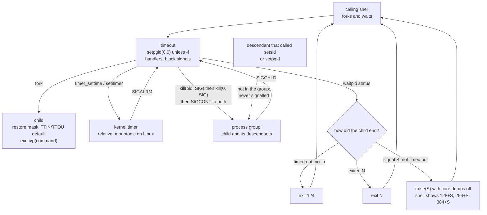

# timeout

> [!summary] Claim
> `timeout` is a supervisor process, not a timer: it forks the command, arms a timer, and on expiry signals a process group (or, on FreeBSD, every descendant it reaps), so its guarantees are exactly as strong as signal delivery, process-group membership, and the exit-status encoding of the shell that reads its result.

Part of [Coreutils and the Userland](README.md) in [Shell and Unix Engineering](../README.md).

## TL;DR

Mechanism: `timeout` forks, execs the command in the child, arms `timer_settime` (or `setitimer`), and on `SIGALRM` sends `SIGTERM` (or `-s SIG`) plus `SIGCONT` to the child and, unless `-f`, to the whole process group it leads.
Rule: test `$?` against 124 (timed out), 125 (timeout failed), 126 (cannot invoke), 127 (not found), and a signal death of the command, which POSIX.1-2024 makes `timeout` reproduce by killing itself with the same signal.
Trap: with GNU, macOS, uutils, and BusyBox, `-s KILL` and the `-k` backstop also kill `timeout` itself (it is in the group it signals), so the result is a signal death (137 in bash, 265 in ksh93, 393 in yash), never 124.
Portability: POSIX added `timeout` only in Issue 8 (2024); GNU, macOS and FreeBSD, BusyBox, and uutils disagree on `-f`, `-p`, `0`, exit 125, descendants, and stopped children, and BusyBox never exits 124 at all.
Do not use it when the work must not be interrupted mid-write, when descendants daemonize or call `setsid`, or when you need a hard containment boundary: use in-process deadlines, a cgroup, or a reaper instead.

## Mental model



The shell forks `timeout`, which makes itself a process group leader (unless `-f`), installs its handlers, and blocks them so that no signal can be acted on before it knows the child's PID.
It then forks the child, which restores the original signal mask and execs the command, so the command and everything it forks without changing groups share `timeout`'s process group.
The kernel timer delivers `SIGALRM` to `timeout`, whose handler sends the termination signal to the child's PID and then to the group (PID argument 0), ignoring that signal in itself for the duration of the send, and follows with `SIGCONT` so that a stopped process can act on it.
A descendant that moved itself to another group or session never sees the signal: the dashed edge is the whole reason the reaper alternative exists.
`SIGCHLD` wakes `timeout` from `sigsuspend`, `waitpid` returns the child's status, and `timeout` converts it: 124 if it timed out, the command's exit code if it exited, and otherwise a death by the same signal, which each shell then encodes in `$?` its own way.

## How it works

### The contract: POSIX.1-2024 XCU timeout

`timeout` is new in Issue 8: its CHANGE HISTORY reads "First released in Issue 8" (POSIX.1-2024 XCU timeout).
The synopsis is `timeout [-fp] [-k time] [-s signal_name] duration utility [argument...]`; long options, `-v`, and numeric signals are extensions.
The utility runs "in a child process", and after a non-zero `duration` the signal from `-s` (default `SIGTERM`) is sent.
Without `-f` the standard lets an implementation choose one of two ways to reach descendants: become a process group leader and signal the group, or arrange that orphaned descendants are reparented to `timeout` and signal every descendant.
If the child's wait status shows it stopped, a `SIGCONT` "shall also be sent in the same manner as the first signal"; otherwise a `SIGCONT` "may be sent".
`-k time` sends `SIGKILL` the same way if the child is still alive `time` after the first signal, and a signal forwarded to the child counts as that first signal.
`-s` takes a `<signal.h>` name "in a case-independent fashion, without the SIG prefix", and the APPLICATION USAGE notes it need not accept `0`.
`duration` is "a decimal number with an optional decimal fraction and an optional suffix" `s`, `m`, `h`, or `d`, and zero disables the limit while signal propagation still happens; the APPLICATION USAGE adds "Regardless of locale, the `<period>` character ... is the decimal-point character recognized in the duration operand".
Naming a special built-in as the utility is undefined; ordinary built-ins and functions are not reachable at all, because `timeout` executes a file.

ASYNCHRONOUS EVENTS carries most of the design.
`timeout` "shall ignore SIGTTIN and SIGTTOU", so a background command reading the terminal stops but `timeout` keeps timing.
Any signal "whose default action is to terminate the process", other than `SIGKILL` and `SIGSTOP`, delivered to `timeout` must be sent on to the same processes the timeout signal would reach, and `SIGALRM` may instead count as the limit being reached.
When it signals its own group, it "shall briefly change the disposition of that signal to ignored while it sends the signal, so that it does not receive the signal itself".
Every disposition the utility inherits must equal what `timeout` inherited, except the timeout signal, which must arrive at its default so that the timeout can work.

EXIT STATUS: 124 if the limit was reached and `-p` was not given; if `-k` fired, either 124 or the `-p` behavior (unspecified); otherwise the utility's exit status, or, if the utility was killed by a signal, `timeout` "shall terminate itself with the same signal while ensuring that a core image is not created"; 125 for any other error, 126 found but not executable, 127 not found.
The RATIONALE explains the re-raise: some historical versions exited 128+N, which misleads callers because "the KornShell sets `$?` to 256+signal_number" (POSIX.1-2024 XCU timeout, RATIONALE).
It also explains the disposition rule with a concrete failure: older versions reset caught signals, so "if timeout was used in a script that was run with nohup, the utility executed by timeout would unexpectedly not be protected from SIGHUP".
The 126 and 127 codes follow KornShell practice shared with `command`, `env`, `nice`, `nohup`, `time`, and `xargs`, and the same section concludes: "A timeout exit status below 124 can only result from passing through the exit status of the executed utility" (POSIX.1-2024 XCU timeout, APPLICATION USAGE).

### GNU coreutils: the reference implementation, call by call

Read `main()` in `src/timeout.c` of coreutils 9.12 (released 2026-09-14) top to bottom:

1. `getopt_long` with `"+fk:ps:v"`: the leading `+` stops at the first operand, so `timeout 5 ls -l` never treats `-l` as its own option.
2. `parse_duration` uses `cl_strtod`, which accepts the current locale's decimal point as well as the C locale's, then `dtimespec_bound` and `apply_time_suffix` (multipliers 1, 60, 3600, 86400); a negative value, trailing junk, or a two-letter suffix is "invalid time interval" and exit 125.
3. Unless `-f`, `setpgid (0, 0)`, with the comment that putting only the child in a new group "would need to worry about foreground and background groups and propagating signals between them".
4. `install_cleanup` installs the `cleanup` handler for every signal in `term-sig.h` (`SIGALRM`, `SIGINT`, `SIGQUIT`, `SIGHUP`, `SIGTERM`, `SIGPIPE`, `SIGUSR1`, `SIGUSR2`, the synchronous faults, `SIGXCPU`, `SIGXFSZ`, and others) plus every real-time signal, but `sig_needs_handling` skips any signal that arrived ignored, except `SIGALRM` and the timeout signal.
5. `SIGTTIN` and `SIGTTOU` are set to `SIG_IGN`, a no-op `SIGCHLD` handler is installed so that `sigsuspend` wakes, and `SIGALRM` and `SIGCHLD` are unblocked in case the parent passed them blocked.
6. `block_cleanup_and_chld` blocks all of those signals so that `monitored_pid` is set before any handler can run.
7. `fork` (the source explains why not `posix_spawn`: a spawn failure would be indistinguishable from the command exiting 127, so 126 versus 127 would be lost).
8. In the child: `prctl (PR_SET_PDEATHSIG, term_signal)` where available, then `if (getppid () != timeout_pid) return EXIT_CANCELED;` so a child whose parent already died does not run, then the original mask is restored, `SIGTTIN` and `SIGTTOU` go back to `SIG_DFL` ("exec doesn't reset SIG_IGN -> SIG_DFL"), and `execvp`; failure exits 127 for `ENOENT` and 126 otherwise.
9. In the parent: `settimeout`, then `while ((wait_result = waitpid (monitored_pid, &status, WNOHANG)) == 0) sigsuspend (&orig_set);`, so handlers run only inside `sigsuspend` and never after the child has been reaped (which would risk signalling a recycled PID).

`settimeout` uses `timer_create (CLOCK_REALTIME, NULL, &timerid)` with `timer_settime` ("potentially nanosecond resolution") where the platform has it, and otherwise `setitimer (ITIMER_REAL)` ("more portable (to Darwin for example), but only provides microsecond resolution"); that choice is made at build time (`#if HAVE_TIMER_SETTIME`, `#elif HAVE_SETITIMER`), and only if the chosen call fails at run time does it fall back to `alarm`, rounding up to whole seconds (GNU 9.12 `settimeout`).
On Linux a relative `CLOCK_REALTIME` timer is silently converted: `__hrtimer_setup` in `kernel/time/hrtimer.c` contains "POSIX magic: Relative CLOCK_REALTIME timers are not affected by clock modifications, so they needs to become CLOCK_MONOTONIC", and `CLOCK_MONOTONIC` "does not measure the time while a system is suspended" (timer_create(2)), so a laptop suspend pauses the deadline.

`cleanup (int sig)` runs on `SIGALRM` or any forwarded signal.
On `SIGALRM` it sets `timed_out = 1` and replaces `sig` with the timeout signal.
It then calls `send_sig (monitored_pid, sig)` (in case the child became a group leader), and without `-f` `send_sig (0, sig)` and, unless the signal is `SIGKILL` or `SIGCONT`, `SIGCONT` to the PID and to the group.
`send_sig` with target 0 first sets the signal to `SIG_IGN` in `timeout` itself, which is the "briefly ignore" rule; `SIGKILL` cannot be ignored, which is why `-s KILL` kills `timeout` too, as the file header admits: "If user specifies the KILL (9) signal is to be sent on timeout, the monitor is killed and so exits with 128+9 rather than 124."
With `-k`, the handler re-arms the timer with `term_signal = SIGKILL` and zeroes `kill_after` so that later signals do not restart it.
If a signal arrives before `fork` or before the child has execed (`monitored_pid == 0`), `cleanup` simply `_exit (128 + sig)`.

After `waitpid`, an exit code passes through; a signal death that was not a timeout turns off core dumps (`prctl (PR_SET_DUMPABLE, 0)` on Linux, else `setrlimit (RLIMIT_CORE, 0)`), restores `SIG_DFL`, unblocks, and `raise`s the same signal; a `SIGKILL` after a timeout sets `preserve_status` so that `-f -k` yields 137 instead of 124; and otherwise a timeout yields 124, while `-p` yields `128 + sig` as an ordinary exit code.
That last detail is a real divergence: GNU `-p` reports a timed-out `SIGTERM` as the exit code 143, which ksh93 also shows as 143, while BSD `-p` dies of the signal, which ksh93 shows as 271 (measured by the lab, both implementations under `/bin/ksh`).

### History of the GNU behavior

The NEWS file is the incident log of this utility, and most entries are bugs in exactly the races described above:

| Release (date) | Change recorded in coreutils NEWS |
| --- | --- |
| 7.0 (2008-10-05) | `timeout` added |
| 8.5 (2010-04-23) | `--kill-after` |
| 8.13 (2011-09-08) | `--foreground`, sub-second timeouts, signals reach commands that create their own group |
| 8.21 (2013-02-14) | `--preserve-status`; an inherited blocked `SIGALRM` no longer disables the timeout |
| 8.24 (2015-07-03) | `--foreground` stops sending `SIGCONT` (it broke GDB) |
| 8.27 (2017-03-08) | race that could signal a reused PID fixed |
| 8.29 (2017-12-27) | `--verbose`; a `SIGCHLD` missed when inherited blocked no longer makes `timeout` wait out the full limit |
| 8.31 (2019-03-10) | durations accept the current locale's decimal point |
| 9.0 (2021-09-24) | sub-second timeouts on macOS |
| 9.1 (2022-04-15) | `--foreground --kill-after` exits 137 when `SIGKILL` was sent |
| 9.5 (2024-03-28) | two narrow races around `fork` fixed |
| 9.6 (2025-01-17) | POSIX short options `-f` and `-p` |
| 9.7 (2025-04-09) | infinitesimal durations such as `1e-5000` no longer mean "never" |
| 9.10 (2026-02-04) | all terminating signals forwarded; ignored signals left ignored; Linux child gets `PR_SET_PDEATHSIG` |
| 9.11 (2026-04-20) | 9.10 regression fixed: `timeout` "no longer exits abruptly when its parent is the init process", as in a container entrypoint; subreapers such as `systemd --user` detected |

Changes on master after 9.12 (unreleased as of 2026-11) add `PTRACE_TRACEME` handling and fix `--signal=ALRM -k` and a `--verbose` hang on a blocked standard error.

### Reaching descendants: process group versus reaper

GNU, uutils, and macOS use the process-group method, so a descendant that calls `setsid` or `setpgid` escapes; the lab shows a `setsid` grandchild still running after GNU and macOS `timeout` exited 124.
FreeBSD's 2025 rewrite (Aaron LI, committed 2025-04-16) uses the reaper method: `procctl (P_PID, getpid (), PROC_REAP_ACQUIRE, NULL)` makes `timeout` the reaper of all future descendants, and `send_sig` uses `PROC_REAP_KILL`, which signals every descendant regardless of group (FreeBSD `bin/timeout/timeout.c`, `send_sig`; procctl(2)).
Because `PROC_REAP_KILL` signals descendants and not the reaper, FreeBSD `timeout` survives its own `SIGKILL` fan-out and reports 124 for `-s KILL` and `-k`, one of the two outcomes POSIX allows.
The FreeBSD loop also reaps orphaned grandchildren with `waitid (P_ALL, -1, &si, WEXITED | WNOHANG)` and leaves only when the child is done and `PROC_REAP_STATUS` reports `rs_children == 0`, so FreeBSD `timeout` waits for orphaned background descendants, not just the child.
macOS has no `procctl`, and its timeout(1) page says it "makes itself the leader of a process group" and that "a descendant that puts itself into another process group, for example by calling setsid(2), is not signalled".
Linux has `PR_SET_CHILD_SUBREAPER`, which GNU only mentions to explain its `getppid` check; it does not use it to reach descendants.

### Who signals whom when timeout itself dies

If `timeout` is killed with `SIGKILL` it cannot forward anything.
On Linux, GNU 9.10 and later set `PR_SET_PDEATHSIG` in the child, so the kernel sends the timeout signal to the command when its parent thread exits; uutils does the same in `prepare` (`set_parent_process_death_signal`).
That protection is cleared when the command execs a set-user-ID, set-group-ID, or capability-bearing binary (PR_SET_PDEATHSIG(2const)), so `timeout 60 sudo ...` is not covered.
On macOS there is no such call: an ad hoc probe for this note killed GNU `timeout` with `SIGKILL` and the command kept running until it finished on its own.

### Terminal interaction and `--foreground`

`setpgid (0, 0)` is harmless when an interactive shell has already placed `timeout` in its own foreground job, but from a script it moves the command into a new, background process group.
Then terminal reads raise `SIGTTIN` and stop the command (which is why `timeout` ignores `SIGTTIN` itself), and terminal-generated `SIGINT` goes to the script's foreground group, not to the command's new group.
GNU documents `-f` for exactly these two cases: the command "is interactive and needs to read from the terminal" and "the user wants to support sending signals directly to command from the terminal (like Ctrl-C for example)", at the price that "any children of command will not be timed out" (coreutils manual, timeout invocation).
The GNU source header also records a known gap: after `fg` on a stopped `timeout 10 dd &`, "the command will remain in the stop state as the shell doesn't send a SIGCONT because the timeout process (group leader) is already running".

### BusyBox: an inverted design

BusyBox 1.37.0 `coreutils/timeout.c` does not supervise a child at all.
It `vfork`s, and the child calls `bb_daemonize_or_rexec (0, argv)`, which forks again, `setsid`s, and points descriptors 0, 1, and 2 at `/dev/null`; that grandchild is the watcher.
The original process waits for the intermediate child and then `BB_EXECVP_or_die`s the command in place, so the command keeps the PID the shell is waiting for (the comment cites `tcpsvd ... timeout service_prog`, where the service should stay a child of `tcpsvd`).
`timeout_wait` sleeps one second at a time (`sleep1`), checking `kill (pid, 0)`, with the comment "Just sleep(HUGE_NUM); kill(parent) may kill wrong process!", then sends the signal to that one PID, and `SIGKILL` after `-k`.
Consequences, all asserted by the lab for BusyBox: no exit 124 (the shell sees the command's own signal death), no process-group fan-out, no `SIGCONT`, no `-f` or `-p` (usage error, exit 1), and `0` means "signal immediately", because `timeout_wait` sleeps zero seconds and then decrements past zero.
The option syntax changed in 1.30.0: 1.29.0 parsed `"+s:t:+"` (`timeout -t SECS`), 1.30.0 parses `"+s:"` with a positional duration (commit c9720a761e, "timeout: fix arguments to match coreutils"); `-k` arrived in 1.35.0 (commit 7d49fedc86, 2021-10-09) and fractional seconds in commit e4b5ccd13b (2024-04-08, "timeout: allow fractional seconds in timeout values"), present in the 1.37.0 tarball; an earlier commit, 4c20d9f2b0 (2018-08-03), had already extended fractional duration parsing to `timeout` (BusyBox commit history for `coreutils/timeout.c`).

### uutils

uutils (main branch as of 2026-11; latest release 0.12.0 of 2026-09-17) follows GNU's shape in Rust: `setpgid` unless `--foreground`, `PR_SET_PDEATHSIG` on Linux, `SIGTTIN` and `SIGTTOU` reset in the child, and signals blocked and collected with `sigwait`.
Because the Rust runtime ignores `SIGPIPE`, `prepare` restores `SIG_IGN` for `SIGPIPE` in the child only if it was ignored when `timeout` started, which is the POSIX disposition rule written out by hand (`platform/unix.rs`, `prepare`).
On a signal delivered to `timeout` itself, `timeout.rs` forwards it and returns `ExitStatus::SignalSent`, an exit code of 128+N, rather than re-raising it as POSIX asks; a command that dies of a signal on its own is re-raised by `preserve_signal_info`, which first disables core dumps (read from `timeout.rs` and `platform/unix.rs` on main as of 2026-11; no uutils binary was run for this note).

## Numbers and limits

| Quantity | Value | Source |
| --- | --- | --- |
| Exit for a time-out without `-p` | 124 | POSIX.1-2024 XCU timeout, EXIT STATUS |
| `timeout` error, cannot invoke, not found | 125, 126, 127 | POSIX.1-2024 XCU timeout; lab test "a missing command gives 127..." |
| Usage error (missing operands) on macOS and FreeBSD | 1, not 125 | FreeBSD `usage()` calls `exit(EXIT_FAILURE)`; measured on macOS 27.3 |
| Invalid duration in BusyBox 1.37.0 | 1 | lab assertion (predicted from `bb_show_usage`) |
| `-s KILL` or `-k` without `-f`, as seen by bash, ksh93, yash | 137, 265, 393 (FreeBSD: 124) | lab tests; shell offsets measured in the shell matrix; FreeBSD `send_sig` |
| Suffix multipliers | s=1, m=60, h=3600, d=86400 | POSIX.1-2024 XCU timeout; GNU `apply_time_suffix` |
| GNU timer resolution | ns (`timer_settime`), us (`setitimer`), s (`alarm`) | GNU 9.12 `settimeout` comments |
| FreeBSD maximum duration with a suffix | below 100000000 s (about 3.17 years) | FreeBSD `parse_duration`; measured on macOS: `1e8s` gives 125, `99999999s` runs |
| macOS `timeout 1e9 true` (no suffix) | exit 1, command never runs ("setitimer(): Invalid argument", "eof from control pipe") | measured 2026-11-15, macOS 27.3 |
| GNU 9.12 on macOS, `timeout 1e9 true` | warns "setitimer: Invalid argument", falls back to `alarm`, runs | measured 2026-11-15 |
| `timeout 1e-5000 /bin/sleep 3` | GNU 9.12: 124 at once; macOS: 0 after 3 s (underflow to 0 = no limit) | measured 2026-11-15 |
| BusyBox watcher polling interval | 1 s (`sleep1`), so the watcher can outlive the command by up to 1 s | BusyBox 1.37.0 `timeout_wait` |
| Signals GNU forwards | every `term-sig.h` signal and `SIGRTMIN`..`SIGRTMAX`, unless inherited ignored | GNU 9.12 `install_cleanup` |
| `USR1` death as seen by bash on macOS | 158 (128 + 30; `SIGUSR1` is 30 on macOS, 10 on Linux) | measured ad hoc 2026-11-15 |

## Portability

How the shell reports `timeout`'s result (the shell only reads the wait status; `timeout` is always an external utility):

| Shell | `timeout` killed by signal N shows as | `timeout 1 f` for a function `f` | Note |
| --- | --- | --- | --- |
| POSIX sh | greater than 128, signal identified in an implementation-defined manner | 127 (execs a file) | POSIX.1-2024 XCU 2.8.2 |
| bash 3.2 (macOS `/bin/sh`), bash 5.x | 128+N | 127 | lab under `/bin/sh` (bash 3.2); bash 5.x in the shell matrix |
| zsh native, `zsh --emulate sh` | 128+N | 127 | native zsh rejects `status=...` (read-only), measured with zsh 5.9.2 |
| dash, BusyBox ash, mksh, posh | 128+N | 127 | shell matrix |
| ksh93 (u+ 2012 and u+m) | 256+N | 127 | lab under `/bin/ksh`; POSIX RATIONALE |
| yash | 384+N | 127 | shell matrix |

The implementations:

| Behavior | GNU 9.12 | macOS 27.3 (`shell_cmds-336.40.1`) | FreeBSD `bin/timeout` (2025 rewrite) | BusyBox 1.37.0 | uutils main |
| --- | --- | --- | --- | --- | --- |
| Descendant reach | process group | process group | reaper (`PROC_REAP_KILL`) | the one PID | process group |
| `setsid` escapee survives | yes (lab) | yes (lab) | no (source) | yes (lab) | yes (source) |
| Time-out exit | 124 (lab) | 124 (lab) | 124 (source) | signal death (source, lab) | 124 (source) |
| `0` | no limit (lab) | no limit (lab) | no limit (source) | signal at once (source, lab) | no limit (source: uucore `wait_or_timeout` "Zero disables the timer") |
| `-s KILL` without `-f` | `timeout` dies of `SIGKILL` (lab) | `timeout` dies of `SIGKILL` (lab) | 124, reaper not signalled (source) | command dies of `SIGKILL` (source, lab) | `timeout` dies of `SIGKILL` (source) |
| `-f -s KILL` | exit 137 (lab) | 124 (lab) | 124 (source) | usage error 1 (source, lab) | exit 137 (source) |
| `-p` after a `SIGTERM` time-out | exit 143 (lab) | dies of `SIGTERM` (lab) | dies of `SIGTERM` (source) | usage error 1 (source, lab) | exit 143 (source) |
| Stopped command at the limit | `SIGCONT` sent, 124 (lab) | exits 1 at the stop (lab) | `SIGCONT` sent (source) | no `SIGCONT`, `-k` `SIGKILL` (source, lab) | `SIGCONT` sent without `-f` (source) |
| Inherited ignored `SIGHUP` kept | yes since 9.10; no before (lab) | yes (lab) | yes, handlers installed after `fork` (source) | yes, no handlers (source, lab) | yes (source: `prepare` installs only a `SIGCHLD` handler; other signals are blocked for `sigwait`, which leaves dispositions alone) |
| Invalid duration | 125 (lab) | 125 (lab) | 125 (source) | 1 (source, lab) | 125 (source) |
| `-s 0` | accepted (measured) | "invalid signal", 125 (measured) | "invalid signal", 125 (source: `str2sig` accepts numbers from 1) | accepted (source: `get_signum` allows 0 "for shells") | accepted (source: `signal_by_name_or_value("0")` returns `Some(0)`, pinned by a uucore unit test) |
| Locale decimal (`0,5`) | accepted in a comma locale (NEWS 8.31) | rejected (measured, C locale) | rejected (source: `strtod`, then suffix check) | rejected (source: `strspn` of digits and `.`) | rejected (source: uucore `parse_digits` accepts only `.`, and trailing text is an invalid interval) |
| Parent-death protection | Linux only, 9.10+ | none (measured) | reaper keeps descendants | not applicable (exec in place) | Linux only |

"source, lab" marks a cell the lab asserts from the implementation's source but that only the integrator's matrix runs (BusyBox on Alpine); FreeBSD and uutils cells come from source alone.
`timeout` is absent from POSIX before Issue 8, so on older systems check `command -v timeout` before relying on it, and do not assume a GNU `gtimeout` name outside Homebrew.

## Worked example

The [lab](../labs/08-timeout/) runs every claim above under each shell and each implementation; its `deadline.sh` is the wrapper you would actually ship, because it turns `timeout`'s overloaded status into a word and decodes all three signal numberings.

```sh
#!/bin/sh
# deadline.sh: run a command under timeout(1) with a KILL backstop and say how it ended.
# Usage: deadline.sh SECONDS COMMAND [ARG...]
# Prints one line: ok, exit N, timed out, timeout failed, cannot invoke, not found, or signal N.
# Exits 0 for ok and 1 otherwise. TIMEOUT names the timeout binary (default: timeout on PATH).
T=${TIMEOUT:-timeout}
if [ "$#" -lt 2 ]; then
  echo 'usage: deadline.sh SECONDS COMMAND [ARG...]' >&2
  exit 2
fi
secs=$1
shift
# -k 2: if the command ignores the first signal, SIGKILL follows two seconds later.
"$T" -k 2 "$secs" "$@"
rc=$? # not "status": that name is read-only in zsh
case $rc in
  0) echo ok ;;
  124) echo 'timed out' ;;
  125) echo 'timeout failed' ;;
  126) echo 'cannot invoke' ;;
  127) echo 'not found' ;;
  *)
    # A shell reports death by signal N as 128+N, but ksh93 uses 256+N and yash 384+N.
    if [ "$rc" -gt 384 ]; then
      echo "signal $((rc - 384))"
    elif [ "$rc" -gt 256 ]; then
      echo "signal $((rc - 256))"
    elif [ "$rc" -gt 128 ]; then
      echo "signal $((rc - 128))"
    else
      echo "exit $rc"
    fi
    ;;
esac
[ "$rc" -eq 0 ]
```

Captured on the macOS host with GNU coreutils 9.12 under `/bin/sh` (bash 3.2) and again under `/bin/ksh` (ksh93u+ 2012), with standard error discarded; both shells print the same four lines:

```console
$ sh deadline.sh 5 /bin/sh -c 'exit 3' 2>/dev/null
exit 3
$ sh deadline.sh 1 /bin/sleep 5 2>/dev/null
timed out
$ sh deadline.sh 5 /nonexistent/cmd 2>/dev/null
not found
$ sh deadline.sh 1 /bin/sh -c 'trap "" TERM; exec /bin/sleep 5' 2>/dev/null
signal 9
```

The last case is the instructive one: the command ignores `SIGTERM` (an ignored disposition survives `exec`, POSIX.1-2024 XSH exec), so after two more seconds `-k` sends `SIGKILL` to the group, `timeout` dies with it, and the shell reports 137 under bash but 265 under ksh93, which the decoder maps back to `signal 9` in both.
With BusyBox `timeout` the second line reads `signal 15`, because the shell is waiting on the command itself, and the lab asserts that per implementation.
The lab's other tests are the portability table: each row above that says "lab" is one `@test` with a `case` arm per implementation and the shell's signal offset computed by `sig`.

## Pitfalls

> [!warning] `-s KILL` and `-k` never produce 124 (except on FreeBSD)
> Trigger: `timeout -s KILL 30 job` or `timeout -k 5 30 job` without `-f`, then `if [ $? -eq 124 ]`.
> Symptom: the time-out branch never runs; bash sees 137, ksh93 265, yash 393, and the shell may print "Killed"; FreeBSD's reaper version alone returns 124.
> Fix: treat any signal death after a deadline as a time-out (see `deadline.sh`), or use GNU `-f`, where `SIGKILL` after a time-out becomes the plain exit code 137 (GNU 9.1 and later).

> [!warning] A shell function, alias, or builtin cannot be timed
> Trigger: `timeout 10 my_func` or `timeout 10 cd /slow/nfs`.
> Symptom: status 127 ("No such file or directory"), measured in every shell the lab runs.
> Fix: run a shell: `timeout 10 sh -c 'my_cmd "$1"' sh "$arg"`, passing data as arguments, never by interpolating it into the `-c` string.

> [!warning] 124 is ambiguous and `-p` makes 143 ambiguous
> Trigger: the command itself exits 124, or GNU `-p` reports a timed-out `SIGTERM` as the exit code 143.
> Symptom: a real failure reads as a time-out, or a time-out reads as a signal; GNU `-p` gives 143 even under ksh93, where a real signal death would be 271.
> Fix: when the distinction matters, record the deadline yourself (`-v` writes "sending signal TERM to command" to standard error in GNU) or have the command report its own outcome out of band.

> [!warning] Descendants that leave the group survive
> Trigger: the command starts a daemon, calls `setsid`, or a tool such as a test runner puts workers in their own groups.
> Symptom: `timeout` returns 124 and the workers keep running, holding ports, locks, and pipe ends; the lab's `setsid` grandchild survives GNU and macOS `timeout`.
> Fix: contain the job with something that tracks descendants (FreeBSD's reaper-based `timeout`, a cgroup, a container), or make the command itself propagate shutdown.

> [!warning] Ctrl-C and terminal reads from a script
> Trigger: a script, not an interactive prompt, runs `timeout 60 ssh host` or `timeout 60 read_prompt`.
> Symptom: the command stops on `SIGTTIN` when it reads the terminal, and Ctrl-C kills the script but not the command, because `timeout` moved it to a background process group.
> Fix: `timeout -f`, accepting that descendants are then not timed out (coreutils manual, timeout invocation).

> [!warning] Killed output is lost output
> Trigger: `{ produce; } | timeout 5 grep pattern | consumer`, or any filter killed while its stdio buffer is full.
> Symptom: lines the filter already matched never appear; the lab's `grep` had matched `line` and printed nothing when killed.
> Fix: line-buffer the filter (`grep --line-buffered`, `stdbuf -oL`, see [[stdio-Buffering-and-stdbuf]]) or have it catch `SIGTERM` and flush; `SIGTERM`'s default action is abnormal termination (POSIX.1-2024 XBD `<signal.h>`, action T), which skips `exit`'s flush.

> [!warning] Old GNU `timeout` drops `nohup` protection
> Trigger: `nohup timeout 1h job` or `trap '' HUP` before `timeout`, with coreutils older than 9.10 (Debian 13 trixie ships 9.7-3 per sources.debian.org, as of 2026-11).
> Symptom: the job dies on hangup although `SIGHUP` was ignored; 9.7 installs a `SIGHUP` handler unconditionally, and `exec` resets a caught signal to its default.
> Fix: upgrade to 9.10 or later, or run `nohup` inside: `timeout 1h nohup job`; this is the exact failure the POSIX RATIONALE describes, and the lab asserts it per GNU version.

> [!warning] macOS `timeout` and a stopped command
> Trigger: the command receives `SIGSTOP` or `SIGTSTP` before the limit (a debugger, a job-control accident).
> Symptom: macOS `/usr/bin/timeout` exits 1 at once; without `-f` the kernel's orphaned-group rule then sends `SIGHUP` and `SIGCONT` and the command dies (POSIX.1-2024 XSH `_exit`), and with `-f` the command stays stopped forever with PPID 1 (measured).
> Fix: use GNU `timeout` on macOS for supervision, or never let the command stop; the cause is that macOS `waitid (P_ALL, 0, &si, WEXITED | WNOHANG)` also returns stopped children with `si_code` `CLD_STOPPED` (measured with a C probe on macOS 27.3), which FreeBSD's loop then maps to `EXIT_FAILURE`.

> [!warning] Large or tiny durations
> Trigger: `timeout inf job` or `timeout 1e9 job` on macOS, `timeout 1e-5000 job` anywhere but GNU 9.7 and later.
> Symptom: macOS exits 1 without running `job` ("setitimer(): Invalid argument"); macOS and pre-9.7 GNU treat an underflowing value as 0, which means no limit at all.
> Fix: stay within POSIX syntax (decimal digits, optional fraction, one suffix) and well below 100000000 seconds; use `0` explicitly when you mean "no limit".

> [!warning] BusyBox is a different tool with the same name
> Trigger: an Alpine image, an initramfs, or an embedded target where `timeout` is the BusyBox applet.
> Symptom: no 124, `timeout 0 job` kills `job` immediately, grandchildren are never signalled, `-f` and `-p` are usage errors, and a PID recycled within the one-second polling window could be signalled by the watcher.
> Fix: detect the implementation (`timeout --version` names GNU or uutils; BusyBox prints its banner), install coreutils in the image, or write the wrapper to accept a signal death as a time-out.

> [!warning] Container PID 1 and subreapers
> Trigger: coreutils 9.10 started from a container entrypoint whose parent is the init process.
> Symptom: `timeout` "exits abruptly" (coreutils NEWS, 9.11 bug fixes: "bug introduced in coreutils-9.10"): the 9.10 child tested `if (getppid () == 1)` to detect that its parent had died and exited 125, which is wrong when `timeout`'s parent really is PID 1; 9.11 compares against the PID `timeout` recorded before `fork`.
> Fix: 9.11 or later; pin the coreutils version in images whose entrypoint is a shell.

No CVE names `timeout` itself: an NVD keyword search for "coreutils timeout" returned zero results on 2026-11-15 (NVD API 2.0 `totalResults` 0, HTTP 200).

## Security and robustness

`timeout` adds no privilege boundary: signalling follows POSIX `kill` permission, so without privileges it can signal only processes whose real or saved set-user-ID matches its own real or effective user ID, and a descendant that changes both is beyond its reach (POSIX.1-2024 XSH kill).
Linux parent-death protection is dropped across a set-user-ID or capability exec, so a killed `timeout` leaves a privileged command running (PR_SET_PDEATHSIG(2const)).
Build `sh -c` commands with positional parameters, never string interpolation: `timeout 5 sh -c 'grep -- "$1" "$2"' sh "$pat" "$file"`; see [[Command-Injection]].
A signal is a request: `SIGTERM` can be caught, ignored, or blocked, so pair it with `-k` when the deadline is a hard requirement, and remember that `SIGKILL` skips every cleanup, leaving temporary files, lock files, and half-written output behind.
Write outputs atomically (temporary file plus `rename`, see [[install-and-Atomic-Deployment]]) so that a killed job leaves either the old result or the new one; a lock held through [[flock]] is released by the kernel when the descriptor closes on death, but a lock implemented as a PID file is not.
`timeout` is wall-clock, not a resource limit: a busy loop and a blocked `read` are treated the same, CPU time is bounded by `ulimit -t` ([[Resource-Limits-and-ulimit]]), and on Linux GNU's deadline does not advance while the machine is suspended.
`timeout` forwards terminating signals, so it is safe as an intermediate in a supervision tree; but a `SIGKILL` sent to `timeout` alone orphans the command everywhere except Linux GNU 9.10 and later and uutils on Linux.

## The principal's view

The decision is where the deadline lives and what it must contain.
An in-process deadline (a context or cancellation token, a socket timeout, `curl --max-time`) can stop cleanly between operations, return a precise error, and release resources; prefer it whenever you own the code.
`timeout` is the right tool at the boundary you do not own: a third-party binary in CI, a probe in a health check, a step in a shell pipeline, where an outer supervisor must convert "hung" into "failed" quickly and predictably.
Its trade-off is coarse semantics: one signal to one process group, an exit status overloaded with the command's own codes, and implementation differences large enough that BusyBox and GNU need different status handling.
When containment matters more than convenience (test runners that spawn servers, build steps that daemonize, anything that can call `setsid`), choose a mechanism that tracks every descendant: FreeBSD's reaper-based `timeout`, a Linux cgroup or container with its own kill, or a supervisor that is a subreaper.
When the job must not be interrupted mid-write, do not kill it at all; make the work idempotent and resumable, then a deadline is just a retry.
Standardize the wrapper, not the flags: one `deadline.sh`-style function per codebase that knows the implementation, adds `-k`, and maps every outcome to a word removes the 124 versus 137 versus 265 class of bug from every caller.
Reach for a real language when you need to collect partial output, retry with backoff, or decide per outcome, but know what it kills: Python's `subprocess.run(timeout=...)` documents that "the child process will be killed and waited for", and Go's `exec.CommandContext` interrupts "by calling cmd.Cancel or os.Process.Kill", so both target the one child unless you put it in its own group or session and signal that.

## Interview questions

> [!question] L5: What does `timeout 5 cmd` exit with when `cmd` runs too long, and what are 125, 126, and 127?
>
> > [!success]- Answer
> > It exits 124 after sending `SIGTERM`, unless `-p` was given.
> > 125 means `timeout` itself failed (bad option or duration), 126 that the command was found but could not be executed, and 127 that it was not found.
> > Any status below 124 is the command's own exit code passed through.
> > BusyBox is the exception: it execs the command in place, so a time-out shows as the command's `SIGTERM` death (143 in bash).
> >
> > Follow-up: Why can a status of 124 still be the command's own?

> [!question] L5: Why does `timeout 10 myfunc` fail with 127 when `myfunc` is defined?
>
> > [!success]- Answer
> > `timeout` is an external utility that calls `execvp` on its operand, and a shell function exists only in the shell's memory.
> > The same holds for aliases and builtins; POSIX makes special built-ins undefined as the operand.
> > Run a shell instead: `timeout 10 sh -c 'body "$1"' sh "$arg"`, or export the logic into a script.
> >
> > Follow-up: Why must the argument be passed as `$1` rather than interpolated into the `-c` string?

> [!question] L6: Predict the output: `timeout -s KILL 1 sleep 5; echo $?` in bash and in ksh93, and then with `-f` added.
>
> > [!success]- Answer
> > Without `-f`, GNU sends `SIGKILL` to its own process group, which includes `timeout`, and `SIGKILL` cannot be ignored, so `timeout` dies of it.
> > bash prints 137 and ksh93 prints 265 (256 + 9), possibly after a "Killed" notice.
> > With `-f`, GNU signals only the child and then exits with the plain code 137, so both shells print 137; macOS `timeout -f` prints 124.
> >
> > Follow-up: Which of these would a `[ $? -eq 124 ]` check catch?

> [!question] L6: Debug this script: `timeout 300 ./integration-tests.sh || echo timeout` reports success of the timeout, yet port 8080 is still bound afterwards.
>
> > [!success]- Answer
> > The test script started a server that left `timeout`'s process group, by daemonizing or calling `setsid`, so the group-wide `SIGTERM` never reached it.
> > Confirm with `ps -o pid,pgid,sid,command` while it runs: the server has a different PGID or SID.
> > Fix the containment rather than the timeout: stop the server from the test's own `trap ... EXIT`, run the suite in a cgroup or container, or use a reaper-based supervisor.
> > Also add `-k` so that a process that ignores `SIGTERM` is not left either.
> >
> > Follow-up: Would FreeBSD's `timeout` have caught it, and what would its exit status have been?

> [!question] L6: Why does `timeout` send `SIGCONT` after `SIGTERM`, and what happens on macOS when the command is stopped?
>
> > [!success]- Answer
> > A stopped process does not act on `SIGTERM` until continued, so POSIX requires `SIGCONT` when the wait status shows a stop and permits it otherwise; GNU always sends it (except with `-f`).
> > macOS `waitid` with only `WEXITED` still reports the stopped child, so macOS `timeout` treats it as finished and exits 1 immediately.
> > Without `-f` the command is then in an orphaned process group with a stopped member, so the kernel sends `SIGHUP` and `SIGCONT` and it dies; with `-f` it stays stopped with PPID 1.
> >
> > Follow-up: Why does GNU not use `WUNTRACED`?

> [!question] L6: A cron job runs `nohup timeout 2h backup.sh`; on an older Debian box it dies when the admin's session ends; why?
>
> > [!success]- Answer
> > `nohup` sets `SIGHUP` to ignored, but coreutils before 9.10 installs its own `SIGHUP` handler in `timeout` before forking.
> > A caught signal is reset to the default action by `exec`, so the backup runs with the default `SIGHUP` disposition and dies on hangup.
> > POSIX.1-2024 requires inherited dispositions to pass through unchanged, and GNU 9.10 skips handlers for signals that arrived ignored.
> > Workaround on old systems: `timeout 2h nohup backup.sh`.
> >
> > Follow-up: Which signal is the one exception to the pass-through rule, and why?

> [!question] L7+: Why does POSIX make `timeout` kill itself with the child's signal instead of exiting 128+N, and what does it cost?
>
> > [!success]- Answer
> > A wait status carries "exited with N" and "killed by S" separately, and shells encode the second differently: 128+S in most, 256+S in ksh93, 384+S in yash.
> > Exiting 128+N would make ksh93 show 143 for what it would otherwise show as 271, so callers could not tell a signal death from an exit code.
> > Re-raising preserves the wait status exactly, at the cost of having to disable core dumps first (`PR_SET_DUMPABLE` or `RLIMIT_CORE` 0) so that `timeout` does not overwrite the child's core file.
> > GNU `-p` still exits 128+N after a time-out, so the guarantee holds only for signals the child received on its own.
> >
> > Follow-up: How does uutils handle a signal delivered to `timeout` itself, and is that conforming?

> [!question] L7+: Design the timeout and cleanup strategy for a CI system that runs untrusted build steps, each of which can spawn arbitrary process trees.
>
> > [!success]- Answer
> > Do not rely on process groups: a step can call `setsid` and escape, as the lab shows for GNU and macOS.
> > Put each step in a container or cgroup, give it a wall-clock deadline and a CPU-time limit, and kill the whole cgroup on expiry, so containment does not depend on the step's cooperation.
> > Inside that boundary `timeout -k` is still useful to turn a hang into a fast, attributable failure with a log line, and the wrapper maps every status (124, signal deaths in each numbering, 125 to 127) to one outcome vocabulary.
> > Make outputs atomic and steps idempotent so a kill at any point leaves a consistent state and a retry is safe.
> >
> > Follow-up: Which Linux mechanism ensures a step cannot outlive its supervisor if the supervisor itself is killed?

## Related

Prerequisites: [[stdio-Buffering-and-stdbuf]]

Next: [[flock]]

See also: [[nohup-and-setsid]], [[Signals-Dispositions-Masks-and-Delivery]], [[Exit-Status-and-Wait-Status]], [[Sessions-Process-Groups-and-Controlling-Terminals]], [[Zombies-and-Orphans]], [[Processes-fork-exec-and-wait]], [[Job-Control-Signals]], [[Four-Userlands-GNU-BSD-BusyBox-uutils]], [[Userland-Portability-Traps]], [[Resource-Limits-and-ulimit]], [[Command-Injection]], [[install-and-Atomic-Deployment]]

## Further reading

- [POSIX.1-2024 XCU timeout](https://pubs.opengroup.org/onlinepubs/9799919799/utilities/timeout.html): the contract, and a RATIONALE that explains every design decision, including the ksh93 256+N problem and the `nohup` failure.
- [GNU coreutils 9.12 `src/timeout.c`](https://raw.githubusercontent.com/coreutils/coreutils/v9.12/src/timeout.c): 700 lines that show every race a supervisor must close.
- [GNU coreutils NEWS](https://raw.githubusercontent.com/coreutils/coreutils/master/NEWS): fifteen years of `timeout` bugs, each a lesson in signal handling.
- [FreeBSD `bin/timeout/timeout.c`](https://cgit.freebsd.org/src/plain/bin/timeout/timeout.c): the reaper design, with `PROC_REAP_ACQUIRE` and `PROC_REAP_KILL`.
- [FreeBSD procctl(2)](https://man.freebsd.org/cgi/man.cgi?query=procctl&sektion=2&format=ascii): what a reaper is and what `PROC_REAP_STATUS` reports.
- [BusyBox 1.37.0 `coreutils/timeout.c`](https://raw.githubusercontent.com/mirror/busybox/master/coreutils/timeout.c): the exec-in-place, watcher-grandchild alternative and its trade-offs.
- [uutils `timeout.rs`](https://raw.githubusercontent.com/uutils/coreutils/main/src/uu/timeout/src/timeout.rs) and [`platform/unix.rs`](https://raw.githubusercontent.com/uutils/coreutils/main/src/uu/timeout/src/platform/unix.rs): the same design in Rust, including the `SIGPIPE` repair the Rust runtime forces.
- [PR_SET_PDEATHSIG(2const)](https://man7.org/linux/man-pages/man2/PR_SET_PDEATHSIG.2const.html): the Linux parent-death signal and when it is cleared.
- [Linux `kernel/time/hrtimer.c`](https://raw.githubusercontent.com/torvalds/linux/master/kernel/time/hrtimer.c): `__hrtimer_setup`, where a relative `CLOCK_REALTIME` timer becomes `CLOCK_MONOTONIC`.
- [POSIX.1-2024 XSH `_exit`](https://pubs.opengroup.org/onlinepubs/9799919799/functions/_exit.html): the orphaned-process-group `SIGHUP` and `SIGCONT` rule that rescues stopped children.
