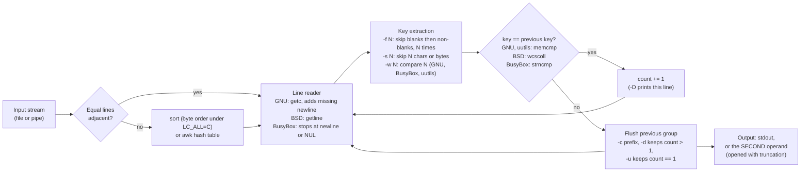

# uniq and Counting

> [!summary] Claim
> `uniq` is a two-line state machine that compares each line only with the line before it, so every correct use of it is really a contract about what ran upstream (a sort, or a source that already groups equal lines) and about which of four userlands is defining "equal", "line", and "count" this time.

Part of [Coreutils and the Userland](README.md) in [Shell and Unix Engineering](../README.md).

## TL;DR

- Mechanism: `uniq` holds the previous line and the current line, compares their keys (after `-f` fields and `-s` characters), and either extends the current group or flushes it; memory is two lines, never a table.
- Rule: duplicates must be adjacent, so count with `LC_ALL=C sort | uniq -c`, rank with `sort -k1,1nr -k2`, and parse the count with `sed`, never with `read count line`.
- Trap: the second operand of `uniq` is an output file, so `uniq a b` silently overwrites `b`, and `uniq f f` empties `f` (lab on GNU and macOS, measured on BusyBox 1.37.0 and uutils 0.12.0).
- Portability fact: GNU, BusyBox, and uutils pad the `-c` count to 7 columns while BSD and macOS pad to 4; GNU and uutils keep NUL bytes, BusyBox ends a line at a NUL, and macOS truncates the line there and drops its newline.
- When not to use it: for counts by a middle field, order-preserving dedup, or keys that need case folding beyond ASCII, use `awk` (`!seen[$0]++`, `c[$2]++`); for cardinalities that do not fit in memory or on disk, use a sketch such as HyperLogLog.

## Mental model



A stream enters, and the first decision is not `uniq`'s at all: if equal lines are not already adjacent, something upstream must make them so, either `sort` (which, under `LC_ALL=C`, orders by bytes so identical lines always touch) or an `awk` hash table that never needs adjacency.
The line reader is where the implementations first diverge: GNU appends a missing final newline, BSD and macOS copy the line exactly as read, and BusyBox treats a NUL byte as a line end.
Key extraction cuts a suffix of the line (fields, then characters, then an optional length cap), and the comparison asks one question, "is this key equal to the previous key?", using four different notions of equality.
A match only increments a counter; a mismatch flushes the group, and only at the flush do `-c`, `-d`, and `-u` decide what to print, which is why a counting `uniq` cannot emit a group until the next different line or end of file arrives.
The output arrow ends at the second operand when one is given, which is the trap that turns a mistyped "two inputs" command into a truncated file.

## How it works

### The specification: adjacent lines, identity, and a text file

POSIX.1-2024 defines the whole utility in three sentences: `uniq` "shall read an input file comparing adjacent lines, and write one copy of each input line", "the trailing `<newline>` of each line in the input shall be ignored when doing comparisons", and "repeated lines in the input shall not be detected if they are not adjacent" (POSIX.1-2024 XCU uniq, DESCRIPTION).
The synopsis is `uniq [-c|-d|-u] [-f fields] [-s char] [input_file [output_file]]`, and the bar notation means `-c`, `-d`, and `-u` are mutually exclusive for a conforming application (POSIX.1-2024 XBD 12.1); `uniq -cd` and `uniq -du` are therefore extensions whose meaning each implementation picks, since "the use of conflicting mutually-exclusive arguments produces undefined results, unless a utility description specifies otherwise" (XBD 12.1) and the `uniq` page specifies nothing.
The input "shall be a text file" (XCU uniq, INPUT FILES), and a text file is one whose lines "do not contain NUL characters and none can exceed `{LINE_MAX}` bytes" (POSIX.1-2024 XBD 3.387), while a line is "zero or more non-`<newline>` characters plus a terminating `<newline>`" (XBD 3.185).
So a NUL byte, an overlong line, and an unterminated last line (an "incomplete line", XBD 3.172) are all outside the contract, and the lab shows four different answers for them.

Equality is identity.
The POSIX.1-2024 APPLICATION USAGE says `uniq` "treats lines as duplicates only if they are identical, whereas `sort -u` treats lines as duplicates if they collate equally", and the ENVIRONMENT VARIABLES section lists `LC_CTYPE` (for characters and blanks) but not `LC_COLLATE`.
That was not always so: Issue 6 added `LC_COLLATE` to `uniq` via TC1 (XCU uniq, CHANGE HISTORY), GNU coreutils 4.5.1 made `uniq` "obey the LC_COLLATE locale, as per POSIX 1003.1-2001 TC1", and GNU 8.32 (2020-03-05) reversed it: "uniq no longer uses strcoll() to determine string equivalence" (coreutils NEWS).
The 2017 edition still warned that `sort` might not make duplicates adjacent in a locale without a total collation order and recommended `LC_ALL=C sort -u | sort` (POSIX.1-2017 XCU uniq, APPLICATION USAGE); POSIX.1-2024 removed that worry from the other side by requiring `sort` to break collation ties "byte-by-byte using the collating sequence for the POSIX locale" (POSIX.1-2024 XCU sort, DESCRIPTION, Austin Group Defect 1070), so identical lines are always adjacent after a conforming `sort`.

Fields and characters are skipped, never selected.
A field is "the maximal string matched by the basic regular expression `[[:blank:]]*[^[:blank:]]*`" (XCU uniq, `-f`), so the blanks that precede a field belong to it, and after `-f 1` the comparison starts at the blanks before field 2.
That is why `a  x` (two spaces) and `b x` (one space) are different keys under `-f 1`: the remainders are two-spaces-x and one-space-x, and the lab asserts that every implementation agrees.
`-s chars` skips characters after the fields, and if either option asks for more than the line has, "a null string shall be used for comparison", so all short lines compare equal to each other.

The output format for `-c` is `"%d %s", <number of duplicates>, <line>` (XCU uniq, OUTPUT FILES), in the File Format Notation where a plain space means "one or more `<blank>` characters" and where, when neither field width nor precision is given, "the implementation may precede, follow, or precede and follow numeric arguments of types d, i, and u with `<blank>` characters" (POSIX.1-2024 XBD 5).
That clause is what makes GNU's seven-column right alignment and BSD's four-column alignment both conforming, and it is why a portable parser must accept any number of leading blanks.

### GNU coreutils: two line buffers and a memcmp

GNU `uniq` keeps two `struct linebuffer` objects and swaps their pointers instead of copying (coreutils `src/uniq.c`, `swap_lines`).
Lines come from gnulib `readlinebuffer_delim`, a `getc` loop that, at end of file, appends the delimiter to an unterminated last line (gnulib `lib/linebuffer.c`, `readlinebuffer_delim`), which is why GNU always emits a final newline.
`find_field` walks `skip_fields` times over blanks then non-blanks, using `newline_or_blank`, which tests `c32issep` on multibyte characters decoded by `mcel_scan`, then advances `skip_chars` characters with `mcel_scan`, and caps the key at `check_chars` (`-w`) characters (coreutils `src/uniq.c`, `find_field`).
Since coreutils 9.5 (2024-03-28) "join and uniq now support multi-byte characters better" (NEWS); in 9.4 the same function advanced `skip_chars` bytes (coreutils v9.4 `src/uniq.c`, `find_field`: `i += MIN (skip_chars, size - i)`), and the lab branches on the version.
`different` is `oldlen != newlen || memcmp (old, new, oldlen)`, or `memcasecmp` under `-i` (coreutils `src/uniq.c`, `different`); in 8.31 it still called `xmemcoll` when `hard_LC_COLLATE` was set (coreutils v8.31 `src/uniq.c`, `different`).
`memcasecmp` folds byte by byte, so `-i` merges `A` and `a` but not U+00C9 and U+00E9, whose UTF-8 encodings differ in a byte that `toupper` leaves alone; the lab shows exactly that.

`check_file` has two loops, and the comment above them states the reason: in the default case (no `-c`, `-d`, `-D`, or `-u`) "this optimization lets uniq output each different line right away, without waiting to see if the next one is different" (coreutils `src/uniq.c`, `check_file`).
Every other mode prints a group only when the next different line arrives or the input ends, so `tail -f log | uniq -c` shows nothing for the current run of identical lines until a different line follows.
The count is formatted by hand into a buffer, `while (end - p < 8) *--p = ' ';` (seven count columns plus the separator space), the counter is an `intmax_t`, and reaching `INTMAX_MAX` with `-c` fails with "too many repeated lines" (coreutils `src/uniq.c`, `writeline` and `check_file`).
GNU 9.12 (2026-09-14) notes that "'uniq -c' now operates up to 2.5x times faster on systems with unlocked stdio functions" and fixes "'uniq -w' no longer overruns the read buffer in multibyte locales. [bug introduced in coreutils-9.5]" (NEWS).

Operands are opened with `freopen (infile, "r", stdin)` and then `freopen (outfile, "w", stdout)` (coreutils `src/uniq.c`, `check_file`), so when both name one file the input is already open when `"w"` truncates it, and `uniq` then reads an empty file; POSIX says only that "the results are unspecified if the file named by output_file is the file named by input_file" (XCU uniq, OPERANDS).
GNU extensions: `-D` and `--all-repeated[=none|prepend|separate]`, `--group[=separate|prepend|append|both]` (8.22, 2013-12-13), `-i`, `-w`, `-z` (6.9.90, 2007-12-01), and the obsolete `-N` and `+N` forms; with `-z`, `'\n'` counts as a field delimiter (8.25, 2016-01-20) (coreutils NEWS and `main`).
The texinfo manual still says "Comparisons honor the rules specified by the `LC_COLLATE` locale category" (coreutils `doc/coreutils.texi`, uniq invocation), which the code has not done since 8.32.

### FreeBSD and macOS: wide characters and wcscoll

FreeBSD `uniq` reads with `getline(3)`, converts each line with `mbstowcs` into a `wchar_t` string, strips one trailing `L'\n'`, applies `skip()` (fields with `iswblank`, then characters), lowercases with `towlower` under `-i`, and compares with `wcscoll(3)` (FreeBSD `usr.bin/uniq/uniq.c`, `main`, `convert`, `skip`).
When `mbstowcs` fails on an invalid sequence, two invalid lines fall back to a byte comparison in `inlcmp` that treats `'\n'` as end of string, and one invalid line against one valid line is always "different".
The output path is `fprintf(ofp, "%4lld %s", repeats + 1, str)` or `"%s"` (FreeBSD `uniq.c`, `show`): the count is four columns, and the line is printed exactly as `getline` returned it, so an unterminated last line stays unterminated.
Because `mbstowcs` and `%s` both stop at the first NUL, two lines `a<NUL>x` and `a<NUL>y` both become `a`, compare equal, and print as the single byte `a`, with no newline (lab, macOS 27.3).
The `-d` flag without `-c` prints the first line of a group at its first repeat, in the "lines equal" branch, without consulting `-u`, which is why `uniq -du` prints the repeated lines on BSD and nothing elsewhere.
Apple's `text_cmds` copy is the same code with the Capsicum sandboxing (`caph_enter`, `cap_rights_limit`) compiled out under `#ifndef __APPLE__`; its `#else` branch only opens the output operand and line-buffers stdout when `__RUNNING_INSIDE_ATF_RUN` is set (apple-oss-distributions `text_cmds/uniq/uniq.c`).
There is no `-w`, `-z`, or `--group`; `-D[septype]` exists with `none`, `prepend`, and `separate`, and the obsolete `-N` and `+N` are rewritten to `-f N` and `-s N` by `obsolete()` before `getopt_long` runs.

### BusyBox: C strings and a NUL that ends the line

BusyBox `uniq_main` parses `"cduf:+s:+w:+iz"` with `getopt32`, reads each line with `xmalloc_fgetline`, skips fields with `skip_whitespace` and `skip_non_whitespace`, skips `-s` characters one byte at a time, and compares with `strncmp` or `strncasecmp` bounded by `max_chars` (default `INT_MAX`) (BusyBox `coreutils/uniq.c`, `uniq_main`).
`xmalloc_fgetline` calls `bb_get_chunk_from_file`, whose `getc` loop breaks on `'\n'` and also on `'\0'` (BusyBox `libbb/get_line_from_file.c`, `bb_get_chunk_from_file`), so a NUL byte ends a line, and `-z` changes only the output terminator: `printf("%7lu ", dups + 1)` then `printf("%s%c", old_line, eol)` with `eol` set to 0 under `-z`.
The skip helpers treat space and bytes 9 to 13 as whitespace, a wider set than POSIX `[[:blank:]]`, because "In POSIX/C locale ... isspace is only these chars" (BusyBox `libbb/skip_whitespace.c`).
The counter is an `unsigned long` incremented with the comment "testing for overflow seems excessive", and the `%7lu` comment says it "matches GNU coreutils 6.9".
The `busybox-1.37.0.tar.bz2` release has these three files byte for byte as quoted here (compared with `diff`).

### uutils: byte slices, ASCII case, and a 128 KiB buffer

uutils `uniq` reads with `BufRead::read_until(line_terminator, ...)`, pops the terminator, computes `key_start` from fields (blank means space, tab, or newline) plus `-s` as a byte offset, computes `key_end` from `-w` in characters in a UTF-8 locale and in bytes in the C locale, and compares the slices with `==` or `eq_ignore_ascii_case` (uutils `src/uu/uniq/src/uniq.rs`, `read_line`, `key_bounds`, `key_end_index`, `keys_are_equal`).
It writes the count right-aligned to `COUNT_PREFIX_WIDTH = 7` and always appends the terminator, and its reader and writer use `OUTPUT_BUFFER_CAPACITY = 128 * 1024` bytes (uutils `uniq.rs`, `build_count_prefix`, `write_line`) (as of 2026-11, `main` branch).

### Counting beyond uniq

`sort | uniq -c` is the canonical frequency count because `sort` is the only part that needs memory, and `sort` spills to temporary files when it runs out (see [[External-Merge-Sort]]); `uniq` itself is O(1) memory and O(total bytes) time.
The hash alternative, `awk '{ c[$0]++ } END { for (k in c) print c[k], k }'`, is one pass with O(distinct keys) memory and an unspecified output order (see [[awk-Associative-Arrays-and-Idioms]]); `awk '!seen[$0]++'` removes non-adjacent duplicates while keeping first-seen order, which no `sort`-based pipeline can do.
Ranking a count needs explicit keys: `sort -rn` reverses the last-resort whole-line comparison as well, because ties are ordered "as if none of the options -d, -f, -i, -n, or -k were present (but with -r still in effect)" (XCU sort, DESCRIPTION), so ties come out in descending byte order; `sort -k1,1nr -k2` gives count descending, line ascending.
`wc -l` writes "the number of `<newline>` characters" (POSIX.1-2024 XCU wc, `-l`), so an unterminated last line is not counted; `grep -c ''` counts selected lines and does count it in BSD grep (lab, macOS), GNU grep 3.11, and BusyBox grep (measured in the Debian and Alpine images), although POSIX only defines `grep` on text files.
`comm` gives set intersection and difference on two inputs sorted in the current collating sequence (POSIX.1-2024 XCU comm, DESCRIPTION), which is the right tool when the question is "which lines are in both" rather than "how many times".
When the distinct count itself is too large to hold, HyperLogLog estimates it in one pass with relative standard error about `1.04/sqrt(m)` for `m` registers, and its authors report cardinalities "well beyond 10^9 with a typical accuracy of 2% while using a memory of only 1.5 kilobytes" (Flajolet, Fusy, Gandouet, Meunier, AofA 2007, abstract).

## Numbers and limits

| Quantity | Value | Source |
|---|---|---|
| `uniq` working memory | two lines (previous and current) | GNU `swap_lines`, FreeBSD `prevline`/`thisline`, BusyBox `old_line`/`cur_line` |
| `{_POSIX2_LINE_MAX}` (minimum `{LINE_MAX}`) | 2048 bytes, newline included | POSIX.1-2024 XBD `limits.h` |
| `getconf LINE_MAX` on macOS 27.3 | 2048 | measured here, 2026-11-15 |
| Historical `uniq` line limit | 1080 bytes | POSIX.1-2024 XCU uniq, RATIONALE |
| Line length limit in GNU, BSD, BusyBox, uutils | none but memory (growing buffers) | `linebuffer`, `getline`, `xrealloc` loop, `Vec` |
| `-c` count width | GNU 7, BusyBox 7, uutils 7, BSD and macOS 4 | `writeline`, `"%7lu "`, `COUNT_PREFIX_WIDTH`, `"%4lld "`; lab |
| Count type and overflow | GNU `intmax_t`, error at `INTMAX_MAX`; BSD `long long`, unchecked; BusyBox `unsigned long`, unchecked; uutils `usize` | source of each |
| `-f`/`-s` argument range | BSD 0 to `INT_MAX` (`strtonum`); GNU negative is an error, larger than `IDX_MAX` silently clamped | FreeBSD `main`, GNU `size_opt` |
| uutils I/O buffer | 131072 bytes | `OUTPUT_BUFFER_CAPACITY` (as of 2026-11) |
| GNU 9.12 `uniq -c` speedup | up to 2.5x with unlocked stdio | coreutils NEWS 9.12 |
| macOS `wc -l` output for one line on stdin | `       1` (8 columns) | measured here, macOS 27.3 |
| Benchmark input | 2,000,000 lines, 22,000,000 bytes, 95,230 distinct | generated with `awk`, measured here |
| `LC_ALL=C gsort \| guniq -c` (GNU 9.12) | 0.22 to 0.33 s | measured here, Apple M3 Pro, 2 runs, wall clock |
| Same pipeline with `LC_ALL=en_US.UTF-8` | 1.32 to 1.40 s | measured here, same conditions |
| macOS `sort \| uniq -c`, `LC_ALL=C` | 0.64 to 0.65 s | measured here |
| `uniq -c` alone on presorted input | GNU 0.06 s; macOS 0.14 s (C), 0.17 to 0.18 s (UTF-8) | measured here |
| `awk` hash count, `c[$0]++` | gawk 5.4.1 0.74 to 0.79 s; macOS awk 20200816 1.14 to 1.15 s | measured here |
| `LC_ALL=C gsort -u` (distinct lines) | 0.20 s | measured here |
| HyperLogLog standard error | about `1.04/sqrt(m)` | Flajolet et al. 2007 |

The measured rows come from one ad hoc script run on 2026-11-15 (macOS 27.3, Apple M3 Pro, GNU coreutils 9.12), not from the lab, and every pipeline produced the same 95,230 groups.
Two readings matter: on this input the locale cost of `sort` (about 4x) dwarfs any difference between `uniq` implementations, and GNU `sort` beat both awk hash tables, so "hashing is O(n), sorting is O(n log n)" did not decide the winner at two million lines.

## Portability

Shell behavior matters only where a script consumes `uniq` output; the utility behavior does not depend on the shell.

| Shell | `read -r n line` on `      2   lead` gives `line=lead` (blanks lost) | `topk.sh 3` output on the lab input | Evidence |
|---|---|---|---|
| POSIX sh | yes, `read` strips leading IFS white space | specified behavior only | POSIX.1-2024 XCU read |
| macOS bash 3.2 (`/bin/sh`) | yes | `3<TAB>b`, `2<TAB>  lead`, `2<TAB>a` | lab, run here |
| bash 5.x | yes | same | lab asserts; measured, bash 5.2.37, Debian 13 image, 2026-11-15 |
| zsh native | yes | same | lab asserts; measured, zsh 5.9, Debian 13 image |
| zsh `--emulate sh` | yes | same | lab asserts; measured, zsh 5.9, Debian 13 image |
| dash | yes | same | lab, `topk.sh` tests run on macOS; measured, dash 0.5.12, Debian 13 image |
| ksh93 | yes | same | lab asserts; measured, ksh93u+m 1.0.10, Debian 13 image |
| mksh | yes | same | lab asserts; measured, mksh R59c, Debian 13 image |
| yash | yes | same | lab asserts; measured, yash 2.58.1, Alpine 3.22 image |
| posh | yes (with `IFS` unset in the environment) | same | lab asserts; measured, posh 0.14.1, Debian 13 image |
| BusyBox ash | yes | same | lab asserts; measured, BusyBox 1.37.0 ash, Debian 13 image |

| Behavior | GNU coreutils 9.12 | FreeBSD and macOS | BusyBox 1.37.0 | uutils (main, 2026-11) | Evidence |
|---|---|---|---|---|---|
| Equality | `memcmp` (since 8.32) | `wcscoll` on wide strings | `strncmp` | slice `==` | source |
| `-c` width | 7 | 4 | 7 | 7 | lab (GNU, macOS); BusyBox and uutils measured |
| Unterminated last line | newline added | copied as is | newline added | newline added | lab (GNU, macOS); BusyBox and uutils measured |
| NUL byte in a line | kept | line cut at NUL, both lines merge, no newline | NUL ends the line | kept | lab (GNU, macOS); GNU 9.7, BusyBox, and uutils measured |
| `-s` unit (UTF-8 locale) | characters (9.5+), bytes (9.4 and older) | characters | bytes | bytes | lab (GNU 9.12, macOS); GNU 9.7, BusyBox, and uutils measured; GNU 9.4 source |
| `-i` folds U+00C9 to U+00E9 | no (byte `memcasecmp`) | yes (`towlower`) | no (`strncasecmp`) | no (ASCII only) | lab (GNU, macOS); BusyBox and uutils measured |
| `-d -u` together | prints nothing | prints repeated lines | prints nothing | prints nothing | lab (GNU, macOS); BusyBox and uutils measured |
| `-w N` | yes | no (usage error) | yes | yes | lab (GNU, macOS); BusyBox and uutils measured |
| `-z` | NUL in and out | no (usage error) | NUL out only; input still splits on newline and NUL | NUL in and out | lab (GNU, macOS); BusyBox and uutils measured |
| `-D`, `--all-repeated` | yes | `-D[septype]` | no | yes | lab (GNU, macOS); BusyBox and uutils measured |
| `--group` | yes | no | no | yes | source; uutils measured |
| Obsolete `-N` (`-f N`) | yes | yes | no | yes | source; macOS `-1`, uutils `-1`, and BusyBox `-1` (rejected) measured |
| `uniq f f` | empties `f` | empties `f` | empties `f` | empties `f` | lab (GNU, macOS); GNU 9.7, BusyBox, and uutils measured; the uutils source calls `File::create` after the input is open (POSIX: unspecified) |

"Measured" means one run on 2026-11-15 of GNU coreutils 9.7 in a Debian 13 image, BusyBox 1.37.0 in an Alpine 3.22 image, and uutils 0.12.0 (the `uutils` package of the Alpine edge image, run as `uutils uniq` under `C.UTF-8`); the uutils source cited in this note is the `main` branch (as of 2026-11), and every cell above matched the 0.12.0 binary.

## Worked example

The [lab](../labs/08-uniq-and-counting/) has two parts: `topk.sh`, a top-N counter that is correct for every input the four userlands agree on, and `uniq.bats`, which runs each `uniq` it finds (`uniq`, `guniq`, `uu-uniq`, `busybox uniq`) and asserts each implementation's own behavior.

`topk.sh`, verbatim:

```sh
#!/bin/sh
# topk.sh [N]: print the N (default 10) most frequent input lines as COUNT<TAB>LINE.
# Ties are broken by the line itself in ascending byte order, so the output is deterministic.
# The line is kept byte for byte, including leading blanks, which a `read count line` parse would strip.
# Usage: topk.sh [N] <input
# Example: printf 'b\na\nb\n' | topk.sh 2  ->  2<TAB>b, then 1<TAB>a
set -eu

n=${1:-10}
case $n in
  '' | *[!0-9]*)
    printf 'topk.sh: N must be a decimal integer, got "%s"\n' "$n" >&2
    exit 2
    ;;
  *) ;;
esac

# Byte order for both sorts and byte identity for uniq: no locale can make two different lines collate equal.
LC_ALL=C
export LC_ALL
tab=$(printf '\t')

# 1. sort makes equal lines adjacent; uniq only ever compares a line with the one before it.
# 2. uniq -c right-aligns the count (width 7 in GNU, BusyBox, and uutils; 4 in BSD and macOS), then one space.
# 3. sed turns "<blanks>COUNT<space>" into "COUNT<tab>", leaving the line's own leading blanks alone.
# 4. sort by count descending, then by the rest of the line ascending; plain `sort -rn` would reverse ties too.
sort \
  | uniq -c \
  | sed "s/^ *\\([0-9][0-9]*\\) /\\1$tab/" \
  | sort -t "$tab" -k1,1nr -k2 \
  | head -n "$n"
```

The test feeds `b`, `  lead`, `a`, `b`, `  lead`, `c`, `a`, `b` and asks for three lines; captured on macOS 27.3 under `/bin/sh` (bash 3.2.57) with `od -c`:

```text
3	b
2	  lead
2	a
```

The duplicates of `b` were not adjacent, the two-space indent of `  lead` survived, and the tie at 2 was broken by bytes (space, 0x20, sorts before `a`); a version with `sort -rn` would print `a` before `  lead`, and a version with `read n line` would print `lead`.

The divergence tests are one loop each; this is the `-d -u` one, verbatim from `uniq.bats`:

```sh
@test "-d with -u prints nothing in GNU, BusyBox, and uutils, but the repeated lines in BSD" {
  local cmd flavor
  lab_impls
  while IFS= read -r cmd; do
    # shellcheck disable=SC2086 # split a multi-word command such as "busybox uniq"
    flavor=$(uniq_flavor $cmd)
    run_lab_c "printf 'a\\na\\nb\\n' | $cmd -d -u; printf '|'" </dev/null
    echo "impl=$cmd flavor=$flavor output=$output"
    [ "$status" -eq 0 ]
    case $flavor in
      gnu | busybox | uutils) [ "$output" = "|" ] ;;
      bsd) [ "$output" = "$(printf 'a\n|')" ] ;;
      *) false ;;
    esac
  done <<<"$IMPLS"
}
```

The `printf '|'` sentinel exists because command substitution deletes trailing newlines (POSIX.1-2024 XCU 2.6.3), which would hide the difference between "printed `a` and a newline" and "printed nothing but a newline".
The run here (macOS 27.3, `/usr/bin/uniq` and GNU `guniq` 9.12) passed all 19 tests; the outputs it asserts for the other implementations are:

```text
-c on a,a,b        GNU/BusyBox/uutils "______2_a"   BSD "___2_a"            (spaces shown as _)
printf 'a\na\nb'   GNU/BusyBox/uutils "a\nb\n"      BSD "a\nb"
a<NUL>x, a<NUL>y   GNU/uutils both lines kept     BusyBox "a\nx\na\ny\n"   BSD "a" (one byte)
-s 1 on e-acute-x, e-grave-x   GNU 9.5+/BSD one group of 2   BusyBox/uutils/GNU 9.4 two groups
-i on A,a,U+00E9,U+00C9        GNU/BusyBox/uutils "2 1 1"   BSD "2 2"
```

BusyBox 1.37.0 in the Alpine image printed exactly the BusyBox values above when run by hand on 2026-11-15, and GNU 9.7 in the Debian image printed the GNU 9.5+ values; uutils 0.12.0 in the Alpine edge image printed the uutils values above (two groups for `-s 1`, NUL bytes kept, `-i` ASCII only) on the same day.

## Pitfalls

> [!warning] Unsorted input
> Trigger: `uniq -c access.log` or `grep ERROR log | uniq -c` on input whose repeats are not consecutive.
> Symptom: the same line appears many times with small counts; totals look plausible and are wrong.
> Fix: `LC_ALL=C sort | uniq -c`, or `awk '{ c[$0]++ } END { for (k in c) print c[k], k }'` when one pass and memory proportional to distinct keys is acceptable.

> [!warning] The second operand is an output file
> Trigger: `uniq -c old.txt new.txt` written as if `uniq` took two inputs, like `diff` or `comm`.
> Symptom: `new.txt` is truncated and replaced by the counts of `old.txt`; `uniq f f` leaves `f` empty, because the output is opened with truncation after the input is opened (GNU `freopen (outfile, "w", stdout)`, BusyBox `O_TRUNC`).
> Fix: always redirect (`uniq -c <in >out`), and never name the same file twice; POSIX leaves the same-file case unspecified.

> [!warning] Parsing `uniq -c` with `read`
> Trigger: `uniq -c | while read -r n line; do ...`.
> Symptom: lines that begin with blanks lose them (the lab shows `<2><lead>` for `  lead`), and trailing blanks go too, so distinct keys that differ only in edge whitespace are reported under the same text.
> Fix: rewrite the prefix with `sed 's/^ *\([0-9][0-9]*\) /\1<TAB>/'` and split on the tab, or count in `awk`, which can print `count "\t" line` directly; see [[The-read-Builtin]] and [[Field-Splitting-and-IFS]].

> [!warning] Assuming the count width
> Trigger: `cut -c1-7` or `cut -c9-` on `uniq -c` output, or a test that compares against `"      2 a"`.
> Symptom: correct on GNU and Alpine, off by three columns on macOS and FreeBSD (`%4lld `), and wrong everywhere once a count exceeds the field width.
> Fix: strip leading blanks with a regular expression; the only universal fact is "blanks, digits, one space, line" (lab).

> [!warning] `-f` does not select a field
> Trigger: `uniq -c -f 1` to "count by the second column", or input whose separators vary between one and several blanks.
> Symptom: `-f` skips leading fields and compares everything after them, including the blanks before the next field, so `a  x` and `b x` are different keys.
> Fix: extract the key first (`awk '{ print $2 }' | sort | uniq -c`, or `awk '{ c[$2]++ }'`); normalize separators with `tr -s ' '` if the remainder must be compared.

> [!warning] `-i` is not Unicode case folding, and `sort | uniq -i` is not enough
> Trigger: `sort | uniq -ci` on mixed-case input, or `uniq -i` on accented text.
> Symptom: under `LC_ALL=C`, `sort` puts `A B a b` in that order, so `uniq -i` merges nothing (lab); GNU, BusyBox, and uutils fold only ASCII, so U+00C9 and U+00E9 stay apart, while BSD merges them.
> Fix: `sort -f | uniq -i` so case variants are adjacent; for real case-insensitive keys normalize first (`tr '[:upper:]' '[:lower:]'` for ASCII, a Unicode-aware tool otherwise); see [[Unicode-and-UTF-8-in-Text-Tools]].

> [!warning] `wc -l` undercounts and pads
> Trigger: a file without a final newline, or `[ "$(wc -l <f)" = 3 ]` on macOS.
> Symptom: `printf 'a\nb' | wc -l` is 1 because `wc -l` counts newline characters (POSIX.1-2024 XCU wc), and macOS prints `       1`, so a string comparison fails.
> Fix: `grep -c ''` counts an unterminated last line in BSD grep (lab), GNU grep 3.11, and BusyBox grep (measured); strip blanks with `tr -d ' '` or compare numerically.

> [!warning] Ranking with `sort -rn`
> Trigger: `sort | uniq -c | sort -rn | head`.
> Symptom: ties come out in descending byte order (`1 b` before `1 a`), because POSIX keeps `-r` in effect for the whole-line tie-break; a report built this way and one built with `-k1,1nr -k2` disagree about "the top 10" whenever the tenth and eleventh entries tie.
> Fix: `sort -k1,1nr -k2`, as `topk.sh` does; see [[sort-Keys-and-Stability]].

> [!warning] NUL bytes and binary input
> Trigger: `uniq` on files that are not text files, for example concatenated `find -print0` output or binary logs.
> Symptom: macOS silently merges different lines that share a prefix before the NUL and writes truncated output with no newline; BusyBox splits lines at each NUL.
> Fix: for NUL-delimited records use `sort -z | uniq -z` on GNU or uutils only, and treat any other `uniq` as text-only; see [[find-print0-and-exec-Plus]].

> [!warning] Distribution patches change the code you read
> Trigger: reading upstream GNU source to reason about a vendor build.
> Symptom: CVE-2013-0222: "The SUSE coreutils-i18n.patch for GNU coreutils allows context-dependent attackers to cause a denial of service (segmentation fault and crash) via a long string to the uniq command, which triggers a stack-based buffer overflow in the alloca function" (NVD); the overflow was in the multibyte patch, not in upstream `uniq.c`, and sibling CVE-2013-0221 and CVE-2013-0223 hit `sort` and `join` through the same patch.
> Fix: check which source your distribution actually builds (its patch set and version), and test the vendor binary, not the upstream tarball.

## Security and robustness

`uniq` reads untrusted data in log pipelines, so its failure modes are about memory and truncation, not code execution in the upstream tools: every implementation grows its line buffer without a limit and holds two lines at once (previous and current), so a multi-gigabyte line costs that much memory; bound input with `head -c` or `fold` where line length is attacker controlled.
The only memory-safety bugs on record for `uniq` are in a distribution's internationalization patch (CVE-2013-0222, an `alloca` stack overflow on a long line) and in GNU's own multibyte `-w` path between 9.5 and 9.12 ("no longer overruns the read buffer in multibyte locales", coreutils NEWS 9.12); an NVD keyword search for "uniq command" (45 results, searched 2026-11-15) found no other CVE in a `uniq` utility.
The second-operand trap does have a CVE of its own, in a caller: CVE-2026-105789 reports that Microsoft UFO before 3.0.9 treated `sort` and `uniq` as read-only commands, so "an authenticated caller can use sort -o or the optional second uniq operand to create or overwrite files writable by the UFO server process" (NVD); an allowlist that admits `uniq` must also reject a second operand.
A count that wraps is a silent integrity failure: BusyBox's `unsigned long` is 32 bits on 32-bit targets, so a group of more than 4,294,967,295 identical lines would print a small count, while GNU stops with "too many repeated lines" at `INTMAX_MAX`.
Output written to the second operand is opened with truncation before any input is read, so a mistyped command destroys data before it fails; scripts should redirect output to a temporary file and rename it into place (see [[mktemp]] and [[install-and-Atomic-Deployment]]).
Set `LC_ALL=C` for byte-exact identity on data that is not valid text in the current locale: POSIX recommends it for pathnames because they "can contain byte sequences that do not form valid characters in some locales, in which case the utility's behavior would be undefined" (XCU uniq, APPLICATION USAGE), and on BSD an invalid sequence changes the comparison path from `wcscoll` to `inlcmp`.
A pipeline that ends in `head` makes upstream writers receive `SIGPIPE`; that is harmless in `topk.sh` because the final status is `head`'s, but under `set -o pipefail` it becomes a spurious failure (see [[SIGPIPE-and-EPIPE]]).

## The principal's view

The decision is not "which `uniq` flag" but "where does grouping happen, and who owns the definition of equal".
`sort | uniq -c` is the right default for ad hoc and batch counting because it is bounded in memory by `sort`'s external merge, deterministic under `LC_ALL=C`, and present on every Unix; the cost is a full sort and the locale trap, and the measurement above shows the locale is the larger cost.
An `awk` hash table is the right tool when the key is a field, when first-seen order matters, or when the data is streamed and the distinct set is small; its cost is memory proportional to the distinct keys and an unspecified output order.
Once the distinct set does not fit in RAM and an exact answer is not required, the answer is a probabilistic sketch (HyperLogLog for cardinality) in a real language, not a cleverer pipeline.
For anything another program parses, do not ship `uniq -c` text: emit `count<TAB>key` (as `topk.sh` does) or a structured format, because the count field's width, the separator rule, and the line's own blanks are all implementation-defined.
For portability, write to the intersection: `-c`, `-d`, `-u`, `-f`, `-s` on newline-terminated text with no NUL bytes, in `LC_ALL=C`, and never two `-c`/`-d`/`-u` options at once; `-i`, `-w`, `-z`, `-D`, and `--group` are GNU-family extensions whose semantics already differ between BSD, BusyBox, and uutils.
When the data is not text (NUL bytes, invalid encodings, lines longer than memory should hold), stop using text utilities and move to a language with explicit byte handling.

## Interview questions

> [!question] L5: Why does `uniq` need sorted input, and what exactly goes wrong if it does not get it?
>
> > [!success]- Answer
> > `uniq` compares each line only with the previous line, so it detects runs of equal lines, not duplicates in general (POSIX.1-2024 XCU uniq: "Repeated lines in the input shall not be detected if they are not adjacent").
> > Unsorted input produces several groups for the same line, each with a partial count, and no error.
> > Sorting makes equal lines adjacent; under POSIX.1-2024 even a locale with collation ties breaks them byte by byte, so identical lines always touch.
> > The design keeps `uniq` at two lines of memory and lets `sort` own the expensive, spill-to-disk part.
> >
> > Follow-up: When is the adjacency-only behavior exactly what you want, so sorting would be wrong?

> [!question] L5: Predict the output of `printf 'a\nb\na\na\n' | uniq -c | sed 's/^ *//'` and of the same pipeline with `sort` in front.
>
> > [!success]- Answer
> > Without `sort`: `1 a`, `1 b`, `2 a`, because the first `a` and the last two are separate runs.
> > With `sort`: `3 a`, `1 b`.
> > The `sed` removes the implementation-specific padding (7 columns in GNU, 4 in BSD), so both outputs are the same on every userland (lab).
> >
> > Follow-up: What would `uniq -d` and `uniq -u` print for the unsorted input?

> [!question] L5: How do you get the ten most frequent lines, deterministically, with ties broken alphabetically?
>
> > [!success]- Answer
> > `LC_ALL=C sort | uniq -c | sed 's/^ *\([0-9][0-9]*\) /\1<TAB>/' | sort -t '<TAB>' -k1,1nr -k2 | head -n 10`, with a real tab.
> > `sort -rn` is not enough: POSIX keeps `-r` in effect for the whole-line tie-break, so ties come out in reverse byte order.
> > The `sed` step makes the count a tab-separated field without touching the line's own blanks.
> >
> > Follow-up: What changes if the input is 200 GB and has 50 million distinct lines?

> [!question] L6: Debug this script: it reports wrong totals for some keys and loses indentation in the report.
> ```sh
> sort data.txt | uniq -c | while read -r n key; do
>   printf '%s=%d\n' "$key" "$n"
> done
> ```
>
> > [!success]- Answer
> > `read` with the default `IFS` strips leading and trailing blanks from `key`, so `  x` and `x` print as the same key (each with its own count, which looks like a wrong total when someone sums by printed key).
> > Interior runs of blanks survive because `key` is the last variable, but the edges are gone (POSIX.1-2024 XCU read).
> > Fix: convert the prefix with `sed 's/^ *\([0-9][0-9]*\) /\1<TAB>/'` and read with `IFS='<TAB>' read -r n key`, or do the whole thing in one `awk` pass.
> > Also add `LC_ALL=C` so the sort order and the identity test are byte based.
> >
> > Follow-up: Why is a `while read` loop over a large count output also slow, and what replaces it?

> [!question] L6: Why does `uniq -f 1`, meant to group lines by everything after the timestamp, fail to merge lines with identical messages?
>
> > [!success]- Answer
> > A field is `[[:blank:]]*[^[:blank:]]*` (POSIX.1-2024 XCU uniq, `-f`), so skipping one field leaves the blanks before field 2 in the key.
> > If the log pads the timestamp column with a variable number of spaces, the remainders differ in their leading blanks.
> > The lab shows `a  x` and `b x` as different keys under `-f 1` in every implementation.
> > Fix: normalize separators (`tr -s ' '`) or extract the key explicitly with `awk` or `cut`.
> >
> > Follow-up: How does `-s` interact with `-f`, and in which unit does it count on BusyBox versus GNU 9.5?

> [!question] L6: Why do GNU `uniq -c` and macOS `uniq -c` print different column layouts, and is either non-conforming?
>
> > [!success]- Answer
> > GNU pads the count to seven columns by hand in `writeline`; FreeBSD and macOS use `"%4lld %s"`.
> > POSIX specifies `"%d %s"` in File Format Notation, where an unqualified `%d` may be preceded or followed by blanks and a space means one or more blanks (POSIX.1-2024 XBD 5), so both conform.
> > The portable parse is "leading blanks, digits, one space, then the line".
> >
> > Follow-up: Every current implementation writes exactly one space after the count; what in the standard would still let a conforming one write two?

> [!question] L6: What does `uniq -du` print?
>
> > [!success]- Answer
> > On GNU, BusyBox, and uutils, nothing: `-d` suppresses unique lines and `-u` suppresses repeated ones.
> > On FreeBSD and macOS, the repeated lines, because the "lines equal" branch prints the group's first line for `-d` without checking `-u` (FreeBSD `uniq.c`, `main`).
> > POSIX does not decide it: the synopsis `[-c|-d|-u]` makes the options mutually exclusive for conforming applications (XBD 12.1).
> >
> > Follow-up: Which other option combinations are rejected outright by GNU, and why does it reject `-c` with `-D`?

> [!question] L7+: GNU `uniq` used `strcoll` for nearly two decades and then stopped; what was the trade-off, and what did POSIX change around it?
>
> > [!success]- Answer
> > With collation, two byte-different lines that collate equally were "duplicates", which made `uniq` agree with `sort -u` but made its output depend on the locale and cost a `strcoll` per line.
> > GNU 4.5.1 adopted `LC_COLLATE` after POSIX 2001 TC1 added it; GNU 8.32 dropped `strcoll` "to operate more efficiently and consistently" (coreutils NEWS).
> > POSIX.1-2024 now says `uniq` treats lines as duplicates only if identical, and requires `sort` to break collation ties byte by byte, so `sort | uniq` is sound in any locale while `sort -u` may still drop lines that collate equal.
> > FreeBSD and macOS still compare with `wcscoll`, so the userlands can still disagree in a locale with ties.
> > The GNU manual still claims `LC_COLLATE` applies, which is a documentation bug.
> >
> > Follow-up: When would you deliberately want collation equality in a dedup step, and how would you get it explicitly?

> [!question] L7+: Design the counting step of a pipeline that must report the top 100 URLs from 5 TB of logs per day, exactly, and the number of distinct client IPs, approximately.
>
> > [!success]- Answer
> > Exact top-k needs exact per-key counts: partition by a hash of the URL into shards, count each shard with a hash map or `sort | uniq -c` on a bounded slice, and merge the per-shard top-k lists.
> > `sort | uniq -c` on one machine works when temporary disk is several times the input and the latency is acceptable; it bounds RAM through external merge sort.
> > Distinct IPs do not need exactness: a HyperLogLog sketch per shard (standard error about `1.04/sqrt(m)`) merges by register-wise max and fits in kilobytes.
> > Fix `LC_ALL=C`, normalize keys before counting, and emit `count<TAB>key` so downstream parsing does not depend on `uniq -c` layout.
> >
> > Follow-up: How do you test that the sharded counts equal a single-machine `sort | uniq -c` on a sample?

## Related

Prerequisites: [[External-Merge-Sort]]

Next: [[cp-mv-and-Rename-Semantics]]

See also: [[sort-Keys-and-Stability]], [[Four-Userlands-GNU-BSD-BusyBox-uutils]], [[Userland-Portability-Traps]], [[stdio-Buffering-and-stdbuf]], [[awk-Associative-Arrays-and-Idioms]], [[The-read-Builtin]], [[Field-Splitting-and-IFS]], [[Locale-and-LC_ALL]], [[LC_ALL-C-for-Speed]], [[Unicode-and-UTF-8-in-Text-Tools]], [[SIGPIPE-and-EPIPE]], [[Log-Triage-Pipelines]]

## Further reading

- [POSIX.1-2024 uniq](https://pubs.opengroup.org/onlinepubs/9799919799/utilities/uniq.html) - The normative contract: adjacency, identity, the field regular expression, and the `"%d %s"` count format.
- [POSIX.1-2024 sort](https://pubs.opengroup.org/onlinepubs/9799919799/utilities/sort.html) - The byte tie-break that makes `sort | uniq` sound, and why `sort -u` can drop lines that only collate equal.
- [POSIX.1-2024 XBD 5 File Format Notation](https://pubs.opengroup.org/onlinepubs/9799919799/basedefs/V1_chap05.html) - Why a `%d` in a format may carry implementation-chosen blanks.
- [GNU coreutils uniq.c](https://raw.githubusercontent.com/coreutils/coreutils/master/src/uniq.c) - `find_field`, `different`, `writeline`, and the two-loop `check_file`.
- [GNU coreutils NEWS](https://raw.githubusercontent.com/coreutils/coreutils/master/NEWS) - Dated history: `LC_COLLATE` in 4.5.1, `-z` in 6.9.90, `--group` in 8.22, `strcoll` removed in 8.32, multibyte in 9.5, the `-w` overrun fix in 9.12.
- [FreeBSD uniq.c](https://raw.githubusercontent.com/freebsd/freebsd-src/main/usr.bin/uniq/uniq.c) - The wide-character, `wcscoll`-based design that macOS inherits.
- [BusyBox uniq.c](https://raw.githubusercontent.com/mirror/busybox/master/coreutils/uniq.c) - A 100-line C-string implementation, and the clearest view of the minimum `uniq` needs.
- [uutils uniq.rs](https://raw.githubusercontent.com/uutils/coreutils/main/src/uu/uniq/src/uniq.rs) - The Rust rewrite's byte-slice comparison and its byte versus character choices for `-s` and `-w`.
- [NVD CVE-2013-0222](https://nvd.nist.gov/vuln/detail/CVE-2013-0222) - A `uniq` crash that existed only in a distribution patch.
- [Flajolet et al., HyperLogLog (AofA 2007)](https://algo.inria.fr/flajolet/Publications/FlFuGaMe07.pdf) - The cardinality sketch to reach for when exact distinct counting does not fit.
