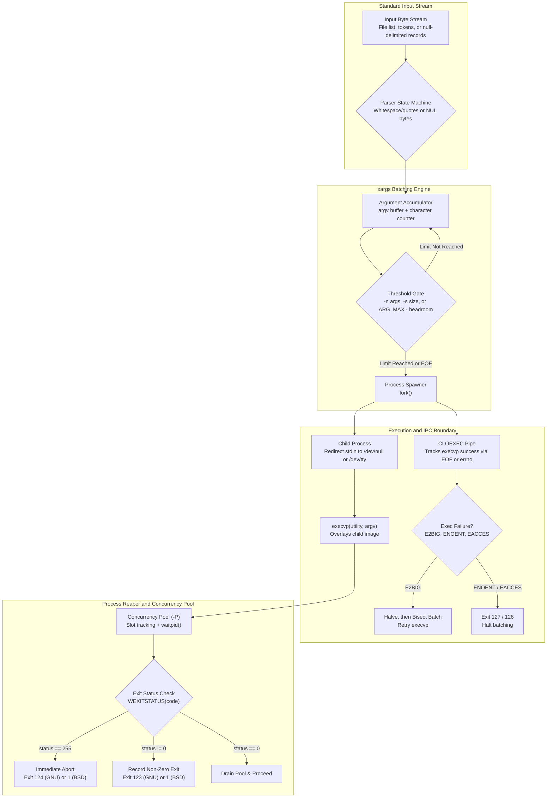

# xargs and Argument Batching

> [!summary] Claim
> The `xargs` utility converts unbounded standard input byte streams into bounded argument vectors for repeated execution of a target program, calculating batch size against operating system `{ARG_MAX}` limits while managing process concurrency, stream delimiters, and exit status propagation.

Part of [Coreutils and the Userland](README.md) in [Shell and Unix Engineering](../README.md).

## TL;DR

- Mechanism: `xargs` consumes delimiters from standard input, packs arguments into an internal buffer bounded by `{ARG_MAX} - 2048` bytes or `-s`/`-n` constraints, forks child processes, and executes the specified utility sequentially or concurrently under `-P` (`(POSIX.1-2024 XCU xargs)`).
- Rule: Always pair streaming file discovery with null delimiters (`find -print0 | xargs -0` or `git status -z | xargs -0`) and append `--` before positional arguments to prevent whitespace splitting, quote corruption, and option injection.
- Trap: By default without `-0`, `xargs` treats single quotes, double quotes, and backslashes as quoting syntax rather than literal bytes, causing pipelines to abort with a quote error or misparse on common filenames like `O'Reilly.pdf`.
- Portability fact: POSIX.1-2024 (Issue 8 via Austin Group Defect 243) standardized `-0` and `-r` and requires exactly one run on empty input without `-r`; GNU and BusyBox `xargs` execute the target utility once with zero arguments, while macOS (BSD) `xargs` exits without executing it (measured in the shell matrix).
- When not to use it: Do not use `xargs -P` when child processes write concurrent stdout/stderr streams that must not interleave; use GNU Parallel, dedicated job servers, or direct shell loops with descriptor locking instead.

## Mental model



The standard input byte stream enters the parser finite-state machine, which parses arguments either by splitting on unquoted whitespace and stripping shell-style quotes or by slicing across literal null bytes when `-0` is active.
Parsed arguments accumulate in memory while checking size boundaries against `-n`, `-s`, and the kernel execution ceiling `{ARG_MAX} - 2048`.
Once an argument batch boundary is reached or standard input signals EOF, `xargs` forks a child process that receives the batch as its `argv`; in GNU `xargs` the parent also holds the read end of a `CLOEXEC`-protected pipe through which the child reports an exec failure.
The child resets standard input to `/dev/null` (or `/dev/tty` if `-o` is specified) and attempts `execvp()`; if `execvp()` fails with `E2BIG`, the parent reads the error through the pipe, shrinks the argument count (halving until a batch succeeds, then bisecting), and immediately retries the invocation (`(findutils lib/buildcmd.c, update_limit)`).
When the child executes successfully, it enters the concurrency worker pool bounded by `-P`, where child terminations are monitored with `waitpid()`.
If any child exits with status 255 or is killed by a signal, `xargs` stops reading further input and exits after a diagnostic, whereas other non-zero exits are tracked and aggregated into the final exit status code (`(POSIX.1-2024 XCU xargs, CONSEQUENCES OF ERRORS)`).

## How it works

### The Core Problem: The exec Boundary and Argument Limits

Unix shells execute commands by packing arguments into an array of pointers (`char *argv[]`) and invoking `execve(2)` (`(POSIX.1-2024 XSH exec)`).
The operating system kernel enforces a strict ceiling on the total memory allocated to command-line arguments and environment variables passed into a new process image.
On Linux, this limit is bounded by stack limits: `bprm_stack_limits()` in `fs/exec.c` caps the argument and environment strings at the smaller of `RLIMIT_STACK / 4` and three quarters of `_STK_LIM`, and glibc reports `RLIMIT_STACK / 4` as `{ARG_MAX}`, so `getconf ARG_MAX` prints `2097152` (2 MiB) with the default 8 MiB stack, as measured in the Debian 13 matrix image (`(as of 2026-11)`).
On macOS, `sysconf(_SC_ARG_MAX)` is 1 MiB (`1048576` bytes; `getconf ARG_MAX` and `sysctl kern.argmax` on the macOS 27.3 host, `(as of 2026-11)`).
When a shell glob expansion like `rm /path/to/archive/*` expands 100,000 files, the total string size can easily exceed this limit, causing `execve(2)` to fail immediately with error `E2BIG` ("Argument list too long").
The fundamental architectural purpose of `xargs` is to sit between a streaming producer and an argument-vector consumer, slicing the unbounded stream into chunks that fit comfortably under system limits.

### Specification: POSIX.1-2024 (Issue 8) Mechanics

The IEEE Std 1003.1-2024 specification defines `xargs` in the Shell and Utilities volume (`(POSIX.1-2024 XCU xargs)`).
POSIX dictates that `xargs` reads arguments from standard input and repeatedly invokes the specified utility until EOF is reached or a termination condition occurs.
The command-line length calculated by `xargs` is the sum of the byte sizes of the utility name and each argument treated as strings, including a null terminator byte for each string.
POSIX mandates that `xargs` shall limit the command line length such that the combined argument and environment lists shall not exceed `{ARG_MAX} - 2048` bytes (`(POSIX.1-2024 XCU xargs)`).
The APPLICATION USAGE section explains that this 2048-byte headroom guarantees that the invoked utility has room to modify its environment variables and command line arguments and still invoke another utility; it notes the minimum `{ARG_MAX}` is 4096 bytes and the minimum `{LINE_MAX}` is 2048 bytes.
Within this ceiling, POSIX requires that if neither `-n` nor `-s` is specified, the default command line length supported by `xargs` must be at least `{LINE_MAX}` (whose smallest permitted value is 2048 bytes).

In Issue 8 of POSIX.1-2024, the Austin Group applied Defect 243 (filed as "Add -print0 to find"), officially standardizing two historically divergent `xargs` options (`(POSIX.1-2024 XCU xargs, CHANGE HISTORY)`):
1. Option `-0` specifies that arguments in standard input are delimited by null bytes (`\0`) and that no other input bytes are special, so quotes and backslashes are literal.
2. Option `-r` specifies that `xargs` shall not invoke the utility if no arguments are supplied on standard input; without `-r`, POSIX requires the utility to be executed exactly once.

### Input Parsing: Default Mode vs Null-Delimited Mode

In default mode (without `-0`), `xargs` executes an internal finite-state machine to parse input lines (`(findutils xargs/xargs.c, read_line)`).
The states include `NORM`, `SPACE`, `QUOTE`, and `BACKSLASH`.
Arguments are delimited by unquoted spaces, horizontal tabs, and newline characters.
Consecutive delimiter characters are collapsed into a single delimiter.
Within an argument, a sequence of characters can be quoted with single quotes (`'...'`) or double quotes (`"..."`).
A backslash (`\`) escapes any single character, including newlines.
Crucially, quotes in `xargs` input do not behave identically to shell quotes: they cannot enclose newlines (`(POSIX.1-2024 XCU xargs)`), and an unmatched quote at a newline or EOF causes a fatal syntax error.
When an unescaped single quote appears in input (for instance, the apostrophe in `customer_O'Connor_data.csv`), `read_line()` enters `QUOTE` mode; if a newline or the end of stream arrives before the matching quote, `xargs` exits with status 1 and a diagnostic: GNU prints `unmatched single quote; by default quotes are special to xargs unless you use the -0 option`, BusyBox prints `unmatched single quote`, and macOS prints `unterminated quote` (measured in the shell matrix).
GNU first runs the arguments already accumulated (`exec_if_possible()` precedes the error in `read_line()`), whereas macOS exits without running them (measured in the shell matrix).

When option `-0` is enabled, `xargs` bypasses the state machine completely and enters raw byte processing (`(findutils xargs/xargs.c, read_string)`).
Each argument is delimited strictly by a null byte (`\0`).
Spaces, tabs, newlines, single quotes, double quotes, and backslashes are read as raw, uninterpreted payload bytes.
POSIX.1-2024 notes that with `-0`, standard input need not be a text file and `xargs` processes it as bytes, not characters; each of several adjacent null bytes is its own delimiter.

### Buffer Calculation and Adaptive E2BIG Halving

Implementations allocate internal memory structures to manage argument accumulation.
In GNU findutils, `buildcmd.c` handles batch sizing (`(findutils lib/buildcmd.c, bc_init_controlinfo)`).
GNU `xargs` computes the environment size via `bc_size_of_environment()` by summing `strlen(env[i]) + 1` for all active environment variables (findutils 4.10.0).
It subtracts both the environment size and `XARGS_POSIX_HEADROOM` (2048 bytes, defined in `xargs/xargs.c`) from the system `ARG_MAX`.
To bound memory allocation, GNU `xargs` invokes `bc_use_sensible_arg_max()`, which sets the default batch buffer to 128 KiB (`131072` bytes) unless overridden by `-s`; `xargs --show-limits` reports `Size of command buffer we are actually using: 131072` in the Debian 13 matrix image.
FreeBSD and macOS `xargs` calculate available space as `arg_max - 4096` minus `strlen + 1 + sizeof(char *)` per environment variable, and enforce an arbitrary default argument count ceiling of 5000 arguments (`nargs = 5000`) (`(freebsd usr.bin/xargs/xargs.c, main)`); the macOS host passed exactly 5000 arguments per batch.
BusyBox `xargs` caps `n_max_chars` at the smaller of `bb_arg_max()` and 32 KiB, minus 2048 (`30720` bytes with the default) (`(busybox findutils/xargs.c, xargs_main)`); BusyBox 1.37.0 on Alpine packed 15351 two-byte arguments per batch, which fills exactly that budget.

When executing commands, GNU `xargs` implements an adaptive retry mechanism (`(findutils xargs/xargs.c, xargs_do_exec)` and `(lib/buildcmd.c, bc_do_exec)`).
Prior to calling `fork(2)`, `xargs` opens an anonymous pipe with `pipe()` and sets `FD_CLOEXEC` on the write end (`fcntl(fd[1], F_SETFD, FD_CLOEXEC)`).
In the child process, `execvp(argv[0], argv)` is called.
If `execvp()` succeeds, the kernel automatically closes `fd[1]` upon replacing the process image, and the parent reading `fd[0]` encounters an immediate EOF (0 bytes).
If `execvp()` fails for any reason, the child writes the integer `errno` into `fd[1]` and terminates; `E2BIG` is the case that is retried.
The parent reads `E2BIG` from the pipe, reaps the child, and returns failure to `bc_do_exec()`, which shrinks the argument count with `update_limit()` (halving until one batch succeeds, then bisecting between the largest successful and smallest failed counts) and re-executes the remaining arguments in smaller batches without crashing the pipeline; `ENOENT` makes `xargs` exit 127 and any other errno exit 126.

### Child Environment, Stdin Redirection, and Savannah Bug #3992

A recurring hazard in Unix pipeline processing occurs when an invoked child utility attempts to read from standard input.
If `xargs` left its own standard input connected to the child, the child would read the remaining arguments intended for `xargs`, draining the argument stream and corrupting execution.
This defect was formally resolved in GNU findutils as Savannah bug #3992 (cited in the comment above `prep_child_for_exec()` in `xargs/xargs.c`).
In `prep_child_for_exec()`, `xargs` automatically closes standard input (`fd 0`) and redirects it to `/dev/null` before calling `execvp()`; GNU keeps the inherited stdin only when arguments come from `-a file` (`keep_stdin`).
FreeBSD and macOS open `_PATH_DEVNULL` in the child the same way, and in the shell matrix a child running `cat` read empty stdin under GNU, BusyBox, and macOS `xargs`.
If the user explicitly intends to run an interactive program (such as `vim`, `nano`, or `rm -i`), GNU, BSD, and BusyBox `xargs` all provide the `-o` flag (`--open-tty` in GNU).
With `-o`, `xargs` reopens `/dev/tty` onto file descriptor 0 in the child process, allowing direct terminal interaction.

### Line Grouping, the Logical EOF String, and Tracing (-L, -E, -t)

POSIX.1-2024 defines three more batching and diagnostic options that scripts meet in the wild (`(POSIX.1-2024 XCU xargs)`).
- `-L number` (XSI) invokes the utility for each set of `number` input lines; a line ending in an unescaped blank continues onto the next line.
  Measured with `printf 'a b\nc\nd e f\n' | xargs -L 2 ...`: GNU findutils 4.10.0 and macOS both produce `<a> <b> <c>` then `<d> <e> <f>`, so lines are counted but each line is still split into blank-delimited arguments.
  BusyBox 1.37.0 rejects `-L` (`unrecognized option: L`).
- `-E eofstr` makes an input argument equal to `eofstr` the logical end of input; every earlier argument is still used.
  POSIX leaves unspecified whether `_` is a default EOF string when neither `-E` nor `-0` is given; GNU, BusyBox, and macOS all pass `_` through as an ordinary argument (measured), so portable scripts should never rely on a default.
  GNU's `-e[eofstr]` takes its value only when attached (`-eSTOP`); with `-e STOP`, `STOP` is parsed as the utility name (measured on GNU and BusyBox).
- `-t` writes each constructed command line to standard error just before it runs; measured identically on GNU, BusyBox, and macOS for a one-argument run.
- `-x` terminates when a constructed command line cannot fit the `-s` size; GNU prints `cannot fit single argument within argument list size limit` and BusyBox the same with `can't`, both exit 1 (measured).

The lab tests "xargs -L groups lines on GNU and BSD and is rejected by BusyBox" and "xargs -E stops input at the logical EOF string" assert these results.

### Concurrency and Process Pooling (-P)

When passed `-P maxprocs` (`--max-procs=maxprocs`), `xargs` activates parallel execution.
Instead of waiting for each child process to terminate before constructing the next command line, `xargs` maintains an internal process table (`childpids` array in BSD, `pids` array in GNU).
In GNU it forks child processes concurrently until `procs_executing` reaches `proc_max` (BSD tracks `curprocs` against `maxprocs`).
When the pool is full, GNU `xargs` blocks in `wait_for_proc()` (calling `waitpid(-1, &status, wflags)`), reclaiming finished children before launching new tasks.
If `-P 0` is specified, GNU `xargs` permits unbounded concurrency, whereas FreeBSD clamps both `-P 0` and any larger value to the soft `RLIMIT_NPROC` limit (`(freebsd usr.bin/xargs/xargs.c, main)`).

In GNU `xargs`, concurrency can be modified dynamically at runtime without restarting the pipeline (`(findutils xargs/xargs.c, increment_proc_max, decrement_proc_max)`).
GNU `xargs` registers signal handlers for `SIGUSR1` and `SIGUSR2` with `sigaction(2)`:
- Sending `SIGUSR1` increments `proc_max`, instantly adding capacity to the active worker pool.
- Sending `SIGUSR2` decrements `proc_max` (down to a minimum of 1), throttling active concurrency.

GNU `xargs` also supports `--process-slot-var=NAME`.
Before executing each child, `xargs` assigns the child an available slot index from `0` to `maxprocs - 1` and exports this index into the designated environment variable (`(findutils xargs/xargs.c, set_slot_var)`).
Worker scripts can query this variable to bind to dedicated CPU cores, scratch directory paths, or database connection pools without collision.

### Exit Status Specification and Protocol

The exit status protocol of `xargs` is strictly codified in POSIX.1-2024:
- `0`: All invocations of the utility completed successfully with exit status 0.
- `1-125`: One or more invocations of the utility returned a non-zero exit status, or an internal error occurred (such as argument list assembly failure).
- `126`: The specified utility was located but could not be invoked (e.g., file permissions prevented execution, `EACCES`).
- `127`: The specified utility could not be found (`ENOENT`).

Implementations diverge within the `1-125` range:
- GNU findutils and BusyBox assign specific semantic values:
  - `123`: Any invocation of the utility exited with a non-zero status in the range 1-254 (`XARGS_EXIT_CLIENT_EXIT_NONZERO`).
  - `124`: The utility exited with status 255 (`XARGS_EXIT_CLIENT_EXIT_255`), which signals `xargs` to abort immediately.
  - `125`: The utility was killed by a fatal signal (`XARGS_EXIT_CLIENT_FATAL_SIG`).
  - `1`: General command line assembly failure or syntax error.
- BSD and macOS assign `1` across all non-zero, status 255, and signaled child terminations, while strictly preserving `126` and `127`; on 255 or a signal they stop reading input but wait for the other running children before exiting (`(freebsd usr.bin/xargs/xargs.c, waitchildren)`).
- These codes were measured in the shell matrix: GNU findutils 4.10.0 and BusyBox 1.37.0 gave 123, 124, and 125 for a child exiting 1, exiting 255, and killed by `SIGKILL`; macOS gave 1 for all three.

The exit status `255` has special significance across all implementations:
POSIX mandates that if an invocation of the utility exits with status 255 or is terminated by a signal, `xargs` shall write a diagnostic message and exit without processing any remaining input (`(POSIX.1-2024 XCU xargs, CONSEQUENCES OF ERRORS)`).
This provides a fail-fast backchannel for batch scripts to halt expensive operations upon detecting unrecoverable errors.

## Numbers and limits

| Limit / Parameter | Value | Source / Scope | Verified Behavior |
|:---|:---|:---|:---|
| POSIX `_POSIX_ARG_MAX` | 4096 bytes | `(POSIX.1-2024 <limits.h>)` | Minimum allowable `{ARG_MAX}` on any conforming POSIX system. |
| POSIX required headroom | 2048 bytes | `(POSIX.1-2024 XCU xargs)` | Buffer reserved below `{ARG_MAX}` for child environment modifications. |
| POSIX minimum batch length | `{LINE_MAX}` (at least 2048 bytes) | `(POSIX.1-2024 XCU xargs)` | Minimum command line length supported when `-n` and `-s` are omitted. |
| Linux default `ARG_MAX` | 2097152 bytes (2 MiB) | Linux kernel `fs/exec.c` `bprm_stack_limits()`; the 3/4 `_STK_LIM` cap is the CVE-2017-1000365 fix | `RLIMIT_STACK / 4` with an 8 MiB stack; `getconf ARG_MAX` in the Debian 13 matrix image `(as of 2026-11)`. |
| Linux `MAX_ARG_STRLEN` | 131072 bytes (128 KiB) | `(linux/binfmts.h)` | Maximum size of any single argument or environment string (`PAGE_SIZE * 32`, so 128 KiB with 4 KiB pages). |
| macOS default `ARG_MAX` | 1048576 bytes (1 MiB) | `sysctl kern.argmax`, `getconf ARG_MAX` | Measured on the macOS 27.3 host `(as of 2026-11)`. |
| GNU `xargs` default buffer size | 131072 bytes (128 KiB) | `(findutils lib/buildcmd.c, bc_use_sensible_arg_max)` | Hard-coded default `arg_max`; `xargs --show-limits` reports 131072 (findutils 4.10.0). |
| BSD / macOS default `-n` limit | 5000 arguments | `(freebsd usr.bin/xargs/xargs.c, main)` | Default argument count limit per child invocation (measured on the macOS host). |
| BusyBox `xargs` buffer ceiling | 30720 bytes (30 KiB) | `(busybox findutils/xargs.c, xargs_main)` | Smaller of `bb_arg_max()` and 32 KiB, minus 2048 bytes; measured as 15351 two-byte arguments per batch on BusyBox 1.37.0. |
| POSIX `-I` constructed argument limit | >= 255 bytes | `(POSIX.1-2024 XCU xargs)` | Implementation-defined limit on each argument after `replstr` substitution; must be at least 255 bytes. |
| POSIX `-I` replacement count | >= 5 arguments | `(POSIX.1-2024 XCU xargs)` | Minimum number of arguments guaranteed to support `replstr`. |
| Maximum parallelism (`-P`) | `INT_MAX` (2147483647) | GNU `xargs --show-limits` | Upper bound for `--max-procs`; measured with findutils 4.10.0 on 64-bit Debian 13. |

## Portability

The table below documents utility and shell execution behavior across standard platforms and implementations.
Every entry reflects behaviors specified in POSIX.1-2024, verified in implementation source code, or measured in the shell matrix.
The GNU, BSD/macOS, and BusyBox rows (empty input, `-d`, `-J`, and the exit codes) and the `PIPESTATUS`/`pipestatus` cells were measured in the shell matrix (GNU findutils 4.10.0 on Debian 13, BusyBox 1.37.0 on Alpine 3.22, the macOS 27.3 host); the FreeBSD `-r` no-op is documented in the FreeBSD `xargs(1)` manual; the uutils row was read from its source only.

| Implementation / Environment | Empty Stdin (no `-r`) | Option `-0` / `-r` | Option `-d` (custom delim) | Batch Insert (`-J` or `-I`) | Child Failure Exit Code | Child 255 Exit Code | Signal Scaling (`SIGUSR1/2`) | Native Shell Alternative / Notes |
|:---|:---|:---|:---|:---|:---|:---|:---|:---|
| POSIX.1-2024 Standard | Executes utility once | Standardized (Issue 8) | Not specified | `-I` supported (`-J` not in POSIX) | Exits 1-125 | Exits 1-125 (halts) | Not specified | Standard shell interface `(POSIX.1-2024 XCU xargs)` |
| GNU findutils `xargs` | Executes utility once | Supported (`-0`, `-r`) | Supported (`-d`) | `-I` supported (`-J` rejected) | Exits 123 | Exits 124 (halts) | Supported (`SIGUSR1/2`) | `--process-slot-var=NAME`, default 128 KiB buffer |
| BSD and macOS `xargs` | Skips execution (0 runs) | Supported (`-0`, `-r` no-op) | Unsupported (fails) | Both `-I` and `-J` supported | Exits 1 | Exits 1 (halts) | Unsupported | Clamps `-n` to 5000 args by default |
| BusyBox `xargs` | Executes utility once | Supported (`-0`, `-r`) | Unsupported (1.37.0 rejects `-d`) | `-I` supported (`-J` rejected) | Exits 123 | Exits 124 (halts) | Unsupported | Buffer capped at 30 KiB (`32 * 1024 - 2048`) |
| uutils `xargs` (Rust) | Executes utility once | Supported (`-0`, `-r`) | Supported (`-d`) | `-I` supported (`-J` rejected) | Exits 123 | Exits 124 (halts) | Unsupported | Aims at GNU compatibility; cells read from `src/xargs/mod.rs` in uutils findutils 0.11.0 (`xargs_main` returns 123 to 127, `process_input` runs once on empty input without `-r`, no `-J` or `SIGUSR1/2` handling), not measured `(as of 2026-11)` |
| POSIX sh | Passes stream via pipe | Shell agnostic | Utility dependent | Shell agnostic | Sees utility exit code | Sees utility exit code | N/A | External utility invocation only |
| macOS bash 3.2 | Passes stream via pipe | Shell agnostic | Utility dependent | Shell agnostic | Captures `${PIPESTATUS[@]}` | Captures `${PIPESTATUS[@]}` | N/A | No `readarray -d ''` support (added in bash 4.4) |
| Current bash (5.2+) | Passes stream via pipe | Shell agnostic | Utility dependent | Shell agnostic | Captures `${PIPESTATUS[@]}` | Captures `${PIPESTATUS[@]}` | N/A | In-process alternative: `readarray -d '' array` |
| zsh (native) | Passes stream via pipe | Shell agnostic | Utility dependent | Shell agnostic | Captures `$pipestatus` | Captures `$pipestatus` | N/A | In-process alternative: `autoload -Uz zargs` |
| zsh (`--emulate sh`) | Passes stream via pipe | Shell agnostic | Utility dependent | Shell agnostic | Captures `$?` (and `pipefail`); `$pipestatus` unset | Captures `$?` (and `pipefail`); `$pipestatus` unset | N/A | POSIX word splitting restored |
| Debian dash 0.5.12 | Passes stream via pipe | Shell agnostic | Utility dependent | Shell agnostic | Captures `$?` only | Captures `$?` only | N/A | Minimal POSIX shell; no array primitives |
| AT&T ksh93u+m 1.0.10 | Passes stream via pipe | Shell agnostic | Utility dependent | Shell agnostic | Captures `$?` (and `pipefail`); no `PIPESTATUS` | Captures `$?` (and `pipefail`); no `PIPESTATUS` | N/A | Pipeline connects stages with sockets |
| MirBSD mksh R59 | Passes stream via pipe | Shell agnostic | Utility dependent | Shell agnostic | Captures `${PIPESTATUS[@]}` | Captures `${PIPESTATUS[@]}` | N/A | Catches `SIGTERM` in non-interactive scripts |
| yash 2.58 | Passes stream via pipe | Shell agnostic | Utility dependent | Shell agnostic | Captures `$?` (and `pipefail`); no `PIPESTATUS` | Captures `$?` (and `pipefail`); no `PIPESTATUS` | N/A | Strict POSIX conformity mode available |
| posh 0.14.1 | Passes stream via pipe | Shell agnostic | Utility dependent | Shell agnostic | Captures `$?` only | Captures `$?` only | N/A | Minimal pdksh derivative; inherits `IFS` |
| BusyBox ash 1.37.0 | Passes stream via pipe | Shell agnostic | Utility dependent | Shell agnostic | Captures `$?` only | Captures `$?` only | N/A | Embedded shell; invokes BusyBox `xargs` applet |

## Worked example

The following example is verified against the test harness in [lab](../labs/08-xargs-and-argument-batching/).
The probe script `batch_probe.sh` tests batch boundaries, null-byte delimiter safety with tricky filenames, and the exit 255 abort protocol.

```sh
#!/bin/sh
# batch_probe.sh: probe argument batching, delimiter parsing, and exit semantics under xargs.

set -eu

mode="${1:-}"
shift || true

case "$mode" in
  count)
    printf '%d args:' "$#"
    for arg in "$@"; do
      printf ' <%s>' "$arg"
    done
    printf '\n'
    ;;
  abort_on_target)
    target="${1:-}"
    shift || true
    for arg in "$@"; do
      if [ "$arg" = "$target" ]; then
        printf 'aborting on %s\n' "$arg" >&2
        exit 255
      fi
    done
    printf 'processed %d items\n' "$#"
    ;;
  *)
    printf 'Usage: %s {count|abort_on_target} [args...]\n' "$0" >&2
    exit 2
    ;;
esac
```

Running the three probing scenarios produces the exact captured output below (macOS host; GNU findutils 4.10.0 and BusyBox 1.37.0 print the same lines, and Scenario 3 then exits 124 there versus 1 on macOS):

```bash
# Scenario 1: Fixed-chunk batching with -n 3 across 7 input items
$ printf '%s\n' 1 2 3 4 5 6 7 | xargs -n 3 ./batch_probe.sh count
3 args: <1> <2> <3>
3 args: <4> <5> <6>
1 args: <7>

# Scenario 2: Null-delimited streaming with -0 preserving quotes, spaces, and leading hyphens
$ printf '%s\0' 'file1' 'file with spaces' "O'Reilly" '-delete' | xargs -0 ./batch_probe.sh count --
5 args: <--> <file1> <file with spaces> <O'Reilly> <-delete>

# Scenario 3: Early termination via exit status 255 on target item 'c'
$ printf '%s\n' a b c d e | xargs -n 1 ./batch_probe.sh abort_on_target c
processed 1 items
processed 1 items
aborting on c
xargs: ./batch_probe.sh: exited with status 255; aborting
```

In Scenario 1, `xargs` packs exactly three arguments per child invocation, emitting a final partial batch of one argument.
In Scenario 2, null-delimited processing guarantees that whitespace, single quotes, and strings resembling flags (`-delete`) are passed intact to the target utility without syntax errors.
In Scenario 3, when the utility returns status 255 upon encountering `c`, `xargs` writes an error notification to standard error and halts instantly, ensuring items `d` and `e` are never processed.

## Pitfalls

> [!warning] Unquoted Whitespace and Quote Parsing Corrupts File Streams
> **Trigger:** Invoking `find . -type f | xargs rm` or `cat filelist.txt | xargs cp -t /dest` without null delimiters.
> **Symptom:** Filenames containing spaces are split into multiple arguments; filenames containing single or double quotes trigger fatal parsing errors (`xargs: unterminated quote` or `xargs: unmatched single quote`), leaving batches partially processed.
> **Fix:** Always pair producers and consumers using null bytes: `find . -type f -print0 | xargs -0 rm --` or `tr '\n' '\0' < filelist.txt | xargs -0 cp -t /dest --`.

> [!warning] Option Injection from Untrusted File Paths
> **Trigger:** Passing file lists containing paths that begin with a hyphen (`-`) directly to utilities through `xargs` without operand delimiters (e.g., `find . -print0 | xargs -0 rm`).
> **Symptom:** A file named `-rf` or `--checkpoint-action=exec=evil.sh` is parsed by the downstream utility as a command-line flag rather than a file operand, altering program behavior or deleting unintended directories.
> **Fix:** Insert a literal `--` operand delimiter between the utility arguments and `xargs` input: `find . -print0 | xargs -0 rm -f --`.
> Alternatively, prefix relative discovery paths with `./` (`find . -name ...`).

> [!warning] Stdin Starvation in Interactive Child Utilities
> **Trigger:** Running interactive utilities like `rm -i`, `vim`, `nano`, or `ssh` inside `xargs` without terminal redirection.
> **Symptom:** GNU, BSD, and BusyBox `xargs` attach the child's standard input to `/dev/null`, so the prompt reads EOF immediately: `rm -i` treats the missing answer as "no" and removes nothing, and editors such as `vim` warn that input is not from a terminal and misbehave.
> Only a hand-rolled loop or GNU `xargs -a file` (which keeps the inherited stdin) lets the child consume the remaining filenames from the pipeline stream instead.
> **Fix:** Use the `-o` (`--open-tty`) flag (`xargs -0 -o vim`) to reattach `/dev/tty` to standard input in the child process.

> [!warning] Silent Destruction of Argument Batching via `-I`
> **Trigger:** Combining placeholder replacement `-I {}` with batch expectations (e.g., `find . -print0 | xargs -0 -I {} cmd {}`).
> **Symptom:** System performance collapses due to extreme fork/exec overhead; `xargs` runs `cmd` exactly once per file instead of batching thousands of files per command line.
> **Fix:** Rely on standard batch appending (`xargs -0 cmd --`) where arguments are placed at the end of the command line.
> If arguments must be placed before a target directory, use GNU utility flags (like `cp -t TARGET`) or BSD batch replacement (`xargs -J % cp -Rp % TARGET`).

> [!warning] Uncontrolled Concurrency Interleaving on Shared Output Descriptors
> **Trigger:** Using `xargs -P 8` on commands that write multi-line text to standard output or standard error.
> **Symptom:** Child processes write concurrently to the inherited file descriptors; output lines are mangled, interleaved, and corrupted because `xargs` provides no output locking or line-buffering.
> **Fix:** Direct each parallel child to write to a distinct temporary file (`xargs -P 8 -n 1 sh -c 'cmd "$@" > "out.$$.tmp"' _`), or use GNU Parallel (`parallel --line-buffer`) which serializes child outputs.

> [!warning] Empty Input Running Destructive Commands on GNU
> **Trigger:** Pipelines like `git diff --name-only | xargs rm` executed on a clean git working tree where standard input is empty.
> **Symptom:** On GNU systems (and with BusyBox, as POSIX requires), `xargs` invokes `rm` with no file arguments, causing `rm: missing operand` errors or executing utilities that behave dangerously when given zero operands.
> **Fix:** Always supply the `-r` (`--no-run-if-empty`) option: `git diff --name-only | xargs -r rm --`.

> [!warning] Masked Producer Failures in Upstream Pipelines
> **Trigger:** Executing `find /critical/data -name '*.log' | xargs -r rm` in default shell execution environments where `pipefail` is disabled.
> **Symptom:** If `find` encounters permission errors, fails to mount a disk, or exits with status 1, the pipeline still exits with status 0 as long as `xargs` succeeds, masking upstream failures.
> **Fix:** Enable `set -o pipefail` in shell scripts or check pipeline array variables (`${PIPESTATUS[@]}` in bash, `$pipestatus` in zsh) to ensure upstream discovery succeeded before acting on exit statuses.

## Security and robustness

### Shell Injection via `sh -c` Wrapping

A catastrophic security anti-pattern involves interpolating `xargs` arguments into an inline shell string:
```bash
# VULNERABLE: Direct string interpolation into shell parser
find . -type f | xargs -I {} sh -c 'echo "Processing file: {}"'
```
If an adversary creates a file named `file"; rm -rf /; echo "`, the shell spawned by `sh -c` parses the embedded semicolon and executes arbitrary commands with the privileges of the script runner.
This pattern is an instance of CWE-78, OS command injection (`(MITRE CWE-78)`).

The robust, injection-proof pattern isolates the argument vector from the shell parser by passing items as positional arguments:
```bash
# ROBUST: Positional parameter binding
find . -type f -print0 | xargs -0 -n 100 sh -c '
  for file in "$@"; do
    printf "Processing file: %s\n" "$file"
  done
' sh
```
In this pattern, the shell receives file paths strictly inside `$@` via `execve(2)`.
No file path is ever evaluated by the shell word parser, neutralizing command injection entirely.

### Option Injection Defenses

POSIX utilities parse arguments using `getopt(3)` or `getopt_long(3)`.
Any argument beginning with a hyphen (`-`) is evaluated as a command flag unless preceded by the end-of-options marker `--`.
Attackers frequently exploit this by placing files such as `--checkpoint-action=exec=shell.sh` in public upload directories.
When an administrative script runs `xargs tar -cf archive.tar`, `tar` interprets the filename as an option.

Hardened shell scripts enforce two layers of defense:
1. Always insert `--` immediately before input arguments:
   ```bash
   find . -type f -print0 | xargs -0 grep -- "pattern"
   ```
2. Force path canonicalization at discovery time so filenames never begin with `-`:
   ```bash
   find . -type f -exec ... # Always yields paths prefixed with ./
   ```

### TOCTOU Vulnerabilities: `find | xargs` vs `find -exec ... +`

Pipelines that decouple file discovery from file processing introduce Time-of-Check to Time-of-Use (TOCTOU) race conditions.
While `find` traverses a directory hierarchy and pipes paths across a Unix pipe to `xargs`, a local attacker can rename a parent directory and replace it with a symlink pointing to `/etc` or `/var`.
When `xargs` subsequently invokes `rm` or `chown`, the utility traverses the newly substituted symlink, modifying critical system files outside the target tree.

Where filesystem security is paramount against hostile local actors, prefer in-process batching:
```bash
find /path/to/target -execdir rm -- {} +
```
The `-execdir` primary executes the command from the immediate subdirectory containing the matched file and passes a `./`-prefixed basename, so the utility never resolves the full path again; the GNU find manual (`doc/find.texi`, "Problems with -exec and filenames") recommends it for this reason, and it narrows, rather than removes, the symlink race across directory trees.

## The principal's view

From the perspective of a staff-plus or principal engineer, `xargs` is an essential bridge between Unix stream processing and Unix process execution, but it represents an architectural boundary that carries operational risk.

1. **Decoupling Producer and Consumer:**
   The fundamental virtue of `xargs` over `find -exec ... +` is architectural decoupling.
   `find -exec ... +` couples file discovery directly to execution within a single monolithic traversal.
   `xargs` decouples generation from processing: the input stream can originate from `find`, `git ls-files -z`, `grep -lZ`, a Kafka consumer, or an S3 inventory export.
   However, this decoupling requires explicit serialization protocols (`-0`) and deliberate error-handling pipelines (`set -o pipefail`).

2. **The In-Process Batching Decision:**
   When operating purely within the local filesystem where discovery and execution are tightly linked, prefer `find -exec ... +`.
   `find -exec ... +` performs in-process argument batching directly inside `find`'s memory space.
   It eliminates pipe descriptor overhead, eliminates string parsing and delimiter escaping, narrows the discovery-to-use race when written as `-execdir ... +`, and handles empty result sets cleanly without requiring `-r`.

3. **When to Abandon `xargs -P`:**
   `xargs -P` is suitable only for embarrassingly parallel, side-effect-free, idempotent batch tasks where child output is either discarded or redirected to independent files (e.g., resizing images into distinct target paths, pre-compressing static assets).
   The moment a workload requires:
   - Non-interleaved, deterministic output streaming,
   - Automatic retry on transient failures,
   - Dynamic rate limiting, backpressure, or semaphore-based resource acquisition,
   - Structured error tracing and individual task exit status inspection,
   `xargs -P` must be discarded in favor of GNU Parallel, a Makefile (`make -j`), or a robust worker pool written in Go or Python.

4. **The Non-Negotiable Baseline:**
   In production shell scripts, raw `xargs` without options is considered a defect.
   The production baseline is:
   `xargs -0 -r -- <utility> [initial-args...] --`
   This guarantees null-delimiter safety, zero-run suppression on empty inputs, and immunity to option injection.

## Interview questions

> [!question] L5: Why does `find . -name '*.txt' | xargs rm` fail when processing a file named `2026_Report_O'Reilly.txt`, and how does `-0` resolve it?
>
> > [!success]- Answer
> > By default, `xargs` treats whitespace, tabs, and newlines as delimiters, and treats single quotes, double quotes, and backslashes as shell-like quoting syntax.
> > When `xargs` encounters the single quote in `O'Reilly`, its internal parser enters `QUOTE` mode awaiting a closing quote.
> > If the stream ends or reaches a newline without a matching quote, `xargs` exits 1 with a fatal `unmatched single quote` (GNU, BusyBox) or `unterminated quote` (macOS) error; GNU first runs the arguments it had already accumulated.
> > Using `find ... -print0 | xargs -0 rm --` switches `xargs` to raw byte mode where arguments are delimited solely by null bytes (`\0`).
> > Under `-0`, quotes, backslashes, spaces, and newlines are treated as literal byte payloads without parsing.
> >
> > Follow-up: What happens if an input stream to `xargs -0` contains two adjacent null bytes?

> [!question] L5: What is the purpose of the `-r` (`--no-run-if-empty`) flag, and how do GNU and BSD implementations differ when it is omitted?
>
> > [!success]- Answer
> > The `-r` flag instructs `xargs` not to invoke the target utility if standard input contains no non-empty arguments.
> > POSIX.1-2024 mandates that without `-r`, `xargs` must invoke the target utility exactly once with zero arguments.
> > GNU and BusyBox `xargs` conform to this default: `printf '' | xargs echo "RUN:"` executes `echo` once, printing `RUN:` (measured in the shell matrix).
> > BSD and macOS `xargs` diverge from the POSIX default by historically treating empty input as a no-op, skipping execution entirely (measured on the macOS host).
> > On BSD and macOS, `-r` is accepted for compatibility but is functionally redundant (FreeBSD `xargs(1)`: "the -r option does nothing").
> >
> > Follow-up: Why is running a command once on empty input dangerous for utilities like `rm` or `git checkout`?

> [!question] L6: Predict the output and exit status of the following script under GNU `xargs`:
> ```bash
> printf '%s\n' 1 2 3 4 | xargs -n 2 sh -c '
>   for x in "$@"; do
>     if [ "$x" -eq 3 ]; then exit 255; fi
>     printf "%s " "$x"
>   done
>   printf "\n"
> ' sh
> echo "Status: $?"
> ```
>
> > [!success]- Answer
> > The output will print `1 2 ` on the first line, followed by `xargs: sh: exited with status 255; aborting` on standard error, and `Status: 124`.
> > `xargs -n 2` groups `1 2` into the first invocation, which completes successfully and outputs `1 2 \n`.
> > The second batch receives `3 4`; when the shell script encounters `3`, it executes `exit 255`.
> > POSIX specifies that an exit status of 255 instructs `xargs` to abort immediately without processing remaining input.
> > Under GNU `xargs`, a child exiting with status 255 causes `xargs` itself to terminate with exit status 124 (this exact script printed these lines and `Status: 124` under findutils 4.10.0 in the shell matrix).
> >
> > Follow-up: What would the exit status be under macOS (BSD) `xargs`?

> [!question] L6: Debug this deployment script where processing 50,000 files takes two hours and occasionally corrupts permissions:
> ```bash
> find /var/www/uploads -type f | xargs -I {} chmod 0644 {}
> ```
>
> > [!success]- Answer
> > The primary performance flaw is `-I {}`: option `-I` forces insert mode, which implies `-x` and executes `chmod` once per input line rather than batching.
> > For 50,000 files, this spawns 50,000 distinct `fork` and `exec` processes instead of roughly 15 to 20 batched processes (about 40-byte paths packed into GNU's 128 KiB default buffer).
> > The robustness flaw is that `find` outputs unquoted newlines and spaces without `-print0`, causing filenames with spaces or quotes to break.
> > The fix is to switch to null-delimited batch execution: `find /var/www/uploads -type f -print0 | xargs -0 chmod 0644 --`.
> > Even better, in-process traversal eliminates `xargs` entirely: `find /var/www/uploads -type f -exec chmod 0644 -- {} +`.
> >
> > Follow-up: Does `-I` allow batching if combined with `-n 100`?

> [!question] L6: How does GNU `xargs` handle the `E2BIG` error returned by the kernel when executing a command, and how does it detect this error from a child process?
>
> > [!success]- Answer
> > Prior to forking, GNU `xargs` creates an anonymous pipe with `FD_CLOEXEC` set on the write descriptor (`fd[1]`).
> > The child process redirects standard input and calls `execvp()`.
> > If `execvp()` succeeds, the kernel automatically closes `fd[1]` via `FD_CLOEXEC`, causing the parent's read on `fd[0]` to return EOF (0 bytes).
> > If `execvp()` fails, the child writes the `errno` integer into `fd[1]` and exits.
> > The parent reads `E2BIG` from the pipe, reaps the child, and `bc_do_exec()` calls `update_limit()`, which halves the argument count until a batch succeeds and then bisects, retrying execution with smaller batches (`(findutils lib/buildcmd.c)`).
> >
> > Follow-up: Why does GNU `xargs` need an IPC pipe instead of simply inspecting the child's exit status via `waitpid()`?

> [!question] L6: Why can running `xargs -P 16` result in corrupted logs or malformed output files, and how does the operating system buffer child process output?
>
> > [!success]- Answer
> > Child processes spawned by `xargs -P` inherit the parent's standard output and standard error file descriptors directly.
> > The operating system kernel guarantees write atomicity to pipes only for writes up to `{PIPE_BUF}` (4096 bytes on Linux, 512 bytes on macOS).
> > For regular files, the kernel does not serialize writes from multiple processes sharing an open file description, resulting in race conditions and interleaved byte streams.
> > Furthermore, C standard I/O library buffering (`glibc` stdout is fully buffered when connected to a pipe or file, in blocks of `st_blksize` bytes when that is smaller than `BUFSIZ` (`libio/filedoalloc.c`); `stat` reported 4096 for both a pipe and a regular file in the Debian 13 image) flushes at block boundaries that do not align with lines.
> > `xargs` does not implement line buffering or stdout multiplexing, meaning concurrent output from parallel workers inevitably overlaps.
> >
> > Follow-up: How does GNU Parallel solve this problem?

> [!question] L7: Compare `find . -type f -execdir cmd -- {} +` against `find . -type f -print0 | xargs -0 cmd --` across performance, kernel limits, and security against symlink race attacks.
>
> > [!success]- Answer
> > In terms of performance, `find -exec ... +` batches in-process without allocating pipe buffers or serializing/deserializing string streams over IPC.
> > In terms of kernel limits, both tools query `sysconf(_SC_ARG_MAX)` and calculate batch sizes under `{ARG_MAX}`; GNU `find` and GNU `xargs` share the `lib/buildcmd.c` batching code, and both pass the same 2048-byte headroom to `bc_init_controlinfo()` (`find/parser.c`, `xargs/xargs.c`).
> > In terms of security, `find ... | xargs` is vulnerable to TOCTOU symlink substitution: between discovery by `find` and execution by `xargs`, an attacker can replace a parent directory with a symlink to an arbitrary target.
> > `find -execdir ... +` narrows this race by executing the command from the immediate directory with `./`-prefixed relative pathnames, so the utility does not re-resolve the full path.
> >
> > Follow-up: What is the primary functional limitation of `find -exec ... +` compared to `xargs`?

> [!question] L7: How does GNU `xargs` dynamically manage worker pool scaling at runtime under `-P`, and how does it prevent race conditions between signal handlers and process reaping?
>
> > [!success]- Answer
> > GNU `xargs` installs signal handlers for `SIGUSR1` and `SIGUSR2` using `sigaction(2)`.
> > The handler functions `increment_proc_max()` and `decrement_proc_max()` modify the global process ceiling `proc_max` and set a flag `stop_waiting`.
> > Because signal handlers cannot perform complex memory allocation or process reaping safely, they only adjust `proc_max` and set `stop_waiting`, a `volatile sig_atomic_t`.
> > `wait_for_proc()` loops on `waitpid(-1, &status, wflags)`; when the call fails with `EINTR` and `stop_waiting` is set, it switches to `WNOHANG`, while `xargs_do_exec()` reads the exec-status pipe with `safe_read()` so a `SIGUSR1` or `SIGUSR2` during that read is not an error.
> > If `SIGUSR1` arrives while `xargs` is blocked waiting for a child slot, `wait_for_proc()` stops blocking, recognizes the newly available slot, and launches the next batch.
> >
> > Follow-up: What mechanism does GNU `xargs` provide to allocate isolated execution slots to concurrent workers?

## Related

Prerequisites: [[find-print0-and-exec-Plus]]

Next: [[sort-Keys-and-Stability]]

See also: [[File-Discovery-and-Batch-Execution-Find-Fd-Xargs-Parallel]]

## Further reading

- [POSIX.1-2024 xargs Specification](https://pubs.opengroup.org/onlinepubs/9799919799/utilities/xargs.html): The authoritative standard for argument batching, option requirements, and exit status definitions.
- [Austin Group Defect 243](https://www.austingroupbugs.net/view.php?id=243): The standards committee resolution that formally introduced `-0` and `-r` into POSIX.1-2024 Issue 8.
- [GNU findutils xargs Source Code](https://git.savannah.gnu.org/cgit/findutils.git/tree/xargs/xargs.c): Primary implementation showing the CLOEXEC error pipe, signal handling for `-P`, and slot management.
- [GNU findutils buildcmd Source Code](https://git.savannah.gnu.org/cgit/findutils.git/tree/lib/buildcmd.c): Core library showing buffer sizing, adaptive E2BIG argument halving, and environment size calculation.
- [FreeBSD xargs Source Code](https://raw.githubusercontent.com/freebsd/freebsd-src/main/usr.bin/xargs/xargs.c): Demonstrates BSD-specific architectural decisions including `-J` batch insertion and the 5000-argument default limit.
- [BusyBox xargs Source Code](https://raw.githubusercontent.com/brgl/busybox/master/findutils/xargs.c): Embedded implementation illustrating aggressive buffer clamping to 30 KiB and minimal state machine parsing.
- [Linux Kernel fs/exec.c](https://git.kernel.org/pub/scm/linux/kernel/git/torvalds/linux.git/tree/fs/exec.c): Kernel implementation of `bprm_stack_limits()` enforcing `{ARG_MAX}` and `MAX_ARG_STRLEN` boundaries.
